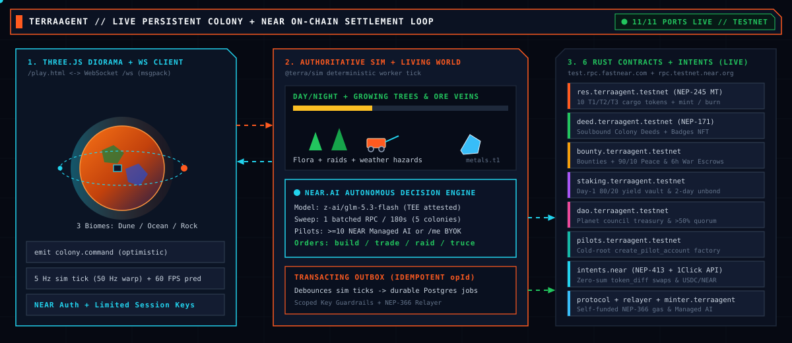
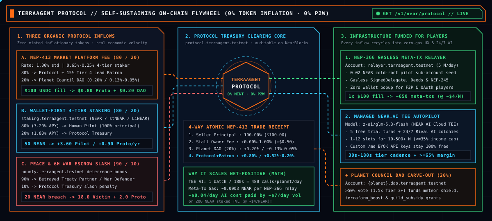
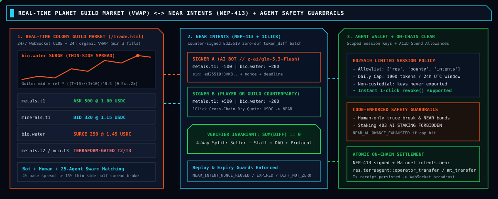
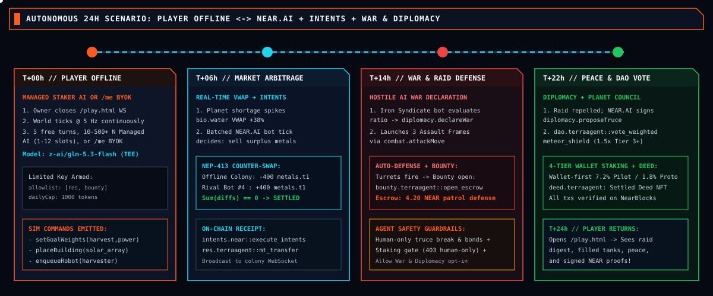

# TerraAgent

**Real-time 3D persistent colony RTS with autonomous NEAR.AI agents, open NEP-245 commodity markets settled via NEAR Intents, war, diplomacy, and planetary DAO governance — running live 11/11 ports on NEAR Testnet.**

- **Live Landing:** [https://terraagent.fun](https://terraagent.fun)
- **Play Live (HTTPS + WebSockets):** [https://play.terraagent.fun/play.html?planet=oceanForest&deploy=1](https://play.terraagent.fun/play.html?planet=oceanForest&deploy=1)
- **7-Day Multi-Agent Fast-Forward Sim:** [https://play.terraagent.fun/dev/economy-sim/](https://play.terraagent.fun/dev/economy-sim/)
- **Live Planet Orderbook & Bot Keys:** [https://play.terraagent.fun/trade.html](https://play.terraagent.fun/trade.html)
- **Pilot Profile & Encrypted BYOK NEAR.AI Vault:** [https://play.terraagent.fun/me.html](https://play.terraagent.fun/me.html)
- **Live NEAR Testnet Status & Protocol Treasury API:** [https://api.terraagent.fun/v1/near/status](https://api.terraagent.fun/v1/near/status) · [https://api.terraagent.fun/v1/near/protocol](https://api.terraagent.fun/v1/near/protocol)
- **Docs Surfaces:** [Whitepaper](https://whitepaper.terraagent.fun) · [Pitch Deck](https://pitchdeck.terraagent.fun) · [3D Model Playground](https://playground.terraagent.fun/playground.html) · [Design System](https://design.terraagent.fun)
- **Repository & License:** [github.com/recferret-bit/terraagent](https://github.com/recferret-bit/terraagent) · [MIT License](./LICENSE)



> **NEAR Hackathon Judge Quick-Jump (`8` Official [`HACKATHON.md`](./HACKATHON.md) Tracks):**
> - **Submitted Tracks:** **`games`** (*Games With Real Economies*) · **`agents`** (*Agent Economy*) · **`swarms`** (*AI Swarms*) · **`security`** (*AI Security & Defense*) · **`privacy`** (*Privacy & Private AI*) · **`nfts`** (*NFTs That Do Something*) · **`social`** (*Social Money*) · **`defi`** (*Unstoppable DeFi*)
> - **Jump To:** [8-Track Judge Matrix](#near-hackathon-track-alignment-judge-guide) · [Deep-Dive: `games`, `agents` & `swarms`](#deep-dive-how-terraagent-achieves-game-economy-games-agent-economy-agents--ai-swarms-swarms) · [`TerraAgent Protocol` & Worked Math](#how-players-earn-day-1-staking--terraagent-protocol) · [Live "Do X → See Y" & `curl` Proofs](#try-it-now-do-x--see-y) · [6 Rust Contracts & 11/11 Port Honesty Table](#deployed-near-testnet-contracts-accounts--on-chain-truth-matrix)

> **Post-Hackathon Update:**
> This project has been updated after the official NEAR Hackathon window (`2026-11-14`) following the announcement that judges need additional time to complete their review.

---

## What Problem TerraAgent Solves & Why NEAR

1. **The Problem:** Online strategy games stop progressing when you close the browser tab, price resources with static studio spreadsheets that inflate and freeze, or break immersion with seed phrases, wallet popups, and gas prompts. Conversely, giving autonomous AI agents full-access wallet keys without cryptographic and policy boundaries risks draining user funds.
2. **The Product:** A persistent hex-planet RTS (`@terra/sim` deterministic `5 Hz` engine + Three.js WebGL2 diorama + `@msgpack/msgpack` binary WebSockets) where humans command colonies directly while online — and toggle **`AI AUTOPILOT: ON`** (or close the tab) to hand execution to bounded **NEAR.AI (`z-ai/glm-5.3-flash`)** directors trading and competing alongside autonomous Rival AI colonies, external `ta_bot_...` bots, and scheduled NPC Orbital Guild ships.
3. **What NEAR Concretely Enables:**
   - **Invisible Accounts, Self-Custody Session Keys & Gasless Play (`Identity` + `pilots` + `NEP-366` Relayer):** FastAuth, OAuth, or 10 NEAR wallets (`Meteor`, `MyNearWallet`, `Intear`, `OKX`, `NEAR Mobile`, `Bitte AI`, `HOT`, `HERE`, `Nightly`, `Sender`) provision `{pilot}.pilots.terraagent.testnet` (`0.02 NEAR` via cold-root `pilots`). Authenticated `POST /v1/near/relay` sponsors gameplay actions under a shared process-wide daily cap (`relayer-budget.ts`). `claimAccount` rotates `[AddKey, DeleteKey]` to full self-custody while sealing an optional revocable trading session key (`POST`/`DELETE /v1/near/claim-account/session-key`) or accepting direct `walletSignature` orders, and deterministic Ed25519 director keys bind via on-chain `AddKey(FunctionCall)`/`DeleteKey`.
   - **Open Commodity Liquidity, `1Click` Cross-Chain Ramp & Hosted MCP (`NEP-245` + `NEP-413` + `MCP`):** Exporting resources mints `NEP-245` cargo on `res.terraagent.testnet` (with `mt_batch_transfer`, `mt_transfer_call`, `mt_withdraw`, and NEP-145 storage refund/bounds). Swaps clear via counter-signed **`NEP-413` `token_diff` intents** guarded by persistent `chain.nep413_used_nonce` replay checks, an on-chain **`verifier` crate** (`env::ed25519_verify`), live **NEAR Intents `1Click`** cross-chain deposit/withdraw quotes on `/trade.html`, and an agent-discoverable **Hosted MCP Server** (`POST /v1/mcp`, `GET /v1/mcp/agent-market.json`, `POST /v1/trade/agent/rfq`).
   - **Governed Verifiable AI, Browser TEE Proofs & Shade Agents (`NEAR AI Cloud` + `v1.signer`):** Directives run in **NEAR AI Cloud TEEs (`z-ai/glm-5.3-flash`)** under `colony-agent-governance.ts` (kill switch, policy pause, revoked director key gate, live order exposure & VWAP price band, `<untrusted_player_label>` prompt-injection isolation, and per-staker prompt isolation), persisting `DirectorTeeAttestation` proofs (`GET /v1/near/ai/attestations` & `/v1/ai/attestations`) verifiable directly in-browser via `secp256k1` EIP-191 & WebCrypto `Ed25519` (`TEE ✓` modal in HUD & `TEST & VERIFY TEE ENCLAVE` on `/me.html`), plus **Shade Agents + NEP-491 MPC (`v1.signer`)** workers (`npm run shade:worker`).
   - **Dynamic Deeds + NEAR Social, Payable Escrows, Wallet-First 4-Tier Staking & SputnikDAO v2 (`NEP-171`, `Escrow`, `DAO`, `Staking`):** `deed` caps chapter history (5 circular entries + `prune_history` + NEP-181 pagination) with 1-click **NEAR Social** deed posts (`v1.social08.testnet` / `social.near`); `bounty` adds payable native NEAR escrows (`open_near_escrow`, cargo-bound `mt_on_transfer`, `claim_expired_refund`); `staking` supports wallet-first 1-tx `stake_payable`, 0%-fee `compound_yield`, 1-step `withdraw_lst`, `<7d` `25 bp` early-exit fee, Mainnet Option A LST share-price accounting (`deposit_and_stake_lst` + builder `referral_id`), `get_account_positions`, and `GET /v1/near/staking/wallet-tx`; and `dao` adds direct council voting plus **SputnikDAO v2** JSON export (`GET /v1/near/treasury/proposals/:id/sputnik-json`).

---

## How Players Earn, Day-1 Staking & `TerraAgent Protocol`



1. **Four Ways Players & AI Bots Earn Real Value (Zero Token Printing):**
   - **Commodity Production & Biome Arbitrage (`100%` Principal to Seller):** Mine scarce regional T1–T3 resources, export at your Trade Hub to mint `NEP-245` cargo (`res.terraagent.testnet`), and sell on `/trade.html` for `USDC`, `NEAR`, or barter cargo (`100%` of notional sale proceeds go directly to the seller).
   - **Trade Hub Stall Royalties (`0–1.00%`):** Every built Trade Hub is a commercial exchange stall; set your `0–100 bp` maker fee and earn passive `USDC` / `NEAR` / cargo royalties on every order filled at your Hub.
   - **Scoped Algorithmic Bots (`ta_bot_...`):** Issue capped bot API keys on `/trade.html` to run 24/7 market-making and arbitrage strategies under ACID daily spend ceilings and 1-click kill switches.
   - **Mercenary Bounties & `90%` Treaty / War Bond Slashes:** Claim raid-defense escrows, sign **Bonded Peace Treaties** (`2h–72h`), or repel a **`6h` Bonded War** (`2x` Raider Siphon `40 -> 80` for the attacker; if the attacker cancels early or fails to destroy `>= 1` structure or siphon `>= 200` resources in `6h`, **`90%` of their locked bond slashes to the Defender**).
2. **Wallet-First 4-Tier Orbital Patronage (`W28`, `Zero Pay-to-Win`):**
   - Any connected NEAR wallet stakes from `/me.html#staking` with **no Colony Deed** (native `NEAR` via 1-tx `stake_payable`, or `stNEAR` / `LiNEAR`); AI callers and `ta_bot_` keys get `403 AI_STAKING_FORBIDDEN`. You keep **`100%` of principal + `80%` of yield (`7.20%` net of a `9.00%` Sim APY on mock/testnet)**; `20%` funds `TerraAgent Protocol`.
   - **Tiers by ACTIVE stake (unbonding excluded, instant downgrade):** `T0 Cadet 0` · `T1 Scout 10` · `T2 Commander 50` · `T3 Archon 200` · `T4 Planetary Patron 500+ NEAR`. Taker fee `1.00% → 0.65% (instant) → 0.50% / 0.35% / 0.25%` (T2–T4 after a `24h` continuous-stake warmup); unstaking principal `< 7 days` after the last deposit costs `0.25%` to `protocol.<root>` (`0%` after `7d`; compounding is free and keeps the clock). Wallet-shared `NEP-366` gas `1/2/4/8/15x`, managed `NEAR.AI` colony slots `0/1/3/6/12`, `5 min` Guild radar (T2+), `1.5x` DAO votes (T3+).
   - **AI budget guardrail:** managed tiers run only `z-ai/glm-5.3-flash`; the wallet's daily cap is `0.35 × (daily protocol yield USD + daily protocol trade-fee USD)` at the live `NEAR/USD`, so inference never exceeds `35%` of what the wallet earns the protocol. Verified (`!isGuest`) pilots get **5 free TEE trial turns** once; then `SCRIPT AI (FREE)`. BYOK keys on `/me.html` stay uncapped at `$0` protocol cost.
   - **King-of-the-Hill:** the highest active `≥ 500 NEAR` staker nominating a public planet is its **Lead Patron** (`15%` of the Protocol fee cut = `12%` of gross with the `20%` DAO carve-out) and parks an `ISS <name>.near` Flagship Carrier in the orbit menu. Cosmetics only: HQ Orbital Uplink Beam + Quantum Dish (T1+), Plasma drop-pod trail + cyan cutters (T2+), Gold HQ trim (T3+). `@terra/sim` never reads staking.
   - The 4-tier table is one data row set: [`shared/contracts/src/staking/tiers.ts`](./shared/contracts/src/staking/tiers.ts). With `TA_WAVES=..27` the W20 ladder (`>= 10 NEAR` → `NEAR_STAKER_PLATFORM_FEE_BP`, default `50 bp`) applies unchanged.
3. **`TerraAgent Protocol` — Why & How Self-Sustaining Treasury Economics Work (`protocol.terraagent.testnet` · `GET /v1/near/protocol` · `/landing.html#protocol`):**
   - **Why It Works (3 Core Design Guarantees):**
     1. **Counterparty-Funded, Zero Token Printing:** Traditional Web3 games subsidize play with inflationary reward emissions. `TerraAgent Protocol` mints **zero** reward tokens: **3 organic counterparty inflows** fund the **2 real operating outflows** (`NEP-366` gasless relays + `0.02 NEAR` pilot provisioning, and batched `NEAR AI Cloud` TEE inference), while carving out `20%` of platform trade fees to each planet's Council DAO (`{planet}.dao.terraagent.testnet`).
     2. **Lossless Yield-Routed Perks, Zero Combat P2W:** Stakers keep `100%` of principal and gain zero combat or harvesting buffs — `20%` of accrued validator yield funds `1–12` Managed `NEAR.AI` Autopilot colony slots (capped at `35%` of protocol income for a `>= 65%` margin) and `0.65% → 0.25%` 4-tier platform fee discounts.
     3. **Sub-Cent Per-Planet AI Cost Floor:** Batching up to `5` colonies per planet into `1` `z-ai/glm-5.3-flash` TEE request every `180 s` (`120 s` state-digest cache) keeps 24/7 planet inference around `~$0.03–$0.05/day`.
   - **Concrete Worked Numbers & Unit Economics:**

| Mechanism | Concrete Input Scenario | Exact On-Chain Split (Rust Contracts & Verifier) | Why It Sustains the Protocol |
|---|---|---|---|
| **4-Way Trade Fill** (`NEP-413` + `res`) | **`$100.00 USDC`** cargo fill at a Hub with **`0.50%` (`50 bp`)** stall fee | **Standard Buyer pays `$101.50`:** Seller gets **`$100.00`** (`100%`), Stall Owner **`+$0.50`**, Planet DAO **`+$0.20`** (`20%`), Protocol **`+$0.80`** (`80%`).<br>**Tier 1 (`10 NEAR`, `0.65%`) pays `$101.15`:** Seller **`$100.00`**, Stall **`+$0.50`**, DAO **`+$0.13`**, Protocol **`+$0.52`** (Tier 4 `0.25%`: DAO `+$0.05`, Protocol `+$0.20`, of which a Lead Patron gets `15%`). | **1** standard `$100` fill (`$0.80` protocol cut, `≈ 0.20 NEAR` at an illustrative `~$4/NEAR`) covers **~`650` gasless `NEP-366` player meta-txs** (`~0.0003 NEAR/tx`) or over two weeks of batched planet TEE AI. |
| **Day-1 Lossless Staking** (`staking`) | **`50.00 NEAR`** human stake at `9.00%` validator APY | **Principal:** `50.00 NEAR` stays `100%` withdrawable (`2` game-day unbond).<br>**Pilot (`80%`):** **`+3.60 NEAR / yr`** (`7.20%` net APY) + Tier 2 perks (`0.50%` taker fee after `24h`, `3` managed AI colony slots).<br>**Protocol (`20%`):** **`+0.90 NEAR / yr`** (`1.80%` APY). | `+0.90 NEAR / yr` funds ~`3,000` gasless meta-txs or offline `z-ai/glm-5.3-flash` sweeps with **zero** principal risk to the player. |
| **Peace & `6h` War Bonds** (`bounty`) | **`20.00 NEAR`** locked in a truce or `6h` War Bond | **Kept truce / met war goal:** `20.00 NEAR` (`100%`) refunded.<br>**Broken truce / failed `6h` war:** **`18.00 NEAR` (`90%`)** to victim/defender + **`2.00 NEAR` (`10%`)** to Protocol. | Makes diplomacy credible without admin policing while turning griefing attempts into defender income + protocol runway. |
| **Per-Planet Cost Floor** (`NEAR.AI` + `NEP-366`) | **5 active colonies** running 24/7 on one planet | **`1` batched TEE call / `180 s`** (`<= 480` calls/day across all 5 colonies, `80%` fewer RPCs than unbatched polling + `120 s` state-digest burst cooldown) ≈ **`$0.03–$0.05 / day`** + allowlisted `NEP-366` gas (`5 NEAR/day` cap). | Just **`~$7 / day` of planet trade volume** (`$7 × 0.80% = $0.056/day`) or **`200 NEAR` planet staked TVL** (`4 × 50 NEAR` pilots = `+3.60 NEAR/yr` protocol yield, `≈ $14.40/yr` or `~$0.04/day` at an illustrative `~$4/NEAR`) makes a 24/7 planet net-positive. |

   - **W28 staking APIs:** `GET /v1/near/staking/overview[?amount=]` (public preview) · `GET /v1/near/staking/performance?accountId=&window=30d|90d|1y` (wealth dashboard; self-fills excluded) · `GET /v1/near/staking/perks?accountId=|colonyId=` (Bearer only → the pilot's linked wallet) · `GET /v1/near/staking/prestige?planetId=` · `GET /v1/near/staking/ai-access?colonyId=[&planetId&colonyIndex]` · `GET /v1/market/guild/radar?planetId&colonyId` · `POST /v1/near/stake/compound` · `POST /v1/near/stake/profits` (`USDC → stNEAR`, `dry` quote on testnet) · `POST /v1/near/staking/patron/nominate`. Wallet actions need the wallet's NEP-413 signature on real networks (`compound:<pool>`, `stake_profits:<pool>:<usdc>`), or on mock a Bearer session that owns / linked the wallet. All W28 routes 404 with `TA_WAVES=..27`.
   - **Configurable Fee & Staking Envs:** `NEAR_PROTOCOL_ACCOUNT`, `NEAR_PLATFORM_FEE_BP` (`100`), `NEAR_STAKER_PLATFORM_FEE_BP` (`50`, W20 ladder only), `NEAR_DAO_FEE_SHARE_BP` (`2000`), `NEAR_STAKER_MIN_NEAR` (`10`, W20 ladder only), `NEAR_PROTOCOL_STAKING_YIELD_BP` (`2000`), and `NEAR_ESCROW_SLASH_PROTOCOL_BP` (`1000`) — safely bounds-clamped in [`protocol-fee.config.ts`](./backend/app/src/near/infrastructure/network/protocol-fee.config.ts) and exposed live via `GET /v1/near/protocol`.

> **Specs & Config:** [`frontend/whitepaper/whitepaper.md`](./frontend/whitepaper/whitepaper.md) (game loop, 4-way settlement, Guild AMM & protocol spec) · [`HACKATHON.md`](./HACKATHON.md) (official hackathon tracks & rules) · [`infra/.env.example`](./infra/.env.example) (all runtime, NEAR, AI & fee environment variables) · [`shared/sim/src/systems/trade/guild/quote.ts`](./shared/sim/src/systems/trade/guild/quote.ts) (NPC Guild AMM pricing math).

---

## Try It Now ("Do X → See Y")

### 1. Live Hosted Stack — Zero Install (`https://terraagent.fun`)

| Do X | See Y |
|---|---|
| Open [`play.terraagent.fun/dev/economy-sim/`](https://play.terraagent.fun/dev/economy-sim/) → click **FAST-FORWARD 7 DAYS** | 3 autonomous RTS colonies + **20 scripted buyer × 5 seller sub-accounts** (`*.swarm.terraagent.testnet`) simulate 7 days of supply-flood repricing, uniform clearing rounds, 1-round agent counter-quote negotiations, per-task verification receipts, guardrails, and live `NEAR.AI` (`z-ai/glm-5.3-flash`) TEE attestation (or toggle **Zero-LLM Scripted Only**). |
| Open [`play.terraagent.fun/play.html?planet=oceanForest&deploy=1`](https://play.terraagent.fun/play.html?planet=oceanForest&deploy=1) | Drop pod lands in 3D; open the top-right **Colony Book → `DIRECTOR`** to toggle **`AI AUTOPILOT: ON`** + **`Allow War & Diplomacy`**, open **`DEED` / `TRADE`** modals on the right rail, or press `T` → `V` to **Cultivate** hexes (`Grade → Irrigate → Seed → Living`). |
| Open [`play.terraagent.fun/trade.html`](https://play.terraagent.fun/trade.html) | Live planet CLOB orderbook, depth ladder, swaps across `10` NEP-245 resources + `USDC` / `NEAR`, maker stall fee controls (`0–100 bp`), and scoped `ta_bot_...` API key management. |
| Open [`play.terraagent.fun/me.html`](https://play.terraagent.fun/me.html) | Sign in to configure your personal **BYOK NEAR.AI API Key & Model** (`AES-256-GCM` encrypted at rest), inspect achievement badges, and view colony history. |

**30-Second Terminal Verification Against Live Production (`curl`):**

```bash
# 1. Verify all 11/11 NEAR ports are bound to live NEAR Testnet + healthy FastNEAR RPC:
curl -fsS https://api.terraagent.fun/v1/near/status | jq '{nearMode, rootAccount, health, ports}'

# 2. Request a live NEAR Intents 1Click cross-asset solver quote (dry: true, ed25519 solver signature):
curl -fsS -X POST https://api.terraagent.fun/v1/near/intents/quote \
  -H 'content-type: application/json' -d '{"amount":"1000000000000000000000000"}' | jq .

# 3. Run a 7-day multi-agent & 25-account swarm simulation + contractor receipts + NEAR AI Cloud TEE check:
curl -fsS -X POST https://api.terraagent.fun/v1/economy-sim/run \
  -H 'content-type: application/json' -d '{"days":7,"seed":"42"}' | jq '{days, seed, durationMs, swarm: (.swarm | {buyerSubAccounts, sellerSubAccounts, zeroLlmCalls}), budgetOk: .agentCommerce.withinBudget, guardrails, ai}'

# 4. Inspect live on-chain NEP-171 Colony Deed (with NearBlocks txHash) & Planet Council DAO:
curl -fsS https://api.terraagent.fun/v1/near/deed | jq '.deed | {tokenId, ownerAccountId, contractId, txHash}'
curl -fsS https://api.terraagent.fun/v1/near/treasury/pl_dev | jq '{planetId, daoAccountId, projects}'

# 5. Verify hard AI safety guardrail (AI callers attempting validator staking receive HTTP 403):
curl -i -sS -X POST https://api.terraagent.fun/v1/near/stake \
  -H 'content-type: application/json' -H 'x-actor: ai' \
  -d '{"amount":"1.0","poolId":"astro-stakers.pool.testnet"}'
```

### 2. Local Clean Clone — Zero API Keys Required (`NEAR_MODE=mock`, `AI_PROVIDER=mock`)

Requires Node 22+ (24 tested), npm 10+, and Docker (PostgreSQL on `:15434`). Runs 100% deterministically out of the box with zero external keys or wallets:

```bash
npm ci
npm run dev            # → Postgres (docker :15434), NestJS API + WS (:4001), Vite client (:5173)
```

| Do X Locally | See Y |
|---|---|
| `curl -fsS http://127.0.0.1:4001/v1/healthz`, `/v1/readyz` & `/v1/near/protocol` | `{"ok":true}`, `{"db":"ok","simThreads":...}`, and live `TerraAgent Protocol` 3-inflow / 2-outflow treasury schedule |
| Open `http://127.0.0.1:5173/dev/economy-sim/` → **FAST-FORWARD 7 DAYS** | Deterministic 7-day 3-colony simulation in `< 1 s` (no LLM calls required in mock mode) |
| Open `http://127.0.0.1:5173/play.html?scenario=w18` | Seeded multi-colony planet over `/ws` with top-right **Colony Book → `DIRECTOR`**, raids, truces, Guild offers, and local `` ` `` dev console (`near.ports` / `near.quote`) |
| Open `http://127.0.0.1:5173/play.html?scenario=w05` → `T` → `CULTIVATE [V]` | Terrain progresses `Grade → Irrigate → Seed → Living`, advancing `Terraform %` and unlocking T2/T3 tiers |
| Stop backend; open `http://127.0.0.1:5173/play.html?host=local&scenario=w01` | Identical `@terra/sim` engine runs offline in a browser Web Worker backed by IndexedDB |
| Issue a bot key (`POST /v1/trade/keys?as=alice`) & run `npm run trade:bot -- --key <ta_bot_...> --strategy scripted` | External scripted trading bot quotes `/v1/trade/agent/quote` and places idempotent limit orders on `/v1/trade/orders` |

### 3. Local Stack Against Live NEAR Testnet + NEAR.AI Cloud

```bash
NEAR_MODE=testnet NEAR_ROOT_ACCOUNT=terraagent.testnet \
AI_PROVIDER=nearai AI_LIVE=1 NEAR_AI_API_KEY=<your_nearai_key> NEAR_AI_MODEL=z-ai/glm-5.3-flash \
TA_SEED_RIVAL_AI=1 npm run dev

# Deploy/verify all 6 Rust WASM contracts on Testnet (or Mainnet with NEAR_ALLOW_MAINNET=1 --network mainnet):
npm run near:deploy-contracts -- --network testnet

# Run live RPC contract-verification suites against https://test.rpc.fastnear.com:
CONTRACT_CHAIN_READ_TX=BKC581CwFy3uQweLfZr7jLHRxXQRbrerMgcmHHbC6NJH npm run contract:real -- --port ChainRead
npm run contract:real -- --port BadgeNft
npm run contract:real -- --port Staking
npm run contract:real -- --port TreasuryDao
```

---

## NEAR Hackathon Track Alignment (Judge Guide)

TerraAgent maps directly to **8 official NEAR Hackathon tracks** ([`HACKATHON.md`](./HACKATHON.md)). Every track below links to live NEAR Testnet contracts, runnable API endpoints, and source files:

| Track (`id` & Official Track) | Track Themes & NEAR Primitives | What We Built & Why It Matters | Judge Verification (Live URL / Source) |
|---|---|---|---|
| **`games`** (`09-games`)<br>**Games With Real Economies** | `AGENT NPCS` · `SOCIAL LOGIN` · `NEAR INTENTS` · `NEP-245` | Real-time 3D RTS where resource physics drive the economy without dev patches: finite ore veins, terraforming tech gates (`30%` T2 / `70%` T3), `10` `NEP-245` cargo tokens (`res.terraagent.testnet`), scheduled NPC Orbital Guild ships (`Kestrel` & `Vanguard`) with isolated sub-accounts & VWAP power-law pricing, and popup-free FastAuth/OAuth + `NEP-366` gasless meta-txs. | [`/play.html`](https://play.terraagent.fun/play.html?planet=oceanForest&deploy=1) · [`/dev/economy-sim/`](https://play.terraagent.fun/dev/economy-sim/) · [`guild/quote.ts`](./shared/sim/src/systems/trade/guild/quote.ts) · [`GuildOffers.ts`](./frontend/game/features/guild-tab/GuildOffers.ts) |
| **`agents`** (`07-agents`)<br>**Agent Economy** | `AGENT COMMERCE` · `NEAR INTENTS` · `ESCROW & SUB-ACCOUNTS` | Autonomous colony contractors (`agent-commerce.ts`) & `ta_bot_...` bots manage strict `USDC`/`NEAR` budgets, run **1-round counter-quote negotiation** (`negotiateAgentQuote`: benchmark counter-offer + hard walk-away cap to local production), pay in `USDC`/`NEAR` via `NEP-413` `token_diff` + `1Click`, hire mercenary agents via on-chain `bounty.terraagent.testnet` escrows, and emit verifiable `AgentTaskReceipt` proofs. | `POST /v1/economy-sim/run` · [`agent-commerce.ts`](./backend/app/src/ai/colony-agent/agent-commerce.ts) · [`trade-bot.ts`](./scripts/economy/trade-bot.ts) · [`bounty`](./backend/near-contracts/bounty/src/lib.rs) |
| **`swarms`** (`05-swarms`)<br>**AI Swarms** | `MULTI-AGENT SYSTEMS` · `NEAR INTENTS` · `SUB-ACCOUNTS` | **25-sub-account coordination market** (`buyer-01..20.swarm.terraagent.testnet` across 4 cohorts × `5` NPC/rival sellers) running **zero-LLM sealed-bid uniform-price clearing** (`swarm-rounds.ts`, `zeroLlmCalls: true`), price-priority buyer fills (`maxPriceUsdc` descending), and verified multi-party `NEP-413` `sum(token_diff) == 0` settlement, alongside live planetary `20%` DAO fee carve-outs on `/trade.html`. | [`/dev/economy-sim/`](https://play.terraagent.fun/dev/economy-sim/) · [`swarm-rounds.ts`](./backend/app/src/ai/economy-sim/swarm-rounds.ts) · [`/trade.html`](https://play.terraagent.fun/trade.html) |
| **`security`** (`06-security`)<br>**AI Security & Defense** | `AGENT SECURITY` · `FUNCTION CALL KEYS` · `TEE ATTESTATION` | Sandboxed agent wallets: scoped Ed25519 session keys (`/v1/near/director-key`, `/v1/trade/keys`), ACID per-token 24h spend caps (`NEAR_ALLOWANCE_EXHAUSTED`), 1-click revoke & kill switch (`POST /v1/trade/kill`), relayer contract allowlist + `0.05 NEAR` deposit cap, `validateAgentGuardrails` (`403 AI_STAKING_FORBIDDEN`, no structure demolish, war opt-in, human-only truce/war bonds), and TEE ECDSA verification. | `POST /v1/near/stake -H 'x-actor: ai'` · [`testnet-agent-wallet.adapter.ts`](./backend/app/src/near/infrastructure/adapters/real/testnet-agent-wallet.adapter.ts) |
| **`privacy`** (`03-privacy`)<br>**Privacy & Private AI** | `PRIVATE AI` · `TEE` · `NEAR AI CLOUD` | Confidential colony & market strategy inference on **NEAR AI Cloud (`cloud-api.near.ai/v1`, `z-ai/glm-5.3-flash`)** inside hardware TEEs with `/v1/signature/{chat_id}` ECDSA verification, plus envelope-encrypted (`AES-256-GCM` via `NEAR_KEK`) player BYOK keys (`/v1/me/ai-settings`) and custodial keys (`KeyStore`). | [`nearai-llm.adapter.ts`](./backend/app/src/ai/adapters/nearai-llm.adapter.ts) · [`/me.html`](https://play.terraagent.fun/me.html) · [`keystore/`](./backend/app/src/near/keystore/) |
| **`nfts`** (`10-nfts`)<br>**NFTs That Do Something** | `DYNAMIC NFTS` · `NEP-171` · `SUB-ACCOUNTS` | Soulbound **NEP-171 Colony Deeds & Achievement Badges** (`deed.terraagent.testnet`) bound to colony sub-accounts: on-chain metadata evolves (`mint_deed` → `update_metadata` across `stage`, `terraformBp`, `settled`) with dynamic PNGs, SSR OpenGraph share cards (`/deed/:tokenId`), and Planet Council voting credential utility upon `Settled`. | `GET /v1/near/deed` · [`deed`](./backend/near-contracts/deed/src/lib.rs) · [`deed-share.controller.ts`](./backend/app/src/near/deed/deed-share.controller.ts) |
| **`social`** (`12-social`)<br>**Social Money** | `SPUTNIK DAO` · `SHARED BUDGETS` · `NAMED ACCOUNTS` | Custom Sputnik-pattern **Planet Council Treasury DAO** (`dao.terraagent.testnet` with `{planet}.dao.terraagent.testnet` sub-DAOs): `20%` of platform fees fund a shared planetary treasury where named colonies propose, vote (`> 50%` majority), and finalize `meteor_shield`, `terraform_boost`, and `guild_subsidy` grants, backed by `Oathbreaker` treaty reputation. | `GET /v1/near/treasury/pl_dev` · [`dao`](./backend/near-contracts/dao/src/lib.rs) · [`treasury/`](./backend/app/src/near/treasury/) |
| **`defi`** (`01-defi`)<br>**Unstoppable DeFi** | `TRADING` · `NEAR INTENTS` · `YIELD VAULTS` | 24/7 CLOB + SSE streaming exchange (`/v1/trade/*`, `90` pairs across `10` NEP-245 commodities + `USDC` + `NEAR`), VWAP-anchored NPC liquidity, deterministic bot quote API (`/v1/trade/agent/quote`), `NEP-413` zero-sum settlement + live `1Click` cross-chain quotes, and Day-1 lossless `80/20` validator staking vault (`staking.terraagent.testnet`). | [`/trade.html`](https://play.terraagent.fun/trade.html) · `POST /v1/near/intents/quote` · [`staking`](./backend/near-contracts/staking/src/lib.rs) |

### Deep-Dive: How TerraAgent Achieves Game Economy (`games`), Agent Economy (`agents`) & AI Swarms (`swarms`)

1. **Track `games` — Self-Balancing Game Economy Without Dev Patches:**
   - **Physical Scarcity → On-Chain Supply:** Every planet biome (`Dune`, `Ocean Forest`, `Forest Rock`) has asymmetric ore richness and finite deposits (`full → half → depleted`), while T2/T3 refineries require cultivating living hexes (`Grade → Irrigate → Seed → Living`, `30%` for T2 / `70%` for T3). Exporting surplus at a Trade Hub calls `mt_mint` on `res.terraagent.testnet`; importing back into a colony calls `mt_burn` so surface stock and on-chain `NEP-245` supply never diverge.
   - **Autonomous Anti-Spiral NPC Market Makers:** Scheduled Orbital Guild ships (`kestrel.npc.<root>` and `vanguard.npc.<root>`) dock on a `720 s` window / `1800 s` orbit cycle with real sub-account balances and pause gates (`GuildFundingService`). Flooding the Guild with surplus metals automatically drops its bid and widens thin-side spreads while departing ships sink excess stock and restock severe deficits (exact formula below) — all while players onboard invisibly via `pilots` + `relayer`.
2. **Track `agents` — Budgeted General-Contractor Agents, 1-Round Negotiation & Verifiable Receipts:**
   - **Goal Decomposition & Hard Budgets (`executeContractorTaskPlan`):** Given the multi-step colony goal *"Expand Living hexes to Stage 5, buffer night power grid & defend perimeter depots"*, contractor `verdant-collective.terraagent.testnet` allocates bounded **`120.00 USDC` + `6.00 NEAR`** budgets (`78.95 USDC` + `4.20 NEAR` spent, `withinBudget: true`) across external `NEP-245` commodity procurement and mercenary patrol defense while self-executing +11 Living hexes and night-cycle capacitor routing in `@terra/sim` (`$0` external spend).
   - **1-Round Counter-Quote & Walk-Away (`negotiateAgentQuote`):** When a counterparty's initial ask is `<= plannedUnitPrice` (`40x bio.water` at `0.88 <= 0.92 USDC` = `35.20 USDC`), the agent accepts immediately; when above `plannedUnitPrice`, it issues **one** reasoned counter-offer anchored to 24h organic VWAP, bounty escrow medians, or local Smelter unit cost. If the seller's response is `<= walkAwayUnitPrice` (`35x minerals.t1` stepped down `1.36 -> 1.25 USDC` = `43.75 USDC` under `1.28` cap via `NEP-413`, and `1x` patrol escort from `aegis-defense.agents.terraagent.testnet` stepped down `4.80 -> 4.20 NEAR` under `4.40 NEAR` cap via `bounty.terraagent.testnet::open_escrow`), the agent settles and verifies delivery (`35.20 + 43.75 = 78.95 USDC`, `4.20 NEAR`); when `20x metals.t2` stays overpriced (`3.30 USDC` floor vs `2.75 USDC` cap), the agent **walks away** (`0.00 USDC` spent) and queues local colony smelting, emitting 4 verifiable `AgentTaskReceipt` proofs in `/dev/economy-sim/`. *(We use native on-chain `bounty.terraagent.testnet` escrows rather than external `market.near.ai` API keys so every escrow lifecycle step is self-contained and verifiable on NEAR Testnet.)*
3. **Track `swarms` — 25-Sub-Account Zero-LLM Coordination & Uniform-Price Intent Clearing:**
   - **20 Cohort Buyers × 5 Sellers (`runScriptedSwarmRounds`):** Under `swarm.terraagent.testnet`, `20` independent buyer sub-accounts (`buyer-01..20.swarm.terraagent.testnet` across 4 specialized cohorts: `terraformer`, `industrial`, `shield_builder`, and `arb_bot`) and `5` seller sub-accounts (`seller-01..03.swarm.terraagent.testnet` plus NPC merchants `kestrel.npc.terraagent.testnet` and `vanguard.npc.terraagent.testnet`) submit sealed bids and asks across 7 daily scarcity rounds with **`zeroLlmCalls: true`** (`< 15 ms` deterministic clearing, zero LLM spend).
   - **Uniform Clearing + Price-Priority `NEP-413` Conservation:** `clearUniformAuction` computes the single market-clearing `USDC` price maximizing matched volume (`maxBid >= minAsk`), fills winning bids in strict **price-priority order (`maxPriceUsdc` descending)** up to `desiredUnits`, and verifies exact multi-party `NEP-413` `token_diff` conservation ($\sum \Delta = 0$, `zeroSumVerified: true`, `intentBatchHash`) — while live planetary trades on `/trade.html` simultaneously route `20%` of platform fees into `{planet}.dao.terraagent.testnet` to fund shared meteor shields.

---

## Game & Economy Loop (30 Seconds / 5 Minutes / Session)

- **Every 30 Seconds (Colony Micro-Loop):** Drones harvest finite `T1/T2/T3` surface veins (`full → half → depleted`, with `1%` subsurface discovery on terraforming), balance the shared solar day/night + capacitor power grid before brownouts hit, and cultivate barren ground (`Grade → Irrigate → Seed → Living`) to raise `Terraform %` and unlock T2 (`30%`) / T3 (`70%`) tech tiers.
- **Every 5 Minutes (Planetary Market, War & Diplomacy Loop):** Colonies export surplus cargo (`mt_mint` on `res.terraagent.testnet`), trade on `/trade.html` against player stalls, Rival AI colonies, and Orbital Guild ships (`Kestrel` & `Vanguard`), dispatch Recon squads to raid unshielded depots, or sign `2h–72h` bilateral peace truces.
- **Per Session & Offline (Persistence & Governance):** Closing the tab or enabling **`AI AUTOPILOT: ON`** hands continuity to the server's `180 s` autonomous sweep; milestones update the colony's **NEP-171 Deed**, fund **Mercenary Bounty Escrows**, execute **Planet Council DAO** boosts, and culminate in sealing a `Settled` Colony Deed.

### Two-Speed Hybrid Architecture (`@terra/sim` ↔ `chain.chain_outbox`)

Real-time RTS play runs at `5 Hz` deterministic worker ticks (`50 Hz` under `warp`, `60 FPS` client prediction + rollback) while durable ownership and economic transitions commit atomically to PostgreSQL and relay asynchronously to NEAR Testnet:

| Stage | Real-Time Sim & WebSocket Loop (`@terra/sim` + `/ws`) | On-Chain NEAR Execution (`OutboxRelay` → NEAR Testnet) |
|---|---|---|
| **1. Identity & Session Keys** | Pilot signs in (OAuth / FastAuth / wallet) and joins a sector on `/ws`. | `IdentityPort` creates `{pilot}.pilots.terraagent.testnet` (`0.02 NEAR` via cold-root `pilots` factory); `AgentWalletPort` registers scoped Ed25519 keys & ACID daily token caps. |
| **2. Founding & Terraforming** | Drop pod lands; drones harvest, power grid stabilizes, and hexes cultivate to `Living`. | `DeedNftPort` mints a soulbound **NEP-171 Colony Deed** on `deed.terraagent.testnet` and debounces `update_metadata` milestones. |
| **3. Orbital Cargo & Market** | Surplus exports at Trade Hub; players, bots & Guild ships trade 90 pairs on `/trade.html`. | Export calls `mt_mint` on `res.terraagent.testnet` (import calls `mt_burn`); trades verify counter-signed **`NEP-413` zero-sum `token_diff`** batches + `1Click` quotes. |
| **4. Autonomy, War & Bounties** | Offline / `AI AUTOPILOT: ON` colonies evaluate every `180 s` (`120 s` state-digest cache). | Raid-defense escrows lock/claim/refund on `bounty.terraagent.testnet`; gasless `SignedDelegate` actions relay via `relayer.terraagent.testnet` (`NEP-366`). |
| **5. Council DAO & Staking** | Colonies vote on `meteor_shield`, `terraform_boost`, or `guild_subsidy`; launch settles colony. | `TreasuryDaoPort` executes proposals on `{planet}.dao.terraagent.testnet`; humans stake NEAR on `staking.terraagent.testnet` (`403` for AI). |



### Orbital Guild AMM Pricing Math

Markets run 24/7 over REST + SSE + WebSocket diffs (`/v1/trade/*`). Scheduled NPC Guild ships (`kestrel` / `vanguard`) prevent illiquidity on young planets without distorting organic price discovery ([`frontend/whitepaper/whitepaper.md`](./frontend/whitepaper/whitepaper.md), [`shared/sim/src/systems/trade/guild/quote.ts`](./shared/sim/src/systems/trade/guild/quote.ts), [`shared/sim/src/systems/trade/agent/quote.ts`](./shared/sim/src/systems/trade/agent/quote.ts)):

$$\text{mid}_i = \text{ref}_i \cdot \left(\text{clamp}\!\left(\frac{T_i + 10}{I_i + 10},\; 0.50,\; 2.00\right)\right)^{0.5}$$

- **Organic VWAP Anchor:** $\text{ref}_i$ tracks 24h organic player/rival VWAP once $\ge 3$ eligible fills ($\ge 10$ units, max age `3600 s`) exist while excluding NPC self-fills, falling back to cold-start parities (`metals.t1 = 1.00`, `minerals.t1 = 1.20`, `bio.water = 0.90`, `bio.biomass = 1.25`).
- **Dynamic Thin-Side Spreads, Sinks & Reason Tooltips:** Base half-spreads start at `200 bp` (`2.0%` each side = `4.0%` full spread) and widen to `1500 bp` (`15.0%`) on the thin side (`ask` when $I_i < T_i$; `bid` when $I_i > T_i$). Every departure exports `10%` of excess stock off-planet (inflation sink) and restocks `10%` of severe deficits, every UI offer surfaces a plain-English `reason` tooltip (`"Kestrel: stock 5,250/2,500 (2.10x target), ref 1.00 (24h VWAP) → mid 0.71 (-29% vs ref), thin bid -15%"`), and fills settle under the 4-way split in [How Players Earn, Day-1 Staking & `TerraAgent Protocol`](#how-players-earn-day-1-staking--terraagent-protocol).

---

## Autonomous Intelligence (`NEAR.AI` TEE + Player BYOK) & Safety Guardrails



1. **Governed Bot Decision Manager & Hosted MCP ([`backend/app/src/ai/colony-agent/`](./backend/app/src/ai/colony-agent/)):**
   - Sweeps active planets every **`180 s`**, packing Rival AI and Managed Staker colonies on a planet into batched RPCs while isolating staker-owned prompts from rival bots, sanitizing player-chosen labels inside `<untrusted_player_label>` fences, and keeping a **`120 s` observation-digest cooldown** so unchanged colonies consume **zero extra LLM tokens**.
   - **Runtime Governance (`colony-agent-governance.ts`):** Enforces DB kill switches, policy pauses, revoked director keys (`DeleteKey`), live resting-order exposure headroom, and canonical 24h VWAP price bands before any AI trade hits `@terra/sim`.
   - **Verifiable TEE Proofs (`nearai-signature.ts` + Browser Verifier):** Calls NEAR AI Cloud (`https://cloud-api.near.ai/v1/chat/completions`, default **`z-ai/glm-5.3-flash`**), verifies `/v1/signature/{chat_id}` (`SHA-256` `${modelId}:${requestHash}:${responseHash}` + `EIP-191/EIP-2098 secp256k1` / `RFC 8032 Ed25519`), persists signed `DirectorTeeAttestation` rows (`GET /v1/near/ai/attestations` & `/v1/ai/attestations`), and lets pilots independently re-verify the raw curve signature + payload hashes right in the browser (`TEE ✓` modal in `DirectorPanel` via `teeVerifier.ts`).
   - **Hosted MCP Server & Shade Agent MPC:** External AI agents discover the live market at `GET /v1/mcp/agent-market.json`, execute JSON-RPC 2.0 tools (`list_planets`, `list_pairs`, `get_orderbook`, `quote_swap`, `get_balances`, `place_order`, `cancel_order`, `negotiate_rfq`) over `POST /v1/mcp` or `POST /v1/trade/agent/rfq`, and can run decentralized **Shade Agent** workers (`npm run shade:worker`, `/v1/near/shade-agent/*`, `v1.signer-prod.testnet` / `v1.signer`).
2. **Managed Staker Autopilot, 5-Turn Trial + Isolated Player BYOK NEAR.AI Vault (`/me.html` → `/v1/me/ai-settings`):**
   - Verified pilots receive **5 free `NEAR.AI` TEE trial turns**, and pilots staking **`10 / 50 / 200 / 500+ NEAR`** wallet-first on `/me.html#staking` unlock **`1 / 3 / 6 / 12` Managed `NEAR.AI` Autopilot colony slots** (`z-ai/glm-5.3-flash`, dynamically capped at `35%` of wallet protocol income so protocol margin stays `>= 65%`). Alternatively, any pilot can attach their own personal NEAR.AI API key, run a live **TEE Enclave Probe (`POST /v1/me/ai-settings/verify` → `TEST & VERIFY TEE ENCLAVE`)**, and pick any of the **7 preset NEAR AI Cloud models** (`z-ai/glm-5.3-flash`, `z-ai/glm-5.3`, `deepseek/deepseek-v3.2`, `deepseek-ai/DeepSeek-V4.1-Flash-1017`, `Qwen/Qwen3.8-27B`, `openai/gpt-5-mini`, `anthropic/claude-sonnet-4-6`) or a custom NEAR AI Cloud model ID.
   - BYOK keys are encrypted at rest with **`AES-256-GCM`** (`NEAR_KEK`, migration `0032_player_nearai_settings`), never returned in plaintext (`apiKeyPreview` only), and take precedence when configured; unstaked colonies without a BYOK key fall back cleanly to deterministic policy evaluation with zero server LLM spend.
3. **Hard Code-Enforced AI & Custody Guardrails:**
   - **Scoped Keys, Scoped Trading Sessions & IDOR Ownership Guards:** Enforces method allowlists, atomic `claimAccount` custody transfer with optional revocable scoped trading session keys (`POST`/`DELETE /v1/near/claim-account/session-key`), persistent `chain.nep413_used_nonce` replay protection, authenticated `POST /v1/near/relay`, shared daily relayer caps (`relayer-budget.ts`), colony ownership checks (`colony-ownership.guard.ts`), ACID daily spend caps (`NEAR_ALLOWANCE_EXHAUSTED`), and `/v1/trade/kill` emergency halt.
   - **War Opt-In & Human-Only Truce/War Slashing:** `validateAgentGuardrails` strips `declare_war` / `raid` unless **`Allow War & Diplomacy`** is enabled, and permanently forbids AI from canceling active truces (`cancelTruce`), canceling declared wars (`cancelWar`), or locking native human `NEAR` in bonds.
   - **No Autonomous Demolition & Concurrency Fencing:** Away AI cannot dismantle player structures, and any manual player command increments `intentRevision` to drop in-flight stale AI directives.
   - **Human-Only Validator Staking:** AI callers receive `403 AI_STAKING_FORBIDDEN` on `/v1/near/stake`, `/v1/near/unstake`, and `/v1/near/withdraw`.

---

## Cryptographic & NEAR.AI Payload Examples

### 1. Counter-Signed Zero-Sum `NEP-413` `token_diff` Trade Intent

Generated and verified by [`backend/app/src/near/intents/nep413-token-diff.ts`](./backend/app/src/near/intents/nep413-token-diff.ts) (Borsh NEP-413 tag `2^31 + 413` + SHA-256 + Ed25519):

```json
{
  "standard": "nep413",
  "payload": {
    "message": "{\"signer_id\":\"iron-guild.terraagent.testnet\",\"deadline\":\"2026-11-13T12:00:00.000Z\",\"intents\":[{\"intent\":\"token_diff\",\"diff\":{\"nep245:res.terraagent.testnet:metals.t1\":\"-400\",\"nep245:res.terraagent.testnet:bio.water\":\"250\"}}]}",
    "nonce": "mQ9x3kKp8Z6N1Y2v4tR7wL0cB5dF8hJ1sP3qA9uE4vY=",
    "recipient": "intents.near"
  },
  "public_key": "ed25519:7fH3k9qR...",
  "signature": "ed25519:3vK8pM2n..."
}
```
*Verifier invariant:* Across every matched batch, $\sum_i \text{diff}_i[\text{token}] = 0$, signatures match registered colony/bot keys, and reused nonces reject with `NEAR_INTENT_NONCE_REUSED`.

### 2. Batched `NEAR.AI` (`z-ai/glm-5.3-flash`) Directive & Cryptographic Attestation

```json
{
  "model": "z-ai/glm-5.3-flash",
  "directives": [
    {
      "colonyIndex": 1,
      "action": "trade",
      "tradeSide": "sell",
      "tradePair": "metals.t1/minerals.t1",
      "tradeAmount": 250,
      "rationale": "metals surplus 2.1x; Guild ask wide at +14% VWAP"
    },
    {
      "colonyIndex": 2,
      "action": "declare_war",
      "targetColonyIndex": 1,
      "rationale": "target shield expired; 4 Recon Rovers ready"
    }
  ],
  "attestation": {
    "chatId": "chatcmpl-aa70ad9395b2e7fe",
    "verified": true,
    "signatureKind": "gateway",
    "signingAlgo": "ecdsa"
  }
}
```

---

## Deployed NEAR Testnet Contracts, Accounts & On-Chain Truth Matrix

All **6 deployed custom Rust `near-sdk 5.7` smart contracts** (plus a 7th standalone **`verifier`** workspace crate — **7 crates, `172` Rust unit tests** in [`backend/near-contracts/`](./backend/near-contracts/)) and **4 core protocol accounts** power NEAR Testnet (`NEAR_MODE=testnet`), with 1-env promotion to NEAR Mainnet (`NEAR_MODE=mainnet` + `NEAR_ALLOW_MAINNET=1`):

### 6 Live Testnet Contracts + 7th `verifier` Crate (`near-sdk 5.7` · `172` Unit Tests)

| Contract Account | Source Crate | Standard & Key On-Chain Methods | Live WASM `code_hash` | Deploy / Init Tx (`testnet.nearblocks.io`) |
|---|---|---|---|---|
| [`res.terraagent.testnet`](https://testnet.nearblocks.io/address/res.terraagent.testnet) | [`near-contracts/res`](./backend/near-contracts/res/src/lib.rs) | **NEP-245 Multi-Token** (`10` cargo tokens, `18` dec) · `mt_mint`, `mt_burn`, `mt_withdraw`, `operator_transfer`, `mt_transfer`, `mt_batch_transfer`, `mt_transfer_call`, `mt_resolve_transfer`, NEP-145 storage refund & bounds | `8Tmkq9b1e4KoumPiiBAEFMMsSTnWuxCZ6L6p52SHRroa` | [`5reiQL5XddxLS9hDDmKrh1Nn4N8f5Ui9KjtqySvGejok`](https://testnet.nearblocks.io/txns/5reiQL5XddxLS9hDDmKrh1Nn4N8f5Ui9KjtqySvGejok) |
| [`deed.terraagent.testnet`](https://testnet.nearblocks.io/address/deed.terraagent.testnet) | [`near-contracts/deed`](./backend/near-contracts/deed/src/lib.rs) | **NEP-171 Soulbound Deeds & Badges** · `mint_deed`, `update_metadata` (5-entry circular history cap), `prune_history`, NEP-181 `nft_tokens` / `nft_tokens_for_owner` pagination (`<= 50`), `get_deed` | `4TMMsxv3whUVCUxmfbzEWgf8HfwEMLFmX4pGxyvpVV3M` | [`E1AGHyMmzCGdsRqvoMVjqWqVQGGkuRu3djQzuRj3wRGK`](https://testnet.nearblocks.io/txns/E1AGHyMmzCGdsRqvoMVjqWqVQGGkuRu3djQzuRj3wRGK) (live mint [`FSYoA8pd...`](https://testnet.nearblocks.io/txns/FSYoA8pdfsmKCK2G6Pri6apnKMoj2sHGbA3dsoNJu4XF)) |
| [`bounty.terraagent.testnet`](https://testnet.nearblocks.io/address/bounty.terraagent.testnet) | [`near-contracts/bounty`](./backend/near-contracts/bounty/src/lib.rs) | **Mercenary, Peace & War Bond Escrow** · `open_escrow`, `open_near_escrow` (payable native NEAR), `mt_on_transfer`, `claim_escrow`, `refund_escrow`, `claim_expired_refund`, `slash_escrow` (`90%` victim · `10%` Protocol) | `9NEAvdLMN62YEth7ENZxadZhxH68injDVff7sGgDvSJ9` | [`21F1c5TdGtgcAhoTMPRMkHCYvQ15USqo4fpxBrXU8UAB`](https://testnet.nearblocks.io/txns/21F1c5TdGtgcAhoTMPRMkHCYvQ15USqo4fpxBrXU8UAB) (init [`GDDYUk82...`](https://testnet.nearblocks.io/txns/GDDYUk826TgGxDWiTq9y6PdNKW7HpfGoe8hQrMXccNFG)) |
| [`staking.terraagent.testnet`](https://testnet.nearblocks.io/address/staking.terraagent.testnet) | [`near-contracts/staking`](./backend/near-contracts/staking/src/lib.rs) | **Wallet-First 4-Tier Staking Vault (human-only)** · `stake_payable`, `compound_yield` (0% fee), `withdraw_lst` (1-step LST payout), `deposit_and_stake_lst` (builder `referral_id`), `refresh_lst_price` (Option A share-price solvency), `get_account_positions`, `<7d` `25 bp` early-exit fee, `ft_on_transfer` LST whitelist (`stNEAR`/`LiNEAR`/`rNEAR`), `stake`, `unstake`, `withdraw`, `withdraw_protocol_yield` | `9b51P4dVKvQWK5r8T5J9gdiNuEvNMuxY3CK1SihefNwb` | [`5UvHFrKUocqf5JewptneZqGeXgXkJQZaeVMPfHTrusX2`](https://testnet.nearblocks.io/txns/5UvHFrKUocqf5JewptneZqGeXgXkJQZaeVMPfHTrusX2) (init [`CJAeXB8Y...`](https://testnet.nearblocks.io/txns/CJAeXB8YVZqrXPQQRRMMY2s6sBY7Ma17gE1thZ9CHAyX)) |
| [`dao.terraagent.testnet`](https://testnet.nearblocks.io/address/dao.terraagent.testnet) | [`near-contracts/dao`](./backend/near-contracts/dao/src/lib.rs) | **Planet Council Treasury DAO** · `create_dao`, `deposit`, `add_member`, direct council `propose`, `vote`, `vote_weighted` (`1.5x` Tier 3+ staker vote weight), `get_dao_weights`, `finalize`, `get_dao` (`> 50%` quorum) + SputnikDAO v2 JSON export (`/v1/near/treasury/proposals/:id/sputnik-json`) | `J5L9QjPghZQ337PLxyv7ehEtNRWo2KuMvTnoAMyNEGrS` | [`DmsGYQ7VBajz1rRC5FKxNarnnddhs5CzeVgfJc6mqx5U`](https://testnet.nearblocks.io/txns/DmsGYQ7VBajz1rRC5FKxNarnnddhs5CzeVgfJc6mqx5U) (planet DAO [`CcatcC2z...`](https://testnet.nearblocks.io/txns/CcatcC2zYsrkr2zSS7CnNazF6nHzvu7Sz5nEyvQ7f9ee)) |
| [`pilots.terraagent.testnet`](https://testnet.nearblocks.io/address/pilots.terraagent.testnet) | [`near-contracts/pilots`](./backend/near-contracts/pilots/src/lib.rs) | **Cold-Root Pilot Sub-Account Factory** · `create_pilot_account` + `on_pilot_created` callback, `get_pilot_account`, `set_operator`, `get_operator` (idempotent by `op_id`) | `7HP8BHuqUF36MtxYK8DKRenjZ9n9CmR9NSaZmnuZpWa5` | [`cSTqNFu5aQKb9MiJwantuhxj4Hwn3T2D4WbhCHJAr2h`](https://testnet.nearblocks.io/txns/cSTqNFu5aQKb9MiJwantuhxj4Hwn3T2D4WbhCHJAr2h) (init [`BQ2pWYj4...`](https://testnet.nearblocks.io/txns/BQ2pWYj49ALR2kB6VuLTpKMmRur7xMrNco2UMdLZg2BY)) |
| `verifier` (`NEAR_CONTRACT_VERIFIER`, Workspace WASM) | [`near-contracts/verifier`](./backend/near-contracts/verifier/src/lib.rs) | **On-Chain NEP-413 `token_diff` Verifier** · Borsh `sha256(tag \|\| payload)`, `env::ed25519_verify`, `simulate_intents`, `execute_intents`, `add_public_key`, `register_account_key` & replay registry | Release WASM built | Pre-deploy in workspace (`6` Rust unit tests; standalone Testnet verifier) |

### 4 Core Protocol Accounts & Direct FastNEAR RPC Verification

- **Root & Governance Owner:** [`terraagent.testnet`](https://testnet.nearblocks.io/address/terraagent.testnet) ([`3qmHWbgs...`](https://testnet.nearblocks.io/txns/3qmHWbgsfNoykfDeuLsyGVw36kaUmGN5uUiJqrHBgRLH)) — cold governance owner of all 6 contracts (hot server never needs `NEAR_ROOT_SECRET_KEY` when `NEAR_USE_PILOTS_FACTORY=true` + `NEAR_CONTRACT_PILOTS=pilots.terraagent.testnet` are set).
- **TerraAgent Protocol Treasury:** [`protocol.terraagent.testnet`](https://testnet.nearblocks.io/address/protocol.terraagent.testnet) ([`567guLDV...`](https://testnet.nearblocks.io/txns/567guLDVMfBG9t9n1dNGtL5ziQcuwArj1Ff8wcsHgdq4), `NEAR_PROTOCOL_ACCOUNT`, live telemetry at `GET /v1/near/protocol`) — receives `80%` of platform trade fees (`68%` net when a planet's Tier 4 Lead Patron earns their `15%` protocol share = `12%` of gross), `20%` of validator staking yield, and `10%` of Peace/War bond slashes to fund `relayer` gas and Managed `NEAR.AI` Autopilot.
- **NEP-366 Gasless Meta-Tx Relayer & Pilot Operator:** [`relayer.terraagent.testnet`](https://testnet.nearblocks.io/address/relayer.terraagent.testnet) ([`BftLVcAc...`](https://testnet.nearblocks.io/txns/BftLVcAcvG5ik42WAzypjQ81Vo2xBVULcHtMjsUdKPbW)) — sponsors `SignedDelegate` gas & `storage_deposit` within `NEAR_RELAYER_DAILY_CAP` and `NEAR_RELAYER_MAX_DEPOSIT_NEAR` (`0.05 NEAR`), and calls `pilots.terraagent.testnet::create_pilot_account`.
- **Authorized Contract Operator:** [`minter.terraagent.testnet`](https://testnet.nearblocks.io/address/minter.terraagent.testnet) ([`7FHCx4UM...`](https://testnet.nearblocks.io/txns/7FHCx4UMq8E3hVj1tQxAWGN7CmZ4hTupGpEte4Fopzu)) — serialized FIFO nonce signer across `res`, `deed`, `bounty`, `staking`, `dao`.

```bash
# Verify live WASM code_hash across all 6 contracts + query NEP-245 cargo metadata on FastNEAR Testnet RPC:
for c in res deed bounty staking dao pilots; do
  echo -n "$c.terraagent.testnet -> "
  curl -fsS -X POST https://test.rpc.fastnear.com -H 'content-type: application/json' \
    -d "{\"jsonrpc\":\"2.0\",\"id\":1,\"method\":\"query\",\"params\":{\"request_type\":\"view_account\",\"finality\":\"final\",\"account_id\":\"$c.terraagent.testnet\"}}" | jq -r '.result.code_hash'
done

curl -fsS -X POST https://test.rpc.fastnear.com -H 'content-type: application/json' \
  -d '{"jsonrpc":"2.0","id":1,"method":"query","params":{"request_type":"call_function","finality":"final","account_id":"res.terraagent.testnet","method_name":"mt_metadata","args_base64":"e30="}}' | jq '.result.result | implode | fromjson'
```

### Full 11/11 Port + AI + Notifier Honesty Table (`GET /v1/near/status`)

Per [`HACKATHON.md`](./HACKATHON.md) (`Q-007`, `Q-010`, `Q-017`), the exact boundary between on-chain Testnet execution and off-chain/hybrid verification is documented below:

| Port / Service | Local (`NEAR_MODE=mock`) | Production (`NEAR_MODE=testnet` / `mainnet`) | Exact On-Chain vs. Verifier Boundary |
|---|---|---|---|
| `ChainRead` | Postgres Mock | **Live Testnet / Mainnet** (`test.rpc.fastnear.com` / `free.rpc.fastnear.com`) | Real JSON-RPC block finality, account views & tx receipt verification with automatic RPC failover (`retries: 2`). |
| `Identity` | Postgres Mock | **Live Testnet / Mainnet** (`TestnetIdentityAdapter`) | Verifies `NEP-413` Ed25519 + RPC `view_access_key` (`FullAccess`) / FastAuth / OIDC JWKS proofs across 10 wallets (incl. `Bitte AI`, `HOT`, `HERE`, `Nightly`, `Sender`); provisions `{pilot}.pilots.terraagent.testnet` and executes atomic `[AddKey(userKey), DeleteKey(custodialKey)]` on `claimAccount` with optional revocable scoped trading session keys (`POST`/`DELETE /v1/near/claim-account/session-key`). |
| `Relayer` | Postgres Mock | **Live Testnet / Mainnet** (`relayer.terraagent.testnet`) | Broadcasts authenticated (`POST /v1/near/relay`) `NEP-366` `SignedDelegate` meta-transactions against allowlisted contracts under a shared process-wide daily budget (`relayer-budget.ts`, `5 NEAR/day` `NEAR_RELAYER_DAILY_CAP`, `<= 0.05 NEAR` attached deposit), `/v1/near/status` headroom telemetry (`contractHeadroom`, `storageAlerts`), `NonceLane` serialization & RPC failover. |
| `CargoToken` | Postgres Mock | **Live Testnet / Mainnet** (`res.terraagent.testnet`) | Real `mt_mint`, `mt_burn`, `mt_withdraw`, `operator_transfer`, `mt_transfer`, `mt_batch_transfer`, `mt_transfer_call` & `mt_balance_of` calls on our NEP-245 Rust contract (with NEP-145 storage refund & bounds). |
| `Intents` | Postgres Mock | **Hybrid Testnet + `verifier` Crate / Direct `intents.near` Mainnet** (`TestnetIntentsAdapter`) | Because `intents.near` has no NEAR Testnet deployment (`Q-007`), `NEAR_MODE=testnet` signs & verifies real `NEP-413` `token_diff` payloads with persistent `chain.nep413_used_nonce` replay checks, supports direct `walletSignature` or scoped session-key order signing (`POST /v1/trade/orders`), queries live `1Click` (`GET /v1/near/intents/tokens`, `POST /v1/near/intents/quote`, `GET /v1/near/intents/status`) on `/trade.html`, and anchors receipts synced with `res.terraagent.testnet` (with a standalone Rust `verifier` contract crate ready for on-chain verification). Under `NEAR_MODE=mainnet` (`NEAR_ALLOW_MAINNET=1`), registers keys and broadcasts directly to `intents.near::execute_intents`. |
| `AgentWallet` | Postgres Mock | **Live Testnet / Mainnet** (`TestnetAgentWalletAdapter`) | Provisions `{name}.<root>` sub-accounts, derives HMAC-keyed Ed25519 director keys (`deriveDirectorPublicKey`) bound via finite-gas on-chain `AddKey(FunctionCall)`/`DeleteKey` (`/v1/near/director/authorize` & `/revoke`), enforces per-token ACID spend caps in Postgres, and exposes Shade Agents + `v1.signer` MPC signing (`/v1/near/shade-agent/*`). |
| `DeedNft` | Postgres Mock | **Live Testnet / Mainnet** (`deed.<root>`) | Real `mint_deed`, bounded `update_metadata` (5-entry circular history + `prune_history`) & NEP-181 pagination on our NEP-171 Rust contract + dynamic PNG, SSR OpenGraph share page & 1-click **NEAR Social** deed post. |
| `BadgeNft` | Postgres Mock | **Live Testnet / Mainnet** (`deed.<root>`) | Real soulbound achievement badge mints (`collection: 'badge'`) on `deed.<root>`. |
| `Escrow` | Postgres Mock | **Live Testnet / Mainnet** (`bounty.<root>`) | Real `open_escrow`, native payable `open_near_escrow`, `mt_on_transfer`, `claim_escrow`, `refund_escrow`, `claim_expired_refund` & `slash_escrow` (`90%` victim · `10%` Protocol) on our Bounty & Diplomacy Escrow contract. |
| `Staking` | Postgres Mock | **Live Testnet / Mainnet** (`staking.<root>`) | Wallet-first `stake_payable`, `compound_yield`, `unstake`, `withdraw`, `withdraw_lst`, `deposit_and_stake_lst`, `ft_on_transfer` LST whitelist, `get_account_positions` sync (`StakingPositionSyncService`), `<7d` `25 bp` backed early-exit fee & `GET /v1/near/staking/wallet-tx` direct wallet signing (incl. injected wallets) & `403` AI guard. |
| `TreasuryDao` | Postgres Mock | **Live Testnet / Mainnet** (`dao.<root>`) | Real `create_dao`, `deposit`, `add_member`, direct council `propose`, `vote` / `vote_weighted` (`1.5x` Tier 3+ staker weight) & `finalize` calls (`{planet}.dao.<root>`) plus **SputnikDAO v2** JSON export (`GET /v1/near/treasury/proposals/:id/sputnik-json`). |
| `LlmProvider` | Deterministic Mock | **Live NEAR AI Cloud TEE** (`z-ai/glm-5.3-flash`) | Governed inference on `cloud-api.near.ai/v1`, `/v1/signature/{chat_id}` `secp256k1`/`Ed25519` verification persisted to `chain.director_tee_attestation` (`GET /v1/near/ai/attestations`), in-browser `secp256k1` & WebCrypto `Ed25519` verifier, `/me.html` live TEE probe & Hosted MCP Server (`/v1/mcp`). |
| `Notifier` | `core.mock_notify` | Configurable (`NOTIFY_ADAPTER=mock\|live`) | Persists offline raid/truce alerts in Postgres (`NOTIFY_ADAPTER=live` enables WebPush / Telegram delivery). |

---

<a id="pages"></a>
## Pages, Controls & Developer Commands

### Web Surfaces (`frontend/vite.config.ts`)

| Path / Host | Purpose | Key Parameters |
|---|---|---|
| `/` · `/landing.html` (`terraagent.fun`) | Hub navigation, orbital showcase, `#economics` calculator & `#protocol` visual schematic | Planet cards deep-link into `/play.html`; live `/v1/near/protocol` hydration |
| `/play.html` (`play.terraagent.fun`) | 3D colony RTS over `/ws` or offline worker | `?planet=dune\|oceanForest\|forestRock`, `?deploy=1`, `?scenario=w00..w28`, `?host=local\|server`, `?skip=1`, **`?spectator=1`** (zero-player local bot-only spectator with `&bots=1..6&seed=`, or **`?spectator=1&host=server`** / `&join=<planetId>` for live backend spectator), `?pixel=0\|1` (on by default), `?fpsCap=0\|30\|60\|90\|120` (60 by default) |
| `/trade.html` | Planet CLOB orderbook, depth ladder, swaps & `ta_bot_...` keys | `?planet=<id>&pair=<base>/<quote>&as=<name>` |
| `/me.html` | Pilot profile, badges, colony history, **BYOK NEAR.AI vault** & **`#staking`** (public preview logged out; Wealth Dashboard with a linked wallet) | `#staking?amount=<X>`, `?host=local` (in-browser local staking & AI simulator with 1-minute warmup/unbonding/yield); authenticated session (`?as=<name>` in local dev; `TA_LOCAL_STAKING_TIMINGS=1` on `npm run dev`) |
| `/deed/:tokenId` | Public SSR OpenGraph Colony Deed card & metadata history | Dynamic PNG at `/v1/near/deed/:tokenId/image.png` |
| `/dev/economy-sim/` | 7-day 3-colony RTS + **20-buyer × 5-seller scripted swarm** & agent receipt simulator | `?seed=<str>&llm=0` (Zero-LLM scripted or live `NEAR.AI` TEE) |
| `/playground.html` (`playground.terraagent.fun`) | 3D procedural kitbash & shader turntable. Every catalog building is in the list (that group starts open). **Day / Night** on the View bar (`N`) dims the sun and shows each building's own projector pools | `?inspect=<id>&floraRow=tree\|ground&validate=1&biome=<kind>&night=1&pose=auto\|walk\|run\|graze\|sleep\|glide\|flap&wildlife=forestRock\|oceanForest\|dune&wildlifeHour=10`, `?inspect=hub&stakeTier=0..4` (W28 HQ prestige; `__pg.setStakeTier(n)`), `?inspect=ship.flagshipCarrier` |
| `/pitchdeck/` · `/whitepaper/` · `/design/` | Investor deck, technical whitepaper & Faction Plate tokens | Hosted on dedicated `*.terraagent.fun` subdomains |

### Key In-Game Controls (`/play.html`)

- **Dev Console & Visual Lab (`VITE_APP_ENV=development` only):** `` ` `` opens the dev console (`help`, `warp`, `time`, `spawn`, `grant`, `stage`, `away`, `back`, `offerTruce`, `chain.ping`, `near.ports`, `near.quote`; staking: `stake.fund [account] <near>`, `stake.nominate [planetId]`, `time.warp <seconds>` moves the staking clock for the 24h fee warmup / 7-day exit window / unbonding); `F8` / `Shift+P` opens the Visual Shader Lab (`CRT`, `PIXEL`, `SHADOW`, `FPS`). Production builds (`VITE_APP_ENV=production` or default `vite build`) strip the `` ` `` console, shader/FX switches, FPS counter, `BORDER: SOLID`, and `COMBAT LAB` so HUD corners reflow cleanly.
- **Unified Right HUD Rail (`Command Dock` + `Colony Book`):**
  - **Command Dock:** `B` Build · `U` Production · `T` Terraform (`G` Grade/Clear · `V` **Cultivate** `Grade → Irrigate → Seed → Living` · `R` Repair/rotate · `Z` Dismantle) · `Queue` · `M` Global Map.
  - **Colony Book:** `PLAYER`, `DEED`, `GOALS`, and `TRADE` open full-featured modal dialogs immediately; `AWAY` (offline caps & standing auto-trade), `HQ AI` (in-session goals, priorities & diplomacy), `DIRECTOR` (`AI AUTOPILOT` & risk/focus doctrine), `COMBAT`, `SUPPLY` (shortfalls, surplus & logistics remedies), and `NOTIFICATIONS` (live Guild traders & clickable notification history) unfold side drawers; neighbor colonies list cleanly below the top-left minimap.

### Build, Test & Verification Gates

```bash
npm run dev                              # Postgres + NestJS API/WS (:4001) + Vite (:5173)
npm run dev:cluster                      # Postgres + dedicated sim-worker (:4101) + stateless api/ws (:4001) + Vite (:5173)
npm run check                            # typecheck + ESLint + check:structure (<=500L/file, <=100L/fn) + gen:check
npm test                                 # unit test suite (Vitest, no DB required)
npm run test:integration                 # PostgreSQL + Prisma + Outbox integration suite
npm run test:contract                    # all 11 NEAR port + AI + Notifier contract suites
npm run contract:real -- --port <Port>   # live NEAR Testnet contract verification
npm run test:parity                      # browser worker vs server thread bit-determinism gate
npm run e2e -- --waves ..28              # Playwright headless-Chromium end-to-end suite
npm run validate:models -- --all         # 3D procedural geometry, connectivity & palette validator
npm run near:test-contracts              # 172/172 Rust unit tests across the 7 near-contracts crates (6 deployed + verifier)
npm run near:build-contracts             # Build release wasm32-unknown-unknown binaries (--cfg near)
npm run near:health                      # Inspect Testnet liquid headroom & storage lock (--apply --faucet for top-up)
npm run shade:worker                     # Run Shade Agent autonomous swarm/treasury worker (`v1.signer` MPC)
```

### Repository Layout

```text
shared/        @terra/{contracts, config, db, ledger, sim} — deterministic sim, schemas & ledger shared by client & server
backend/
  app/         @terra/app — NestJS modules (ws, game, near, ai, market, profile, notify, analytics, dev)
  near-contracts/  Rust near-sdk 5.7 workspace: 6 deployed contracts (res, deed, bounty, staking, dao, pilots) + NEP-413 verifier
frontend/      Vite multi-page WebGL2 client (game, render, landing, trade, playground, design, pitchdeck, whitepaper)
tests/         Playwright E2E, client/server parity & Vitest suites
infra/         Docker Compose stacks (infra, frontend, backend, chain), Nginx vhosts & env templates
scripts/       Dev orchestration, Testnet/Mainnet deployment, codegen & architectural structure gates
HACKATHON.md   Official NEAR Hackathon track & submission specification
```

### Tech Stack, Patterns & Database

- **Stack:**
  - **Frontend:** TypeScript, Vite (multi-page MPA), Three.js (WebGL2 diorama, instanced GPU-animated kitbash meshes, GLSL/TSL shaders), Web Workers, binary WebSockets (`@msgpack/msgpack`), SSE.
  - **Backend & Shared:** Node.js, NestJS (`@terra/app`), `@terra/sim` (zero-IO deterministic `5 Hz` engine), `@terra/contracts` (Zod schemas & generated types), `@terra/ledger` (integer-minor-unit balanced journal).
  - **Chain & AI:** `near-api-js`, 7 Rust `near-sdk 5.7` crates (`res`, `deed`, `bounty`, `staking`, `dao`, `pilots` deployed + `verifier` with `borsh`), **Hosted MCP Server** (`/v1/mcp`), **Shade Agents + `v1.signer` MPC**, NEAR AI Cloud TEE (`z-ai/glm-5.3-flash`, browser-verifiable ECDSA attestation) + `AES-256-GCM` BYOK vault.
  - **Infra & QA:** PostgreSQL + Prisma, Docker Compose, Nginx, `prom-client`, Pino, Vitest, Playwright.
- **Architecture & Patterns:**
  - **Hexagonal Ports & Adapters:** 11 NEAR ports, `LlmProvider`, and `Notifier` sit behind typed interfaces with swappable `mock` (Postgres) and `live` (NEAR Testnet/Mainnet, NEAR.AI TEE) adapters.
  - **Deterministic Sim + Prediction/Rollback:** `@terra/sim` runs identically in the browser Web Worker and Node server (`5 Hz` base / `50 Hz` warp), gated by `npm run test:parity`.
  - **Transactional Outbox (`chain.chain_outbox`):** Game/economy state commits atomically in Postgres with idempotent `op_id` outbox jobs (`PENDING → RUNNING → DONE | FAILED | DEAD`) relayed asynchronously to NEAR RPC.
  - **Contract-First & Layered Boundaries:** `@terra/contracts` is the single source of truth for REST/WS/sim payloads; `render/` stays isolated from `shared/sim/`; `check:structure` enforces `<= 500` lines/file and `<= 100` lines/function.
- **Database (PostgreSQL + Prisma, 5 Schemas):** Modular `.prisma` files in [`shared/db/prisma/`](./shared/db/prisma/) merge into one schema across 5 PostgreSQL schemas:
  - `core`: pilots, sessions, progression, badges, notifications, mock-chain & `AgentWallet` scoped keys/spend caps.
  - `world`: sectors, planets, colonies, hex terrain/weather state, snapshots, lobby rooms.
  - `economy`: cargo/resource balances, CLOB orderbook, fills, Guild AMM policy, `ta_bot_...` API keys.
  - `ai`: colony directives, `120 s` state-digest cache, encrypted BYOK keys, TEE signature logs.
  - `chain`: `chain_outbox` relay queue, NEP-171 deeds, bounty/treaty/war escrows, `staking` & `dao` records.

---

## Hackathon Window, Baseline & Open-Source Disclosures

- **Hackathon Window & Baseline (`Q-001`, `Q-003`):** Repository history begins at commit `b0a6108e` (`2026-10-29`, inside the official NEAR Hackathon window starting `2026-10-19` through `2026-11-14`). Early commits (`b0a6108e..90b5fb5a`, `2026-10-29`–`2026-10-30`) seeded the initial visual landing/terrain prototype and wave harness; all deterministic `@terra/sim` gameplay, `@terra/contracts` & ledger, NestJS backend (`@terra/app`), real-time markets, autonomous AI (`NEAR.AI` TEE + BYOK), all **6 Rust `near-sdk 5.7` smart contracts** (`res`, `deed`, `bounty`, `staking`, `dao`, `pilots`), **11/11 NEAR Testnet & Mainnet adapters**, procedural fauna/kitbash expansions, and unit/integration/E2E suites were built during the hackathon window.
- **AI Tooling Disclosure (`Q-005`):** Built with three AI coding agents (**Grok CLI** (`grok`), **Antigravity** (`agy`), and **Claude Code** (`claude`) — configured per wave in [`scripts/wave/prompt.mjs`](./scripts/wave/prompt.mjs)) under human architectural direction, verification, and playtesting, gated by automated architectural (`<= 500` lines/file, `<= 100` lines/fn), client/server parity, contract, and 3D geometry checks. Models used across architecture, implementation, 3D/shader authoring, and review:
  - **xAI (via Grok CLI `grok`):** Grok 4.7 (`grok-4.7`), Grok 4.7 Build Fast (`grok-4.7-build-fast`)
  - **Google Gemini (via Antigravity `agy`):** Gemini 3.8 Flash, Gemini 4 Argon, Gemini 4 Carbon, Gemini 4 Hydrogen
  - **Anthropic Claude (via Claude Code `claude` & Antigravity `agy`):** Claude Opus 5.5, Claude Sonnet 5.5, Claude Fable 5.1, Claude Fable 5.2
- **Libraries & Frameworks (`Q-005`):** Three.js · Vite · TypeScript · NestJS · `ws` · `@msgpack/msgpack` · `near-api-js` · Rust `near-sdk 5.7` · `borsh` · Prisma + PostgreSQL · `zod` · `pino` · `prom-client` · Vitest · Playwright · ESLint · Prettier.
- **License (`Q-014`):** [MIT](./LICENSE).
