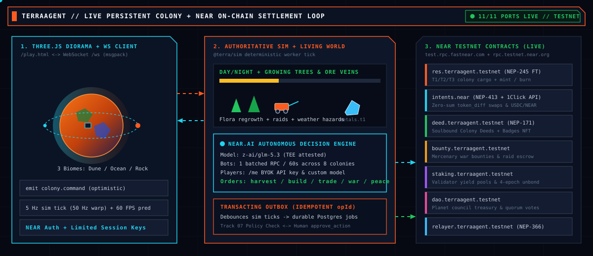
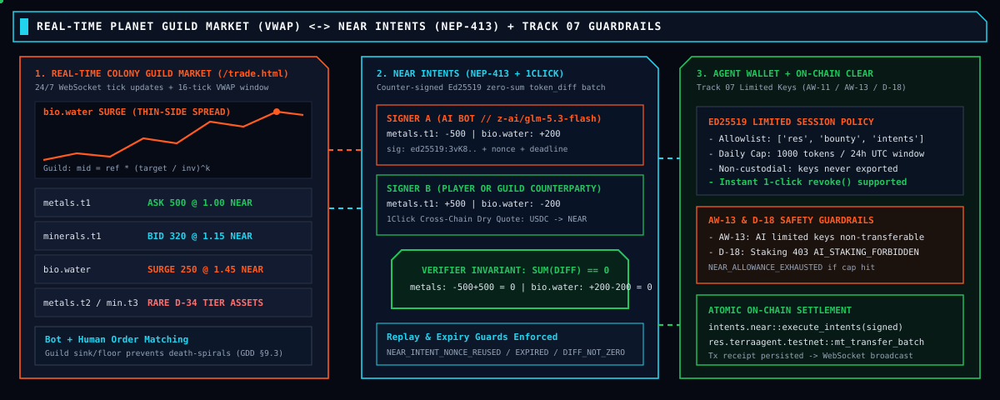
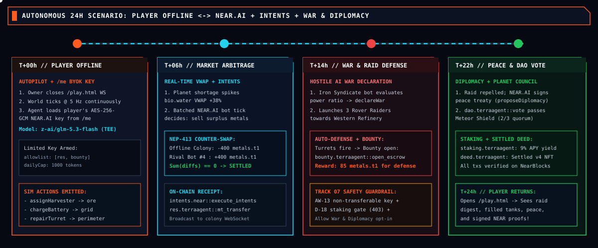

# TerraAgent

**Real-time 3D persistent colony RTS with autonomous NEAR.AI agents, open NEP-245 commodity markets settled via NEAR Intents, war, diplomacy, and planetary DAO governance — running live 11/11 ports on NEAR Testnet.**

- **Live Landing:** [https://terraagent.fun](https://terraagent.fun)
- **Play Live (HTTPS + WebSockets):** [https://play.terraagent.fun/play.html?planet=oceanForest&deploy=1](https://play.terraagent.fun/play.html?planet=oceanForest&deploy=1)
- **7-Day Multi-Agent Fast-Forward Sim:** [https://play.terraagent.fun/dev/economy-sim/](https://play.terraagent.fun/dev/economy-sim/)
- **Live Planet Orderbook & Bot Keys:** [https://play.terraagent.fun/trade.html](https://play.terraagent.fun/trade.html)
- **Pilot Profile & Encrypted BYOK NEAR.AI Vault:** [https://play.terraagent.fun/me.html](https://play.terraagent.fun/me.html)
- **Live NEAR Testnet Status API:** [https://api.terraagent.fun/v1/near/status](https://api.terraagent.fun/v1/near/status)
- **Docs Surfaces:** [Whitepaper](https://whitepaper.terraagent.fun) · [Pitch Deck](https://pitchdeck.terraagent.fun) · [3D Model Playground](https://playground.terraagent.fun/playground.html) · [Design System](https://design.terraagent.fun)



---

## What Problem TerraAgent Solves & Why NEAR

1. **The Problem:** Online strategy games stop progressing when you close the browser tab, price resources with static studio spreadsheets that inflate and freeze, or break immersion with seed phrases, wallet popups, and gas prompts. Meanwhile, letting autonomous AI agents manage real wallets without cryptographic and policy boundaries risks draining user funds.
2. **The Product:** A persistent hex-planet RTS (`@terra/sim` deterministic engine + Three.js WebGL2 diorama + `@msgpack/msgpack` binary WebSockets) where humans command colonies directly while online — and click **`AI AUTOPILOT: ON`** (or go offline) to hand execution to bounded **NEAR.AI (`z-ai/glm-5.3-flash`)** directors competing and trading alongside autonomous Rival AI colonies, external API trading bots, and scheduled NPC Orbital Guild ships.
3. **What NEAR Concretely Enables:**
   - **Invisible Account & Gasless Gameplay (`Identity` + `NEP-366` Relayer):** Social login (`FastAuth` PKCE/JWKS, Google/X OAuth, or NEAR wallet selector) provisions `{pilot}.terraagent.testnet` funded with `0.02 NEAR`, while `relayer.terraagent.testnet` sponsors allowlisted `SignedDelegate` meta-transactions so players never hold gas to play — with non-custodial `claimAccount` (`addFullAccessKey`) when ready.
   - **Open Commodity Liquidity & Intent Settlement (`NEP-245` + `NEP-413` + `1Click`):** Exporting colony resources mints `NEP-245` multi-tokens on `res.terraagent.testnet` (importing burns them). Player, bot, rival AI, and NPC Guild orders clear via counter-signed **`NEP-413` zero-sum `token_diff` intents** paired with live **NEAR Intents 1Click (`1click.chaindefuser.com/v0/quote`, `dry: true`)** cross-asset solver quotes.
   - **Confidential Verifiable AI + Sandboxed Spending (`NEAR AI Cloud TEE` + `AgentWallet`):** Colony directives run in **NEAR AI Cloud TEEs (`z-ai/glm-5.3-flash`)** verified via `/v1/signature/{chat_id}` ECDSA signatures (plus `AES-256-GCM` encrypted player BYOK keys on `/me.html`), constrained by scoped session keys, ACID per-token daily spend caps, one-click revocation, and hard server/contract guardrails (`403 AI_STAKING_FORBIDDEN`, human-only truce breaking).
   - **Dynamic Assets, Trustless Bounties & Shared Treasuries (`NEP-171`, `Escrow`, `DAO`, `Staking`):** Every colony mints an evolving soulbound **NEP-171 Colony Deed NFT** (`deed.terraagent.testnet`) whose `Settled` status gates human-only validator staking (`staking.terraagent.testnet`), posts raid-defense cargo escrows (`bounty.terraagent.testnet`), and votes on planetary public goods in per-planet **Treasury DAOs** (`{planet}.dao.terraagent.testnet` on `dao.terraagent.testnet`).

> **Specs & Rules:** [`docs/game/RULES.md`](./docs/game/RULES.md) (30s/5m/session loop, sub-accounts & AI custody checkpoint) · [`docs/game/GUILD_PRICING.md`](./docs/game/GUILD_PRICING.md) (NPC Guild AMM formula & reason tooltips) · [`docs/hackathon/DEPLOY_GUIDE.md`](./docs/hackathon/DEPLOY_GUIDE.md) (VPS + Testnet deployment) · [`docs/dev/DEV_TOOLS.md`](./docs/dev/DEV_TOOLS.md) (console commands, routes & env vars).

---

## Try It Now ("Do X → See Y")

### 1. Live Hosted Stack — Zero Install (`https://terraagent.fun`)

| Do X | See Y |
|---|---|
| Open [`play.terraagent.fun/dev/economy-sim/`](https://play.terraagent.fun/dev/economy-sim/) → click **FAST-FORWARD 7 DAYS** | 3 autonomous colonies (*Verdant Collective*, *Iron Guild Outpost*, *Crimson Vanguard*) simulate 7 days of mining, Guild VWAP price curves, raids, bilateral truces, guardrails, and a live `NEAR.AI` (`z-ai/glm-5.3-flash`) TEE-attested evaluation. |
| Open [`play.terraagent.fun/play.html?planet=oceanForest&deploy=1`](https://play.terraagent.fun/play.html?planet=oceanForest&deploy=1) | Drop pod lands in 3D; open left **Colony Book → `DIRECTOR`** to toggle **`AI AUTOPILOT: ON`** + **`Allow War & Diplomacy`**, press `T` → `V` to **Cultivate** hexes (`Grade → Irrigate → Seed → Living`), or press `` ` `` and run `near.ports` / `near.quote`. |
| Open [`play.terraagent.fun/trade.html`](https://play.terraagent.fun/trade.html) | Live planet CLOB orderbook, depth ladder, swaps across `10` NEP-245 resources + `USDC` / `NEAR`, maker stall fee controls (`0–100 bp`), and scoped `ta_bot_...` API key management. |
| Open [`play.terraagent.fun/me.html`](https://play.terraagent.fun/me.html) | Sign in to configure your personal **BYOK NEAR.AI API Key & Model** (`AES-256-GCM` encrypted at rest), inspect achievement badges, and view colony history. |

**30-Second Terminal Verification Against Live Production (`curl`):**

```bash
# 1. Verify all 11/11 NEAR ports are bound to live NEAR Testnet + healthy FastNEAR RPC:
curl -fsS https://api.terraagent.fun/v1/near/status | jq '{nearMode, rootAccount, health, ports}'

# 2. Request a live NEAR Intents 1Click cross-asset solver quote (dry: true, ed25519 solver signature):
curl -fsS -X POST https://api.terraagent.fun/v1/near/intents/quote \
  -H 'content-type: application/json' -d '{"amount":"1000000000000000000000000"}' | jq .

# 3. Run a 7-day 3-colony economy simulation + live NEAR AI Cloud (z-ai/glm-5.3-flash) TEE attestation check:
curl -fsS -X POST https://api.terraagent.fun/v1/economy-sim/run \
  -H 'content-type: application/json' -d '{"days":7,"seed":"42"}' | jq '{days, seed, durationMs, guardrails, ai}'

# 4. Inspect live on-chain NEP-171 Colony Deed (with NearBlocks txHash) & Planet Council DAO:
curl -fsS https://api.terraagent.fun/v1/near/deed | jq '.deed | {tokenId, ownerAccountId, contractId, txHash}'
curl -fsS https://api.terraagent.fun/v1/near/treasury/pl_dev | jq '{planetId, daoAccountId, projects}'

# 5. Verify hard AI safety guardrail (AI callers attempting validator staking receive HTTP 403):
curl -i -sS -X POST https://api.terraagent.fun/v1/near/stake \
  -H 'content-type: application/json' -H 'x-actor: ai' \
  -d '{"amount":"1.0","poolId":"astro-stakers.pool.testnet"}'
```

### 2. Local Clean Clone — Zero API Keys Required (`NEAR_MODE=mock`, `AI_PROVIDER=mock`)

Requires Node 22+ (24 tested), npm 10+, and Docker (PostgreSQL on `:15434`). Runs 100% deterministically out of the box with zero external keys or wallets:

```bash
npm ci
npm run dev            # → Postgres (docker :15434), NestJS API + WS (:4001), Vite client (:5173)
```

| Do X Locally | See Y |
|---|---|
| `curl -fsS http://127.0.0.1:4001/v1/healthz` & `/v1/readyz` | `{"ok":true}` and `{"db":"ok","simThreads":...}` |
| Open `http://127.0.0.1:5173/dev/economy-sim/` → **FAST-FORWARD 7 DAYS** | Deterministic 7-day 3-colony simulation in `< 1 s` (no LLM calls required in mock mode) |
| Open `http://127.0.0.1:5173/play.html?scenario=w18` | Seeded multi-colony planet over `/ws` with HUD **DIRECTOR**, raids, truces, and Guild offers |
| Open `http://127.0.0.1:5173/play.html?scenario=w05` → `T` → `CULTIVATE [V]` | Terrain progresses `Grade → Irrigate → Seed → Living`, advancing `Terraform %` and unlocking T2/T3 tiers |
| Stop backend; open `http://127.0.0.1:5173/play.html?host=local&scenario=w01` | Identical `@terra/sim` engine runs offline in a browser Web Worker backed by IndexedDB |
| Issue a bot key (`POST /v1/trade/keys?as=alice`) & run `npm run trade:bot -- --key <ta_bot_...> --strategy scripted` | External scripted trading bot quotes `/v1/trade/agent/quote` and places idempotent limit orders on `/v1/trade/orders` |

### 3. Local Stack Against Live NEAR Testnet + NEAR.AI Cloud

```bash
NEAR_MODE=testnet NEAR_ROOT_ACCOUNT=terraagent.testnet \
AI_PROVIDER=nearai AI_LIVE=1 NEAR_AI_API_KEY=<your_nearai_key> NEAR_AI_MODEL=z-ai/glm-5.3-flash \
TA_SEED_RIVAL_AI=1 npm run dev

# Run live RPC contract-verification suites against https://test.rpc.fastnear.com:
CONTRACT_CHAIN_READ_TX=BKC581CwFy3uQweLfZr7jLHRxXQRbrerMgcmHHbC6NJH npm run contract:real -- --port ChainRead
npm run contract:real -- --port BadgeNft
npm run contract:real -- --port Staking
npm run contract:real -- --port TreasuryDao
```

---

## NEAR Hackathon Track Alignment

TerraAgent is one cohesive product designed around the official NEAR Hackathon tracks ([`docs/hackathon/HACKATHON.md`](./docs/hackathon/HACKATHON.md)):

| Track ID & Name | Official Track Themes Covered | How TerraAgent Implements It | Verify Live / Source |
|---|---|---|---|
| **`games`**<br>Games With Real Economies | `AGENT NPCS` · `SOCIAL LOGIN` · `NEAR INTENTS` · `NEP-245` | 30s/5m/session RTS where the economy *is* the gameplay: `NEP-245` cargo (`res.terraagent.testnet`), scheduled NPC Orbital Guild merchants (`kestrel`, `vanguard`) with readable inventory power-law pricing & hover `reason` tooltips, 10% off-planet sink/restock, social login + `NEP-366` gasless relayer (invisible chain UX), and 7-day fast-forward simulator. | [`/dev/economy-sim/`](https://play.terraagent.fun/dev/economy-sim/) · [`RULES.md`](./docs/game/RULES.md) · [`GUILD_PRICING.md`](./docs/game/GUILD_PRICING.md) |
| **`agents`**<br>Agent Economy | `AGENT COMMERCE` · `NEAR INTENTS` · `SUB-ACCOUNTS` | Colony AI directors (`ColonyAgentLoopService`), Rival AI neighbors, and external `ta_bot_...` bots earn NEP-245 cargo, trade via `NEP-413` `token_diff` intents + `1Click` quotes, counter-quote Guild spreads, negotiate bilateral truces, and hire mercenary defense via on-chain cargo escrows (`bounty.terraagent.testnet`), emitting one verifiable receipt + rationale per task. | [`colony-agent/`](./backend/app/src/ai/colony-agent/) · [`trade-bot.ts`](./scripts/economy/trade-bot.ts) · [`bounty`](./backend/near-contracts/bounty/src/lib.rs) |
| **`swarms`**<br>AI Swarms | `MULTI-AGENT SYSTEMS` · `NEAR INTENTS` · `SUB-ACCOUNTS` | Shared-planet multi-agent coordination & competition: isolated `*.terraagent.testnet` & `*.npc.terraagent.testnet` sub-accounts, central planet orderbook coordinator (`/v1/market/:planetId`), zero-sum intent batch clearing, collective public-good funding in `{planet}.dao.terraagent.testnet`, plus zero-LLM deterministic simulation mode (`useLiveLlm: false`). | `POST /v1/economy-sim/run` · [`economy-sim/`](./backend/app/src/ai/economy-sim/) · [`/trade.html`](https://play.terraagent.fun/trade.html) |
| **`security`**<br>AI Security & Defense | `AGENT SECURITY` · `FUNCTION CALL KEYS` · `TEE ATTESTATION` | Sandboxed agent custody: scoped Ed25519 session keys (`/v1/near/director-key`, `/v1/trade/keys`) with ACID per-token spend allowances (`NEAR_ALLOWANCE_EXHAUSTED`), one-click revoke & emergency kill switch (`POST /v1/trade/kill`), relayer receiver allowlist + daily gas cap, `validateAgentGuardrails` policy engine (`403 AI_STAKING_FORBIDDEN`, no demolish `AW-10`, war opt-in `AW-11`, human-only truce cancel `AW-13`, `intentRevision` concurrency), and TEE signature verification. | `POST /v1/near/stake -H 'x-actor: ai'` · [`testnet-agent-wallet.adapter.ts`](./backend/app/src/near/infrastructure/adapters/real/testnet-agent-wallet.adapter.ts) |
| **`nfts`**<br>NFTs That Do Something | `DYNAMIC NFTS` · `NEP-171` · `SUB-ACCOUNTS` | Soulbound **NEP-171 Colony Deeds & Achievement Badges** (`deed.terraagent.testnet`) bound to colony sub-accounts: metadata evolves on-chain (`mint_deed` → `update_metadata` across `stage`, `terraformBp`, `settled`) with dynamic PNG rendering, SSR OpenGraph cards (`/deed/:tokenId`), and real behavioral utility — a `Settled` Deed is the credential required to unlock validator staking and council membership. | `GET /v1/near/deed` · [`deed`](./backend/near-contracts/deed/src/lib.rs) · [`deed-share.controller.ts`](./backend/app/src/near/deed/deed-share.controller.ts) |
| **`privacy`**<br>Privacy & Private AI | `PRIVATE AI` · `TEE` · `NEAR AI CLOUD` | Confidential colony & market strategy inference on **NEAR AI Cloud (`https://cloud-api.near.ai/v1`, `z-ai/glm-5.3-flash`)** inside hardware TEEs with `/v1/signature/{chat_id}` ECDSA verification, plus envelope-encrypted (`AES-256-GCM` via `NEAR_KEK`) player BYOK API keys (`/v1/me/ai-settings`) and custodial keys (`KeyStore`). | [`nearai-llm.adapter.ts`](./backend/app/src/ai/adapters/nearai-llm.adapter.ts) · [`/me.html`](https://play.terraagent.fun/me.html) · [`keystore/`](./backend/app/src/near/keystore/) |
| **`social`**<br>Social Money | `DAO TREASURY` · `SHARED BUDGETS` · `NAMED ACCOUNTS` | Custom Sputnik-pattern **Planet Council Treasury DAO** (`dao.terraagent.testnet` with live `{planet}.dao.terraagent.testnet` sub-DAOs): market/Guild tax legs fund a shared planetary budget where named colony accounts propose, vote (`> 50%` quorum), and finalize `meteor_shield`, `terraform_boost`, and `guild_subsidy` effects, backed by `Oathbreaker` treaty reputation. | `GET /v1/near/treasury/pl_dev` · [`dao`](./backend/near-contracts/dao/src/lib.rs) · [`treasury/`](./backend/app/src/near/treasury/) |
| **`defi`**<br>Unstoppable DeFi | `TRADING` · `NEAR INTENTS` · `YIELD VAULTS` | 24/7 CLOB + SSE streaming exchange (`/v1/trade/*`, 90 pairs across 10 NEP-245 commodities + `USDC` + `NEAR`), autonomous VWAP-anchored Guild liquidity, deterministic quote API (`/v1/trade/agent/quote`), `NEP-413` zero-sum settlement + live `1Click` solver quotes, and validator yield vault (`staking.terraagent.testnet` + `*.pool.testnet`). | [`/trade.html`](https://play.terraagent.fun/trade.html) · `POST /v1/near/intents/quote` · [`staking`](./backend/near-contracts/staking/src/lib.rs) |

---

## Game & Economy Loop (30 Seconds / 5 Minutes / Session)

- **Every 30 Seconds (Colony Micro-Loop):** Drones harvest finite `T1/T2/T3` surface veins (`full → half → depleted`, with `1%` subsurface discovery on terraforming), balance the shared solar day/night + capacitor power grid before brownouts hit, and cultivate barren ground (`Grade → Irrigate → Seed → Living`) to raise `Terraform %` and unlock T2/T3 tech (`D-34`).
- **Every 5 Minutes (Planetary Market, War & Diplomacy Loop):** Colonies export surplus cargo (`mt_mint` on `res.terraagent.testnet`), trade on `/trade.html` against player stalls, Rival AI colonies, and Orbital Guild ships (`Kestrel` & `Vanguard`), dispatch Recon squads to raid unshielded depots, or sign `2h–72h` bilateral peace truces.
- **Per Session & Offline (Persistence & Governance):** Closing the tab or enabling **`AI AUTOPILOT: ON`** hands continuity to the server's `180 s` autonomous sweep; milestones update the colony's **NEP-171 Deed**, fund **Mercenary Bounty Escrows**, execute **Planet Council DAO** boosts, and culminate in sealing a `Settled` Colony Deed.

### Two-Speed Hybrid Architecture (`@terra/sim` ↔ `chain.chain_outbox`)

Real-time RTS play runs at `5 Hz` deterministic worker ticks (`50 Hz` under `warp`, `60 FPS` client prediction + rollback) while durable ownership and economic transitions commit atomically to PostgreSQL and relay asynchronously to NEAR Testnet:

| Stage | Real-Time Sim & WebSocket Loop (`@terra/sim` + `/ws`) | On-Chain NEAR Execution (`OutboxRelay` → NEAR Testnet) |
|---|---|---|
| **1. Identity & Session Keys** | Pilot signs in (OAuth / FastAuth / wallet) and joins a sector on `/ws`. | `IdentityPort` creates `{pilot}.terraagent.testnet` (`0.02 NEAR`); `AgentWalletPort` registers scoped Ed25519 keys & ACID daily token caps. |
| **2. Founding & Terraforming** | Drop pod lands; drones harvest, power grid stabilizes, and hexes cultivate to `Living`. | `DeedNftPort` mints a soulbound **NEP-171 Colony Deed** on `deed.terraagent.testnet` and debounces `update_metadata` milestones. |
| **3. Orbital Cargo & Market** | Surplus exports at Trade Hub; players, bots & Guild ships trade 90 pairs on `/trade.html`. | Export calls `mt_mint` on `res.terraagent.testnet` (import calls `mt_burn`); trades verify counter-signed **`NEP-413` zero-sum `token_diff`** batches + `1Click` quotes. |
| **4. Autonomy, War & Bounties** | Offline / `AI AUTOPILOT: ON` colonies evaluate every `180 s` (`120 s` state-digest cache). | Raid-defense escrows lock/claim/refund on `bounty.terraagent.testnet`; gasless `SignedDelegate` actions relay via `relayer.terraagent.testnet` (`NEP-366`). |
| **5. Council DAO & Staking** | Colonies vote on `meteor_shield`, `terraform_boost`, or `guild_subsidy`; launch settles colony. | `TreasuryDaoPort` executes proposals on `{planet}.dao.terraagent.testnet`; humans stake NEAR on `staking.terraagent.testnet` (`403` for AI). |



### Orbital Guild AMM Pricing Math & Fee Model

 Markets run 24/7 over REST + SSE + WebSocket diffs (`/v1/trade/*`). Scheduled NPC Guild ships (`kestrel` / `vanguard`) prevent illiquidity on young planets without distorting organic price discovery ([`docs/game/GUILD_PRICING.md`](./docs/game/GUILD_PRICING.md), [`shared/sim/src/systems/trade/guild/quote.ts`](./shared/sim/src/systems/trade/guild/quote.ts)):

$$\text{mid}_i = \text{clamp}\!\left(\text{ref}_i \cdot \left(\frac{T_i}{\max(I_i, 100)}\right)^k,\; 0.25\,\text{ref}_i,\; 4.00\,\text{ref}_i\right)$$

- **Organic VWAP Anchor (`LED-32`):** $\text{ref}_i$ tracks 24h organic player/rival VWAP once $\ge 3$ distinct-colony fills exist (excluding NPC self-fills), falling back to canonical cold-start parities (`metals.t1 = 1.00`, `minerals.t1 = 1.20`, `bio.water = 0.90`, `bio.biomass = 1.25`).
- **Dynamic Thin-Side Spreads, Sinks & Reason Tooltips:** Thin inventory widens half-spreads up to `1500 bp` (`15%`), every departure exports `10%` of excess stock off-planet (inflation sink) and restocks `10%` of severe deficits, and every UI offer displays a plain-English `reason` tooltip (`"Kestrel: stock 6,300/3,000 (2.10x target), ref 1.00 (24h VWAP) → mid 0.48 (-52% vs ref)"`).
- **Fee Transparency (`D-44`):** Buyers pay a `100 bp` (`1.0%`) platform fee + `0–100 bp` maker stall fee in the pair's quote asset (cargo tokens on commodity pairs, with `USDC`/`NEAR` quote pairs and treasury tax legs wired in `/v1/trade/*`).

---

## Autonomous Intelligence (`NEAR.AI` TEE + Player BYOK) & Safety Guardrails



1. **Batched Bot Decision Manager ([`backend/app/src/ai/colony-agent/`](./backend/app/src/ai/colony-agent/)):**
   - Sweeps active planets every **`180 s`** with a **`120 s` observation-digest cache** so unchanged colonies consume **zero LLM tokens**.
   - Serializes all non-player Rival AI colonies on a planet into **one batched prompt** to NEAR AI Cloud (`https://cloud-api.near.ai/v1/chat/completions`, default **`z-ai/glm-5.3-flash`**) returning typed `directives[]` (`queue_goal`, `trade`, `accept_guild_offer`, `declare_war`, `raid`, `propose_truce`, `respond_truce`, `hold`), and verifies `/v1/signature/{chat_id}` (`provider_tee` / `gateway` ECDSA signature).
2. **Isolated Player BYOK NEAR.AI Vault (`/me.html` → `/v1/me/ai-settings`):**
   - Players can attach their own NEAR.AI API key and choose their model (`z-ai/glm-5.3`, `z-ai/glm-5.3-flash`, `deepseek/deepseek-v3.2`, `Qwen/Qwen3.8-27B`, `openai/gpt-5-mini`, `anthropic/claude-sonnet-4-6`).
   - Keys are encrypted at rest with **`AES-256-GCM`** (`NEAR_KEK`, migration `0032_player_nearai_settings`) and never returned in plaintext (`apiKeyPreview` only). Player autopilot never touches server bot quota and falls back cleanly to deterministic policy evaluation if no BYOK key is set.
3. **4 Code-Enforced AI Safety Guardrails:**
   - **Scoped Keys & ACID Token Allowances (`AgentWalletPort`):** Enforces method allowlists, per-token daily/session spend caps (`NEAR_ALLOWANCE_EXHAUSTED`), one-click key revocation, and `/v1/trade/kill` emergency halt.
   - **War Opt-In & Human-Only Truce Breaking (`AW-11`, `AW-13`):** `validateAgentGuardrails` strips `declare_war` / `raid` unless **`Allow War & Diplomacy`** is enabled, and permanently forbids AI from breaking active truces early (`Oathbreaker` 24h penalty is human-only).
   - **No Autonomous Demolition & Concurrency Fencing (`AW-10`):** Away AI cannot dismantle player structures, and any manual player command increments `intentRevision` to drop in-flight stale AI directives.
   - **Human-Only Validator Staking (`D-18`):** AI callers receive `403 AI_STAKING_FORBIDDEN` on `/v1/near/stake`, `/v1/near/unstake`, and `/v1/near/withdraw`.

---

## Cryptographic & NEAR.AI Payload Examples

### 1. Counter-Signed Zero-Sum `NEP-413` `token_diff` Trade Intent

Generated and verified by [`backend/app/src/near/intents/nep413-token-diff.ts`](./backend/app/src/near/intents/nep413-token-diff.ts) (Borsh NEP-413 tag `2^31 + 413` + SHA-256 + Ed25519):

```json
{
  "standard": "nep413",
  "payload": {
    "message": "{\"signer_id\":\"iron-guild.terraagent.testnet\",\"deadline\":\"2026-11-13T12:00:00.000Z\",\"intents\":[{\"intent\":\"token_diff\",\"diff\":{\"nep245:res.terraagent.testnet:metals.t1\":\"-400\",\"nep245:res.terraagent.testnet:bio.water\":\"250\"}}]}",
    "nonce": "mQ9x3kKp8Z6N1Y2v4tR7wL0cB5dF8hJ1sP3qA9uE4vY=",
    "recipient": "intents.near"
  },
  "public_key": "ed25519:7fH3k9qR...",
  "signature": "ed25519:3vK8pM2n..."
}
```
*Verifier invariant:* Across every matched batch, $\sum_i \text{diff}_i[\text{token}] = 0$, signatures match registered colony/bot keys, and reused nonces reject with `NEAR_INTENT_NONCE_REUSED`.

### 2. Batched `NEAR.AI` (`z-ai/glm-5.3-flash`) Directive & Cryptographic Attestation

```json
{
  "model": "z-ai/glm-5.3-flash",
  "directives": [
    {
      "colonyIndex": 1,
      "action": "trade",
      "tradeSide": "sell",
      "tradePair": "metals.t1/minerals.t1",
      "tradeAmount": 250,
      "rationale": "metals surplus 2.1x; Guild ask wide at +14% VWAP"
    },
    {
      "colonyIndex": 2,
      "action": "declare_war",
      "targetColonyIndex": 1,
      "rationale": "target shield expired; 4 Recon Rovers ready"
    }
  ],
  "attestation": {
    "chatId": "chatcmpl-aa70ad9395b2e7fe",
    "verified": true,
    "signatureKind": "gateway",
    "signingAlgo": "ecdsa"
  }
}
```

---

## Deployed NEAR Testnet Contracts, Accounts & On-Chain Truth Matrix

All **5 custom Rust `near-sdk 5.7` smart contracts** ([`backend/near-contracts/`](./backend/near-contracts/)) and **3 core protocol accounts** are deployed and active on NEAR Testnet (`NEAR_MODE=testnet`):

### 5 Live Rust Smart Contracts (`near-sdk 5.7`)

| Contract Account | Source Crate | Standard & Key On-Chain Methods | Live WASM `code_hash` | Deploy / Init Tx (`testnet.nearblocks.io`) |
|---|---|---|---|---|
| [`res.terraagent.testnet`](https://testnet.nearblocks.io/address/res.terraagent.testnet) | [`near-contracts/res`](./backend/near-contracts/res/src/lib.rs) | **NEP-245 Multi-Token** (`10` cargo tokens, `18` dec) · `mt_mint`, `mt_burn`, `operator_transfer`, `mt_transfer`, `mt_balance_of`, `mt_metadata` | `9KrGRQKkAMUP8qCEGk5CC6pgK9E79V1js46EipXTsvym` | [`7r2V4bttfkSjKBuFc2y4hKHjmd8FDQuDexnfLNSNUTFh`](https://testnet.nearblocks.io/txns/7r2V4bttfkSjKBuFc2y4hKHjmd8FDQuDexnfLNSNUTFh) |
| [`deed.terraagent.testnet`](https://testnet.nearblocks.io/address/deed.terraagent.testnet) | [`near-contracts/deed`](./backend/near-contracts/deed/src/lib.rs) | **NEP-171 Soulbound Deeds & Badges** · `mint_deed`, `update_metadata`, `get_deed`, `owner_of`, `nft_token`, `nft_tokens_for_owner` | `GFB5WgL1hMiCSFZSNjiXdYhui68ptf2AyDvFHZGUR6pB` | [`72R9C6pU6HKw25HBpX4XSFHXQhGxFhoCE1SQzTgkiUUW`](https://testnet.nearblocks.io/txns/72R9C6pU6HKw25HBpX4XSFHXQhGxFhoCE1SQzTgkiUUW) (live mint [`FSYoA8pd...`](https://testnet.nearblocks.io/txns/FSYoA8pdfsmKCK2G6Pri6apnKMoj2sHGbA3dsoNJu4XF)) |
| [`bounty.terraagent.testnet`](https://testnet.nearblocks.io/address/bounty.terraagent.testnet) | [`near-contracts/bounty`](./backend/near-contracts/bounty/src/lib.rs) | **Mercenary & Raid-Defense Escrow** · `open_escrow`, `claim_escrow`, `refund_escrow`, `get_escrow` (idempotent by `op_id`) | `6VGAZh8udooNjj85LyzBZT4jY1959FWFBJ3KBugGVtuH` | [`GDDYUk826TgGxDWiTq9y6PdNKW7HpfGoe8hQrMXccNFG`](https://testnet.nearblocks.io/txns/GDDYUk826TgGxDWiTq9y6PdNKW7HpfGoe8hQrMXccNFG) |
| [`staking.terraagent.testnet`](https://testnet.nearblocks.io/address/staking.terraagent.testnet) | [`near-contracts/staking`](./backend/near-contracts/staking/src/lib.rs) | **Validator Yield Vault (`D-18` human-only)** · `credit_near`, `stake`, `unstake` (`2` game-day unbonding), `withdraw`, `get_position` | `9K2xHY4QZh7wfXAdf8pxogviBortXP4mM722W3k97NeC` | [`CJAeXB8YVZqrXPQQRRMMY2s6sBY7Ma17gE1thZ9CHAyX`](https://testnet.nearblocks.io/txns/CJAeXB8YVZqrXPQQRRMMY2s6sBY7Ma17gE1thZ9CHAyX) (init [`BKC581Cw...`](https://testnet.nearblocks.io/txns/BKC581CwFy3uQweLfZr7jLHRxXQRbrerMgcmHHbC6NJH)) |
| [`dao.terraagent.testnet`](https://testnet.nearblocks.io/address/dao.terraagent.testnet) | [`near-contracts/dao`](./backend/near-contracts/dao/src/lib.rs) | **Planet Council Treasury DAO** · `create_dao`, `deposit`, `add_member`, `propose`, `vote`, `finalize`, `get_dao` (`> 50%` quorum) | `ByT7esMkAqrtAi7SceUhDM5aauA1XfoUPt88fVvz5L8r` | [`4DVcXY5cV4uGRA5rtcoy6HhqPAhi2QwuKgwtjTvJedHn`](https://testnet.nearblocks.io/txns/4DVcXY5cV4uGRA5rtcoy6HhqPAhi2QwuKgwtjTvJedHn) (planet DAO [`CcatcC2z...`](https://testnet.nearblocks.io/txns/CcatcC2zYsrkr2zSS7CnNazF6nHzvu7Sz5nEyvQ7f9ee)) |

### Protocol Accounts & Direct FastNEAR RPC Verification

- **Root & Sub-Account Parent:** [`terraagent.testnet`](https://testnet.nearblocks.io/address/terraagent.testnet) ([`3qmHWbgs...`](https://testnet.nearblocks.io/txns/3qmHWbgsfNoykfDeuLsyGVw36kaUmGN5uUiJqrHBgRLH)) — funds new pilot/bot sub-accounts (`0.02 NEAR`).
- **NEP-366 Gasless Meta-Tx Relayer:** [`relayer.terraagent.testnet`](https://testnet.nearblocks.io/address/relayer.terraagent.testnet) ([`BftLVcAc...`](https://testnet.nearblocks.io/txns/BftLVcAcvG5ik42WAzypjQ81Vo2xBVULcHtMjsUdKPbW)) — sponsors `SignedDelegate` gas & `storage_deposit` within `NEAR_RELAYER_DAILY_CAP`.
- **Authorized Contract Operator:** [`minter.terraagent.testnet`](https://testnet.nearblocks.io/address/minter.terraagent.testnet) ([`7FHCx4UM...`](https://testnet.nearblocks.io/txns/7FHCx4UMq8E3hVj1tQxAWGN7CmZ4hTupGpEte4Fopzu)) — serialized FIFO nonce signer across `res`, `deed`, `bounty`, `staking`, `dao`.

```bash
# Verify live WASM code_hash across all 5 contracts + query NEP-245 cargo metadata on FastNEAR Testnet RPC:
for c in res deed bounty staking dao; do
  echo -n "$c.terraagent.testnet -> "
  curl -fsS -X POST https://test.rpc.fastnear.com -H 'content-type: application/json' \
    -d "{\"jsonrpc\":\"2.0\",\"id\":1,\"method\":\"query\",\"params\":{\"request_type\":\"view_account\",\"finality\":\"final\",\"account_id\":\"$c.terraagent.testnet\"}}" | jq -r '.result.code_hash'
done

curl -fsS -X POST https://test.rpc.fastnear.com -H 'content-type: application/json' \
  -d '{"jsonrpc":"2.0","id":1,"method":"query","params":{"request_type":"call_function","finality":"final","account_id":"res.terraagent.testnet","method_name":"mt_metadata","args_base64":"e30="}}' | jq '.result.result | implode | fromjson'
```

### Full 11/11 Port + AI + Notifier Honesty Table (`GET /v1/near/status`)

Per [`docs/hackathon/HACKATHON.md`](./docs/hackathon/HACKATHON.md) (`Q-007`, `Q-010`, `Q-017`), the exact boundary between on-chain Testnet execution and off-chain/hybrid verification is documented below:

| Port / Service | Local (`NEAR_MODE=mock`) | Production (`NEAR_MODE=testnet` on `api.terraagent.fun`) | Exact On-Chain vs. Verifier Boundary |
|---|---|---|---|
| `ChainRead` | Postgres Mock | **Live Testnet** (`test.rpc.fastnear.com` + failover) | Real JSON-RPC block finality, account views & tx receipt verification. |
| `Identity` | Postgres Mock | **Live Testnet** (`TestnetIdentityAdapter`) | Verifies FastAuth Ed25519 / OIDC JWKS proofs; creates real `{pilot}.terraagent.testnet` sub-accounts (`0.02 NEAR`) and supports on-chain `addFullAccessKey` claim. |
| `Relayer` | Postgres Mock | **Live Testnet** (`relayer.terraagent.testnet`) | Broadcasts real `NEP-366` `SignedDelegate` meta-transactions & `storage_deposit` against allowlisted contracts within daily gas cap. |
| `CargoToken` | Postgres Mock | **Live Testnet** (`res.terraagent.testnet`) | Real `mt_mint`, `mt_burn`, `operator_transfer` & `mt_balance_of` calls on our NEP-245 Rust contract. |
| `Intents` | Postgres Mock | **Live Testnet + 1Click** (`TestnetIntentsAdapter`) | Because `intents.near` has no NEAR Testnet deployment (`Q-007`), `TestnetIntentsAdapter` signs & verifies real `NEP-413` Borsh/Ed25519 `token_diff` payloads, queries live `1click.chaindefuser.com/v0/quote` (`dry: true`), settles Testnet swaps in our ACID verifier ledger synced with `res.terraagent.testnet` `mt_balance_of`, and anchors finalized Testnet receipts on `res.terraagent.testnet`. |
| `AgentWallet` | Postgres Mock | **Live Testnet** (`TestnetAgentWalletAdapter`) | Provisions real `{name}.terraagent.testnet` sub-accounts on-chain; enforces per-token spend allowances ACID in Postgres (native NEAR FC keys cap gas only, not NEP-245 amounts) and anchors finalized receipts on `res.terraagent.testnet`. |
| `DeedNft` | Postgres Mock | **Live Testnet** (`deed.terraagent.testnet`) | Real `mint_deed` & debounced `update_metadata` transactions on our NEP-171 Rust contract + dynamic PNG & SSR OpenGraph share page. |
| `BadgeNft` | Postgres Mock | **Live Testnet** (`deed.terraagent.testnet`) | Real soulbound achievement badge mints (`collection: 'badge'`) on `deed.terraagent.testnet`. |
| `Escrow` | Postgres Mock | **Live Testnet** (`bounty.terraagent.testnet`) | Real `open_escrow`, `claim_escrow` & `refund_escrow` calls on our Bounty Escrow Rust contract. |
| `Staking` | Postgres Mock | **Live Testnet** (`staking.terraagent.testnet`) | Real `credit_near`, `stake`, `unstake` & `withdraw` calls on our Staking Vault Rust contract against `*.pool.testnet` validator metadata (`403` for AI). |
| `TreasuryDao` | Postgres Mock | **Live Testnet** (`dao.terraagent.testnet`) | Real `create_dao`, `deposit`, `add_member`, `propose`, `vote` & `finalize` calls on our Sputnik-pattern DAO Rust contract (`pl_dev.dao.terraagent.testnet`, etc.). |
| `LlmProvider` | Deterministic Mock | **Live NEAR AI Cloud TEE** (`z-ai/glm-5.3-flash`) | Real inference on `cloud-api.near.ai/v1` + cryptographic ECDSA signature verification via `/v1/signature/{chat_id}` + `AES-256-GCM` BYOK vault. |
| `Notifier` | `core.mock_notify` | Configurable (`NOTIFY_ADAPTER=mock\|live`) | Persists offline raid/truce alerts in Postgres (`NOTIFY_ADAPTER=live` enables WebPush / Telegram delivery). |

---

## Pages, Controls & Developer Commands

### Web Surfaces (`frontend/vite.config.ts`)

| Path / Host | Purpose | Key Parameters |
|---|---|---|
| `/` · `/landing.html` (`terraagent.fun`) | Hub navigation & interactive orbital landing showcase | Planet cards deep-link into `/play.html` |
| `/play.html` (`play.terraagent.fun`) | 3D colony RTS over `/ws` or offline worker | `?planet=dune\|oceanForest\|forestRock`, `?deploy=1`, `?scenario=w00..w22`, `?host=local`, `?skip=1` |
| `/trade.html` | Planet CLOB orderbook, depth ladder, swaps & `ta_bot_...` keys | `?planet=<id>&pair=<base>/<quote>&as=<name>` |
| `/me.html` | Pilot profile, badges, colony history & **BYOK NEAR.AI vault** | Authenticated session (`?as=<name>` in local dev) |
| `/deed/:tokenId` | Public SSR OpenGraph Colony Deed card & metadata history | Dynamic PNG at `/v1/near/deed/:tokenId/image.png` |
| `/dev/economy-sim/` | 7-day 3-colony economy, war, truce & NEAR.AI simulator | Deterministic or live `NEAR.AI` TEE evaluation |
| `/playground.html` (`playground.terraagent.fun`) | 3D procedural kitbash & shader turntable | `?inspect=<id>&validate=1&biome=<kind>` |
| `/pitchdeck/` · `/whitepaper/` · `/design/` | Investor deck, technical whitepaper & Faction Plate tokens | Hosted on dedicated `*.terraagent.fun` subdomains |

### Key In-Game Controls (`/play.html`)

- **Dev Console (`` ` ``):** `help`, `warp`, `time`, `spawn`, `grant`, `stage`, `away`, `back`, `offerTruce`, `chain.ping`, `near.ports`, `near.quote`.
- **Command Dock (right):** `B` Build · `U` Production · `T` Terraform (`G` Grade/Clear · `V` **Cultivate** `Grade → Irrigate → Seed → Living` · `R` Repair/rotate · `Z` Dismantle) · `Q` Queue · `M` Global Map.
- **Colony Book (left):** `DIRECTOR` (**`AI AUTOPILOT: OFF / ON`** + **`Allow War & Diplomacy`**), `AWAY`, `DEED`, `GOALS`, `HQ AI`, `COMBAT`, `TRADE`.

### Build, Test & Verification Gates

```bash
npm run dev                              # Postgres + NestJS API/WS (:4001) + Vite (:5173)
npm run check                            # typecheck + ESLint + check:structure (<=500L/file, <=100L/fn) + gen:check
npm test                                 # unit test suite (Vitest, no DB required)
npm run test:integration                 # PostgreSQL + Prisma + Outbox integration suite
npm run test:contract                    # all 11 NEAR port + AI + Notifier contract suites
npm run contract:real -- --port <Port>   # live NEAR Testnet contract verification
npm run test:parity                      # browser worker vs server thread bit-determinism gate
npm run e2e -- --waves ..22              # Playwright headless-Chromium end-to-end suite
npm run validate:models -- --all         # 3D procedural geometry, connectivity & palette validator
cargo test --manifest-path backend/near-contracts/Cargo.toml   # Rust unit tests across all 5 contracts
```

### Repository Layout (`D-41` Clean Root)

```text
shared/        @terra/{contracts, config, db, ledger, sim} — deterministic sim, schemas & ledger shared by client & server
backend/
  app/         @terra/app — NestJS modules (ws, game, near, ai, market, profile, notify, analytics, dev)
  near-contracts/  5 Rust near-sdk 5.7 smart contracts: res, deed, bounty, staking, dao
frontend/      Vite multi-page WebGL2 client (game, render, landing, trade, playground, design, pitchdeck, whitepaper)
tests/         Playwright E2E, client/server parity & Vitest suites
infra/         Docker Compose stacks (infra, frontend, backend, chain), Nginx vhosts & env templates
scripts/       Dev orchestration, Testnet deployment, codegen & architectural structure gates
docs/          Game rules, Guild math, NEAR protocol specs, deployment guide & visual constitution
```

---

## Hackathon Window, Baseline & Open-Source Disclosures

- **Hackathon Window & Baseline (`Q-001`, `Q-003`):** Repository history begins at commit `b0a6108e` (`2026-10-29`, inside the official NEAR Hackathon window starting `2026-10-19` through `2026-11-14`). Early commits (`b0a6108e..90b5fb5a`, `2026-10-29`–`2026-10-30`) seeded the initial visual landing/terrain prototype and wave harness; all deterministic `@terra/sim` gameplay, `@terra/contracts` & ledger, NestJS backend (`@terra/app`), real-time markets, autonomous AI (`NEAR.AI` TEE + BYOK), all **5 Rust `near-sdk 5.7` smart contracts** (`res`, `deed`, `bounty`, `staking`, `dao`), **11/11 NEAR Testnet adapters**, procedural fauna/kitbash expansions, and unit/integration/E2E suites were built during the hackathon window.
- **AI Tooling Disclosure (`Q-005`):** Built with AI coding agents (Antigravity & Claude Code) under human architectural direction, verification, and playtesting, gated by automated architectural (`<= 500` lines/file, `<= 100` lines/fn), parity, contract, and 3D geometry checks.
- **Libraries & Frameworks (`Q-005`):** Three.js · Vite · TypeScript · NestJS · `ws` · `@msgpack/msgpack` · `near-api-js` · Rust `near-sdk 5.7` · `borsh` · Prisma + PostgreSQL · `zod` · `pino` · `prom-client` · Vitest · Playwright · ESLint · Prettier.
- **License (`Q-014`):** [MIT](./LICENSE).
