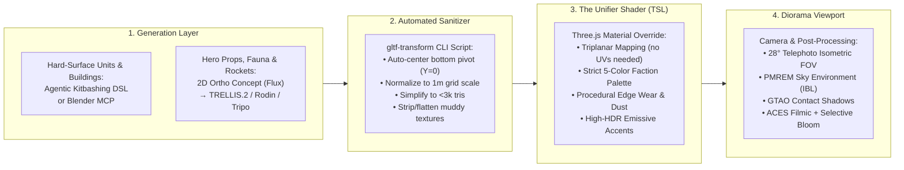

# Making AI-Generated 3D Visuals & Models Look Incredible in Three.js

**Target Project:** TerraAgent (Autonomous Colony Builder)  
**Focus:** Solving the "Programmer Art" & "Inconsistent AI Mesh" Problems in Browser 3D Games

---

## 1. Diagnosis: Why AI-Generated 3D Games Usually Look Terrible

If you have built Three.js games with AI agents before, you likely hit two walls:

### Problem A: "The Snowman Problem" (Coding Agents Writing Raw Three.js Primitives)
When you ask an LLM coding agent (Claude, Cursor, Antigravity, GPT) to *"create a 3D mining robot or solar station in Three.js"*, it defaults to:
- Combining raw, razor-sharp `THREE.BoxGeometry` and `THREE.CylinderGeometry` primitives.
- Assigning flat `MeshStandardMaterial({ color: 0xff0000 })` with default roughness/metalness.
- Dropping a single `DirectionalLight` + `AmbientLight` with no Environment Map (IBL) and no Tone Mapping.
- **Result:** Metals look like black plastic, edges have zero specular catch-lights, silhouettes look like 1998 debug primitives, and everything looks flat.

### Problem B: "The Frankenstein Asset Problem" (Raw Image-to-3D / Text-to-3D Meshes)
When you generate `.glb` models using 3D AI tools (Meshy, Tripo, Rodin, TRELLIS, Hunyuan3D) and drop them into Three.js:
- **Baked Lighting Clashes:** One model has fake yellow sunlight baked into its albedo texture from the left; another has blue shadows baked from the right.
- **Broken UVs & Muddy Textures:** AI unwrap islands look like shredded confetti, causing blurry seams and 20 MB texture bloat.
- **Wildly Different Proportions & Polycounts:** A small rock has 150,000 triangles, origin pivots are floating at random offsets, and art styles clash violently.

---

## 2. The 4-Pillar Solution Architecture

To make **TerraAgent** look like a cohesive indie hit (think *Factorio* meets *Planetary Annihilation*, *Synty Sci-Fi*, or *Dorfromantik*), you must **never trust raw AI textures or raw LLM primitive boxes**. Instead, enforce the following four layers:



---

## 3. Pillar 1: The "Unifier Shader" (How to Make Disparate AI Models Look Like One Art Director Made Them)

The #1 secret used by technical artists when combining AI-generated 3D models is **stripping or overriding the AI's raw material on load** and replacing it with a **Unified Procedural Shader** in Three.js.

### 3.1 Why Overriding Materials Fixes AI Models Immediately
AI 3D generators (especially Hunyuan3D, Rodin, and Tripo) are actually **very good at 3D silhouettes and normal detail**, but **terrible at consistent PBR albedo/roughness maps**. When you replace or blend their material with a unified Three.js shader:
1. Every robot, factory, turret, and rock shares the **exact same lighting response, roughness curve, and color palette**.
2. Baked-in shadow artifacts from the AI generator vanish.
3. All models can share a single material pipeline (`BatchedMesh` / `InstancedMesh` friendly).

### 3.2 Key Techniques Inside the Unifier Shader

#### A. Triplanar World/Object-Space Mapping (Bypasses Bad AI UVs)
Never rely on AI-generated UV coordinates for tiling details (metal grain, hex patterns, rock strata, ice cracks). Project textures along the X, Y, and Z axes blended by `abs(normal)`:
```glsl
// Conceptual GLSL / TSL Triplanar Blend
vec3 blend = pow(abs(vObjectNormal), vec3(4.0));
blend /= dot(blend, vec3(1.0));
vec4 xTex = texture2D(uDetailMap, vObjectPos.yz * uScale);
vec4 yTex = texture2D(uDetailMap, vObjectPos.xz * uScale);
vec4 zTex = texture2D(uDetailMap, vObjectPos.xy * uScale);
vec4 detail = xTex * blend.x + yTex * blend.y + zTex * blend.z;
```

#### B. Vertical Ground-Up Weathering Gradient (Anchors Objects to the Planet)
A colony building sitting on a Mars-like desert planet looks pasted-on unless it picks up dust from the ground.
- In your shader, compute `float groundFactor = smoothstep(0.0, 1.2, vLocalPos.y);`
- Mix the planet's terrain dust/snow/moss color into the bottom `0.0m – 1.2m` of every building and robot (`mix(uPlanetDustColor, baseColor, groundFactor)`).
- **Result:** Every building automatically blends into whatever planet type (Temperate, Desert, Ice) it is placed on!

#### C. Procedural Rim Light & Curvature Edge Highlighting
At RTS camera distances (zoomed out), small details get lost. Add two subtle shader terms:
1. **Top-Down Hemisphere Gradient:** Multiply albedo by `mix(0.65, 1.15, vWorldNormal.y * 0.5 + 0.5)` so tops of structures are bright and undersides are naturally shadowed.
2. **Fresnel Silhouette Rim:** `pow(1.0 - max(dot(viewDir, normal), 0.0), 3.0)` tinted with the planet's sky color so dark metallic robots remain crisp against dark terrain.
3. **Luminance-Driven Emissive Extraction:** If keeping the AI model's albedo texture, convert its color to HSV/luminance in the shader: any pixel with high saturation + high brightness (e.g., cyan/orange energy cores painted on the concept art) is automatically boosted by `emissiveIntensity = 4.0` so it triggers `UnrealBloomPass`!

---

## 4. Pillar 2: The Best AI 3D Asset Generation Pipeline (2026 State of the Art)

When you need organic alien fauna, complex hero buildings (Nuclear Reactor, Rocket Silo), or sculpted terrain props, use a **2-Stage Image-to-3D Pipeline**—never raw Text-to-3D.

### Step 1: Generate an Isometric Concept Sheet (Flux.1 Dev / Pro or Midjourney v7)
Text-to-3D models hallucinate wildly without a visual anchor. Always generate a 2D image first using this strict prompt template:

> **Prompt Template for 2D-to-3D Input:**  
> *"Single isometric 3/4 view of a [futuristic autonomous mining robot / compact modular solar power station], stylized hard-surface sci-fi game asset inspired by Factorio and Overwatch, chunky readable silhouette, distinct mechanical joints, matte industrial titanium and safety-amber panels with glowing cyan energy core, neutral flat studio lighting, no cast shadows, isolated on a solid pure white background #FFFFFF, orthographic game render."*

**Why this prompt works for 3D conversion:**
- `"chunky readable silhouette"` prevents thin wires/antennas that turn into Swiss cheese during 3D reconstruction.
- `"neutral flat studio lighting, no cast shadows"` prevents the 3D AI from interpreting shadows as black paint or holes.
- `"solid pure white background"` guarantees clean alpha segmentation.

### Step 2: Convert 2D Image to `.glb` (2026 Model Comparison)

| 3D AI Generator | Best Use Case in TerraAgent | Strengths | Watch Out For |
| :--- | :--- | :--- | :--- |
| **Microsoft TRELLIS.2** *(Open Source / MIT)* | **Batch Buildings, Rocks, Props** | Best open-source structured latent 3D representation; clean geometry and native PBR channels; free to self-host or run via Replicate/fal.ai. | Needs post-decimation (`gltf-transform simplify`) for web poly budgets. |
| **Deemos Rodin Gen-2.5** | **Hero Hard-Surface Assets** (Rocket, Command Hub, Factories) | Industry-leading sharp hard-surface creases, clean quad-like topology, and separated sub-parts. | Paid API/credits; best reserved for your 10–15 core hero buildings. |
| **Tripo v3.1** | **Alien Fauna & Animated Units** | Fast API, built-in quad remeshing (`low-poly mode`), and automatic biped/quadruped rigging. | Default textures can look slightly glossy—clamp `roughness >= 0.4` in Three.js. |
| **Tencent Hunyuan3D 2.1 / 3.1** | **Complex Single-Image Fidelity** | Exceptional back-side geometry inference from a single front-3/4 concept image. | High raw triangle count; must run through automated meshopt simplification. |

### Step 3: Automated Post-Processing Script (`scripts/optimize-assets.mjs`)
Never load a raw AI `.glb` directly into Three.js. Run every generated `.glb` through this automated Node.js pipeline using `@gltf-transform` to:
1. Weld duplicate vertices and decimate to your RTS polygon budget (e.g., `2,500` triangles).
2. Center the X/Z pivot and snap the lowest vertex to `Y = 0.0` (so buildings never float or sink into terrain).
3. Normalize scale so 1 unit = 1 grid tile.
4. Resize bloated 2K/4K AI textures down to crisp `512x512` WebP and compress geometry with `Meshopt`.

```javascript
// scripts/optimize-assets.mjs
import { NodeIO } from '@gltf-transform/core';
import { ALL_EXTENSIONS } from '@gltf-transform/extensions';
import {
  weld,
  simplify,
  dedup,
   prune,
  textureCompress,
  center,
} from '@gltf-transform/functions';
import { MeshoptSimplifier, MeshoptEncoder } from 'meshoptimizer';

await MeshoptSimplifier.ready;
await MeshoptEncoder.ready;

const io = new NodeIO().registerExtensions(ALL_EXTENSIONS);

export async function sanitizeAiGlb(inputPath, outputPath, targetRatio = 0.15) {
  const document = await io.read(inputPath);

  await document.transform(
    dedup(),
    weld({ tolerance: 0.0005 }),
    // Reduce 50k AI mesh to ~3k-5k game-ready triangles
    simplify({ simplifier: MeshoptSimplifier, ratio: targetRatio, error: 0.01 }),
    // Center X/Z and place pivot exactly at the bottom (Y=0) for terrain placement
    center({ pivot: 'below' }),
    // Downscale textures to 512x512 WebP for instant browser loading
    textureCompress({ targetFormat: 'webp', resize: [512, 512] }),
    prune()
  );

  // Clamp metallic/roughness extremes common in AI exports
  for (const material of document.getRoot().listMaterials()) {
    material.setRoughnessFactor(Math.max(material.getRoughnessFactor(), 0.45));
    material.setMetallicFactor(Math.min(material.getMetallicFactor(), 0.65));
  }

  await io.write(outputPath, document);
  console.log(`Sanitized ${inputPath} -> ${outputPath}`);
}
```

---

## 5. Pillar 3: Making Coding Agents Generate Awesome Procedural 3D Models (Kitbashing & Blender MCP)

What if you want **AI coding agents** (like Antigravity or Claude Code) to generate 3D models *directly in code* without external Image-to-3D APIs?

### Secret #1: Ban Raw Primitives — Give the Agent a "Kitbash Greeble Library"
The reason LLM-generated Three.js models look like snowmen is that the agent only has `BoxGeometry`, `SphereGeometry`, and `CylinderGeometry`.
Instead, build a single module `src/visuals/kitbash/KitbashPrimitives.ts` with **12 reusable compound sub-parts**:
1. **`chamferedPlate(w, h, d, bevel)`** — Uses `RoundedBoxGeometry` or extruded 2D octagonal profiles (catches specular highlights on every edge!).
2. **`hexCore(radius, height, glowColor)`** — Hexagonal prism encased in a dark metallic cage with an inner emissive core (`emissiveIntensity: 4.0`).
3. **`coolingVentArray(rows, cols)`** — Instanced angled louvers in a recessed frame.
4. **`hydraulicStrut(start, end, thickness)`** — Two-part telescoping cylinder (dark chrome inner rod + painted outer sleeve).
5. **`hangingCable(p1, p2, slack, radius)`** — `CatmullRomCurve3` + `TubeGeometry` with a downward sag midpoint `(p1+p2)/2 - vec3(0, slack, 0)`. Adding 2–3 sagging power cables between parts immediately makes a procedural machine look 10x more detailed and grounded!
6. **`radarDish(radius, tilt)`** — LatheGeometry parabolic dish with a central feed horn and blinking tip LED.
7. **`treadAssembly(length, height)`** — Stadium-shaped extruded track with recessed rollers.
8. **`solarWing(width, length, segments)`** — Angled dark-blue photovoltaic grid with silver frame dividers.

When the coding agent composes a `MinerBot` or `HydroStation` out of **chamfered plates + cooling vents + hydraulic struts + sagging cables + glowing hex cores**, using a strict **3-Tier Material Hierarchy** (Primary Painted Armor, Dark Gunmetal Skeleton, HDR Emissive Core), procedural code models suddenly look like professional hard-surface sci-fi assets!

### Secret #2: Visual Self-Correction Loop (Screenshot Inspection)
Coding agents are "blind" when writing 3D coordinates—they accidentally place a turret barrel 2 units away from the turret body or rotate a solar panel upside down.
- **Best Practice Rule:** Whenever an agent creates or modifies a procedural 3D model or Blender MCP asset, require it to render a **4-View Orthographic Diagnostic Sheet** (Front, Side, Top, Isometric 3/4) in a headless browser / DevTools tab and **inspect the screenshot** before marking the asset complete!

### Secret #3: Blender MCP (`blender-mcp`) for Complex Static Meshes
If Blender is installed locally, connect `blender-mcp` so the coding agent can write Blender Python (`bpy`) scripts with access to modifiers Three.js lacks natively:
- **Bevel Modifier + Weighted Normals:** Turns simple boolean/extruded blocks into crisp AAA hard-surface sci-fi geometry in 2 lines of Python.
- **Skin + Subdivision + Decimate Modifiers:** Lets the agent define a simple vertex graph (skeleton) for alien fauna or twisted alien trees, skin it into an organic mesh, apply vertex colors, and export directly to `/public/assets/models/*.glb`.

---

## 6. Pillar 4: The "Tabletop Diorama" Lighting & Post-Processing Recipe

Even a $500 3D model looks terrible in Three.js's default scene setup. Conversely, even modest low-poly models look breathtaking when rendered with a **"Tactile Tabletop Miniature" (Tilt-Shift Diorama)** visual pipeline.

### The Mandatory 7-Step Viewport Checklist

| # | Setting / Pass | Exact Three.js Implementation | Visual Impact |
| :- | :--- | :--- | :--- |
| **1** | **Telephoto Isometric Camera** | `PerspectiveCamera(28, aspect, 1, 500)` placed at `45°` elevation | Eliminates wide-angle fish-eye distortion; makes the colony feel like a dense, tactile scale model. |
| **2** | **Tone Mapping & Color Space** | `renderer.toneMapping = THREE.ACESFilmicToneMapping; renderer.toneMappingExposure = 1.1;` | Prevents harsh neon clipping; gives filmic roll-off to bright explosions, lasers, and solar glare. |
| **3** | **Procedural Studio/Sky IBL** | `scene.environment = pmremGenerator.fromScene(new RoomEnvironment()).texture;` | **Crucial:** Metallic surfaces (`metalness > 0.3`) reflect black nothingness without `scene.environment`! |
| **4** | **Warm Sun + Cool Sky Fill** | Key `DirectionalLight(0xfff4e0, 3.2)` + `HemisphereLight(0x88bbff, 0x3a2d28, 0.9)` | Creates warm sunlit faces and rich, cool blue-tinted shadows instead of dead gray shadows. |
| **5** | **Tight Cascaded / Frustum Shadows** | Dynamically recenter `dirLight.shadow.camera` bounds around the camera's ground target each frame (`±40m` box, `2048x2048` map) | Keeps shadows razor-sharp when zoomed in on robots without wasting shadow texels on off-screen terrain. |
| **6** | **Selective HDR Bloom** | `UnrealBloomPass(res, strength: 0.45, radius: 0.3, threshold: 1.1)` | Because `threshold > 1.0`, normal sunlit surfaces never glow blurry, while emissive cores (`intensity: 4.0`) and lasers glow vibrantly. |
| **7** | **GTAO + Atmospheric Height Fog** | `FogExp2(planetFogColor, 0.008)` + Screen-Space Ambient Occlusion (GTAO) | Grounds every robot wheel and building base into the terrain with dark contact pockets and atmospheric depth. |
