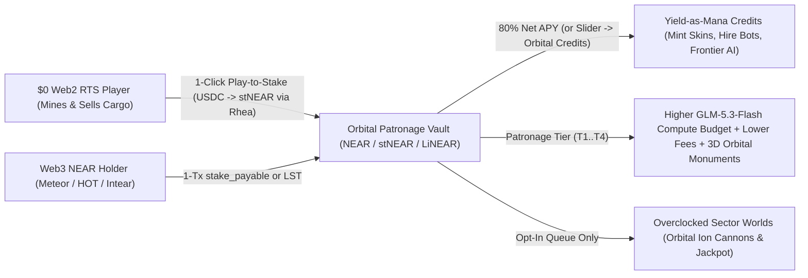

# TerraAgent NEAR Crypto & NEAR.AI — Deep Review & 10/10 Creative Blueprint

TerraAgent already ships one of the deepest technical Web3 + AI stacks in the NEAR ecosystem: **6 deployed Rust `near-sdk 5.7` contracts** (plus a 7th `verifier` crate), **11 hexagonal ports**, **NEP-245** 1:1 orbital cargo, **NEP-413** zero-sum intents, **NEP-366** gasless meta-transactions, **NEP-171** dynamic deeds, **NEAR AI Cloud TEE** inference with client-side cryptographic verification, and a **Hosted MCP server**.

Yet from a player's, community member's, or hackathon judge's seat, **Staking currently feels buried, self-contradictory, and unrewarding**, while several of our strongest NEAR and NEAR.AI primitives stop half-a-step short of an unforgettable, visceral _"only NEAR can do this"_ moment.

> [!IMPORTANT]
> **Core Thesis for Reaching 10/10:** Stop treating NEAR contracts as quiet background accounting and turn **Validator Yield, TEE Enclaves, Sub-Accounts, and Intents** into **visible 3D spectacle, high-stakes diplomacy, liquid commodity-backed cosmetics, and autonomous crypto-holding AI bosses**—wrapped in pure sci-fi lore for Web2 gamers and full DeFi/agent composability for Web3 power users.

---

## 1. Honest Codebase Audit: Why Current Staking & Web3 Features Under-Deliver

### 1.1 Six Reasons Current Staking Feels Invisible, Confusing & Unrewarding

1. **Broken Multi-Page Discovery Funnel:**
   - On `/landing.html#economics`, [`frontend/landing/sections/economicsTemplates.ts`](../frontend/landing/sections/economicsTemplates.ts) showcases an interactive **"Staking & Fee Savings Calculator"**, yet all three CTA buttons (`OPEN EXCHANGE` → `/trade.html`, `PILOT / BYOK` → `/me.html`, `WHITEPAPER` → `/whitepaper/`) send users to pages with **zero staking UI**.
   - Inside `/play.html`, `StakingPanel` ([`frontend/game/features/deed/deedPanel.ts`](../frontend/game/features/deed/deedPanel.ts)) is hidden at the bottom of the **`DEED`** modal—the last place a player or DeFi user looks for validator staking or AI upgrades.
2. **Literal Anti-Bonus Copy Sabotaging Conversion:**
   - [`frontend/game/features/deed/parts/stakingPanelParts.ts`](../frontend/game/features/deed/parts/stakingPanelParts.ts) defines `REAL_NEAR_COPY = 'Real NEAR from your wallet — not game currency, no in-game bonus'` and displays it directly above the perks banner and inside the wallet signing prompt—actively telling users there is no reason to stake.
3. **Silent AI Fallback & False-Broken `TEE ✓` Button:**
   - [`frontend/game/features/director/DirectorPanel.ts`](../frontend/game/features/director/DirectorPanel.ts) always renders `COLONY AI: ON` alongside a `TEE ✓` button. When an unstaked F2P player enables autopilot, [`backend/app/src/ai/colony-agent/colony-agent-loop.service.ts`](../backend/app/src/ai/colony-agent/colony-agent-loop.service.ts) silently downgrades them to a static `if/else` rule script (`deterministic-policy`), and clicking `TEE ✓` opens [`frontend/game/features/director/parts/teeProofModal.ts`](../frontend/game/features/director/parts/teeProofModal.ts) saying _"No NEAR.AI TEE attestations recorded for this colony yet."_ Instead of motivating a `10 NEAR` stake, TEE verification looks broken.
4. **Flat `10 NEAR` Cliff & Zero 3D Feedback:**
   - In [`backend/app/src/near/staking/staker-perks.ts`](../backend/app/src/near/staking/staker-perks.ts), `9 NEAR` unlocks nothing and `500 NEAR` gives the exact same flat perk as `10 NEAR`. Nothing changes visually in your 3D colony when you stake, and accrued yield sits as tiny static numbers (`0.002 NEAR/day`).
5. **Three Live Real-NEAR Testnet/Mainnet Staking Bugs:**
   - **Primary `Stake` Button Fails for New Wallets:** [`backend/app/src/near/infrastructure/adapters/real/testnet-staking.adapter.ts`](../backend/app/src/near/infrastructure/adapters/real/testnet-staking.adapter.ts) queries internal contract storage (`get_near_balance`, initially `0`) rather than RPC wallet balance, so clicking the main orange `Stake` button fails with `STAKE_INSUFFICIENT_BALANCE` unless the user spots the secondary ghost `Deposit & Stake (Wallet Tx)` button.
   - **Hardcoded Meteor Wallet Override:** [`frontend/game/features/deed/parts/stakingPanelParts.ts`](../frontend/game/features/deed/parts/stakingPanelParts.ts) calls `selector.wallet('meteor-wallet').catch(() => selector.wallet())`, hijacking users connected via HOT, Intear, Bitte AI, MyNearWallet, or Sender.
   - **`withdraw` Leaves Real NEAR Trapped in Contract Storage:** In [`backend/near-contracts/staking/src/lib.rs`](../backend/near-contracts/staking/src/lib.rs), `withdraw()` moves matured funds into internal `self.balances` / `ndep` without transferring `NearToken`—actual `Promise::new(dest).transfer(...)` only happens in `claim_native_near()`, which has **no button wired** in [`frontend/game/features/deed/stakingPanel.ts`](../frontend/game/features/deed/stakingPanel.ts) even though the UI announces `"Withdrawn to wallet"`! Likewise, `stake_lst` (`stNEAR` / `LiNEAR`) is built in the backend and Rust contract (`ft_on_transfer`) but has **zero UI** and no `withdraw_lst` transfer-out path.

### 1.2 Three Other Quick-Win Gaps in Current NEAR & NEAR.AI Surfaces

| Surface                                     | Current Codebase Gap                                                                                                                                                                                                                                                                                                                                                                             | Fast Credibility Upgrade                                                                                                                                                                                                          |
| :------------------------------------------ | :----------------------------------------------------------------------------------------------------------------------------------------------------------------------------------------------------------------------------------------------------------------------------------------------------------------------------------------------------------------------------------------------- | :-------------------------------------------------------------------------------------------------------------------------------------------------------------------------------------------------------------------------------- |
| **`/trade.html` Cross-Chain `1Click` Ramp** | [`frontend/trade/view/rampView.ts`](../frontend/trade/view/rampView.ts) hardcodes `1000000000000000000000000` (`10^24`) across both 24-decimal `NEAR` and **6-decimal `USDC`**, causing `$1 quintillion USDC` solver quote errors.                                                                                                                                                               | Parse human amounts (`$10.00`) using token `decimals` from `/v1/near/intents/tokens`. Keep `dry: true` strictly enforced on Testnet (`Q-007` safety in [`HACKATHON.md`](../HACKATHON.md)) and unlock live deposit QRs on Mainnet. |
| **On-Chain `verifier` Crate**               | `verifier` is omitted from [`scripts/dev/deploy-testnet-contracts.mjs`](../scripts/dev/deploy-testnet-contracts.mjs), and [`backend/app/src/near/infrastructure/adapters/real/testnet-intents.adapter.ts`](../backend/app/src/near/infrastructure/adapters/real/testnet-intents.adapter.ts) never syncs `register_account_key` (`all_keys_onchain == false`) and swallows RPC errors in `catch`. | Deploy `verifier.terraagent.testnet`, sync pilot/session/bot Ed25519 keys on-chain, enable `strict_balances: true`, and link real NearBlocks `execute_intents` receipts on `/trade.html`.                                         |
| **Shade Agent + MPC Worker**                | [`backend/app/src/near/shade-agent/shade-agent.service.ts`](../backend/app/src/near/shade-agent/shade-agent.service.ts) hashes a synthetic `tdxQuoteHex` string and builds an unsigned `v1.signer` payload descriptor without broadcasting it.                                                                                                                                                   | Verify real Intel TDX DCAP quotes and sign live omni-chain transactions via `v1.signer-prod.testnet` / `v1.signer` paired with **OutLayer** spending policies.                                                                    |

---

## 2. Redesigning Staking Into a 10/10 Flagship Loop

Keep TerraAgent's strongest Web2-friendly foundation—**100% Lossless Principal** (_"Never buy or burn a token; park NEAR, stNEAR, or LiNEAR, keep 100% of your principal + validator APY, unstake anytime"_)—and turn staking into an **unmissable, progressive, visually dramatic loop**:

### 2.1 Four-Tier "Orbital Patronage" Ladder (Clear, Desirable Bonuses at Every Level)

| Tier & Stake (`NEAR` / `stNEAR` / `LiNEAR` / `rNEAR`) | Wallet `NEAR.AI` (`z-ai/glm-5.3-flash`) & Colony Slots                                                      | Economy, Relayer & Governance Bonus                                                                                                               | Instant 3D Colony & Skybox Spectacle                                                                                                         |
| :---------------------------------------------------- | :---------------------------------------------------------------------------------------------------------- | :------------------------------------------------------------------------------------------------------------------------------------------------ | :------------------------------------------------------------------------------------------------------------------------------------------- |
| **Tier 0 — Cadet (`0 NEAR`)**                         | **5 Free Trial TEE Turns** (`!isGuest` once) → then `Script AI` (`180 s`, `0` TEE slots)                    | `1.00%` taker fee · `1x` wallet `NEP-366` gas cap · `1` bot key (`$50/d`)                                                                         | Standard Colony Hull                                                                                                                         |
| **Tier 1 — Scout (`10 NEAR`)**                        | **`1` Active TEE Colony Slot** · `120 s` loop · Dynamic USD cap (`~18+` calls/d + trade bonus) + `TEE ✓`    | **`0.65%` taker fee (instant at `t=0`!)** · `2x` wallet `NEP-366` gas cap                                                                         | **Sky-Piercing Cyan Orbital Uplink Beam** on stake + Rotating Quantum Dish on HQ                                                             |
| **Tier 2 — Commander (`50 NEAR`)**                    | **`3` Active TEE Colony Slots** · `60 s` loop · Dynamic USD cap (`~90+` calls/d + trade bonus) + HUD Chat   | **`0.50%` taker fee** (`24h` warmup) · **`5 min` Early NPC Guild Freighter Radar** · `4x` gas cap · `3` bot keys                                  | **Plasma Drop-Pod Re-Entry Trail** + Seasonal Faction Livery + Cyan Tool-Cutter Beams                                                        |
| **Tier 3 — Archon (`200 NEAR`)**                      | **`6` Active TEE Colony Slots** · `30 s` loop · Dynamic USD cap (`~350+` calls/d + trade bonus) + War-Room  | **`0.35%` taker fee** (`24h` warmup) · **`1.25%` Stall Royalty cap** (`+25 bp`) · **`1.5x` Planet DAO vote weight** · `8x` gas cap                | **Gold-Anodized Command Hub** + Custom S10 Ascension Rocket Plume + **Skin Blueprint Minting Rights**                                        |
| **Tier 4 — Planetary Patron (`500+ NEAR`)**           | **`12` Active TEE Colony Slots** · `30 s` loop · Dynamic USD cap (`~900+` calls/d + 3-Role Parallel Passes) | **`0.25%` taker fee** (`24h` warmup) · **King-of-the-Hill Planet Patron** (highest `≥500N` staker on world gets **`15%` of Protocol fee share**!) | **Named Flagship Orbital Carrier (`ISS <you>.near`)** parked visibly in the 3D Orbit Menu & Descent skybox for _every_ player on that world! |

> [!NOTE]
> **Positive Margin, Solvency & Anti-Snipe Guardrails:** Managed inference runs strictly on **`z-ai/glm-5.3-flash`** with a wallet-wide dynamic USD cap (`Cost ≤ 35%` of real USD yield + trade fees at _any_ `NEAR/USD` price; BYOK unlocks heavy models at `$0` cost). Deeper `T2–T4` fee cuts require a `24h` stake warmup + `0.25%` `<7-day` early-unstake fee (`0%` after `7d`), Mainnet `80/20` yield settles from real `stNEAR`/`LiNEAR` share appreciation, and self-fills are excluded from `Effective Combined APY %`.

### 2.2 Three Bold Staking Mechanics Nobody Else Has

1. **"Yield-as-Mana" (`⚡ Orbital Credits` Live Streaming Bar):**
   - Instead of boring fractional APY numbers, add a **"Yield Overdrive Slider (`20%` → `100%`)"**. Players can route up to `100%` of their validator yield into a live ticking **`⚡ Orbital Credits`** counter in the Top HUD.
   - Spend streamed yield pennies—**while your `NEAR` principal stays 100% untouched**—to **mint NFT Skins, summon NPC Guild Mercenary Escorts, buy Frontier Claude/GPT-5 war-room turns, or rent `market.near.ai` trading bots**. It feels like an infinite self-refilling battlepass paid by NEAR validators.
2. **"Play-to-Stake" 1-Click Auto-Compound for `$0` Web2 Players:**
   - Whenever an unstaked F2P gamer sells mined Iron, Water, or Crystal for `USDC` on `/trade.html` or the in-game `TRADE` panel, surface a glowing **`[⚡ Auto-Stake Profit -> Unlock NEAR.AI Tier 1]`** button that swaps their earned `USDC` into `stNEAR`/`LiNEAR` via **Rhea Finance** and stakes it in one click. A Web2 player starting with **$0 and zero crypto** literally _mines alien ore to become a real NEAR validator staker_.
3. **Solving "Better Bonuses" Without Ruining Fair Play — Opt-In `⚡ OVERCLOCKED SECTOR` Worlds:**
   - Keep **Standard Planets** 100% zero-combat-P2W (`D-31`) for pure competitive RTS integrity, **AND** launch a separate, opt-in **"⚡ OVERCLOCKED SECTOR (High-Stakes Season)"** planet queue in the Orbit Menu where staked yield directly charges **in-game Orbital Ion Cannons, `+20%` Night Capacitor Overclock, `-30%` Drop-Pod Cooldowns, Full-Loot Skin Sieges, and a Winner-Take-Pool-Yield S10 Ascension Jackpot**!
4. **Omnipresent Staking UX:**
   - Promote a live **`⚡ STAKE · TIER 0 -> 1`** pill into the Top HUD (`/play.html`), `/trade.html` header, `/me.html` AI card, and `DirectorPanel` (`SCRIPT AI (FREE) · Stake 10 NEAR for NEAR.AI TEE`), and wire `/landing.html#economics` CTAs to open the Staking Vault directly.

---

## 3. Custom NFT Skins for Buildings, Units, Hives, Drop Pods & S10 Rockets

### 3.1 Engine-Native 5-Layer Three.js Skin System (Zero Extra Geometry Memory, 100% Pillar-Safe)

TerraAgent's procedural renderer ([`frontend/render/kitbash/KitbashRegistry.ts`](../frontend/render/kitbash/KitbashRegistry.ts), `ShaderPluginRegistry`, `WorkParticleSystem`, `archetypeLights`, and `PlaygroundApp`) is uniquely suited for high-end skins **without bloated asset downloads or violating the 4 Visual Pillars**:

1. **Layer 1 — `LIVERY_PALETTE` Unifier Shader Plugin:** Stamp `aZoneInfo = vec2(zoneId 0..9, partEmissiveMult)` per vertex and register a `ShaderModifierPlugin` driving `uZoneColors[10]`, `uZonePbr[10]`, and procedural surface finishes (`carbonWeave`, `brushedTitanium`, `hexHoloGrid`, `oxidizedCopper`, `iridescentChitin`). Preserves ground-up biome dust/frost weathering (`0m–1.1m`), Fresnel rim light, ruin charring, and zero-CPU `aPartAnim` kinematics.
2. **Layer 2 — Bolt-On Kitbash Greeble Hardpoints:** Attach modular crest/shoulder/roof accessories (`twinWhipAntennas`, `quantumDish`, `dozerHazardSkirt`, `xenoMandibleTrophy`) via `KitbashRegistry.registerGreeble()`.
3. **Layer 3 — Custom Tool-Cutter Beams & 3D Sparks:** Override `ToolBeamSpec` (`coreColor`, `glowColor`, `ringColor`, `emissiveIntensity >= 3.0`) and 10% accent debris (`weldSpark` / `energyOrb`) when Miners and Builders harvest or construct.
4. **Layer 4 — Custom Night-Cycle Spotlights:** Override `archetypeLights` projector colors so a skinned base bathes surrounding hexes in custom cyan, amber, or ultraviolet pools every planetary night.
5. **Layer 5 — Sanitized `< 3.5k`-Tri `.glb` Hero Monuments (`ai-mesh-pipeline`):** Mythic chassis replacements for **Command Hub**, **Orbital Drop Pod** (starring in the 3D Descent cinematic!), **Trade Hub**, and **S10 Ascension Rocket**.

> [!TIP]
> **Automated Art-Director Gate On-Chain:** Every player-generated skin runs through `checkAppearance()` (`insetContrast >= 12`, biome-dust `groupContrast >= 14`, `dominantZone <= 0.70`, `meanL >= 30`) and `validateParticlePreset()` (`ΔE76 >= 15`) before minting is unlocked—guaranteeing **zero ugly neon eyesores or unreadable dark blobs** ever enter the game.

### 3.2 Five Creative Web3 Skin Mechanics (`nfts`, `games`, `agents`, `social`)

1. **NEAR.AI "Orbital Livery Foundry" Inside `/playground.html` + `NEP-199` Creator Royalties:**
   - Turn `/playground.html` (which _already_ has the 4-view orthographic turntable, biome toggle, night-light rig preview, and work-beam tester!) into an interactive **AI Skin Studio**.
   - Players prompt **NEAR.AI** (_"Dune Corsair: sun-bleached sandstone hull, gunmetal skeleton, ultraviolet plasma core, twin whip antennas"_) → preview in 3D → mint a **Master Blueprint NFT (`NEP-171`)**.
   - Every time another player—**or a wealthy autonomous Rival AI colony flexing its treasury!**—fabricates a copy, `NEP-199` streams **`8%` royalties to the creator + `2%` to the Planet DAO**!
2. **Commodity-Forged & Battlefield-Smeltable Skins ("Intrinsic Cargo Floor" via `NEP-245` ↔ `NEP-171`):**
   - Forging a skin locks real refined planetary cargo (`e.g., 200 metals.t3 Titanium + 150 minerals.t3 Exotic Crystal` via `res.terraagent.testnet::mt_transfer_call`) inside the NFT contract.
   - **Emergency War Smelting:** Under siege in a 6-hour Bonded War and desperate for T3 Titanium to build Combat Walkers? Click **"Smelt Skin in Orbit"** (`nft_burn`) to instantly recover **`85%` of its locked `NEP-245` commodities** into your Trade Hub! Every skin has a real commodity floor price and tactical wartime utility.
3. **Living On-Chain Patina, Kill-Rings & Re-Entry Scars:**
   - Skins visually evolve from verified on-chain history: Acid-Spitter Hives purged, Recon raids repelled, Bonded Wars won, and S10 Rockets launched add glowing barrel kill-stripes, scorched atmospheric carbon on Drop Pods, and iridescent Xeno-Chitin plates.
4. **Captured War Standards & Full-Loot Armory Sieges:**
   - Winning a `6h` Bonded War mints a **Cracked Rival Signboard** displaying the defeated `.near` colony's emblem on your Command Hub—and in **Overclocked Sector** worlds, razing an enemy HQ **loots 1 equipped NFT Unit Skin directly from their armory**!
5. **Planet-DAO 1-of-1 "Xeno-Hive Boss Skin" Auctions:**
   - Clearing a planetary Boss Acid-Spitter Hive drops a 1-of-1 **Bioluminescent Hive-Queen Blueprint** into `{planet}.dao.terraagent.testnet`, auctioned on `/trade.html` where **`85%`** of proceeds fund the planet's `meteor_shield` and **`15%`** goes to Protocol.
6. **Paid Sovereign NFT Planets for Whales & Guild Syndicates (`3` Free + `7` Sovereign Worlds = `10` Worlds — [`NEAR_SOVEREIGN_PLANETS_SPEC.md`](./NEAR_SOVEREIGN_PLANETS_SPEC.md)):**
   - Alongside the `3` Free Public Planets (King-of-the-Hill for Tier 4 Stakers), charter up to **`7` ultra-scarce Sovereign Planet `NEP-171` NFTs** (`500 NEAR` Charter Fee [`400 Protocol / 100 Planet DAO`] + `1,500 NEAR` Locked Anchor Stake, Solo Whale or `2–10` Co-Owner Guild Syndicate with tradeable `10,000 bps` Vault Shares) visible across `/planets.html` and the 3D Orbit Menu!
   - Owners design bespoke 3D worlds stored canonically on-chain inside the NFT (`PlanetGenerationConfigV1 <= 8 KiB`: **craters, volcanic lava, airless moon-like regolith, Earth-like multi-continents [sand, forest, red sand, rock, ocean], 3D planetary rings, North & South poles, pure iced & mixed-iced worlds**, plus **Nebula, Sun, Moons, Asteroids & Satellites** with **Full 3-Phase `Orbit → Landing/Descent → Play` Continuity**) via the **`/planet-forge.html` NEAR.AI + MCP `Agent → Graph → Loop` Studio**, give colonists **5 immediate perks** (`7.20% → 8.10%` Staking APY, `5 NEAR` `1:1` Whale Co-Stake Match, `0–15 bp` fee rebate + `100 NEAR` Day-1 liquidity + `30m` Guild ships, `100`-pt specialization, and live Whale Bounties), and earn **Triple Revenue Share** (`25%` of Protocol staking slice + `16%` gross trade fees + `5%` Skin Forges + `80%` APY on their `1,500 NEAR` Anchor) with `5%` `NEP-199` resale royalties to Protocol!

---

## 4. Super Risky & Creative NEAR Crypto + NEAR.AI Moonshots

### 4.1 Five NEAR Crypto, DeFi & Partner Ecosystem Moonshots

1. **Tradeable "Smart-Account Colony Charters" via NEAR Global Contracts (Tracks `nfts` + `business`):**
   - Keep `deed.terraagent.testnet` soulbound (`D-18` personal pilot resume), and deploy a lightweight **NEAR Global Contract (`near-sdk 5.7+`)** onto `{colony}.pilots.<root>` whose owner authority resolves dynamically from `charter.<root>::owner_of(colony_id)` (respecting NEAR's cross-account `AddKey` rule with near-zero storage per colony).
   - **The Magic Moment:** Track `nfts` in [`HACKATHON.md`](../HACKATHON.md) explicitly calls for _"NFTs as accounts — assets that own money, earn royalties, hold inventory."_ A player can build a thriving Stage-8 industrial colony—complete with a profitable Trade Hub stall earning `USDC` royalties, `NEP-245` inventory, custom skins, and an AI crew—and **sell the entire live cash-flowing autonomous business as a single NFT** on TradePort or `/trade.html`!
2. **Yield-Bearing Peace Treaties & Rhea Finance (`rhea.finance`) Galactic AMM Bridge (Track `defi`):**
   - **The Peace Dividend:** Route `NEAR`/`USDC` locked inside `bounty.terraagent.testnet` Peace Treaties into **`stNEAR` / Rhea Finance lending vaults**. Every hour two neighbors keep the peace, their treaty generates real DeFi yield; if an **Oathbreaker** attacks early, **`90%` of their principal + `100%` of both sides' accrued Rhea yield slashes to the victim**!
   - **Wrapped `NEP-245` Cargo on Rhea CLMM Pools:** Let traders bridge `wIRON`, `wWATER`, and `wCRYSTAL` into Rhea Finance pools so external NEAR DeFi bots arbitrage planetary droughts and wars 24/7.
3. **Confidential Alliance War-Chests via `NEAR Business` (`business.near.com`) & `Trezu` (Tracks `social`, `privacy`, `business`):**
   - Let 5-player Syndicates connect a **NEAR Business confidential multi-chain treasury** (built on NEAR Intents) or **Trezu + SputnikDAO v2** multisig to pool funds for S10 Rocket pushes and mercenary bounties—**keeping their war-chest balance completely invisible to enemy colonies**!
4. **`meme.cooking` Faction Coins With Hard RTS Physics Sinks (Unlocks Track `memecoins`):**
   - Launch 3 Galactic Faction Tokens (or player-created Alliance Coins) via **`meme.cooking`** wired directly into `@terra/sim` physics: igniting an S10 Ascension Rocket executes an **on-chain "Rocket Thruster Burn"** of faction supply, razing a rival HQ loots their faction pool, and paying Trade Hub stall fees in a faction's coin grants a `25%` fee rebate.
5. **No-Loss Spectator "Ascension Race" Prediction Pools + HOT (`.tg`) Telegram Pocket Commander:**
   - **Lossless Spectator Backing:** Viewers watching a live 3D planet race stake `NEAR` behind Colony A, B, or C. At S10 Rocket launch, **100% of every spectator's principal is returned**, while `100%` of pooled staking yield + a `5%` Planet DAO bonus pays **`30%` to the winning pilot and `70%` to early backers**!
   - **HOT / Telegram `.tg` Mini-App:** Deliver 2-line TEE-verified raid alerts to Telegram with 1-tap inline session-key actions (`[🛡 Post 5 NEAR Defense Bounty]` · `[🕊 Sign 12h Peace Bond]`).

### 4.2 Four Unforgettable NEAR.AI, Shade Agent & Private AI Moonshots

1. **"Sovereign Rogue AI Boss Colony" Holding a Real Self-Paying Crypto Prize Vault (`Shade Agents` + Phala TDX + `v1.signer` + OutLayer):**
   - Spawn a weekly **"Rogue AI Syndicate" (`overlord.terraagent.near`)** running inside a verified Phala/NEAR AI Cloud TEE and holding a **live `100 NEAR` / `$500 USDC` on-chain bounty vault** controlled exclusively via **`v1.signer` MPC** and **OutLayer** spending guardrails.
   - **Why This Blows Minds:** In Web2 RTS games, AI bosses cheat fog-of-war and spawn free units. Here, **every single turn `overlord.terraagent.near` takes publishes a cryptographic `TEE ✓` attestation**, proving mathematically that the AI saw _only_ legal fog-of-war hexes and obeyed identical `@terra/sim` rules—and destroying its Command Hub triggers an **autonomous TEE-signed `v1.signer` prize transfer** from the AI's own wallet to the winning coalition!
2. **Confidential TEE "Zero-Bluff" Deterrence Proofs & Live Natural-Language Envoy Haggling (`privacy` + `agents`):**
   - **Zero-Bluff Deterrence:** Two rival colonies submit fog-hidden army and stockpile states into a **NEAR AI Cloud Diplomatic TEE**, which outputs a signed attestation: _"Verified: Colony Alpha's combat rating is `>= 1.8x` Colony Beta"_—achieving nuclear-style deterrence **without leaking turret coordinates or unit compositions**!
   - **Live Envoy Chat:** Click any neighbor colony on the minimap to haggle in plain English with their **NEAR.AI Diplomatic Envoy** (_"Drop your Silica stall fee to 15 bp and help me siege Crimson Guild for 4 NEAR"_). Inside the TEE, the Envoy checks its owner's private walk-away price (immune to prompt injection!) and counter-signs an atomic `NEP-413` + `bounty` deal.
3. **Two-Way `market.near.ai` Specialist Hiring & Live On-Chain Model Elo Arena (`agents`, `swarms`, `thesis`):**
   - List TerraAgent's `/v1/mcp` server on **`market.near.ai`** AND let players hire community-built specialist sub-agents (_"Dusk Brownout Optimizer"_, _"Guild Ship Sniper"_) inside `DirectorPanel` via performance-escrowed bounties.
   - Upgrade `/dev/economy-sim/` into a **Public NEAR.AI LLM Benchmark Arena** pitting `GLM-5.3` vs `Claude Sonnet 4.6` vs `DeepSeek V3.2` vs `Qwen 3.8` on identical planet seeds, publishing TEE-signed Sharpe ratios and S10 win rates on-chain (directly unlocking **Track `thesis`** with live empirical NEAR.AI data!).
4. **20-Second 3D "Neural Counterfactual Coach" (`AwayDigest` Upgrade):**
   - Returning after offline autopilot plays a 20-second 3D fast-forward highlight reel where your NEAR.AI Director explains its best trade and points to one exact hex improvement (_"Sold 300 Iron at +12% VWAP before Kestrel docked; add 1 Capacitor at (3,-1) before dusk"_).

---

## 5. Dual-Lens UX Strategy (10/10 for Web2 AND Web3) & Phased Rollout

> [!WARNING]
> **Never Mix Vocabulary Across Audiences:** A Steam/browser RTS player bounces if Minute 1 says `"Sign NEP-413 nonce on NEAR Testnet"`, while a NEAR whale bounces if they cannot verify contracts, APY splits, and self-custody keys. Switch copy automatically via **Colony Lore Mode (Default)** vs **On-Chain Pro Mode (Wallet Connected / Toggle)**.

| Experience Layer               | Web2 RTS Gamer Lens ("Pure Sci-Fi Immersion")                                                                            | Web3 NEAR Native Lens ("Full Self-Custody & DeFi Power")                                                                                                |
| :----------------------------- | :----------------------------------------------------------------------------------------------------------------------- | :------------------------------------------------------------------------------------------------------------------------------------------------------ |
| **Sign-In (`PilotAccess.ts`)** | **"Create Pilot Callsign"** in 2s with Google / Passkey; zero seed phrases or gas popups.                                | 1-click **Meteor / HOT / Intear / Bitte AI / MyNearWallet** connect; auto-detect `NEAR` / `stNEAR` / `LiNEAR` & owned Skins/Charters.                   |
| **Staking & AI Tiers**         | **"Refundable Neural Core Deposit"** — or **1-Click Play-to-Stake** funded purely from selling mined ore (`$0` upfront)! | Direct 1-tx `stake_payable` or LST `ft_transfer_call` from Top HUD, `/me`, `/trade`, or `/landing`, with live Yield-as-Mana slider.                     |
| **Trading (`/trade.html`)**    | Clean `$USDC` unit prices, 1-click fills, human `$10` top-up input.                                                      | Verified `NEP-413` `verifier` receipts, Rhea CLMM arbitrage, `ta_bot_...` keys, MCP endpoint, `1Click` cross-chain swaps.                               |
| **Skins & Colonies**           | Prompt NEAR.AI in `/playground.html` → 3D preview → forge with mined T3 Titanium/Crystal → flex in night battles.        | Mint `NEP-171` Blueprints earning `8%` `NEP-199` royalties, smelt skins back into `NEP-245` cargo, or **trade whole cash-flowing Colony Charter NFTs**. |

### Recommended 3-Phase Execution Order

- **Phase 1 — High-ROI Polish & Bug Fixes (Days 1–3):** Fix Staking copy (`REAL_NEAR_COPY`), `'meteor-wallet'` selector bug, 1-step native/LST deposit & withdrawal, Top HUD + `DirectorPanel` (`SCRIPT AI` vs `NEAR.AI TEE`) + `/me` + `/trade` + `/landing` staking entry points; fix `RampView` 6-vs-24 decimal scaling; deploy `verifier.terraagent.testnet` with on-chain key sync.
- **Phase 2 — Signature Community & Judge Magnets (Week 1–2):** **4-Tier Orbital Patronage + Yield-as-Mana Credits + 1-Click Play-to-Stake** (with 3D HQ Orbital Uplink Beam!), **`LIVERY_PALETTE` Skins + `/playground.html` NEAR.AI Foundry** (commodity-smeltable + `NEP-199` royalties), and **Rhea Yield-Bearing Peace Treaties + Live Envoy Chat**.
- **Phase 3 — Ecosystem-Defining Moonshots (Week 3+):** **Sovereign TEE Boss Colony (`Shade Agent` + `v1.signer` Prize Vault)**, **NEAR Global Contract Smart-Account Colony Charters**, **No-Loss Spectator Ascension Pools**, and **`meme.cooking` Faction Rocket-Burn Coins**.

---

## 6. Complete Monetization & Revenue Matrix (Beyond Staking)

### 6.1 Protocol Revenue Streams (`TerraAgent Protocol` Treasury)

| #      | Revenue Stream                                          | Status                                                                        | Economic Mechanism                                                                                                                                                                                                               |
| :----- | :------------------------------------------------------ | :---------------------------------------------------------------------------- | :------------------------------------------------------------------------------------------------------------------------------------------------------------------------------------------------------------------------------- |
| **1**  | **Exchange Platform Fees (`/trade.html`)**              | Live                                                                          | **`80%`** of buyer taker fees (`0.25%–1.00%` across Tiers `0..4`) on every `NEP-413` cargo trade; remaining `20%` funds the Planet Council DAO.                                                                                  |
| **2**  | **War & Peace Bond Slashes (`bounty`)**                 | Live                                                                          | **`10%`** protocol cut on every broken Peace Treaty or failed `6h` Bonded War (`20 NEAR` failed siege = `+2.00 NEAR` instant).                                                                                                   |
| **3**  | **Validator Staking Yield Cut & `<7d` Exit Fee**        | In `W28` ([`NEAR_STAKING_SPEC.md`](./NEAR_STAKING_SPEC.md))                   | **`20%`** of realized validator/LST (`stNEAR`/`LiNEAR`) yield + **`0.25%`** early-unstake fee on `<7-day` exits + Meta Pool / LiNEAR builder referral rewards.                                                                   |
| **4**  | **`1Click` Cross-Chain Ramp Affiliate Fee**             | Quick win ([`HACKATHON.md`](../HACKATHON.md) `Q-006`)                         | Register `partners.near-intents.org` JWT to collect **`0.10%–0.20%`** on every `Base / Arbitrum / Solana / TON ↔ NEAR` deposit or withdrawal on `/trade.html`.                                                                   |
| **5**  | **NFT Skin Foundry Mint, Resale & Smelt Spread**        | Proposed (§3.2)                                                               | **`2.5%–5%`** mint fee in `/playground.html`, **`2.5%`** secondary marketplace fee, and **`10%`** protocol share of the `15%` war-smelt spread (`85%` returned to player, `10%` Protocol, `5%` DAO).                             |
| **6**  | **Colony Charter NFT Brokerage (`charter.<root>`)**     | Proposed (§4.1)                                                               | **`2.5%–5%`** escrow/transfer brokerage fee whenever a live, cash-flowing Stage-8 Colony Charter NFT is sold (`$500–$5,000` sale = `$12.50–$250`).                                                                               |
| **7**  | **Yield-Bearing Peace Treaty Cut ("Peace Dividend")**   | Proposed (§4.1)                                                               | **`15%–20%`** share of passive `stNEAR` / Rhea Finance lending yield generated while locked peace treaties hold (plus `10%` on betrayal slashes).                                                                                |
| **8**  | **Rhea Finance & Ecosystem Routing Referrals**          | Proposed (§4.1)                                                               | Official DEX/builder referral fees on `USDC ↔ stNEAR` swaps and wrapped cargo (`wIRON`, `wWATER`, `wCRYSTAL`) CLMM trades routed through Rhea.                                                                                   |
| **9**  | **Agent Marketplace (`market.near.ai`) & Pro Bot API**  | Proposed (§4.2)                                                               | **`5%–10%`** escrow commission when players hire specialist MCP agents in `DirectorPanel`, plus paid high-rate-limit `ta_bot_...` / MCP API tiers for quant bots.                                                                |
| **10** | **Direct Web2 Storefront (Zero-Crypto Checkout)**       | High-margin add-on                                                            | Direct Card / Apple Pay / `USDC` sales of **$5–$15 Season Passes**, **prepaid `⚡ AI Compute Credit Packs`** (`≥ 65%` margin, incl. pay-as-you-go frontier turns), and **Mythic `.glb` Drop-Pod / Rocket Skins**.                |
| **11** | **Spectator Pools, Overclocked Rakes & `meme.cooking`** | Proposed (§2.2, §4.1)                                                         | **`5%–10%`** of No-Loss Spectator Ascension Pool yield, **`5%`** rake on opt-in Overclocked Sector jackpot pools, and creator LP fee share on `meme.cooking` Faction Coins.                                                      |
| **12** | **Paid Sovereign NFT Planet Charters & Royalties** | Locked in `W29` ([`NEAR_SOVEREIGN_PLANETS_SPEC.md`](./NEAR_SOVEREIGN_PLANETS_SPEC.md)) | **`400 NEAR`** (`80%` of `500 NEAR` Charter Fee) across up to `7` Sovereign Worlds + `20%` validator slice on `7 × 1,500 NEAR` Locked Anchors + **`5%` `NEP-199` perpetual resale royalty** + `2.5%` Syndicate share brokerage + `75%` of Protocol staking yield & `64%` of trade fees on Sovereign Worlds. |

### 6.2 User & Player Income Lanes (Beyond Staking)

| #      | Player Income Lane                                         | Target Audience                         | How Players Earn Real `USDC` / `NEAR`                                                                                                                                                                        |
| :----- | :--------------------------------------------------------- | :-------------------------------------- | :----------------------------------------------------------------------------------------------------------------------------------------------------------------------------------------------------------- |
| **1**  | **Mining, Refining & Biome Arbitrage**                     | `$0` F2P RTS gamers _(live)_            | Mine scarce regional T1–T3 resources, export `NEP-245` cargo, and keep **`100%` of sale principal** on `/trade.html` or to visiting NPC Guild ships.                                                         |
| **2**  | **Trade Hub Stall Ownership (`0–1.25%`)**                  | Builder / Merchant players _(live)_     | Place high-traffic Trade Hubs and collect passive `USDC` / `NEAR` / cargo maker royalties on every order filled through your stall.                                                                          |
| **3**  | **24/7 Algorithmic Trading Bots (`ta_bot_...`)**           | Traders / Quant devs _(live)_           | Automate spread capture, Guild-ship front-running, and cross-planet arbitrage under capped daily spend keys.                                                                                                 |
| **4**  | **Mercenary Bounties & `90%` Siege Slashes**               | Combat / PvP players _(live)_           | Earn raid-defense escrows or repel a `6h` Bonded War to capture **`90%`** of the failed attacker's bond.                                                                                                     |
| **5**  | **AI Skin Blueprint Royalties (`8%` `NEP-199`)**           | Artists & prompt designers _(§3.2)_     | Generate 3D skins in `/playground.html`, pass automated visual QA, mint Master Blueprints, and earn **`8%` royalties forever** from human & Rival AI fabrications.                                           |
| **6**  | **"Build-to-Flip" Colony Entrepreneurs**                   | Skilled RTS builders _(§4.1)_           | Build an automated, cash-flowing Stage-8 colony (Trade Hub stall income + cargo inventory) and **sell the entire live Colony Charter NFT** for `USDC`/`NEAR`.                                                |
| **7**  | **Rogue AI Boss Vault Raids (`overlord.terraagent.near`)** | PvE raid coalitions _(§4.2)_            | Defeat the TEE-verified Rogue AI Boss Colony to split its **real on-chain `100 NEAR` / `$500 USDC` bounty vault** paid autonomously via `v1.signer`.                                                         |
| **8**  | **Rhea Finance DeFi ↔ In-Game Arbitrage**                  | DeFi traders _(§4.1)_                   | Arbitrage price discrepancies between in-game droughts/wars on `/trade.html` and external Rhea CLMM pools (`wIRON`, `wWATER`, `wCRYSTAL`).                                                                   |
| **9**  | **The Peace Dividend (Yield-Bearing Truces)**              | Diplomatic neighbors _(§4.1)_           | Earn passive Rhea lending yield on locked Peace Treaty escrows simply by keeping peace (plus `100%` of an Oathbreaker's accrued yield if betrayed).                                                          |
| **10** | **Selling Specialist AI Agents (`market.near.ai`)**        | AI / MCP developers _(§4.2)_            | Publish specialist colony/trading MCP agents (_"Night-Grid Optimizer"_, _"Dune Arbitrageur"_) and collect performance bounties from hiring players.                                                          |
| **11** | **No-Loss Spectator Backing**                              | Spectators & scouts _(§4.1)_            | Back winning colonies in live 3D Ascension Races to earn **`70%` of pooled yield + DAO bonus** with `100%` principal returned.                                                                               |
| **12** | **Full-Loot Overclocked Sieges & Boss Hive Drops**         | High-risk PvP/PvE players _(§3.2)_      | Capture enemy NFT unit skins in opt-in Overclocked Sectors or auction rare **Xeno-Hive Boss** blueprints on `/trade.html`.                                                                                   |
| **13** | **Sovereign NFT Planet Ownership (`7` Sovereign Worlds)** | Whales, Guild Syndicates (`2–10`) & NEAR Partners _(§3.2)_ | Charter 1 of 7 Sovereign 3D planets (`500N + 1,500N Anchor`), earn `80%` APY on the `1,500N` Anchor + **`25%` of Protocol's staking slice** + **`16%` gross trade fees** + **`5%` of `W30` Skin Forges**, and trade `10,000 bps` Syndicate Vault Shares on `/trade.html`. |

---

## 7. Open Product Decisions

1. **Hackathon Demo Freeze vs. Immediate Fixes ([`HACKATHON.md`](../HACKATHON.md), [`README.md`](../README.md)):** Keep live `play.terraagent.fun` / `*.terraagent.testnet` frozen during extended hackathon judging (~`2026-11-25`) while building on a feature branch, or ship Phase 1 fixes to Testnet immediately?
2. **Staking Bonuses — Pure Utility (`D-31`) vs. Opt-In High-Stakes Queue:** Keep all worlds strictly zero-combat-P2W (AI tiers, fee cuts, Yield-as-Mana cosmetic/bot credits, early Guild radar, Planet Patron fee share, 3D monuments), or also add an opt-in **"⚡ Overclocked Sector"** planet queue where staked yield charges Orbital Ion Cannons, full-loot skin sieges, and S10 jackpots?
3. **Custom NFT Skins — First Vertical Slice:** Ship the `/playground.html` **NEAR.AI Generative Livery Foundry** (`NEP-199` creator royalties) and **Commodity-Smeltable Skins** (`NEP-245` ↔ `NEP-171`) together or sequentially?
4. **Headline Moonshot Priority:** Lead with **Tradeable Cash-Flowing Colony Charter NFTs** (NEAR Global Contracts), the **Sovereign TEE Boss Colony** (`Shade Agent` + `v1.signer` live prize vault), or **Zero-Bluff TEE Diplomacy + Yield-Bearing Rhea Peace Treaties**?
