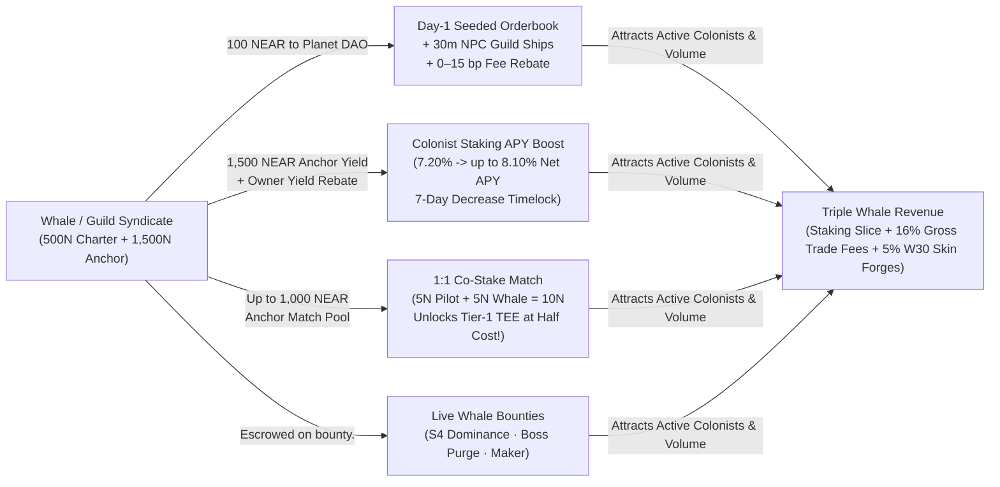
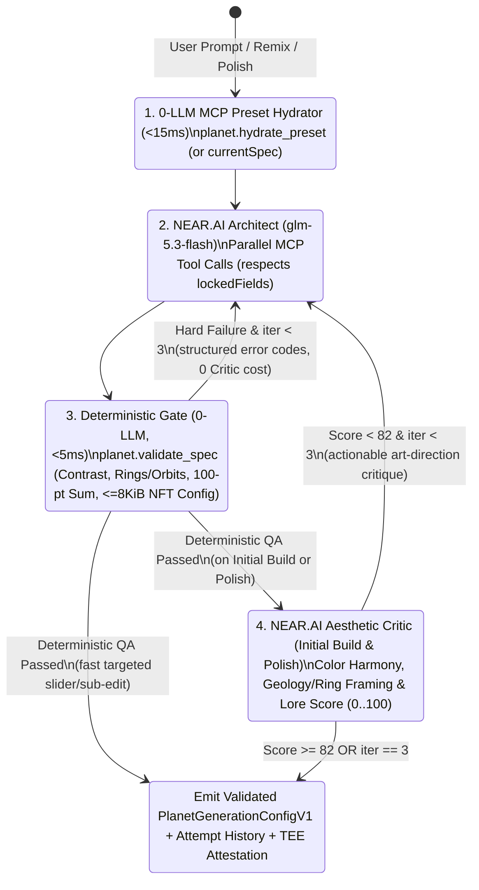

# TerraAgent — Paid Sovereign Planets, `/planets.html` Atlas & NEAR.AI MCP Studio Specification (`W29`)

> **Status:** Economics, Colonist Perks, Season Sharding, Procedural Planet Generation Config & MCP Graph Architecture Locked
> **Source Blueprint:** [`docs/NEAR_PROPOSALS.md`](./NEAR_PROPOSALS.md) · [`docs/NEAR_STAKING_SPEC.md`](./NEAR_STAKING_SPEC.md) · [`docs/NEAR_SKINS_AND_PLANETS_SPEC.md`](./NEAR_SKINS_AND_PLANETS_SPEC.md)
> **Wave Plan:** [`docs/plan/waves/W29-sovereign-planets.md`](./plan/waves/W29-sovereign-planets.md) (followed by [`docs/plan/waves/W30-custom-skins.md`](./plan/waves/W30-custom-skins.md))

This specification defines **Wave 29 (`W29`)** of TerraAgent: **Paid Sovereign Planets (`planets.<root>`)**, **Guild Syndicate Co-Charters**, **5 Active-Colonist Staking & Economy Perks**, **Rolling 14-Day Seasons with Auto-Sharded `24h` Landing Instances**, **Full Procedural Planet Generation Stored On-Chain Inside the NFT (`PlanetGenerationConfigV1`)**—covering **impact craters, volcanic lava, airless moon-like regolith ground, Earth-like multi-continent biomes (sand, forest, red sand, alpine rock, oceans), 3D planetary rings, independent North & South polar ice caps, and pure iced or mixed-iced worlds**—the dedicated **`/planets.html`** Galactic Atlas & Showcase page (with a concise **`/landing.html#planets`** teaser), and the **`/planet-forge.html`** 3D Celestial & Geology **NEAR.AI + MCP `Agent → Graph → Loop`** Studio with **Full 3-Phase Continuity (`Orbit` → `Landing / Descent` → `Playable 3D Hex Surface`)**.

---

## 1. Executive Summary & 10-World Galactic Roster

TerraAgent hosts **up to `10` active worlds** in one shared galaxy—combining free public worlds for baseline play with ultra-scarce, player-benefiting **Paid Sovereign Worlds** chartered by NEAR whales, guilds, and ecosystem partners:

| World Class | Supply Cap | Ownership & Governance | Why Players Land Here |
| :--- | :--- | :--- | :--- |
| **Canonical Free Worlds** (`Kharon Dunes`, `Thalassa Verde`, `Granite Hollow`) | **`3` Worlds** _(always open)_ | Public protocol worlds governed by `{planet}.dao.<root>`; Tier 4 (`500+ NEAR`) Stakers compete **King-of-the-Hill** for temporary Season Patronage (`15%` of Protocol trade fees + `ISS <pilot>.near` Carrier, per [`NEAR_STAKING_SPEC.md`](./NEAR_STAKING_SPEC.md)). | Balanced `1.0x`-baseline biomes, standard `7.20%` net staking APY, `10 NEAR` Tier-1 threshold, `45–60m` NPC Guild ships. |
| **Paid Sovereign Worlds** (`planets.terraagent.<root>`) | **`7` Worlds Max** (`3 + 7 = 10` Total Worlds; `PLANET_FORGE_MODE=open` free on dev/testnet) | Chartered as **`NEP-171` + `NEP-199` NFTs** by a **Solo Whale** OR a **`2–10` Co-Owner Guild Syndicate** (`500 NEAR` Charter Fee + `1,500 NEAR` Locked Anchor Stake = **`2,000 NEAR`** total commitment). | **Boosted `7.20% → 8.10%` Net Staking APY**, **`1:1` `5 NEAR` Whale Co-Stake Match** (Tier-1 TEE at half price!), **`0–15 bp` Trade Fee Rebate + Day-1 `100 NEAR` DAO Liquidity + `30m` Guild Freighters**, **Specialized `2.0x` Resource Niches**, **Live Whale Bounties**, and bespoke **3D Celestials**. |

---

## 2. Whale & Guild Syndicate Charter Economics (`2,000 NEAR` Commitment)

### 2.1 Pricing, `PLANET_FORGE_MODE` Switch & Supply Cap

| Dimension | Locked Rule |
| :--- | :--- |
| **Dev / Testnet Mode (`PLANET_FORGE_MODE=open`)** | Default in local dev, CI, and public Testnet: **1-click free test minting** (`mint_open_test_planet`) with configurable higher test cap so any visitor, judge, or tester can design, test-land, and publish custom 3D Sovereign Worlds immediately. |
| **Mainnet Mode (`PLANET_FORGE_MODE=charter`)** | Hard cap **`MAX_SOVEREIGN_PLANETS = 7`** active Sovereign Planet NFTs. Chartering requires **`2,000 NEAR`** (`~$8,000` at `$4 NEAR`), split into **`500 NEAR` Charter Fee** + **`1,500 NEAR` Locked Anchor Stake**. |
| **`500 NEAR` Charter Fee Split** | **`400 NEAR` (`80%`) → `protocol.<root>`** (immediate protocol treasury revenue) + **`100 NEAR` (`20%`) → `{planet}.dao.<root>`** (automatically seeds **Day-1 `/trade.html` two-sided orderbook liquidity** & planetary defense reserves). |
| **`1,500 NEAR` Locked Anchor Stake** | Delegated inside `planets.<root>` → `staking.<root>` (`stNEAR` / `LiNEAR` share-price-solvent vault on Mainnet), earning real validator yield (`~135 NEAR/yr` gross at `9%`). Directly backs both the **Colonist APY Boost Pool** and the **`1:1` Colonist Co-Stake Match Pool**! |
| **Secondary NFT Resale (`NEP-199`)** | Selling a Sovereign Planet NFT on `/trade.html` or TradePort transfers **the entire live planet + its intact `1,500 NEAR` Locked Anchor Stake** atomically to the buyer, paying a **`5.0%` (`500 bp`) `NEP-199` perpetual royalty** to `protocol.<root>` (`95%` to seller / Syndicate Vault). |
| **`90-Day` Sunset Cooldown** | Calling `begin_sunset()` (Solo Owner or `>= 67%` Syndicate share vote) starts a **`90-day` Sunset Cooldown**: **new shard spin-ups and new `1:1` Co-Stake Match bindings freeze immediately**, active `<= 14-day` shards and existing matched colonists play out cleanly to completion (`<= t + 14d`) without rugging live colonies or `NEAR.AI TEE` access, and at `t + 90d` `finalize_sunset()` unlocks **`100%` of the `1,500 NEAR` Anchor Stake** pro-rata to owner/shareholders and **frees the `1-of-7` Sovereign World slot**. |

### 2.2 Guild Syndicate Co-Charter Vaults (`2–10` Co-Owners + Tradeable `bps` Shares)

Whales can charter solo (`10,000 bps = 100%`), OR **Guild Syndicates (`2–10` co-owners)** can pool `>= 2,000 NEAR` trustlessly on `planets.<root>`:

1. **Trustless Pooling & `72h` Refund Safety:**
   - A founder opens `open_syndicate_charter(draft_spec, lead_governor)` and `2–10` accounts call `contribute_syndicate(charter_id)` with any `NEAR` split summing to `2,000 NEAR` (optional extra contributions above `2,000 NEAR` route into the Planet's Bounty Reserve).
   - If `2,000 NEAR` is not reached within `72 hours` (or cancelled prior to mint), every contributor withdraws `100%` of their deposit with `0%` fee (`refund_expired_syndicate`).
2. **Pro-Rata `10,000 bps` Vault Shares & Transfer-Safe Reward Debt (Tradeable on `/trade.html`):**
   - Upon `finalize_syndicate_charter`, each co-owner receives exact **`bps` Vault Shares** (`share_bps_i = floor(contribution_i * 10_000 / 2_000 NEAR)`, remainder `1–9 bps` assigned to `lead_governor` so `sum === 10_000`).
   - Individual `bps` Vault Shares can be listed and traded on **`/trade.html`** (`2.5%` Protocol / `2.5%` Planet DAO brokerage) so a co-owner can exit or join a thriving planet syndicate anytime without unbonding the planet!
   - Every `NEAR` and `USDC` earned by the planet accrues via **MasterChef-style cumulative accumulators (`acc_near_per_bps`, `acc_usdc_per_bps`) with per-holder `reward_debt` settled atomically BEFORE every `transfer_syndicate_shares` (`claim_planet_revenue`)**, guaranteeing a secondary share buyer can never drain pre-transfer revenue earned by the seller.
3. **Clear Operational vs. Structural Governance:**
   - **Lead Governor (`1` designated co-owner):** Tunes day-to-day planet parameters—**Whale Yield Rebate slider**, **Co-Stake Match cap**, **Local Trade Fee Rebate slider**, **next-shard `100`-Point Specialization**, **Celestial/Visual updates**, and **Whale Bounties**.
   - **`>= 67%` (`6,700 bps`) Share Supermajority Vote:** Required to **list/sell the Sovereign Planet NFT**, **initiate the `90-day` Sunset Cooldown**, or **elect a new Lead Governor**.

---

## 3. Why Colonists Immediately Notice & Prefer Paid Planets (The 5 Player Perks)

Every colonist landing on a Paid Sovereign Planet experiences **five immediate, high-utility economic and staking advantages**—while **`@terra/sim` unit stats, building HP, and weapon damage remain 100% identical (`D-31` zero combat P2W)**:



### 3.1 Perk 1 — Active-Colonist Staking APY Boost (`7.20% → up to 8.10%` Net APY)
- **How It Works:** On standard worlds (`9.00%` gross validator APY), stakers earn `80%` (`7.20%` net) and Protocol receives `20%` (`1.80%` gross). On a Sovereign Planet, the Planet Owner receives **`25%` of Protocol's `20%` slice** (`0.45%` gross; Protocol retains `1.35%` gross) **plus** `80%` net yield on their own **`1,500 NEAR` Anchor Stake** (`108 NEAR/yr` at `9%`).
- **Whale Yield Rebate Slider (`+0 bp` to `+90 bp` Net APY):** The Lead Governor sets a **Colonist APY Boost** lifting active colonists from **`7.20%` up to `8.10%` net APY**, paid strictly out of the Planet's accrued **Owner Yield Slice + Anchor Yield Rebate Pool** (100% Mainnet-solvent: rebate payouts per epoch are capped by actual realized vault yield, never printing unbacked tokens).
- **Active-Colonist & Anti-Double-Count Gate:** To earn the boost, a wallet selects **1 `homePlanetId`** and maintains an **active colony (`stage >= S1`, heartbeat/sim activity within `72h`)** on an active shard of that planet. Founding colonies on multiple Sovereign Worlds never double-counts stake.
- **`7-Day` Decrease Timelock (Anti-Bait-and-Switch):** Raising `apyBoostBp` applies **instantly**; lowering `apyBoostBp` (or `tradeFeeRebateBp`) schedules an on-chain **`7-day` timelock** surfaced prominently on `/planets.html`, Orbit Menu, and `/play.html` HUD.

### 3.2 Perk 2 — `1:1` Whale Anchor Co-Stake Match (`5 NEAR` Unlocks `10-NEAR` Tier-1 `NEAR.AI TEE`!)
- **Half-Cost Tier-1 Onboarding:** Up to **`1,000 NEAR`** (`0–1,000 NEAR` configurable by Lead Governor = up to **`200` matched colonists**) of the `1,500 NEAR` Locked Anchor Stake backs a **`1:1` Co-Stake Match**.
- When an active colonist (`stage >= S1` on that Sovereign Planet, `homePlanetId` set) stakes **`>= 5 NEAR`** (`activeStaked >= 5 NEAR`), `5 NEAR` of the Planet's Anchor Stake is co-matched (`effectiveTierStake = pilotStake + 5 NEAR`, capped at `10 NEAR` Tier-1 threshold):
  - Immediately unlocks **Tier-1 Scout (`1` Managed `NEAR.AI TEE` `glm-5.3-flash` Colony Slot + instant `0.65%` taker fee before planet rebate + 3D Cyan HQ Orbital Uplink Beam)** for **half the normal `10 NEAR` stake**!
- **Guaranteed `>= 65%` Protocol AI Margin, Anti-Double-Count Budget & Zero Principal Leak:**
  - Because **both** the colonist's `5 NEAR` (`15%` Protocol validator slice = `75% × 20%`) and the Whale's `5 NEAR` matched Anchor slice (`20%` Protocol validator slice) are **real staked `NEAR` generating real validator yield (`10 NEAR` total real principal)**, the colonist's `dailyAiBudgetUsd` (`0.35 × (dailyProtocolColonistYieldUsd + dailyProtocolMatchedAnchorYieldUsd + dailyProtocolTradeFeeUsd)`) keeps `Cost <= 35%` even in a `$0.50 NEAR/USD` crash!
  - **Strict AI Budget Conservation:** Every `5 NEAR` Anchor slice matched to a colonist (or reserved in `matchCapNear`) is **excluded from the Whale/Governor's own wallet `dailyAiBudgetUsd`**, so the same `5 NEAR` Anchor principal can never fund AI inference for two wallets simultaneously.
  - The Whale's `5 NEAR` **never leaves `planets.<root>`**—colonists earn validator yield only on their own `5 NEAR`, and matched slots auto-recycle if a colonist unstakes `< 5 NEAR`, goes inactive `> 7d`, or finishes their season shard (and new matches freeze during `begin_sunset()`).

### 3.3 Perk 3 — Local `/trade.html` Fee Rebate (`0–15 bp`) + Day-1 DAO Liquidity + `30m` Guild Ships
1. **Local Trade Fee Rebate (`0–15 bp`) & King-of-the-Hill Exclusivity:**
   - On a Paid Sovereign Planet, the Charter Owner / Syndicate Vault earns **`20%` of Protocol's `80%` taker-fee share** (`= 16%` of gross taker fee; Protocol keeps `64%`, Planet DAO keeps `20%`). **`W28` King-of-the-Hill Tier-4 Patron nomination (`PatronSeatService` / `PatronPayoutService`, `12%` gross) is strictly disabled on Sovereign Worlds (`SOVEREIGN_PLANET_HAS_CHARTER_OWNER`)**—King-of-the-Hill applies exclusively to the `3` Canonical Free Worlds so Patron and Sovereign cuts never stack or conflict.
   - The Lead Governor configures `tradeFeeRebateBp` (`0..15 bp`, `7-day` decrease timelock). On each fill of gross taker fee `grossBp` (`100 / 65 / 50 / 35 / 25 bp` across Tiers `0..4`), `ownerSliceBp = floor(grossBp * 16 / 100)` (`16 / 10 / 8 / 5 / 4 bp`):
     - **Default Zero-Subsidy Clamp:** Without dipping into a subsidy vault, `effectiveRebateBp = min(tradeFeeRebateBp, ownerSliceBp)` (`-15 bp` at Tier 0: `100 → 85 bp`; `-10 bp` at Tier 1: `65 → 55 bp`; `-8 bp` at Tier 2: `50 → 42 bp`; `-5 bp` at Tier 3: `35 → 30 bp`; `-4 bp` at Tier 4: `25 → 21 bp`).
     - **Optional `RebateVault` Top-Up:** If the Governor funds the planet's `RebateVault` (`USDC`/`NEAR`), any shortfall `max(0, tradeFeeRebateBp - ownerSliceBp)` (`e.g., 5 bp` at Tier 1 for full `65 → 50 bp`) draws atomically from `RebateVault`, guaranteeing **Protocol (`64%` of `grossBp`) and Planet DAO (`20%` of `grossBp`) are NEVER cannibalized at any tier**.
2. **`100 NEAR` DAO-Seeded Day-1 Orderbook:** The `100 NEAR` routed to `{planet}.dao.<root>` on charter automatically posts two-sided Day-1 resting maker bands across Tier-1 cargo (`metals`, `minerals`, `oil`, `bio`) so early colonists never face an empty orderbook.
3. **Faster `30-Minute` NPC Guild Freighters:** Sovereign Worlds run accelerated **`30-minute` NPC Guild Freighter** docking cycles (vs `45–60m` baseline), creating brisk off-world arbitrage and early `USDC` income for F2P miners.

### 3.4 Perk 4 — Zero-Inflation `100-Point` Planet Specialization (`0.5x–2.0x` Multipliers)
- Owners allocate **exact `100` points** across the 6 planetary axes (`metals`, `minerals`, `oil`, `bio`, `solar`, `hiveThreat`), mapping `8..34` points linearly/piecewise (`16–17 pts = 1.00x`, `8 pts = 0.50x`, `34 pts = 2.00x`).
- **Anti-Cheese Coupling:** Pushing any harvestable resource (`metals`, `minerals`, `oil`, `bio`) above `1.50x` requires both `sum == 100` (forcing scarcity elsewhere, e.g. `0.50x` Water/Bio) **and** `hiveThreat >= 1.0 + 0.5 * max(0, maxResourceMult - 1.5)` (`>= 1.25x` at `2.0x` ore), preventing risk-free "loot pinata" farms while driving massive cross-planet trade volume on `/trade.html`.
- **Per-Shard Immutability:** Multipliers lock into each `LandingShard` when its first colony lands; Governor adjustments apply cleanly to the next spawned `24h` shard.

### 3.5 Perk 5 — Whale-Escrowed Live Bounties on `bounty.<root>`
Owners, Guilds, or NEAR ecosystem sponsors fund verifiable on-chain prize pools (`NEAR` or `USDC`) on [`backend/near-contracts/bounty/src/lib.rs`](../backend/near-contracts/bounty/src/lib.rs) across three built-in categories:
1. **`14-Day Stage-4 Dominance`:** Auto-settled when a `14-day` shard completes to the top 3 verified (`!isGuest`) `S4` colonies (`50% / 30% / 20%`).
2. **`Per-Boss-Hive Purge`:** Paid automatically per Boss Hive (`hive.spitter` / boss mound) destroyed on the planet, split pro-rata by verified `@terra/sim` siege damage (`!isGuest`).
3. **`Top Market Maker`:** Paid per epoch to verified (`!isGuest`) Trade Pad stalls / makers ranked by filled **non-self** two-sided liquidity volume on `/trade.html?planet=<id>` (`buyerOwner !== sellerOwner && buyerOwner !== stallOwner`).

---

## 4. Rolling 14-Day Seasons + Auto-Sharded `24h` Landing Instances

Canonical TerraAgent worlds seal new landings after `24 hours` or full sector seats (`MATCHMAKING MM-20..24`) so rookies never drop next to a 10-day empire. Paid Sovereign Planets preserve **100% rookie fairness AND permanent asset value** via a two-layer architecture in `backend/app/src/lobby/`:

| Layer | Lifetime | What Lives Here |
| :--- | :--- | :--- |
| **1. Sovereign `PlanetIdentity`** (`pl_sov_01..07`) | **Permanent** _(until `90d` Sunset)_ | `NEP-171` NFT & Syndicate `bps` Vault Shares, `1,500 NEAR` Anchor Stake & `1:1` Co-Stake Match Pool, `{planet}.dao.<root>` treasury, **unified `/trade.html?planet=<id>` CLOB orderbook**, Celestial & `100`-pt Blueprint, and cumulative Season Hall-of-Fame. |
| **2. Playable `LandingShard`** (`pl_sov_01__s001`, `__s002`, …) | **`24h` Admission → `14d` Season** | Deterministic `@terra/sim` hex world (`seed = mix32(planet.seed, shardIndex)`). Accepts new drops until **seats fill OR `24h` elapses since first landing**, then seals and runs its `14-day` season. **The instant `__s00N` seals, `ProvisioningService` auto-spawns `__s00(N+1)`** so newcomers can **ALWAYS** land on a fresh `<24h` map while trading into the planet's deep unified market! |

- **Zero-Breakage Relational Key Seam (`core.planet` ↔ `Colony` ↔ `Market` / `Staking` / `Bounty`):**
  - Each playable `LandingShard` is stored as a standard `core.planet` row (`id = 'pl_sov_01__s001'` — matching `HomePlanetId = /^pl_[A-Za-z0-9_-]{1,64}$/` in `shared/contracts/src/rest/ids.ts` without colons or URL-unsafe chars — `sovereignPlanetId = 'pl_sov_01'`, `shardIndex = 1`, `firstLandedAt`, `seasonEndsAt`) so `Colony.planetId` (`@@unique([planetId, colonyIndex])`), `SectorLandingSlot`, `SectorReservation`, and `GamePlanets` `@terra/sim` instances remain **100% shard-isolated with zero sim index collisions**.
  - `MatchTicket` accepts `planetId = 'pl_sov_01'` and resolves `reservedPlanetId = 'pl_sov_01__s00N'` (the active `<24h` open shard).
  - `MarketCallers.colonyOf(playerId, 'pl_sov_01')`, `TradeKeyRepository`, `GuildVisitService` (`30m` freighter cadence), `StakerPerks` (`homePlanetId = 'pl_sov_01'`), and `Bounty` normalize via `sovereignPlanetIdOf(planetId)` (`Planet.sovereignPlanetId ?? planetId.split('__s')[0]`) so colonies across **all active shards (`__s001`, `__s002`, …)** trade seamlessly on the single unified `/trade.html?planet=pl_sov_01` orderbook and earn Sovereign staking/bounty perks!
- **Active-Orbit Curation (Anti-Ghost-Town):** Up to `10` worlds (`3` Free + `<= 7` Active Sovereign) orbit in the main 3D Orbit Menu. Any Sovereign World with `< 3` living colonies across all shards **and** `$0` open Whale Bounties for `30` consecutive days moves to the **`Dormant Worlds`** drawer (instantly returning to main Orbit as soon as the Governor posts a bounty or `>= 1` colony lands).

---

## 5. Three-Surface Discovery & Creation UX (`/landing.html` → `/planets.html` → `/planet-forge.html`)

### 5.1 Concise `/landing.html#planets` Update (Zero Clutter)
- Add **`PLANETS`** (`/planets.html`) to the top navigation bar.
- Keep `#planets` (`04 · PLANETS & MATCHMAKING`) crisp: display the `3` Free Canonical Worlds plus a sleek **Sovereign Worlds Banner Plate** (`"3 Free Public Worlds + 7 Sovereign Whale & Guild Worlds · Up to 8.10% Staking APY · 5 NEAR 1:1 Co-Stake Match · Live Bounties"`) with two chamfered CTAs:
  - **`[EXPLORE ALL PLANETS →]`** → `/planets.html`
  - **`[OPEN NEAR.AI PLANET STUDIO →]`** → `/planet-forge.html`

### 5.2 Dedicated `/planets.html` — Galactic Atlas, Generated Examples & Syndicate Desk
Registered in [`frontend/vite.config.ts`](../frontend/vite.config.ts) (`rollupOptions.input` + `/planets` rewrite) and linked from [`frontend/index.html`](../frontend/index.html):
1. **Live Active Worlds Directory (`3` Free + `<= 7` Sovereign):**
   - Real-time 3D `PlanetThumbnails` globes + filter tabs (`All`, `Boosted Staking`, `Open Bounties`, `Open Syndicate Charters`, `Dormant`).
   - Each Sovereign card prominently displays: **Net APY (`8.10% ⚡`)**, **Free `1:1` Co-Stake Match Slots (`148/200`)**, **Trade Rebate (`-15 bp · 30m Ships`)**, **`100`-Pt Specialization pills**, **Live Bounty Pool (`NEAR`/`USDC`)**, **Open `<24h` Shard Seats**, **`[LAND COLONY]`**, and **`[TRADE BOOK]`**.
2. **Curated Showcase — 6 Generated Sovereign Planet Examples:**
   - Interactive 3D gallery proving the full procedural range of worlds users can build and store on-chain as NFT configs:
     1. **Obsidian Forge** — *Volcanic Lava & Twin-Gap Ringed World:* molten magma calderas & glowing HDR lava fissures/rivers (`lava.mode = 'hybrid'`), dark basalt crust, dusty obsidian planetary rings casting a sharp equatorial shadow, crimson flare star, dense metallic asteroid belt, `2.0x Metals · 1.5x Solar · 0.5x Bio`.
     2. **Gaia Terra Nova** — *Earth-Like Multi-Continent World with North & South Poles:* distinct continents mixing **lush green forests**, **golden sand deserts**, **Martian red-sand canyons**, alpine granite & azure oceans, prominent **North & South polar ice caps**, warm golden sun, 2 relay satellites, `2.0x Bio · Hydro+`.
     3. **Selene Ashfall** — *Airless Cratered Moon World:* lunar maria & pitted grey regolith ground (`lunarRegolith.airless = true`), multi-scale Worley impact craters with raised rims & bright ejecta rays, vacuum approach (pure retro-thruster propulsive landing, zero chute/plasma), twin cratered moonlets, orbital `stationRing`, `1.8x Metals · 1.6x Minerals · 0.5x Bio`.
     4. **Cryo-Glass Halo** — *Pure Iced Glacier & Ice-Ringed World:* full glacial ice crust (`ice.mode = 'glacier'`, `frozenSea = true` cracked ice sheets over frozen seas), sweeping blue-white crystalline planetary rings, blue-white star (`9200K`), icy fractured moon, emerald ion nebula, `2.0x Minerals · 1.3x Threat`.
     5. **Boreal Caldera** — *Mixed Iced + Boreal Forest & Magma Rift World:* dramatic **mixed-iced planet** (`ice.mode = 'mixed'`, heavy North & South polar caps transitioning into snow-dusted pine highlands, red-sand badlands & glowing geothermal lava rifts), deep magenta-violet nebula curtains, low grazing amber sun, retrograde lumpy moonlet, `1.7x Minerals · 1.6x Threat`.
     6. **Ares Red-Sand Expanse** — *Red-Sand Desert, Impact Craters & Polar Caps:* rusty ochre & bleached salt-flat continents scarred by impact craters, crisp white **North & South polar dry-ice caps**, thin dusty ochre rings, giant close solar corona (`2.1x`), 5 solar-collector satellites, `2.0x Solar · 1.5x Oil · 0.5x Bio`.
   - Every example card offers **`[▶ Test-Land in 3D]`** (`/play.html?customPlanet=<presetId>&deploy=1`; full custom/un-minted `draft:<draftId>`, `nft:<tokenId>`, and `?spec=` handoff contract in §6.4) and **`[✨ Remix in NEAR.AI Studio]`** (`/planet-forge.html?preset=<presetId>`).
3. **Whale & Guild Syndicate Charter Desk:**
   - Live `7`-slot availability counter, interactive Sovereign ROI calculator, and active `2–10` Co-Owner **Syndicate Charter Pools** where guildmates contribute `NEAR` toward `2,000 NEAR` for `bps` Vault Shares.

---

## 6. Procedural Planet Generation, 3-Phase Continuity (`Orbit` → `Landing` → `Play`) & On-Chain NFT Config

### 6.1 Canonical On-Chain NFT Config (`PlanetGenerationConfigV1`)

**Every planet generation parameter MUST be stored directly on-chain inside the `NEP-171` Sovereign Planet NFT (`planets.<root>`) as a single canonical, versioned JSON config (`PlanetGenerationConfigV1`, `schemaVersion: 1`)**—never fragmented across hidden server-only presets:

```ts
// Canonical on-chain payload stored in `StoredPlanetNft.config_json` & `Nep171TokenMetadata.extra` (<= 8,192 UTF-8 bytes; ASCII worst-case ~5.5 KiB, always measured in UTF-8 bytes)
interface PlanetGenerationConfigV1 {
  schemaVersion: 1;
  name: string; // 3..48 chars
  tagline: string; // 0..160 chars
  seed: number; // uint32 deterministic master seed
  planetArchetype: 'earthlike' | 'lunar' | 'volcanic' | 'iced' | 'mixedIce' | 'dune' | 'oceanic' | 'custom';
  baseKind: 'dune' | 'oceanForest' | 'forestRock'; // fallback render/audio family
  geology: {
    craters: {
      enabled: boolean; density: number; // 0..1
      maxRadius: number; // 0.04..0.28 (globe) / scales hex crater basins
      rimHeight: number; // 0..1
      ejectaBrightness: number; // 0..1
      microPitting: number; // 0..1
    };
    lava: {
      enabled: boolean; coverage: number; // 0..1
      mode: 'fissures' | 'calderas' | 'seas' | 'hybrid'; // when ice.frozenSea === true, constrained to 'fissures' | 'calderas'
      crustColor: string; glowColor: string; // #rrggbb
      emissiveIntensity: number; // 2.0..5.0 (HDR bloom)
      flowSpeed: number; // 0..2.0
    };
    lunarRegolith: {
      enabled: boolean; albedo: number; // 0.2..0.75
      dustContrast: number; // 0..1
      mariaCoverage: number; // 0..1 (dark basalt lunar plains)
      airless: boolean; // true => vacuum descent (0 kPa, no plasma/clouds/chute/rain; retro-propulsive landing, starry sky)
    };
  };
  continents: {
    enabled: boolean; count: number; // 1..6 tectonic macro-plates
    scale: number; // 0.6..2.5
    sharpness: number; // 0..1
    seaLevel: number; // 0..0.72
    seaColor: string; seaDeepColor: string;
    zones: Array<{ // 1..4 distinct continental biomes blended across globe & hex map
      biome: 'sand' | 'redSand' | 'forest' | 'meadow' | 'rock' | 'tundra' | 'glacier' | 'basalt' | 'regolith';
      weight: number; // 0.1..1.0
      latitudeCenter: number; // -1..1
      colorLow: string; colorHigh: string; rockColor: string;
      floraDensity: number; // 0..1
    }>;
  };
  poles: {
    enabled: boolean;
    northExtent: number; // 0..0.55 (covers P.y >= 1.0 - northExtent from North Pole toward equator)
    southExtent: number; // 0..0.55 (covers P.y <= -(1.0 - southExtent) from South Pole toward equator)
    raggedness: number; // 0..1
    iceColor: string; permafrostTint: string;
    specular: number; // 0..1
  };
  ice: {
    mode: 'none' | 'polar' | 'mixed' | 'glacier';
    coverage: number; // 0..1 (global snow/ice sheet fraction for mixed/glacier worlds)
    frozenSea: boolean; // true => cracked translucent glacial ice sheets over shallow/deep basins (mutually exclusive with lava 'seas'|'hybrid')
    crackGlowColor: string;
    snowlineHeight: number; // 0..1 (elevation threshold for alpine snow caps)
    frostWeathering: number; // 0..1 (ground-up frost tint on units & buildings)
  };
  rings: {
    enabled: boolean;
    innerRadius: number; // 11.2..16.5 in orbit units (scaled proportionally by globeRadius / 9.5 across Orbit, Thumbnails & Descent)
    outerRadius: number; // 13.0..24.0 (> innerRadius + 1.2)
    tiltX: number; tiltZ: number; // -1.1..1.1 rad
    innerColor: string; outerColor: string;
    opacity: number; // 0.15..0.95
    bandFrequency: number; // 2..24
    gapWidth: number; // 0..0.35 (Cassini-style division gap)
    iceSparkle: number; // 0..1
    castShadow: boolean; // planet shadow on ring + ring shadow band on globe & surface
  };
  landing: {
    landingLatitude: number; // -0.95..0.95 (-1 South Pole, 0 Equator, +1 North Pole; warn/clamp <= 0.78 when rings.enabled so ring arc clears horizon)
    landingLongitude: number; // -3.14..3.14 rad
    landingZoneOverride?: 'sand' | 'redSand' | 'forest' | 'meadow' | 'rock' | 'tundra' | 'glacier' | 'basalt' | 'regolith';
    atmosphereProfile: { pressureKpa: number; gravityG: number; dayTempC: number; nightTempC: number; gasSummary: string /* <= 64 chars */ };
  };
  palette: { groundLow: string; groundHigh: string; rock: string; rockDark: string; accent: string };
  sky: { skyColor: string; horizonColor: string; fogColor: string; fogDensity: number; sunColor: string; sunIntensity: number; exposure: number };
  orbital: { atmosphereColor: string; atmosphereDensity: number; cloudCover: number; cloudColor: string; axialTilt: number };
  weathering: { dustColor: string; rimTint: string; weatheringHeight: number; weatheringIntensity: number };
  celestials: CelestialSystemSpec; // NebulaSpec (presetId <= 32), SunSpec, MoonSpec[0..4] (name <= 32), AsteroidFieldSpec, SatelliteSpec[0..6]
  specialization: PlanetSpecializationSpec; // exact 100-pt sum across metals, minerals, oil, bio, solar, hiveThreat
}
```

- **On-Chain Authoritative Storage & Cross-Layer Wire Transport (`planets.<root>` → Postgres → HTTP/WS → `@terra/sim` & `@terra/render`):**
  - Stored verbatim inside `StoredPlanetNft { config_json: String, config_version: u32, config_hash: String, ... }` and exposed via standard `NEP-171` `nft_token(token_id).metadata.extra` + dedicated `get_planet_config(token_id)` view method.
  - Serialized with **canonical minified JSON** (lexicographically sorted object keys, finite floats rounded to `4` decimal places; max-length ASCII worst-case full config with 4 moons, 6 satellites & 4 continent zones measures **`~5,450 bytes`**, comfortably under the **`<= 8,192` UTF-8 bytes** hard cap / `~0.08 NEAR` storage deposit). **Byte-length validation MUST measure exact UTF-8 bytes** (checked both on incoming raw `config_json` before `JSON.parse` and on canonical serialized output): because `@terra/contracts` compiles with `"lib": ["ES2022"], "types": []` (zero DOM lib / zero `@types/node`, see [`shared/contracts/src/ai/parse.ts`](../shared/contracts/src/ai/parse.ts)), `shared/contracts/src/planets/config.ts` implements a pure-ES2022 surrogate-safe `utf8ByteLength(text)` (counting valid surrogate pairs as `4` bytes and unpaired surrogates as `3`-byte `U+FFFD` so it matches `new TextEncoder().encode(canonicalJson).byteLength <= 8_192` in browser/Node runtimes and `config_json.len() <= 8_192` in Rust—**never** JavaScript UTF-16 `string.length`, which undercounts multi-byte emoji/CJK characters in `name`, `tagline`, `gasSummary`, or `moon.name`) and a pure-ES2022 `sha256Utf8Hex(canonicalJson)` (mirroring [`shared/sim/src/economy/sha256.ts`](../shared/sim/src/economy/sha256.ts)) so `config_hash = sha256(utf8Bytes)` matches Rust `sha256(config_json.as_bytes())` and external verifiers byte-for-byte. Validated on-chain during mint (`mint_open_test_planet`, `charter_sovereign_planet`, `finalize_syndicate_charter`) and Lead Governor visual updates (`update_planet_config(token_id, config_json)`, which bumps `config_version`, recomputes `config_hash`, emits `NEP-171` `nft_metadata_update`, and keeps active shard specialization locked until next shard rollover).
  - Postgres (`SovereignPlanet.configJson`, `configVersion`, `configHash`) acts strictly as an indexed read mirror hydrated from the NFT. The server transports `sovereignPlanetId`, `shardIndex`, `configVersion`, `configHash`, and `generationConfig?: PlanetGenerationConfigV1` over **`PlanetSummary`** (`GET /v1/home`, [`shared/contracts/src/rest/home.ts`](../shared/contracts/src/rest/home.ts)) for the Orbit Menu, over **`WelcomePlanet`** (WS `welcome`, [`shared/contracts/src/ws/server.ts`](../shared/contracts/src/ws/server.ts)) for live online play & descent, and into **`PlanetParams` / `PlanetState.meta`** (`@terra/sim` worldgen). Any client, `/planets.html`, `/planet-forge.html`, `/play.html` (online WS or `?host=local` / `?customPlanet=`), or external NFT marketplace passes `(tokenId, config_json)` straight into `CustomPlanetRegistry.fromNftConfig(configJson)` to deterministically reconstruct the exact same 3D globe, rings, descent sequence, and playable hex surface!

### 6.2 Procedural Surface Geology, Continents, Rings, Poles & Ice (3-Phase Continuity)

Every generated capability MUST be unmistakably noticeable across **all 3 player touchpoints**—**Orbit**, **Landing / Descent**, and **Live 3D Hex Play**—while preserving **`D-31` zero combat P2W**, leaving `TERRAIN_CODES = { flat: 0, forest: 1, rock: 2, slope: 3, hole: 4, shallow: 5, deep: 6 }` unrenumbered, packing new fragment shader parameters into `vec4` uniform blocks (plus `uOpt > 0.5` 1-octave Worley fast path and zero-branch bypasses when a feature is disabled so fragment uniform counts stay safely under WebGL2 `MAX_FRAGMENT_UNIFORM_VECTORS`), and routing `generationConfig` through both off-main-thread Web Workers (`terrainPrep.worker.ts` & `biome.worker.ts` via `BiomeOrchestratorConfig`):

- **Unambiguous Basin Material Precedence (`hexWater.ts` + `waterfallMaterial.ts`):** `hexWater.ts` replaces its legacy `look.kind !== 'dune'` gate with `basinMaterial = (lava.enabled && (lava.mode === 'seas' || lava.mode === 'hybrid')) ? 'lava' : ice.frozenSea ? 'ice' : (continents.seaLevel > 0 && !lunarRegolith.airless) ? 'water' : 'none'` (strictly enforced by `planet.validate_spec`: `ice.frozenSea === true` forbids `lava.mode` `'seas' | 'hybrid'`, keeping molten magma to highland `'fissures' | 'calderas'` on fire-and-ice worlds). Perimeter waterfalls (`hexWaterfall.ts` / `waterfallMaterial.ts`) render glowing magma cascades for `'lava'` and are replaced by frozen ice cliffs / disabled for `'ice'`; `registerReflectiveWater` and swimming `WaterFauna` disable on `'lava'` and `'ice'`; and `BiomeOrchestrator`'s `rehydrateHabitatIndex.isPassableLand` blocks `shallow`/`deep` whenever `basinMaterial !== 'none'` (regardless of `baseKind`).
- **Endemic Biosphere & Weather Gating (`BiomeConfig.ts` + `terrainShader.ts`):** `BiomeOrchestratorConfig` carries `generationConfig` into `biome.worker.ts` so airless moons (`lunarRegolith.airless`), pure glacier worlds (`ice.mode === 'glacier'`), and sterile volcanic worlds (`maxZoneFloraDensity === 0`) disable `BirdsOrchestrator`, `AnimalsOrchestrator`, and `TreesOrchestrator` (`enabled: false`), while multi-continent worlds spawn per-region tree/flora pools (`pine` in `forest`, `duneTree`/scrub in `sand`, none in `redSand`/`glacier`/`regolith`/`basalt`). Airless worlds also suppress rain, puddles, and electrocution in `evalTerrainWeather`.

| Planet Capability | Studio & NFT Config Params | 1. 3D Orbit Stage (`PlanetGlobe` + `PlanetRings`) | 2. Landing / Descent (`SkyRig` + `timeline` + `atmosphereSpec` + `ReentryFx` + `ChuteFx` + `HeatShield` + `RetroFlames` + `GroundFx`) | 3. Playable 3D Hex Surface (`shared/sim` worldgen + `terrainShader` + `tileTint` + `BiomeOrchestrator` + `SkyCelestialDome`) |
| :--- | :--- | :--- | :--- | :--- |
| **Impact Craters** | `geology.craters` (`density`, `maxRadius`, `rimHeight`, `ejectaBrightness`, `microPitting`) | Multi-scale Worley crater field (`surfaceFrag.ts`, adapted from `Moons.ts`, `vec4`-packed `uCraterParams`, 1-octave on `uOpt > 0.5`) with depressed bowls, raised bump rims & bright radial ejecta streaks. | Approach globe LOD sharpens crater basins & ejecta rays directly under the dive vector; touchdown dust matches crater ejecta albedo. | Deterministic `craterRelief` worldgen stage sculpts bowl depressions & rocky ring rims into hex `height`/`rock` (preserving flat starter landing pads); `terrainShader.ts` adds radial ejecta albedo & micro-crater normal bump. |
| **Volcanic Lava** | `geology.lava` (`coverage`, `mode`, `crustColor`, `glowColor`, `emissiveIntensity`, `flowSpeed`) | Animated glowing HDR magma fissures, calderas & molten seas (`emissive >= 2.0`, `vec4`-packed `uLavaParams`) piercing dark basalt crust, dramatically visible on both day and night hemispheres. | Glowing lava veins shine through volcanic ash clouds during orbital drop; `ReentryFx` swaps wind streaks for rising hot ember sparks; warm magma bounce lights the pod hull. | `terrainShader.ts` renders animated HDR magma fissures (`emissive >= 3.0`, selective bloom) through dark basalt; when `basinMaterial === 'lava'`, `hexWater.ts` renders `shallow`/`deep` basins with **`LavaMaterial`** (molten flowing magma + cooled crust islands, magma perimeter falls, zero fish/reflections). |
| **Moon-Like Ground** | `geology.lunarRegolith` (`albedo`, `dustContrast`, `mariaCoverage`, `airless`) | High-contrast grey/silver regolith highlands + darker basalt lunar maria + dense micro-pitting (`uLunarParams`); zero cloud/atmosphere shell when `airless = true`. | When `airless = true` (`atmosphereDensity <= 0.08`): `atmosphereSpec.ts` & `timeline.ts` run a true vacuum branch (`0.00 kPa · EXOSPHERE / VACUUM`, `mach = 0`, `heat = 0`, no RF blackout, no `aeroPeak`/`chuteShock`, `SHLD/CHUT: N/A (VAC)`, vacuum captions), `SkyRig.ts` removes the `Math.max(cloudCover, 0.3)` clamp, keeps persistent starfield (`uSpace = 1`) and `fog.density = 0` all the way to touchdown, `ReentryFx`/`ChuteFx`/`HeatShield` suppress plasma & parachute, **`RetroFlames`** fires an extended propulsive burn (`tn = 22..34`), and `GroundFx` blasts silver-grey regolith plumes. | Procedural `lunarRegolith` PBR micro-detail texture in `terrainShader.ts`, crisp high-contrast shadow relief, pitted craters, zero water/trees/birds/mammals/rain-puddles (`BiomeConfig` biosphere gated off), and ash-grey regolith weathering in `BiomeMaterialRegistry`. |
| **Earth-Like Multi-Continent Biomes** | `continents` (`count`, `scale`, `sharpness`, `seaLevel`, `zones[1..4]` from `sand`, `redSand`, `forest`, `meadow`, `rock`, `tundra`, `glacier`, `basalt`, `regolith`) | Seeded tectonic continent plates in `surfaceFrag.ts` visibly separating **golden sand deserts**, **lush green forests**, **Martian red-sand canyons**, alpine granite highlands & coastal azure seas on one globe. | `SkyRig.ts` computes the `globe.spin` quaternion directly from `(landing.landingLatitude, landing.landingLongitude)` (replacing the hardcoded `(1.0, 2.2, 0.0)` rotation) so the exact continent biome & coastline seen from orbit aligns seamlessly with the approaching hex terrain. | Pure deterministic `sampleContinentZone(q, r, radius, config)` living in `shared/contracts/src/planets/continents.ts` (`@terra/contracts/planets/continents`, the same shared contract layer as `TERRAIN_CODES` so both `@terra/sim` worldgen and `frontend/render` `terrainPrep.worker.ts` / `tileTint.ts` `uRegionBiomeMap` import it cleanly without violating `scripts/check-structure.mjs` `RN-06`) blends **sand, forest, red sand, meadow, rock & snow** across hex regions centered on the landing zone; `BiomeOrchestrator` / `TreesOrchestrator` spawns per-region trees (`pine` in forest, `duneTree`/scrub in sand, `none` in red-sand/glacier/regolith) & endemic flora per zone. |
| **Planetary Rings** | `rings` (`innerRadius`, `outerRadius`, `tiltX/Z`, `inner/outerColor`, `opacity`, `bandFrequency`, `gapWidth`, `iceSparkle`, `castShadow`) | Custom double-sided annular **`PlanetRings.ts`** mesh (`256` tris, scaled by `globeRadius / 9.5` across Orbit, `PlanetThumbnails` auto-zoom, and Descent) with dust/ice bands, Cassini gaps, sparkle & analytic planet shadow on rings + ring shadow band cast across `surfaceFrag.ts`. | `SkyRig.ts` renders the massive scaled planetary rings (`R = 4000`) sweeping across the orbital sky during carrier drop and cross-fades them cleanly into the surface sky dome during atmospheric entry. | **`SkyCelestialDome.ts`** projects a luminous perspective-correct **Planetary Ring Arc** spanning horizon-to-horizon across the colony sky (tilted by `landingLatitude` & `rings.tilt`, with the planet's own night-time umbra notch carved into the glowing arc; `|landingLatitude| <= 0.78` ensures the arc clears the geometric horizon `asin(R / outerRadius)`). |
| **North & South Poles** | `poles` (`northExtent`, `southExtent`, `raggedness`, `iceColor`, `permafrostTint`, `specular`) | Independent North (`P.y >= 1.0 - northExtent`) and South (`P.y <= -(1.0 - southExtent)`) polar ice caps in `surfaceFrag.ts` (`uPoleParams`) with ragged noise boundaries, permafrost transition bands & specular ice glint. | Landing at high `|landingLatitude|` dives directly toward the polar cap edge; `atmosphereSpec.ts` shifts ambient temperature & crisp arctic lighting. | Polar latitude & permafrost bands shift hex surface snowline, tundra/permafrost tint, and frost dust weathering on units/buildings when landing near either pole. |
| **Iced & Mixed-Iced Worlds** | `ice` (`mode: 'none' \| 'polar' \| 'mixed' \| 'glacier'`, `coverage`, `frozenSea`, `crackGlowColor`, `snowlineHeight`, `frostWeathering`) | `'glacier'` renders a full ice-world shell with fracture lineae (`uIceParams`); `'mixed'` blends expansive ice sheets & snow-capped highlands directly alongside forest, sand, rock, or volcanic lava rifts. | Glacial specular glare on orbital approach; icy frost/snow squall streaks in `ReentryFx`; white-cyan snow powder plumes under retro-burn in `GroundFx`. | Snowfields & frosted rocks in `terrainShader.ts`; when `basinMaterial === 'ice'` (`ice.frozenSea = true`), `hexWater.ts` renders `shallow`/`deep` basins with **`IceSheetMaterial`** (cracked translucent glacier ice plates with deep cyan crevices, frozen/disabled falls, zero swimming fish); `BiomeMaterialRegistry` applies ground-up blue-white frost weathering (`frostWeathering`) to every robot and building. |

### 6.3 Custom Celestials & Sky-to-Surface Continuity (`Orbit` ↔ `Descent` ↔ `3D Hex Surface`)

`CustomPlanetSpec` extends [`frontend/render/planets/PlanetSpec.ts`](../frontend/render/planets/PlanetSpec.ts) with the deterministic `celestials: CelestialSystemSpec` block (embedded inside `PlanetGenerationConfigV1`) driving **Orbit (`OrbitalStage.ts`)**, **Descent (`SkyRig.ts`)**, and the **Landed 3D Hex Colony Surface (`applyPlanetLook.ts` + `SkyCelestialDome.ts` + `dayNightConfig.ts`)**:

| Celestial Layer | Configurable Studio Parameters | 3D Orbit / Space Stage (`OrbitalStage.ts`) | Landed 3D Hex Colony Surface (`applyPlanetLook.ts` + `SkyCelestialDome.ts` + `dayNightConfig.ts`) |
| :--- | :--- | :--- | :--- |
| **Nebula Backdrop** (`NebulaSpec`) | `colorA`, `colorB`, `density (0..1)`, `wispScale (0.5..2.5)`, `presetId` | Drives `SpaceBackdrop.uNebA/B` & 3-depth `ParallaxLayers` nebula slabs (`z = -650/-430/-270`). | Fades into the upper `planetSkyDome` shader as `daylight` drops (`DUSK → NIGHT`), tinting deep-night sky zenith & subtle IBL fill. |
| **Sun Rig** (`SunSpec`) | `azimuth`, `elevation`, `size (0.4..2.5x)`, `kelvin (3200..9500K)` / `color`, `intensity (0.8..2.6)`, `flareStrength` | Positions `SunRig` directional key light, corona disc scale, and mouse-reactive lens-flare ghosts. | Sets daytime key-light `sunColor` / `noonTempK`, solar elevation/azimuth trajectory, and sky-dome sun disc angular radius (`pow(s, sizeExp)`). |
| **Planet Moons** (`MoonSpec[0..4]`) | Up to `4` moons: `name`, `radius`, `orbit (14.8..28)`, `period (+/-)`, `incline`, `node`, `phase`, `base/dark/tint`, `craters`, `bump`, `irregular`, `ice`, `banding` | Renders procedural Worley-cratered / icy / lumpy `StageMoons` orbiting the globe without clipping planetary rings, asteroid belts, or satellites. | Renders primary custom Moon(s) rising along the night/twilight hex horizon and tints secondary `moonlight` (`nightBrightness` fill) with `moon[0].tint`. |
| **Asteroids** (`AsteroidFieldSpec`) | `enabled`, `mode ('belt' \| 'scattered' \| 'both')`, `density / count (<= 250)`, `innerRadius (14.6..26)`, `outerRadius (<= 29)`, `incline`, `driftSpeed`, `rockTint`, `metallicGlint`, `coOrbitRings` | Renders instanced low-poly tumbling asteroid ring/field around the globe & parallax depth slabs (optionally co-orbiting inside a planetary ring band when `coOrbitRings = true`). | Draws a subtle sunlit **Asteroid-Belt arc** + sparse micro-rock silhouettes across the night sky dome (`0` shadow casters, `< 0.1ms` GPU). |
| **Satellites** (`SatelliteSpec[0..6]`) | Up to `6` kitbash satellites (`prop.satComms`, `prop.satSolar`, `prop.stationRing`): `size`, `orbit (11.2..13.2)`, `period (+/-)`, `incline`, `node`, `phase`, `beaconColor` | Animates velocity-aligned kitbash satellites in low planetary orbit (`Satellites.ts`) clear of any planetary ring plane. | Animates tiny moving **solar-glint / beacon points** sweeping overhead across the dusk & night sky along their exact orbital inclination! |

### 6.4 Custom Planet Handoff Contract (`[▶ Test-Land in 3D]` & Shareable `?spec=` URLs)

Any planet—whether a curated showcase preset, an on-chain minted Sovereign Planet NFT, or an **arbitrary un-minted `PlanetGenerationConfigV1` (up to `8,192` UTF-8 bytes) still being iterated in `/planet-forge.html`**—MUST be immediately playable in `/play.html` (full 3D Descent + Playable Hex Surface) and shareable across browsers without a login wall:

1. **Local Test-Land Routing & In-Browser `LocalHost` Seam (`onlineMode.ts` → `Game.ts` → `OnlineSession` / `localBootFallback.ts`):**
   - When `/play.html` receives `?customPlanet=<target>` or `?spec=<token>` (without `?join=` or `?scenario=`), `onlineMode(location.search)` returns `null`, routing into `frontend/game/app/Game.ts`.
   - Inside `Game.ts`, `isCustomTestLand = q.has('customPlanet') || q.has('spec')` MUST:
     1. Disable `autoProbeColony` and bypass `probeActiveColony()` / `enterExistingColony()` so an existing online server colony never hijacks a Test-Land launch.
     2. Resolve the `PlanetGenerationConfigV1` via `frontend/game/core/customPlanetHandoff.ts` before deploying (rendering a Faction Plate recovery notice with a 1-click **`[Return to Planet Studio]`** link on missing, expired, or corrupt input instead of silently falling back to `Kharon Dunes`).
     3. Trigger auto-deploy when `(q.has('customPlanet') || q.has('spec')) && (q.get('skip') === '1' || q.has('t') || q.get('deploy') === '1')`.
     4. Construct `CustomPlanetSpec = CustomPlanetRegistry.fromNftConfig(configJson)` for `DescentRunner` AND mount `OnlineSession` via `mountBootOnlineSession({ ..., customGenerationConfig: config, forceLocalHost: true })` → `bootAuthAndHome` → `createLocalBootFallback(..., { generationConfig: config })` → in-browser `LocalHost` running full `@terra/sim` hex worldgen (`createPlanet({ generationConfig: config })`) + `HexTerrain` + `BiomeOrchestrator` + `SkyCelestialDome` (skipping `GET /v1/me/home` completely—never falling back to the legacy non-hex `Gameplay.ts` prototype—and threading `generationConfig` through `resolveOnlinePlanetLook` / `syncOnlineSpaceDescentFrame` so the custom spec is never clobbered back to a stock `baseKind`).
2. **`?customPlanet=` Target Forms:**
   - **Showcase Preset (`?customPlanet=<presetId>&deploy=1`):** e.g., `obsidian_forge`, `gaia_terra_nova`, `selene_ashfall`, `cryo_glass_halo`, `boreal_caldera`, `ares_red_sand` — resolves synchronously from `CustomPlanetRegistry.getPreset(presetId)`.
   - **Minted On-Chain NFT (`?customPlanet=nft:<tokenId>&deploy=1`):** fetches canonical `config_json` from `GET /v1/near/planets/:tokenId/config` (mirroring `planets.<root>::get_planet_config(token_id)`), validates exact UTF-8 byte length `<= 8_192` + `PlanetGenerationConfigV1.safeParse`, and hydrates `CustomPlanetRegistry.fromNftConfig(configJson)`.
   - **Same-Origin Un-Minted Draft (`?customPlanet=draft:<draftId>&deploy=1` — primary `[▶ Test-Land in 3D]` handoff from `/planet-forge.html`):**
     - Clicking **`[▶ Test-Land in 3D]`** in `/planet-forge.html` serializes the current config to canonical minified JSON, verifies `utf8ByteLength(canonicalJson) <= 8_192` and `PlanetGenerationConfigV1.safeParse`, derives a URL-safe `draftId` (`configHash.slice(0, 12)` or ULID), writes `{ version: 1, savedAt: Date.now(), configHash, configJson: canonicalJson }` to **`localStorage`** under `terra.planetForge.draft.<draftId>` (using `localStorage` rather than `sessionStorage` so both same-tab navigation and `target="_blank"` new-tab launches share the draft on the same origin; LRU-capped at `10` most recent drafts with `24h` TTL, evicting oldest drafts first if quota is tight), and navigates to `/play.html?customPlanet=draft:<draftId>&deploy=1`.
     - **Private-Browsing / Storage-Blocked Fallback:** If `localStorage.setItem` throws `QuotaExceededError` or `SecurityError` (e.g., strict privacy mode or disabled storage), `[▶ Test-Land in 3D]` automatically falls back to compressing the config into `/play.html?spec=v1.<base64url>&deploy=1` whenever the encoded token fits within `MAX_SPEC_URL_CHARS = 3_800` (and if even the compressed token exceeds `3_800` chars or `CompressionStream` is unavailable, displays a Faction Plate notice offering `[Copy / Export JSON Config]` or 1-click Testnet open mint `nft:<tokenId>`).
     - `/play.html` reads `terra.planetForge.draft.<draftId>`, validates `utf8ByteLength(configJson) <= 8_192` + `PlanetGenerationConfigV1.safeParse`, verifies `sha256Utf8Hex(configJson) === configHash`, and launches `DescentRunner` + in-browser `LocalHost` `@terra/sim` hex worldgen (`createPlanet({ generationConfig })`). If the draft is missing, expired, or corrupt (e.g., cleared storage or pasted into another browser), `/play.html` renders the Faction Plate recovery notice with **`[Return to Planet Studio]`**.
3. **Cross-Browser Shareable `?spec=` URL Codec (accepted by both `/planet-forge.html?spec=<token>` and `/play.html?spec=<token>&deploy=1`):**
   - **Clean Workspace Split (Zero `node:zlib` / Zero DOM Leaks in `@terra/contracts`):**
     - `shared/contracts/src/planets/specUrl.ts` (pure ES2022, compiling under `"lib": ["ES2022"], "types": []`) owns the wire constants (`SPEC_URL_PREFIX = 'v1.'`, `MAX_SPEC_URL_CHARS = 3_800`, `MAX_SPEC_TOKEN_CHARS = 4_096`, `MAX_PLANET_CONFIG_BYTES = 8_192`), pure-ES2022 unpadded `base64url` encode/decode, prefix/length bounds guards, and post-decompression UTF-8 byte-cap + schema validation.
     - `frontend/game/core/customPlanetHandoff.ts` (DOM lib in `frontend/tsconfig.json`, and natively supported in Node 18+/24 Vitest with **zero `node:zlib` imports** so Vite browser bundling stays clean) wraps Web Standard `CompressionStream('deflate-raw')` / `DecompressionStream('deflate-raw')` (`encodeSpecUrlToken` / `decodeSpecUrlToken`).
   - **Encoding & URL-Length Fallback (`MAX_SPEC_URL_CHARS = 3_800`, keeping total URL safely `< 4,096` bytes across browsers & Nginx proxies):** Compresses canonical minified `PlanetGenerationConfigV1` UTF-8 bytes (`<= 8_192` bytes) via `CompressionStream('deflate-raw')`, encodes with unpadded `base64url`, and prefixes `v1.` → `?spec=v1.<base64url>` (typical `2–5 KiB` configs compress to `~900–2,000` chars). If the encoded token exceeds `3_800` chars (e.g., high-entropy/multi-byte worst case) or `CompressionStream` is unavailable, `/planet-forge.html` never emits a silently truncated URL; instead it surfaces a clear fallback offering 1-click **`[Copy / Export JSON Config]`** (paired with **`[Import JSON Config]`** in `/planet-forge.html`) or 1-click Testnet open mint (`PLANET_FORGE_MODE=open`) to share a short permanent `?customPlanet=nft:<tokenId>` URL.
   - **Decoding & Zip-Bomb Defense:** Both `/planet-forge.html` and `/play.html` verify the `v1.` prefix, bound the raw token length (`<= 4_096` chars), stream-decompress via `DecompressionStream('deflate-raw')` with a **hard `8_192`-byte decompressed UTF-8 cap** (aborting immediately on oversized/malformed streams before `JSON.parse`), and run `PlanetGenerationConfigV1.safeParse`, surfacing a Faction Plate validation banner on error.

---

## 7. `/planet-forge.html` — NEAR.AI + MCP `Agent → Graph → Loop` Architecture

### 7.1 Production State-Graph Best Practices Applied
Instead of a brittle single-shot LLM JSON blob—or a slow unbounded chat loop—TerraAgent's Planet Studio implements the industry-standard **MCP + Checkpointed StateGraph + Hybrid Evaluator-Optimizer Loop** (`<= 3` iterations, `2–5s` end-to-end latency):

1. **MCP Server as Single Source of Truth, Public-Safe Auth Partition & Progressive Tool Discovery (`POST /v1/mcp`):**
   - All planet construction capabilities live as typed Zod MCP tools in `backend/app/src/ai/mcp/planet-forge/` registered on `McpService`.
   - **Zero-Login Guest Compatibility (`McpService` Auth Split):** Unlike `trade` MCP tools (which require `TradeAuth.authenticate()`), deterministic `planet.*` tools (`list_presets`, `hydrate_preset`, `configure_*`, `allocate_specialization`, `validate_spec`, `search_mcp_tools`) run under `TradeAuth.throttlePublic(req)` with optional principal resolution (`0` login wall!), while `POST /v1/near/planets/forge-graph` enforces per-tier daily AI loop quotas (`3/d` guest IP+session, `10/d` pilot, `30–150/d` Tiers `1–4`, `∞` BYOK).
   - To prevent context-window bloat for trading bots, `tools/list` parses optional `params.domain` (`'trade' | 'planet_forge' | 'all'`) plus a lightweight `search_mcp_tools` meta-tool (Progressive Discovery), so both the internal `/planet-forge.html` studio and external MCP clients (Claude Desktop, Cursor, `market.near.ai`) share **100% identical tool schemas**.
2. **Side-Effect Isolation, Checkpointing & `lockedFields` Pinning:**
   - Every graph step mutates an immutable `PlanetForgeGraphState` checkpoint (`attemptHistory[]`) with **zero on-chain or wallet side effects**; chartering/minting is strictly an explicit human action outside the graph.
   - Users can pin any parameter group in `/planet-forge.html` (`lockedFields`: e.g. `['rings', 'geology.lava', 'continents', 'poles', 'moons', 'specialization']`), enforced deterministically **outside the LLM** when applying MCP tool patches so iterative `"add thicker polar ice caps"` or `"make the nebula darker"` prompts never overwrite custom rings, continents, moons, or economy numbers.
3. **Decoupled Deterministic Gate vs. Aesthetic Critic (`<= 3` Loops, `2–5s` Latency):**



### 7.2 Exact MCP `planet.*` Tool Suite & Deterministic Validation Rules

| MCP Tool Name | Responsibility | Deterministic Constraints Enforced by `planet.validate_spec` |
| :--- | :--- | :--- |
| `planet.list_presets` | Discover curated planet archetypes (Earth-like, Lunar, Volcanic, Glacier, Mixed-Ice, Red-Sand), stellar, nebula & celestial templates by tag/biome. | Read-only catalog (`0-LLM`). |
| `planet.hydrate_preset` | Hydrate complete valid baseline `PlanetGenerationConfigV1` from closest preset/archetype + seed. | Guarantees `Planet QA ✔` at `iter = 0` (`< 15 ms`). |
| `planet.configure_geology_and_continents` | Patch `planetArchetype`, `geology` (`craters`, `lava`, `lunarRegolith`), `continents` (`count`, `scale`, `seaLevel`, `zones[1..4]` mixing `sand`, `redSand`, `forest`, `meadow`, `rock`, `tundra`, `glacier`, `basalt`, `regolith`), and `landing` (`landingLatitude/Longitude`, `atmosphereProfile`). | `zones.length in [1, 4]`, `lava.emissiveIntensity in [2.0, 5.0]`, `lunarRegolith.airless === true` forces `atmosphereDensity <= 0.08`, `cloudCover == 0`, `seaLevel == 0`, `ice.frozenSea == false`, `sky.fogDensity <= 0.0005`, `atmosphereProfile.pressureKpa == 0`, `floraDensity == 0`, and disables weather rain/puddles/storms; continent & ice ground albedo maintains terrain-vs-hull **CIE-Lab `ΔE76 >= 18`**. |
| `planet.configure_poles_ice_and_rings` | Patch `poles` (`northExtent`, `southExtent`, `raggedness`, `iceColor`), `ice` (`mode: none\|polar\|mixed\|glacier`, `coverage`, `frozenSea`, `snowlineHeight`, `frostWeathering`), and `rings` (`innerRadius`, `outerRadius`, `tiltX/Z`, colors, `opacity`, `bandFrequency`, `gapWidth`, `castShadow`). | `northExtent, southExtent in [0, 0.55]` (`P.y >= 1 - northExtent`, `P.y <= -(1 - southExtent)`); `rings.innerRadius in [11.2, 16.5]`, `rings.outerRadius in [inner + 1.2, 24.0]`; `ice.frozenSea === true` and `lava.mode === 'seas' \| 'hybrid'` are strictly mutually exclusive (`validate_spec` auto-resolves `lava.mode` to `'fissures'` when `ice.frozenSea === true` so `hexWater.ts` basin material is unambiguous); when `rings.enabled === true`, warns/clamps `|landingLatitude| <= 0.78` unless `landing` is pinned so the overhead ring arc stays above the geometric horizon `asin(R / outerRadius)`. |
| `planet.configure_surface_and_sky` | Patch `palette`, `sky`, `orbital` (`atmosphere`, `clouds`, `axialTilt`), and `weathering` (`BiomeMaterialRegistry` dust/frost/ash). | Terrain-vs-hull/fog **CIE-Lab `ΔE76 >= 18`**, `exposure in [0.65, 1.15]`, `fogDensity <= 0.0085`, `seaLevel in [0, 0.72]`. |
| `planet.configure_sun_and_nebula` | Patch `SunSpec` (`azimuth`, `elevation`, `size`, `kelvin`/`color`, `intensity`) & `NebulaSpec` (`colorA`, `colorB`, `density`, `wispScale`). | `sunSize in [0.4, 2.5]`, `kelvin in [3200, 9500]`, sky-vs-nebula night readability guard. |
| `planet.configure_celestials` | Add/edit/remove `moons[0..4]`, `asteroids` (`belt`/`scattered`/`coOrbitRings`), and `satellites[0..6]`. | Globe `R = 9.5`; low-orbit satellites `orbit in [11.2, 13.2]` (`maxHalfExtent <= 1.25` → outer envelope `<= 14.45`); moons `orbit in [14.8, 28.0]` with moon-to-moon radial gap `>= r_i + r_j + 1.8`; asteroid belt `innerRadius >= 14.6`, `outerRadius <= 29.0`, `count <= 250`; every moon/satellite keeps radial clearance (`>= 0.8` from `[rings.innerRadius, rings.outerRadius]`) OR orbital-plane tilt separation (`>= 0.35 rad`) from planetary rings and asteroid belts (except `asteroids.coOrbitRings = true`), keeping total celestial + ring tris `<= 3.5k`. |
| `planet.allocate_specialization` | Allocate `100`-point budget across `metals, minerals, oil, bio, solar, hiveThreat`. | Exact `sum == 100`, each axis `in [8, 34]` (`0.50x..2.00x`), anti-cheese `hiveThreat` coupling when any resource `> 1.50x`. |
| `planet.validate_spec` | Run full deterministic geology, contrast, ring/orbit-clearance, economy & on-chain NFT UTF-8 byte-size rubric. | Verifies exact UTF-8 byte length via pure-ES2022 `utf8ByteLength(canonicalJson) <= 8_192` (100% identical to `new TextEncoder().encode(canonicalJson).byteLength <= 8_192` and Rust `config_json.len() <= 8_192`—never UTF-16 `string.length`, which undercounts multi-byte emoji/CJK in `name`, `tagline`, `gasSummary`, or `moon.name`, checked both before `JSON.parse` on raw input and on canonical output) + deterministic `configHash = sha256Utf8Hex(canonicalJson)`; returns `{ valid, rubricScore, configBytes, configHash, issues[], autoFixesApplied[] }`. |

### 7.3 Open Manual Controls + Anti-Bot AI Loop Metering

| Access Tier | Manual Sliders, Celestials, `0-LLM` Presets & `Test-Land in 3D` | Managed NEAR.AI `Agent → Graph → Loop` Quota (`z-ai/glm-5.3-flash`) |
| :--- | :--- | :--- |
| **Anonymous Guest** | **Unlimited (`0` login wall)** | **`3` free Graph loops / day** _(IP + session token rate-limited)_ |
| **Signed-In Pilot (`!isGuest`, Tier 0)** | **Unlimited** | **`10` Graph loops / day** |
| **Staking Tiers `1 / 2 / 3 / 4`** (`10 / 50 / 200 / 500+ NEAR`) | **Unlimited** | **`30 / 60 / 100 / 150` Graph loops / day** _(bounded inside wallet dynamic USD margin cap)_ |
| **`/me.html` BYOK NEAR.AI Key OR External `POST /v1/mcp` Client** | **Unlimited** | **Unlimited (`$0` protocol inference cost)** |

---

## 8. Complete Revenue & Yield Flow Breakdown (Mainnet Solvency Proof)

| Activity on Sovereign Planet | Colonist / Trader | Sovereign Planet NFT / Syndicate (`10,000 bps`) | Planet Council DAO | TerraAgent Protocol |
| :--- | :--- | :--- | :--- | :--- |
| **Charter Mint (`2,000 NEAR` Total)** | Day-1 liquid orderbook + `200` `5N` co-stake slots | Locks **`1,500 NEAR` Anchor Stake** (earns `80%` validator APY = `~108 NEAR/yr` @ `9%`) | **`100 NEAR`** _(seeds Day-1 `/trade.html` liquidity)_ | **`400 NEAR`** instant + `20%` validator slice on `1,500N` (`~27 NEAR/yr`) |
| **Colonist Stakes `100 NEAR` (`9%` Gross = `9.00 NEAR/yr`)** | **`7.20 NEAR` → up to `8.10 NEAR`** (`80%` base + Whale Rebate boost!) | **`0.45 NEAR`** (`25%` of Protocol slice, minus Colonist Rebate boost) | `0` | **`1.35 NEAR`** (`75%` of Protocol slice — funds `glm-5.3-flash` + gas at `>= 65%` margin) |
| **Colonist Stakes `5 NEAR` (`1:1` Co-Stake Match)** | Unlocks **Tier-1 `NEAR.AI TEE` + `65 bp` fee** + keeps `80%` APY on own `5 NEAR` | `5 NEAR` Anchor slice matched non-custodially (Whale keeps Anchor principal) | `0` | Earns real validator slice across **full `10 NEAR` (`5 + 5`)** → `Cost <= 35%` margin intact! |
| **`$100` Cargo Trade (`1.00%` T0 Fee = `$1.00`, `-15 bp` Rebate)** | Buyer pays **`$0.85`** (`15 bp` saved at T0; at T1–T4 `min(rebateBp, ownerSliceBp)` = `10/8/5/4 bp` unless `RebateVault` tops up!); Seller keeps **`$100.00`** | **`$0.01–$0.16`** (`16%` gross cut minus `effectiveRebateBp`) | **`$0.20`** (`20%` intact!) | **`$0.64`** (`64%` intact; `W28` Patron disabled on Sovereign Worlds!) |
| **Secondary Planet NFT Sale (`5,000 NEAR`)** | `1,500 NEAR` Anchor & `7d` rebate timelocks stay intact | Seller / Syndicate receives **`4,750 NEAR` (`95%`)** | `0` | **`250 NEAR` (`5.0%` `NEP-199` royalty)** |
| **Syndicate Share Trade on `/trade.html` (`200 NEAR` for `1,000 bps`)** | Buyer enters live cash-flowing planet syndicate (`acc_reward_per_bps` checkpointed prior to transfer) | Seller receives **`190 NEAR` (`95%`)** + accrued pre-sale yield | **`5 NEAR` (`2.5%`)** | **`5 NEAR` (`2.5%`)** |
| **Skin Edition Forged on Planet _(in `W30`)_** | Creator keeps **`85%`** | **`5%`** _(carved from Protocol's `10%`)_ | **`5%`** | **`5%`** |

---

## 9. Key Codebase & Smart-Contract Seams (`W29`)

- **Shared Contracts, Wave Flag & DB (`W29-01`):** Bump `LAST_WAVE = 29` in [`shared/contracts/src/flags/index.ts`](../shared/contracts/src/flags/index.ts), add `shared/contracts/src/planets/` (re-exported from [`shared/contracts/src/index.ts`](../shared/contracts/src/index.ts); pure ES2022 with zero DOM/Node globals so `shared/contracts/tsconfig.json` `"lib": ["ES2022"], "types": []` passes cleanly): `config.ts` (`PlanetGenerationConfigV1` canonical sorted-key JSON serializer + surrogate-safe `utf8ByteLength(text) <= 8_192` matching `new TextEncoder().encode(...).byteLength` & Rust `config_json.len()` + pure-ES2022 `sha256Utf8Hex` `configHash` + string-length bounds), `continents.ts` (pure deterministic `sampleContinentZone(q, r, radius, config)` alongside `TERRAIN_CODES` so both `@terra/sim` and `@terra/render` import `@terra/contracts/planets/continents` cleanly without violating `scripts/check-structure.mjs` `RN-06`), `specUrl.ts` (pure-ES2022 `?spec=v1.<base64url>` framing constants `MAX_SPEC_URL_CHARS = 3_800` / `MAX_SPEC_TOKEN_CHARS = 4_096` / `MAX_PLANET_CONFIG_BYTES = 8_192`, `toBase64Url` / `fromBase64Url` & validation helpers), `geology.ts`, `celestials.ts`, `charter.ts`, `perks.ts`, `forge-graph.ts`; extend `PlanetSummary` ([`shared/contracts/src/rest/home.ts`](../shared/contracts/src/rest/home.ts)) & `WelcomePlanet` ([`shared/contracts/src/ws/server.ts`](../shared/contracts/src/ws/server.ts)) with `sovereignPlanetId`, `shardIndex`, `configVersion`, `configHash` & `generationConfig?: PlanetGenerationConfigV1` (using `HomePlanetId`-safe shard IDs `pl_sov_01__s001`), add `sovereignPlanetId` / `shardIndex` / `firstLandedAt` / `seasonEndsAt` on `core.planet` + `shared/db/prisma/near-planets.prisma` (`SovereignPlanet.configJson`, `configVersion`, `configHash`, `0035_w29_sovereign_planets`).
- **Rust Contracts (`W29-02`, `W29-03`):**
  - `backend/near-contracts/planets/src/lib.rs` (`NEP-171` + `NEP-199`, on-chain `StoredPlanetNft.config_json` [`config_json.len() <= 8_192` exact UTF-8 bytes matching TS `utf8ByteLength` / `TextEncoder().encode(canonicalJson).byteLength <= 8_192`] + `config_version` + `sha256(config_json.as_bytes())` `config_hash` exposed via `nft_token().metadata.extra` & `get_planet_config(token_id)` and updated via Lead Governor `update_planet_config(token_id, config_json)`, `mint_open_test_planet`, `charter_sovereign_planet`, `open_syndicate_charter` / `contribute_syndicate` / `finalize_syndicate_charter`, `10,000 bps` shares with `acc_near_per_bps` / `acc_usdc_per_bps` transfer checkpoints, `7d`-timelocked `set_colonist_rebates`, `90d` `begin_sunset` [freezing new shards & new co-stake matches] / `finalize_sunset`, `claim_planet_revenue`).
  - `backend/near-contracts/staking/src/lib.rs` (Anchor registration, `home_planet_id`, solvent APY boost & non-custodial `5 NEAR` co-stake match) & `backend/near-contracts/bounty/src/lib.rs` (`create_planet_bounty` / `settle_planet_bounty`).
- **Lobby Sharding, Deterministic Worldgen, Hexagonal Port & Economy Services (`W29-04`, `W29-05`):**
  - `backend/app/src/lobby/{planets,lifecycle,provisioning,matchmaker}.service.ts` (`PlanetIdentity` → auto-spawned `24h` `LandingShard` `core.planet` rows `pl_sov_01__s00N` + `14d` season lifecycle + `30d` Dormant curation) & `shared/sim/src/gen/{createPlanet,generators,world/}` (`PlanetParams.generationConfig` importing `sampleContinentZone` from `@terra/contracts/planets/continents` + deterministic config-driven worldgen stages for crater bowls/rims, volcanic calderas, lunar maria, multi-continent biome zones, polar/ice latitude bands & `100`-pt specialization, preserving `TERRAIN_CODES 0..6` and `D-31` parity).
  - Hexagonal **`PlanetNftPort`** in `backend/app/src/near/application/ports/planet-nft.port.ts` (`NEAR_PORT_NAMES` + `NEAR_ADAPTER_PLANET_NFT=mock|testnet|devnet|mainnet`, `mock` & `testnet`/`mainnet` adapters reading/writing on-chain `config_json`, `backend/app/src/near/__contract__/planets.contract.ts`), `backend/app/src/near/planets/`, `backend/app/src/near/staking/` + `backend/app/src/ai/colony-agent/managed-ai-gate.ts` (anti-double-count `5 + 5 NEAR` AI margin), and `backend/app/src/market/` (`sovereignPlanetIdOf` shard unification, `min(rebateBp, ownerSliceBp + rebateReserveBp)` rebate, `PatronSeatService` Sovereign exclusion, `100 NEAR` DAO Day-1 liquidity seeder, `30m` Guild ships, Syndicate share market, `Top Market Maker` non-self bounty settlement).
- **MCP `Agent → Graph → Loop` Engine (`W29-06`):**
  - `backend/app/src/ai/mcp/{mcp.service,mcp-tools.registry}.ts` (public-throttled `planet.*` vs authenticated `trade` split + `params.domain` filter) + `backend/app/src/ai/mcp/planet-forge/{planet-forge-tools,planet-forge-graph.service,planet-forge-quota.service}.ts` (covering geology, craters, lava, lunar regolith, multi-continent zones, poles, ice, rings, celestials, specialization & `<= 8,192` UTF-8 byte NFT config validation).
- **3D Orbital Globe, Rings, Descent & Playable Hex Surface Continuity (`W29-07`, `W29-08`, `W29-09`):**
  - **Orbit (`W29-07`):** `frontend/render/planets/{PlanetSpec,CustomPlanetRegistry,PlanetGlobe,PlanetThumbnails}.ts`, `frontend/render/planets/globe/{surfaceFrag,materials,PlanetRings}.ts` (`vec4`-packed uniforms + `uOpt > 0.5` fast path + dimensionless `R / 9.5` ring scaling + ring-aware thumbnail framing), `frontend/render/orbit/{OrbitalStage,Moons,stage/StageMoons,stage/SunRig,stage/NebulaTint,stage/Satellites}.ts`, `frontend/render/visuals/space/{SpaceBackdrop,ParallaxLayers,parallax/asteroids}.ts`, and `frontend/game/ui/{menu,worldCard,lobby}.ts`.
  - **Landing / Descent & Custom Planet Handoff (`W29-08`):** `frontend/game/app/online/onlineMode.ts` (`?customPlanet=` / `?spec=` routing → `null`), `frontend/game/app/Game.ts` + `colonyEntryBridge.ts` + `descentBridge.ts` + `online/{OnlineSession,bootOnline,localBootFallback,viewportHelper}.ts` (`isCustomTestLand` bypassing `autoProbeColony` / `enterExistingColony`, mounting in-browser `LocalHost` via `createLocalBootFallback(..., { generationConfig })` → `@terra/sim` `createPlanet({ generationConfig })` with zero `/v1/me/home` call, and preserving `CustomPlanetSpec` across `resolveOnlinePlanetLook` / `syncOnlineSpaceDescentFrame`), `frontend/game/core/customPlanetHandoff.ts` (`?customPlanet=<presetId>|nft:<tokenId>|draft:<draftId>` `localStorage` draft reader + Web Standard `CompressionStream('deflate-raw')` / `DecompressionStream('deflate-raw')` `?spec=v1.<base64url>` codec with `<= 8_192`-byte streaming zip-bomb guard, zero `node:zlib` imports & Faction Plate error recovery), `frontend/render/descent/types.ts`, `frontend/game/descent/{DescentRunner,atmosphereSpec,timeline}.ts`, and `frontend/game/descent/parts/{SkyRig,ReentryFx,ChuteFx,HeatShield,RetroFlames,GroundFx}.ts` (landing-latitude globe quaternion alignment, scaled `R = 4000` ringed approach, true vacuum airless lunar landing [`heat = 0`, no blackout/chute/clouds/fog, persistent stars, extended propulsive burn], volcanic ember streaks, polar/glacial frost plumes).
  - **Playable Hex Surface, Workers & Sky (`W29-09`):** `frontend/render/planets/prep/{types,terrainPrepCore,terrainPrep.worker}.ts`, `frontend/render/planets/hex/{chunkMesh,tileTint,hexWater,hexWaterfall,waterfallMaterial,createHexTerrain}.ts` (`uRegionBiomeMap` importing `sampleContinentZone` from `@terra/contracts/planets/continents` so `npm run check:structure` `RN-06` passes with zero `@terra/sim` violations, `basinMaterial` 3-way switch replacing `look.kind !== 'dune'`, magma/frozen falls, water reflection/fauna gating), `frontend/render/visuals/terrain/{terrainShader,terrainMaterial}.ts`, `frontend/render/visuals/water/{LavaMaterial,IceSheetMaterial}.ts`, `frontend/render/visuals/{biomes,ProceduralTextureRegistry}.ts`, `frontend/render/orchestrators/{BiomeConfig,BiomeOrchestrator,TerrainOrchestrator,TreesOrchestrator,AnimalsOrchestrator,BirdsOrchestrator,worker/protocol,worker/BiomeWorkerController}.ts` (serializing `generationConfig` into `biome.worker.ts`, per-region multi-continent trees/flora, airless/glacier/volcanic wildlife gating, `isPassableLand` basin fix & airless weather suppression), `frontend/render/planets/{applyPlanetLook,SkyCelestialDome}.ts`, and `frontend/render/core/dayNightConfig.ts`.
- **Frontend Pages, Nginx/SEO & Canonical Docs (`W29-10`..`W29-15`):**
  - `frontend/landing.html` + `frontend/landing/sections/planetCards.ts` (concise teaser), `frontend/planets.html` + `frontend/game/pages/planets/` (Galactic Atlas, 6 Diverse Generated Planet Examples, Syndicate Desk), `frontend/planet-forge.html` + `frontend/game/pages/planet-forge/` (3-Mode `Orbit ↔ Landing/Descent ↔ 3D Surface Hex` Studio + Manual Geology/Continents/Rings/Poles/Ice/Celestial Constructors + On-Chain NFT Config JSON Inspector + `[▶ Test-Land in 3D]` `localStorage` `draft:<draftId>` handoff + `?spec=v1.<base64url>` shareable URL / JSON Import-Export fallback + MCP `Agent → Graph → Loop` Console), Colonist Perks banners across `/play.html`, `/me.html#staking`, and `/trade.html`, `/planets` + `/planet-forge` rewrites in `frontend/vite.config.ts` & `infra/nginx/hosts/{apex,play}.conf`, and updates to `frontend/public/{sitemap.xml,llms.txt}`, `frontend/whitepaper/whitepaper.md`, `infra/.env.example`, `README.md`, and `frontend/dev/api-atlas/`.
