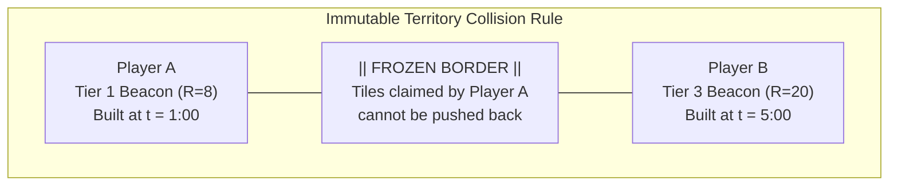

# TerraAgent — Colony Economy, 3-Tier Building Progression, Power Grid & Territory Specification

**Target Project:** Autonomous Colony Builder (NEAR Hackathon 2026)  
**Scope:** Complete Balance Tables (Cost, Footprint Size, Build Time, Power Drain, Output, HP), Destructible Power Lines, Resource & Unit Supply Extensions, and Immutable Territory Collision Mechanics

---

## 1. Core Economy & Construction Rules

Every object constructed in a player's colony obeys **5 Hard Constraints** (plus a proposed 6th, Prepared Ground):

1. **Strict 3-Tier Progression (`Tier 1 → Tier 2 → Tier 3`) & Dual Upgrade Mode:**
   - Every building archetype exists in 3 tiers (`Mk.I`, `Mk.II`, `Mk.III`).
   - Upgrading or building a higher tier **produces significantly more (~2.8x–3.5x per tier)**, **costs more (~2.5x–3.2x per tier)**, **requires a larger grid footprint** (e.g., `1x1 → 2x2 → 3x3` or `2x2 → 3x3 → 4x4`), and **takes longer to construct**.
   - **In-Place Upgrade vs. Fresh Build:** Players and the AI Orchestrator can **either** build a T2/T3 structure fresh on any valid owned territory **or** upgrade an existing T1$\rightarrow$T2 / T2$\rightarrow$T3 structure **in-place** if the surrounding adjacent tiles needed for the larger footprint (`+1` ring/edge) are free and owned. In-place upgrades cost only the **resource & build-time difference ($\Delta = \text{Cost}_{T_{n+1}} - \text{Cost}_{T_n}$)**.
2. **Universal Power Consumption (`-E/s`) & Hybrid Brownout Priority Shedding:**
   - **Every building in the game consumes continuous electrical power (`E/s`)** to run its onboard computers, sensors, pumps, or life support—even storage silos, territory beacons, power relays, and energy generators (which have an internal parasitic/cooling power draw alongside their gross power output).
   - **Severed Power Lines:** Any building on a subgraph disconnected from an active Energy Station / Capacitor Bank goes **100% `OFFLINE`** immediately.
   - **Connected Grid Brownouts:** If connected grid demand exceeds generation + capacitor discharge, the AI Orchestrator sheds load in strict priority order so defenses stay alive:
     1. *Shed First (Lowest Priority):* `Terraforming Processors` & `Rocket Silo`
     2. *Shed Second:* `Robotics Factories` & `Inter-Colony Trade Hubs`
     3. *Shed Third:* `Resource Extractors` & `Supply Depots`
     4. *Keep Online Last (Highest Priority):* `Defense Turrets`, `Hazard Shields`, `Territory Claim Beacons`, `Drone Control Arrays`, and `Energy Station Cooling Pumps`.
3. **Physical Power Line Connectivity (Destructible Grid):**
   - Power is not global magic. Buildings must be linked to Energy Stations via **Power Lines / Relay Pylons**.
   - Power Lines have physical HP, maximum transmission capacity (`Max Load E/s`), and can be severed by **Lightning Strikes**, **Meteorites**, **Alien Fauna**, or **PvP Raids**. Severed branches immediately go `UNPOWERED` until repaired by a Builder Bot.
4. **Dual Supply System (Resource Storage Cap + Robot Control Supply):**
   - **Resource Supply Cap:** The colony can only hold a finite amount of `Metals`, `Minerals`, `Petroleum`, and `Water`. Exceeding the cap halts mining until the player builds or upgrades **Resource Supply Depots**.
   - **Robot Control Supply (Bandwidth Cap):** Autonomous robots require active AI telemetry bandwidth (`Supply Slots`). To field larger robot fleets, the colony must build and power **Drone Control Arrays (Supply Extensions)**.
5. **Mandatory Territory Ownership & Immutable Border Collision:**
   - **All buildings (including mines, turrets, and power lines) can ONLY be placed on tiles owned by the player's colony.**
   - Territory is expanded by building **Territory Claim Beacons (T1 / T2 / T3)**.
   - **Immutable Collision Rule:** When two players' territories meet, **the border locks permanently along the collision line and NEVER moves or pushes back existing tiles**, even if the neighbor upgrades to a Tier 3 Beacon right next to a Tier 1 Beacon.
6. **Prepared Ground Only (proposed, D-16):**
   - Every footprint tile must be terraformed to **Prepared** (or Living) before construction starts. Rocks, holes, water, forest and slopes must be terraformed; even Flat ground needs a Grade. Every terraform op consumes energy, and that load is shed first in a brownout.
   - The HQ Drone can terraform from landing, using its own power cell, so it can always prepare its own Command Hub site. Rules, op table and energy costs: [`docs/game/units-orders-and-progression-spec.md`](./units-orders-and-progression-spec.md) §4.5.

---

## 2. Territory Mechanics & Immutable Border Collision

### 2.1 How Territory Claiming Works
- Each grid tile `(q, r)` stores `ownerId: AccountId | null` and `anchoredByBuildingIds: Set<EntityId>`.
- When a **Colony Command Hub** or **Territory Claim Beacon (T1/T2/T3)** finishes construction at `(q0, r0)` with claim radius $R$:
  ```typescript
  for (const tile of getTilesInRadius(q0, r0, R)) {
    if (tile.ownerId === null) {
      // Tile is unclaimed -> Claim it for this player!
      tile.ownerId = building.ownerId;
      tile.anchoredByBuildingIds.add(building.id);
    } else if (tile.ownerId === building.ownerId) {
      // Already owned by same player -> Add redundant anchor so border is reinforced
      tile.anchoredByBuildingIds.add(building.id);
    } else {
      // Owned by ANOTHER player -> HARD COLLISION!
      // Do NOT overwrite tile.ownerId. Border remains frozen in place.
    }
  }
  ```



### 2.2 What Happens If a Territory Beacon Is Unpowered or Destroyed?
- **Unpowered Beacon:** Cannot claim *new* tiles and takes `+25%` bonus damage, but existing claimed tiles remain locked so borders do not flicker during brief brownouts.
- **Destroyed Beacon:** Removes its `building.id` from `tile.anchoredByBuildingIds`. If a tile has **zero remaining friendly anchors** and is not rebuilt within a **60-second Grace Timer**, the tile reverts to `UNCLAIMED` (`ownerId = null`), allowing an enemy beacon to claim it.

---

## 3. Master Building Economy Tables (Tiers 1, 2, 3)

### Resource Legend
- **M:** `Metals` · **Min:** `Minerals` · **Pet:** `Petroleum` · **W:** `Water` · **E/s:** `Energy per second`
- **Size:** Grid footprint in tiles (`W × D`).
- **Build Time:** Construction time in seconds (with 1 Tier-1 Builder Bot; faster with T2/T3 Builder Bots).

---

### 3.1 Command & Territory Extension Buildings

| Building Name | Tier | Size (Tiles) | Build Time | Cost (M / Min / Pet / W) | Power Drain (`-E/s`) | HP | Territory Radius & Effect |
| :--- | :-: | :-: | :-: | :--- | :-: | :-: | :--- |
| **Colony Command Hub** *(Starting Core)* | **T1** | `3×3` | `30s` *(0s start)* | `200 M / 100 Min / 50 Pet / 50 W` | `-5 E/s` | `1,500` | Claims **R = 10** tiles; Base Storage `+500` all; Base Robot Supply `+10` |
| **Colony Command Hub** *(Sector HQ)* | **T2** | `4×4` | `75s` | `600 M / 350 Min / 200 Pet / 150 W` | `-14 E/s` | `3,800` | Claims **R = 15** tiles; Base Storage `+1,500` all; Robot Supply `+25` |
| **Colony Command Hub** *(Planetary Citadel)* | **T3** | `5×5` | `160s` | `1,800 M / 1,100 Min / 650 Pet / 500 W` | `-35 E/s` | `9,500` | Claims **R = 22** tiles; Base Storage `+4,500` all; Robot Supply `+60` |
| **Territory Claim Beacon** *(Outpost Spire)* | **T1** | `1×1` | `18s` | `80 M / 40 Min / 0 Pet / 10 W` | `-4 E/s` | `400` | Extends territory by **R = 8** tiles (stops at enemy border) |
| **Territory Claim Beacon** *(Regional Relay)* | **T2** | `2×2` | `42s` | `220 M / 140 Min / 40 Pet / 30 W` | `-11 E/s` | `1,100` | Extends territory by **R = 14** tiles; reveals fog-of-war `R = 20` |
| **Territory Claim Beacon** *(Sovereign Obelisk)* | **T3** | `3×3` | `90s` | `600 M / 450 Min / 150 Pet / 100 W` | `-28 E/s` | `3,000` | Extends territory by **R = 22** tiles; buffs friendly turret range `+15%` in radius |

---

### 3.2 Power Lines, Grid Distribution & Energy Storage

*Note: Power Lines must be placed within the player's territory. If a Power Line node is destroyed, any downstream grid branch disconnected from an Energy Station loses power.*

| Building Name | Tier | Size (Tiles) | Build Time | Cost (M / Min / Pet / W) | Line Loss / Drain (`-E/s`) | HP | Span Range & Grid Capacity |
| :--- | :-: | :-: | :-: | :--- | :-: | :-: | :--- |
| **Power Line Pylon** *(Basic Conduit)* | **T1** | `1×1` | `4s` | `15 M / 5 Min / 0 Pet / 0 W` | `-0.5 E/s` | `120` | Links up to **6 tiles**; Max load **80 E/s**; fragile against lightning/raids |
| **Power Line Pylon** *(HV Relay Tower)* | **T2** | `1×1` | `10s` | `45 M / 25 Min / 5 Pet / 0 W` | `-1.2 E/s` | `380` | Links up to **12 tiles**; Max load **300 E/s**; survives 1 lightning strike |
| **Power Line Pylon** *(Armored Substation)* | **T3** | `2×2` | `24s` | `130 M / 90 Min / 30 Pet / 10 W` | `-3.0 E/s` | `1,200` | Links up to **20 tiles**; Max load **1,200 E/s**; immune to weather damage |
| **Energy Capacitor Bank** *(Battery Cell)* | **T1** | `2×2` | `16s` | `70 M / 60 Min / 10 Pet / 10 W` | `-1.5 E/s` | `450` | Stores **1,500 E**; max discharge **30 E/s** during night/storms |
| **Energy Capacitor Bank** *(Industrial Grid Cell)* | **T2** | `3×3` | `38s` | `190 M / 180 Min / 45 Pet / 30 W` | `-4.0 E/s` | `1,150` | Stores **5,000 E**; max discharge **100 E/s** |
| **Energy Capacitor Bank** *(Superconductor Vault)* | **T3** | `4×4` | `80s` | `520 M / 550 Min / 160 Pet / 90 W` | `-10.0 E/s` | `2,800` | Stores **18,000 E**; max discharge **350 E/s** |

---

### 3.3 Energy Production Stations (All 5 Types × 3 Tiers)

*Every generator requires an internal **Operating/Cooling Power Drain (`-E/s`)** to run pumps/control rods (and needs a brief kickstart from the Command Hub or Capacitors if the grid is at 0 E). Both Gross Output and Net Output are listed.*

| Station Type | Tier | Size (Tiles) | Build Time | Cost (M / Min / Pet / W) | Internal Drain (`-E/s`) | Gross Output (`+E/s`) | **Net Output (`+E/s`)** | Resource Upkeep & Planet Notes |
| :--- | :-: | :-: | :-: | :--- | :-: | :-: | :-: | :--- |
| **Coal / Oil Thermal Plant** | **T1** | `2×2` | `15s` | `80 M / 20 Min / 20 Pet / 10 W` | `-3 E/s` | `+28 E/s` | **`+25 E/s`** | Consumes `-1.5 Pet/s`; pollutes (attracts fauna) |
| **Coal / Oil Thermal Plant** | **T2** | `3×3` | `35s` | `210 M / 70 Min / 60 Pet / 30 W` | `-8 E/s` | `+83 E/s` | **`+75 E/s`** | Consumes `-3.8 Pet/s`; higher heat signature |
| **Coal / Oil Thermal Plant** | **T3** | `4×4` | `75s` | `550 M / 220 Min / 180 Pet / 90 W` | `-20 E/s` | `+240 E/s` | **`+220 E/s`** | Consumes `-9.0 Pet/s`; heavy industrial output |
| **Wind Turbine Station** | **T1** | `2×2` | `14s` | `70 M / 35 Min / 5 Pet / 0 W` | `-1 E/s` | `+16 E/s` | **`+15 E/s`** | `0` fuel; output varies `50%–140%` with wind |
| **Wind Turbine Station** | **T2** | `3×3` | `32s` | `180 M / 110 Min / 25 Pet / 0 W` | `-3 E/s` | `+48 E/s` | **`+45 E/s`** | High-altitude rotor; steady in storms |
| **Wind Turbine Station** | **T3** | `4×4` | `70s` | `480 M / 320 Min / 80 Pet / 0 W` | `-8 E/s` | `+143 E/s` | **`+135 E/s`** | Vortex multi-rotor; harvests storm energy (`+30%`) |
| **Solar Collector Array** | **T1** | `2×2` | `18s` | `60 M / 75 Min / 10 Pet / 5 W` | `-1 E/s` | `+21 E/s` | **`+20 E/s`** | `0 E/s` at night; **`+35%` bonus on Desert** |
| **Solar Collector Array** | **T2** | `3×3` | `40s` | `160 M / 220 Min / 35 Pet / 15 W` | `-3 E/s` | `+63 E/s` | **`+60 E/s`** | Sun-tracking heliostats; `-25%` on Ice planet |
| **Solar Collector Array** | **T3** | `4×4` | `85s` | `420 M / 640 Min / 110 Pet / 40 W` | `-8 E/s` | `+188 E/s` | **`+180 E/s`** | Concentrated solar thermal tower |
| **Hydro Power Station** | **T1** | `2×3` | `25s` | `110 M / 60 Min / 15 Pet / 40 W` | `-4 E/s` | `+39 E/s` | **`+35 E/s`** | Must be placed on/adjacent to Water/River tiles |
| **Hydro Power Station** | **T2** | `3×4` | `55s` | `300 M / 180 Min / 50 Pet / 120 W` | `-10 E/s` | `+115 E/s` | **`+105 E/s`** | `-30%` efficiency during Ice Planet deep freeze |
| **Hydro Power Station** | **T3** | `4×5` | `115s` | `820 M / 520 Min / 160 Pet / 350 W` | `-25 E/s` | `+335 E/s` | **`+310 E/s`** | Deep-crust geothermal-hydro dam |
| **Nuclear Reactor** | **T1** | `3×3` | `60s` | `350 M / 300 Min / 120 Pet / 150 W` | `-15 E/s` | `+135 E/s` | **`+120 E/s`** | Consumes `-1.0 Min/s` & `-3.0 W/s` (cooling) |
| **Nuclear Reactor** | **T2** | `4×4` | `130s` | `950 M / 850 Min / 350 Pet / 400 W` | `-40 E/s` | `+400 E/s` | **`+360 E/s`** | Consumes `-2.5 Min/s` & `-7.5 W/s` |
| **Nuclear Reactor** | **T3** | `5×5` | `240s` | `2,600 M / 2,400 Min / 950 Pet / 1,100 W` | `-90 E/s` | `+1,190 E/s`| **`+1,100 E/s`**| Tokamak Fusion Core; powers late-game Rocket & Terraforming |

---

### 3.4 Resource Extraction & Gathering Buildings

| Building Name | Tier | Size (Tiles) | Build Time | Cost (M / Min / Pet / W) | Power Drain (`-E/s`) | HP | Base Production Rate |
| :--- | :-: | :-: | :-: | :--- | :-: | :-: | :--- |
| **Metals Extractor** | **T1** | `2×2` | `14s` | `65 M / 20 Min / 0 Pet / 10 W` | `-6 E/s` | `500` | **`+4.0 Metals/s`** (scaled by deposit richness) |
| **Metals Extractor** | **T2** | `3×3` | `34s` | `180 M / 75 Min / 25 Pet / 30 W` | `-18 E/s` | `1,350` | **`+12.5 Metals/s`** |
| **Metals Extractor** | **T3** | `4×4` | `75s` | `490 M / 240 Min / 90 Pet / 85 W` | `-48 E/s` | `3,400` | **`+38.0 Metals/s`** (deep-core laser bore) |
| **Minerals Quarry** | **T1** | `2×2` | `16s` | `75 M / 30 Min / 5 Pet / 15 W` | `-8 E/s` | `500` | **`+3.0 Minerals/s`** |
| **Minerals Quarry** | **T2** | `3×3` | `38s` | `210 M / 95 Min / 35 Pet / 45 W` | `-22 E/s` | `1,350` | **`+9.5 Minerals/s`** |
| **Minerals Quarry** | **T3** | `4×4` | `82s` | `560 M / 300 Min / 110 Pet / 120 W` | `-58 E/s` | `3,400` | **`+30.0 Minerals/s`** |
| **Petroleum Well & Refinery** | **T1** | `2×2` | `20s` | `90 M / 45 Min / 15 Pet / 20 W` | `-10 E/s` | `450` | **`+2.5 Petroleum/s`** (flammable if attacked) |
| **Petroleum Well & Refinery** | **T2** | `3×3` | `45s` | `250 M / 140 Min / 50 Pet / 60 W` | `-28 E/s` | `1,200` | **`+8.0 Petroleum/s`** |
| **Petroleum Well & Refinery** | **T3** | `4×4` | `95s` | `680 M / 420 Min / 160 Pet / 170 W` | `-72 E/s` | `3,000` | **`+25.0 Petroleum/s`** |
| **Water Extractor / Condenser**| **T1** | `2×2` | `15s` | `60 M / 35 Min / 10 Pet / 0 W` | `-7 E/s` | `480` | **`+3.5 Water/s`** (`0.5x` on Desert, `1.5x` on Ice) |
| **Water Extractor / Condenser**| **T2** | `3×3` | `35s` | `165 M / 110 Min / 35 Pet / 0 W` | `-20 E/s` | `1,250` | **`+11.0 Water/s`** |
| **Water Extractor / Condenser**| **T3** | `4×4` | `78s` | `450 M / 330 Min / 110 Pet / 0 W` | `-52 E/s` | `3,200` | **`+34.0 Water/s`** |

---

### 3.5 Supply Extensions (Resource Storage Silos & Robot Bandwidth Relays)

| Building Name | Tier | Size (Tiles) | Build Time | Cost (M / Min / Pet / W) | Power Drain (`-E/s`) | HP | Supply / Storage Extension Provided |
| :--- | :-: | :-: | :-: | :--- | :-: | :-: | :--- |
| **Resource Supply Depot** *(Storage Silo)* | **T1** | `2×2` | `12s` | `60 M / 25 Min / 10 Pet / 0 W` | `-2 E/s` | `600` | **`+1,000` Max Storage Cap** for Metals, Minerals, Pet, Water |
| **Resource Supply Depot** *(Logistics Warehouse)* | **T2** | `3×3` | `28s` | `170 M / 80 Min / 35 Pet / 10 W` | `-6 E/s` | `1,600` | **`+3,500` Max Storage Cap** for all 4 solid/liquid resources |
| **Resource Supply Depot** *(Mega Vault)* | **T3** | `4×4` | `65s` | `480 M / 260 Min / 110 Pet / 40 W` | `-16 E/s` | `4,200` | **`+12,000` Max Storage Cap** + protects `30%` from PvP raids |
| **Drone Control Array** *(Unit Supply Extension)* | **T1** | `1×1` | `14s` | `55 M / 45 Min / 10 Pet / 5 W` | `-5 E/s` | `350` | **`+8` Robot Supply Cap** (allows building more robots) |
| **Drone Control Array** *(Unit Supply Extension)* | **T2** | `2×2` | `32s` | `150 M / 140 Min / 40 Pet / 20 W` | `-14 E/s` | `950` | **`+22` Robot Supply Cap** + `+10%` robot movement speed in sector |
| **Drone Control Array** *(Unit Supply Extension)* | **T3** | `3×3` | `70s` | `420 M / 420 Min / 130 Pet / 65 W` | `-36 E/s` | `2,500` | **`+60` Robot Supply Cap** + `+20%` robot work/mining speed |
| **Inter-Colony Trade Hub** *(NEAR Intents Port)* | **T1** | `2×2` | `22s` | `100 M / 80 Min / 30 Pet / 10 W` | `-6 E/s` | `650` | Enables NEAR Intents trades up to **250 units/min** |
| **Inter-Colony Trade Hub** *(NEAR Intents Port)* | **T2** | `3×3` | `50s` | `280 M / 240 Min / 95 Pet / 30 W` | `-16 E/s` | `1,750` | Trade throughput **900 units/min**; lower transport fuel fee |
| **Inter-Colony Trade Hub** *(NEAR Intents Port)* | **T3** | `4×4` | `110s` | `780 M / 700 Min / 280 Pet / 90 W` | `-42 E/s` | `4,500` | Trade throughput **3,500 units/min**; orbital drop pod delivery |

---

### 3.6 Factories, Terraforming & Rocket Progression

| Building Name | Tier | Size (Tiles) | Build Time | Cost (M / Min / Pet / W) | Power Drain (`-E/s`) | HP | Function & Output |
| :--- | :-: | :-: | :-: | :--- | :-: | :-: | :--- |
| **Robotics Factory** | **T1** | `3×3` | `25s` | `120 M / 70 Min / 30 Pet / 20 W` | `-10 E/s` | `800` | Produces **Tier 1** Robots (`1.0x` build speed) |
| **Robotics Factory** | **T2** | `4×4` | `60s` | `340 M / 230 Min / 100 Pet / 60 W` | `-28 E/s` | `2,200` | Produces **Tier 1 & Tier 2** Robots (`1.5x` speed on T1) |
| **Robotics Factory** | **T3** | `5×5` | `130s` | `950 M / 720 Min / 320 Pet / 180 W` | `-75 E/s` | `5,800` | Produces **Tier 1, 2 & 3** Robots (`2.2x` speed on T1/T2) |
| **Terraforming Processor** | **T1** | `3×3` | `40s` | `200 M / 180 Min / 80 Pet / 100 W` | `-25 E/s` | `900` | Consumes `-4 W/s`; terraforms **R = 10** tiles (`+0.15%/s` planet score) |
| **Terraforming Processor** | **T2** | `4×4` | `90s` | `580 M / 540 Min / 250 Pet / 300 W` | `-70 E/s` | `2,400` | Consumes `-10 W/s`; terraforms **R = 20** tiles (`+0.50%/s` planet score) |
| **Terraforming Processor** | **T3** | `5×5` | `190s` | `1,650 M / 1,600 Min / 750 Pet / 900 W`| `-190 E/s`| `6,500` | Consumes `-26 W/s`; atmospheric converter (**R = 38**, `+1.65%/s` score) |
| **Interplanetary Rocket Silo**| **T1** *(Probe)* | `3×3` | `90s` | `600 M / 500 Min / 400 Pet / 200 W` | `-45 E/s` | `1,800` | Launches **Sector Recon Probe** (reveals target planets & resource yields) |
| **Interplanetary Rocket Silo**| **T2** *(Lander)*| `4×4` | `210s` | `1,800 M / 1,600 Min / 1,400 Pet / 700 W`| `-120 E/s`| `4,800` | Launches **Founder Pod** to colonize next planet (`+25%` starting stock) |
| **Interplanetary Rocket Silo**| **T3** *(Ark)* | `6×6` | `420s` | `5,200 M / 4,800 Min / 4,200 Pet / 2,000 W`| `-320 E/s`| `12,000`| Launches **Colony Ark** (starts new planet with T2 Hub + 3 T2 Robots) |

---

### 3.7 Colony Defense & Hazard Mitigation

| Building Name | Tier | Size (Tiles) | Build Time | Cost (M / Min / Pet / W) | Power Drain (`-E/s`) | HP | Combat / Defense Stats |
| :--- | :-: | :-: | :-: | :--- | :-: | :-: | :--- |
| **Autocannon Turret** *(Kinetic)* | **T1** | `1×1` | `12s` | `55 M / 20 Min / 10 Pet / 0 W` | `-3 E/s` | `450` | Range `8`; `18 DPS`; consumes `-0.2 Metals/s` while firing |
| **Autocannon Turret** *(Twin Gatling)*| **T2** | `2×2` | `28s` | `150 M / 65 Min / 35 Pet / 10 W` | `-8 E/s` | `1,250` | Range `11`; `52 DPS`; shreds light swarm fauna |
| **Autocannon Turret** *(Railgun)* | **T3** | `3×3` | `62s` | `410 M / 210 Min / 110 Pet / 30 W` | `-22 E/s` | `3,300` | Range `16`; `155 DPS`; armor-piercing anti-robot rounds |
| **Laser Defense Tower** *(Energy)* | **T1** | `1×1` | `16s` | `50 M / 55 Min / 15 Pet / 10 W` | `-8 E/s` | `400` | Range `9`; `24 DPS`; `0` ammo cost, spikes grid `-12 E/s` on fire |
| **Laser Defense Tower** *(Pulse Beam)*| **T2** | `2×2` | `36s` | `140 M / 165 Min / 50 Pet / 35 W` | `-22 E/s` | `1,100` | Range `13`; `72 DPS`; melts heavy carapace |
| **Laser Defense Tower** *(Plasma Arc)*| **T3** | `3×3` | `78s` | `390 M / 480 Min / 150 Pet / 100 W`| `-60 E/s` | `2,900` | Range `17`; `215 DPS`; chains lightning between 3 targets |
| **Hazard Shield & Lightning Rod** | **T1** | `1×1` | `14s` | `45 M / 50 Min / 5 Pet / 10 W` | `-4 E/s` | `500` | Intercepts **Lightning Strikes** within `R = 10` (protects Power Lines) |
| **Hazard Shield & Lightning Rod** | **T2** | `2×2` | `34s` | `130 M / 150 Min / 30 Pet / 30 W` | `-12 E/s` | `1,400` | Intercepts **Lightning & Small Meteorites** in `R = 16`; converts strike to `+200 E` |
| **Hazard Shield & Lightning Rod** | **T3** | `3×3` | `75s` | `360 M / 440 Min / 100 Pet / 90 W` | `-32 E/s` | `3,800` | Projects dome shield (`R = 24`, `2,500 Shield HP`) against PvP rockets & storms |

---

## 4. Autonomous Robot Units Table (3 Tiers)

> **Superseded (proposed D-16):** the robot roster, unit balance, order queue and progression now live in [`docs/game/units-orders-and-progression-spec.md`](./units-orders-and-progression-spec.md). The table below is kept for history only.

*Robots are built at the **Robotics Factory** (T1/T2/T3), consume **Robot Supply Slots** from **Drone Control Arrays**, and draw continuous recharge power (`-E/s`) from the colony grid.*

| Robot Archetype | Tier | Footprint / Scale | Build Time | Cost (M / Min / Pet / W) | Supply Cost | Grid Power Draw (`-E/s`) | HP | Speed & Capabilities |
| :--- | :-: | :-: | :-: | :--- | :-: | :-: | :-: | :--- |
| **Miner / Harvester Bot** | **T1** | `0.8m` | `10s` | `40 M / 15 Min / 5 Pet / 0 W` | `1 Supply` | `-1.5 E/s` | `160` | Harvests `+2.0 res/s`; clears small trees/rocks |
| **Miner / Harvester Bot** | **T2** | `1.2m` | `22s` | `110 M / 50 Min / 20 Pet / 10 W` | `2 Supply` | `-4.0 E/s` | `420` | Harvests `+6.0 res/s`; heavy plasma cutter |
| **Miner / Harvester Bot** | **T3** | `1.7m` | `48s` | `300 M / 160 Min / 70 Pet / 30 W` | `4 Supply` | `-10.0 E/s` | `1,100` | Harvests `+18.0 res/s`; autonomous ore smelting |
| **Builder / Repair Bot** | **T1** | `0.8m` | `12s` | `45 M / 25 Min / 10 Pet / 0 W` | `1 Supply` | `-2.0 E/s` | `150` | Build/Repair rate `1.0x`; repairs severed Power Lines |
| **Builder / Repair Bot** | **T2** | `1.2m` | `26s` | `125 M / 80 Min / 30 Pet / 10 W` | `2 Supply` | `-5.0 E/s` | `390` | Build/Repair rate `2.5x`; dual welding arms |
| **Builder / Repair Bot** | **T3** | `1.7m` | `55s` | `340 M / 240 Min / 95 Pet / 30 W` | `4 Supply` | `-12.0 E/s` | `1,000` | Build/Repair rate `6.0x`; nano-lathe projector |
| **Combat / Raider Bot** | **T1** | `0.9m` | `14s` | `55 M / 30 Min / 15 Pet / 0 W` | `1 Supply` | `-2.5 E/s` | `240` | `14 DPS`; fast wheeled scout & nest clearer |
| **Combat / Raider Bot** | **T2** | `1.4m` | `30s` | `155 M / 95 Min / 45 Pet / 15 W` | `2 Supply` | `-6.5 E/s` | `680` | `42 DPS`; tracked assault tank |
| **Combat / Raider Bot** | **T3** | `2.1m` | `65s` | `430 M / 290 Min / 140 Pet / 45 W` | `4 Supply` | `-16.0 E/s` | `1,950` | `130 DPS`; siege mech with anti-building missiles |
