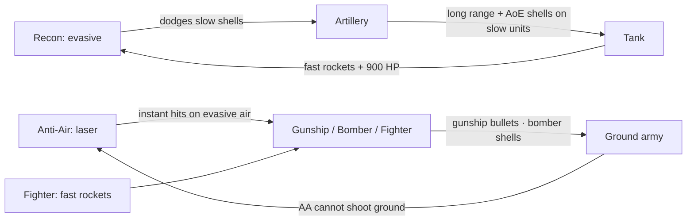

# TerraAgent — Unit Roster, Orders & Learning-Curve Specification

> **Status:** v0.3 (2026-10-29). **Accepted as D-16** ([`docs/spec/DECISIONS.md`](../spec/DECISIONS.md)). Related owner decisions: D-17 (hard offline mode), D-18 (launch gate and Settled colonies), D-21 (pylon load). Plan: epic TA-14.
> **Supersedes:** robot table in [`docs/game/colony-economy-and-buildings-spec.md`](./colony-economy-and-buildings-spec.md) §4 and [`docs/spec/SIMULATION.md`](../spec/SIMULATION.md) §7.2.
> **Builds on:** buildings, costs, power and territory from `docs/game/colony-economy-and-buildings-spec.md`; tick model, commands and rule engine from `SIMULATION.md`; away-mode rules from `CONTINUITY.md`; directives from `AI_ORCHESTRATOR.md`.
> **Reference game:** read "Total Commander" as **Total Annihilation / Supreme Commander**: one irreplaceable Commander who builds the base, worker tiers that gate tech, build queues that wait for resources, and counter-based army composition.

Numbers are **proposed** and owner-tunable. They will live in `shared/sim/src/data/*.ts` and never in system code. Rule IDs (`UO-…`) are for tracing into tests.

---

## 1. Design goals

1. **A small roster.** 14 unit types in total. Each one has one job that no other unit does as well.
2. **Indirect control.** The player gives orders through four menus (Construction, Terraform, Units, HQ Goals). Every order goes into the colony's local queue. Workers and factories pick orders up when resources and a capable worker are available.
3. **Rock–paper–scissors combat.** Battle v1 uses plain HP and plain damage. Counters come from weapon behaviour (slow shells, fast rockets, instant lasers, AoE), range, speed and HP, not from hidden bonuses. §5.5 verifies them with equal-cost duels.
4. **A strict learning curve.** Content unlocks in 11 stages (S0–S10). Each stage teaches **one** new mechanic and adds **at most two** new unit types. Threat scales with the colony's stage, not with wall-clock time. Every new unit first meets a PvE enemy it counters (§6).
5. **Ground first.** Structures can stand **only on terraformed (Prepared) ground**. Rocks, holes, water, forest and slopes must be terraformed first, and every terraform operation uses energy. The HQ Drone can terraform from the first second, so it can always prepare the site for its own Command Hub (§4.5). Terraforming also works **in reverse, as defense**. Raised ridges and dug moats are real walls that no ground unit or creature can cross. Only air units and indirect-fire artillery reach past them (§4.8).

---

## 2. Roster (14 types)

| # | Id | Name | Role | Layer | Built at | Stage | Visual archetype (kitbash) |
|---|---|---|---|---|---|---|---|
| 1 | `hq` | **HQ Drone** (Commander) | Terraforms and builds from landing (prepares the Hub site, then builds the Command Hub), holds the HQ goal queue, negotiates; adds harvesting at T2 | Ground | Drop pod / reprinted by Hub | S0 | `robot.hero` (exists) |
| 2 | `harvester` | Harvester Drone (T1) | Harvests surface deposits; Clear and Break (forest, rock) | Ground | Command Hub T1+ | S1 | `robot.miner` (exists) |
| 3 | `builder` | Builder / Repair Drone (T1) | Builds T1 structures, repairs anything | Ground | Command Hub T1+ | S2 | `robot.builder` (exists) |
| 4 | `terraformer` | Terraform Drone (T1) | Prepares ground (grade, clear, break, level, fill, reclaim) and restores land (irrigate, seed) | Ground | Command Hub T1+ | S1 | `robot.terraformer` (new) |
| 5 | `multitask` | Multitask Drone (T2, T3) | Any worker lane; builds T2 (T3) structures | Ground | Command Hub T2 (T3) | S5 / S10 | `robot.multitask` (new) |
| 6 | `recon` | Recon Battle Drone | Fast skirmisher, scouting, kills light targets | Ground | Robotics Factory T1+ | S3 | `robot.combat` (exists, re-skin) |
| 7 | `tank` | Close-Combat Tank | Heavy line holder; fast rockets hit evasive units | Ground | Robotics Factory T2+ | S6 | `unit.tank` (new) |
| 8 | `artillery` | Long-Range Artillery | Siege; kills heavy units and structures | Ground | Robotics Factory T2+ | S6 | `unit.artillery` (new) |
| 9 | `radar` | Mobile Radar Drone | Wide detection, spots for artillery | Ground | Robotics Factory T2+ | S7 | `unit.radar` (new) |
| 10 | `aa` | Anti-Air Track | Ground unit, shoots air only | Ground | Robotics Factory T1+ | S8 | `unit.aa` (new) |
| 11 | `airRecon` | Air Recon | Fastest unit, wide vision, unarmed | Air | Aero Hangar T2+ | S8 | `air.recon` (new) |
| 12 | `fighter` | Air Fighter | Air superiority, shoots air only | Air | Aero Hangar T2+ | S9 | `air.fighter` (new) |
| 13 | `gunship` | Air Gunship | Hovering anti-light-ground | Air | Aero Hangar T2+ | S9 | `air.gunship` (new) |
| 14 | `bomber` | Air Bomber | Strategic siege of heavy units and structures | Air | Aero Hangar T3 | S10 | `air.bomber` (new) |

There are three worker lanes and one army. There are no tiers inside combat types: variety comes from **types**, as in Total Annihilation, not from Mk.II versions of the same unit. Workers have tiers only where the user asked for them: specialists are T1, Multitask is T2/T3, and the HQ is T1–T3.

New 3D archetypes follow `AGENTS.md` Pillar 1 (`procedural-kitbash-3d`): at least 7 parts, a silhouette breaker, and the 60/30/10 material split. Each role should be readable from its silhouette: AA has upward barrels, artillery a long barrel, radar a dish, the tank is low and wide, and recon is small and tall-legged.

---

## 3. Core rules

### 3.1 Lanes and who works them (`UO-L`)

| Worker | Construction | Harvest | Terraform | Max structure tier it can build | Work rate |
|---|:-:|:-:|:-:|:-:|:-:|
| HQ T1 | ✔ | — | ✔ (every unlocked op) | T1 + Command Hub (any tier) | 1.5× |
| HQ T2 | ✔ | ✔ | ✔ | T2 + Command Hub | 2.5× |
| HQ T3 | ✔ | ✔ | ✔ | All ("build all") | 4.0× |
| Harvester | — | ✔ | Clear, Break only | — | 1.0× |
| Builder | ✔ (+ repair) | — | — (see `UO-TF-03`) | T1 | 1.0× |
| Terraformer | — | — | ✔ | — | 1.0× |
| Multitask T2 | ✔ | ✔ | ✔ | T2 | 2.0× |
| Multitask T3 | ✔ | ✔ | ✔ | T3 | 5.0× |

- `UO-L-01` **Harvest is a standing job, not a queue.** Harvest-capable workers that are not busy work the nearest surface deposit of the most-needed resource. The weighting comes from the `economy` priority and the per-resource harvest weights in the Construction menu. They never need an order.
- `UO-L-02` **Tech rule.** A worker can build or upgrade a structure only up to its own max tier. **Repair has no tier limit.** Every worker that can build can repair, and the Builder repairs at 1.5× its build rate. This keeps the cheap Builder useful late in the game.
- `UO-L-03` **The Command Hub is HQ-only.** Only the HQ Drone can build a Command Hub or upgrade one in place. Hub tier is the colony's tech level. A structure of tier N needs Hub tier ≥ N **and** a worker of tier ≥ N. This breaks the "T2 worker needs a T2 Hub, which needs a T2 worker" loop.
- `UO-L-04` **Assist.** Up to 4 workers can work on one construction job, and their rates add. A terraform area order splits its tiles across up to 8 workers.
- `UO-L-05` "Build time" in every table means seconds at **1.0×**. Actual time = build time ÷ Σ assigned rates.

### 3.2 HQ Drone (Commander) (`UO-HQ`)

| Tier | HP | Radius | Speed | Vision | Weapon (self-defense) | Work rate / lanes | Active HQ goals | Open trade offers | Reprint at Hub (cost / time) |
|---|---|---|---|---|---|---|---|---|---|
| T1 | 900 | 0.6 | 1.6 t/s | 9 | 12 DPS kinetic, range 5 | 1.5× construction + terraform | 2 | 1 (≤ 250 units) | 200/100/50/50 · 60 s |
| T2 | 2 200 | 0.6 | 1.8 t/s | 10 | 25 DPS kinetic, range 5 | 2.5× all lanes | 3 | 3 (≤ 900 units) | 500/300/150/100 · 90 s |
| T3 | 5 000 | 0.6 | 2.0 t/s | 12 | 60 DPS kinetic, range 6 | 4.0× all lanes, all tiers | 5 | 6 (≤ 3 500 units) | 1 200/800/400/300 · 150 s |

- `UO-HQ-01` **HQ tier follows Hub tier.** When a Hub upgrade completes, the HQ docks at the Hub for a free 20 s refit and comes back at the new tier. There is only one HQ per colony. It costs **0 supply** and has **no grid draw**. Its work energy comes from its own power cell (`UO-HQ-06`).
- `UO-HQ-02` Battle v1 has no armor (§5.4). The HQ is hard to snipe because of its HP (900 / 2 200 / 5 000) and its self-preservation rule (`UO-HQ-03`).
- `UO-HQ-03` **Self-preservation.** Below 40 % HP the HQ drops its current job, retreats to the Hub and self-repairs at 1 % HP/s inside Hub range. The player cannot override this while the newcomer shield (§6.3) is active.
- `UO-HQ-04` **Loss and elimination.** This replaces SIMULATION §7.7 "Elimination".
  - HQ destroyed, Hub alive: the Hub reprints the HQ (table above). The reprint is the top item in the Units lane and jumps every queue. Construction of tier ≥ T2 and Hub upgrades pause until the HQ is back.
  - Hub destroyed, HQ alive: the colony becomes `critical`. The HQ must rebuild a Hub within 6 000 ticks (10 min). The HQ goal "Re-establish" is queued automatically.
  - Both destroyed, or the 10-min window runs out: the colony is `eliminated` (ruins rules unchanged).
- `UO-HQ-05` **Negotiation.** The HQ is the colony's diplomat. A "Negotiate" goal (§4.6) creates trade offers through the existing trade saga (NEAR.md §7). Two things are needed: first contact with the neighbor, and an online Inter-Colony Trade Hub T1 (unchanged). HQ tier sets how many offers can be open at once. The HQ also negotiates **truces** (`UO-DIP`, §4.7), which are in MVP.
- `UO-HQ-06` **Power cell (makes landing possible).** The HQ pays the energy for its terraform ops out of its own cell, never directly from the grid. That is how it prepares the Hub site before any grid exists.
  - Cell capacity: T1 800 E, T2 2 000 E, T3 5 000 E.
  - Recharge: 3 E/s anywhere, so the HQ can never deadlock. Fast recharge of 20 / 40 / 80 E/s within 6 tiles of a powered Hub or pylon. The fast recharge counts as grid load in shed group 3.
  - Typical Hub site: 9 tiles, about 6 Flat + 3 Forest/Rock, costs about 300 E and about 29 s at 1.5×. The worst case allowed by the spawn guarantee (`UO-TF-09`) is 6 Flat + 3 Rock: 360 E and 36 s of prep, plus 20 s to build the Hub, about 56 s in total. That leaves more than half of the 800 E cell spare.

### 3.3 Supply and upkeep (`UO-S`)

- `UO-S-01` Supply caps are unchanged from the economy spec: Hub T1/T2/T3 gives +10/+25/+60; Drone Control Array T1/T2/T3 gives +8/+22/+60.
- `UO-S-02` A unit's grid draw (−E/s) is paid in full while it works, moves or fights, and at **50 % while idle**. Army upkeep is real power, as in Total Annihilation. Ten tanks cost about one Solar T2's output.
- `UO-S-03` **Global economy scale.** `ECONOMY_RATE_SCALE = 0.25` multiplies every **resource** flow: extraction, harvesting, fuel and coolant upkeep, terraform water use, and ammo. Energy flows (E/s) and every cost stay as they are. Why: with the economy spec's rates as written, a single T1 Metals Extractor pays for a Hub T2 upgrade in under 2 minutes, which would compress S0–S10 into roughly 20 minutes. §6.4 checks the pacing under the scale.

---

## 4. Orders: menus and the local queue

### 4.1 Menus (`UO-M`)

| Menu | Contents | Opened by |
|---|---|---|
| **Construction** | Build (place a ghost footprint; it shows the ground-prep bill: tiles, time, E and resources) · Upgrade (in place) · Power line (drag a pylon chain = 1 order) · Demolish · Harvest weights (per-resource sliders, applied immediately, not queued) | S0 |
| **Terraform** | Grade · Clear · Break (S0) · Level (S1) · Fill (S2) · Reclaim · Irrigate · Seed (S4). Single tile or area brush; one brush stroke = 1 order. A tile-state overlay (Wild / Prepared / Living) is on whenever this menu or a ghost footprint is open | S0 |
| **Units** | Produce N × unit (with a repeat toggle) · Rally point · Stance (Hold / Defend area / Hunt) · Attack-move to tile | S1 (workers), S3 (army) |
| **HQ Goals** | High-level goals that the HQ breaks down into orders in the other three lanes (§4.6) | S0 (tutorial goal pre-queued) |

A menu shows only what is unlocked. Locked items for the next stage are shown greyed out with their unlock condition, so the player always sees the next step.

### 4.2 Queue entry lifecycle (`UO-Q`)

```
queued → waiting(resources | storage | worker | power | site) → in_progress(%) → done
        ↘ cancelled                                  ↘ cancelled (refund 75 %)
```

- `UO-Q-01` **An entry is an intent. Nothing is paid when it is queued.** The cost is paid in one lump sum when work **starts**: when a worker arrives at the site, or when a factory slot begins the unit. This replaces `SIM-C-03` "deducted at acceptance". The Hub reprint (UO-HQ-04) is paid the same way.
- `UO-Q-02` Cancelling a waiting entry is free. Cancelling an in-progress entry refunds 75 % (unchanged). Demolish refunds 50 % (unchanged).
- `UO-Q-03` Every waiting entry shows **why** it is waiting and an ETA. Example: "waiting: Minerals 40/75 · ~50 s at +0.75/s". This is the most important feedback for learning.
- `UO-Q-04` Validation still happens on enqueue (territory, tier unlocked, footprint free; Deep Water only from S5). Resources are checked again at start. If the footprint is not fully Prepared, linked terraform orders are created (`UO-TF-03`) and the entry shows `waiting(site: 5/9 tiles prepared)`. If a site becomes invalid (for example, a meteor makes a hole), the entry goes back to `waiting(site)` and is not dropped.
- `UO-Q-05` **Storage.** If any part of an entry's cost is larger than the colony's storage cap for that resource, the entry can never start. It shows `waiting(storage)` with a one-click hint to build or upgrade a Supply Depot. Example: the Rocket Silo T2 needs 1 800 M, but Hub T2 storage alone holds 1 500. This is a deliberate learning beat: "bigger projects need bigger warehouses".

### 4.3 Dispatch (`UO-D`)

Dispatch runs every 10 ticks per lane, staggered like the rule engine.

- `UO-D-01` The dispatcher scans entries in precedence order (§4.4). It starts the **first** entry that is affordable and has an eligible worker or factory slot free. A blocked entry does not block the entries behind it.
- `UO-D-02` **Earmark (anti-starvation).** Once an entry has waited on resources for ≥ 60 s, the amounts it is short of are earmarked. Later entries can spend only stock above the earmark. The oldest blocked entry earmarks first. Earmarks are shown in the HUD. The total earmark per resource never exceeds 80 % of the storage cap, and entries in `waiting(storage)` never earmark.
- `UO-D-03` Worker choice: the nearest idle eligible worker. Ties go to the lowest tier first, so expensive multirole workers stay free for jobs only they can do. Workers busy on a lower-precedence job get pre-empted only by `player` entries.
- `UO-D-04` Units lane: each entry is sent to the least-loaded production building that can build that type. Each production building has a 5-slot local buffer.

### 4.4 Precedence and limits (`UO-P`)

| Source | Precedence | Notes |
|---|---|---|
| `system` (HQ reprint, critical repair) | 0 (highest) | Repair floor from `SIM-R-03` |
| `player` (direct menu orders) | 1 | FIFO; the player can drag to reorder |
| `hq` (orders broken down from player HQ goals) | 2 | Tagged with the goal id; budget-capped (§4.6) |
| `ai` (AI-director directive) | 3 | Unchanged `SIM-R-04` limits and away policy |
| `auto` (rule-engine housekeeping) | 4 | Dropped first when a lane is full |

Limits per colony: Construction 20 entries, Terraform 20, Units 10 (plus 5 per production building), HQ goals 2/3/5 by HQ tier. These replace the single 50-task cap in `SIM-C-04`.

### 4.5 Ground preparation and terraforming (`UO-TF`)

- `UO-TF-01` **Build only on terraformed ground.** Every footprint tile of every structure must be **Prepared** (or **Living**) and owned before construction can start. This includes the Command Hub, pylons, beacons and turrets. No generated tile is buildable as it is; even Flat ground needs a quick Grade. For an in-place upgrade, the extra +1 ring must be Prepared too.

**Tile model.** The planet generator assigns each tile a terrain class. Ops turn it into Flat, then Grade turns Flat into Prepared. A second branch turns Prepared ground into Living land.

```
Forest ─Clear─┐
Rock ──Break──┤
Slope ─Level──┼─► Flat ─Grade─► PREPARED (buildable) ─Irrigate─► Irrigated ─Seed─► LIVING (buildable, scores)
                                   │  ▲
                       Raise / Dig │  │ Lower
                                   ▼  │
                    RIDGE (wall, blocks direct fire) · MOAT (wall, fire passes)
Hole ──Fill───┤
Shallow water ─Reclaim─┘
Deposit tile ──Grade──► PREPARED (keeps the deposit; extractors need it)
Deep water ─Deep Reclaim (T2 workers)─► Shallow water ─Reclaim─► Flat ─Grade─► PREPARED
```

| Op | From → to | Time / tile @1.0× | **Energy / tile** | Cost / tile | Who | Unlock |
|---|---|---|---|---|---|---|
| Grade | Flat or Deposit → **Prepared** | 3 s | 20 E | — | HQ, Terraformer, Multitask | S0 |
| Clear | Forest → Flat | 5 s | 30 E | 0 · yields +5 Pet | HQ, Terraformer, Harvester, Multitask | S0 |
| Break | Rock → Flat | 6 s | 60 E | 0 · yields +10 M | HQ, Terraformer, Harvester, Multitask | S0 |
| Level | Slope → Flat | 8 s | 60 E | 2 Min | HQ, Terraformer, Multitask | S1 |
| Fill | Hole / crater → Flat | 10 s | 100 E | 10 M + 5 Min | HQ, Terraformer, Multitask | S2 |
| Reclaim | Shallow water → Flat | 14 s | 200 E | 20 M + 10 Min | HQ, Terraformer, Multitask | S4 |
| Deep Reclaim | Deep water → Shallow water | 28 s | 400 E | 40 M + 20 Min | **HQ T2+, Multitask T2+ only** (tier-gated like T2 structures, `UO-L-02`) | S5 |
| Irrigate | Prepared → Irrigated | 10 s | 80 E | 15 W (×2 on Desert) | HQ, Terraformer, Multitask | S4 |
| Seed | Irrigated → **Living** | 15 s | 90 E | 10 W + 5 Min | HQ, Terraformer, Multitask | S4 |
| Raise Ridge | Prepared → **Ridge** (wall) | 12 s | 150 E | 15 M + 10 Min | HQ, Terraformer, Multitask | S7 |
| Dig Moat | Prepared → **Moat** (wall) | 10 s | 120 E | 0 · yields +5 Min | HQ, Terraformer, Multitask | S7 |
| Lower | Ridge or Moat → Prepared | 8 s | 60 E | 0 · a Ridge refunds 50 % | HQ, Terraformer, Multitask | S7 |

Full cost to make one tile buildable:

| Terrain | Flat | Forest | Rock | Slope | Hole | Shallow water | Deep water |
|---|---|---|---|---|---|---|---|
| Time | 3 s | 8 s | 9 s | 11 s | 13 s | 17 s | 45 s |
| Energy | 20 E | 50 E | 80 E | 80 E | 120 E | 220 E | 620 E |
| Resources | — | +5 Pet | +10 M | 2 Min | 10 M + 5 Min | 20 M + 10 Min | 60 M + 30 Min |

- `UO-TF-02` **Terraforming eats energy.** An op's energy per tile is drawn evenly over its work time, so the draw grows with the worker's rate. Example: Grade with a 1.0× worker draws about 6.7 E/s; Reclaim draws about 14 E/s.
  - Op energy joins the robot drain on the **Hub's grid component**, the same abstraction as SIMULATION §7.2, so a Terraformer can prepare a frontier beacon site outside pylon range. The HQ draws from its cell (`UO-HQ-06`).
  - Terraform load joins brownout **shed group 1**, together with the Terraforming Processor and the Rocket Silo. A shed op pauses, keeps its progress and shows `waiting(power)`. So in a brownout terraforming always stops first, and defenses never go dark because a terraformer is working.
- `UO-TF-03` **Placing on unprepared ground is allowed and auto-links the prep.** The ghost footprint shows the prep bill. Confirming creates the construction order plus **one linked terraform order** that covers every missing op on the footprint.
  - The linked order runs in the Terraform lane with the same source and precedence as its construction order. Linked prep does not count toward the Terraform lane's 20-entry limit.
  - The construction waits as `waiting(site: n/m tiles prepared)`.
  - Builders do **not** terraform: ground prep is the Terraform lane's job. Cancelling the construction also cancels its linked prep.
- `UO-TF-04` **Ground persistence.**
  - Prepared ground stays Prepared after a building is demolished or destroyed, so rebuilding needs no new prep.
  - A **meteor impact** turns the tiles within radius 1 into **Hole**. Rebuilding there needs Fill + Grade. A meteor that hits a wall **breaches** it: a Ridge becomes Rock and a Moat becomes Hole, and both are passable (`UO-W-06`).
  - Living tiles are buildable. A footprint placed on Living tiles reverts them to Prepared, so they no longer count toward Terraform %.
- `UO-TF-05` **Own territory only, with one exception.** All ops need owned tiles, like construction. **Exception:** a Command Hub placement and its linked site prep may use **unclaimed** tiles (never foreign ones). The Hub claims R 10 on completion as before. Without this exception the landing site could never be prepared, because the colony owns nothing at S0. The same exception covers the "Re-establish" path (`UO-HQ-04`) after anchor grace has expired. A Harvester's Clear/Break yields are lump sums and are not scaled by `ECONOMY_RATE_SCALE`.
- `UO-TF-06` Colony **Terraform %** = Living tiles ÷ owned tiles, excluding Deep Water that has not been reclaimed, and Ridge/Moat tiles (walls do not lower your score). It feeds colony score and the "control % + terraforming level" goal in `docs/game/autonomous-colony-spec.md` §9.
- `UO-TF-10` **Deep water is reclaimable from S5** (owner decision, Q11). The full cost to buildable land is about 3× shallow water, and only T2+ workers can do the Deep Reclaim step. Hydro stations must keep at least one adjacent water tile (Shallow or Deep). Reclaiming the last one switches the station off until it is rebuilt next to water. The ghost footprint warns about this before the player confirms.
- `UO-TF-07` Living tiles give +10 % move speed to ground units and +5 % output to adjacent extractors, so restoring land pays back in more than score.
- `UO-TF-08` The Terraforming Processor (economy spec §3.6) stays as the late-game **area** tool and unlocks at S5. On its own, it turns Prepared tiles in its radius into Living, using the economy spec's water and energy draw (shed group 1). It does **not** prepare raw terrain; that stays drone work.
- `UO-TF-09` **Spawn guarantee (planet generator).** Within radius 4 of every spawn slot:
  - Terrain is only Flat, Forest, Rock or Deposit, with at least 60 % Flat. There are no Holes, Slopes or Water.
  - Every 3×3 window inside that radius has **at most 3 non-Flat tiles**.
  - At least one metals deposit and one open 2×2 site lie within radius 8.
  - These guarantees mean the HQ's cell can always pay for the Hub site, and S1 never starts with a Fill or Reclaim.

**Terrain mix by planet type (generator targets, proposed):**

| Terrain share of land tiles | Flat | Forest | Rock | Slope | Hole | Shallow water | Deep water |
|---|---|---|---|---|---|---|---|
| Temperate | 45 % | 25 % | 8 % | 10 % | 2 % | 6 % | 4 % |
| Desert | 50 % | 0 % | 22 % | 15 % | 8 % | 3 % (oasis) | 2 % |

The two planets need different land work: forest clearing and water reclaim on Temperate, rock breaking and crater filling on Desert. This follows design pillar 3 ("planet uniqueness").

### 4.6 HQ goals (`UO-G`)

A goal is a target state. The HQ (rule engine, or the AI director when it has budget) keeps adding `hq`-tagged orders until the target is met or the goal's budget runs out.

| Goal | Unlock | Parameters | Breaks down into | Done when | Default budget |
|---|---|---|---|---|---|
| Establish Colony | S0 (pre-queued) | — | Prepare the Hub site, Hub, 1 extractor, 1 generator (with their ground prep) | all built | full stock |
| Grow Economy | S1 | target income per resource | extractors, harvesters, depots | income reached | 50 % of stock |
| Secure Power | S2 | target net E/s **at night** | generators, capacitors, pylons | target held for 1 night | 50 % |
| Defend Area | S3 | area, strength (low/med/high); from S7 also "fortify: yes/no" | turrets, combat units, Drone Control Arrays, Defend stance; from S7 also ridge/moat lines with Wall Gates | strength reached | 40 % |
| Clear Nest | S3 | nest | rally combat units, attack | nest destroyed | 30 % |
| Expand Toward | S4 | direction or deposit | Ground prep, beacons, pylons | tile(s) owned | 40 % |
| Terraform Zone | S4 | area, target state | tile ops | area reaches state | 30 % |
| Tech Up | S4 | target Hub tier | saves resources (earmarks), then upgrades Hub | Hub at tier | 100 % (saving) |
| Negotiate | neighbor contact (+ Trade Hub T1 for trades) | partner; trade give/want bounds **or** truce length | trade offers or a truce offer (HQ-signed, §4.7) | accepted / declined / expired | the trade bounds |
| Build Army | S6 | composition preset or "counter what you see" | Units-lane orders | composition reached | 40 % |
| Raid Colony | S6 + own newcomer shield off | target colony | attack-move with an army group | ends on command or when the army is gone | — |
| Prepare Rocket | S10 (MVP: S5) | — | Terraform Zone over all owned land, Rocket Silo, stockpile | silo ready **and** launch gate met (`UO-R-01`); launch still needs the player (`AW-12`) | 100 % |

- `UO-G-01` A goal's budget caps how much of current stock its orders may spend while active. Away-mode caps (`AW-20`) still apply on top.
- `UO-G-02` The breakdown is deterministic and lives in the rule engine. The AI director may **propose** goals (`DirectiveV1.queueGoal`, §7). It cannot create raw orders that go around goal budgets.
- `UO-G-03` **Each stage suggests a goal** (§6.2, last column) as a one-click card. This is the tutorial. It teaches the HQ-goal layer without a separate tutorial system.

### 4.7 Truces (`UO-DIP`)

A truce is a non-aggression pact between two colonies on the same planet. It is negotiated by their HQ Drones and enforced by the simulation.

| Item | Rule (proposed) |
|---|---|
| `UO-DIP-01` Requirements | Both colonies have made contact and both HQ Drones are alive. **No Trade Hub is needed.** Not allowed while either colony has damaged the other in the last 10 min (no "truce to stop a raid that is already landing"). |
| `UO-DIP-02` Terms | Length 2 h, 6 h, 24 h or 72 h, capped by the proposer's HQ tier: T1 ≤ 6 h, T2 ≤ 24 h, T3 ≤ 72 h. Active truces per colony: T1 1, T2 2, T3 4. An offer expires after 10 min. |
| `UO-DIP-03` Effects | Neither side's units auto-target the other's units or buildings. `raid`, Raid Colony and attack-move into the partner's territory are rejected (`truce_active`). Fauna, hazards and third colonies are unaffected. |
| `UO-DIP-04` Breaking | Either side can cancel. Cancelling starts a **10-min notice** during which the truce still holds, so there is no surprise backstab. The canceller is marked **Oathbreaker** for 24 h: it cannot propose truces, and other colonies see the mark on its HQ card. Expiry at the end of the term gives no mark. |
| `UO-DIP-05` Away and AI | The AI director may **propose** truces and **accept** incoming ones while the player is away (protective only). It may never cancel one. Cancelling is player-only (extends `AW-13` / `AW-14`). |
| `UO-DIP-06` Settlement | Truce state is planet-local sim state (both colonies share one planet), so it does not use the NEAR trade saga. An optional on-chain receipt in the colony registry can come later (NEAR.md). |

Learning-curve fit: newcomers are already shielded until S6 or 6 h (`UO-T-05`). Truces become meaningful right when that shield drops, which gives a new player a non-military answer to a strong neighbor.

### 4.8 Terrain walls (`UO-W`)

Reverse terraforming turns Prepared ground into **walls**. Walls cannot be destroyed by weapons, and ground units cannot cross them. The ways past a wall are air units, indirect fire, the owner lowering it, a destructible gate, or a lucky meteor.

**Passability (all terrain, ground units and ground fauna):**

| Tile | Ground movement | Blocks direct fire | Notes |
|---|---|---|---|
| Flat, Prepared, Living, Deposit | 1.0× | no | Living +10 % (`UO-TF-07`) |
| Forest 0.6× · Slope 0.7× · Rock 0.5× · Hole 0.5× · Shallow water 0.5× | slowed | no | — |
| **Ridge** | **impassable** | **yes** (see `UO-W-02`) | Raised wall |
| **Moat** | **impassable** | no | Dug wall: you can shoot across it, but cannot walk |
| Deep water | impassable | no | Natural barrier until Deep Reclaim |
| Air units | ignore all terrain | — | Unchanged (§5.3) |

- `UO-W-01` **Real walls.** Ground units and ground fauna can never enter a Ridge or Moat tile. Pathfinding treats them as solid. When a wall op completes, the nav graph is marked dirty and path caches are invalidated, within the existing A\* budget (`SIM-T-03`).
- `UO-W-02` **Line of fire.** Every weapon has `arc: direct | indirect`.
  - A **direct**-fire ground shot (ground→ground or ground→structure) is blocked if the hex line from shooter to target crosses a Ridge tile.
  - **Parapet rule:** a Ridge tile **adjacent to the shooter** does not block. Units and turrets standing right behind a wall can fire over it, and attackers hugging the outside can fire in over it. The wall becomes a front line, not a blind box.
  - Moats never block fire.
- `UO-W-03` **Who goes over walls.**
  - **Indirect** fire ignores Ridges: Artillery (high arc) and Bomber (drop).
  - Shots from air units and shots at air units are never blocked.
  - Everything else is **direct**: Recon, Tank, HQ, Autocannon, Laser Tower, fauna bites.
  - A future unit without a high arc is direct-fire, so it **cannot** shoot past a ridge unless it stands at the parapet.
- `UO-W-04` **Indestructible, owner-only.** Weapons cannot damage walls. Only the owner can raise or lower them, and only on their own territory. Enemies can never terraform foreign land (`UO-TF-05`). A ground army stopped by a wall must bring artillery or air units, or break a gate.
- `UO-W-05` **No self-trapping.** A Raise or Dig op is rejected (`would_isolate`) if it would cut any of your own structures or deposits off from the Hub for your own ground workers. Gates count as open for your own units. The check is one flood fill over owned tiles when the op starts, ≤ ~2 000 tiles.
- `UO-W-06` **Meteor breach.** A meteor turns a Ridge into Rock and a Moat into Hole (`UO-TF-04`). The breach is passable until it is re-raised. Repairing it is an `AW-02` rebuild, so it is allowed while the player is away.
- `UO-W-07` **Fauna against walls.** If a raid has no ground path to any colony structure, ground fauna attack the nearest **Wall Gate**. With no gate, they besiege the wall for 5 min and then leave, and the raid counts as repelled. A fully walled core is immune to ground fauna. That is the reward for the investment. Extractors and pylons outside the walls stay exposed, and Drifters (air, S8) ignore walls.
- `UO-W-08` **PvP.** Raid Colony and attack-move path to the nearest **gate** when the walls are closed. Artillery and air units in the army work over the walls; direct-fire units wait at the parapet line. The newcomer shield (`UO-T-05`) ends at S6, before walls unlock at S7, so walls are a mid-game answer, not a newcomer fortress.
- `UO-W-09` **Wall cost reality check.** A ring around a Hub's R 10 claim is about 60 tiles. From Flat that costs about 900 M + 600 Min + 10 200 E and about 15 min of one Terraformer. That is affordable at S7, but not free. Walling every distant extractor is not.

**New building: Wall Gate** (T1 only; destructible weak point)

| Building | Tier | Size | Build | Cost | −E/s | HP | Effect |
|---|---|---|---|---|---|---|---|
| Wall Gate | T1 | 1×1 (in a wall line) | 15 s | 60 / 30 / 0 / 0 | 1 | 1 200 | Passable for **own** units only (truce partners included only if the owner toggles "open to partners"). **Closed for everyone if unpowered.** Structure armor; when destroyed it leaves a Prepared tile, which is a breach. Shed group 4 (keep last). Unlock S7 |

### 4.9 Launch gate and Settled colonies (`UO-R`, D-18)

- `UO-R-01` **Launch gate.** The rocket can launch only when **100 % of the colony's own territory is Living**. Wall tiles, Deep Water and building footprints are excluded. The HUD shows `Living n / m` with an overlay of the tiles still missing. Holding more land means more to restore before leaving, which is a deliberate trade-off against expansion.
- `UO-R-02` **Settled colony.** On launch the colony becomes **Settled**, not ruins:
  - Its entities freeze: no ticking cost, no power, no production.
  - Its structures become invulnerable.
  - Its tiles keep their frozen border.
  - It counts toward the player's score, and its NEAR account stays live.
- `UO-R-03` **Staking.** Through the Settled colony's NEAR account, the player can stake **their own NEAR** with a whitelisted validator pool. The yield comes from the validator, not from the game. In-game, a Settled colony gives only the existing Founder Pod bonus to the next colony. There is no pay-to-win boost tied to the amount staked. Colony accounts are claimable by the player (NEAR.md).
- `UO-R-04` A Settled colony still occupies its seat (the planet does not refill it, D-12). Truces with it end; trades with it are closed.

---

## 5. Balance tables

Columns follow the economy spec: Cost `M / Min / Pet / W`, supply, grid draw (−E/s, idle 50 %), HP, build time at 1.0×. Speed and range are in tiles. DPS is base damage before the multiplier.

### 5.1 Workers

| Unit | Built at | Build | Cost | Supply | −E/s | HP | Speed | Vision | Rate & lanes |
|---|---|---|---|---|---|---|---|---|---|
| HQ T1 / T2 / T3 | see §3.2 | — | — | 0 | 0 (power cell) | 900 / 2 200 / 5 000 | 1.6 / 1.8 / 2.0 | 9 / 10 / 12 | §3.1 |
| Harvester | Hub T1+ | 10 s | 40 / 15 / 5 / 0 | 1 | 1.5 | 160 | 1.5 | 7 | Harvest 2.0 res/s × `ECONOMY_RATE_SCALE` (= 0.5/s); Clear, Break |
| Builder | Hub T1+ | 12 s | 45 / 25 / 10 / 0 | 1 | 2.0 | 150 | 1.5 | 7 | Build 1.0× (≤ T1); repair 1.5× (any tier) |
| Terraformer | Hub T1+ | 14 s | 50 / 30 / 5 / 10 | 1 | 2.5 | 170 | 1.3 | 7 | Terraform 1.0×, every op; the op energy (§4.5) is drawn on top of its own 2.5 E/s |
| Multitask T2 | Hub T2+ | 26 s | 130 / 90 / 30 / 15 | 2 | 5.0 | 420 | 1.8 | 8 | All lanes 2.0×, builds ≤ T2 |
| Multitask T3 | Hub T3 | 55 s | 360 / 260 / 100 / 40 | 4 | 12.0 | 1 100 | 2.0 | 9 | All lanes 5.0×, builds ≤ T3 |

Design check: specialists give 1.0 work per supply and are about 2× cheaper per work unit. Multitask T2 gives 1.0 per supply and Multitask T3 gives 1.25 per supply, plus flexibility, higher tiers and HP. When supply is the bottleneck (late game), multitask wins. When resources are the bottleneck (early game), specialists win. Both are right at different times, which is the lesson.

The existing Miner/Builder/Combat T2 and T3 rows in the economy spec §4 are **retired**: their roles moved to Multitask and to the combat types.

### 5.2 Combat units

Distances are in **tiles** and speeds in **tiles/s** (`UO-C-00`). Weapons follow the battle rules in §5.4.

| Unit | Built at | Build | Cost | Supply | −E/s | HP | Speed | Radius | View | Weapon: kind · dmg × rate = DPS · range (min) · projectile speed · AoE | Special |
|---|---|---|---|---|---|---|---|---|---|---|---|
| Recon | Factory T1+ | 14 s | 55 / 30 / 15 / 0 | 1 | 2.5 | 240 | 3.0 | 0.4 | 10 | Bullet · 7 × 2/s = 14 · 4 · 20 · — | **Evasive**; fastest ground unit |
| Tank | Factory T2+ | 30 s | 160 / 90 / 40 / 10 | 2 | 6.0 | 900 | 1.2 | 0.7 | 7 | Rocket · 36 × 1/s = 36 · 5 · 10 · 1.0 | — |
| Artillery | Factory T2+ | 32 s | 150 / 110 / 50 / 10 | 2 | 6.0 | 320 | 1.1 | 0.6 | 6 | Shell · 90 × 0.5/s = 45 · 14 (3) · 4 · 1.5 | **Indirect**; range far beyond its own view, so it needs a spotter |
| Mobile Radar | Factory T2+ | 20 s | 90 / 110 / 20 / 10 | 1 | 8.0 | 260 | 1.6 | 0.5 | 10 | — | Radar 22 (contacts count as spotted); unarmed |
| Anti-Air | Factory T1+ | 24 s | 110 / 80 / 30 / 10 | 2 | 5.0 | 480 | 1.5 | 0.6 | 9 (air 14) | Laser · 15 × 4/s = 60 · 10 · instant · — | Air targets only |
| Air Recon | Hangar T2+ | 18 s | 70 / 60 / 30 / 0 | 1 | 4.0 | 200 | 6.0 | 0.4 | 14 | — | Evasive; unarmed; flies straight |
| Fighter | Hangar T2+ | 28 s | 130 / 90 / 50 / 0 | 2 | 6.0 | 380 | 5.0 | 0.5 | 10 | Rocket · 40 × 1/s = 40 · 6 · 15 · — | Evasive; air targets only |
| Gunship | Hangar T2+ | 34 s | 170 / 100 / 60 / 10 | 2 | 7.0 | 650 | 3.0 | 0.7 | 9 | Bullet · 16 × 2/s = 32 · 5 · 20 · — | Evasive; ground targets only; hovers |
| Bomber | Hangar T3 | 45 s | 240 / 170 / 90 / 20 | 3 | 9.0 | 850 | 3.5 | 0.8 | 8 | Shell (bomb) · 100 × 0.5/s = 50 · 2 · 4 · 1.5 | Evasive; **indirect**; ground and structures only |

**Other shooters (same rules):**

| Shooter | Weapon | Hits | View |
|---|---|---|---|
| HQ T1 / T2 / T3 (radius 0.6) | Bullet · 6 / 12.5 / 30 × 2/s = 12 / 25 / 60 DPS · range 5 / 5 / 6 | Ground | 9 / 10 / 12 |
| Autocannon Turret T1 | Bullet · 9 × 2/s = 18 · range 8 | Ground **and air** (every colony's baseline AA from S3) | 9 |
| Laser Tower T1 | Laser · 6 × 4/s = 24 · range 9 | Ground and air | 10 |
| Skitter / Brute / Drifter | Melee bite = Laser at range 1 · 8 / 30 / 10 DPS | Ground (Drifter flies) | 6 |
| Higher turret tiers | DPS and range from the economy spec §3.7; same weapon kind as T1 | — | range + 1 |

Production speed: Hub 1.0× (workers). Factory T1 1.0×, T2 1.5×, T3 2.2× (economy spec). Hangar T2 1.0×, T3 1.5×.

### 5.3 New building: Aero Hangar (`UO-B`)

Air gets its own production building, as in Total Annihilation's Aircraft Plant. This makes air a clear mid-game commitment. It has no T1.

| Building | Tier | Size | Build | Cost | −E/s | HP | Effect |
|---|---|---|---|---|---|---|---|
| Aero Hangar | T2 | 3×3 | 55 s | 300 / 220 / 120 / 40 | 24 | 2 000 | Builds Air Recon, Fighter, Gunship. Needs Hub T2 and stage S7 |
| Aero Hangar | T3 | 4×4 | 120 s | 850 / 680 / 340 / 120 | 65 | 5 200 | Adds Bomber; 1.5× speed. Needs Hub T3 |

Brownout shedding group: second, together with the Robotics Factory. Air units fly straight (no A\*) and ignore terrain and walls. They are blocked only by map bounds.

### 5.4 Battle system v1: plain HP, plain damage (`UO-C`)

v1 is deliberately simple. Every unit has **HP**, and every hit removes **plain damage**: there are no armor classes and no damage multipliers. Counters come from **weapon behaviour, range, speed and HP**. The earlier damage-type × armor matrix is kept as *Future*.

- `UO-C-00` **One common unit.** **1 tile = one hex = 2 m** in the world. Every distance (range, view, AoE radius, hitbox radius, speed) is in tiles or tiles/s; time is in seconds; damage is in HP. The client converts to world space as `tiles × 2 m`.
- `UO-C-01` **Layers.** Each weapon has `hitsGround` and `hitsAir`. Structures count as ground. A unit ignores targets its weapon cannot hit.
- `UO-C-02` **Weapon kinds.**

| Kind | Travel | Hit rule | AoE | Arc | Typical speed |
|---|---|---|---|---|---|
| **Bullet** | Projectile | Impact check (`UO-C-03`) | none | direct | 20 tiles/s, effectively certain at short range |
| **Shell** | Projectile | Impact check | yes (1.5) | **indirect** (over ridges) | 4 tiles/s, slow, so evasive units dodge it |
| **Rocket** | Projectile | Impact check | 0–1.0 | direct | 10–15 tiles/s |
| **Laser** | Instant (no projectile) | Always hits if in range and in line of fire | none | direct | — |

- `UO-C-03` **Projectiles without physics.**
  - **Fire.** When a projectile weapon fires, the sim computes the flight time `t = distance / projectile speed` and an aim point `aim = target.pos + target.velocity × t` (a one-time lead; **no homing**). It stores a projectile event `{impactAt, aim, damage, aoe, shooter, target}`. No per-tick flight and **no collision checks** run in the sim; the client only animates the flight.
  - **Impact.** When `impactAt` is reached, the target is **hit** if it is still alive and `distance(target.pos, aim) ≤ aoe + target.radius`. A hit deals full damage.
  - **AoE.** Every *other enemy* within `aoe` of the aim point takes **50 %** damage. A missed shell still explodes at the aim point. There is no friendly fire in v1.
- `UO-C-04` **Evasive units.** Recon and all air units are evasive: while engaging, they change heading every 0.5 s (strafing). The one-time lead then misses whenever the flight is long: drift ≈ `speed × (t − 0.5) × 2`. As a result:
  - **slow shells miss evasive units**: this is why Recon beats Artillery;
  - **lasers and fast bullets or rockets hit them**: this is why Anti-Air and Tanks beat evasive units.
- `UO-C-05` **Fire arc and walls.** Shells (Artillery, Bomber) are `indirect` and fly over Ridges. Bullets, rockets and lasers are `direct` and obey the line-of-fire and parapet rules (`UO-W-02`).
- `UO-C-06` **Spotting.** A unit fires only at targets inside its colony's shared view (any unit, building, beacon view or radar contact).
- `UO-C-07` **Targeting.** Pick the nearest enemy in range that the weapon can hit; ties go to the lowest entity id. Keep that target until it dies or leaves range. A building's HP reaching 0 destroys it. A unit's HP reaching 0 removes it.
- `UO-C-08` **Range and view circles (client).** All rings are drawn on the ground at `radius × 2 m`.
  - Selected own unit or building: **weapon range** as a solid ring in faction colour, **min range** as a dashed red ring (artillery), and **view range** as a thin dashed white ring at 40 % opacity.
  - Hovering an enemy shows its weapon range in red.
  - Holding `Alt` shows rings for every own unit on screen.
  - Placing a turret shows its range ring on the ghost footprint.
  - Projectiles are drawn as tracers (bullets), arcs (shells), smoke trails (rockets) or beams (lasers). An impact flash plus a ground decal of the AoE radius plays at the aim point.

### 5.5 Counters and verified duels (v1 model)



The duel model follows the rules above: per-shot projectiles, impact check, evasive drift, AoE with 50 % splash, attacker closing from 16 tiles, focus fire. Spotting and terrain are ignored. Budget is about 1 200 resource units, or 12 supply, per side.

| Matchup (equal cost) | Winner | Survivors | Time | Equal supply |
|---|---|---|---|---|
| Tank ×4 vs Recon ×12 | Tank | 3 / 4 | 15 s | Tank 6 / 6 |
| Artillery ×4 vs Tank ×4 | Artillery | 4 / 4 | 9 s | Artillery 6 / 6 |
| Recon ×12 vs Artillery ×4 | Recon | 12 / 12 | 11 s | Recon 12 / 12 |
| Anti-Air ×5 vs Gunship ×4 / Bomber ×2 / Fighter ×4 | Anti-Air | 4 / 5 · 5 / 5 · 5 / 5 | 10 / 7 / 9 s | AA wins all; vs Bomber only 2 / 6 survive (**weak**: watch in playtests) |
| Fighter ×4 vs Gunship ×4 / Bomber ×2 | Fighter | 4 / 4 | 18 / 12 s | Fighter 6 / 6 |
| Gunship ×4 vs Recon ×12 / Artillery ×4 | Gunship | 4 / 4 | 26 / 13 s | Gunship 6 / 6 |
| Bomber ×2 vs Tank ×4 / Artillery ×4 | Bomber | 2 / 2 | 20 / 10 s | Bomber 4 / 4 |
| Tank ×4 / Artillery ×4 vs Anti-Air ×5 | Ground | 4 / 4 | 19 / 8 s | Ground 6 / 6 |

The table is reproduced by [`tools/battle_duels.py`](./tools/battle_duels.py) (`python3 docs/game/tools/battle_duels.py`). It is ported to `shared/sim/test/duels.spec.ts` as a CI check (`AC-04`).

### 5.6 Fauna roster (PvE teachers)

| Species | Appears at | HP | Speed | Radius | Attack | Behaviour | Teaches |
|---|---|---|---|---|---|---|---|
| Skitter (`fauna.skitter`, exists) | S3 | 120 | 2.0 | 0.3 | Bite 8 DPS, range 1 | Swarm, nests | Recon and turrets beat swarms |
| Brute (new) | S6 | 1 400 | 1.0 | 0.8 | Bite 30 DPS, range 1 | Solo or pairs, walks at walls | Slow and big: artillery shells always land; recon takes too long |
| Drifter (`fauna.drifter`, exists) | S8 | 180 | 4.0 | 0.6 | Bite 10 DPS, range 1 (flies, evasive) | Flocks of 4–8, drift over walls to extractors | Lasers and Anti-Air beat evasive air |

---

## 6. Learning curve

### 6.1 Principles (`UO-LC`)

- `UO-LC-01` **One mechanic per stage, at most two new unit types.**
- `UO-LC-02` **Every stage has a trigger and a minimum dwell time**, so nobody skips a lesson by accident. Safety triggers can override the dwell, because a threat must never arrive before its counter.
- `UO-LC-03` **Threat follows the colony's stage, not wall time.** Fauna raid size and composition come from `threatStage` (§6.3).
- `UO-LC-04` **A counter arrives before or with its threat.** A PvE enemy introduces each counter unit (§5.6). Enemy air seen by a colony before S8 unlocks S8's Anti-Air at once (it is built at Factory T1).
- `UO-LC-05` **Learn by hand, then automate.** A lane's autonomous growth (the rule engine adding `auto` orders) turns on **one stage after** the lane is introduced. Until then the rule engine only offers suggestions. Away-mode safety (repair, defend, rebuild per `AW-01..05`) is always on.
- `UO-LC-06` **Two separate stage counters.** `unlockStage` belongs to the player account and is the highest stage ever reached. New colonies inherit it, so veterans do not replay the tutorial on the next planet. `threatStage` belongs to the colony and is recomputed from what the colony has actually built. Threat always uses `threatStage`.
- `UO-LC-07` **What autopilot can and cannot advance.** The rule engine may complete the triggers for **S0–S4** on its own: Hub auto-placement (it picks the lowest prep-cost Hub site inside the spawn-guarantee radius), extractor + generator, Factory T1 + a combat unit when defense need is high. These are all T1 actions it already performs. **Tier upgrades (Hub T2/T3, Factory T2, Aero Hangar) need a player order or an accepted Tech Up goal.** Big strategic bets wait for the player (consistent with `AW-15`). An unattended colony therefore grows into S4 and holds there. **Survival is not guaranteed while away** (D-17, hard mode): players, fauna and the environment can eliminate an unattended colony. Every critical event notifies the player (Web Push or Telegram), and the player-set away budget limits automated spending, except on defense and repair.

### 6.2 Stage table

Times are targets for an engaged new player under `ECONOMY_RATE_SCALE = 0.25`. The first session (about 40 min) covers S0–S6, which is the whole MVP. Air comes in the second hour.

| Stage | Name | Trigger (all of) · min dwell | Teaches (the one mechanic) | New units | New buildings / orders | Target time | Suggested HQ goal |
|---|---|---|---|---|---|---|---|
| **S0** | Landfall | Colony spawned | **Prepare ground, then build** | HQ T1 | Command Hub (player picks the site; auto-placed after 60 s if idle); Terraform → Grade / Clear / Break | 0:00 | Establish Colony |
| **S1** | First Light | Hub T1 complete | Resources flow, and **everything costs energy**, terraforming included | Harvester, Terraformer | Metals Extractor, Solar T1; Terraform → Level | ~1:00 | Grow Economy |
| **S2** | The Grid | Extractor and generator complete · dwell 2 min | Grid reach, parallel workers, storage, night | Builder | Pylon, Capacitor, Wind, Supply Depot, Minerals Quarry, Water Extractor, Petroleum Well; Terraform → Fill (meteors start, `UO-T-07`) | ~3:00 | Secure Power (first night is at 12:00) |
| **S3** | First Contact | S2 dwell 5 min, **or** fauna seen within 15 tiles (override) | Threat and defense, supply cap | Recon | Robotics Factory T1, Autocannon T1, Drone Control Array T1, Thermal Plant (its pollution attracts fauna) | ~8:00 | Defend Area → Clear Nest |
| **S4** | Shape the Land | Factory T1 built and 1 combat unit · dwell 6 min | Territory and **reclaiming land** (water, Living tiles) | — (a 2nd Terraformer is the suggestion) | Territory Beacon T1; Terraform → Reclaim / Irrigate / Seed; Hub T2 upgrade orderable **after 8 min in S4** | ~15:00 | Expand Toward, Terraform Zone, Tech Up |
| **S5** | Second Tier | **Hub T2 complete** (an HQ upgrade order, Δ 400/250/150/100) | Tiers and multirole: lanes merge | Multitask T2 (HQ → T2 refit) | T2 of Beacon, Solar, Extractors, Depot, DCA, Turret, Factory; Terraforming Processor T1; Trade Hub T1 if not yet unlocked | ~25:00 | Tech Up (Factory T2) |
| **S6** | Combined Arms | Factory T2 complete · dwell 5 min in S5 | Counters (the ground triangle) | Tank, Artillery | Army stances, attack-move, Build Army preset "counter what you see"; Brute fauna starts | ~32:00 | Build Army, Clear Nest (Brute) |
| **S7** | High Ground | First artillery built · dwell 5 min, or S6 + 10 min | **Terrain as defense**: walls stop ground units and direct fire; artillery, air and radar reach over | Mobile Radar | Terraform → Raise Ridge / Dig Moat / Lower; Wall Gate; Beacon T2 vision; Laser Tower T1; Aero Hangar T2 orderable | ~40:00 | Defend Area (fortify: yes) |
| **S8** | Skies | Aero Hangar T2 complete, **or** enemy air seen (override, Anti-Air only) | The air layer | Air Recon, Anti-Air | — ; Drifter fauna starts | ~50:00 | Defend Area (AA) |
| **S9** | Air War | First air unit built · dwell 10 min | The air triangle | Fighter, Gunship | — | ~1:00 | Build Army (air mix) |
| **S10** | Strategic | **Hub T3 complete** | Endgame tier and the rocket | Bomber, Multitask T3 (HQ → T3: "build all") | All T3 structures, Aero Hangar T3, Rocket Silo | ~1:30 | Prepare Rocket |

**Side unlock (event-driven, not a stage):** the first of these at S2 or later unlocks the Inter-Colony Trade Hub T1 and the HQ "Negotiate" goal (trades and truces): first `neighborContact`, **or the first Orbital Guild ship visit** (so a colony alone on a planet can still trade). A demo flag `TRADE_HUB_AT_S2` unlocks it at S2 directly (plan W10-03). An event-driven unlock teaches diplomacy when it first becomes relevant.

### 6.3 Threat scaling and protection (`UO-T`)

| Rule | Value (proposed) | Replaces |
|---|---|---|
| `UO-T-01` First fauna raid | Not before S3 + 5 min | SIM §7.6 raids starting at tick 0 |
| `UO-T-02` Raid size | `2 + threatStage` creatures, cap 12; +1 per Thermal Plant (pollution) | `3 + ⌊tick/72 000⌋` |
| `UO-T-03` Raid composition | S3–S5 Skitters · S6+ adds 1 Brute per 4 · S8+ adds a Drifter flock | 1 species |
| `UO-T-04` Raid interval | 10 min per colony (unchanged), chance `10 % + 5 % × thermal` (unchanged) | — |
| `UO-T-05` **Newcomer shield** (PvP) | Raid-protected until `threatStage ≥ S6` or 6 h of colony age, whichever comes first. The shield ends at once if the colony starts a raid itself | the fixed 2 h `raidProtectedUntil` |
| `UO-T-06` `threatStage` | The highest stage whose **gating building** the colony currently owns, so losing the Factory T2 lowers it | — |
| `UO-T-07` Meteors | Not before S2 + 10 min. An impact turns radius-1 tiles into Hole (`UO-TF-04`) and breaches walls (`UO-W-06`) | SIM §7.6 meteors at any time |
| `UO-T-08` Raids against walls | Ground fauna target gates or besiege (`UO-W-07`). From S8, raids on a colony with a closed wall ring get 1 extra Drifter flock, so the counter (AA) arrives with the threat | — |
| `UO-T-09` Away colonies | Same threat as present colonies (hard mode, D-17); elimination while away is possible. Notifications within 60 s of `underAttack`, `colonyCritical`, `energyCollapse` | CONTINUITY's "must survive a night offline" goal |

Why the shield is needed: planets admit players for 24 h (D-12). A new player can therefore land next to a veteran with gunships. The shield covers that gap until the newcomer has the ground triangle, and baseline AA (the Autocannon) exists from S3.

### 6.4 Pacing check, S0–S6 (`ECONOMY_RATE_SCALE = 0.25`)

Hand-computed from a reference build order. Rates use the scale: Metals Extractor T1 1.0/s, Quarry 0.75/s, Petroleum Well 0.625/s, Water 0.875/s, Harvester 0.5/s, Thermal upkeep −0.375 Pet/s. A working 1.0× Terraformer adds about 7–14 E/s of grid load on top of its 2.5 E/s drain.

| Window | Key purchases (sum M/Min/Pet/W) | Stock at start | Income at end (M/Min/Pet/W per s) | Supply used / cap | Power at end, day / night (E/s) | What actually paces the window |
|---|---|---|---|---|---|---|
| S0 0:00–1:00 | Hub site prep (~300 E from the HQ cell) + Hub 200/100/50/50 | 600/350/200/200 (pod cargo) | 0 | 1 / 10 | +3 / +3 (Founder Core +8, Hub −5) | HQ time: ~29 s prep + 20 s build |
| S1 1:00–3:00 | Harvester, Terraformer, Metals Extractor, Solar = 215/140/20/25 (+ ~200 E of ground prep) | ~410/255/155/150 (prep yields) | 1.5 / 0.5 / 0 / 0 | 3 / 10 | +14 / **−6**; about −8 more while the Terraformer works | **Minerals and power**: terraforming at night is most players' first brownout. Being shed first, it only pauses the Terraformer |
| S2 3:00–8:00 | Builder, Quarry, Pet Well, Water, 3 Wind, 1 Solar, Depot, 3 pylons, 1 Harvester ≈ 685/370/80/40 (+ ~40 tiles of prep ≈ 1 600 E) | ~320/165/135/125 | 1.5 / 1.75 / 0.6 / 0.9 | 5 / 10 | +48 / **+8** (idle Terraformer) | **Minerals**, then night power (if the S2 suggestion is ignored, the first night at 12:00 browns out) |
| S3 8:00–15:00 | Factory, 2 Autocannons, 2 Recon, DCA, Thermal, 2nd Metals Extractor ≈ 540/255/110/45 | ~280/180/155/225 | 2.5 / 1.75 / 0.2 net / 0.9 | 7 / 18 | +42 / +2 | **Petroleum** (Thermal upkeep eats ⅔ of one well) |
| S4 15:00–25:00 | 2nd Terraformer, 2 Beacons, 2 extractors, some Reclaim, ~20 Living tiles, Hub T2 Δ 400/250/150/100 ≈ 885/605/180/650 | ~370/660/220/560 | 3.5 / 1.75 / 0.6 / 1.75 | 9 / 18 | +35 / +5 | **Storage cap (1 500) and dwell.** Water only binds if the player terraforms > 60 tiles |
| S5 25:00–32:00 | 1–2 Multitask T2, Factory T2 Δ 220/160/70/40, DCA, T2 extractor | — | 6+ / 4+ / 1.5 / 2.5 | 13 / 41 (the Hub T2's +25 replaces T1's +10; 2nd DCA) | — | Dwell (5 min) |

What the check shows:

- **S1–S3 are paced by resources**, each by a different one (Minerals and terraform power → night power → Petroleum). That is the intended curve.
- **Ground prep is a real but small energy tax.** About 20–80 E per tile, so 1–3 % of early generation over a stage. It shows up as a power **spike** while drones work, which is exactly when the player is watching. Reclaim (220 E per tile) and Living land (≈ 170 E per tile on top of prep) are the big energy sinks, and they arrive at S4, once the grid can carry them.
- **From S4 on, resources stop being the limit.** Storage caps and stage dwell times pace the game instead. So the Hub T2 upgrade can be **ordered only after 8 min in S4**, and S6 needs 5 min in S5. Without these floors a player who has the resources reaches S5 at about 17 min and skips the territory and terraform lesson.
- If the owner would rather pace S4–S5 by resources than by timers, set `ECONOMY_RATE_SCALE ≈ 0.15` and re-run the check.
- **Late game:** with T2 extractors (3.1 M/s each), T3 costs of about 2 000 per resource take minutes. The whole ladder (S10) takes about 1.5 h of active play, and a rocket about **3–5 h** on a 14-day planet. The launch gate (`UO-R-01`) adds about 1–2 h: about 250 Living tiles cost about 6 000 W and 50 000 E, minus what Terraforming Processors do. The owner chose "rocket in hours" (Q2).

These are design estimates. The headless reference-player bot (§8, P-H) must confirm them before anyone tunes the tables.

---

## 7. Reconciliation and contract change requests

Docs and contracts that must change if D-16 is accepted. The lead lands them in the next wave's pre-step.

| # | Where | Change |
|---|---|---|
| 1 | `docs/game/colony-economy-and-buildings-spec.md` §4 | Robot table superseded by §5.1–5.2 here (pointer added). Add the Aero Hangar rows (§5.3). Mark the Autocannon `hitsAir`. Laser Tower can hit air. |
| 2 | `SIMULATION.md` §7.2, §7.3 | Robots per §5. Starting kit: HQ T1 + 1 Harvester + pod cargo 600/350/200/200; **the Hub is built by the HQ (30 s at 1.0×), not spawned instantly**. |
| 3 | `SIMULATION.md` `SIM-C-03` / `SIM-C-04` | Pay-on-start (`UO-Q-01`). Lanes, precedence `system > player > hq > ai > auto`, and per-lane limits (§4.4) replace the 50-task cap. TA-06.4 rejected "pay-as-you-build" (drained over build time). Pay-on-start is a lump sum, so refund math stays the same. |
| 4 | `SIMULATION.md` §7.6, §7.7 | Threat scaling `UO-T-*`, Brute and Drifter, newcomer shield, elimination per `UO-HQ-04`. |
| 5 | `SIMULATION.md` §3 tick pipeline | Add a `progression` sub-step for stage evaluation (it already exists as system 12). Add a dispatch step inside `robots`. Air movement skips A\*. Combat gains layers, multipliers, min range, splash and spotting. |
| 6 | `PROTOCOL.md` `CommandKind` / `enqueueTask` | `task` adds `terraform {op, tiles}`, `buildUnit {unit, count, repeat}`, `queueGoal {goal, params}`, `setStance`, `attackMove`, `setRally`, `setHarvestWeights`. Remove `buildRobot`. Rejection codes add `worker_tier_locked` and `stage_locked`. |
| 7 | `AI_ORCHESTRATOR.md` `DirectiveV1` | v2: `queueRobot` → `queueUnit {unit: UnitId (14 ids), count}`, add `queueGoal`. `queueBuild.tier` becomes 1–3, limited by the colony's **Hub tier** and by `unlockStage`. The Hub tier matters on its own: a veteran's fresh colony has `unlockStage` 10 but a T1 Hub. Brief adds `stage` and `threatStage`. |
| 8 | Priority sliders (SIM vs AI_ORCHESTRATOR mismatch) | Canonical set: **`economy, expansion, defense, power, terraform`**. `rocket` stops being a slider and becomes the "Prepare Rocket" goal. |
| 9 | `CONTINUITY.md` `AW-04` | "produce T1 robots" → "produce worker and combat units up to the supply cap to replace losses (types already owned, ≤ current `unlockStage`)". |
| 10 | `DECISIONS.md` | D-16 (this spec + MVP cut). D-15's robot list is superseded by D-16. |
| 11 | Kitbash catalog | New archetypes: `robot.terraformer`, `robot.multitask`, `unit.tank`, `unit.artillery`, `unit.radar`, `unit.aa`, `air.recon`, `air.fighter`, `air.gunship`, `air.bomber`, `fauna.brute`, `building.aeroHangar`. Re-skin `robot.combat` as Recon. |
| 12 | `docs/game/colony-economy-and-buildings-spec.md` §1 | New hard constraint 6, **Prepared ground** (`UO-TF-01`); pointer added. Brownout shed group 1 gains terraform-op load. Extractors must sit on **Graded** deposit tiles. Hydro must be on Prepared tiles next to water. |
| 13 | `SIMULATION.md` §5 state, §7.4, §7.5, §7.6, §10 | Per-tile `terrain` and `prep` (small integer enums) in the tile arrays. Placement requires own **and** Prepared tiles, except that a Command Hub and its site prep may use unclaimed tiles (`UO-TF-05`), so `not_own_territory` validation changes for Hubs. Terraform-op energy joins the robot drain on the Hub's component. Terraform load in shed group 1. Meteors create Holes. SIM-GEN emits the terrain classes and mix (§4.5) and enforces the spawn guarantee `UO-TF-09`. |
| 14 | `PROTOCOL.md` | `placeBuilding` / `upgradeBuilding` on unprepared tiles succeed and return the linked terraform order id. `terraform.op` ∈ `grade, clear, break, level, fill, reclaim, deepReclaim, irrigate, seed`. `terrain_unbuildable` is used only for Deep Water before S5. Diplomacy commands: `diplomacy.proposeTruce {targetColonyId, hours}`, `diplomacy.respondTruce {offerId, accept}`, `diplomacy.cancelTruce {truceId}`. Rejection codes `truce_active`, `oathbreaker` and `recent_hostility`. Events `truceOffered`, `truceSigned`, `truceNotice`, `truceEnded`. View deltas carry tile `prep` changes. |
| 15 | Client / visuals | Tile-state overlay. The ghost footprint shows the prep bill. A Prepared-ground pad look (foundation hex plates via `procedural-texture-synthesis` and a blend into terrain via `shader-texture-tuning`). Terraform-op VFX and sound. |
| 16 | `AI_ORCHESTRATOR.md`, `CONTINUITY.md` | New trigger `diplomacy.truce_offered`. `DirectiveV1` v2 gains `truceOffer {to, hours}` and `truceRespond {offerId, accept}`, but no cancel. Away policy allows proposing and accepting truces while away; cancelling is player-only (`UO-DIP-05`). |
| 17 | `SIMULATION.md` §3, §7.7, `PROTOCOL.md` | Nav graph with impassable Ridge/Moat and dirty-flag invalidation. Hex line-of-fire check for direct weapons, with the parapet exception (`UO-W-02`). Weapon `arc` field. `terraform.op` adds `raiseRidge, digMoat, lower`. Reject code `would_isolate`. Fauna siege behaviour (`UO-W-07`). Economy spec gains the **Wall Gate** row. Kitbash: `building.wallGate`, plus a Ridge/Moat terrain look via `shader-texture-tuning`. |

---

## 8. Plan

### 8.1 MVP cut (D-16 accepted: stages S0–S7, 9 unit types)

| Ships in MVP (hackathon) | Data present, `enabled: false` |
|---|---|
| Stages **S0–S7**; Rocket Silo T2 orderable at S5, launch gate `UO-R-01`, Settled colonies | S8–S10 |
| HQ T1–T2, Harvester, Builder, Terraformer, Multitask T2 | Multitask T3, HQ T3 |
| Recon, Tank, Artillery (full ground triangle), Mobile Radar; terrain walls + Wall Gate + line of fire | Anti-Air, all air units, Aero Hangar |
| Skitter, Brute | Drifter |
| All 9 terraform ops (Deep Reclaim from S5) and the Prepared-ground rule; HQ goals up to S6; Negotiate: trade offers **and truces** | Truce on-chain receipts |

That is 9 unit types against D-15's 3. **Fallback "MVP-lite"** if time runs short: drop Multitask T2 (HQ T2 covers multirole). That leaves 8 types and still keeps the full ground triangle and walls. The Terraformer cannot be dropped any more: ground prep is core from S1.

**Hackathon demo cut (D-27):** Temperate only, stages **S0–S4**, units HQ, Harvester, Builder, Terraformer and Recon. **Terrain walls are unlocked at S4 in the demo build** through a data flag; the full game keeps them at S7. Everything else in the table above ships after the hackathon. Ticks in this spec assume 10 TPS design units; `compileData` converts them to seconds for the simplified server simulation (D-24: 5 TPS active, coarse when the planet is empty).

### 8.2 Phases

| Phase | Scope | Extends existing task(s) | New tasks (proposed `TA-14.x`) | Wave |
|---|---|---|---|---|
| **P-A** Owner review | §9 answered; D-16 Accepted (2026-10-29) | — | — | done |
| **P-B** Data tables | `data/units.ts`, `data/damage.ts`, `data/stages.ts`, `data/terraform.ts`, `data/fauna.ts`; `compileData` | TA-06.4 | 14.1 | W2 |
| **P-C** Lanes and queue | Lanes, pay-on-start, dispatch, earmarks, precedence, worker tier gate, HQ rules (refit, reprint, elimination) | TA-06.6 (rescope: "HQ + workers + lanes") | 14.2 | W2 |
| **P-D** Ground and terraform | Terrain classes + spawn guarantee in the generator; tile `terrain`/`prep` state; the 9 ops (incl. tier-gated Deep Reclaim) with energy draw and shed group 1; hydro adjacency check; **wall ops Raise/Dig/Lower + `would_isolate` flood fill**; linked prep orders; the Prepared-ground placement rule; meteor holes; Terraform %, Living bonuses | TA-06.2 (generator), TA-06.4 (placement rule) | 14.3 | **W2** (before construction lands; P-C depends on it) |
| **P-E** Combat model | **Battle v1**: plain HP/damage, projectile impact checks (no homing, no collision), lasers, rockets, AoE, evasive units, layers, min range, spotting, stances, attack-move; range/view rings; **fire arc + line of fire over Ridges (parapet rule); nav graph with walls; fauna siege; gate pathing**; Recon/Tank/Artillery; Brute | TA-06.8 (fauna), TA-06.11 (PvP) | 14.4 | W3–W4 |
| **P-F** Progression | `unlockStage` / `threatStage`, triggers, dwell, overrides, stage-scaled raids, newcomer shield, suggestion cards; launch gate + Settled colony (`UO-R`) | TA-06.7 (rule engine) | 14.5 | W3 |
| **P-G** HQ goals, diplomacy and AI | Goal breakdown + budgets in the rule engine; **truces** (`UO-DIP`: offers, effects, notice, Oathbreaker); `DirectiveV1` v2; brief fields | TA-06.7, TA-06.11, TA-09 | 14.6 | W3–W4 |
| **P-H** Balance harness | Deterministic duel harness (§5.5 table as CI assertions); headless reference-player bot S0→S6; stage-time telemetry | TA-13 | 14.7 | W3 (harness), W5 (bot) |
| **P-I** Client | Four order menus with greyed next-stage items, tile-state overlay and ghost-footprint prep bill, queue panel with wait reasons, ETA and earmarks, goal cards, stage toasts | TA-11.7, TA-11.8 | 14.8 | W3–W4 |
| **P-J** Visuals | 9 MVP archetypes (6 new incl. `unit.radar`, + re-skin) + `building.wallGate` under `procedural-kitbash-3d`, 4-view audit; Prepared-ground pad material and terraform-op VFX | TA-11.6 | 14.9 | W3 |

If D-16 is accepted, STATUS.md and EXECUTION_ORCHESTRATOR.md gain epic **TA-14** (9 tasks), and TA-06.6, TA-06.7, TA-06.11 and TA-11.8 have their titles rescoped. Those files are not edited until the owner accepts D-16.

### 8.3 Acceptance criteria (definition of done for the learning curve)

| ID | Check | How |
|---|---|---|
| `AC-01` | The reference-player bot reaches S1 ≤ 1:15, S2 ≤ 4:00, S3 ≤ 10:00, S4 ≤ 18:00, S5 ≤ 30:00, S6 ≤ 40:00 on both planet types | Headless bot scenario, 5 seeds |
| `AC-02` | No brownout (shedding **beyond** group 1; a paused terraform op does not count) before the first night. The first night gives ≤ 60 s of brownout if the player followed the S2 suggestion | Same scenario |
| `AC-03` | A **passive** colony (Hub auto-placed, no player input, autopilot only) reaches S4 on its own (`UO-LC-07`). Survival is **not** asserted (hard mode, D-17). Every `underAttack` / `colonyCritical` produces a player notification within 60 s | `unattended` scenario (extends TA-06's `unattended-24h-compressed`) |
| `AC-04` | Every §5.5 row holds: the counter wins with ≥ 50 % of its force surviving, at equal cost **and** at equal supply | Duel harness in CI |
| `AC-05` | No stage adds more than 1 mechanic or more than 2 unit types | `stages.ts` lint test |
| `AC-06` | No PvP raid lands on a colony with `threatStage < S6` and age < 6 h | Sim test |
| `AC-07` | Every waiting queue entry shows a reason and an ETA | Client test on the `waiting` view |
| `AC-08` | Telemetry: the median real stage-reach times from playtests fall within ±30 % of §6.2 | Product analytics funnel `stage_reached{stage}` |
| `AC-09` | **No structure is ever started on a tile that is not Prepared or Living** (property test over random command logs, all planet types) | Sim property test |
| `AC-10` | On 1 000 generated spawn slots per planet type, the HQ prepares the site and finishes the Hub using only its T1 cell, in ≤ 60 s of HQ work time (walking excluded) | Generator + sim test |
| `AC-11` | In any brownout, no consumer outside shed group 1 goes offline while a terraform op is still drawing | Sim test |
| `AC-12` | While a truce or its notice period is active, no damage passes between the two colonies, and every raid or attack-move into the partner's territory is rejected with `truce_active` | Sim test |
| `AC-13` | An away colony's AI never cancels a truce; a cancel always starts the 10-min notice and the 24 h Oathbreaker mark | Sim + away-policy test |
| `AC-14` | No ground unit or creature ever occupies a Ridge or Moat tile; air units and indirect fire are never blocked by them | Sim property test |
| `AC-15` | Direct fire never passes a Ridge that is not adjacent to the shooter; artillery fire does | Sim test (line-of-fire fixtures) |
| `AC-16` | No wall op ever leaves an own structure unreachable from the Hub by own ground workers | Sim property test |
| `AC-17` | Launch is rejected until owned non-wall, non-deep-water, non-footprint tiles are 100 % Living; after launch the Settled colony takes no damage and costs no ticking | Sim test |

---

## 9. Owner decisions (answered 2026-10-29)

| # | Question | Decision | Matches recommendation |
|---|---|---|---|
| 1 | Payment model | **Pay on start** (`UO-Q-01`) | ✔ |
| 2 | Economy pace | **`ECONOMY_RATE_SCALE = 0.25`; rocket in hours** (about 2–4 h active) | ✔ |
| 3 | Air production | **New Aero Hangar** (T2/T3, §5.3) | ✔ |
| 4 | Worker tier gate | **Kept** (`UO-L-02`) | ✔ |
| 5 | HQ loss | **Reprint while the Hub stands; losing both eliminates the colony** (`UO-HQ-04`) | ✔ |
| 6 | Diplomacy scope | **Trades + truces in MVP** (`UO-DIP`, §4.7) | ✘ (recommended trades only) |
| 7 | MVP cut | **8 types**, stages S0–S6 | ✔ |
| 8 | Starting power | **Hub Founder Core +8 E/s** (also closes SIMULATION §14 Q1) | ✔ |
| 9 | Stage inheritance | **Veterans inherit unlocks** (`UO-LC-06`) | ✔ |
| 10 | Ground rule | **Strict: every tile is graded**, Flat included (`UO-TF-01`) | ✔ |
| 11 | Deep water | **Reclaimable at T2** (Deep Reclaim, S5, ~3× shallow cost, `UO-TF-10`) | ✘ (recommended not in MVP) |
| — | Terrain walls (owner request) | **Added**: Ridge / Moat walls, Wall Gate, line of fire (§4.8), unlocked at S7 | — |

| 12 | Ship S7 (walls + Mobile Radar) in MVP | **Yes**: MVP = S0–S7, 9 types | ✔ |
| — | Old colony after the rocket (SIM Q2) | **Settled colony** after a full-terraform launch gate, plus the player's own NEAR staking (§4.9, D-18) | ✘ (recommended ruins) |
| — | Offline difficulty (SIM Q4) | **Hard**: elimination possible while away; players are notified (D-17) | ✘ (recommended gentle) |
| — | Per-pylon max load (SIM Q5) | **Enforced in MVP** (D-21) | ✘ (recommended defer) |

No open questions remain in this spec. Owner answers for the other specs are recorded in each spec's "Owner decisions" section and in D-17 … D-23.
