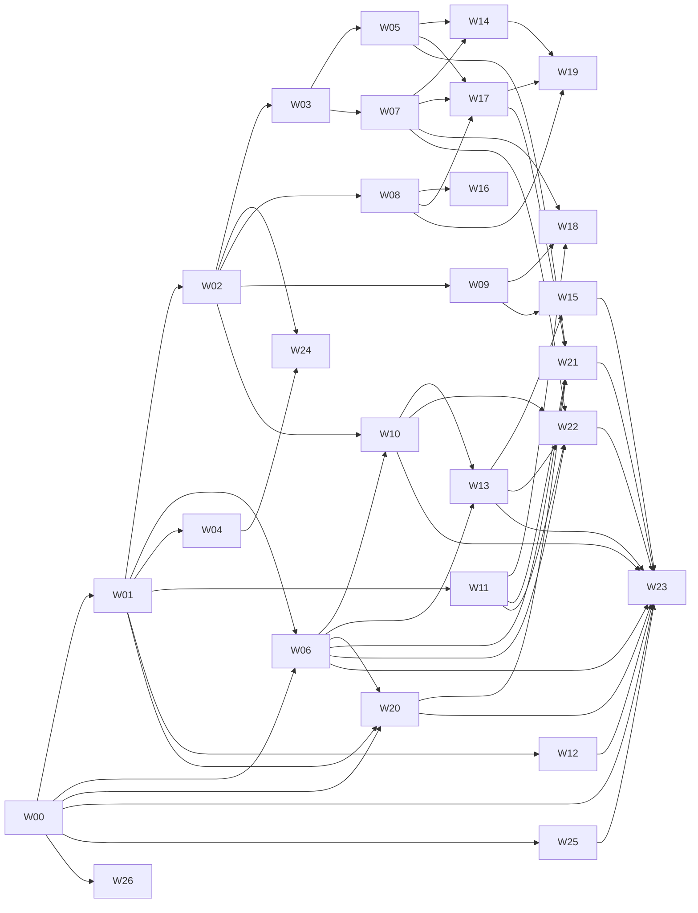

# TerraAgent — Product Waves (master plan)

> **Status:** v1 (2026-10-30). This replaces the layer-based plan (`EXECUTION_ORCHESTRATOR.md`, `STATUS.md`, `issues/TA-*.md`, 116 tasks), which is kept for traceability only. Every new issue carries a `Replaces` reference to the old TA ids.
> **Specs:** [`../spec/DECISIONS.md`](../spec/DECISIONS.md) (D-01 … D-37; D-32 = frontend layout; D-37 = hosting on `terraagent.fun`) · [`../game/`](../game/) · [`../spec/`](../spec/)
> **Issue index:** [`ISSUE_INDEX.md`](./ISSUE_INDEX.md) (**871 issues in 27 waves, ≈ 619 agent-days**; regenerate with `python3 scripts/plan/index_waves.py --write`) · **Wave files:** [`waves/`](./waves/) · **Hackathon subset:** [`HACKATHON_CUT.md`](./HACKATHON_CUT.md)

## 1. The rule

1. **Every wave ships a working app.** A wave is a **vertical product slice**: sim, server, client, visuals and tests together. When a wave is merged, a player can open the app and use the new feature end to end, on top of every wave it depends on.
2. **Every wave can be tested on its own, and you can go back and forward** (§3): it has a feature flag, a git tag, a seed scenario and its own e2e suite.
3. **Waves can be built in parallel** (§4): waves sit on tracks with disjoint file ownership, use contract-first issues, plug into registries instead of editing shared files, and use mocks for anything not built yet.
5. **Every wave is built in its own branch and worktree** (§7). It reaches `main` only after the owner's manual check; then its worktree and branch are deleted and `main` is pushed.
4. **An issue is at most one agent-day** (size S ≤ ½ day, M ≤ 1 day). Each issue has exactly **one acceptance check** written as "do X → see Y", and names its wave flag. Anything bigger is split. **The issue count is a result of this rule, not a target.**

## 2. Waves

| Wave | Name | Track | Player-visible result ("the demo") | Depends on |
|---|---|---|---|---|
| **W00** | Platform Skeleton | Spine | App boots, the client connects over WS, and an empty hex planet renders with a live server tick. Dev console, scenario loader, time warp, flags, CI and the e2e harness work. Ports + Postgres mocks + contract tests exist | — |
| **W01** | Landfall | Spine | Guest login → drop pod lands → HQ drone prepares ground (Grade / Clear / Break) → builds the Command Hub → the colony survives a server restart (snapshot) | W00 |
| **W02** | First Light | Spine | Harvester and Metals Extractor produce resources (D-34 families Metals / Minerals / Bio, T1 sub-resources; Energy is grid power), Solar powers the colony, day/night cycles, storage caps, order queue v1 (pay on start, wait reasons, ETA), Construction menu | W01 |
| **W03** | The Grid | Gameplay | Builder, pylons with reach and per-pylon load, capacitor, wind, thermal fuel, depot, quarry / water extractor / petroleum well (Bio T2 source), brownout shedding, repair, all 4 order lanes with earmarks | W02 |
| **W04** | Maps & Camera | Client | Minimap (click to pan), global planet map on `M` with layers, selection and camera polish, tile-state overlay | W01 |
| **W05** | Shape the Land | Gameplay | Terraformer and all terrain ops (Level, Fill, Reclaim, Deep Reclaim, Irrigate, Seed), linked prep, beacons + territory + frozen borders, Terraform %, Living bonuses, T2/T3 resource tiers unlocked by terraforming (D-34), `desert` and `ocean` planet types next to `temperate` (D-33), lightning + meteors (holes) | W03 |
| **W06** | Invisible Chain (F5, mock) | Economy/NEAR | Social login (mock), named account "Pilot ID", gasless relayer (mock), mock receipts in a dev chain explorer | W00, W01 |
| **W07** | First Contact (battle v1) | Gameplay | Skitter nests and raids, Robotics Factory T1, Recon, Autocannon, Laser Tower, supply (DCA), battle v1 (projectiles judged at impact time, lasers, rockets, AoE, evasive units), range and view rings, projectile VFX | W03 |
| **W08** | Stages & HQ Goals | Autonomy | Stage engine S0–S10 (data-driven), triggers / dwell / overrides, `unlockStage` / `threatStage`, suggestion cards, HQ goals with budgets, rule-engine autopilot, priority sliders | W02 |
| **W09** | Offline & Notifications | Autonomy | Presence, coarse ticking for empty planets, restart fast-run, away mode + away budget, "while you were away" digest, hard mode, Web Push + Telegram (via `NotifierPort`, mock first) | W02 |
| **W10** | Cargo & Trade Hub (F1, mock) | Economy/NEAR | Trade Hub building, export mints cargo (mock NEP-245), import burns it, mint caps, cargo panel | W02, W06 |
| **W11** | Lobby & Planets | Meta | Planet picker, queue, planet lifecycle (capacity, admission 24 h, seal, lifetime, end, early end), join fallback, 2 h seat refill, parties, many planets across sim threads | W01 |
| **W12** | Player Page & Achievements | Meta | `/me` (pilot, progress, planets, stats, history, play), XP and levels, 20 × 3 achievement flip cards, badge art, badge mint outbox (mock) | W01 (more families light up as producer waves land) |
| **W13** | Markets (F2, mock) | Economy/NEAR | Market stalls at Trade Hubs, buy/sell orders, matching, owner fees, `token_diff` settlement on mock Intents, price board | W06, W10 |
| **W14** | Fortify (walls) | Gameplay | Ridge, Moat, Lower, Wall Gate, line of fire + parapet, wall-aware pathing, fauna siege, `would_isolate` | W05, W07 |
| **W15** | Guild & Agents (F3, F4, mock) | Economy/NEAR | Orbital Guild NPC traders with wallets visit, quote and trade; colony director key with allowance; `autoTrade` | W09, W13 |
| **W16** | AI Director | Autonomy | `LlmProviderPort` (mock + Z.ai glm-5.3), triggers, brief, DirectiveV1 v2, budgets, raw logs, rationale in the HUD, away story | W08 |
| **W17** | Second Tier (S5–S7) | Gameplay | Hub T2 + HQ refit, Multitask T2, T2 buildings, Factory T2, Tank, Artillery, Mobile Radar + spotting, Brute fauna | W05, W07, W08 |
| **W18** | PvP & Diplomacy | Gameplay | Raids on colonies, newcomer shield, colony critical / elimination, HQ reprint, truces (offer, notice, Oathbreaker), AI raid opt-in | W07, W09, W11 |
| **W19** | Air & Endgame (S8–S10) | Gameplay | Aero Hangar, Air Recon, Fighter, Gunship, Bomber, Anti-Air, Drifter, T3 structures, Multitask T3, HQ T3 | W08, W14, W17 |
| **W20** | Colony Deed & Staking (F6, mock) | Economy/NEAR | A dynamic Deed NFT minted at founding that updates with milestones, a Deed card, own-NEAR staking (mock pool) | W00, W01, W06 |
| **W21** | Rocket & Settlement | Gameplay | Rocket Silo, launch gate (100 % Living), countdown, Settled colony, carry-over to a new planet, all-settled planet ends early, account claim (mock) | W05, W06, W11, W17, W20 |
| **W22** | Treasury & Bounties (F7, F8, mock) | Economy/NEAR | Planet treasury DAO (fees in, proposals, votes, projects), bounty escrow, mercenary NPCs | W06, W07, W10, W11, W13 (W18 optional) |
| **W23** | Real NEAR (phase 2) | Economy/NEAR | Each port switches to its real adapter after its contract suite passes: Identity, Relayer → Cargo → Intents → Agent wallet → Deed / Staking → DAO → Escrow | per port: W00, W06, W10, W12, W13, W15, W20, W21, W22; ops: W25 |
| **W24** | Mobile, PWA & Landing | Client | Landscape fullscreen play on phones, rotate prompt, iOS PWA path, touch controls, live landing diorama | W02, W04 |
| **W25** | Launch Ops & Submission | Ops | Monitoring, backups, rollback deploy, first-party analytics, load test, balance harness + reference bot, README / LICENSE / video / X post / form. Hosting is W26 | W00 (grows with each wave; hosting issues name W26 ids) |
| **W26** | Sites | Ops | `terraagent.fun` and its subdomains on one nginx, four compose stacks, local and on `DEPLOY_HOST` over SSH. No Cloudflare | W00 |

The **spine** is W00 → W01 → W02. Everything after W02 can run on up to **five parallel tracks**.

**Soft (optional) dependencies.** These are not drawn in the graph. Each one is a hook that lights up when the other wave is on and falls back to the dev console or a stub when it is off, so neither wave blocks the other:
- W04 map layers: Threats ← W07, Market ← W13, Walls ← W14.
- Stage numbers in W05/W07/W14 ← W08.
- Deep Reclaim (W05) is usable by players only with W17's T2 workers.
- Digest fields ← W13/W16; away story ← W16.
- Elimination causes in W09 ← W18.
- Guild strategy (W15) ← W16; autoTrade partners ← W18.
- Shared service worker: W24-07 owns the file, W09 registers the push handler.

Each wave file lists its soft dependencies in its header.

## 3. Going back and forward (testing waves separately)

| Mechanism | How it works |
|---|---|
| **Wave flags** | Each wave owns the flag `W<nn>`. Server: `TA_WAVES=all` (default), `TA_WAVES=..07` (W00–W07 only), or an explicit list like `TA_WAVES=00,01,02,07`. Client: the same set comes from the server in `welcome.flags`; in dev it can be overridden with `?waves=..07`. Code checks `flags.has('W07')`. Data-table rows (buildings, units, ops, achievements, stages) carry `wave: 'W07'` and are filtered at `compileData`. **No flag, no feature**: menus, commands, systems and HUD panels of a disabled wave do not exist |
| **Flag-safe state** | Snapshots keep entities of disabled waves. A disabled wave's systems do not run and its entities are inert and hidden, never deleted, so turning a wave back on restores them. Commands of a disabled wave are rejected with `wave_disabled` |
| **Git tags** | When a wave lands on `main` (§7), its merge commit is tagged `wave-NN`; a later landing of the same wave (e.g. its `H+` or post-hackathon rows) is tagged `wave-NN.2`, `wave-NN.3`… `git checkout wave-07 && npm run dev` gives exactly the app as of that landing |
| **Seed scenarios** | Each wave has `scenarios/wNN-<slug>.ts`, which creates a planet already in the state that wave needs (e.g. W14 starts with a colony at S4, a Terraformer and a nest nearby). Load it with `?scenario=w14` or `npm run scenario w14` |
| **E2E per wave** | `e2e/wNN.spec.ts` drives headless Chrome against the running app and asserts the wave's demo. `npm run e2e -- --waves ..NN` runs every suite up to NN, so a regression in an earlier wave is caught. Wave DoD = its e2e passes **and** every earlier wave's e2e still passes |
| **Local host** | `?host=local` runs the shared engine in the browser with no backend (D-31): gameplay waves can be played and tested without the app or Postgres, and `npm run e2e -- --host local` runs sim-only suites. Features that need server modules (accounts, NEAR, lobby, notifications, progression, LLM) are hidden locally |
| **Dev tools (W00)** | Dev console (grant resources, set stage, spawn raid, spawn unit, reveal map, `tune` balance rows live with a `TA_BALANCE_OVERRIDES` file, D-35), time warp ×1–×100, state inspector, mock chain explorer, flag panel. Dev-only builds; they are not anti-cheat (D-25) and are not shipped in production |

## 4. Building waves in parallel

| Rule | Detail |
|---|---|
| **Tracks own paths** | Spine/lead: kernel, contracts core, app shell. **Gameplay (G):** `shared/sim/src/systems/<feature>/`, `shared/sim/src/data/<feature>.ts`, `frontend/game/features/<feature>/`, kitbash archetypes (`frontend/render/kitbash/archetypes/`). **Economy/NEAR (E):** `backend/app/src/near/**`, `backend/app/src/market/**`, sim `systems/{trade,treasury,bounty,mercenary}/`, client `features/{cargo,market,deed,treasury,bounty,identity}/`. **Autonomy (P):** sim `systems/{progression,goals,rule-engine}/`, `backend/app/src/{ai,notify}/`, client `features/{goals,stages,away,notify}/`. **Meta (M):** `backend/app/src/{lobby,profile,progression}/`, client `pages/{me,lobby}/`. **Client (C):** `frontend/game/{core,net,store,camera,maps,mobile}/`, `frontend/render/**`, `frontend/landing/**`. **Ops (O):** `infra/`, `.github/`, `scripts/`, `e2e/harness/`. W26 splits that into four stacks built at the same time after its nginx skeleton (infra, frontend, backend, chain); W25 does not own `infra/compose`, `infra/nginx` or `infra/hosts` |
| **One engine** | Every game rule lives in `@terra/sim` (D-31). The server sim thread, client-side prediction and the local host run that same code, so a wave never puts a game rule in a server module or a client feature. A wave that adds state registers its synced fields (no delta code) and adds its scenario to the engine parity test (W00-58) |
| **One renderer: build on `frontend/render`** | The 3D look is done and approved; waves extend it, never replace it or start a parallel renderer. Viewport, tone mapping, bloom, IBL → `render/core/createColonyViewport.ts` · models → `render/kitbash` (`KitbashRegistry`, greebles, `npm run validate:models`, playground 4-view check) · materials → `render/visuals/UnifiedColonyMaterial.ts` (biome weathering, rim) and `unified/registries.ts` · terrain, water, scatter, landforms, particles → `render/visuals/terrain/*` (the hex grid is drawn with this terrain shader, W00-28) · textures → `ProceduralTextureRegistry` · space, sun, parallax → `render/visuals/space/*` · planet globe + terraform stages + territories → `render/planets/globe/*` · orbit stage + deploy → `render/orbit/*` · descent cinematic and its FX (flames, plasma, streaks, ground FX, drop rig) → `frontend/game/descent`, `render/descent` · day/night, lightning → `render/lighting/*` · CRT → `render/ui/crt.ts` · RTS camera, ground pick → `frontend/game/app/`. A wave adds a module next to these or registers into their registries; changing their look needs the owner's OK and the 4-view check (AGENTS.md pillars) |
| **Registries, not edits** | Shared lists are assembled by **auto-discovery**, so a new feature adds a file instead of editing a shared one: sim systems `systems/*/index.ts` (each declares its pipeline order), contracts `shared/contracts/src/commands/*.ts` and `events/*.ts`, data `data/*.ts`, client features via `import.meta.glob('./features/*/index.ts')` in `frontend/game` (a feature never imports another feature or app; AGENTS.md §6) (each registers menus, HUD panels, renderers), server modules via a module list built from `modules/*/`. This follows the registry pattern in `AGENTS.md` (`KitbashRegistry` etc.) |
| **Contract-first** | Each wave's **first issue** (`WNN-01`) lands its contracts: zod schemas for commands and events, data-table rows, port methods, flag. Waves that depend on it open only after it has landed in `main` (§7, no stacking); waves that do not depend on it code against mocks until then |
| **Mocks for missing waves** | All NEAR, LLM and notifications behind ports with mocks (D-30). A wave that needs data from an unfinished wave uses the dev console or a scenario to fake it |
| **Shared-file pre-step** | The few files that cannot be auto-discovered (root `package.json`, Prisma schema core, `CommandKind` union generation script) are changed only in a **lead pre-step** at the start of a wave. Prisma: one schema file per module (`prisma/<module>.prisma`), merged by script |
| **Merge rule** | The wave development pipeline (§7): issue branches merge into their wave branch when the gates are green; the wave branch merges into `main` only after the owner's manual check, then it is tagged, its worktree and branch are deleted and `main` is pushed |

## 5. Issue format

Issue id: `WNN-XX`, e.g. `W07-12`. One row per issue in the wave file:

| Column | Meaning |
|---|---|
| **ID** | `WNN-XX`. `XX = 01` is always contracts & data; the last issue is always `wave e2e + scenario + tag` |
| **Title** | Imperative, specific |
| **Type** | `contract` · `sim` · `server` · `client` · `visual` · `data` · `test` · `ops` · `docs` |
| **Size** | `S` (≤ ½ day) or `M` (≤ 1 day). There is no L; split it |
| **H** | Hackathon tag: `H` must for Nov 1–14 · `H+` stretch · `H2` real NEAR after the D10 gate · blank = after the hackathon. An `H` issue may depend only on `H` issues; `H+` on `H`/`H+`; `H2` on `H`/`H2` (the index script checks this) |
| **Deps** | Issue ids (same or other waves). Ranges (`W07-03..07`) and `all above` / `all W07` are allowed; for a tagged issue they mean the issues of its tag set only. Bare waves (`W07`) are not allowed: write the issue id. A wave's e2e also waits for the e2e of the waves in its header's **Depends on** |
| **Acceptance** | One "do X → see Y" check |
| **Spec** | Spec rule ids or sections |
| **Replaces** | Old TA task ids, if any |

Every wave file has: goal, demo story (the e2e script in words), dependencies, track, owned paths, flag, scenario, issue table, and wave DoD. Hackathon waves also have a **Hackathon slice**: the demo steps their e2e tags `@hack` (run with `npm run e2e -- --hack`) and what is deferred.

## 6. Hackathon (Nov 1–14, solo + AI agents)

Decision B (2026-10-30): every hackathon wave ships its **core slice**, tagged `H` per issue, so each still ends in a working, tested app. Waves in the cut: W00–W15 (W16 not in the cut), W20 (deed only), W22 (treasury + nest bounties), W25 (submission; hosting moved to W26), W26 (sites on `terraagent.fun`); W23's F5/F1/F2 swap is tagged `H2` and runs only after the D10 gate. Everything else is post-hackathon.

- Numbers, calibration rule, checkpoints and the drop order: [`HACKATHON_CUT.md`](./HACKATHON_CUT.md).
- Generated critical path and start order: [`HACKATHON_SCHEDULE.md`](./HACKATHON_SCHEDULE.md) (`python3 scripts/plan/index_waves.py --write`).

## 7. Wave development pipeline

Every wave is built in its **own branch and its own git worktree**. Nothing is committed to `main` directly; a wave reaches `main` only after the **owner's manual check**. Branches stay local: only `main` (and its tags) is pushed.

**Names**

| Thing | Name | Example |
|---|---|---|
| Wave branch | `wave/wNN-<slug>` (slug = the wave file name) | `wave/w07-first-contact` |
| Wave worktree | `../TerraAgent-wt/wNN` | `../TerraAgent-wt/w07` |
| Issue branch | `issue/WNN-XX` | `issue/W07-03` |
| Issue worktree | `../TerraAgent-wt/WNN-XX` | `../TerraAgent-wt/W07-03` |
| Landing tag | `wave-NN`, then `wave-NN.2`, … | `wave-07` |

**Pipeline**

| # | Step | Who | Commands (`npm run wave` does steps 1 and 7 — see below; the single-step scripts do the rest) |
|---|---|---|---|
| 1 | **Open the wave**: only when **every wave in its header Depends on has landed in `main`** (tagged `wave-NN`); branch from the current `main` into its own worktree, with its own dev ports and database | agent | `git worktree add ../TerraAgent-wt/w07 -b wave/w07-first-contact main` → `npm run wave:open -- 07` |
| 2 | **No stacking**: a wave never merges another wave's unlanded branch. If a dependency is still open, the wave waits (`npm run wave -- status` shows `waits for W03 in main`); `wave:open` and `npm run wave` refuse to open it | — | — |
| 3 | **Build issues**: one issue = one agent = one issue worktree branched from the wave branch | agent | `git worktree add ../TerraAgent-wt/W07-03 -b issue/W07-03 wave/w07-first-contact` → `npm run wave:issue -- W07-03` |
| 4 | **Land an issue in the wave**: when its gates are green (typecheck, lint, unit, contract suites, the wave's e2e with `--hack` in the hackathon), merge it into the wave branch, then delete the issue worktree and branch. No human step. On a conflict the agent merges the wave branch into the issue branch, re-runs the gates and retries | agent | in the wave worktree: `git merge --no-ff issue/W07-03` · `git worktree remove ../TerraAgent-wt/W07-03` · `git branch -d issue/W07-03` → `npm run wave:issue:land -- W07-03` |
| 5 | **Wave ready for check**: every tagged issue of this landing has landed; merge the latest `main` into the wave branch; the wave e2e **and every earlier wave's e2e** pass; the dev stack runs on the worktree's ports with `?scenario=wNN`; the lead has played every demo step on it and written the **owner check guide** [`checks/wNN-check.md`](./checks/README.md) (exact URLs with ports, where to type, what to see; worked example [`checks/w00-check.md`](./checks/w00-check.md)) | agent | `git merge main` · `npm run ci:fast && npm run e2e -- --waves ..07` → `npm run wave:check -- 07` (prints the demo steps to try and the URL) |
| 6 | **Manual check**: follow the owner check guide step by step (the `@hack` steps in the hackathon) in the worktree's dev stack. Not OK → note what is wrong; agents fix it with new issue branches (steps 3–5) and ask again | **owner** | open the URL from step 5 |
| 7 | **Land the wave**: on the owner's go — merge into `main`, tag, push, delete the worktree and the branch, and tell every open wave to merge the new `main` | owner runs it (or agent on the owner's explicit go) | `npm run wave -- land NN` (e.g. `npm run wave -- land 00`), or in the main checkout: `git pull --ff-only` · `git merge --no-ff wave/w07-first-contact -m "W07 First Contact"` · `git tag wave-07` · `git push origin main --tags` · `git worktree remove ../TerraAgent-wt/w07` · `git branch -d wave/w07-first-contact` → `npm run wave:land -- 07` |

**One command.** `npm run wave` first lands every completed wave whose dependencies are in `main` (in dependency order), then resumes the open wave or opens the next ready one (hackathon value order, **every dependency landed in `main`**), runs `npm ci` in its worktree and starts the wave's runner there as the lead (`claude`, `agy`, or `grok`; `--runner` overrides the preset), with instructions to build the wave's `H` rows issue by issue and stop at the owner check. After your check, `npm run wave -- land` merges, tags, pushes and removes the worktree and branch. Also: `npm run wave -- status`, `npm run wave -- next 06`, `--new` (open a second wave in parallel), `--tags H,H+`, `--dry-run`, `--no-launch`.

**Rules**
- **Opening and landing follow dependencies.** A wave opens only after every wave it depends on (header **Depends on**) is in `main`, and therefore lands after them too; `wave:open` / `npm run wave` / `wave:land` refuse otherwise. The owner's check of a wave gates the waves that depend on it, so check and land waves promptly. (Waves opened before this rule — W01 and W02, stacked on W00 — keep working and still land only after their dependencies.)
- **Open waves follow `main`.** After any landing, every open wave branch merges `main` (step 5 does it at the latest).
- **The main checkout may hold other people's uncommitted work** (CLAUDE.md). Step 7 merges there only if no dirty file is touched by the merge; otherwise it stops and says which files. It never stashes or reverts anyone's work.
- **Isolation per worktree.** Each worktree gets its own `TA_PORT_BASE` (app, client, e2e) and its own database `terra_<branch>` on the shared Postgres, written to `.env.worktree`, so several waves can run their dev stacks and e2e at once. Each worktree runs its own `npm ci`.
- **One landing per wave in the hackathon.** The `H` rows (plus any `H+` rows done in time) land as `wave-NN`. Later rows of the same wave reopen it with the same steps and land as `wave-NN.2`, ….
- **Going back** works on landed waves only: `git checkout wave-07` (§3). Unlanded work lives in its wave branch until the owner's check.
