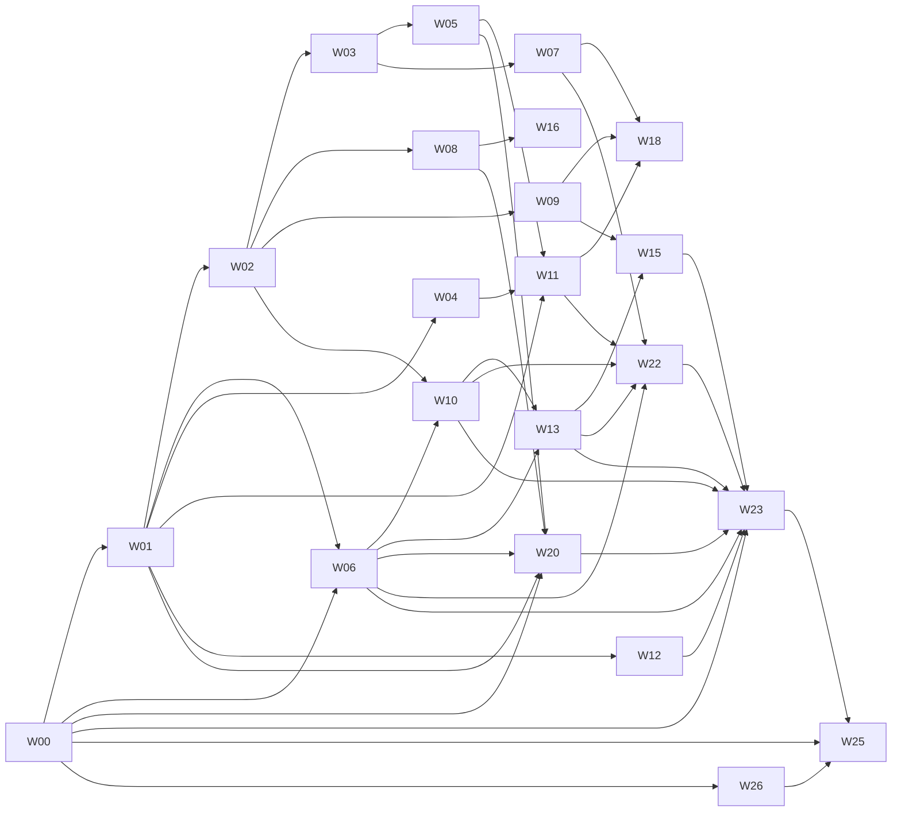

# TerraAgent — Product Waves (master plan)

> **NEAR Hackathon Vertical Slice Revision (2026-11-09):** Focused the entire schedule on polishing the **Tier-1 (`S0–S4`) Vertical Slice** — core colony gameplay, AI Director, persistent multiplayer & diplomacy, economy/markets, offline play, and NEAR + Web3 features:
> - **Postponed Waves (`POSTPONED` — 0 `H` issues, skipped by `npm run wave`):** `W14` (Fortify), `W17` (Second Tier S5–S7), `W19` (Air & Endgame S8–S10), `W21` (Rocket & Settlement), `W24` (Mobile, PWA & Landing), and `W27` (450-Sector Streaming).
> - **Skip All Tier 2/3:** All Tier 2/3 buildings, resources (`metals.t2/t3`, `minerals.t2/t3`, `bio.t2/t3`), units (`tank`, `artillery`, `radar`, `multitask`, `brute`, aircraft), and stages (`S5–S10`) are deferred out of the vertical slice.
> - **Active Vertical Slice Order (22 Waves, 634 `H` issues):**
>   - **Landed (17):** `W00 → W26 → W01 → W02 → W06 → W10 → W03 → W07 → W05 → W04 → W08 → W12 → W11 → W13 → W16 → W20 → W09`
>   - **Remaining Build Queue (5):** `W15` (Guild & Agent Wallets) → `W18` (PvP & Diplomacy) → `W22` (Treasury DAO & Bounties) → `W23` (`NEAR_MODE=mock|testnet|devnet` Switch & Real NEAR Testnet/Devnet Adapters) → `W25` (Launch Ops & Submission)
> - **100% Working Mocked + `NEAR_MODE=mock|testnet|devnet` Switch & Full-Game E2E Gates:** Every economy, AI Director (`AI_PROVIDER=mock|zai` with `AI_LIVE=1`), offline (`NOTIFY_ADAPTER=mock|live|webpush|telegram`), and all 11 Web3 ports work 100% end-to-end when mocked (`NEAR_MODE=mock`) and switch cleanly to real NEAR testnet/devnet via `NEAR_MODE=testnet|devnet` (or per-port `NEAR_ADAPTER_<PORT>=mock|testnet|devnet|mainnet`). Every wave enforces unit + integration (positive/negative/corner cases) + full-game server E2E (`tests/e2e/wNN.spec.ts`).

**Regional trade revision (2026-11-04):** W11-46 adds resource identity hooks; W13-50–57 add configurable planet/sector endowments, base/army logistics, trade reasons and AI experiments. W27 (postponed) preserves pinned resources during streaming. Generated counts replace earlier estimates; no new calendar commitment.

> **W13/W15 economy revision (2026-11-04, D-44 & D-45):** [ECONOMY](../spec/ECONOMY.md) adds database-managed profiles, recurring consumption, USDC buyer fees, reproducible AI experiments, and external trading bot API (`/v1/trade/*`). W13-01–67 are required mock scope; W15 risk/requote/tests are required. W23 provides the `NEAR_MODE=mock|testnet|devnet` feature switch and real testnet/devnet adapters. Regenerated ISSUE_INDEX/HACKATHON_SCHEDULE supersede older totals and dates.

> **Status:** v2 Vertical Slice (2026-11-09). This replaces the layer-based plan (`EXECUTION_ORCHESTRATOR.md`, `STATUS.md`, `issues/TA-*.md`, 116 tasks), which is kept for traceability only. Every new issue carries a `Replaces` reference to the old TA ids.
> **Specs:** [`../spec/DECISIONS.md`](../spec/DECISIONS.md) (D-01 … D-45; D-42 = W02 as-built build rules; D-43 = W07 neutral hive fauna & combat/motion rules; D-44 = regional specialization & market fees; D-45 = W05 hex-tile footprint & R4 plane joining + W13 external bot participation; D-32 = frontend layout; D-40 = hosting on `terraagent.fun`; D-41 = 7-domain layout) · [`../game/`](../game/) · [`../spec/`](../spec/)
> **Issue index:** [`ISSUE_INDEX.md`](./ISSUE_INDEX.md) (**1020 issues in 28 waves, ≈ 754.5 agent-days; 634 `H` issues in 22 active Vertical Slice waves**; regenerate with `python3 scripts/plan/index_waves.py --write`) · **Wave files:** [`waves/`](./waves/) · **Hackathon subset:** [`HACKATHON_CUT.md`](./HACKATHON_CUT.md)

## 1. The rule

1. **Every wave ships a working app.** A wave is a **vertical product slice**: sim, server, client, visuals and tests together. When a wave is merged, a player can open the app and use the new feature end to end, on top of every wave it depends on.
2. **Every wave can be tested on its own, and you can go back and forward** (§3): it has a feature flag, a git tag, a seed scenario and its own e2e suite.
3. **Waves can be built in parallel** (§4): waves sit on tracks with disjoint file ownership, use contract-first issues, plug into registries instead of editing shared files, and use mocks for anything not built yet.
5. **Every wave is built in its own branch and worktree** (§7). It reaches `main` only after the owner's manual check; then its worktree and branch are deleted and `main` is pushed.
4. **An issue is at most one agent-day** (size S ≤ ½ day, M ≤ 1 day). Each issue has exactly **one acceptance check** written as "do X → see Y", and names its wave flag. Anything bigger is split. **The issue count is a result of this rule, not a target.**

## 2. Waves

| Wave | Name | Track | Player-visible result ("the demo") | Depends on |
|---|---|---|---|---|
| **W00** | Platform Skeleton | Spine | App boots, the client connects over WS, and an empty hex planet renders with a live server tick. Dev console, scenario loader, time warp, flags, CI and the e2e harness work. Ports + Postgres mocks + contract tests exist | — |
| **W01** | Landfall | Spine | Guest login → drop pod lands → HQ drone prepares ground (Grade / Clear / Break) → builds the Command Hub → the colony survives a server restart (snapshot) | W00 |
| **W02** | First Light | Spine | Worker Drone T1 and Metals Extractor produce resources (D-34 families Metals / Minerals / Bio, T1 sub-resources; Energy is grid power; finite 3-stage deposits (several workers on one deposit)), Solar powers the colony, day/night cycles (with daytime entity light shutoff + night moon shadows), storage caps, order queue v1 (progressive resource deduction, 50% cancel/dismantle refund, wait reasons, ETA), unified collapsible Command Dock (`BUILD`/`PRODUCTION`/`TERRAFORM`/`QUEUE`), bottom selection bar + 3D health/progress bars, and object-driven 3D terraforming particle system with hand-locked lasers | W01 |
| **W03** | The Grid | Gameplay | Worker Drone T2, pylons with reach and per-pylon load, capacitor, wind, thermal fuel, depot, quarry / water extractor / petroleum well (Bio T2 source), brownout shedding, automatic repair (the manual REPAIR order already ships in W02), multi-builder dispatch, all 4 order lanes with earmarks | W02 |
| **W04** | Maps & Camera | Client | Minimap (click to pan), global planet map on `M` with layers, selection and camera polish, tile-state overlay | W01 |
| **W05** | Shape the Land | Gameplay | Unified Worker Drone T1–T3 (`ENTITY_KIND.worker`), auto per-hex Terraform / Repair / Dismantle tool with growth ladder (Level, Fill, Reclaim, Deep Reclaim, Irrigate, Seed) and Ctrl+click queue, D-45 hex-tile footprints & R4 plane joining, linked site prep, Territory Beacon + Hydro Power Station + Hazard Shield & Lightning Rod, Terraform %, Living bonuses, T2/T3 resource tiers unlocked by terraforming (D-34), `desert` and `ocean` planet types next to `temperate` (D-33), storms / rain / twisters / lightning + meteors (holes), planar water reflections (`WaterReflectionPass`), and unified `BuildingLightState` | W03 |
| **W06** | Invisible Chain (F5, mock) | Economy/NEAR | Social login (mock), named account "Pilot ID", gasless relayer (mock), mock receipts in a dev chain explorer | W00, W01 |
| **W07** | First Contact (battle v1) | Gameplay | Three neutral insect species and organic hives, passive life/aggressive waves, deterministic directive + sparse motion sync (`DIFF_FORMAT=2`), GPU-instanced swarm renderer, hive-life + gallery + march playground, Robotics Factory T1, six-wheel Recon Armored Scout (`robot.recon`), Autocannon, Laser Tower (`building.laserTower`), supply (DCA), battle v1 (projectiles judged at impact time, lasers, rockets, AoE, spotting gates, `moveGroup` flow-field slot march, `F6` Combat Lab), range and view rings, pooled projectile/combat/liquid VFX | W03 |
| **W08** | Stages & HQ Goals | Autonomy | Stage engine S0–S10 (data-driven), triggers / dwell / overrides, `unlockStage` / `threatStage`, suggestion cards, HQ goals with budgets, rule-engine autopilot, priority sliders | W02 |
| **W09** | Offline & Notifications | Autonomy | Presence tracker (`60 s` away timer, blip ignore, `system.presence`), coarse ticking (`1 step/s`, `dt=5`, `ta_game_planet_mode`) for empty planets, staggered `60 s` + seal/end/shutdown snapshots & `24 h`-capped restart fast-run with post-fastrun notification flush, `awayPolicy` (`AW-01..15`) + per-resource away session budget (`AW-20`, defense/repair uncapped) + `withinAutoTrade` (`AW-13`), `ColonyBook` `AWAY` tab (`setAutopilot` synced with W16 `ColonyDirectorRecord`), `AwayDigestStore` + `welcome.away` / `/v1/me/home.awaySummary` + "While you were away" headline plate (with W16 `awayStory`), hard-mode elimination while away (`colony eliminate`), single-socket colony takeover (`bye 4001`, "Playing elsewhere") + `?scenario=` reload-after-away seat resume & `&fresh=1`, and Postgres `MockNotifier` (`NOTIFY_ADAPTER=mock`, `/v1/dev/notify`) + `AlertRouter` (8 kinds, `under_attack` 10-min debounce) | W02 |
| **W10** | Cargo & Trade Hub (F1, mock) | Economy/NEAR | Trade Hub building, export mints cargo (mock NEP-245), import burns it, mint caps, cargo panel | W02, W06 |
| **W11** | Planet Foundations | Sim/Meta/Client | Three persistent 19-sector worlds (`7` land + `12` ocean sectors, `4×` basic sector size `R=48`, `7,057` tiles/sector), atomic sector admission, parties/resume, pinned saves, isolated single-sector gameplay (`cross_sector_disabled`), and Orbital Picker + Global Map (`M`) surrounding-sector display | W01, W04, W05 |
| **W12** | Player Page & Achievements | Meta | `/me` (pilot, progress, planets, stats, history, play), XP and levels, 20 × 3 achievement flip cards, badge art, badge mint outbox (mock) | W01 (more families light up as producer waves land) |
| **W13** | Markets & Trading Bot API (F2, mock) | Economy/NEAR | USDC/barter/NEAR markets, buyer 1% platform + 0–1% stall fees, NEP-413 `MockIntentsAdapter` + deterministic chain fault injection (`near.mock.fault`), DB economy profiles & operator panel (`/dev/chain/?tab=economy`), recurring prestige projects (`survey_array`, `monument`) + metered cargo transport recipe, regional resource endowments + base/army logistics supply windows (`unitReserve`), reproducible AI economy experiments (`npm run economy`), standalone `/trade.html` + `/v1/trade/*` bot REST+SSE API (allowances, kill switch, rate limits, `/v1/trade/overview/:planetId`), and pure need/value quote library (`shared/sim/src/systems/trade/agent/`) + `npm run trade:bot` (D-44, D-45) | W06, W10 |
| **W14** | **[POSTPONED]** Fortify (walls) | Gameplay | *Postponed out of NEAR Hackathon Vertical Slice* — Ridge, Moat, Lower, Wall Gate, line of fire + parapet, wall-aware pathing, fauna siege | W05, W07 |
| **W15** | Guild & Agents (F3, F4, mock) | Economy/NEAR | Orbital Guild NPC traders with wallets visit, quote and trade; colony director key with allowance; `autoTrade` | W09, W13 |
| **W16** | AI Director | Autonomy | Separate `@terra/director` worker (mock + live Z.ai `glm-5.3`), private MCP, durable `PrismaDirectorStore` outbox/budget/kill-switch, W08 goals, Conservative/Risky skills, W11/W27 context & `SectorAdvisor`, W13 quote-library Guild strategy, live HUD `DIRECTOR` policy controls & rationale, and away story | W08 |
| **W17** | **[POSTPONED]** Second Tier (S5–S7) | Gameplay | *Postponed out of NEAR Hackathon Vertical Slice (Tier 2/3 skipped)* — Hub T2 + HQ refit, Multitask T2, T2 buildings, Factory T2, Tank, Artillery, Mobile Radar, Brute fauna | W05, W07, W08 |
| **W18** | PvP & Diplomacy | Gameplay | Raids on colonies, newcomer shield, colony critical / elimination, HQ reprint, truces (offer, notice, Oathbreaker), AI raid opt-in | W07, W09, W11 |
| **W19** | **[POSTPONED]** Air & Endgame (S8–S10) | Gameplay | *Postponed out of NEAR Hackathon Vertical Slice (Tier 2/3 skipped)* — Aero Hangar, Air Recon, Fighter, Gunship, Bomber, Anti-Air, Drifter, T3 structures | W08, W14, W17 |
| **W20** | Colony Deed & Staking (F6, mock) | Economy/NEAR | Dynamic NEP-171 Colony Deed minted at founding (`MockDeedNftAdapter` + outbox), 10-min debounced milestone projector (stage, Terraform %, trade volume, truces, rank, eliminated/abandoned status), server-side SVG→PNG 1200×630 Faction Plate card renderer (`Active`/`Settled`/`Eliminated`), public `/deed/:tokenId` share page + Share on X, Stage-4 / 100%-Living-Planet / `Seal Settled Deed` settlement, mock NEP-413 account claim & wallet signer modal, `MockStakingAdapter` own-NEAR validator staking + 4-epoch unbonding + `staking-no-p2w` property, `/dev/chain/` Deeds & Staking tabs, and dual `TabBook` HUD layout (`CommandDock` + `ColonyBook`) | W00, W01, W06, W05, W08 |
| **W21** | **[POSTPONED]** Rocket & Settlement | Gameplay | *Postponed out of NEAR Hackathon Vertical Slice* — Rocket Silo, launch gate, countdown, carry-over | W05, W06, W11, W17, W20 |
| **W22** | Treasury & Bounties (F7, F8, mock) | Economy/NEAR | Planet treasury DAO (fees in, proposals, votes, projects), bounty escrow, Tier-1 `robot.recon` mercenary NPC squads | W06, W07, W10, W11, W13 (W18 optional) |
| **W23** | Real NEAR Switch & Testnet/Devnet (`NEAR_MODE`) | Economy/NEAR | Unified `NEAR_MODE=mock\|testnet\|devnet\|mainnet` feature flag & per-port `NEAR_ADAPTER_<PORT>` override; real NEAR testnet/devnet contracts & adapters for Identity/Relayer, Cargo NEP-245, Intents, Agent Wallet, Deed/Staking, DAO & Escrow | W00, W06, W10, W12, W13, W15, W20, W22 |
| **W24** | **[POSTPONED]** Mobile, PWA & Landing | Client | *Postponed out of NEAR Hackathon Vertical Slice* — Landscape fullscreen play on phones, rotate prompt, iOS PWA path, touch controls | W02, W04 |
| **W25** | Launch Ops & Submission | Ops | Monitoring, backups, env & CSP guards, `npm run ports:table`, README / LICENSE / demo video / X post / submission form. Hosting is W26 | W00, W26, W23 |
| **W26** | Sites | Ops | `terraagent.fun` and its subdomains on one nginx, four compose stacks, local and on `DEPLOY_HOST` over SSH. No Cloudflare | W00 |
| **W27** | **[POSTPONED]** [Planet Scale, Streaming & Navigation](./waves/W27-planet-sectors.md) | Sim/Meta/Client | *Postponed out of NEAR Hackathon Vertical Slice* — Extend W11 with large continent configs, infinite/streaming multi-sector loading, seamless cross-sector boundary traversal, bounded residency, hierarchical maps, ground-to-globe zoom | W04, W05, W11 |

**W11/W27 split (owner-approved 2026-11-04; simplified 2026-11-09):** W11 establishes persistent canonical sector worlds after W01/W04/W05 with `4×` basic sector size (`R=48`, `7,057` tiles per sector; `134,083` total tiles across the 19-sector small-atlas manifest: `7` land + `12` ocean halo sectors), isolated single-sector gameplay (`PlanetState.grid.radius = 48`; cross-sector movement, building placement, power links, territory claims and seam terraforming blocked with `reason: 'cross_sector_disabled'`), and all `19` surrounding sectors displayed on the Orbital Picker and Global Map (`M` dialog). W27 scales that same model and unlocks infinite/streaming multi-sector loading and seamless cross-sector boundary traversal; its number does not require W06–W26 first. W27 requires actual W04 camera, W05 territory and full W11 party/recovery/handoff readiness, not H-only tags. W11-only keeps persistent isolated-sector worlds; W27 adds multi-sector streaming, cross-border traversal and ground-to-globe navigation without changing admission or resetting saves. See both wave readiness sections and MATCHMAKING §0.

The **spine** is W00 → W01 → W02. Everything after W02 can run on up to **five parallel tracks**.

**Soft (optional) dependencies.** These are not drawn in the graph. Each one is a hook that lights up when the other wave is on and falls back to the dev console or a stub when it is off, so neither wave blocks the other:
- W04 map layers: Threats ← W07, Market ← W13, Walls ← W14.
- Stage numbers in W05/W07/W14 ← W08.
- Deep Reclaim (W05) is usable by players only with W17's T2 workers.
- Digest fields ← W13/W16; away story ← W16.
- Elimination causes in W09 ← W18.
- Guild strategy (W15) ← W16; autoTrade partners ← W18.
- Shared service worker: W24-07 owns the file, W09 registers the push handler.

Each wave file lists its soft dependencies in its header.

## 3. Going back and forward (testing waves separately)

| Mechanism | How it works |
|---|---|
| **Wave flags** | Each wave owns the flag `W<nn>`. Server: `TA_WAVES=all` (default), `TA_WAVES=..07` (W00–W07 only), or an explicit list like `TA_WAVES=00,01,02,07`. Client: the same set comes from the server in `welcome.flags`; in dev it can be overridden with `?waves=..07`. Code checks `flags.has('W07')`. Data-table rows (buildings, units, ops, achievements, stages) carry `wave: 'W07'` and are filtered at `compileData`. **No flag, no feature**: menus, commands, systems and HUD panels of a disabled wave do not exist |
| **Flag-safe state** | Snapshots keep entities of disabled waves. A disabled wave's systems do not run and its entities are inert and hidden, never deleted, so turning a wave back on restores them. Commands of a disabled wave are rejected with `wave_disabled` |
| **Git tags** | When a wave lands on `main` (§7), its merge commit is tagged `wave-NN`; a later landing of the same wave (e.g. its `H+` or post-hackathon rows) is tagged `wave-NN.2`, `wave-NN.3`… `git checkout wave-07 && npm run dev` gives exactly the app as of that landing |
| **Seed scenarios** | Each wave has `tests/scenarios/wNN-<slug>.ts`, which creates a planet already in the state that wave needs (e.g. W14 starts with a colony at S4, a Worker Drone T3 and a nest nearby). Load it with `?scenario=w14` or `npm run scenario w14` |
| **E2E per wave** | `tests/e2e/wNN.spec.ts` drives headless Chrome against the running app and asserts the wave's demo. `npm run e2e -- --waves ..NN` runs every suite up to NN against an app booted with later waves off (`TA_WAVES=..NN`; not with `E2E_REUSE=1`, which keeps the dev stack's setting, or `--host local`, which boots no app), so a regression in an earlier wave is caught. Wave DoD = its e2e passes **and** every earlier wave's e2e still passes |
| **Local host** | `?host=local` runs the shared engine in the browser with no backend (D-31): gameplay waves can be played and tested without the app or Postgres, and `npm run e2e -- --host local` runs sim-only suites. Features that need server modules (accounts, NEAR, lobby, notifications, progression, LLM) are hidden locally |
| **Dev tools (W00)** | Dev console (grant resources, set stage, spawn raid, spawn unit, reveal map, `time` planetary solar clock, `tune` balance rows live with a `TA_BALANCE_OVERRIDES` file, D-35), time warp ×1–×100, state inspector, mock chain explorer, flag panel. Dev-only builds; they are not anti-cheat (D-25) and are not shipped in production |

## 4. Building waves in parallel

| Rule | Detail |
|---|---|
| **Tracks own paths** | Spine/lead: kernel, contracts core, app shell. **Gameplay (G):** `shared/sim/src/systems/<feature>/`, `shared/sim/src/data/<feature>.ts`, `frontend/game/features/<feature>/`, kitbash archetypes (`frontend/render/kitbash/archetypes/`). **Economy/NEAR (E):** `backend/app/src/near/**`, `backend/app/src/market/**`, sim `systems/{trade,treasury,bounty,mercenary}/`, client `features/{cargo,market,deed,treasury,bounty,identity}/`. **Autonomy (P):** sim `systems/{progression,goals,rule-engine}/`, `backend/app/src/{ai,notify}/`, client `features/{goals,stages,away,notify}/`. **Meta (M):** `backend/app/src/{lobby,profile,progression}/`, client `pages/{me,lobby}/`. **Client (C):** `frontend/game/{core,net,store,camera,maps,mobile}/`, `frontend/render/**`, `frontend/landing/**`. **Ops (O):** `infra/`, `.github/`, `scripts/`, `tests/e2e/harness/`. W26 splits that into four stacks built at the same time after its nginx skeleton (infra, frontend, backend, chain); W25 does not own `infra/compose`, `infra/nginx` or `infra/hosts` |
| **One engine** | Every game rule lives in `@terra/sim` (D-31). The server sim thread, client-side prediction and the local host run that same code, so a wave never puts a game rule in a server module or a client feature. A wave that adds state registers its synced fields (no delta code) and adds its scenario to the engine parity test (W00-58) |
| **One renderer: build on `frontend/render`** | The 3D look is done and approved; waves extend it, never replace it or start a parallel renderer. Viewport, tone mapping, bloom, IBL, shadows, day/night sun color → `frontend/render/core/createColonyViewport.ts`, `shadowConfig.ts`, `dayNightConfig.ts` · models → `frontend/render/kitbash` (`KitbashRegistry`, greebles, `npm run validate:models`, playground 4-view check) · materials → `frontend/render/visuals/UnifiedColonyMaterial.ts` (biome weathering, rim) and `unified/registries.ts` · terrain, water, scatter, landforms, particles → `frontend/render/visuals/terrain/*` (the hex grid is drawn with this terrain shader, W00-28) · textures → `ProceduralTextureRegistry` · space, sun, parallax → `frontend/render/visuals/space/*` · planet globe + terraform stages + territories → `frontend/render/planets/globe/*` · orbit stage + deploy → `frontend/render/orbit/*` · descent cinematic and its FX (flames, plasma, streaks, ground FX, drop rig) → `frontend/game/descent`, `frontend/render/descent` · day/night, lightning → `frontend/render/lighting/*` · CRT & `F8` Visual Shader Lab → `frontend/render/ui/crt.ts`, `pixelDialog.ts` · RTS camera, ground pick → `frontend/game/app/`. A wave adds a module next to these or registers into their registries; changing their look needs the owner's OK and the 4-view check (AGENTS.md pillars) |
| **Registries, not edits** | Shared lists are assembled by **auto-discovery**, so a new feature adds a file instead of editing a shared one: sim systems `systems/*/index.ts` (each declares its pipeline order), contracts `shared/contracts/src/commands/*.ts` and `events/*.ts`, data `data/*.ts`, client features via `import.meta.glob('./features/*/index.ts')` in `frontend/game` (a feature never imports another feature or app; AGENTS.md §6) (each registers menus, HUD panels, renderers), server modules via a module list built from every `backend/app/src/<name>/<name>.module.ts` (`backend/app/src/discovery.ts`). This follows the registry pattern in `AGENTS.md` (`KitbashRegistry` etc.) |
| **Contract-first** | Each wave's **first issue** (`WNN-01`) lands its contracts: zod schemas for commands and events, data-table rows, port methods, flag. Waves that depend on it open only after it has landed in `main` (§7, no stacking); waves that do not depend on it code against mocks until then |
| **Mocks for missing waves** | All NEAR, LLM and notifications behind ports with mocks (D-30). A wave that needs data from an unfinished wave uses the dev console or a scenario to fake it |
| **Shared-file pre-step** | The few files that cannot be auto-discovered (root `package.json`, Prisma schema core, `CommandKind` union generation script) are changed only in a **lead pre-step** at the start of a wave. Prisma: one schema file per module (`prisma/<module>.prisma`), merged by script |
| **Merge rule** | The wave development pipeline (§7): issue branches merge into their wave branch when the gates are green; the wave branch merges into `main` only after the owner's manual check, then it is tagged, its worktree and branch are deleted and `main` is pushed |

## 5. Issue format

Issue id: `WNN-XX`, e.g. `W07-12`. One row per issue in the wave file:

| Column | Meaning |
|---|---|
| **ID** | `WNN-XX`. `XX = 01` is always contracts & data; the last issue is always `wave e2e + scenario + tag` |
| **Title** | Imperative, specific |
| **Type** | `contract` · `sim` · `server` · `client` · `visual` · `data` · `test` · `ops` · `docs` |
| **Size** | `S` (≤ ½ day) or `M` (≤ 1 day). There is no L; split it |
| **H** | Hackathon tag: `H` must for Nov 1–14 · `H+` stretch · `H2` real NEAR after the D10 gate · blank = after the hackathon. An `H` issue may depend only on `H` issues; `H+` on `H`/`H+`; `H2` on `H`/`H2` (the index script checks this) |
| **Deps** | Issue ids (same or other waves). Ranges (`W07-03..07`) and `all above` / `all W07` are allowed; for a tagged issue they mean the issues of its tag set only. Bare waves (`W07`) are not allowed: write the issue id. A wave's e2e also waits for the e2e of the waves in its header's **Depends on** |
| **Acceptance** | One "do X → see Y" check |
| **Spec** | Spec rule ids or sections |
| **Replaces** | Old TA task ids, if any |

Every wave file has: goal, demo story (the e2e script in words), dependencies, track, owned paths, flag, scenario, issue table, and wave DoD. Hackathon waves also have a **Hackathon slice**: the demo steps their e2e tags `@hack` (run with `npm run e2e -- --hack`) and what is deferred.

## 6. Hackathon Vertical Slice (Nov 1–14, solo + AI agents)

Vertical Slice Revision (2026-11-09): every active hackathon wave ships its **complete Tier-1 (`S0–S4`) vertical slice**, tagged `H` per issue, with full unit + integration + server E2E test suites and 100% mocked execution (`NEAR_MODE=mock`) plus a live `NEAR_MODE=testnet|devnet` switch (`W23`).
- **22 Active Vertical Slice Waves (`628 H` issues):** `W00, W26, W01, W02, W06, W10, W03, W07, W05, W04, W08, W12, W11, W13, W16` (landed) → `W09, W15, W18, W20, W22, W23, W25` (remaining build queue).
- **6 Postponed Waves (`0 H` issues, skipped by `npm run wave`):** `W14` (Fortify), `W17` (Second Tier S5–S7), `W19` (Air & Endgame S8–S10), `W21` (Rocket & Settlement), `W24` (Mobile, PWA & Landing), and `W27` (450-Sector Streaming), plus all Tier 2/3 buildings, resources, units, and stages (`S5–S10`).
- Numbers, calibration rule, checkpoints and the drop order: [`HACKATHON_CUT.md`](./HACKATHON_CUT.md).
- Generated critical path and start order: [`HACKATHON_SCHEDULE.md`](./HACKATHON_SCHEDULE.md) (`python3 scripts/plan/index_waves.py --write`).

## 7. Wave development pipeline

Every wave is built in its **own branch and its own git worktree**. Nothing is committed to `main` directly; a wave reaches `main` only after the **owner's manual check**. Branches stay local: only `main` (and its tags) is pushed.

**Names**

| Thing | Name | Example |
|---|---|---|
| Wave branch | `wave/wNN-<slug>` (slug = the wave file name) | `wave/w07-first-contact` |
| Wave worktree | `../TerraAgent-wt/wNN` | `../TerraAgent-wt/w07` |
| Issue branch | `issue/WNN-XX` | `issue/W07-03` |
| Issue worktree | `../TerraAgent-wt/WNN-XX` | `../TerraAgent-wt/W07-03` |
| Landing tag | `wave-NN`, then `wave-NN.2`, … | `wave-07` |

**Pipeline**

| # | Step | Who | Commands (`npm run wave` does steps 1 and 7 — see below; the single-step scripts do the rest) |
|---|---|---|---|
| 1 | **Open the wave**: only when **every wave in its header Depends on has landed in `main`** (tagged `wave-NN`); branch from the current `main` into its own worktree, with its own dev ports and database | agent | `git worktree add ../TerraAgent-wt/w07 -b wave/w07-first-contact main` → `npm run wave:open -- 07` |
| 2 | **No stacking**: a wave never merges another wave's unlanded branch. If a dependency is still open, the wave waits (`npm run wave -- status` shows `waits for W03 in main`); `wave:open` and `npm run wave` refuse to open it | — | — |
| 3 | **Build issues**: one issue = one agent = one issue worktree branched from the wave branch | agent | `git worktree add ../TerraAgent-wt/W07-03 -b issue/W07-03 wave/w07-first-contact` → `npm run wave:issue -- W07-03` |
| 4 | **Land an issue in the wave**: when its gates are green (typecheck, lint, unit, contract suites, the wave's e2e with `--hack` in the hackathon), merge it into the wave branch, then delete the issue worktree and branch. No human step. On a conflict the agent merges the wave branch into the issue branch, re-runs the gates and retries | agent | in the wave worktree: `git merge --no-ff issue/W07-03` · `git worktree remove ../TerraAgent-wt/W07-03` · `git branch -d issue/W07-03` → `npm run wave:issue:land -- W07-03` |
| 5 | **Wave ready for check**: every tagged issue of this landing has landed; merge the latest `main` into the wave branch; the wave e2e **and every earlier wave's e2e** pass; the dev stack runs on the worktree's ports with `?scenario=wNN`; the lead has played every demo step on it and written the **owner check guide** [`checks/wNN-check.md`](./checks/README.md) (exact URLs with ports, where to type, what to see; worked example [`checks/w00-check.md`](./checks/w00-check.md)) | agent | `git merge main` · `npm run ci:fast && npm run e2e -- --waves ..07` → `npm run wave:check -- 07` (prints the demo steps to try and the URL). A wave that leaves rows open lists them in its **Deferred** bullet and in `docs/questions-and-limitations/` (AGENTS.md §5), and names the later wave that owns each (W02's: W03-31..37, W12-33/34, W25-22) |
| 6 | **Manual check**: follow the owner check guide step by step (the `@hack` steps in the hackathon) in the worktree's dev stack. Not OK → note what is wrong; agents fix it with new issue branches (steps 3–5) and ask again | **owner** | open the URL from step 5 |
| 7 | **Land the wave**: on the owner's go — merge into `main`, tag, push, delete the worktree and the branch, and tell every open wave to merge the new `main` | owner runs it (or agent on the owner's explicit go) | `npm run wave -- land NN` (e.g. `npm run wave -- land 00`), or in the main checkout: `git pull --ff-only` · `git merge --no-ff wave/w07-first-contact -m "W07 First Contact"` · `git tag wave-07` · `git push origin main --tags` · `git worktree remove ../TerraAgent-wt/w07` · `git branch -d wave/w07-first-contact` → `npm run wave:land -- 07` |

**One command.** `npm run wave` first lands every completed wave whose dependencies are in `main` (in dependency order), then resumes the open wave or opens the next ready one (hackathon value order, **every dependency landed in `main`**), runs `npm ci` in its worktree and starts the wave's runner there as the lead (`claude`, `agy`, or `grok`; `--runner` overrides the preset), with instructions to build the wave's `H` rows issue by issue and stop at the owner check. After your check, `npm run wave -- land` merges, tags, pushes and removes the worktree and branch. Also: `npm run wave -- status`, `npm run wave -- next 06`, `--new` (open a second wave in parallel), `--tags H,H+`, `--dry-run`, `--no-launch`.

**Rules**
- **Opening and landing follow dependencies.** A wave opens only after every wave it depends on (header **Depends on**) is in `main`, and therefore lands after them too; `wave:open` / `npm run wave` / `wave:land` refuse otherwise. The owner's check of a wave gates the waves that depend on it, so check and land waves promptly. (Waves opened before this rule — W01 and W02, stacked on W00 — keep working and still land only after their dependencies.)
- **Open waves follow `main`.** After any landing, every open wave branch merges `main` (step 5 does it at the latest).
- **The main checkout may hold other people's uncommitted work** (CLAUDE.md). Step 7 merges there only if no dirty file is touched by the merge; otherwise it stops and says which files. It never stashes or reverts anyone's work.
- **Isolation per worktree.** Each worktree gets its own `TA_PORT_BASE` (app, client, e2e) and its own database `terra_<branch>` on the shared Postgres, written to `infra/.env.worktree`, so several waves can run their dev stacks and e2e at once. Each worktree runs its own `npm ci`.
- **One landing per wave in the hackathon.** The `H` rows (plus any `H+` rows done in time) land as `wave-NN`. Later rows of the same wave reopen it with the same steps and land as `wave-NN.2`, ….
- **Going back** works on landed waves only: `git checkout wave-07` (§3). Unlanded work lives in its wave branch until the owner's check.

## W12 progression handoff

All later waves follow [the progression engine contract](../spec/PROGRESSION_ENGINE.md) and their per-wave integration gate. W09 owns notification delivery; W11 owns authenticated multi-colony resume; W23 owns delayed/idempotent badge mint consumers. Pending effects are durable and must not be marked delivered without a successful consumer. The hub mock card is explicit, and gameplay has no ME navigation.
