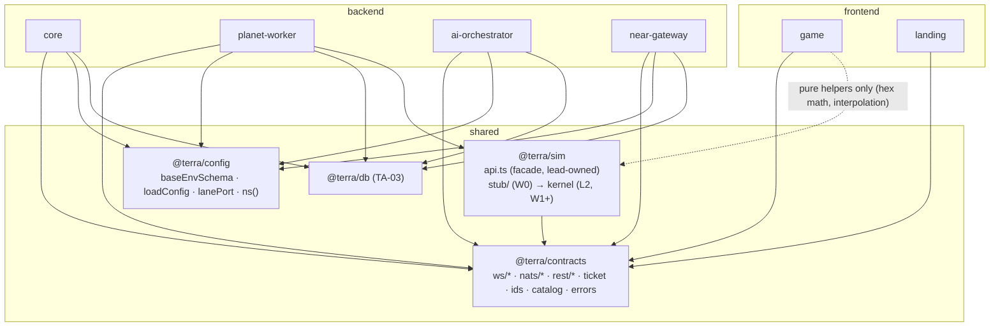

# Epic TA-01 — Monorepo, Tooling & Shared Contracts

> **Orchestrator:** [`EXECUTION_ORCHESTRATOR.md`](../EXECUTION_ORCHESTRATOR.md) · **Status Board:** [`STATUS.md`](../STATUS.md)
> **Spec:** [`ARCHITECTURE.md`](../../spec/ARCHITECTURE.md) §3, §5.2, §6, §7, §9, §13, §15 · [`PROTOCOL.md`](../../spec/PROTOCOL.md) (all) · [`DECISIONS.md`](../../spec/DECISIONS.md) D-01, D-03, D-05, D-07, D-14

## Overview

Wave 0 foundation, executed by the lead alone. Creates the npm-workspaces monorepo modelled on `../freightchain` (`backend/`, `frontend/`, `infra/`, `docs/`, `tests/`, `scripts/` + `shared/`), the root `npm run check`, and the three shared packages every lane codes against from W1 on:

- `@terra/contracts` — the cross-lane contract (WS, NATS, REST, ticket, catalog enums). After W0 it changes **only** in wave pre-steps.
- `@terra/config` — base env schema + loader + lane port/namespace helpers.
- `@terra/sim` **facade** (`shared/sim/src/api.ts`) + a deterministic stub, so the worker (L3) and clients can integrate in W1 while L2 builds the real kernel behind the same API.

Plus the CI script with a contract drift test and architecture-boundary rules.

## Epic analytics

- **Goal / user value:** five agents can work in parallel from W1 without colliding or inventing incompatible message shapes. The owner gets one place (`@terra/contracts` + `PROTOCOL.md`) to review every wire format.
- **Success metrics:**
  - `npm ci && npm run check` on a clean clone < **3 min** on a laptop; `npm run ci:fast` < **6 min**.
  - 100 % of subjects/messages in `PROTOCOL.md` have a zod schema and a round-trip test; JSON-Schema snapshot committed.
  - 0 string-literal NATS subjects outside `@terra/contracts` (lint rule).
  - W1 lanes need **0** mid-wave contract change requests for the items listed in their DoR (measured at W1 barrier).
- **In scope:** workspace layout, TypeScript/ESLint/Prettier/Vitest config, shared packages, sim facade + stub, `ci:fast`, dependency-cruiser boundaries, env example convention.
- **Out of scope:** app code (TA-04/07/09/10/11/12), Docker images (TA-02.3), NATS bootstrap generation (TA-02.2), DB schema (TA-03).
- **Key risks:** over-specifying contracts before the sim exists (mitigation: additive `v:1` evolution, PROTOCOL PR-05); NestJS decorators vs. Vitest (mitigation: `unplugin-swc` decided in TA-01.1 and proven by a sample spec); workspace lockfile conflicts across lanes (mitigation: orchestrator §1.3 — lead regenerates lockfile).

## Architecture overview



Boundary rules (enforced by dependency-cruiser in TA-01.5): `frontend/**` never imports `backend/**`, `@terra/db`, `@terra/config`; backend apps never import each other; `@terra/sim` imports nothing but `@terra/contracts` (no `node:*`, no DOM); `@terra/contracts` imports only `zod` and `jose`.

## Task index

| Task | Title | Wave / Lane | Depends On |
|---|---|---|---|
| `TA-01.1` | npm-workspaces skeleton: root `package.json`, `tsconfig.base.json`, ESLint/Prettier, Vitest, `npm run check` | W0 / Lead | None |
| `TA-01.6` | `@terra/config`: zod env loader, `TA_NS` + lane port helpers, `.env.example` convention | W0 / Lead | TA-01.1 |
| `TA-01.2` | `@terra/contracts`: WS envelope + worker/lobby message schemas v1 | W0 / Lead | TA-01.1 |
| `TA-01.3` | `@terra/contracts`: NATS subjects, stream/KV definitions & payload schemas | W0 / Lead | TA-01.2 |
| `TA-01.4` | `@terra/contracts`: REST DTOs, error codes, planet-ticket claims | W0 / Lead | TA-01.2 |
| `TA-01.7` | `@terra/sim` public API facade (`api.ts`) + stub implementation | W0 / Lead | TA-01.2, TA-01.3 |
| `TA-01.5` | `scripts/ci-fast.sh`, root `ci:fast`, contract drift test | W0 / Lead | TA-01.1..01.4, TA-01.6, TA-01.7, TA-03.1, TA-13.1 |

(Order follows the W0 lane list in the orchestrator; TA-01.5 runs last in W0.)

---

## Tasks

### `TA-01.1` — npm-workspaces skeleton: root `package.json`, `tsconfig.base.json`, ESLint/Prettier, Vitest, `npm run check`

- **Status:** `[ ] Todo`
- **Wave / Lane:** `W0 / Lead`
- **Depends On:** None
- **Spec:** [`ARCHITECTURE.md` §3](../../spec/ARCHITECTURE.md#3-app-inventory--repository-layout), [`DECISIONS.md` D-03, D-14](../../spec/DECISIONS.md)
- **Target Files:**
  - `package.json` (workspaces: `shared/*`, `backend/*`, `frontend/*`, `tests/*`; scripts `check`, `lint`, `typecheck`, `test`, `format`, `build`)
  - `package-lock.json`, `.nvmrc` (`24`), `.npmrc` (`engine-strict=true`, `save-exact=true`)
  - `tsconfig.base.json`, `tsconfig.json` (solution file with project references)
  - `eslint.config.mjs` (flat config, typescript-eslint, import ordering), `.prettierrc`, `.editorconfig`
  - `vitest.workspace.ts`, `vitest.shared.ts` (SWC plugin for Nest decorators)
  - `.gitignore`, `.gitattributes`, `README.md` (dev quickstart)
  - placeholder workspaces: `backend/{core,planet-worker,ai-orchestrator,near-gateway}/package.json`, `frontend/{game,landing}/package.json`, `shared/{contracts,config,sim,db}/package.json` (name, `private`, `type: module`, empty `src/index.ts`)
  - `git init` + first commit; tag `w0-start`
- **Verify:** `npm ci && npm run check`

#### Analytics
- **Problem & goal:** the repo is docs-only. Every later task assumes one install, one TypeScript config, one test runner and one `check` command that every lane's DoD calls.
- **Constraints:** Node **24 LTS**; ESM only (`"type": "module"`, `module: NodeNext`); TypeScript `strict`, `noUncheckedIndexedAccess`, `exactOptionalPropertyTypes`; NestJS needs `experimentalDecorators` + `emitDecoratorMetadata` only in backend tsconfigs (not in `shared/sim`).
- **Risks → mitigations:** Vitest + Nest DI metadata breaks without SWC → `unplugin-swc` in `vitest.shared.ts`, proven by a sample `@Injectable` spec in `backend/core/test/smoke.spec.ts`; slow `tsc` across 10 packages → project references + `tsc -b` incremental.
- **Alternatives rejected:** pnpm + turborepo (extra tooling for agents, D-03); Jest (freightchain uses it, but ESM + TS project refs are smoother in Vitest; one runner for frontend and backend); per-app `--prefix` installs as in freightchain (cannot share `shared/*` packages cleanly).
- **Telemetry (proves it works):** CI log lines `check.duration_s` and `check.packages=<n>` printed by `scripts/check-summary.mjs`; Vitest JSON reporter `tests.total`.

#### Architecture
- Root scripts delegate per workspace: `"check": "npm run lint && npm run typecheck && npm run test"`, `"typecheck": "tsc -b"`, `"test": "vitest run"` (workspace file covers all packages), `"lint": "eslint . --max-warnings 0"`.
- Package naming `@terra/<folder>`; internal deps use `"@terra/contracts": "*"` (workspace link).
- Package exports: shared packages publish subpath exports to built `dist/` with `types` pointing at `src` during dev (`"exports": {"./ws": {"types": "./src/ws/index.ts", "import": "./dist/ws/index.js"}}`); Vite apps consume source via TS paths.
- Folder skeleton exactly as `ARCHITECTURE.md` §3 (empty dirs keep a `.gitkeep`).

#### Definition of Ready (DoR)
- [ ] D-03 (npm workspaces) and D-14 (NestJS everywhere) accepted or explicitly left `Proposed` by the owner.
- [ ] Node 24 available locally (`node -v`).

#### Definition of Done (DoD)
- [ ] `npm ci && npm run check` passes on a clean clone; `tsc -b` builds all workspaces.
- [ ] Sample specs pass: `shared/contracts/test/smoke.spec.ts` and `backend/core/test/smoke.spec.ts` (Nest `Test.createTestingModule` with an `@Injectable` resolves under Vitest+SWC).
- [ ] ESLint flat config errors on `any` in `shared/**`, on floating promises in `backend/**`.
- [ ] `README.md` "Dev quickstart" lists `npm ci`, `npm run infra:up` (TA-02.1), `npm run check`.
- [ ] Git repo initialised; `.gitignore` covers `node_modules`, `dist`, `.env`, `*.local`, coverage.
- [ ] **Root script registry (added by lead):** root `package.json` declares **every** script name used by Verify/barrier commands in `EXECUTION_ORCHESTRATOR.md` (`infra:up`, `db:migrate`, `test:integration`, `nats:bootstrap`, `images:build`, `nginx:test`, `deploy:dry-run`, `stack:local:smoke`, `sim:determinism` (workspace), `near:contract:test`, `test:e2e`, `test:failover`, `test:load`, `test:soak:mm`, `monitoring:check`, `smoke:prod`, `test:ci:full`). Each delegates to a file inside the owning lane's paths (e.g. `nginx:test` → `node infra/deploy/scripts/nginx-test.mjs`, `test:load` → `node tests/load/run.mjs`); until the owner implements it, the target prints `not implemented (TA-xx.y, Wn)` and exits 1. Lanes then implement the target file without touching root files.
- [ ] Status synced in orchestrator, issue file and STATUS.md (§1.6)

---

### `TA-01.6` — `@terra/config`: zod env loader, `TA_NS` + lane port helpers, `.env.example` convention

- **Status:** `[ ] Todo`
- **Wave / Lane:** `W0 / Lead`
- **Depends On:** `TA-01.1`
- **Spec:** [`ARCHITECTURE.md` §3 ports, §5.2, §15](../../spec/ARCHITECTURE.md#15-tunables-all-env-configurable-defaults-here), [orchestrator §1.5](../EXECUTION_ORCHESTRATOR.md#15-isolation-per-lane-local--ci), [`DECISIONS.md` D-07](../../spec/DECISIONS.md)
- **Target Files:**
  - `shared/config/src/load.ts` (`loadConfig(schema, env)`), `shared/config/src/base.ts` (`baseEnvSchema`), `shared/config/src/ports.ts` (`servicePort`, `LANE_PORTS`), `shared/config/src/ns.ts` (`ns()`, `NS()`), `shared/config/src/describe.ts` (`describeEnv()` for examples)
  - `shared/config/test/*.spec.ts`
  - `scripts/check-env-examples.mjs`
  - `backend/*/.env.example`, `frontend/*/.env.example` (initial base keys only), `infra/deploy/.env.example` (aggregated placeholder; TA-02.5 completes it)
- **Verify:** `npm run test -w @terra/config && node scripts/check-env-examples.mjs`

#### Analytics
- **Problem & goal:** four services and five lanes must agree on `TA_NS`, ports, `DATABASE_URL`, `NATS_URL` and every tunable in ARCHITECTURE §15 — with fail-fast errors instead of silent defaults in production.
- **Constraints:** zero runtime deps beyond `zod`; works in Node and (for public `VITE_*` keys) at Vite build time; production must refuse to start with a missing required key; lanes set only `LANE=1..5` and get the right ports/namespace automatically.
- **Risks → mitigations:** every new env key becoming a lead pre-step bottleneck → only **base** keys live in `@terra/config`; each app extends `baseEnvSchema` in its own `src/config/env.schema.ts` (lane-owned). Drift between schemas and `.env.example` → `check-env-examples.mjs` in CI.
- **Alternatives rejected:** `@nestjs/config` alone (not usable by frontends/sim tooling, no shared lane helpers); `dotenv-safe` (no typing).
- **Telemetry (proves it works):** on boot each service logs one structured line `config.loaded {service, ns, lane, port, keys:<n>}` (no secret values; keys matching `/SECRET|KEY|PASSWORD|TOKEN/` are redacted); `config_info{service,ns,version}` gauge = 1 exported by apps via TA-04.1/07.1.

#### Architecture
```ts
export const baseEnvSchema = z.object({
  NODE_ENV: z.enum(["development", "test", "production"]).default("development"),
  LOG_LEVEL: z.enum(["trace", "debug", "info", "warn", "error"]).default("info"),
  LANE: z.coerce.number().int().min(1).max(5).optional(),
  TA_NS: z.string().regex(/^[a-z][a-z0-9]{0,7}$/).optional(),     // default: LANE ? `l${LANE}` : "ta"
  NATS_URL: z.string().url().default("nats://127.0.0.1:14222"),
  DATABASE_URL: z.string().url(),                                   // test: must end with _test (guard in @terra/db)
  PORT: z.coerce.number().int().optional(),                         // default: servicePort(service, LANE)
});
export function loadConfig<S extends z.ZodObject<any>>(service: ServiceName, schema: S, env = process.env): Readonly<z.infer<S> & Derived>;
// servicePort: default dev core 4001, worker 4002 (+10 per extra worker), ai 4003, near 4004, game 5173, landing 5174;
//              lane K: 4K01 core, 4K02 worker, 4K12 worker-2, 4K03 ai, 4K04 near, 4K05 game, 4K06 landing.
export const ns = (cfg) => cfg.TA_NS;              // subjects/buckets
export const NS = (cfg) => cfg.TA_NS.toUpperCase(); // stream names
```
- `loadConfig` collects **all** issues and throws one error listing every missing/invalid key.
- Tunables from ARCHITECTURE §15 are exported as `TUNABLE_DEFAULTS` constants so apps' schemas use the same defaults (single source).

#### Definition of Ready (DoR)
- [ ] Port map and lane table in orchestrator §1.5 confirmed.

#### Definition of Done (DoD)
- [ ] Unit tests: missing `DATABASE_URL` in `production` throws listing the key; `LANE=3` ⇒ `TA_NS=l3`, core port `4301`, worker-2 `4312`; explicit `TA_NS` overrides lane; secrets redacted in `describeEnv()` output.
- [ ] `TUNABLE_DEFAULTS` values equal ARCHITECTURE §15 (test compares against a table copied from the doc).
- [ ] `scripts/check-env-examples.mjs` fails when an app schema key is absent from its `.env.example`; wired into `npm run check`.
- [ ] Lifecycle/time tunables (`PLANET_ADMISSION_WINDOW_H`, `PLANET_LIFETIME_D`, `MATCH_SEAT_TTL_S`, `AWAY_AFTER_S`, …) accept **fractional** values so integration/E2E suites can run on a compressed clock (ARCHITECTURE §15); unit test covers `0.01`.
- [ ] Status synced in orchestrator, issue file and STATUS.md (§1.6)

---

### `TA-01.2` — `@terra/contracts`: WS envelope + worker/lobby message schemas v1

- **Status:** `[ ] Todo`
- **Wave / Lane:** `W0 / Lead`
- **Depends On:** `TA-01.1`
- **Spec:** [`PROTOCOL.md` §2–§5](../../spec/PROTOCOL.md#3-websocket-envelope), [`ARCHITECTURE.md` §13](../../spec/ARCHITECTURE.md#13-websocket-protocol-summary)
- **Target Files:**
  - `shared/contracts/src/ids.ts` (prefixed ULID schemas + `newId(prefix)`)
  - `shared/contracts/src/catalog.ts` (`PlanetType`, `PlanetState`, `BuildingArchetype`, `RobotArchetype` enums — MVP set from D-15)
  - `shared/contracts/src/ws/envelope.ts`, `ws/worker.ts`, `ws/lobby.ts`, `ws/views.ts`, `ws/close-codes.ts`, `ws/index.ts`
  - `shared/contracts/src/events.ts` (`EventKind` + per-kind `data` schemas, shared with NATS)
  - `shared/contracts/test/ws-*.spec.ts`, `shared/contracts/test/fixtures/ws/*.json`
- **Verify:** `npm run test -w @terra/contracts`

#### Analytics
- **Problem & goal:** L3 (worker gateway), L1 (lobby), L5 (game client) build both ends of two WebSocket protocols in parallel in W1–W2; they must share one definition with types inferred from zod.
- **Constraints:** PR-01 (servers parse `.strict()`, clients parse permissively), PR-04 integer fixed-point values, WS-02 16 KiB inbound limit, close codes exactly as PROTOCOL §4.6 / ARCHITECTURE §13. Bundle-size friendly for the game (tree-shakeable, `zod` only).
- **Risks → mitigations:** client/server parse modes diverge → export paired parsers `parseClientMsg` (strict, server use) and `parseServerMsg` (passthrough, client use) from the same schemas; view types too big for `welcome` → `ColonyViewV1` lists only revealed tiles + visible entities (WS-30) and a fixture test asserts a 5-colony mid-game fixture < 2 MiB.
- **Alternatives rejected:** Protobuf/FlatBuffers now (tooling burden for agents; MessagePack reserved for `proto: 2`, PROTOCOL WS-04); `typebox` (zod already used across NestJS DTOs).
- **Telemetry (proves it works):** fixture test prints `ws.fixture.welcome.bytes` and `ws.fixture.delta.bytes`; consumers count `ws_invalid_message_total{type}` (implemented in TA-07.3 / TA-04.6 using these parsers).

#### Architecture
- Discriminated unions keyed on `t` (`ClientToWorker`, `WorkerToClient`, `ClientToLobby`, `LobbyToClient`) — one `switch` per side, exhaustive via `never`.
- `CloseCode` const object (`BAD_HELLO: 4000`, … `SERVER_DRAINING: 4012`) + `closeCodeAction` map used by the client (reconnect vs. stop), mirroring PROTOCOL §4.6.
- `ColonyViewV1`, `EntityView`, `TileView`, `PowerView`, `Resources`, `Priorities`, `Autopilot`, `TaskSpec`, `AwaySummary` exported from `ws/views.ts` and reused by REST (`HomeResponse.away`) and NATS (`AiRequestV1.priorities`).
- Golden fixtures (`fixtures/ws/*.json`) — one valid and ≥ 1 invalid per message type — double as examples for agents.

#### Definition of Ready (DoR)
- [ ] PROTOCOL.md §3–§5 reviewed by the owner or explicitly accepted as draft.
- [ ] MVP building/robot catalog (D-15) frozen for `catalog.ts`.

#### Definition of Done (DoD)
- [ ] Every message type in PROTOCOL §4.2, §4.3, §5 has a schema, an inferred TS type and a golden fixture; round-trip test `parse(fixture) → JSON → parse` is stable.
- [ ] Strict parse rejects unknown keys on client→server messages; permissive parse accepts an unknown `event.kind` and extra fields on server→client messages (tests).
- [ ] `cmd` without `id` is rejected; `cmd` args validated per `kind` (one negative test per kind).
- [ ] Size test: fixture `welcome` (5 colonies, 2 000 entities, 6 000 tiles revealed) < 2 MiB; a 200-op `delta` < 64 KiB.
- [ ] Close-code table test equals PROTOCOL §4.6.
- [ ] Status synced in orchestrator, issue file and STATUS.md (§1.6)

---

### `TA-01.3` — `@terra/contracts`: NATS subjects, stream/KV definitions & payload schemas

- **Status:** `[ ] Todo`
- **Wave / Lane:** `W0 / Lead`
- **Depends On:** `TA-01.2`
- **Spec:** [`PROTOCOL.md` §6](../../spec/PROTOCOL.md#6-nats-contract), [`ARCHITECTURE.md` §6, §14](../../spec/ARCHITECTURE.md#6-inter-service-messaging-nats), [`DECISIONS.md` D-05, D-07](../../spec/DECISIONS.md)
- **Target Files:**
  - `shared/contracts/src/nats/subjects.ts` (builders: `planetCmd(ns, planetId)`, `planetTick`, `planetEvt(ns, planetId, kind)`, `planetCtl`, `workerCtl`, `aiRequest`, `nearVerify`, `nearJob(kind)`, `nearEvt(kind)`, `tradeReq(op)`, `tradeEvt(state)`, `mmChanged`)
  - `shared/contracts/src/nats/streams.ts` (`STREAMS`, `KV_BUCKETS`, `CONSUMERS` as data: name template, subjects, retention, max_age, dup window, ack wait, max deliver, backoff)
  - `shared/contracts/src/nats/commands.ts` (`CommandV1`, `CommandKind`, per-kind args, `TickMarkerV1`)
  - `shared/contracts/src/nats/events.ts` (`PlanetEventV1`), `nats/ctl.ts` (planet/worker ctl request/reply unions), `nats/ai.ts` (`AiRequestV1`), `nats/near.ts`, `nats/trade.ts`, `nats/kv.ts` (`WorkerInfoV1`, `LeaseV1`, `PresenceV1`)
  - `shared/contracts/src/nats/msg-id.ts` (`msgId.*` builders for every idempotency key in PROTOCOL NT-10/11/21/30)
  - `shared/contracts/src/nats/headers.ts` (`ta-trace-id`, `ta-source`, `ta-v`)
  - `shared/contracts/test/nats-*.spec.ts`
- **Verify:** `npm run test -w @terra/contracts`

#### Analytics
- **Problem & goal:** NATS is the only inter-service transport (D-05). Subjects, stream configs, Msg-Ids and payloads must be identical in five services and the bootstrap script; one typo silently drops messages.
- **Constraints:** `TA_NS` prefix on every subject/stream/bucket (D-07); stream names `{NS}_…` upper-case; KV bucket names `{ns}_…`; numbers exactly PROTOCOL §6.2/§6.9 and ARCHITECTURE §6; NT-05 (all planet state changes through `PLANET_CMDS`); NT-11 tick markers for deterministic replay.
- **Risks → mitigations:** subject string literals sprinkled in apps → ESLint `no-restricted-syntax` rule flags string literals matching `/^\w+\.planet\./` outside contracts (TA-01.5); Msg-Id formats drifting → only `msgId.*` builders allowed; stream config drift between code and server → TA-02.2 bootstrap generated from `STREAMS`, plus a W1 integration test reading back `streams.info()`.
- **Alternatives rejected:** NestJS `@nestjs/microservices` NATS transport for everything (no JetStream/KV support; we use the `nats` client directly, wrapped by each app's module); free-form JSON (no validation, breaks NT-01).
- **Telemetry (proves it works):** contracts export metric **names** used by all services: `nats_invalid_payload_total{subject}`, `nats_publish_total{stream}`, `nats_publish_dedup_total{stream}` (pub-ack `duplicate: true`), `nats_request_duration_seconds{subject}`; a test asserts each name is unique and documented.

#### Architecture
```ts
export const STREAMS = {
  PLANET_CMDS:   { name: (NS) => `${NS}_PLANET_CMDS`,   subjects: (ns) => [`${ns}.planet.*.cmd`, `${ns}.planet.*.tick`], retention: "limits", maxAge: "48h", duplicateWindow: "10m", maxMsgSize: 65536 },
  PLANET_EVENTS: { name: (NS) => `${NS}_PLANET_EVENTS`, subjects: (ns) => [`${ns}.planet.*.evt.>`], retention: "limits", maxAge: "7d", duplicateWindow: "5m" },
  AI_REQUESTS:   { name: (NS) => `${NS}_AI_REQUESTS`,   subjects: (ns) => [`${ns}.ai.request`], retention: "workqueue", maxAge: "10m", duplicateWindow: "10m" },
  NEAR_JOBS:     { name: (NS) => `${NS}_NEAR_JOBS`,     subjects: (ns) => [`${ns}.near.account.provision`, `${ns}.near.registry.>`], retention: "workqueue", maxAge: "7d", duplicateWindow: "1h" },
  NEAR_EVENTS:   { name: (NS) => `${NS}_NEAR_EVENTS`,   subjects: (ns) => [`${ns}.near.evt.>`, `${ns}.trade.evt.>`], retention: "limits", maxAge: "30d", duplicateWindow: "5m" },
} as const;
export const KV_BUCKETS = {
  WORKERS:       { name: (ns) => `${ns}_workers`,       ttl: "15s", history: 1 },
  PLANET_LEASES: { name: (ns) => `${ns}_planet_leases`, ttl: "15s", history: 1 },
  PRESENCE:      { name: (ns) => `${ns}_presence`,      ttl: null,  history: 1 },
} as const;
```
- Request/reply envelopes: `{ v:1, op, d }` → `{ ok:true, … } | { ok:false, code, detail? }` (NT-03) as zod unions per subject.
- `CommandV1.args` validated by a `commandArgsSchema(kind)` lookup so producers (core, ai, near) and the worker validate identically.

#### Definition of Ready (DoR)
- [ ] PROTOCOL.md §6 accepted as draft, including the two refinements flagged there (tick markers NT-11, `NEAR_EVENTS` stream) — lead updates ARCHITECTURE §6.1 in the same commit if accepted.
- [ ] `TA-01.2` schemas (`Priorities`, `Autopilot`, `TaskSpec`, `EventKind`) exist for reuse.

#### Definition of Done (DoD)
- [ ] Every subject, stream, consumer, KV bucket and Msg-Id in PROTOCOL §6 has a builder/definition; table-driven test compares `STREAMS`/`KV_BUCKETS`/`CONSUMERS` against PROTOCOL §6.2/§6.9 values.
- [ ] Subject builders reject ids that don't match their prefix schema (no `*`/`>` injection).
- [ ] Payload round-trip + negative tests for `CommandV1` (each kind), `TickMarkerV1`, `PlanetEventV1`, ctl unions, `AiRequestV1`, near/trade payloads, KV values.
- [ ] `msgId` builders produce the exact formats of NT-10, NT-11, NT-21, NT-30 and PROTOCOL §6.7 (snapshot test).
- [ ] Status synced in orchestrator, issue file and STATUS.md (§1.6)

---

### `TA-01.4` — `@terra/contracts`: REST DTOs, error codes, planet-ticket claims

- **Status:** `[ ] Todo`
- **Wave / Lane:** `W0 / Lead`
- **Depends On:** `TA-01.2`
- **Spec:** [`PROTOCOL.md` §7, §8](../../spec/PROTOCOL.md#7-planet-ticket-tk-), [`ARCHITECTURE.md` §7](../../spec/ARCHITECTURE.md#7-player--colony--planet--worker-lookup-resume-path)
- **Target Files:**
  - `shared/contracts/src/rest/auth.ts`, `rest/me.ts` (`PlayerDto`, `HomeResponse`, `ColonySummary`, `ColonyRecap`, `PlanetResults`), `rest/planets.ts` (`PlanetSummary`), `rest/match.ts` (`MatchTicketDto`, `CreateMatchTicketBody`), `rest/stats.ts`, `rest/admin.ts` (placeholder, extended in W4 pre-step), `rest/index.ts`
  - `shared/contracts/src/errors.ts` (`ErrorCode`, HTTP status map, `ErrorEnvelope`)
  - `shared/contracts/src/ticket.ts` (`PlanetTicketClaims`, `signPlanetTicket(claims, privateKey, kid)`, `verifyPlanetTicket(token, publicKeys, {workerId, now})`)
  - `shared/contracts/test/rest-*.spec.ts`, `shared/contracts/test/ticket.spec.ts`
  - `scripts/gen-ticket-keys.mjs` (dev Ed25519 key pair → `.env.local` values)
- **Verify:** `npm run test -w @terra/contracts`

#### Analytics
- **Problem & goal:** core (L1) and game client (L5) implement `/v1/me/home`, picker and queue in parallel; the worker (L3) verifies tickets that core issues. They need shared DTOs, error codes and one ticket implementation.
- **Constraints:** home states exactly `NEW | QUEUED | ACTIVE | ELIMINATED | PLANET_ENDED` (ARCHITECTURE §7); ticket `EdDSA`, TTL 60 s, `aud:"planet"`, `jti` single use, workerId-bound (TK-01..03); error envelope with `requestId`.
- **Risks → mitigations:** algorithm confusion attacks on JWT → `verifyPlanetTicket` pins `alg: "EdDSA"` and `kid` lookup, rejects `none`/HS*; clock skew → ±5 s leeway tested; key rotation → verifier accepts a map of `kid → key`.
- **Alternatives rejected:** HS256 shared secret (every worker could mint tickets); opaque tickets checked via NATS request to core (extra hop on every connect, and fails during core outages).
- **Telemetry (proves it works):** metric names exported for TA-04.5/07.3: `planet_ticket_issued_total`, `planet_ticket_verify_total{result="ok|expired|bad_sig|wrong_worker|replayed"}`.

#### Architecture
- `HomeResponse` discriminated union as in PROTOCOL §8; `PlanetSummary` includes `seats {taken, reserved, capacity}`, `ageS`, `admissionClosesInS`, `endsInS` so the picker can show "4/5 seats, closes in 6 h".
- `ticket.ts` uses `jose` (`EdDSA`) and is isomorphic (Node + browser-safe import, though only backend calls it).
- `ErrorCode` ↔ HTTP status map is the only place statuses are chosen; Nest exception filter (TA-04.1) consumes it.

#### Definition of Ready (DoR)
- [ ] PROTOCOL §7–§8 accepted as draft.
- [ ] Home-state semantics agreed with the TA-04/TA-08 plan (ARCHITECTURE §7).

#### Definition of Done (DoD)
- [ ] DTO schemas + fixtures for every endpoint in PROTOCOL §8 table; `HomeResponse` has one fixture per state.
- [ ] Ticket tests: sign→verify ok; expired (61 s) rejected; wrong `workerId` rejected; wrong `aud` rejected; tampered payload rejected; `alg: HS256` token rejected; unknown `kid` rejected; two-key rotation accepted.
- [ ] `ErrorCode` table equals PROTOCOL §8 list (test).
- [ ] `scripts/gen-ticket-keys.mjs` prints `PLANET_TICKET_PRIVATE_KEY`, `PLANET_TICKET_PUBLIC_KEYS`, `PLANET_TICKET_KID` for local `.env`.
- [ ] Status synced in orchestrator, issue file and STATUS.md (§1.6)

---

### `TA-01.7` — `@terra/sim` public API facade (`api.ts`) + stub implementation

- **Status:** `[ ] Todo`
- **Wave / Lane:** `W0 / Lead`
- **Depends On:** `TA-01.2`, `TA-01.3`
- **Spec:** [`ARCHITECTURE.md` §9](../../spec/ARCHITECTURE.md#9-simulation-model), [`DECISIONS.md` D-01, D-02](../../spec/DECISIONS.md), [`SIMULATION.md`](../../spec/SIMULATION.md) (L2's detailed spec), [`PROTOCOL.md` §6.3 NT-11..13](../../spec/PROTOCOL.md#63-planet-command-log--nsplanetplanetidcmd)
- **Target Files:**
  - `shared/sim/src/api.ts` (**lead-owned** facade: types + function signatures + `SIM_VERSION`)
  - `shared/sim/src/index.ts` (re-exports `api.ts`, binds to implementation)
  - `shared/sim/src/stub/*.ts` (deterministic stub: counter state, founder entity walking a circle, echo events)
  - `shared/sim/test/api-contract.spec.ts` (contract test any implementation must pass — L2 keeps it green)
  - `eslint.config.mjs` block for `shared/sim/**` (ban `Date`, `Math.random`, `performance`, `setTimeout`, `node:*`, DOM globals, floating-point `Math.*` except `Math.imul`/`Math.trunc`/`Math.abs`/`Math.min`/`Math.max`)
- **Verify:** `npm run test -w @terra/sim`

#### Analytics
- **Problem & goal:** in W1 the worker (L3) must host planets and the client (L5) must render something while L2 builds the real kernel. A frozen facade + stub decouples them; the contract test guarantees L2's real implementation is a drop-in.
- **Constraints:** determinism rules from ARCHITECTURE §9 (integer math, seeded PRNG, no wall clock); `step` must be allocation-light (≤ 10 ms p99 per planet-tick at MVP scale, measured later in TA-13.5); facade changes after W0 only in pre-steps.
- **Risks → mitigations:** facade too narrow for later needs (AI summary, digest counters) → include `summarize(state, colonyId)` and `counters(state, colonyId)` now (stub returns minimal shapes); in-place mutation surprises → API documents that `step` mutates `state` and returns it; callers must `snapshot()` to keep history.
- **Alternatives rejected:** worker builds against an interface it defines itself (two interfaces drift); running the real sim in W1 (blocks L3 on L2).
- **Telemetry (proves it works):** `api-contract.spec.ts` prints `sim.contract.hash@10000=<hex>` for the stub; the worker later exports `sim_step_duration_seconds` (TA-07.2) using `step` timings.

#### Architecture
```ts
// shared/sim/src/api.ts
export const SIM_VERSION = 1;                               // major bump ⇒ snapshots from older majors refused
export type PlanetParams = { planetId: PlanetId; type: PlanetType; seed: bigint; capacity: number; createdTick?: 0 };
export interface SimState { readonly __brand: "SimState" }  // opaque
export type AppliedCommand = { seq: number; cmd: CommandV1 }; // from PLANET_CMDS, in stream order (NT-11)
export type CommandOutcome = { cmdId: CmdId; ok: true } | { cmdId: CmdId; ok: false; code: RejectCode };
export type StepResult = { state: SimState; tick: number; events: PlanetEventV1[]; outcomes: CommandOutcome[] };

export interface Sim {
  createPlanet(p: PlanetParams): SimState;
  restore(bytes: Uint8Array): SimState;                     // throws SimVersionError on major mismatch
  step(state: SimState, commands: readonly AppliedCommand[]): StepResult;  // advances exactly one tick (TICK_MS = 100)
  snapshot(state: SimState): Uint8Array;                    // canonical binary; same state ⇒ same bytes
  hash(state: SimState): string;                            // xxhash64 hex (16 chars) of canonical state
  view(state: SimState, colonyId: ColonyId): ColonyViewV1;  // fog-of-war filtered (WS-30)
  diff(prev: ColonyViewV1, state: SimState, colonyId: ColonyId): DeltaOp[];
  summarize(state: SimState, colonyId: ColonyId): Record<string, unknown>; // ≤ 2 KiB, for AiRequestV1.state
  counters(state: SimState, colonyId: ColonyId): Record<string, number>;   // digest counters (TA-08.3)
  tick(state: SimState): number;
}
export declare const sim: Sim;
```
- Stub semantics: state = `{tick, seed, colonies[], founderPos}`; `core.spawnColony` adds a colony with one `founder` entity; each tick the founder moves along a deterministic hex circle; `placeBuilding` adds a `building` entity at full progress; events: `colony.founded`, `building.completed`. Enough for W1/W2 integration tests on L3/L5.
- `api-contract.spec.ts` (implementation-agnostic): same seed + same commands ⇒ same `hash` at tick 10 000 across 3 runs; `restore(snapshot(s))` ⇒ same `hash` and identical next `step`; `view` never contains another colony's resources; `step` with an invalid command returns `ok:false` without throwing.

#### Definition of Ready (DoR)
- [ ] D-01 accepted (server-authoritative deterministic sim).
- [ ] `CommandV1`, `PlanetEventV1`, `ColonyViewV1`, `DeltaOp` exist (TA-01.2/01.3).

#### Definition of Done (DoD)
- [ ] `api.ts` compiled and exported; stub passes `api-contract.spec.ts`.
- [ ] ESLint sim block rejects `Date.now()`, `Math.random()`, `import fs from "node:fs"` in `shared/sim/**` (lint fixture test).
- [ ] Stub `step` for 1 planet × 5 colonies < 0.1 ms average (sanity benchmark logged).
- [ ] `SIMULATION.md` references `api.ts` as the facade (lead confirms with L2's spec author).
- [ ] Status synced in orchestrator, issue file and STATUS.md (§1.6)

---

### `TA-01.5` — `scripts/ci-fast.sh`, root `ci:fast`, contract drift test

- **Status:** `[ ] Todo`
- **Wave / Lane:** `W0 / Lead`
- **Depends On:** `TA-01.1`, `TA-01.2`, `TA-01.3`, `TA-01.4`, `TA-01.6`, `TA-01.7`, `TA-03.1`, `TA-13.1`
- **Spec:** [`PROTOCOL.md` PR-06](../../spec/PROTOCOL.md#2-global-rules), [`DATA_MODEL.md` DM-02, DM-03](../../spec/DATA_MODEL.md#2-rules), [orchestrator §1.7](../EXECUTION_ORCHESTRATOR.md#17-common-dor--dod-applies-to-every-task)
- **Target Files:**
  - `scripts/ci-fast.sh`, `scripts/check-summary.mjs`
  - `package.json` scripts: `ci:fast`, `contracts:schema`, `contracts:check`, `arch:check`, `db:drift`
  - `shared/contracts/scripts/emit-json-schema.ts` → `shared/contracts/schema/contracts.v1.json` (committed)
  - `shared/contracts/test/schema-snapshot.spec.ts`
  - `.dependency-cruiser.cjs`
  - `eslint.config.mjs` rule: no NATS subject string literals outside `shared/contracts/**`
  - `.github/workflows/ci.yml` (optional; runs `npm run ci:fast` if the owner uses GitHub — see OWNER_TASKS)
- **Verify:** `npm run ci:fast`

#### Analytics
- **Problem & goal:** five lanes merge at every barrier; the cheapest guard against contract drift and boundary violations is a single fast CI command every lane runs before "ready for barrier".
- **Constraints:** < 6 min locally; needs dev compose for the DB drift check (`db:drift` uses the `terraagent_test` shadow DB); must run identically in GitHub Actions and on a laptop.
- **Risks → mitigations:** schema snapshot churn on harmless refactors → snapshot is generated deterministically (sorted keys) and only changes when shapes change; dependency-cruiser false positives → rules are path-based and listed in the epic's boundary table.
- **Alternatives rejected:** full integration suite in `ci:fast` (too slow; lives in `test:integration` and barrier gates); manual contract review only.
- **Telemetry (proves it works):** `scripts/check-summary.mjs` prints `ci.fast.step=<name> duration_s=<n> status=<ok|fail>` per step and a final `ci.fast.total_s`.

#### Architecture
`ci-fast.sh` steps (fail-fast, timed):
1. `npm ci` (skipped if lockfile hash unchanged in CI cache)
2. `npm run lint` · 3. `npm run typecheck` · 4. `npm run test` (unit only)
5. `npm run contracts:check` — regenerate `contracts.v1.json`, `git diff --exit-code`; additionally fails if the JSON changed but `docs/spec/PROTOCOL.md` did not change in the same diff range (`CI_BASE_REF`)
6. `npm run arch:check` — dependency-cruiser rules: frontend ↛ backend/db/config; backend app ↛ other backend app; sim ↛ anything except contracts; repositories of namespace X only imported from the owning service (DM-02)
7. `node scripts/check-env-examples.mjs` (TA-01.6)
8. `npm run db:drift` — `prisma validate` + `prisma migrate diff --from-migrations shared/db/prisma/migrations --to-schema-datamodel shared/db/prisma/schema.prisma --shadow-database-url $SHADOW_DATABASE_URL --exit-code`
9. `npm run test:integration -- --suite smoke` (TA-13.1; requires `infra:up`)

#### Definition of Ready (DoR)
- [ ] TA-01.1..01.4, 01.6, 01.7, TA-03.1 and TA-13.1 done (all inputs to the steps exist).
- [ ] Owner states whether GitHub Actions is used (OWNER_TASKS); otherwise CI = local `ci:fast` before barrier.

#### Definition of Done (DoD)
- [ ] `npm run ci:fast` exits 0 on clean W0 `main`, total < 6 min (logged).
- [ ] Negative checks proven: changing a zod schema without regenerating ⇒ step 5 fails; importing `@terra/db` from `frontend/game` ⇒ step 6 fails; a `"ta.planet.x.cmd"` literal in `backend/core` ⇒ lint fails; adding a field to `schema.prisma` without migration ⇒ step 8 fails (each demonstrated once, recorded in the PR/commit message).
- [ ] W0 barrier command passes: `npm run check && npm run infra:up && npm run db:migrate && npm run test:integration -- --suite smoke`; tag `w0-done`.
- [ ] Status synced in orchestrator, issue file and STATUS.md (§1.6)
