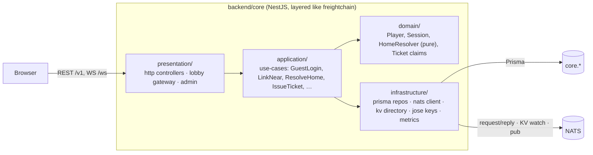

# Epic TA-04 — Core API: Auth, Players, Home, Tickets, Lobby WS

> **Orchestrator:** [`EXECUTION_ORCHESTRATOR.md`](../EXECUTION_ORCHESTRATOR.md) · **Status Board:** [`STATUS.md`](../STATUS.md)
> **Spec:** [`ARCHITECTURE.md`](../../spec/ARCHITECTURE.md) §3, §4, §7, §13, §15 · [`CONTINUITY.md`](../../spec/CONTINUITY.md) §2, §6 · [`MATCHMAKING.md`](../../spec/MATCHMAKING.md) §4, §5.4 · [`DECISIONS.md`](../../spec/DECISIONS.md) D-08, D-10, D-14

## Overview

`backend/core` is the only public HTTP service (`api.terraagent.com`). This epic builds its skeleton and the player-facing surface that is **not** matchmaking logic: guest auth and NEAR wallet linking, player profile, the `GET /v1/me/home` router that decides "picker vs. dive in", the Ed25519 **planet ticket** that lets the browser connect to the right planet worker, the lobby WebSocket that streams planet-list and queue updates, and the admin/ops API. Matchmaking and lifecycle logic live in [`TA-05`](./TA-05-matchmaking-and-planet-lifecycle.md); continuity flows in [`TA-08`](./TA-08-continuity-offline-and-resume.md).

## Epic analytics

- **Goal / user value:** a first visit becomes a playable guest in one request; a returning player lands in their colony with one REST call + one WS connect; operators can see and steer the system.
- **Success metrics:**
  - `POST /v1/auth/guest` p95 ≤ 50 ms; `/v1/me/home` p95 ≤ 80 ms (CT-04).
  - 0 auth bypasses in the negative matrix (unauth 401, foreign resource 404, bad DTO 400, extra field 400).
  - Lobby WS: ≥ 5,000 concurrent sockets per core replica at < 30 % CPU (load test TA-13.6).
  - Ticket verification failures on workers < 0.1 % of connects (excluding expired).
- **In scope:** Nest skeleton; guest + NEAR auth; player profile; home resolver; ticket issuer + worker directory; lobby WS; admin API.
- **Out of scope:** matchmaking decisions (TA-05), presence/digest computation (TA-08 worker side), NEAR chain calls (TA-10), email/social login (later `AuthIdentity` kinds).
- **Key risks:** cross-site refresh cookie (`api.` vs `game.` subdomain) blocked by browser policy → mitigated by `SameSite=None; Secure` + same registrable domain + fallback header token; ticket key leakage → workers hold only public keys, rotation via `kid`.

## Architecture overview

Folder convention (mirrors `../freightchain/backend/server/src`): `backend/core/src/{app,domain,application,infrastructure,presentation}/…`, tests in `backend/core/test/{unit,integration}` plus cross-service suites in `tests/integration/core/**`.

## Task index

| Task | Title | Wave / Lane | Depends On |
|---|---|---|---|
| `TA-04.1` | Core Nest skeleton: config, pino, Prisma, NATS, `/healthz` `/readyz` `/metrics` | W1 / L1 | TA-01.1, TA-01.3, TA-01.6, TA-03.2, TA-13.1 |
| `TA-04.2` | Guest auth: device login, access/refresh JWT, logout revoke | W1 / L1 | TA-04.1, TA-01.4, TA-03.1 |
| `TA-04.4` | Players & `GET /v1/me/home` state machine (`NEW`/`QUEUED`/`ACTIVE`/`ELIMINATED`/`PLANET_ENDED`) | W1 / L1 | TA-04.2 |
| `TA-04.5` | Planet ticket issuer (Ed25519) + worker directory from KV | W2 / L1 | TA-04.4, TA-07.1, TA-07.5 |
| `TA-04.6` | Lobby WebSocket gateway (`/ws`): planets & queue topics | W3 / L1 | TA-05.2, TA-05.3, TA-05.4 |
| `TA-04.3` | NEAR wallet link & sign-in via `near.verify` (NEP-413) | W3 / L1 | TA-04.2, TA-10.2 |
| `TA-04.7` | Admin/ops API: planets, queue, workers, force-seal/end, drain | W4 / L1 | TA-05.5, TA-05.6, TA-07.5 |

---

## Tasks

### `TA-04.1` — Core Nest skeleton: config, pino, Prisma, NATS, `/healthz` `/readyz` `/metrics`

- **Status:** `[ ] Todo`
- **Wave / Lane:** `W1 / L1`
- **Depends On:** `TA-01.1`, `TA-01.3`, `TA-01.6`, `TA-03.2`, `TA-13.1`
- **Spec:** [`ARCHITECTURE.md`](../../spec/ARCHITECTURE.md) §3 (app inventory, health endpoints), §5, §6; D-14
- **Target Files:**
  - `backend/core/package.json`, `backend/core/tsconfig.json`, `backend/core/nest-cli.json`, `backend/core/.env.example`
  - `backend/core/src/main.ts`, `backend/core/src/app/app.module.ts`, `backend/core/src/app/configure-app.ts`
  - `backend/core/src/infrastructure/config/core-env.ts` (uses `@terra/config`)
  - `backend/core/src/infrastructure/logging/logger.module.ts` (pino, `x-request-id`)
  - `backend/core/src/infrastructure/prisma/prisma.module.ts`
  - `backend/core/src/infrastructure/nats/nats.module.ts` (connection, JetStream, KV handles, `TA_NS`)
  - `backend/core/src/infrastructure/metrics/metrics.module.ts` (prom-client)
  - `backend/core/src/presentation/health/health.controller.ts`
  - `backend/core/src/presentation/common/{zod-validation.pipe.ts,domain-error.filter.ts,rate-limit.guard.ts}`
  - `backend/core/test/unit/health.spec.ts`, `tests/integration/core/boot.int-spec.ts`
- **Verify:** `TA_NS=l1 TEST_DATABASE_URL=…/terraagent_lane1_test npm run test -w @terra/core && npm run test:integration -- --suite core`

#### Analytics
- **Problem & goal:** every later core task needs the same plumbing (config, logging with correlation, DB, NATS, errors, metrics). Build it once, the freightchain way, so lanes don't reinvent it.
- **Constraints:** port `3000` prod / `4001` dev / `4101` lane 1; must start with NATS or PG temporarily down (readiness false, liveness true); `TA_NS` prefixes all subjects; only `/v1/*`, `/ws`, `/healthz` routed publicly — `/metrics` and `/readyz` internal only (nginx denies).
- **Risks → mitigations:** NATS reconnect storms → `maxReconnectAttempts: -1`, jittered wait, readiness reflects status; Prisma connection exhaustion with lanes → `connection_limit=10` in lane URLs.
- **Alternatives rejected:** Fastify adapter (fine, but freightchain uses Express; keep parity; revisit under load); Winston (pino is faster and structured by default).
- **Telemetry (proves it works):** `http_request_duration_seconds{route,method,status}` (histogram); `core_ready` (gauge 0/1); `nats_connected` (gauge); log event `app.started` with version + `TA_NS`.

#### Architecture
- `main.ts` → `createApp()` (testable factory) → global `ZodValidationPipe`, `DomainErrorFilter` (maps `DomainError{code,status}` → `{error:{code,message}}` from `@terra/contracts` error codes), CORS allow-list (`https://game.terraagent.com`, `https://terraagent.com`, `*.terraagent.localhost` in dev), `trust proxy` for nginx.
- `/healthz` → `200 {ok:true}` always while process runs. `/readyz` → checks `SELECT 1` (≤ 500 ms) + `nc.flush()` + `jsm.getAccountInfo()`; `503` with failing deps listed.
- `NatsModule` exposes `NatsService { request(subject, payload, schema, timeoutMs), publish, js, kv(bucket) }` — every payload validated against `@terra/contracts/nats` both ways; `x-request-id` copied into NATS headers.
- Graceful shutdown: `enableShutdownHooks`, drain NATS, close Prisma, stop accepting WS.

#### Definition of Ready (DoR)
- [ ] `@terra/config`, `@terra/contracts` (NATS subjects + error codes) and `@terra/db` exist (W0 done).
- [ ] Lane-1 DB and `TA_NS=l1` reachable via the harness from TA-13.1.

#### Definition of Done (DoD)
- [ ] `npm run dev -w @terra/core` starts on `4001`; `/healthz` 200; `/readyz` 200 with PG+NATS up, 503 with NATS stopped (integration test toggles it).
- [ ] Unknown route → `404 {error:{code:'not_found'}}`; zod failure → `400 validation_error`.
- [ ] `/metrics` exposes `http_request_duration_seconds` and `nats_connected`; asserted in `boot.int-spec.ts`.
- [ ] `backend/core/.env.example` lists every key in `core-env.ts`.
- [ ] Status synced in orchestrator, issue file and STATUS.md (§1.6).

---

### `TA-04.2` — Guest auth: device login, access/refresh JWT, logout revoke

- **Status:** `[ ] Todo`
- **Wave / Lane:** `W1 / L1`
- **Depends On:** `TA-04.1`, `TA-01.4`, `TA-03.1`
- **Spec:** [`ARCHITECTURE.md`](../../spec/ARCHITECTURE.md) §15 (`ACCESS_JWT_TTL_M`, `REFRESH_TTL_D`); D-10
- **Target Files:**
  - `backend/core/src/domain/auth/{session.ts,refresh-token.ts,display-name.ts}`
  - `backend/core/src/application/auth/{guest-login.use-case.ts,refresh.use-case.ts,logout.use-case.ts}`
  - `backend/core/src/infrastructure/auth/{jwt.service.ts,prisma-session.repository.ts,revocation-cache.ts}`
  - `backend/core/src/presentation/auth/{auth.controller.ts,access-token.guard.ts,current-player.decorator.ts}`
  - `backend/core/test/unit/auth/*.spec.ts`, `tests/integration/core/auth.int-spec.ts`
- **Verify:** `npm run test -w @terra/core && npm run test:integration -- --suite core`

#### Analytics
- **Problem & goal:** "chain is invisible" (design pillar 5) ⇒ zero-friction start. A guest player is created on first visit and stays the same player across reloads on that device.
- **Constraints:** game SPA on `game.terraagent.com`, API on `api.terraagent.com` (same site, different origin) ⇒ refresh cookie `ta_rt` must be `HttpOnly; Secure; SameSite=None; Domain=api.terraagent.com; Path=/v1/auth`; access JWT kept in memory only; `ACCESS_JWT_TTL_M=15`, `REFRESH_TTL_D=30`.
- **Risks → mitigations:** guest loses progress when cookies are cleared → UI nudge to link NEAR (TA-04.3), documented; bot account spam → nginx `limit_req` + app limit **10 guest creations / IP / hour**; refresh token theft → rotation with reuse detection (reuse revokes the whole family).
- **Alternatives rejected:** long-lived access JWT (freightchain SEC-10 lesson: logout must revoke); storing refresh token in `localStorage` (XSS-exposed).
- **Telemetry (proves it works):** `auth_guest_created_total` (counter); `auth_refresh_total{result=ok|expired|reused|revoked}` (counter); `auth_logout_total` (counter); log event `auth.refresh_reuse_detected` (security).

#### Architecture
- `POST /v1/auth/guest` → creates `core.player` (generated `displayName` "Colonist-7F3A"), `core.auth_identity{kind:'GUEST'}`, `core.auth_session{familyId, tokenHash(sha256), expiresAt, revokedAt}` → sets `ta_rt` cookie, returns `{accessToken, player}`. If a valid `ta_rt` already exists, it behaves like refresh (no duplicate players on double boot).
- `POST /v1/auth/refresh` → rotate: mark old token used, issue new in same family; reuse of a used token ⇒ revoke family, `401 refresh_reused`.
- `POST /v1/auth/logout` → revoke family; access tokens carry `sid`; `AccessTokenGuard` rejects tokens whose `sid` is revoked (in-memory LRU 30 s TTL backed by PG lookup) so logout takes effect ≤ 30 s.
- Access JWT: HS256 with `JWT_ACCESS_SECRET` (core is the only verifier), claims `{sub: playerId, sid, iat, exp}`. A header-token fallback (`Authorization: Refresh <token>`) is supported for browsers blocking third-party-like cookies (Safari ITP edge cases) and documented.

#### Definition of Ready (DoR)
- [ ] `core.player`, `core.auth_identity`, `core.auth_session` exist in `0001_init` (TA-03.1). Otherwise — **Contract change request (lead pre-step):** add these tables.
- [ ] `@terra/contracts` has `AuthGuestResponseV1`, `PlayerV1`, error codes `unauthorized`, `refresh_reused`, `rate_limited`.

#### Definition of Done (DoD)
- [ ] Integration: guest → refresh → refresh (rotation) → reuse old token → 401 + family revoked; logout → access token rejected within 30 s (fake clock).
- [ ] Double `POST /v1/auth/guest` with the same cookie returns the same `playerId`.
- [ ] 11th guest creation from one IP within an hour → `429 rate_limited`.
- [ ] Negative matrix rows for every `/v1/auth/*` route (missing body, extra field → 400, no cookie → 401).
- [ ] Status synced in orchestrator, issue file and STATUS.md (§1.6).

---

### `TA-04.4` — Players & `GET /v1/me/home` state machine (`NEW`/`QUEUED`/`ACTIVE`/`ELIMINATED`/`PLANET_ENDED`)

- **Status:** `[ ] Todo`
- **Wave / Lane:** `W1 / L1`
- **Depends On:** `TA-04.2`
- **Spec:** [`CONTINUITY.md`](../../spec/CONTINUITY.md) §2 (CT-01..05); [`ARCHITECTURE.md`](../../spec/ARCHITECTURE.md) §7
- **Target Files:**
  - `backend/core/src/domain/home/{home-resolver.ts,home-facts.ts}` (pure)
  - `backend/core/src/application/home/get-home.use-case.ts`, `backend/core/src/application/players/{get-me.use-case.ts,update-me.use-case.ts}`
  - `backend/core/src/infrastructure/home/home-facts.repository.ts`
  - `backend/core/src/presentation/players/{me.controller.ts}`
  - `backend/core/test/unit/home/home-resolver.spec.ts`, `tests/integration/core/me-home.int-spec.ts`
- **Verify:** `npm run test -w @terra/core && npm run test:integration -- --suite core`

#### Analytics
- **Problem & goal:** the owner wants first-timers to see available planets and returning players with an operating robot to dive straight in. One endpoint must decide, deterministically and fast.
- **Constraints:** in W1 only `NEW` is reachable (no tickets/colonies yet); the resolver must already implement the full table (H1..H6) so W2/W3 only wire facts. p95 ≤ 80 ms (CT-04). Rate limit 30/min/player.
- **Risks → mitigations:** state drift between client and server → client routes only on `home.state` (CT-01); slow fact loading → single SQL round-trip (CTE) for colony+ticket+last colony.
- **Alternatives rejected:** storing a `player.homeState` column (becomes stale on every event; computing is cheap).
- **Telemetry (proves it works):** `home_requests_total{state}` (counter); `home_resolve_seconds` (histogram); log event `home.resolved` at debug with state.

#### Architecture
- `resolveHome(facts: HomeFacts): HomeV1` — pure, table-driven (CONTINUITY §2.2). Facts loaded by `HomeFactsRepository.load(playerId)` (one query) + `EndpointResolver` (added in TA-04.5; W1 uses a stub returning `null`) + `PlanetBrowser.list()` (added in TA-05.2; W1 returns `[]`).
- `GET /v1/me` → `PlayerV1 {id, displayName, linkedNear?: string, createdAt}`; `PATCH /v1/me {displayName}` (3–20 chars, `[A-Za-z0-9 _-]`, basic blocklist, `.strict()`).
- `HomeV1` is a discriminated union on `state` defined in `@terra/contracts/rest`.

#### Definition of Ready (DoR)
- [ ] `HomeV1` union (`NEW`/`QUEUED`/`ACTIVE`/`ELIMINATED`/`PLANET_ENDED` payloads as in CONTINUITY §2.2) exists in `@terra/contracts` — otherwise **Contract change request (lead pre-step)**.
- [ ] `core.colony`, `core.match_ticket`, `core.planet` tables exist (empty is fine).

#### Definition of Done (DoD)
- [ ] `home-resolver.spec.ts` covers H1..H6, precedence (ALIVE beats open ticket beats eliminated), and `ws:null` + `retryAfterMs` case.
- [ ] `me-home.int-spec.ts`: new guest → `NEW` with `planets: []`; seeded colony rows produce each state.
- [ ] `PATCH /v1/me` validation negatives (too short, extra field, blocked word).
- [ ] Status synced in orchestrator, issue file and STATUS.md (§1.6).

---

### `TA-04.5` — Planet ticket issuer (Ed25519) + worker directory from KV

- **Status:** `[ ] Todo`
- **Wave / Lane:** `W2 / L1`
- **Depends On:** `TA-04.4`, `TA-07.1`, `TA-07.5` (KV shapes only; integration at the W2 barrier)
- **Spec:** [`ARCHITECTURE.md`](../../spec/ARCHITECTURE.md) §6.2, §7 (ticket claims), §15 (`PLANET_TICKET_TTL_S=60`); [`CONTINUITY.md`](../../spec/CONTINUITY.md) CT-02, CT-40, CT-42
- **Target Files:**
  - `backend/core/src/infrastructure/tickets/{planet-ticket.signer.ts,jwks.ts}`
  - `backend/core/src/infrastructure/directory/{worker-directory.ts,lease-watcher.ts}`
  - `backend/core/src/application/tickets/issue-planet-ticket.use-case.ts`
  - `backend/core/src/presentation/tickets/{ticket.controller.ts,jwks.controller.ts}`
  - `backend/core/test/unit/tickets/*.spec.ts`, `tests/integration/core/ticket-directory.int-spec.ts`
- **Verify:** `npm run test -w @terra/core && npm run test:integration -- --suite core`

#### Analytics
- **Problem & goal:** the browser must connect directly to the worker that currently owns its planet, and the worker must trust the connection without calling core.
- **Constraints:** EdDSA (Ed25519) JWT, claims `{sub, colonyId, planetId, workerId, aud:'planet', exp: now+60s, jti}`; workers hold only public keys; key rotation without downtime (2 active `kid`s); `wsUrl` must match `^wss?://[^/]+/w/pw-[0-9]{1,3}$` (never trust a worker-advertised URL blindly).
- **Risks → mitigations:** stale directory during failover → KV **watch** (not polling) on `{ns}_planet_leases` and `{ns}_workers`, plus `ws:null` when no lease (CT-42); clock skew between hosts → 30 s `nbf` leeway on workers.
- **Alternatives rejected:** HS256 shared secret (every worker could mint tickets); opaque ticket validated via NATS request to core (adds a hop to every connect and couples workers to core availability).
- **Telemetry (proves it works):** `resume_ticket_issued_total{result=ok|no_lease|no_colony}` (counter); `directory_entries{kind=worker|lease}` (gauge); `directory_watch_lag_seconds` (histogram).

#### Architecture
- `PlanetTicketSigner.sign(claims)` via `jose`; private key `PLANET_TICKET_PRIVATE_KEY` (PKCS8, base64) + `PLANET_TICKET_KID`; `GET /v1/.well-known/planet-ticket-jwks.json` publishes public keys (workers may also take `PLANET_TICKET_PUBLIC_KEYS` from env).
- `WorkerDirectory` keeps two in-memory maps fed by KV watchers: `planetId → {workerId, epoch}` and `workerId → {url, draining}`; `resolve(planetId) → {workerId, wsUrl} | null`.
- `POST /v1/me/ticket` → `{ws, ticket}` for the live colony (`404 no_live_colony`, or `ws:null, retryAfterMs:2000`). `/v1/me/home` `ACTIVE` uses the same use-case.

#### Definition of Ready (DoR)
- [ ] `PlanetTicketClaimsV1` and KV value schemas (`WorkerHeartbeatV1`, `PlanetLeaseV1`) are in `@terra/contracts` (TA-01.3/01.4).
- [ ] Dev key pair generation documented (`npm run keys:planet-ticket -w @terra/core` script lives in `backend/core/scripts/`).

#### Definition of Done (DoD)
- [ ] Unit: signed ticket verifies with the JWKS; expired / wrong `aud` / unknown `kid` rejected by a reference verifier (same code the worker uses from `@terra/contracts` if provided, else a test helper).
- [ ] Integration: fake worker writes heartbeat + lease to KV → `/v1/me/ticket` returns its `wsUrl`; lease deleted → `ws:null, retryAfterMs:2000` within 1 s (watch).
- [ ] Malicious worker URL in KV (`https://evil/…`) is ignored and logged `directory.bad_worker_url`.
- [ ] Status synced in orchestrator, issue file and STATUS.md (§1.6).

---

### `TA-04.6` — Lobby WebSocket gateway (`/ws`): planets & queue topics

- **Status:** `[ ] Todo`
- **Wave / Lane:** `W3 / L1`
- **Depends On:** `TA-05.2`, `TA-05.3`, `TA-05.4`
- **Spec:** [`ARCHITECTURE.md`](../../spec/ARCHITECTURE.md) §13 (lobby messages); [`MATCHMAKING.md`](../../spec/MATCHMAKING.md) MM-23, MM-36, MM-48
- **Target Files:**
  - `backend/core/src/presentation/lobby/{lobby.gateway.ts,lobby-session.ts,lobby-auth.ts}`
  - `backend/core/src/application/lobby/{lobby-fanout.service.ts}`
  - `backend/core/test/unit/lobby/*.spec.ts`, `tests/integration/core/lobby-ws.int-spec.ts`
- **Verify:** `npm run test -w @terra/core && npm run test:integration -- --suite core`

#### Analytics
- **Problem & goal:** the picker must update live (seats filling, planets sealing) and the queue must push "you're in" without the client polling.
- **Constraints:** `@nestjs/platform-ws` (raw `ws`, D-14); messages `hello {accessToken}` (within 5 s else `4000 bad_hello`), `subscribe {topic:'planets'|'queue'}`, `ping`; server `planets.list`, `planets.changed` (coalesced ≤ 1/s), `queue.position` (≤ 1/2 s), `match.assigned {home}`, `match.failed {code}`; multiple core replicas ⇒ fan-out via `{ns}.mm.changed` and a per-player subject `{ns}.lobby.player.{playerId}`; max **3** lobby sockets per player; idle timeout 75 s, ping 20 s.
- **Risks → mitigations:** thundering `planets.changed` on mass seal → coalescing window 1 s per replica; token expiry on long-lived sockets → close `4003` reason `token_expired` at `exp + 60 s`, client re-hellos after refresh; replica without the player's socket → per-player subject fan-out.
- **Alternatives rejected:** SSE (one-way, but we also need subscribe/hello and it would be a second transport); Socket.IO (heavier protocol, not used anywhere else).
- **Telemetry (proves it works):** `lobby_sockets` (gauge); `lobby_messages_sent_total{type}` (counter); `lobby_fanout_lag_seconds` (histogram: `mm.changed` publish → socket send).

#### Architecture
- `LobbyGateway` authenticates `hello` with `AccessTokenGuard` logic, registers socket in `LobbySessions` (playerId → sockets).
- `LobbyFanoutService` subscribes to `{ns}.mm.changed` (planet list invalidation → recompute via `PlanetBrowser` cache → broadcast to `planets` subscribers) and `{ns}.lobby.player.*` (targeted `match.assigned` / `queue.position` / `match.failed`, published by the matchmaker in TA-05.4).
- **Contract change request (lead pre-step):** add subject `{ns}.lobby.player.{playerId}` + payload union to `@terra/contracts/nats` (not in ARCHITECTURE §6.1 table; lead also updates that table).

#### Definition of Ready (DoR)
- [ ] Lobby message schemas in `@terra/contracts/ws` (ARCHITECTURE §13) and the `lobby.player` subject landed in the W3 pre-step.
- [ ] TA-05.4 publishes `mm.changed` and per-player notifications.

#### Definition of Done (DoD)
- [ ] Integration (2 core instances, same NATS): client on instance A receives `match.assigned` produced by the matchmaker on instance B.
- [ ] No `hello` in 5 s → `4000`; 4th socket for a player → oldest closed `4001 replaced`.
- [ ] Burst of 50 seat changes in 200 ms → ≤ 1 `planets.changed` per second per socket.
- [ ] Status synced in orchestrator, issue file and STATUS.md (§1.6).

---

### `TA-04.3` — NEAR wallet link & sign-in via `near.verify` (NEP-413)

- **Status:** `[ ] Todo`
- **Wave / Lane:** `W3 / L1`
- **Depends On:** `TA-04.2`, `TA-10.2`
- **Spec:** [`ARCHITECTURE.md`](../../spec/ARCHITECTURE.md) §6.1 (`{ns}.near.verify`), §11; [`NEAR.md`](../../spec/NEAR.md) (NEP-413 section); D-10
- **Target Files:**
  - `backend/core/src/domain/auth/{near-link.policy.ts,nonce.ts}`
  - `backend/core/src/application/auth/{issue-near-nonce.use-case.ts,near-sign-in.use-case.ts}`
  - `backend/core/src/infrastructure/auth/{prisma-nonce.repository.ts,near-verify.client.ts}`
  - `backend/core/src/presentation/auth/near-auth.controller.ts`
  - `backend/core/test/unit/auth/near-link.policy.spec.ts`, `tests/integration/core/near-auth.int-spec.ts`
- **Verify:** `npm run test -w @terra/core && npm run test:integration -- --suite core`

#### Analytics
- **Problem & goal:** a guest's colony lives only as long as their cookie. Linking a NEAR wallet makes the account recoverable on any device while keeping gameplay chain-free.
- **Constraints:** NEP-413 signed message (`message: "Sign in to TerraAgent"`, `recipient: "terraagent.com"`, 32-byte `nonce`, 5 min expiry, single use); verification (signature + key is a full-access key of `accountId`) is done by `near-gateway` over `{ns}.near.verify` (timeout 3 s); core never talks to NEAR RPC.
- **Risks → mitigations:** account-merge conflicts (guest with live colony signs into a NEAR account already owning another live colony) → explicit policy table below, never auto-merge two live colonies; replay of a signed payload → nonce consumed atomically (`UPDATE … WHERE used_at IS NULL`).
- **Alternatives rejected:** client-side-only verification (trivially forgeable); wallet-required onboarding (contradicts D-10).
- **Telemetry (proves it works):** `auth_near_total{result=linked|signed_in|conflict|invalid_signature|expired_nonce|verify_timeout}` (counter); `near_verify_latency_seconds` (histogram).

#### Architecture
- `GET /v1/auth/near/nonce` → `{nonce, message, recipient, expiresAt}` stored in `core.auth_nonce`.
- `POST /v1/auth/near {accountId, publicKey, signature, nonce}` → consume nonce → `near.verify` → apply `NearLinkPolicy`:

| Current session | NEAR identity exists? | Result |
|---|---|---|
| guest, no other identity | no | **link** to current player |
| guest without live colony | yes (player P) | **sign in as P**; guest player marked `merged_into=P` |
| guest **with** live colony | yes, P has no live colony | `409 account_conflict`; with explicit `adoptColony:true` the guest's live colony is re-owned by P and the guest player is marked `merged_into=P` |
| guest with live colony | yes, P has live colony | `409 account_conflict` (never merge) |
| no session (fresh device) | yes | sign in as P (new refresh family) |
| no session | no | create player + NEAR identity (wallet-first users) |

#### Definition of Ready (DoR)
- [ ] `{ns}.near.verify` request/response schemas in `@terra/contracts` and TA-10.2 done.
- [ ] `core.auth_nonce` table exists (else **Contract change request (lead pre-step)**).

#### Definition of Done (DoD)
- [ ] Unit: every row of the policy table.
- [ ] Integration with a fake `near.verify` responder: happy link, reuse nonce → `400 nonce_used`, expired → `400 nonce_expired`, verify timeout → `503 near_unavailable`, conflict → `409 account_conflict`.
- [ ] L4 sandbox check documented (real NEP-413 payload from `near-sandbox`) runs in the W3 barrier `--suite w3`.
- [ ] Status synced in orchestrator, issue file and STATUS.md (§1.6).

---

### `TA-04.7` — Admin/ops API: planets, queue, workers, force-seal/end, drain

- **Status:** `[ ] Todo`
- **Wave / Lane:** `W4 / L1`
- **Depends On:** `TA-05.5`, `TA-05.6`, `TA-07.5`
- **Spec:** [`MATCHMAKING.md`](../../spec/MATCHMAKING.md) MM-49, §6; [`CONTINUITY.md`](../../spec/CONTINUITY.md) §7.2
- **Target Files:**
  - `backend/core/src/presentation/admin/{admin.guard.ts,admin-planets.controller.ts,admin-queue.controller.ts,admin-workers.controller.ts}`
  - `backend/core/src/application/admin/*.use-case.ts`
  - `backend/core/src/infrastructure/admin/prisma-admin-audit.repository.ts`
  - `backend/core/test/unit/admin/*.spec.ts`, `tests/integration/core/admin.int-spec.ts`
- **Verify:** `npm run test -w @terra/core && npm run test:integration -- --suite core`

#### Analytics
- **Problem & goal:** operators must see and steer the live system: which planets exist and where, queue health, worker load; and act (seal/end a planet, pause queue, bump priority, drain a worker for deploy).
- **Constraints:** `x-admin-key` header checked against `ADMIN_API_KEY_HASHES` (argon2id); nginx restricts `/v1/admin/*` to an IP allow-list; all DTOs `.strict()`; every mutating call writes `core.admin_audit {actor, action, target, payload, at}`; rate limit 60/min/key. No admin UI in MVP (curl + JSON; a small CLI `npm run admin -w @terra/core -- …`).
- **Risks → mitigations:** admin key leak → hashed at rest, rotation by list, IP allow-list; destructive mistakes → `end` requires `{"confirm": "<planetId>"}`.
- **Alternatives rejected:** NEAR-signed admin auth like freightchain (more secure, more work; candidate for post-MVP).
- **Telemetry (proves it works):** `admin_actions_total{action,result}` (counter); log event `admin.action` (audit mirror).

#### Architecture
| Method & path | Action |
|---|---|
| `GET /v1/admin/planets?state=&type=` | list with lease/worker/epoch/health/seats |
| `GET /v1/admin/planets/:id` | detail + last snapshot tick/hash + colonies |
| `POST /v1/admin/planets` `{type}` | create a warm planet |
| `POST /v1/admin/planets/:id/seal` | `admin_seal` transition (TA-05.1) |
| `POST /v1/admin/planets/:id/end` `{reason, confirm}` | `admin_end` → ENDED flow (TA-08.5) |
| `GET /v1/admin/queue` | depth by state, oldest wait, paused flag, top 100 tickets |
| `POST /v1/admin/queue/pause` / `resume` | MM-46 |
| `PATCH /v1/admin/queue/tickets/:id` `{priority}` | MM-47 |
| `DELETE /v1/admin/queue/tickets/:id` | cancel |
| `GET /v1/admin/workers` | from `{ns}_workers` KV + planet counts |
| `POST /v1/admin/workers/:id/drain` | `{ns}.worker.{id}.ctl drain` (CT-60) |

#### Definition of Ready (DoR)
- [ ] `core.admin_audit`, `core.mm_settings` tables exist (else **Contract change request (lead pre-step)**).
- [ ] `worker.{id}.ctl drain` request schema exists (TA-01.3) and is implemented by TA-07.5.

#### Definition of Done (DoD)
- [ ] Negative matrix: no key 401, wrong key 401, extra field 400, end without confirm 400.
- [ ] Integration: seal → planet disappears from picker; pause → no assignments (TA-05.6 test hook); drain with fake worker → request sent and audited.
- [ ] Every mutating route produces exactly one `core.admin_audit` row (`expectDbDelta`-style helper).
- [ ] **(Added by lead for TA-12.2 / CLIENT.md §analytics):** `POST /v1/analytics/events` accepting `AnalyticsBatchV1` only with the consent flag set, anonymous id only (no playerId unless signed in and consented), max 50 events/batch, 10 batches/min/IP, stored in `core.analytics_event` with 90-day retention (migration in the W4 pre-step).
- [ ] Status synced in orchestrator, issue file and STATUS.md (§1.6).
