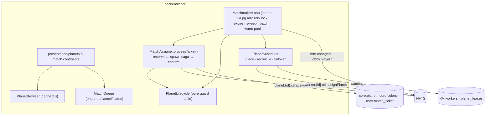

# Epic TA-05 — Matchmaking & Planet Lifecycle

> **Orchestrator:** [`EXECUTION_ORCHESTRATOR.md`](../EXECUTION_ORCHESTRATOR.md) · **Status Board:** [`STATUS.md`](../STATUS.md)
> **Spec:** [`MATCHMAKING.md`](../../spec/MATCHMAKING.md) (rules `MM-01..54`, edge cases E1..E16) · [`ARCHITECTURE.md`](../../spec/ARCHITECTURE.md) §8, §14, §15 · [`CONTINUITY.md`](../../spec/CONTINUITY.md) §7 · [`DECISIONS.md`](../../spec/DECISIONS.md) D-02, D-08, D-12

## Overview

Everything in core that decides **where planets run** and **which planet a new colony lands on**: the planet lifecycle state machine (`PROVISIONING → RECRUITING → SEALED → ENDED → ARCHIVED`), the picker API, the managed match queue with seat reservations, the leader-elected matchmaker loop with warm pool and sealing, and the scheduler that places planets on workers and reassigns them on worker death. The work is staged so W2 already delivers "join a planet" with a simple driver, and W3 replaces it with the production leader loop and failover scheduler.

All code lives in `backend/core/src/{domain,application,infrastructure}/{planets,matchmaking,scheduler}/` (lane L1).

## Epic analytics

- **Goal / user value:** a new player is seated on a young planet within seconds; a planet that is full or older than 24 h never takes newcomers; operators can bound and steer load.
- **Success metrics:**
  - `mm_ticket_wait_seconds` p95 ≤ **5 s** with warm pool, ≤ **15 s** when a planet must be provisioned.
  - **0** seats over capacity and **0** placements onto `SEALED` planets in the 200-player soak (TA-13.6).
  - **0** double-assigned tickets / double colonies per player (DB constraints + concurrency tests).
  - `sched_failover_seconds` p95 ≤ 30 s (CT-51).
- **In scope:** lifecycle SM, picker API, public stats, queue + reservations + spawn saga, leader loop, warm pool, time-based seal/end sweep, scheduler + failover placement, queue controls (caps, backpressure, pause, priority).
- **Out of scope:** admin HTTP surface (TA-04.7 calls into this epic), elimination/end side-effects for players (TA-08.5), party/friends tickets (MATCHMAKING Q4), multi-region (Q5).
- **Key risks:** concurrency bugs in seat counting → Postgres row lock + partial unique indexes + concurrency tests; worker slowness during spawn → reservation TTL + idempotent spawn (`Nats-Msg-Id = colonyId`); scheduler herd on worker death → per-target concurrency limit 10 (MM-53).

## Architecture overview

## Task index

| Task | Title | Wave / Lane | Depends On |
|---|---|---|---|
| `TA-05.1` | Planet lifecycle state machine + static placement on a live worker | W2 / L1 | TA-04.1, TA-03.1, TA-07.5 |
| `TA-05.2` | Planet browser API: `RECRUITING` list + "new planet" per type | W2 / L1 | TA-05.1, TA-04.4 |
| `TA-05.3` | Match queue: enqueue/cancel/status, seat reservation with TTL | W2 / L1 | TA-05.1, TA-05.2 |
| `TA-05.4` | Matchmaker leader loop: assign/create planets, warm pool, sealing | W3 / L1 | TA-05.3 |
| `TA-05.5` | Planet scheduler: capacity-aware placement, lease reconcile, failover reassignment | W3 / L1 | TA-05.1, TA-05.4, TA-07.5 |
| `TA-05.6` | Managed queue controls: caps, backpressure, pause, priority, metrics | W4 / L1 | TA-05.4 |

---

## Tasks

### `TA-05.1` — Planet lifecycle state machine + static placement on a live worker

- **Status:** `[ ] Todo`
- **Wave / Lane:** `W2 / L1`
- **Depends On:** `TA-04.1`, `TA-03.1`, `TA-07.5` (ctl schemas only; integration at W2 barrier)
- **Spec:** [`MATCHMAKING.md`](../../spec/MATCHMAKING.md) §3 (MM-01..10, guard table), MM-50 (static subset), MM-51
- **Target Files:**
  - `backend/core/src/domain/planets/{planet.ts,planet-lifecycle.ts,planet-name.ts}`
  - `backend/core/src/application/planets/{create-planet.use-case.ts,transition-planet.use-case.ts}`
  - `backend/core/src/infrastructure/planets/{prisma-planet.repository.ts,static-placement.ts,worker-ctl.client.ts}`
  - `backend/core/test/unit/planets/planet-lifecycle.spec.ts`, `tests/integration/core/planet-provision.int-spec.ts`
- **Verify:** `npm run test -w @terra/core && npm run test:integration -- --suite core`

#### Analytics
- **Problem & goal:** a planet's state gates everything (who can join, when it ends). It must be explicit, auditable and safe under concurrent writers (matchmaker, sweeper, admin, event consumers).
- **Constraints:** optimistic concurrency (`version` column); `seed` from CSPRNG (64-bit), `simVersion`, `capacity` frozen at creation (MM-10); W2 has no leader loop, so placement is "first live non-draining worker under `WORKER_MAX_PLANETS`, lowest `workerId`".
- **Risks → mitigations:** worker never replies `loaded` → 10 s timeout, next candidate, `placementAttempts` (≤ 3) then `ARCHIVED faultCode=provision_failed`; lost update between sweeper and assigner → `version` check + retry once.
- **Alternatives rejected:** an XState runtime (overkill; a guard table + exhaustive unit test is clearer for agents); storing lifecycle in the worker (core must answer picker queries without NATS round-trips).
- **Telemetry (proves it works):** `mm_planets{state,type}` (gauge); `mm_planet_created_total{type,source}` (counter); `sched_placements_total{result,reason="new"}` (counter); log event `planet.transition {from,to,reason}`.

#### Architecture
- `PlanetLifecycle.transition(planet, event, now) → {next, sideEffects[]}` (pure): side effects like `releaseLease`, `notifyMmChanged` are returned, executed by the use-case after commit.
- `CreatePlanetUseCase(type, source)` → insert `PROVISIONING` (generated name, e.g. "Kepler-7c Dunes") → `StaticPlacement.pick()` (reads `{ns}_workers` KV) → `WorkerCtlClient.assignPlanet({planetId, seed, type, simVersion, restoreFrom:'new'})` → on `loaded{epoch,tick,stateHash}` transition to `RECRUITING`, store `assignedWorkerId`, `leaseEpoch`.
- Health flag (`OK|FAILING_OVER|FAULTED`) stored separately from state.

#### Definition of Ready (DoR)
- [ ] `core.planet` has `state, health, seed, type, sim_version, capacity, seats_taken, first_colony_at, sealed_at, sealed_reason, ended_at, ended_reason, assigned_worker_id, lease_epoch, placement_attempts, version` — else **Contract change request (lead pre-step)** for migration `0002_*`.
- [ ] `{ns}.worker.{id}.ctl assignPlanet/loaded` schemas exist in `@terra/contracts` (TA-01.3).

#### Definition of Done (DoD)
- [ ] `planet-lifecycle.spec.ts`: every guard-table row + every illegal transition throws `DomainError('illegal_transition')`.
- [ ] `planet-provision.int-spec.ts` with a fake worker responder: happy path → `RECRUITING`; first worker times out → second used; 3 failures → `ARCHIVED provision_failed`.
- [ ] Concurrent transitions (seal vs. end) on one planet → exactly one wins, the other retries/re-evaluates.
- [ ] Status synced in orchestrator, issue file and STATUS.md (§1.6).

---

### `TA-05.2` — Planet browser API: `RECRUITING` list + "new planet" per type

- **Status:** `[ ] Todo`
- **Wave / Lane:** `W2 / L1`
- **Depends On:** `TA-05.1`, `TA-04.4`
- **Spec:** [`MATCHMAKING.md`](../../spec/MATCHMAKING.md) §4 (MM-20..24, `PlanetSummaryV1`, `PlanetListV1`, `/v1/planets/stats`)
- **Target Files:**
  - `backend/core/src/application/planets/{planet-browser.service.ts,planet-stats.service.ts}`
  - `backend/core/src/presentation/planets/planets.controller.ts`
  - `backend/core/test/unit/planets/planet-browser.spec.ts`, `tests/integration/core/planet-browser.int-spec.ts`
- **Verify:** `npm run test -w @terra/core && npm run test:integration -- --suite core`

#### Analytics
- **Problem & goal:** "at the beginning the player must see available planets". Show only planets a new player can actually join, sorted so social planets fill first, plus a "start a new planet" choice.
- **Constraints:** filters MM-20 (RECRUITING, health OK, seats free, ≥ 15 min before admission closes); sort MM-21; `newPlanet[]` per enabled type with `available`/`etaS` (MM-22); 2 s in-process cache (MM-23); `GET /v1/planets/stats` public with 10 s cache for the landing page (TA-12.1).
- **Risks → mitigations:** expensive query at scale → single indexed query on `(state, health, type)`; leaking player identities → only `displayName` + `foundedAt` of colonies.
- **Alternatives rejected:** showing sealed planets greyed out (adds noise; owner wants new players on new planets only).
- **Telemetry (proves it works):** `planet_browser_requests_total{cache=hit|miss}` (counter); `planet_browser_items` (histogram); `planets_stats_requests_total` (counter).

#### Architecture
- `PlanetBrowser.list({type?, limit≤20}) → PlanetListV1`; invalidated on `{ns}.mm.changed`.
- Also used by `resolveHome` (TA-04.4) to embed `planets` for `NEW`/`ELIMINATED`/`PLANET_ENDED`.
- `PlanetStats.get()` → `{planetsActive, coloniesAlive, playersOnline (from presence events count via core.colony.last_seen_at window ≤ 2 min), updatedAt}`.

#### Definition of Ready (DoR)
- [ ] `PlanetSummaryV1`, `PlanetListV1`, `PlanetStatsV1` in `@terra/contracts/rest` — else **Contract change request (lead pre-step)**.
- [ ] Enabled types list from env `PLANET_TYPES_ENABLED=temperate,desert` added to `@terra/config` (lead pre-step).

#### Definition of Done (DoD)
- [ ] `planet-browser.int-spec.ts` seeds planets in every state/health/seat/age combination and asserts exact inclusion + order (MM-20, MM-21) with a fake clock (14 min before close → hidden).
- [ ] `newPlanet.available=false` when at `MAX_ACTIVE_PLANETS` and no empty warm planet (MM-22).
- [ ] `/v1/planets/stats` works unauthenticated and is cached (second call within 10 s does not hit DB — spy).
- [ ] Status synced in orchestrator, issue file and STATUS.md (§1.6).

---

### `TA-05.3` — Match queue: enqueue/cancel/status, seat reservation with TTL

- **Status:** `[ ] Todo`
- **Wave / Lane:** `W2 / L1`
- **Depends On:** `TA-05.1`, `TA-05.2`
- **Spec:** [`MATCHMAKING.md`](../../spec/MATCHMAKING.md) §5.1–5.2 (MM-30..40), edge cases E1–E8
- **Target Files:**
  - `backend/core/src/domain/matchmaking/{match-ticket.ts,ticket-state.ts,seat-policy.ts}`
  - `backend/core/src/application/matchmaking/{enqueue.use-case.ts,cancel.use-case.ts,ticket-status.use-case.ts,match-assigner.service.ts,simple-driver.ts}`
  - `backend/core/src/infrastructure/matchmaking/{prisma-ticket.repository.ts,spawn-colony.client.ts}`
  - `backend/core/src/presentation/matchmaking/match.controller.ts`
  - `backend/core/test/unit/matchmaking/*.spec.ts`, `tests/integration/core/{match-ticket-idempotency,enqueue-with-live-colony,seat-reservation,spawn-saga}.int-spec.ts`
- **Verify:** `npm run test -w @terra/core && npm run test:integration -- --suite core`

#### Analytics
- **Problem & goal:** turn "I want to play" into exactly one colony on exactly one eligible planet, never over capacity, never twice, resilient to slow workers and double clicks.
- **Constraints:** one open ticket per player (partial unique index); one `FOUNDING|ALIVE` colony per player (partial unique index); reservation tx with `FOR UPDATE` on the planet row and `SKIP LOCKED` on tickets (MM-33); `MATCH_SEAT_TTL_S=90`; spawn via `planet.{id}.ctl spawnColony` (5 s timeout, 3 attempts, idempotent by `colonyId`) (MM-35..37). W2 driver: `MM_DRIVER=simple` — a single-process interval (1 s) calling `MatchAssigner.processTicket` with in-memory lock; replaced by the leader loop in TA-05.4 (same `MatchAssigner`).
- **Risks → mitigations:** late spawn success after expiry → orphan reconciliation hook (MM-38) implemented here as an event consumer on `planet.*.evt.colony_founded`; a planet sealing mid-flight → JOIN fallback (MM-34) — implemented in TA-05.4; in W2 a non-eligible target fails the ticket with `planet_unavailable`.
- **Alternatives rejected:** JetStream work-queue as the queue (no transactional seat counting, D-08); assigning synchronously inside the HTTP request (blocks on worker latency; breaks under bursts).
- **Telemetry (proves it works):** `mm_queue_depth{state}` (gauge); `mm_assignments_total{mode,result}` (counter); `mm_reservations_expired_total` (counter); `mm_orphan_colonies_total` (counter); `mm_spawn_latency_seconds` (histogram); log events `mm.ticket.created`, `mm.ticket.assigned`.

#### Architecture
- `POST /v1/match/tickets {mode:'JOIN_PLANET'|'NEW_PLANET'|'AUTO', planetId?, planetType?}` (`.strict()`, `Idempotency-Key` honoured 10 min) → `MatchTicketV1 {id,state,position,etaS,planetId?}`; `GET /v1/match/tickets/current`; `DELETE /v1/match/tickets/current` (MM-39). `TRANSFER` is internal only (TA-06.10 via TA-08.5).
- `MatchAssigner.processTicket(id)`:
  1. tx: lock ticket (`SKIP LOCKED`), check live colony (MM-31), choose target (W2: requested planet or first eligible/warm/new), lock planet, check seats, reserve, insert `FOUNDING` colony with pre-allocated `colonyId`.
  2. `SpawnColonyClient.spawn()` with retries inside TTL.
  3. tx: confirm (MM-36): colony `ALIVE`, `seatsTaken++`, `firstColonyAt`, ticket `ASSIGNED`, seal if full via `PlanetLifecycle`.
  4. publish `{ns}.mm.changed`.
- Expiry job (in driver): `RESERVED|SPAWNING` with `reservationExpiresAt < now` → `ABANDONED` colony, ticket → `QUEUED` or `FAILED` (MM-37).

#### Definition of Ready (DoR)
- [ ] `core.match_ticket` (fields per MATCHMAKING §5.1) and `core.colony.state` enum incl. `FOUNDING`, `ABANDONED` + both partial unique indexes exist — else **Contract change request (lead pre-step)** (`0002_*`).
- [ ] `spawnColony` request/reply schema and `colony_founded` event schema in `@terra/contracts/nats`.
- [ ] `MatchTicketV1`, error codes `ticket_open`, `already_has_colony`, `too_late`, `queue_full`, `planet_unavailable` in `@terra/contracts`.

#### Definition of Done (DoD)
- [ ] `match-ticket-idempotency.int-spec.ts`: 20 concurrent POSTs → 1 ticket; different intent → `409 ticket_open` (E1, E2).
- [ ] `enqueue-with-live-colony.int-spec.ts`: `409 already_has_colony` + `home` (E3).
- [ ] `seat-reservation.int-spec.ts`: 8 tickets vs. 1 planet of capacity 5 → exactly 5 `ASSIGNED`, planet `SEALED reason=capacity` in the same tx as the 5th.
- [ ] `spawn-saga.int-spec.ts` with fake worker: timeout → retry → success; expiry → re-queued keeping `createdAt`; late success → `system.retireColony` published (E6, E7); duplicate spawn → worker sees same `Nats-Msg-Id`.
- [ ] Cancel in `QUEUED`/`RESERVED` releases seat; in `SPAWNING` → `409 too_late`.
- [ ] Status synced in orchestrator, issue file and STATUS.md (§1.6).

---

### `TA-05.4` — Matchmaker leader loop: assign/create planets, warm pool, sealing

- **Status:** `[ ] Todo`
- **Wave / Lane:** `W3 / L1`
- **Depends On:** `TA-05.3`
- **Spec:** [`MATCHMAKING.md`](../../spec/MATCHMAKING.md) MM-04, MM-07, MM-09, MM-34, MM-40..44, edge cases E4, E5, E9, E10, E12, E13
- **Target Files:**
  - `backend/core/src/application/matchmaking/{matchmaker.loop.ts,target-selector.ts,warm-pool.service.ts,lifecycle-sweeper.ts}`
  - `backend/core/src/infrastructure/matchmaking/{pg-leader-lock.ts,pg-notify.listener.ts,lobby-notifier.ts}`
  - `backend/core/test/unit/matchmaking/target-selector.spec.ts`, `tests/integration/core/{matchmaker-concurrency,join-fallback,warm-pool,global-cap,planet-sweeper}.int-spec.ts`
- **Verify:** `npm run test -w @terra/core && npm run test:integration -- --suite core`

#### Analytics
- **Problem & goal:** production-grade assignment: exactly one leader across core replicas, batched FIFO with priority, smart target selection (fill planets first, keep one empty planet per type ready), time-based sealing at 24 h and ending at 14 d — the rules that implement "5 players for days → no new players; new players → new planets".
- **Constraints:** leader = holder of `pg_try_advisory_lock(hashtext('ta.matchmaker'))` on a dedicated connection (MM-41); loop 500 ms, early wake by `NOTIFY ta_mm` and `mm.changed` (MM-42); batch 50; sweep every 30 s; `WARM_POOL_PER_TYPE=1`, trim extras > 1 h; `MAX_ACTIVE_PLANETS=200` (MM-43); empty planets do not age (MM-09). Sets `MM_DRIVER=leader` as default; the W2 simple driver stays for unit tests only.
- **Risks → mitigations:** split brain between replicas → advisory lock is session-bound; on connection loss the loop stops before next iteration (checks `lockHeld` each tick); warm pool creating planets during a capacity crunch → warm pool counts toward `MAX_ACTIVE_PLANETS` and is skipped at cap; long sweeps blocking assignment → sweep runs in its own interval with `LIMIT 100` per pass.
- **Alternatives rejected:** NATS KV-based leader election (works, but Postgres lock co-locates leadership with the data it protects); per-replica loops with only `SKIP LOCKED` (safe for tickets, but planet creation and warm pool would race).
- **Telemetry (proves it works):** `mm_leader` (gauge); `mm_loop_duration_seconds` (histogram); `mm_ticket_wait_seconds{mode}` (histogram); `mm_planet_sealed_total{reason}`, `mm_planet_ended_total{reason}`, `mm_capacity_blocked_total` (counters); log events `mm.ticket.fallback`, `mm.leader.acquired|lost`.

#### Architecture
- `MatchmakerLoop.iterate()`: (1) expire reservations/tickets (MM-37, MM-40); (2) if `now - lastSweep ≥ 30 s` → `LifecycleSweeper.run()` (seal by window, end by lifetime / extinct); (3) claim batch → `TargetSelector.choose(ticket)` (MM-34 incl. JOIN fallback with `fallbackFromPlanetId`) → `MatchAssigner.processTicket`; (4) `WarmPool.topUp()` per enabled type.
- Tickets whose target is a `PROVISIONING` planet stay `QUEUED` without a reservation (MM-44).
- After each assignment: publish `{ns}.mm.changed` and `{ns}.lobby.player.{playerId}` (`match.assigned {home}` / `queue.position` / `match.failed`) consumed by TA-04.6.
- `ENDED` side-effects (final snapshot, results, ARCHIVED) are triggered here via `PlanetLifecycle` side-effects but implemented in TA-08.5.

#### Definition of Ready (DoR)
- [ ] TA-05.3 done; `{ns}.lobby.player.{playerId}` subject landed (W3 pre-step, also requested by TA-04.6).
- [ ] Fake-clock helper available in the harness (TA-13.1) for 24 h / 14 d tests.

#### Definition of Done (DoD)
- [ ] `matchmaker-concurrency.int-spec.ts`: two core instances, 30 tickets for one type → exactly one leader assigns; planets never exceed 5 seats; 6th player lands on a second planet (W3 barrier scenario (d)).
- [ ] `join-fallback.int-spec.ts`: JOIN on a planet that fills first → placed on another planet of same type with `fallbackFromPlanetId` (E4).
- [ ] `planet-sweeper.int-spec.ts`: 24 h after first colony → `SEALED window`; reservation taken before seal completes (E5); 14 d → `ENDED lifetime`; empty warm planet unchanged after 30 d.
- [ ] `warm-pool.int-spec.ts` and `global-cap.int-spec.ts`: 1 empty planet per type maintained; at cap no creation, `newPlanet.available=false` (E10).
- [ ] Killing the leader mid-batch → second instance takes over within 1 s, no duplicate colonies (E9).
- [ ] Status synced in orchestrator, issue file and STATUS.md (§1.6).

---

### `TA-05.5` — Planet scheduler: capacity-aware placement, lease reconcile, failover reassignment

- **Status:** `[ ] Todo`
- **Wave / Lane:** `W3 / L1`
- **Depends On:** `TA-05.1`, `TA-05.4`, `TA-07.5`
- **Spec:** [`MATCHMAKING.md`](../../spec/MATCHMAKING.md) §6 (MM-50..54); [`CONTINUITY.md`](../../spec/CONTINUITY.md) §7 (CT-50..54, CT-60..62); [`ARCHITECTURE.md`](../../spec/ARCHITECTURE.md) §6.2, §14
- **Target Files:**
  - `backend/core/src/application/scheduler/{planet-scheduler.service.ts,placement-scorer.ts,reconciler.ts}`
  - `backend/core/src/infrastructure/scheduler/{kv-watchers.ts,assign-throttle.ts}`
  - `backend/core/test/unit/scheduler/{placement-scorer,reconciler}.spec.ts`, `tests/integration/core/scheduler-failover.int-spec.ts`
- **Verify:** `npm run test -w @terra/core && npm run test:integration -- --suite core`

#### Analytics
- **Problem & goal:** "handle many games in parallel" and "it must work even when the player leaves" both require that every live planet is always ticking on some healthy worker. When a worker dies or drains, its planets must move within 30 s with no lost commands.
- **Constraints:** score `planets/WORKER_MAX_PLANETS + load`, filter draining / full / incompatible `simVersion` (MM-50); reconcile every 5 s + on KV watch events (MM-52); ≤ 10 concurrent `assignPlanet` per target (MM-53); runs only on the matchmaker leader (MM-54); new owner bumps `epoch` (CT-52).
- **Risks → mitigations:** NATS KV TTL expiry does not always emit a watch event → periodic reconcile is the source of truth, watch only accelerates; flapping worker (heartbeats on/off) → a worker must be continuously present for 10 s before receiving placements; replacing a planet onto a worker that is itself overloaded → `load` from heartbeat (> 0.85 excluded).
- **Alternatives rejected:** workers self-claiming orphan leases (no global view, herd effects, harder to reason about); Kubernetes-style external operator (not in MVP infra).
- **Telemetry (proves it works):** `sched_placements_total{result,reason=new|failover|drain}` (counter); `sched_failover_seconds` (histogram); `sched_reconcile_duration_seconds` (histogram); `sched_planets_without_lease` (gauge); log events `planet.failover.started|completed`.

#### Architecture
- `Reconciler.run()` per MM-52: planets in `RECRUITING|SEALED|ENDED(not archived)` vs. `{ns}_planet_leases` → missing lease ⇒ `health=FAILING_OVER`, enqueue placement with `restoreFrom:'snapshot'`; archived with lease ⇒ `releasePlanet`.
- `PlacementScorer.rank(workers, planet)`; `AssignThrottle` (semaphore per target worker).
- On `loaded{epoch,tick,stateHash}` → `health=OK`, `assignedWorkerId`, `leaseEpoch` updated; `planet.failover.completed` logged with duration.
- Drain path (CT-62): lease **deleted** by draining worker ⇒ watch fires ⇒ immediate placement (no TTL wait).

#### Definition of Ready (DoR)
- [ ] Worker heartbeat value includes `planets`, `load`, `draining`, `simVersions` (TA-01.3 / TA-07.1) — else **Contract change request (lead pre-step)**.
- [ ] TA-07.5 implements `assignPlanet{restoreFrom}` / `releasePlanet` / `drain`.

#### Definition of Done (DoD)
- [ ] `placement-scorer.spec.ts`: filters + ordering + tie-break; flapping worker excluded for 10 s.
- [ ] `scheduler-failover.int-spec.ts` (2 fake workers): stop heartbeats of worker A holding 12 planets → all 12 placed on B within 30 s (fake TTLs), ≤ 10 concurrent assigns, `epoch` incremented.
- [ ] Drain scenario: lease deleted → placement within 1 s.
- [ ] Barrier W3 (c) passes with real workers (`npm run test:failover -- --quick`).
- [ ] Status synced in orchestrator, issue file and STATUS.md (§1.6).

---

### `TA-05.6` — Managed queue controls: caps, backpressure, pause, priority, metrics

- **Status:** `[ ] Todo`
- **Wave / Lane:** `W4 / L1`
- **Depends On:** `TA-05.4`
- **Spec:** [`MATCHMAKING.md`](../../spec/MATCHMAKING.md) §5.4 (MM-45..49), §9
- **Target Files:**
  - `backend/core/src/application/matchmaking/{queue-controls.service.ts,eta-estimator.ts,position.service.ts}`
  - `backend/core/src/infrastructure/matchmaking/prisma-mm-settings.repository.ts`
  - `backend/core/test/unit/matchmaking/{eta-estimator,position}.spec.ts`, `tests/integration/core/queue-controls.int-spec.ts`
- **Verify:** `npm run test -w @terra/core && npm run test:integration -- --suite core`

#### Analytics
- **Problem & goal:** the owner asked for "some managed queue": operators must bound load (caps, backpressure), stop admissions during incidents (pause), favour certain tickets (priority — e.g. rocket transfers), and players must see an honest position/ETA.
- **Constraints:** `MATCH_QUEUE_MAX=1000` → `503 queue_full` + `Retry-After: 30` (MM-45); pause persisted in `core.mm_settings` and respected by the leader within one loop (MM-46); priority −10..100, `TRANSFER=10` (MM-47); position/ETA via EWMA α=0.2, ≤ 1 push / 2 s / ticket (MM-48). Admin HTTP endpoints are in TA-04.7 and call this service.
- **Risks → mitigations:** ETA lies under cap/pause → `etaS:null` with reason; priority starvation of priority-0 tickets → aging: +1 effective priority per 5 min waited (cap +5) — documented, tunable `MM_PRIORITY_AGING_MIN=5`.
- **Alternatives rejected:** per-type separate queues (more knobs; a single ordered queue with type-aware selection is enough for MVP).
- **Telemetry (proves it works):** `mm_queue_depth{state}` (gauge, already); `mm_queue_rejected_total{reason=full|paused}` (counter); `mm_eta_error_seconds` (histogram: predicted − actual); `mm_paused` (gauge).

#### Architecture
- `QueueControls { pause(), resume(), setPriority(ticketId, p), cancel(ticketId), snapshot() }` writing `core.mm_settings` / tickets and publishing `{ns}.mm.changed`.
- `PositionService.position(ticket)` — indexed count query `(priority_eff DESC, created_at ASC)`; `EtaEstimator` keeps EWMA of assignment durations in memory on the leader, persisted every minute to `core.mm_settings.eta_ewma_s`.
- Picker (`PlanetListV1.queuePaused`) and lobby `queue.position` include pause/cap state.

#### Definition of Ready (DoR)
- [ ] `core.mm_settings` exists (else **Contract change request (lead pre-step)**; also requested by TA-04.7).
- [ ] `MATCH_TICKET_MAX_WAIT_S`, `MM_PRIORITY_AGING_MIN` added to `@terra/config` (lead pre-step) and ARCHITECTURE §15 (lead).

#### Definition of Done (DoD)
- [ ] `queue-controls.int-spec.ts`: 1000 open tickets → 1001st gets 503 + `Retry-After`; pause → 0 assignments for 5 s of loops, expiry suspended (E11); resume → assignments continue in order; priority bump reorders positions; aging lifts an old priority-0 ticket.
- [ ] `eta-estimator.spec.ts`: EWMA math, `null` when paused/at cap.
- [ ] Metrics above asserted in the integration test.
- [ ] Status synced in orchestrator, issue file and STATUS.md (§1.6).
