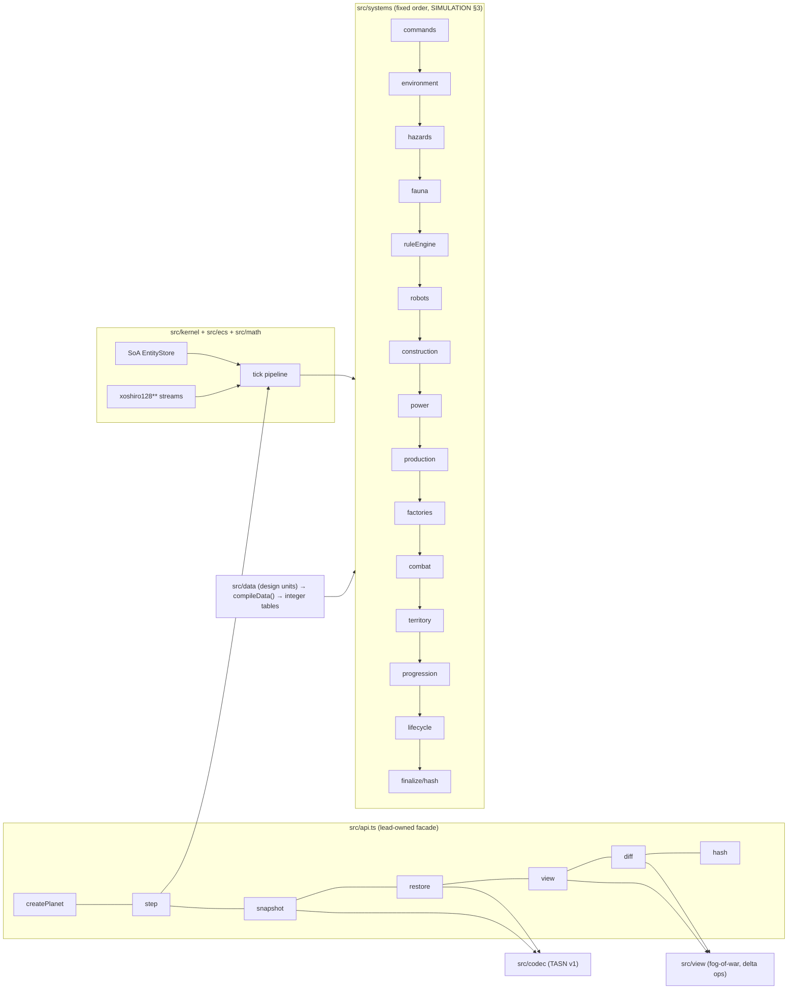

# Epic TA-06 — Simulation Core (`@terra/sim`)

> **Orchestrator:** [`EXECUTION_ORCHESTRATOR.md`](../EXECUTION_ORCHESTRATOR.md) · **Status Board:** [`STATUS.md`](../STATUS.md)
> **Spec:** [`ARCHITECTURE.md`](../../spec/ARCHITECTURE.md) §9, §15 · [`SIMULATION.md`](../../spec/SIMULATION.md) (all sections) · [`DECISIONS.md`](../../spec/DECISIONS.md) D-01, D-13, D-15 · Gameplay: [`colony-economy-and-buildings-spec.md`](../../../colony-economy-and-buildings-spec.md), [`autonomous-colony-spec.md`](../../../autonomous-colony-spec.md)
> **Lane:** `L2` · **Owned paths:** `shared/sim/**` except `shared/sim/src/api.ts` (lead) · W5 extra: `tests/failover/**` (TA-13.4, separate epic)

## Overview

`@terra/sim` is the pure, deterministic TypeScript simulation of one planet. It runs authoritatively inside planet-workers at 10 TPS (D-01), is restored from snapshots and replayed from the tick-marked command log on failover, and produces fog-of-war views and deltas for clients. This epic builds it from the kernel (W1) through the MVP game content (W2–W4). The worker hosting it is [`TA-07`](./TA-07-planet-worker.md); the facade `src/api.ts` + stub is landed by the lead in [`TA-01.7`](./TA-01-monorepo-and-shared-contracts.md).

## Epic analytics

- **Goal / user value:** a colony that genuinely runs itself — mines, builds, powers, defends — whether the player is watching or not, with identical results on any worker (so failover is invisible).
- **Success metrics:**
  - `sim:determinism` passes 3 runs × 72 000 ticks on every scenario, including a mid-run snapshot/restore leg (0 hash mismatches).
  - `step()` p99 ≤ 2.0 ms, mean ≤ 1.0 ms on `mvp-scale` (SIMULATION §12).
  - Scenario `unattended-24h-compressed`: a colony left alone with default priorities grows (≥ 8 buildings, ≥ 6 robots, positive energy at night) and survives default hazards/fauna.
  - Snapshot ≤ 512 KB compressed; round-trip property test 1 000/1 000.
- **In scope:** kernel, PRNG, fixed-point math, SoA store, hex grid + generator, territory, economy (D-15 catalog), power grid, robots + pathfinding, rule engine + priorities + directives, hazards + fauna, PvP raids, rocket departure, codec, view/diff, events.
- **Out of scope:** networking, persistence, timers (TA-07); presence policy (TA-08.2; the worker issues `core.presence`); rendering (TA-11); T2+ content beyond D-15; per-pylon load routing; terraforming; dormant fast-forward (D-13).
- **Key risks:** hidden non-determinism (floats, Map order, `Math.sin`) → lint + integer-only canonicalizer + cross-realm determinism leg; perf blow-ups in pathfinding/grid rebuild → budgets + `sim:bench` in every task's Verify; balance making unattended colonies die → `unattended-24h-compressed` scenario as a gate.

## Architecture overview

Layout: `shared/sim/src/{kernel,ecs,math,grid,gen,data,systems,codec,view,events}/`, tests in `shared/sim/test/**`, scripts `shared/sim/scripts/{determinism,bench}.ts`, scenarios `shared/sim/scenarios/*.ts`.

## Task index

| Task | Title | Wave / Lane | Depends On |
|---|---|---|---|
| `TA-06.1` | Deterministic kernel: tick, seeded PRNG, fixed-point, ECS store, command application, state hash | W1 / L2 | TA-01.1, TA-01.7 |
| `TA-06.2` | Hex grid & planet generator (Temperate/Desert), deposits, spawn sites | W1 / L2 | TA-06.1 |
| `TA-06.9` | Snapshot codec, fog-of-war view & delta diff | W1 / L2 | TA-06.1, TA-06.2 |
| `TA-06.3` | Territory claim & immutable border collision | W2 / L2 | TA-06.2, TA-06.9 |
| `TA-06.4` | Economy: resources, storage caps, MVP building catalog, construction & upgrades | W2 / L2 | TA-06.3 |
| `TA-06.6` | Robots: Miner/Builder/Combat T1, supply cap, task queue, pathfinding | W2 / L2 | TA-06.4 |
| `TA-06.5` | Power grid: generation, pylons, connectivity, brownout shedding | W3 / L2 | TA-06.4, TA-06.6 |
| `TA-06.7` | Rule engine (utility AI) + player priorities + directive application | W3 / L2 | TA-06.5, TA-06.6 |
| `TA-06.8` | Hazards (lightning, meteor) + fauna (1 species, nests) | W4 / L2 | TA-06.5, TA-06.7 |
| `TA-06.11` | Basic PvP raids (combat bots vs. foreign buildings) | W4 / L2 | TA-06.8 |
| `TA-06.10` | Rocket build/launch & colony transfer to a new planet | W4 / L2 | TA-06.7 |

---

## Tasks

### `TA-06.1` — Deterministic kernel: tick, seeded PRNG, fixed-point, ECS store, command application, state hash

- **Status:** `[ ] Todo`
- **Wave / Lane:** `W1 / L2`
- **Depends On:** `TA-01.1`, `TA-01.7`
- **Spec:** [`SIMULATION.md`](../../spec/SIMULATION.md) §2 (`SIM-D-01..10`), §3, §4.1, §5
- **Target Files:**
  - `shared/sim/src/kernel/{step.ts,pipeline.ts,finalize.ts,errors.ts}`
  - `shared/sim/src/math/{fixed.ts,sin-table.ts}`
  - `shared/sim/src/kernel/rng.ts` (xoshiro128\*\*, splitmix64, stream ids)
  - `shared/sim/src/ecs/store.ts`, `shared/sim/src/ecs/components.ts`
  - `shared/sim/src/systems/commands.ts` (dispatcher + rejection codes; per-kind handlers stubbed)
  - `shared/sim/src/codec/canonical.ts`, `shared/sim/src/kernel/hash.ts` (xxHash64 via `xxhash-wasm`)
  - `shared/sim/src/impl.ts` (replaces stub behind `api.ts`)
  - `shared/sim/eslint.config.mjs` (extends `@terra/eslint-config/sim`), `shared/sim/eslint-rules/no-float-literal.js`
  - `shared/sim/scripts/determinism.ts`, `shared/sim/scenarios/idle.ts`
  - `shared/sim/test/{determinism.spec.ts,math/fixed.spec.ts,kernel/rng-streams.spec.ts,kernel/integer-state.spec.ts,lint/banned-apis.fixture.ts}`
- **Verify:** `npm run test -w @terra/sim && npm run sim:determinism -w @terra/sim -- --ticks 10000 --runs 3`

#### Analytics
- **Problem & goal:** every later system and the whole failover story rely on bit-exact reproducibility. The kernel must make non-determinism hard to write and easy to detect.
- **Constraints:** no Node/DOM APIs (runs in worker and browser tests); integers only in state (`SIM-D-02`); 10 TPS fixed tick; hash must be isomorphic (`xxhash-wasm` is async to init → initialize once in `createPlanet/restore` factory, hashing itself sync).
- **Risks → mitigations:** float leak via division → `fixed.ts` helpers + canonicalizer throws on non-integers; hidden global state → cross-realm leg in `determinism.ts`; `xxhash-wasm` init cost → module-level singleton awaited by the worker at boot (`await initSim()` exported from facade).
- **Alternatives rejected:** bitECS (global worlds, recycled ids — `SIM-D-06`); Mulberry32 (single 32-bit state, weak for parallel streams); BigInt fixed-point (10× slower; values fit in 2^53).
- **Telemetry (proves it works):** `StepResult.stats` counters `commandsApplied`, `commandsRejected`, `entities`, `pathNodes` (consumed by worker metrics `ta_sim_*`); determinism script output `hash-checkpoints.json` (per-run checkpoint list) attached to CI artifacts.

#### Architecture
- `step(state, cmds)` runs the fixed pipeline (SIMULATION §3) with all systems registered as no-ops except `commands` and `finalize`.
- `EntityStore`: dense typed-array columns sorted by id; `spawn()` uses `meta.nextEntityId++`; `despawn()` swap-free compaction preserving order (mark + compact at `finalize`).
- RNG streams `gen, weather, hazard, fauna, ai, combat` each `Uint32Array(4)` in `meta.rng`.
- `hash(state)` = xxh64 over `canonical.encode(state)` (shared with the codec in TA-06.9; minimal encoder for meta + store here).
- Lint: `@terra/eslint-config/sim` (provided by lead in TA-01.1; L2 adds the local custom rule) enforces `SIM-D-07`.

#### Definition of Ready (DoR)
- [ ] `TA-01.7` landed `shared/sim/src/api.ts` exposing `initSim, createPlanet, restore, step, snapshot, view, diff, hash` with a stub.
- [ ] `SimCommandV1` envelope + kind union exist in `@terra/contracts` (TA-01.2/01.3). Contract change request (lead pre-step) if missing: internal kinds `ai.directive, trade.commit, spawnColony, retireColony, planetEnd` (SIMULATION §4.1).
- [ ] `@terra/eslint-config/sim` preset exists (TA-01.1) or a change request is filed.

#### Definition of Done (DoD)
- [ ] `determinism.spec.ts`: 3 runs × 10 000 ticks of `idle` with a scripted command log → identical checkpoint hashes; cross-realm leg identical.
- [ ] `integer-state.spec.ts`: injecting `0.5` into any state column makes `hash()` throw `SimNonIntegerError`.
- [ ] `rng-streams.spec.ts`: adding draws to `hazard` does not change the `fauna` sequence.
- [ ] `fixed.spec.ts`: `mulBp`, `mulDiv`, `idiv` (negative operands floor), `isqrt` exhaustively checked on edge values.
- [ ] `banned-apis.fixture.ts` produces ≥ 1 lint error per banned API in `SIM-D-07`; `npm run check` lints `shared/sim/src` with zero errors.
- [ ] Unknown command kind / bad colony index → `cmd.rejected` event, never an exception.
- [ ] Status synced in orchestrator, issue file and STATUS.md (§1.6)

---

### `TA-06.2` — Hex grid & planet generator (Temperate/Desert), deposits, spawn sites

- **Status:** `[ ] Todo`
- **Wave / Lane:** `W1 / L2`
- **Depends On:** `TA-06.1`
- **Spec:** [`SIMULATION.md`](../../spec/SIMULATION.md) §5 (`grid`), §10 (`SIM-GEN`); [`autonomous-colony-spec.md`](../../../autonomous-colony-spec.md) §5
- **Target Files:**
  - `shared/sim/src/grid/{hex.ts,index.ts,neighbors.ts,ring.ts,footprint.ts}` (pure helpers also used by the client for presentation)
  - `shared/sim/src/gen/{noise.ts,planet.ts,deposits.ts,spawn-slots.ts}`
  - `shared/sim/src/data/planet-types.ts`
  - `shared/sim/test/{grid/hex.spec.ts,gen/planet-golden.spec.ts,gen/spawn-fairness.spec.ts}`
  - `shared/sim/scenarios/founder.ts` (empty colony at slot 0, used from W2)
- **Verify:** `npm run test -w @terra/sim && npm run sim:determinism -w @terra/sim -- --ticks 10000 --runs 3`

#### Analytics
- **Problem & goal:** every planet must be unique yet reproducible from `(type, seed)`, with fair spawn slots for up to `PLANET_CAPACITY` colonies.
- **Constraints:** radius 56 (≈ 9 577 tiles) to fit 5 colonies with R 10 claims and room to expand; integer value-noise only; generation ≤ 50 ms.
- **Risks → mitigations:** unfair slots (one colony without petroleum) → per-slot guarantees asserted in `spawn-fairness.spec.ts` over 500 seeds; golden drift on refactor → golden hash test bumps `SIM_VERSION` deliberately.
- **Alternatives rejected:** square dual-grid (economy/territory spec is written in axial hex `(q, r)`); Perlin/Simplex with floats (non-deterministic across engines).
- **Telemetry:** generator returns `GenReport {tiles, depositsByKind, slotScores[]}` logged by the worker as `planet.generated`; `sim:bench` measures generation time.

#### Architecture
- Axial coordinates, `axialToIndex`/`indexToAxial` for radius R hexagon, `hexDistance`, `ring`, `spiral`, footprint shapes for `W×D` buildings mapped onto hex (parallelogram footprint anchored at `(q, r)` with rotation 0..5).
- `createPlanet({planetId, type, seed, capacity})` fills `grid.*`, places nests later (TA-06.8 hooks a generator step that is a no-op now), returns state with empty colonies.
- Spawn slots: ring radius 32, equal angles, `gen` jitter ±3; guarantees per SIMULATION §10.

#### Definition of Ready (DoR)
- [ ] `TA-06.1` done.
- [ ] Planet type enum (`temperate | desert`) exists in `@terra/contracts` (TA-01.4 planet DTOs).

#### Definition of Done (DoD)
- [ ] `planet-golden.spec.ts`: fixed seeds for both types match committed golden hashes.
- [ ] `spawn-fairness.spec.ts`: over 500 seeds every slot has metals/minerals/petroleum within 12 tiles and a buildable 7×7 area; pairwise slot distance ≥ 25.
- [ ] `hex.spec.ts`: index round-trip for all tiles at R 56; distance/ring properties.
- [ ] Generation ≤ 50 ms in `sim:bench`.
- [ ] Status synced in orchestrator, issue file and STATUS.md (§1.6)

---

### `TA-06.9` — Snapshot codec, fog-of-war view & delta diff

- **Status:** `[ ] Todo`
- **Wave / Lane:** `W1 / L2`
- **Depends On:** `TA-06.1`, `TA-06.2`
- **Spec:** [`SIMULATION.md`](../../spec/SIMULATION.md) §5 (`SIM-S-01..03`), §6 (`SIM-V-01..04`); [`ARCHITECTURE.md`](../../spec/ARCHITECTURE.md) §13 (`welcome`, `delta`)
- **Target Files:**
  - `shared/sim/src/codec/{tasn.ts,sections.ts,string-table.ts,migrations/index.ts}`
  - `shared/sim/src/view/{view.ts,vision.ts,diff.ts,changed-at.ts}`
  - `shared/sim/test/{codec/roundtrip.property.spec.ts,codec/tasn-format.spec.ts,view/fog.spec.ts,view/diff.spec.ts}`
  - `shared/sim/scripts/bench.ts` (first version: codec + view + diff timings)
- **Verify:** `npm run test -w @terra/sim && npm run sim:bench -w @terra/sim -- --only codec,view`

#### Analytics
- **Problem & goal:** the worker needs a compact, versioned binary snapshot for persistence/failover and per-colony views that never leak foreign secrets; clients need small deltas at 5 Hz.
- **Constraints:** TASN v1 header fields fixed (SIMULATION §5); ≤ 512 KB compressed; `diff` O(entities in view); views must use only `@terra/contracts` view types so the client compiles without the sim.
- **Risks → mitigations:** information leak (foreign resources/tasks) → `fog.spec.ts` asserts forbidden fields absent; delta drift (client state diverges) → `diff.spec.ts` applies deltas over 3 000 ticks to a reducer and compares with fresh `view()`; schema evolution → `formatVersion` + migrations registry.
- **Alternatives rejected:** JSON snapshots (5–10× larger, float risk); MessagePack of the object graph (slower, no typed-array zero-copy); server-side full view every tick (bandwidth).
- **Telemetry:** `SnapshotInfo {bytes, sections, encodeOps}` returned to the worker (→ `ta_worker_snapshot_bytes`); `DeltaInfo {ops, entities}` (→ `ta_worker_delta_bytes`).

#### Architecture
- `snapshot(state)` writes header + sections (meta, rng, grid columns, colonies, entity columns, tasks, power, hazards, fauna, pathQueue) via `sections.ts`; `restore(bytes)` validates magic/format/simVersion, rebuilds caches (Maps) from canonical arrays.
- `canonical.ts` from TA-06.1 is now the section encoder minus header; `hash` = xxh64(sections).
- `view()` computes vision via `vision.ts` (territory ∪ radius sets, cached per colony and invalidated on entity move/build), `diff(prev, state, ci)` uses per-entity `changedAt` tick columns and per-tile change journal since `prev.tick`.
- Delta op set exactly as `SIM-V-02`.

#### Definition of Ready (DoR)
- [ ] Contract change request (lead pre-step) landed: `ColonyViewV1`, `EntityViewV1`, `ViewDeltaV1`, `PlayerEventV1` schemas in `@terra/contracts/ws` (fields per SIMULATION §6).
- [ ] `TA-06.2` done.

#### Definition of Done (DoD)
- [ ] `roundtrip.property.spec.ts`: 1 000 generated states → `hash(restore(snapshot(s))) === hash(s)`.
- [ ] `tasn-format.spec.ts`: header layout byte-exact; wrong magic / unsupported `simVersion` → typed errors.
- [ ] `fog.spec.ts`: foreign entity outside vision absent; inside vision present with only `id, kind, tier, owner, q, r, x, y, hpPct`.
- [ ] `diff.spec.ts`: reducer(view₀ + Σ deltas) deep-equals `view(stateₙ)` over 3 000 ticks of a moving-entity scenario.
- [ ] Bench: welcome `view()` ≤ 5 ms, `diff()` ≤ 0.3 ms, `snapshot()` ≤ 5 ms on `mvp-scale` placeholder scenario (entities seeded synthetically).
- [ ] Status synced in orchestrator, issue file and STATUS.md (§1.6)

---

### `TA-06.3` — Territory claim & immutable border collision

- **Status:** `[ ] Todo`
- **Wave / Lane:** `W2 / L2`
- **Depends On:** `TA-06.2`, `TA-06.9`
- **Spec:** [`SIMULATION.md`](../../spec/SIMULATION.md) §7.5 (`SIM-G-TER`); [`colony-economy-and-buildings-spec.md`](../../../colony-economy-and-buildings-spec.md) §1.5, §2
- **Target Files:**
  - `shared/sim/src/systems/territory.ts`
  - `shared/sim/src/systems/commands/spawn-colony.ts` (claims Hub radius at spawn)
  - `shared/sim/test/systems/territory.spec.ts`
- **Verify:** `npm run test -w @terra/sim && npm run sim:determinism -w @terra/sim -- --ticks 36000 --scenario founder`

#### Analytics
- **Problem & goal:** territory gates every placement and defines borders between up to 5 colonies; the spec's "frozen border" rule must hold even when a T3 beacon is built next to a T1.
- **Constraints:** claims only on construction completion; anchors per tile (`Uint8`); 600-tick grace on zero anchors; unpowered beacons cannot claim new tiles (power from TA-06.5 — until then treat all as powered behind a flag).
- **Risks → mitigations:** order-dependent claims when two beacons complete in the same tick → process completions in ascending `entityId` (documented, tested); flicker on brownouts → claims never removed by power loss.
- **Alternatives rejected:** influence-based borders that push back (explicitly forbidden by spec).
- **Telemetry:** events `territoryCollision` (first contact), counters in `StepResult.stats.tilesClaimed/tilesReverted`.

#### Architecture
- `claim(buildingId)` iterates `spiral(q0, r0, R)` in tile-index order: unclaimed → owner + anchor; same owner → anchor++; foreign → skip and record collision.
- On building destroyed/demolished: anchor-- for its claimed tiles; tiles reaching 0 get `graceUntil = tick + 600`; at grace end without anchors → `owner = -1`.
- `spawnColony` command: places Hub T1 instantly at slot centre and claims R 10.

#### Definition of Ready (DoR)
- [ ] `spawnColony` args schema present in contracts (SIMULATION §4.1).
- [ ] `TA-06.9` done (tile change journal used by deltas).

#### Definition of Done (DoD)
- [ ] `territory.spec.ts` covers: unclaimed claim; redundant anchor; frozen border vs. T2 beacon next to foreign T1; same-tick completion order; destroyed beacon → 600-tick revert; re-anchor within grace cancels revert; placement outside own territory rejected `not_own_territory`.
- [ ] Deltas carry tile owner changes (`o: 't'`) verified in `diff.spec.ts` extension.
- [ ] Status synced in orchestrator, issue file and STATUS.md (§1.6)

---

### `TA-06.4` — Economy: resources, storage caps, MVP building catalog, construction & upgrades

- **Status:** `[ ] Todo`
- **Wave / Lane:** `W2 / L2`
- **Depends On:** `TA-06.3`
- **Spec:** [`SIMULATION.md`](../../spec/SIMULATION.md) §4.1 (`SIM-C-02..04`), §7.1, §7.3; [`colony-economy-and-buildings-spec.md`](../../../colony-economy-and-buildings-spec.md) §1, §3
- **Target Files:**
  - `shared/sim/src/data/{buildings.ts,starting-kit.ts,compile.ts}` (full economy tables; D-15 subset `enabled: true`)
  - `shared/sim/src/systems/{construction.ts,production.ts}`
  - `shared/sim/src/systems/commands/{place-building.ts,upgrade-building.ts,demolish.ts,cancel-task.ts}`
  - `shared/sim/test/{data/catalog.spec.ts,systems/construction.spec.ts,systems/production.spec.ts}`
- **Verify:** `npm run test -w @terra/sim && npm run sim:determinism -w @terra/sim -- --ticks 36000 --scenario founder`

#### Analytics
- **Problem & goal:** every action costs resources; storage caps throttle mining; building tiers follow the spec's cost/size/time tables exactly.
- **Constraints:** numbers from the economy spec, converted exactly (`SIM-D-08`); resources reserved at acceptance (`SIM-C-03`); construction requires a Builder (until TA-06.6, a placeholder "virtual builder" at rate 1.0× behind flag `TEST_VIRTUAL_BUILDER`, removed in TA-06.6); extractors must cover a matching deposit tile.
- **Risks → mitigations:** transcription errors from the spec → `catalog.spec.ts` asserts each enabled row against a fixture copied verbatim from the spec tables; overflow beyond caps → clamp + `production.capped` stat.
- **Alternatives rejected:** pay-as-you-build (complex refunds, AI reasoning harder).
- **Telemetry:** `StepResult.stats.{constructionsCompleted, resourcesProduced[4], resourcesCapped[4]}`; events `buildingCompleted` (internal → player-visible via view `ev`).

#### Architecture
- `data/buildings.ts`: one row per `(kind, tier)` with size, buildTicks, cost, drain, gross, hp, effects, `shedTier`, `enabled`.
- Construction site entity (`state = constructing`, `progress` in ticks × builder rate); upgrade in place requires +1 ring free & owned, cost Δ, keeps entity id.
- Production: per extractor `rate × richnessBp × planetModifierBp` per tick, only if `powered` (always true until TA-06.5), clamped to storage cap. Thermal plant fuel draw implemented in TA-06.5.
- Starting kit per SIMULATION §7.3 applied by `spawnColony` (`startingStock` override for Founder Pod arrivals).

#### Definition of Ready (DoR)
- [ ] Contract change request (lead, W2 pre-step): trade command kinds `trade.offer`, `trade.respond`, `trade.offerReceived`, `trade.commit`, `trade.revert`, `trade.release` (PROTOCOL `CommandKind`) and events `trade.offer_created`, `trade.accept_reserved`, `trade.declined`, `trade.cancelled`, `trade.leg_applied`, `trade.leg_rejected` (NEAR.md §7).
- [ ] Owner answer or default accepted for SIMULATION §14 Q1 (Founder Core) and Q3 (Trade Hub row enabled).
- [ ] Contract kinds `placeBuilding`, `upgradeBuilding`, `demolish`, `cancelTask` args schemas landed (TA-01.2).

#### Definition of Done (DoD)
- [ ] `catalog.spec.ts`: every D-15 row matches the spec fixture; disabled rows rejected `tier_locked`.
- [ ] `construction.spec.ts`: place → reserve → complete after `buildTicks`; cancel refunds 75 %; demolish refunds 50 %; upgrade Δ cost + footprint growth; insufficient resources / blocked site / wrong terrain rejections.
- [ ] `production.spec.ts`: Metals Extractor T1 on 10 000 bp deposit yields exactly 4 000 mu/s; Desert water ×0.5; cap clamp.
- [ ] `founder` scenario 36 000 ticks deterministic.
- [ ] **Trade legs (scope added by lead for TA-10.5):** resource **reservation** model (reserved amounts are excluded from spendable stock and storage-cap checks count them), and handlers for `trade.offer` (reserve giver side), `trade.respond` (reserve receiver side on accept), `trade.offerReceived` (visible to the target colony and its AI), `trade.commit` (apply one leg: debit reserved, credit other side clamped to cap, report overflow), `trade.revert` (undo an applied leg), `trade.release` (drop a reservation); Trade Hub T1 required (SIMULATION §7). Unit tests `trade-legs.spec.ts`: reserve → commit both legs; one leg rejected → revert + release restores both colonies exactly; reservation survives snapshot/restore.
- [ ] Status synced in orchestrator, issue file and STATUS.md (§1.6)

---

### `TA-06.6` — Robots: Miner/Builder/Combat T1, supply cap, task queue, pathfinding

- **Status:** `[ ] Todo`
- **Wave / Lane:** `W2 / L2`
- **Depends On:** `TA-06.4`
- **Spec:** [`SIMULATION.md`](../../spec/SIMULATION.md) §3 (`SIM-T-03`), §4.1 (`enqueueTask`, `SIM-C-04`), §7.2
- **Target Files:**
  - `shared/sim/src/data/robots.ts`
  - `shared/sim/src/systems/{robots.ts,factories.ts}`
  - `shared/sim/src/systems/robots/{assign.ts,move.ts,harvest.ts,build.ts}`
  - `shared/sim/src/pathfinding/{astar.ts,flow-field.ts,budget.ts}`
  - `shared/sim/src/tasks/{queue.ts,types.ts}`
  - `shared/sim/test/{systems/robots.spec.ts,systems/pathfinding-budget.spec.ts,systems/factories.spec.ts}`
  - `shared/sim/scenarios/founder.ts` (extend: founder builds a Factory and 3 robots)
- **Verify:** `npm run test -w @terra/sim && npm run sim:determinism -w @terra/sim -- --ticks 36000 --scenario founder`

#### Analytics
- **Problem & goal:** robots are what the player sees doing the work; they must take tasks, path, harvest, build and repair deterministically and cheaply.
- **Constraints:** T1 stats from the economy spec; speeds proposed in SIMULATION §7.2; supply cap from Hub + Drone Control Arrays; A\* ≤ 2 000 node expansions per planet per tick, FIFO overflow; up to 300 robots per planet in budget.
- **Risks → mitigations:** pathfinding spikes → per-tick budget + cached flow fields to Hub/deposits invalidated on terrain/building change; robot thrash between tasks → assignment stickiness (task keeps robot until done/invalid).
- **Alternatives rejected:** steering/physics movement (non-trivial determinism); per-robot full A\* every tick.
- **Telemetry:** `StepResult.stats.{pathNodes, pathQueueLen, robotsIdle, robotsWorking}` → worker `ta_sim_path_nodes`; events `robotBuilt`.

#### Architecture
- Task queue per colony with classes player/ai/auto and cap 50 (`SIM-C-04`).
- Assignment: each idle robot picks the highest-precedence compatible task (miner: harvest/clear; builder: build/upgrade/repair; combat: guard/raid), ties by distance then task id.
- Movement in sub-tile units along path waypoints; position columns `x, y` flagged `changedAt` for deltas.
- Factories: build queue per factory, supply reservation at enqueue, spawn adjacent free tile.
- Removes `TEST_VIRTUAL_BUILDER` from TA-06.4.

#### Definition of Ready (DoR)
- [ ] `enqueueTask` task-variant schemas (`build, upgrade, repair, clear, buildRobot, raid, launchRocket`) landed in contracts (lead).
- [ ] `TA-06.4` done.

#### Definition of Done (DoD)
- [ ] `robots.spec.ts`: miner harvests 2.0 res/s on deposit; builder build rate 1.0× completes Hub-adjacent Solar in 180 ticks + travel; repair restores HP; combat bot deals 14 DPS.
- [ ] `factories.spec.ts`: supply cap blocks `buildRobot` with `supply_cap`; Drone Control Array raises cap by 8.
- [ ] `pathfinding-budget.spec.ts`: 300 simultaneous requests never exceed 2 000 expansions in a tick; all resolve within 30 ticks; order deterministic.
- [ ] `founder` scenario: within 36 000 ticks founder builds Factory + ≥ 3 robots; deterministic over 3 runs.
- [ ] Status synced in orchestrator, issue file and STATUS.md (§1.6)

---

### `TA-06.5` — Power grid: generation, pylons, connectivity, brownout shedding

- **Status:** `[ ] Todo`
- **Wave / Lane:** `W3 / L2`
- **Depends On:** `TA-06.4`, `TA-06.6`
- **Spec:** [`SIMULATION.md`](../../spec/SIMULATION.md) §7.4 (`SIM-G-PWR`), §7.6 (day/wind); [`colony-economy-and-buildings-spec.md`](../../../colony-economy-and-buildings-spec.md) §1.2, §1.3, §3.2, §3.3
- **Target Files:**
  - `shared/sim/src/systems/{power.ts,environment.ts}`
  - `shared/sim/src/power/{graph.ts,components.ts,shedding.ts,capacitors.ts}`
  - `shared/sim/test/systems/power.spec.ts`, `shared/sim/test/systems/environment.spec.ts`
  - `shared/sim/scenarios/night-cycle.ts`
- **Verify:** `npm run test -w @terra/sim && npm run sim:determinism -w @terra/sim -- --ticks 72000 --scenario night-cycle`

#### Analytics
- **Problem & goal:** "power is not global magic" — buildings need a physical, destructible grid; night and wind create real decisions; brownouts shed in the spec's priority order so defenses stay up.
- **Constraints:** every building drains power; generators have internal drain; Solar 0 at night, +35 % Desert; Wind 50–140 %; thermal consumes Pet; capacitors store/discharge with caps; grid rebuild ≤ 10 ms worst tick; MVP ignores per-pylon max load (SIMULATION §14 Q5).
- **Risks → mitigations:** full graph rebuild every tick too slow → `dirty` flag on topology changes only, balances recomputed each tick per component (cheap sums); oscillation (shed → surplus → unshed → deficit) → hysteresis: re-enable a shed tier only when surplus ≥ its demand + 5 % for 50 ticks.
- **Alternatives rejected:** global colony energy pool (contradicts spec §1.3); flow-network max-flow per tick (too costly for MVP).
- **Telemetry:** events `powerSevered`, `energyCollapse`; `ColonyView.energy {supply, demand, stored, shedTiers}`; stats `gridRebuilds`.

#### Architecture
- `graph.ts` builds adjacency from Hub/pylons within span and buildings within 3 tiles of a pylon/Hub; union-find for components.
- Per tick per component: supply/demand per SIMULATION §7.4 → shedding (`shedding.ts`) by `shedTier`, newest first → sets `powered` flag consumed by production, factories, turrets, beacons (claims), construction (sites need no power).
- Environment system: daylight from `sinTable` over 12 000-tick day; wind resample every 1 200 ticks from `weather` stream.
- Robots' drain charged to the Hub's component; deficit ⇒ 50 % robot speed/work.

#### Definition of Ready (DoR)
- [ ] `TA-06.6` done (robot drain attribution).
- [ ] Owner default accepted for SIMULATION §14 Q1 (Founder Core +8 E/s) and Q5.

#### Definition of Done (DoD)
- [ ] `power.spec.ts`: pylon destroyed severs branch → consumers offline same tick + `powerSevered`; shedding order exactly Silo → Factory/Trade Hub → Extractors/Depot → Turrets/Beacons last; capacitor charges on surplus and discharges ≤ 30 E/s; thermal stops when Pet = 0; hysteresis prevents oscillation over 1 000 ticks.
- [ ] `environment.spec.ts`: Solar T1 output 0 at night, +35 % on Desert at noon; wind within bounds.
- [ ] `night-cycle` scenario (6 days compressed) deterministic; worst-tick grid rebuild ≤ 10 ms in bench.
- [ ] Status synced in orchestrator, issue file and STATUS.md (§1.6)

---

### `TA-06.7` — Rule engine (utility AI) + player priorities + directive application

- **Status:** `[ ] Todo`
- **Wave / Lane:** `W3 / L2`
- **Depends On:** `TA-06.5`, `TA-06.6`
- **Spec:** [`SIMULATION.md`](../../spec/SIMULATION.md) §8 (`SIM-R-01..06`), §4.1 (`setPriorities`, `ai.directive`, `setAutopilot`); [`AI_ORCHESTRATOR.md`](../../spec/AI_ORCHESTRATOR.md) (`DirectiveV1`); [`CONTINUITY.md`](../../spec/CONTINUITY.md) (away mode); [`autonomous-colony-spec.md`](../../../autonomous-colony-spec.md) §10
- **Target Files:**
  - `shared/sim/src/systems/rule-engine.ts`
  - `shared/sim/src/ai/{needs.ts,scoring.ts,site-selection.ts,planner.ts,directive.ts}`
  - `shared/sim/src/systems/commands/{set-priorities.ts,apply-directive.ts,set-autopilot.ts}`
  - `shared/sim/test/systems/rule-engine.spec.ts`
  - `shared/sim/scenarios/unattended-24h-compressed.ts`
- **Verify:** `npm run test -w @terra/sim && npm run sim:determinism -w @terra/sim -- --ticks 72000 --scenario unattended-24h-compressed`

#### Analytics
- **Problem & goal:** 90–95 % of decisions are made here, for free, every second — this is what keeps a colony alive and growing while the player is offline (G3).
- **Constraints:** each colony evaluated every 10 ticks, staggered; must only issue valid tasks; directives clamp and expire (≤ 18 000 ticks); presence enters only via the `core.presence` command (`SIM-T-02`); `setAutopilot` is the player preference (`director`/`rules_only`); rule-engine cost ≤ 0.3 ms per colony evaluation.
- **Risks → mitigations:** colony death spiral when unattended (no power at night) → `energy` need forecasts night deficit and builds capacitors/wind; scenario gate; AI directive abuse (huge intents) → per-directive cap 5 intents, each validated independently.
- **Alternatives rejected:** behaviour trees (harder to weight by player sliders); GOAP planner (cost, opacity); LLM per decision (cost — `autonomous-colony-spec.md` §10).
- **Telemetry:** `StepResult.stats.{ruleEvals, autoTasksCreated, directiveIntentsAccepted, directiveIntentsDropped}`; `ColonyView.director {topNeeds[3], directiveActiveUntil}` for the HUD/event log.

#### Architecture
- `needs.ts` computes need scores (SIMULATION `SIM-R-02`) from colony aggregates maintained incrementally (income/spend ring buffers of 600 ticks).
- `scoring.ts` applies slider scaling and floors (`SIM-R-03`) and directive weights (`SIM-R-04`).
- `planner.ts` maps top needs to concrete tasks (build X tier 1 at site, buildRobot, repair, clear) respecting affordability; `site-selection.ts` deterministic scoring.
- `core.presence {away:true}` sets the away flags per `SIM-R-06`.
- `DirectiveV1` validation: shape from contracts (AI epic owns schema); sim clamps weights to 0..100, drops unknown buildings/tiers with `directiveIntentsDropped`.

#### Definition of Ready (DoR)
- [ ] Contract change request (lead pre-step) landed: `DirectiveV1` schema (from TA-09.3 analytics), `setAutopilot` args and `core.presence` args.
- [ ] `TA-06.5` done.

#### Definition of Done (DoD)
- [ ] `rule-engine.spec.ts`: low energy → builds generator; storage ≥ 85 % → Supply Depot; supply cap → Drone Control Array; under attack → combat bots / turret regardless of sliders; sliders change ordering measurably; directive overrides weights until `ttlTicks`, then reverts; invalid intents dropped individually; `away` never initiates raids or demolitions.
- [ ] `unattended-24h-compressed` (72 000 ticks, no player commands, default priorities, hazards off until W4): ≥ 8 buildings, ≥ 6 robots, positive net energy over the last night, deterministic over 3 runs.
- [ ] Rule evaluation ≤ 0.3 ms per colony in bench.
- [ ] Status synced in orchestrator, issue file and STATUS.md (§1.6)

---

### `TA-06.8` — Hazards (lightning, meteor) + fauna (1 species, nests)

- **Status:** `[ ] Todo`
- **Wave / Lane:** `W4 / L2`
- **Depends On:** `TA-06.5`, `TA-06.7`
- **Spec:** [`SIMULATION.md`](../../spec/SIMULATION.md) §7.6, §7.7, §9; [`autonomous-colony-spec.md`](../../../autonomous-colony-spec.md) §6, §7
- **Target Files:**
  - `shared/sim/src/data/{hazards.ts,fauna.ts}`
  - `shared/sim/src/systems/{hazards.ts,fauna.ts,combat.ts}`
  - `shared/sim/src/gen/nests.ts`
  - `shared/sim/test/systems/{hazards.spec.ts,fauna.spec.ts,combat.spec.ts}`
  - `shared/sim/scenarios/hostile.ts`
- **Verify:** `npm run test -w @terra/sim && npm run sim:determinism -w @terra/sim -- --ticks 72000 --scenario hostile`

#### Analytics
- **Problem & goal:** events force the colony (and the AI) to repair, rebuild and reprioritize — the reason to come back and the trigger source for the AI director.
- **Constraints:** all randomness from `hazard`/`fauna`/`combat` streams; numbers are proposals (SIMULATION §7.6, owner Q4); unattended colonies at default difficulty must survive a night; turrets consume Metals while firing.
- **Risks → mitigations:** difficulty too high offline → `hostile` scenario gate: an unattended default colony survives 72 000 ticks with ≥ 80 % of buildings; meteor reveal creating unfair deposits → reveal only outside spawn-slot radius 15.
- **Alternatives rejected:** scripted wave timers (predictable, less "planet uniqueness").
- **Telemetry:** events `hazardStrike`, `underAttack`, `buildingDestroyed`, `raidRepelled` (fauna); stats `faunaAlive`, `strikes`, `meteors`.

#### Architecture
- `hazards.ts`: storm state machine per planet type; lightning target selection (weighted, pylons ×4) within colony territories; meteor scheduling with radius falloff damage and 30 % deposit creation.
- `fauna.ts`: nests from `gen/nests.ts` at generation (requires a generator step — bump `SIM_VERSION`), spawns, aggro, raid scheduling per colony (thermal plants raise chance).
- `combat.ts`: unified damage system for turrets, combat bots, fauna (reused by TA-06.11).

#### Definition of Ready (DoR)
- [ ] Owner answer or default accepted for SIMULATION §14 Q4 (numbers).
- [ ] Contract change request (lead pre-step): event kinds `hazardStrike`, `raidStarted`, `raidRepelled` in `PlanetEventV1`.

#### Definition of Done (DoD)
- [ ] `hazards.spec.ts`: lightning only during storms; pylon struck → destroyed → `powerSevered`; meteor damage falloff; deposit creation probability within ±3 % over 10 000 samples.
- [ ] `fauna.spec.ts`: nest spawn cadence and cap; raid chance scales with thermal plants; cleared nest stops spawning.
- [ ] `combat.spec.ts`: Autocannon T1 18 DPS range 8 with Metals consumption; target tie-breaks deterministic.
- [ ] `hostile` scenario: unattended default colony keeps ≥ 80 % buildings over 72 000 ticks; deterministic over 3 runs.
- [ ] Status synced in orchestrator, issue file and STATUS.md (§1.6)

---

### `TA-06.11` — Basic PvP raids (combat bots vs. foreign buildings)

- **Status:** `[ ] Todo`
- **Wave / Lane:** `W4 / L2`
- **Depends On:** `TA-06.8`
- **Spec:** [`SIMULATION.md`](../../spec/SIMULATION.md) §7.7 (raids), §8 `SIM-R-06`; [`autonomous-colony-spec.md`](../../../autonomous-colony-spec.md) §8
- **Target Files:**
  - `shared/sim/src/systems/raids.ts`
  - `shared/sim/src/systems/commands/enqueue-task-raid.ts`
  - `shared/sim/test/systems/raids.spec.ts`
  - `shared/sim/scenarios/two-colony-raid.ts`
- **Verify:** `npm run test -w @terra/sim && npm run sim:determinism -w @terra/sim -- --ticks 72000 --scenario two-colony-raid`

#### Analytics
- **Problem & goal:** colonies on the same planet can attack each other to raid storage or slow opponents; both attack and defense cost resources and energy.
- **Constraints:** new colonies protected for 72 000 ticks; away colonies never initiate raids (`SIM-R-06`) but defend normally; siphon 1 unit/s/resource per adjacent raider (proposed), attacker capped by its storage; raids travel outside own territory.
- **Risks → mitigations:** griefing offline players → raid protection + turrets + defense floor; pile-on of 4 colonies onto one → cap of 12 raiders per target colony at a time (proposed), extra raiders hold.
- **Alternatives rejected:** territory capture in MVP (spec says intentionally expensive; deferred).
- **Telemetry:** events `raidStarted`, `raidRepelled`, `underAttack` (victim); stats `resourcesSiphoned[4]`.

#### Architecture
- `enqueueTask {task:'raid'}` validation: target colony active, not protected (`raid_protected`), attacker has ≥ 1 idle combat bot.
- `raids.ts` groups raiders per raid id, paths to target tile, engages via `combat.ts`, siphons when adjacent to Hub/Depot, returns home when bots ≤ 25 % HP or target destroyed.

#### Definition of Ready (DoR)
- [ ] `TA-06.8` done (combat system).
- [ ] Raid args schema in contracts (lead).

#### Definition of Done (DoD)
- [ ] `raids.spec.ts`: protected target rejected; away colony auto-planner never creates raids; siphon rate and caps; raider retreat; victim turrets engage; 12-raider cap.
- [ ] `two-colony-raid` deterministic over 3 runs.
- [ ] Status synced in orchestrator, issue file and STATUS.md (§1.6)

---

### `TA-06.10` — Rocket build/launch & colony transfer to a new planet

- **Status:** `[ ] Todo`
- **Wave / Lane:** `W4 / L2`
- **Depends On:** `TA-06.7`
- **Spec:** [`SIMULATION.md`](../../spec/SIMULATION.md) §7.1 (Rocket Silo T2), §7.7 (departure), §9 (`rocketReady`, `rocketLaunched`); [`autonomous-colony-spec.md`](../../../autonomous-colony-spec.md) §9; [`CONTINUITY.md`](../../spec/CONTINUITY.md) (re-entry, TA-08.5)
- **Target Files:**
  - `shared/sim/src/systems/progression.ts`
  - `shared/sim/src/systems/commands/enqueue-task-launch.ts`
  - `shared/sim/src/systems/lifecycle.ts` (departed status + ruins)
  - `shared/sim/test/systems/progression.spec.ts`
  - `shared/sim/scenarios/rocket-rush.ts`
- **Verify:** `npm run test -w @terra/sim && npm run sim:determinism -w @terra/sim -- --ticks 72000 --scenario rocket-rush`

#### Analytics
- **Problem & goal:** the end goal of a planet run: build a rocket and move on to a new planet with a bonus (spec §9) — the in-sim half of the transfer; core does re-placement (TA-08.5).
- **Constraints:** Silo T2 (Lander) only, ‑120 E/s, shed first in brownouts; launch requires player or directive intent (`launchRocket`), 300-tick countdown; departure turns the colony into ruins (owner Q2); carry = `stockMultiplierBp 12 500` per spec "+25 % starting stock".
- **Risks → mitigations:** accidental AI launch → `launchRocket` from `ai` source requires `priorities.rocket ≥ 50` set by the player; double transfer → event idempotent per colony (worker dedupe key `colonyId:rocketLaunched`).
- **Alternatives rejected:** legacy AI-run colony after departure (cost; owner Q2 can flip it).
- **Telemetry:** events `rocketReady`, `rocketLaunched` (→ core, near-gateway milestone); stats `siloProgressBp`.

#### Architecture
- Silo is a normal building (TA-06.4 data row enabled); `progression.ts` tracks readiness and countdown, emits events; `lifecycle.ts` sets `departed`, converts entities to ruins, un-anchors tiles (territory grace).
- Colony `score` (every 600 ticks) = owned tiles + buildings value; reported in `PlanetEventV1` for planet results.

#### Definition of Ready (DoR)
- [ ] Owner answer or default accepted for SIMULATION §14 Q2.
- [ ] Contract change request (lead): `rocketLaunched {colonyId, carry}` payload in `PlanetEventV1`.

#### Definition of Done (DoD)
- [ ] `progression.spec.ts`: launch rejected before Silo complete; AI-sourced launch rejected unless `rocket ≥ 50`; countdown 300 ticks; `rocketLaunched` emitted once; colony `departed`; ruins neutral; tiles revert after grace.
- [ ] `rocket-rush` (resources granted by test setup) deterministic over 3 runs.
- [ ] Status synced in orchestrator, issue file and STATUS.md (§1.6)
