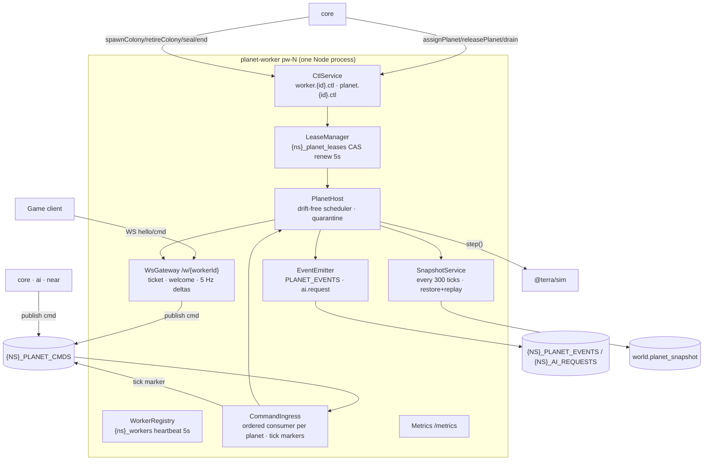

# Epic TA-07 — Planet Worker

> **Orchestrator:** [`EXECUTION_ORCHESTRATOR.md`](../EXECUTION_ORCHESTRATOR.md) · **Status Board:** [`STATUS.md`](../STATUS.md)
> **Spec:** [`ARCHITECTURE.md`](../../spec/ARCHITECTURE.md) §3, §6, §7, §13, §14, §15 · [`SIMULATION.md`](../../spec/SIMULATION.md) §4.2, §11, §12 · [`PROTOCOL.md`](../../spec/PROTOCOL.md) · [`CONTINUITY.md`](../../spec/CONTINUITY.md) · [`DECISIONS.md`](../../spec/DECISIONS.md) D-01, D-02, D-05, D-06, D-14
> **Lane:** `L3` · **Owned paths:** `backend/planet-worker/**`, `tests/integration/worker/**` · W5 extra: `tests/load/planet/**` (TA-13.5, separate epic)
>
> **⚠ 2026-10-30 — superseded in large part by D-24 (one app, simplified server sim).** There is no separate planet-worker service, NATS/JetStream, KV leases, tick markers, replay with state hashes, catch-up ticking, or fog-of-war views. The planet host becomes the **`game` module of the one app** (`backend/app/src/game/**`): the main thread owns HTTP/WS, and `cores − 1` `worker_threads` run the sims, with planets sharded by id. The detailed text below describes the old distributed design and is kept as **Future**. Read each task through this mapping:
>
> | Task | Under D-24 |
> |---|---|
> | TA-07.1 registration/heartbeat | **Obsolete → Future** |
> | TA-07.5 leases + drain | **Obsolete → Future** (deploy = stop / snapshot / start) |
> | TA-07.2 planet host | **Kept, simplified:** thread pool + per-planet step loop; 5 TPS active, coarse 1 step/s (dt 5) when empty; fault quarantine per planet |
> | TA-07.3 WS gateway | **Kept, simplified:** one WS endpoint; `join` → `welcome {fullState}` → 5 Hz entity deltas (JSON); no tickets to a worker, no fog filter, no rate limits (D-25) |
> | TA-07.4 command ingestion | **Kept, simplified:** zod + own-colony check, posted to the sim thread over `MessagePort`; no stream, no tick markers, no durable log |
> | TA-07.7 event emission | **Kept, simplified:** in-process event bus (`planet.event`) to `ai`, `near`, `notify`, `lobby`, `progression` |
> | TA-07.6 snapshots + restore | **Kept, simplified:** snapshot every 60 s and on shutdown; restart = load the snapshot + coarse fast-run of the gap (cap 24 h); no replay, no hash check, ≤ 60 s of actions can be lost |
> | TA-07.9 catch-up ticking | **Obsolete → Future** (replaced by the coarse fast-run in TA-07.6) |
> | TA-07.8 metrics / load shedding | **Kept:** per-thread tick duration, planets, sockets |
>
> Success metrics about failover RTO, acked-command RPO, `stateHash`, `4009 lease_lost` and drain no longer apply. The new ones are: tick p99 per thread, restart-to-playable < 30 s, and delta bandwidth ≤ 8 KB/s per socket.

## Overview

`@terra/planet-worker` is the NestJS service that hosts many planets per process (D-02): it owns planet leases in NATS KV, ticks each planet's `@terra/sim` state at 10 TPS on a drift-free scheduler, ingests commands through the durable JetStream log, serves its own WebSocket at `wss://ws.terraagent.com/w/{workerId}` (D-06), streams fog-of-war deltas at 5 Hz, persists snapshots every 30 s, emits significant events, and restores planets after another worker dies. Continuity tasks that live in this app (presence, digest, away policy) are in [`TA-08`](./TA-08-continuity-offline-and-resume.md) but run in lane L3.

## Epic analytics

- **Goal / user value:** planets live independently of players and of any single process — colonies keep running when the player leaves (G3) and survive worker crashes and deploys without lost commands.
- **Success metrics:**
  - Failover RTO ≤ 30 s, 0 lost acked commands, matching `stateHash` checkpoint (W3 barrier, TA-13.4).
  - Tick lag p99 ≤ 1 tick at 50 planets; `ta_worker_tick_duration_ms` p99 ≤ 2 ms (SIMULATION §12).
  - Command ack latency (WS `cmd` → `cmd.ack`) p95 ≤ 250 ms on LAN.
  - Delta bandwidth ≤ 8 KB/s per socket at MVP scale.
  - Graceful drain of 50 planets ≤ 20 s with zero `4009 lease_lost` closes.
- **In scope:** Nest skeleton, registration/heartbeat, leases + ctl handlers + drain, planet host/scheduler/quarantine, WS gateway (ticket, welcome, deltas, takeover, backpressure, rate limits), command ingestion + tick marking, event emission + AI triggers, snapshot persistence + restore/replay, metrics + load shedding.
- **Out of scope:** placement decisions (core scheduler TA-05.5), presence/digest/away policy (TA-08.1/08.3/08.2), simulation rules (TA-06), nginx routing (TA-02.4).
- **Key risks:** split-brain (two workers ticking one planet) → KV CAS lease + epoch fencing on all writes; event-loop stalls from one heavy planet → per-planet timing, quarantine, load shedding; replay mismatch → tick markers with checkpoint hashes, deterministic sim.

## Architecture overview

Layout: `backend/planet-worker/src/{main.ts,app.module.ts,config/,registry/,lease/,ctl/,host/,ingress/,ws/,snapshot/,events/,metrics/}`, tests in `backend/planet-worker/test/**` (unit) and `tests/integration/worker/**` (cross-service).

## Task index

| Task | Title | Wave / Lane | Depends On |
|---|---|---|---|
| `TA-07.1` | Worker Nest skeleton, registration & heartbeat in `{ns}_workers` | W1 / L3 | TA-01.3, TA-01.6, TA-02.1, TA-03.2 |
| `TA-07.5` | Planet leases (KV CAS) + `planet/worker .ctl` handlers + graceful drain | W1 / L3 | TA-07.1 |
| `TA-07.2` | Planet host: load/unload, drift-free multi-planet tick scheduler, fault quarantine | W1 / L3 | TA-07.5, TA-01.7 |
| `TA-07.3` | Planet WS gateway: ticket verify, welcome snapshot, 5 Hz deltas, takeover, backpressure | W2 / L3 | TA-07.2, TA-01.2, TA-01.4, TA-06.9 |
| `TA-07.4` | Command ingestion: WS + `planet.{id}.cmd` stream → validated, tick-stamped, acked | W2 / L3 | TA-07.3, TA-02.2 |
| `TA-07.7` | Significant-event emission to `{NS}_PLANET_EVENTS` | W2 / L3 | TA-07.4 |
| `TA-07.6` | Snapshot persistence & failover restore (snapshot + replay + hash check) | W3 / L3 | TA-07.4, TA-03.3, TA-06.9 |
| `TA-07.9` | Catch-up ticking after failover/restore: bounded fast-forward of downtime (D-20) | W3 / L3 | TA-07.6 |
| `TA-07.8` | Worker metrics: tick duration, planets, sockets, lag; load shedding | W4 / L3 | TA-07.6 |

---

## Tasks

### `TA-07.1` — Worker Nest skeleton, registration & heartbeat in `{ns}_workers`

- **Status:** `[ ] Todo`
- **Wave / Lane:** `W1 / L3`
- **Depends On:** `TA-01.3`, `TA-01.6`, `TA-02.1`, `TA-03.2`
- **Spec:** [`ARCHITECTURE.md`](../../spec/ARCHITECTURE.md) §3 (ports, health), §6.2 (`{ns}_workers`), §15; [`DECISIONS.md`](../../spec/DECISIONS.md) D-14
- **Target Files:**
  - `backend/planet-worker/package.json`, `tsconfig.json`, `.env.example`, `nest-cli.json`
  - `backend/planet-worker/src/{main.ts,app.module.ts}`
  - `backend/planet-worker/src/config/worker.config.ts` (uses `@terra/config`)
  - `backend/planet-worker/src/nats/nats.module.ts`, `src/prisma/prisma.module.ts`
  - `backend/planet-worker/src/registry/worker-registry.service.ts`
  - `backend/planet-worker/src/health/{health.controller.ts,metrics.controller.ts}`
  - `backend/planet-worker/test/registry/worker-registry.spec.ts`, `tests/integration/worker/registration.int.spec.ts`
- **Verify:** `TA_NS=l3 npm run test -w @terra/planet-worker && npm run test:integration -- --suite worker`

#### Analytics
- **Problem & goal:** core's scheduler and `/me/home` must discover live workers, their public WS URL, capacity and sim versions without HTTP calls (D-05).
- **Constraints:** `WORKER_ID` matches `^pw-[0-9]{1,3}$` (nginx map, D-06); `PUBLIC_WS_URL` e.g. `wss://ws.terraagent.com/w/pw-1`; heartbeat 5 s, KV TTL 15 s; internal port 3100 (dev 4002, lane `4K02`); `/healthz`, `/readyz` (PG + NATS + KV registered), `/metrics`.
- **Risks → mitigations:** duplicate `WORKER_ID` (misconfig) → on boot `create()` the key; if present with a different `startedAt` and not expired, refuse to start with a clear log; clock skew → TTL is server-side in NATS.
- **Alternatives rejected:** HTTP registration endpoint on core (violates D-05); Postgres heartbeat table (write load, no TTL).
- **Telemetry:** `ta_worker_heartbeat_total` (counter), `ta_worker_heartbeat_failures_total` (counter), log event `worker.registered {workerId, version, capacity}`.

#### Architecture
- Value `WorkerInfoV1 {workerId, url, capacity, planets, load: 'ok'|'high', draining, simVersions[], version, startedAt}` (contract from TA-01.3).
- `WorkerRegistryService` writes on boot and every 5 s; on SIGTERM sets `draining: true` (drain logic in TA-07.5).
- Nest app context + HTTP adapter only for health/metrics; the WS server (TA-07.3) is a separate `ws` server bound on the same port via `upgrade` handling.

#### Definition of Ready (DoR)
- [ ] `WorkerInfoV1` schema and KV bucket names exported from `@terra/contracts/nats` (TA-01.3).
- [ ] Env keys `WORKER_ID, PUBLIC_WS_URL, WORKER_MAX_PLANETS, HEARTBEAT_S, LEASE_TTL_S, TA_NS, DATABASE_URL, NATS_URL` defined in `@terra/config` (TA-01.6); otherwise contract change request (lead).

#### Definition of Done (DoD)
- [ ] `worker-registry.spec.ts`: heartbeat cadence, payload shape validated against contract, duplicate-id refusal.
- [ ] `registration.int.spec.ts`: worker boots against lane NATS/PG, appears in `{l3}_workers` within 1 s, disappears ≤ 15 s after `kill -9`.
- [ ] `/readyz` returns 503 until PG + NATS + first heartbeat succeed.
- [ ] Status synced in orchestrator, issue file and STATUS.md (§1.6)

---

### `TA-07.5` — Planet leases (KV CAS) + `planet/worker .ctl` handlers + graceful drain

- **Status:** `[ ] Todo`
- **Wave / Lane:** `W1 / L3`
- **Depends On:** `TA-07.1`
- **Spec:** [`ARCHITECTURE.md`](../../spec/ARCHITECTURE.md) §6.1 (`ctl` subjects), §6.2 (`{ns}_planet_leases`), §14; [`SIMULATION.md`](../../spec/SIMULATION.md) §11.2; [`CONTINUITY.md`](../../spec/CONTINUITY.md) §Failover
- **Target Files:**
  - `backend/planet-worker/src/lease/{lease-manager.service.ts,lease.types.ts}`
  - `backend/planet-worker/src/ctl/{worker-ctl.handler.ts,planet-ctl.handler.ts}`
  - `backend/planet-worker/src/drain/drain.service.ts`
  - `backend/planet-worker/test/lease/lease-manager.spec.ts`, `test/ctl/*.spec.ts`
  - `tests/integration/worker/lease.int.spec.ts`, `tests/integration/worker/drain.int.spec.ts`
- **Verify:** `npm run test -w @terra/planet-worker && npm run test:integration -- --suite worker`

#### Analytics
- **Problem & goal:** exactly one worker may tick a planet; core must be able to assign/release planets and drain a worker for deploys.
- **Constraints:** KV `create` to acquire, `update(rev)` to renew every 5 s, TTL 15 s; `epoch` supplied by core in `assignPlanet` (core increments `planet.leaseEpoch` in Postgres) and carried on every write; renewal failure ⇒ stop ticking immediately + close sockets `4009`; drain ≤ 20 s; ctl replies within 2 s or report `accepted` and finish async with an event.
- **Risks → mitigations:** split brain under partition → stop on first failed renew (≤ 5 s after last success, well before 15 s TTL expiry), epoch fencing of snapshots/tick markers; ctl for a planet not hosted here → reply `{ok:false, code:'planet_not_here'}`; drain racing new assigns → `draining` flag rejects `assignPlanet`.
- **Alternatives rejected:** Postgres advisory locks per planet (connection-bound, 200+ locks, no TTL semantics); Raft/etcd (extra infra).
- **Telemetry:** `ta_worker_lease_acquired_total`, `ta_worker_lease_lost_total` (counter, label `reason`), `ta_worker_drain_duration_ms` (histogram), events `planet.lease.lost {planetId, epoch}` (log + `{ns}.planet.{id}.evt.leaseLost` for core).

#### Architecture
- `worker.{id}.ctl` request kinds: `assignPlanet {planetId, epoch, planetType, seed, simVersion, create: bool}` → acquire lease → hand to `PlanetHost.load()` (create via `createPlanet` or restore via TA-07.6; in W1 stub restore = create) → reply `{ok, tick}`; `releasePlanet {planetId}` → snapshot (TA-07.6 hook; no-op in W1) → stop → delete lease; `drain {}`.
- `planet.{id}.ctl` kinds `spawnColony`, `retireColony`, `seal`, `end`, `inspect`: the first four are **converted to commands** published into `{ns}.planet.{id}.cmd` (so they are in the replay log, SIMULATION `SIM-C-05`) and the reply waits for the tick marker/application result (timeout 5 s); `inspect` returns `{tick, colonies, lastHash, lag}`.
- Drain: set `draining`, for each planet (sequential, oldest first) release; close sockets `4012 server_draining`; exit when empty or after 20 s.

#### Definition of Ready (DoR)
- [ ] `WorkerCtlV1` / `PlanetCtlV1` request/response schemas and `PlanetLeaseV1` exist in `@terra/contracts/nats` (TA-01.3).
- [ ] Core owns `leaseEpoch` (column in `core.planet`, TA-03.1); if missing, contract change request (lead).

#### Definition of Done (DoD)
- [ ] `lease-manager.spec.ts`: acquire conflict → refused; renew uses revision; simulated renew failure stops the planet and emits `leaseLost` within one renew period.
- [ ] `lease.int.spec.ts`: two workers, same `assignPlanet` → only one holds; killing the holder → key expires ≤ 15 s; second worker acquires with `epoch+1`.
- [ ] `drain.int.spec.ts`: 10 stub planets drained ≤ 20 s, all leases deleted, sockets closed with `4012`.
- [ ] `planet.{id}.ctl spawnColony` results in a command in the stream (asserted by reading the stream).
- [ ] Status synced in orchestrator, issue file and STATUS.md (§1.6)

---

### `TA-07.2` — Planet host: load/unload, drift-free multi-planet tick scheduler, fault quarantine

- **Status:** `[ ] Todo`
- **Wave / Lane:** `W1 / L3`
- **Depends On:** `TA-07.5`, `TA-01.7`
- **Spec:** [`SIMULATION.md`](../../spec/SIMULATION.md) §11.1 (`SIM-H-01..03`), §11.5, §12; [`DECISIONS.md`](../../spec/DECISIONS.md) D-02, D-13
- **Target Files:**
  - `backend/planet-worker/src/host/{planet-host.service.ts,scheduler.ts,planet-runtime.ts,quarantine.ts}`
  - `backend/planet-worker/test/host/{scheduler.spec.ts,quarantine.spec.ts,planet-host.spec.ts}`
  - `tests/integration/worker/host.int.spec.ts`
- **Verify:** `npm run test -w @terra/planet-worker && npm run test:integration -- --suite worker`

#### Analytics
- **Problem & goal:** run up to 50 planets at an exact 10 TPS each on one event loop, always (D-13), isolating faults per planet.
- **Constraints:** due time = `startMs + phaseMs + tick × 100` (no drift accumulation); never skip ticks; catch-up ≤ 5 ticks per pass; yield (`setImmediate`) between planets so WS I/O is served; `step()` called only through `@terra/sim` facade (`initSim` awaited at boot); the host must work against the W1 stub sim.
- **Risks → mitigations:** event-loop starvation by catch-up → per-pass cap + yields; GC pauses → measured in lag metric, tuned in TA-13.5; deterministic crash loops → quarantine with single retry (SIMULATION §11.5).
- **Alternatives rejected:** one `setInterval` per planet (drift, timer storms); `worker_threads` per planet (memory; can be swapped behind `PlanetRuntime` later).
- **Telemetry:** `ta_worker_tick_duration_ms` (histogram, per step), `ta_worker_tick_lag_ticks` (gauge, max over planets), `ta_worker_planets` (gauge, label `state=running|faulted|loading`), `ta_worker_planet_faulted_total` (counter), event `{ns}.planet.{id}.evt.planetFaulted`.

#### Architecture
- `PlanetRuntime {planetId, epoch, state, slotIndex, nextDueMs, inbox: SimCommandV1[], status}`.
- `scheduler.ts`: min-heap by `nextDueMs`; loop: pop due → `runtime.tick()` (drains inbox for this tick → `step` → hands `events` to `EventEmitter` (TA-07.7) and view invalidation to WS (TA-07.3)) → push back; `setTimeout(earliestDue − now)` when idle.
- Quarantine: try/catch around `step`; on error → status `faulted`, notify `quarantine.ts` (one restore+replay retry in W3 when TA-07.6 exists; W1: mark faulted).
- `load(planet)`/`unload(planetId)` called by lease/ctl layer.

#### Definition of Ready (DoR)
- [ ] `TA-01.7` facade with stub `step()` available; `initSim()` exported.
- [ ] `TA-07.5` done.

#### Definition of Done (DoD)
- [ ] `scheduler.spec.ts` (fake clock): 50 planets × 600 ticks → every planet exactly 600 steps, max deviation from due time ≤ 1 tick; injected 300 ms stall → catch-up ≤ 5 ticks per pass, no skipped ticks.
- [ ] `quarantine.spec.ts`: a throwing planet is faulted, others keep stepping at 10 TPS, `planetFaulted` emitted once.
- [ ] `host.int.spec.ts`: real NATS + stub sim, 20 planets assigned via ctl run 30 s with lag gauge ≤ 1.
- [ ] Status synced in orchestrator, issue file and STATUS.md (§1.6)

---

### `TA-07.3` — Planet WS gateway: ticket verify, welcome snapshot, 5 Hz deltas, takeover, backpressure

- **Status:** `[ ] Todo`
- **Wave / Lane:** `W2 / L3`
- **Depends On:** `TA-07.2`, `TA-01.2`, `TA-01.4`, `TA-06.9`
- **Spec:** [`ARCHITECTURE.md`](../../spec/ARCHITECTURE.md) §7 (ticket, takeover), §13 (envelope, types, close codes, rates); [`PROTOCOL.md`](../../spec/PROTOCOL.md); [`SIMULATION.md`](../../spec/SIMULATION.md) §6
- **Target Files:**
  - `backend/planet-worker/src/ws/{ws-gateway.ts,ticket-verifier.ts,jti-cache.ts,session.ts,delta-pump.ts,backpressure.ts,rate-limiter.ts}`
  - `backend/planet-worker/test/ws/{ticket-verifier.spec.ts,session.spec.ts,delta-pump.spec.ts,rate-limiter.spec.ts}`
  - `tests/integration/worker/ws-gateway.int.spec.ts`
- **Verify:** `npm run test -w @terra/planet-worker && npm run test:integration -- --suite worker`

#### Analytics
- **Problem & goal:** each worker owns its WebSocket (D-06). A player with a valid ticket must get a full fog-of-war view immediately and smooth 5 Hz deltas afterwards, on one socket per colony.
- **Constraints:** path `/w/{workerId}` (must equal own id, else 404 at upgrade); `hello {ticket}` within 5 s else `4000 bad_hello`; ticket EdDSA verify with `PLANET_TICKET_PUBLIC_KEY`, `aud = "planet"`, `workerId` = self, planet leased here else `4004 planet_not_here`, `exp` 60 s, `jti` single-use cached 120 s; second socket for same colony → old closed `4001 replaced`; idle close 75 s (client pings 20 s); deltas 5 Hz; full resync if client > 50 ticks behind its last `ack.delta`; rates ≤ 10 cmds/s burst 20 → `cmd.reject {code:'rate_limited'}`, sustained 3 s → `4008`.
- **Risks → mitigations:** slow clients bloating memory → backpressure: if `bufferedAmount > 1 MB` skip delta (next delta covers from last sent tick), `> 4 MB` → close `4008`; delta CPU cost with many sockets → deltas computed per colony once per 200 ms and shared by that colony's socket (one socket per colony anyway); ticket replay → jti cache.
- **Alternatives rejected:** Socket.IO (protocol overhead, sticky-session assumptions); auth via cookie on `ws.` subdomain (cross-subdomain cookie scope, CSRF-ish concerns) — ticket in first message instead of query string so it never hits nginx logs.
- **Telemetry:** `ta_worker_ws_sockets` (gauge), `ta_worker_ws_connect_total` (counter, label `result=ok|bad_hello|forbidden|planet_not_here|replaced`), `ta_worker_delta_bytes` (histogram), `ta_worker_ws_backpressure_total` (counter, label `action=skip|close`), `ta_worker_resync_total`.

#### Architecture
- `ws` server attached to the Nest HTTP server's `upgrade`; one `Session {socket, playerId, colonyId, planetId, lastSentTick, lastAckTick, lastView, bucket}`.
- On `hello` OK: register session in planet runtime, send `welcome {colonyId, planet, snapshot: view(), tick, serverTimeMs}`, store `lastView`.
- `delta-pump.ts`: every 200 ms per planet, for each session: `diff(lastView, state, colonyIndex)` → `delta {fromTick, toTick, ops}` → update `lastView` reference.
- Presence hooks (`onConnect/onDisconnect`) exposed for TA-08.1; `cmd` messages handed to `CommandIngress` (TA-07.4).

#### Definition of Ready (DoR)
- [ ] WS message schemas (`hello, welcome, delta, event, cmd, cmd.ack, cmd.reject, ping, pong, ack.delta, bye`) and close codes in `@terra/contracts/ws` (TA-01.2); `PlanetTicketClaims` in TA-01.4.
- [ ] `TA-06.9` `view()/diff()` available (if not, stub views behind the facade).
- [ ] Dev Ed25519 keypair available via `@terra/config` (`PLANET_TICKET_PUBLIC_KEY`).

#### Definition of Done (DoD)
- [ ] `ticket-verifier.spec.ts`: valid; expired; wrong `aud`; wrong `workerId`; reused `jti`; bad signature.
- [ ] `session.spec.ts`: takeover closes old with `4001`; idle 75 s close; hello timeout `4000`.
- [ ] `delta-pump.spec.ts`: 5 Hz cadence; skip on > 1 MB buffered; resync when > 50 ticks behind.
- [ ] `rate-limiter.spec.ts`: 10/s burst 20; sustained abuse → `4008`.
- [ ] `ws-gateway.int.spec.ts`: client with ticket minted by a test signer receives `welcome` then ≥ 10 deltas in 2.5 s for a running planet.
- [ ] Status synced in orchestrator, issue file and STATUS.md (§1.6)

---

### `TA-07.4` — Command ingestion: WS + `planet.{id}.cmd` stream → validated, tick-stamped, acked

- **Status:** `[ ] Todo`
- **Wave / Lane:** `W2 / L3`
- **Depends On:** `TA-07.3`, `TA-02.2`
- **Spec:** [`SIMULATION.md`](../../spec/SIMULATION.md) §4 (`SIM-C-01..09`); [`ARCHITECTURE.md`](../../spec/ARCHITECTURE.md) §6.1 (`{NS}_PLANET_CMDS`), §13
- **Target Files:**
  - `backend/planet-worker/src/ingress/{command-ingress.service.ts,planet-consumer.ts,tick-marker-writer.ts,ack-tracker.ts,authorize.ts}`
  - `backend/planet-worker/test/ingress/{command-ingress.spec.ts,tick-marker-writer.spec.ts,authorize.spec.ts}`
  - `tests/integration/worker/commands.int.spec.ts`
- **Verify:** `npm run test -w @terra/planet-worker && npm run test:integration -- --suite worker`

#### Analytics
- **Problem & goal:** every input that changes a planet (player, AI, trades, admin, system ctl) must go through one durable ordered log so failover replays it exactly; clients need an ack with the tick it was applied at.
- **Constraints:** publish to `{ns}.planet.{id}.cmd` with `Nats-Msg-Id = commandId` (dedupe window 2 min); ordered consumer per planet from `lastAppliedSeq + 1`; commands applied at the next tick boundary; tick marker `{planetId, tick, lastCmdSeq, count, leaseEpoch, stateHash?}` to `{ns}.planet.{id}.tick` for every tick with commands and every 100 ticks; `cmd.ack` only after the tick marker PubAck; WS commands authorized against the ticket's `colonyId` (a player can only command their colony).
- **Risks → mitigations:** JetStream outage → WS commands rejected with `cmd.reject {code:'unavailable'}` (never applied unlogged); duplicate client retries → dedupe by `Nats-Msg-Id`; tick marker publish failure → retry; if still failing the planet pauses (no ticks) rather than diverging from the log; ack latency → tick markers published right after the tick, PubAck awaited asynchronously.
- **Alternatives rejected:** apply-then-log (loses commands on crash); tick marking at ingress with a future tick (other producers would need tick knowledge; clock coupling).
- **Telemetry:** `ta_worker_cmd_ingress_total` (counter, label `source,kind`), `ta_worker_cmd_rejected_total` (counter, label `code`), `ta_worker_cmd_ack_latency_ms` (histogram), `ta_worker_tick_marker_publish_failures_total`.

#### Architecture
- WS `cmd {id, kind, args}` → zod (contracts) → `authorize` (colony match, source `player`) → wrap `SimCommandV1`-pending (no seq/tick) → JetStream publish → on PubAck record `seq` → wait.
- `planet-consumer.ts`: ordered consumer pushes messages into `runtime.inbox`; at tick boundary host takes inbox (contiguous seqs), publishes the tick marker for `tick`, calls `step`; sim events `cmd.rejected` mapped back via `ack-tracker` to `cmd.reject` for WS-originated commands.
- `tick-marker-writer.ts`: publishes tick markers (contract in PROTOCOL `NT-11`), tracks durable `lastCmdSeq`; `ack-tracker` releases `cmd.ack {id, appliedAtTick}` when the covering tick marker is durable.
- Non-WS producers (core/ai/near) get application results via `{ns}.planet.{id}.evt.cmdResult` only for kinds that need it (`spawnColony`, `trade.commit`) — others fire-and-forget.

#### Definition of Ready (DoR)
- [ ] `{ns}.planet.*.tick` / `TickMarkerV1` landed in W0 contracts (ARCHITECTURE §6.1, PROTOCOL `NT-11`). Contract change request (lead pre-step): `cmdResult` event kind.
- [ ] Streams exist via `npm run nats:bootstrap` (TA-02.2).

#### Definition of Done (DoD)
- [ ] `command-ingress.spec.ts`: valid command → published → applied at next tick → `cmd.ack.appliedAtTick` equals tick marker tick; foreign colony command → `cmd.reject {code:'forbidden'}`; duplicate `id` applied once.
- [ ] `tick-marker-writer.spec.ts`: tick markers emitted on command ticks and every 100 ticks with hash.
- [ ] `commands.int.spec.ts`: commands from WS and from a core-like publisher interleave in stream order; JetStream down → `cmd.reject {code:'unavailable'}`, nothing applied.
- [ ] Ack latency p95 ≤ 250 ms in the integration test on localhost.
- [ ] Status synced in orchestrator, issue file and STATUS.md (§1.6)

---

### `TA-07.7` — Significant-event emission to `{NS}_PLANET_EVENTS`

- **Status:** `[ ] Todo`
- **Wave / Lane:** `W2 / L3`
- **Depends On:** `TA-07.4`
- **Spec:** [`SIMULATION.md`](../../spec/SIMULATION.md) §9; [`ARCHITECTURE.md`](../../spec/ARCHITECTURE.md) §6.1 (`evt`, `ai.request`), §10; [`AI_ORCHESTRATOR.md`](../../spec/AI_ORCHESTRATOR.md) (trigger kinds)
- **Target Files:**
  - `backend/planet-worker/src/events/{event-emitter.service.ts,event-mapper.ts,ai-trigger.ts}`
  - `backend/planet-worker/test/events/{event-mapper.spec.ts,ai-trigger.spec.ts}`
  - `tests/integration/worker/events.int.spec.ts`
- **Verify:** `npm run test -w @terra/planet-worker && npm run test:integration -- --suite worker`

#### Analytics
- **Problem & goal:** core (digest, notifications, elimination/end flows), ai-orchestrator (director triggers) and near-gateway (milestones) react to what happens on planets without polling.
- **Constraints:** subject `{ns}.planet.{planetId}.evt.{type}`; payload `PlanetEventV1 {planetId, colonyId?, tick, kind, severity, data}`; idempotent: `Nats-Msg-Id = ${planetId}:${tick}:${kind}:${colonyId ?? '-'}:${n}` so replay after failover does not duplicate (replay window ≤ 35 s < 2 min dedupe); AI requests to `{ns}.ai.request` only for trigger-eligible kinds and at most one outstanding request per colony (ai-orchestrator enforces the real rate limits, TA-09.2).
- **Risks → mitigations:** event storms (every hit) → sim-level debounce (`underAttack` 600 ticks) + worker cap 20 events/s per planet (excess counted, dropped with a `eventsDropped` summary event); AI request flood → one-outstanding rule.
- **Alternatives rejected:** core reading snapshots to infer events (expensive, laggy).
- **Telemetry:** `ta_worker_events_published_total` (counter, label `kind`), `ta_worker_events_dropped_total`, `ta_worker_ai_requests_total` (counter, label `trigger`).

#### Architecture
- Host passes `StepResult.events` to `event-mapper` (filters internal kinds `cmd.rejected`, `hash.checkpoint`), publishes asynchronously (non-blocking for the tick; bounded queue 1 000 per worker, overflow → drop + counter).
- `ai-trigger.ts` maps kinds `underAttack, energyCollapse, resourceShortage(critical), neighborContact, rocketReady, colonyFounded, colonyCritical` → `AiRequestV1 {planetId, colonyId, trigger, severity, tick}`; tracks outstanding per colony, cleared on `ai.directive` command for that colony or after 60 s.

#### Definition of Ready (DoR)
- [ ] `PlanetEventV1` kind union and `AiRequestV1` schema in contracts (TA-01.3 + pre-step for kinds listed in SIMULATION §9).
- [ ] `{NS}_PLANET_EVENTS` and `{NS}_AI_REQUESTS` streams bootstrapped (TA-02.2).

#### Definition of Done (DoD)
- [ ] `event-mapper.spec.ts`: internal events filtered; msg-id format; per-planet rate cap.
- [ ] `ai-trigger.spec.ts`: only eligible kinds; one outstanding per colony; cleared by directive or timeout.
- [ ] `events.int.spec.ts`: `spawnColony` on a running planet produces exactly one `colonyFounded` in `{NS}_PLANET_EVENTS` and one `ai.request`; re-publishing the same tick's events is deduplicated.
- [ ] Status synced in orchestrator, issue file and STATUS.md (§1.6)

---

### `TA-07.6` — Snapshot persistence & failover restore (snapshot + replay + hash check)

- **Status:** `[ ] Todo`
- **Wave / Lane:** `W3 / L3`
- **Depends On:** `TA-07.4`, `TA-03.3`, `TA-06.9`
- **Spec:** [`SIMULATION.md`](../../spec/SIMULATION.md) §4.2 (`SIM-C-08..10`), §11.3, §11.4, §11.5; [`ARCHITECTURE.md`](../../spec/ARCHITECTURE.md) §9, §14; [`CONTINUITY.md`](../../spec/CONTINUITY.md) §Failover; [`DATA_MODEL.md`](../../spec/DATA_MODEL.md) (`world.planet_snapshot`)
- **Target Files:**
  - `backend/planet-worker/src/snapshot/{snapshot.service.ts,restore.service.ts,replayer.ts}`
  - `backend/planet-worker/src/host/quarantine.ts` (enable restore retry)
  - `backend/planet-worker/test/snapshot/{snapshot.service.spec.ts,replayer.spec.ts}`
  - `tests/integration/worker/{restore-replay.int.spec.ts,failover.int.spec.ts}`
- **Verify:** `npm run test -w @terra/planet-worker && npm run test:integration -- --suite worker`

#### Analytics
- **Problem & goal:** the owner's "it must work without the player" also means without any particular server: a planet must resume on another worker within 30 s with no lost acked commands and identical state.
- **Constraints:** snapshot every 300 ticks staggered + on release/seal/end/drain; encode sync ≤ 5 ms, compress + write async, at most one in-flight write per planet; store via `@terra/db` snapshot store (TA-03.3: gzip, retention last 20 + hourly 48 h, epoch fencing); restore = latest snapshot → hash check → replay tick markers from `{NS}_PLANET_CMDS` (`SIM-C-09`) → live; downtime not fast-forwarded (`SIM-C-10`).
- **Risks → mitigations:** corrupted/latest snapshot unreadable → fall back to previous snapshot (stream max age 48 h covers it); hash mismatch during replay → `FAULTED` + alert, never serve a divergent state; long replay blocking the loop → replay in chunks of 50 ticks with `setImmediate` yields, planet marked `loading` (sockets get `retryAfterMs` via `/me/home`).
- **Alternatives rejected:** snapshot-only recovery (loses ≤ 30 s of commands); full event sourcing from tick 0 (replay time grows unbounded).
- **Telemetry:** `ta_worker_snapshot_duration_ms` (histogram, label `phase=encode|write`), `ta_worker_snapshot_bytes` (histogram), `ta_worker_restore_duration_ms`, `ta_worker_replay_ticks` (histogram), `ta_worker_restore_failures_total` (label `reason=hash_mismatch|no_snapshot|decode`), event `planet.restored {planetId, fromTick, toTick, epoch, ms}`.

#### Architecture
- `snapshot.service.ts` subscribes to host tick hook; `restore.service.ts` used by `assignPlanet {create:false}`; `replayer.ts` reads the stream with a direct/ordered consumer from `lastAppliedSeq + 1`, groups by tick markers, verifies checkpoint hashes, returns unstamped tail for the live inbox.
- Quarantine retry (SIMULATION §11.5) uses `restore.service` once.
- Release/seal/end: synchronous final snapshot before lease release.

#### Definition of Ready (DoR)
- [ ] `TA-03.3` snapshot store API `save({planetId, epoch, tick, lastAppliedSeq, stateHash, bytes})` / `loadLatest(planetId, maxEpoch)` available.
- [ ] Tick marker contract landed (TA-07.4 DoR).
- [ ] Core scheduler (TA-05.5, same wave L1) uses `assignPlanet {create:false}` for reassignment — agreed via contract only.

#### Definition of Done (DoD)
- [ ] `replayer.spec.ts`: tick marker grouping, hash verification, unmarked tail handling, stale-epoch tick markers ignored.
- [ ] `restore-replay.int.spec.ts`: run 2 000 ticks with random commands, snapshot at 1 500, restore + replay → `stateHash` at tick 2 000 equals the original run.
- [ ] `failover.int.spec.ts`: two workers; `kill -9` the owner mid-run; second worker acquires lease (`epoch+1`), restores within 30 s, all acked commands present, checkpoint hash matches.
- [ ] Corrupted latest snapshot → falls back to previous and still matches.
- [ ] Status synced in orchestrator, issue file and STATUS.md (§1.6)

---

### `TA-07.8` — Worker metrics: tick duration, planets, sockets, lag; load shedding

- **Status:** `[ ] Todo`
- **Wave / Lane:** `W4 / L3`
- **Depends On:** `TA-07.6`
- **Spec:** [`SIMULATION.md`](../../spec/SIMULATION.md) §11.7, §12; [`ARCHITECTURE.md`](../../spec/ARCHITECTURE.md) §3 (`/metrics`), §14 (capacity)
- **Target Files:**
  - `backend/planet-worker/src/metrics/{metrics.registry.ts,load-monitor.ts}`
  - `backend/planet-worker/src/host/scheduler.ts` (shedding hooks)
  - `backend/planet-worker/test/metrics/{load-monitor.spec.ts,metrics.registry.spec.ts}`
  - `tests/integration/worker/metrics.int.spec.ts`
- **Verify:** `npm run test -w @terra/planet-worker && npm run test:integration -- --suite worker`

#### Analytics
- **Problem & goal:** operators (and core's scheduler) need to see and react to overload before players notice; TA-13.5 needs these metrics to set `WORKER_MAX_PLANETS`.
- **Constraints:** Prometheus text on `/metrics` (prom-client); metric names prefixed `ta_worker_` / `ta_sim_`; shedding rules exactly SIMULATION §11.7 (`load:'high'` in `{ns}_workers`; 2 Hz deltas; request move of newest planet on sustained lag); ticks are never skipped.
- **Risks → mitigations:** label cardinality explosion (per-planet labels × 50 workers) → per-planet metrics only as top-N gauges (`ta_worker_planet_tick_ms_top{rank}`), everything else aggregated; flapping `load` flag → 60 s windows + hysteresis.
- **Alternatives rejected:** OpenTelemetry metrics SDK now (heavier; can export later via OTel collector scraping Prometheus).
- **Telemetry:** consolidated set — `ta_worker_tick_duration_ms`, `ta_worker_tick_lag_ticks`, `ta_worker_planets`, `ta_worker_ws_sockets`, `ta_worker_delta_bytes`, `ta_worker_cmd_ack_latency_ms`, `ta_worker_snapshot_duration_ms`, `ta_worker_event_loop_lag_ms` (perf_hooks), `ta_worker_load_state` (gauge 0/1), `ta_worker_shed_actions_total` (label `action=delta_2hz|move_request`), `ta_sim_path_nodes`, `ta_sim_entities`.

#### Architecture
- `metrics.registry.ts` registers all metrics used across the app (earlier tasks register through it).
- `load-monitor.ts` evaluates every 5 s over 60 s windows; writes `load` into the heartbeat payload; publishes `{ns}.worker.{id}.evt.overloaded` with the newest planet id when the move rule triggers (core scheduler TA-05.5 consumes it).

#### Definition of Ready (DoR)
- [ ] `WorkerInfoV1.load` and `worker.{id}.evt.overloaded` subject in contracts (lead pre-step if missing).
- [ ] `TA-07.6` done.

#### Definition of Done (DoD)
- [ ] `load-monitor.spec.ts`: synthetic p99 > 2 ms for 60 s → `load:'high'`; recovery with hysteresis; lag > 100 ticks for 60 s → one move request.
- [ ] `metrics.int.spec.ts`: `/metrics` exposes every metric listed above with expected types.
- [ ] Shedding never skips a tick (scheduler spec extended).
- [ ] Status synced in orchestrator, issue file and STATUS.md (§1.6)

---

### `TA-07.9` — Catch-up ticking after failover/restore: bounded fast-forward of downtime (D-20)

- **Status:** `[ ] Todo`
- **Wave / Lane:** `W3 / L3 (after TA-07.6)`
- **Depends On:** `TA-07.6`
- **Spec:** [`DECISIONS.md`](../../spec/DECISIONS.md) D-20 (supersedes `SIM-C-10` "no fast-forward"); [`CONTINUITY.md`](../../spec/CONTINUITY.md) §7
- **Target Files:**
  - `backend/planet-worker/src/host/catch-up.ts`
  - `backend/planet-worker/test/host/catch-up.spec.ts`
  - `tests/integration/worker/catch-up.int.spec.ts`
- **Verify:** `npm run test -w @terra/planet-worker -- catch-up && npm run test:integration -- --suite worker --grep catch-up`

#### Analytics
- **Problem:** after a restore, game time must match wall time again, so the planet fast-forwards the downtime.
- **Constraints:** determinism (`SIM-D`). Catch-up runs at up to `CATCHUP_MAX_TPS` (proposed 50) in budgeted slices and is capped at `CATCHUP_MAX_S` (proposed 900 s); anything longer is skipped and reported. Commands arriving during catch-up are tick-marked at the live head.
- **Risk:** CPU spikes on a shared worker → per-planet slice budget plus load shedding (TA-07.8).
- **Telemetry:** `ta_worker_catchup_seconds`, `ta_worker_catchup_skipped_seconds_total`.

#### Architecture
- The catch-up start/end is itself a tick-marked `core.catchUp {fromTick, toTick}` marker, so replays reproduce it bit-exactly.
- Sockets get `welcome` after catch-up completes, or a progress status while it runs.

#### Definition of Ready (DoR)
- [ ] Spec follow-up landed: SIMULATION `SIM-C-10` and CONTINUITY §7 rewritten for D-20; `core.catchUp` marker in contracts (lead, W3 pre-step).

#### Definition of Done (DoD)
- [ ] `catch-up.int.spec.ts`: kill the worker, wait 120 s, restore elsewhere → game tick advanced by ≈ 1 200 ticks (±100), `stateHash` matches a reference replay; downtime above the cap is skipped and reported.
- [ ] Status synced in orchestrator, issue file and STATUS.md (§1.6).
