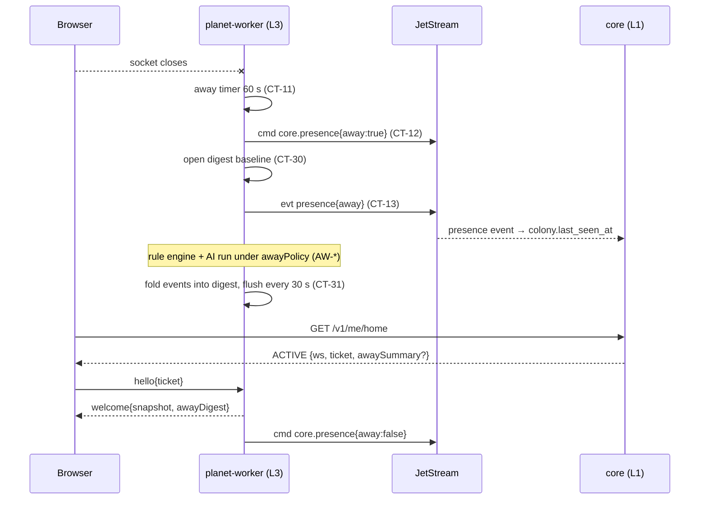

# Epic TA-08 — Continuity: Offline Play & Resume

> **Orchestrator:** [`EXECUTION_ORCHESTRATOR.md`](../EXECUTION_ORCHESTRATOR.md) · **Status Board:** [`STATUS.md`](../STATUS.md)
> **Spec:** [`CONTINUITY.md`](../../spec/CONTINUITY.md) (rules `CT-01..63`, `AW-01..23`) · [`MATCHMAKING.md`](../../spec/MATCHMAKING.md) §3 (ENDED/ARCHIVED) · [`ARCHITECTURE.md`](../../spec/ARCHITECTURE.md) §7, §9, §14, §15 · [`DECISIONS.md`](../../spec/DECISIONS.md) D-01, D-13

## Overview

The owner's core promise: **the colony keeps working when the player leaves, and the player can come back and continue.** Server-authoritative simulation (D-01) already keeps planets ticking; this epic adds what turns that into a product: knowing who is away (presence), keeping automated actors safe while nobody watches (away policy), telling the player what happened (digest), the one-round-trip resume path including device takeover, and clean exits when a colony is eliminated or a planet ends.

Path split (orchestrator §3): worker-side tasks **TA-08.1, 08.2, 08.3** run in **L3** (`backend/planet-worker/src/continuity/**`); core-side **TA-08.4, 08.5** run in **L1** (`backend/core/src/{continuity,home,planets}/**`). Client UX is TA-11.3 (L5). Failover mechanics are TA-07.6 (worker) + TA-05.5 (scheduler); this epic owns their *player-visible* behaviour.

## Epic analytics

- **Goal / user value:** close the tab for 8 hours, reopen, and be back in the colony within 2 s with a clear "while you were away" summary — never surprised by self-inflicted damage.
- **Success metrics:**
  - Resume p75 ≤ **2 s** page-load → first planet frame (`client.resume_ms`, CT-45).
  - ≥ **99 %** of `/v1/me/home` for players with a live colony return `ACTIVE` with a usable ticket (rest = `ws:null` during failover).
  - **0** away-policy violations in replay audits (`away_policy_rejections_total` explains every blocked automated action).
  - Digest delivered on ≥ **99 %** of returns after ≥ 60 s away.
  - Eliminated / planet-ended players reach the picker in one click.
- **In scope:** presence, away command, away policy, digest, resume API & semantics, elimination / planet-end / transfer handling in core.
- **Out of scope:** push/email notifications (CONTINUITY Q4), LLM narrative digest (Q5), client rendering of these (TA-11.3).
- **Key risks:** non-determinism if presence/policy decisions bypass the command log → presence enters the log as `core.presence` (CT-12) and policy is a pure versioned function (AW-21); digest lost on failover → flushed with snapshots (CT-31).

## Architecture overview



## Task index

| Task | Title | Wave / Lane | Depends On |
|---|---|---|---|
| `TA-08.1` | Presence tracking (`{ns}_presence`, `lastSeenAt`) | W3 / L3 | TA-07.3, TA-07.4, TA-07.7 |
| `TA-08.3` | "While you were away" digest | W3 / L3 | TA-08.1, TA-07.6, TA-07.7 |
| `TA-08.4` | Resume flow in core: home → ticket → reconnect; failover retry; device takeover | W3 / L1 | TA-04.4, TA-04.5, TA-05.5 |
| `TA-08.2` | Away-mode autopilot policy & safety rules | W4 / L3 | TA-08.1, TA-06.7, TA-09.4 |
| `TA-08.5` | Elimination, planet end & re-entry flows | W4 / L1 | TA-05.4, TA-08.4, TA-10.4 |

---

## Tasks

### `TA-08.1` — Presence tracking (`{ns}_presence`, `lastSeenAt`)

- **Status:** `[ ] Todo`
- **Wave / Lane:** `W3 / L3`
- **Depends On:** `TA-07.3`, `TA-07.4`, `TA-07.7`
- **Spec:** [`CONTINUITY.md`](../../spec/CONTINUITY.md) §3 (CT-10..14); [`ARCHITECTURE.md`](../../spec/ARCHITECTURE.md) §6.2 (`{ns}_presence`), §15 (`AWAY_AFTER_S=60`)
- **Target Files:**
  - `backend/planet-worker/src/continuity/{presence.service.ts,away-timer.ts}`
  - `backend/planet-worker/src/continuity/presence.module.ts`
  - `backend/planet-worker/test/unit/continuity/presence.service.spec.ts`
  - `tests/integration/worker/presence.int-spec.ts`
- **Verify:** `npm run test -w @terra/planet-worker && npm run test:integration -- --suite worker`

#### Analytics
- **Problem & goal:** the system must know, reliably and deterministically, whether a colony's player is present — it drives away-mode policy, the digest window and `lastSeenAt` for home/stats.
- **Constraints:** worker is the authority (CT-10); away after 60 s without a socket, shorter gaps are blips (CT-11); gameplay-relevant presence MUST be a command in `{NS}_PLANET_CMDS` (`core.presence`) (CT-12); events on `{ns}.planet.{id}.evt.presence` (CT-13); after failover all colonies start disconnected (CT-14). The core-side consumer that writes `core.colony.last_seen_at` is in **TA-08.4** (path ownership).
- **Risks → mitigations:** timer state lost on worker crash → on restore, colonies are disconnected with `since = restoreTime`, and away is re-derived after 60 s (CT-14); takeover (old socket closed by new) must not trigger away → presence keyed by colony, close of a *replaced* socket ignored.
- **Alternatives rejected:** presence decided by core from lobby sockets (wrong signal: lobby ≠ in-game); presence as non-logged worker state (breaks replay of away-mode behaviour).
- **Telemetry (proves it works):** `presence_colonies{state=connected|away}` (gauge); `presence_transitions_total{to=connected|away|blip}` (counter); event `planet.{id}.evt.presence` (NATS).

#### Architecture
- `PresenceService.onWelcome(colonyId)` → KV put `{connected:true, since, workerId}`; if sim view says colony away → publish `core.presence{away:false}` cmd.
- `onSocketClosed(colonyId, reason)` → ignore if `reason=replaced`; KV put `connected:false`; start `AwayTimer(60 s)` → on fire: publish `core.presence{away:true}` cmd + `evt.presence{state:'away', at: disconnectedAt}`.
- `onPlanetRestored(planetId)` → for every colony: KV `connected:false`; arm timers only for colonies the restored state marks present.
- Timer uses the worker's wall clock (presence is input, not simulation), the resulting command is stamped and logged ⇒ replay-safe.

#### Definition of Ready (DoR)
- [ ] `core.presence` command kind and `presence` event payload in `@terra/contracts` — else **Contract change request (lead pre-step)**.
- [ ] `@terra/sim` exposes away flag in colony view and applies `core.presence` (coordinate with L2 TA-06.7; if missing → change request on `shared/sim/src/api.ts`).

#### Definition of Done (DoD)
- [ ] `presence.int-spec.ts`: disconnect 30 s + reconnect → `blip`, no command; disconnect 61 s → exactly one `core.presence{away:true}` in the stream and one `evt.presence away`; reconnect → `away:false`.
- [ ] Takeover close does not start a timer.
- [ ] Restore scenario: KV entries reset, timers re-armed (CT-14).
- [ ] Status synced in orchestrator, issue file and STATUS.md (§1.6).

---

### `TA-08.3` — "While you were away" digest

- **Status:** `[ ] Todo`
- **Wave / Lane:** `W3 / L3`
- **Depends On:** `TA-08.1`, `TA-07.6`, `TA-07.7`
- **Spec:** [`CONTINUITY.md`](../../spec/CONTINUITY.md) §5 (CT-30..33, `AwayDigestV1`)
- **Target Files:**
  - `backend/planet-worker/src/continuity/{away-digest.service.ts,digest-folder.ts,digest.repository.ts}`
  - `backend/planet-worker/src/continuity/digest-ctl.handler.ts` (`getAwayDigest`)
  - `backend/planet-worker/test/unit/continuity/digest-folder.spec.ts`
  - `tests/integration/worker/away-digest.int-spec.ts`
- **Verify:** `npm run test -w @terra/planet-worker && npm run test:integration -- --suite worker`

#### Analytics
- **Problem & goal:** returning to an autonomous colony is only satisfying if the player immediately sees what it achieved and what needs attention (rocket ready, power deficit, under attack).
- **Constraints:** baseline captured on away (CT-30); events folded incrementally, lists capped at 20, flushed with every snapshot (30 s) to `world.planet_event_digest` (CT-31); delivered in `welcome.awayDigest` and as headline via `{ns}.planet.{id}.ctl getAwayDigest` (300 ms budget) (CT-32); retention 7 d, older unseen merged (CT-33); payload ≤ 16 KB.
- **Risks → mitigations:** digest drift vs. reality → `resources.after`/`robots.after` read from state at close, not summed from events; failover mid-away → digest row restored from DB, events after the last flush re-folded from `{NS}_PLANET_EVENTS` by sequence.
- **Alternatives rejected:** computing the digest on demand by scanning 7 d of events at reconnect (slow for long absences); core-side digest (core doesn't own world state).
- **Telemetry (proves it works):** `away_digest_delivered_total` (counter); `away_digest_bytes` (histogram); `away_digest_build_seconds` (histogram); log `digest.closed {durationS, items}`.

#### Architecture
- `DigestFolder.fold(digest, event)` — pure; maps event kinds (`building_built`, `building_destroyed`, `robot_built`, `robot_lost`, `attack`, `hazard`, `ai_decision`, `trade_settled`, `territory_changed`, `alert`) to `AwayDigestV1` fields.
- `AwayDigestService` subscribes to the planet's own events (ordered consumer per planet, start at row's `lastEventSeq`), keeps in-memory digests for away colonies, persists on snapshot hook (TA-07.6) and on close.
- `getAwayDigest{colonyId, headline}` → headline `{durationS, resourcesNet, built, lost, attacks, alerts[0..2]}`.

#### Definition of Ready (DoR)
- [ ] `world.planet_event_digest` table (colonyId, planetId, openedAt, closedAt, seenAt, lastEventSeq, body jsonb) exists — else **Contract change request (lead pre-step)**.
- [ ] `AwayDigestV1`, `welcome.awayDigest?` field and `getAwayDigest` ctl schema in `@terra/contracts`.
- [ ] Event kinds above emitted by TA-07.7 (list agreed in pre-step).

#### Definition of Done (DoD)
- [ ] `digest-folder.spec.ts`: one case per event kind + list capping + merge of two unseen digests.
- [ ] `away-digest.int-spec.ts`: away 10 min (compressed clock) with scripted events → `welcome.awayDigest` matches expected JSON; worker restart mid-away → digest still complete; second reconnect → no digest (seen).
- [ ] Payload size of a 7-day synthetic absence ≤ 16 KB.
- [ ] Status synced in orchestrator, issue file and STATUS.md (§1.6).

---

### `TA-08.4` — Resume flow in core: home → ticket → reconnect; failover retry; device takeover

- **Status:** `[ ] Todo`
- **Wave / Lane:** `W3 / L1`
- **Depends On:** `TA-04.4`, `TA-04.5`, `TA-05.5`
- **Spec:** [`CONTINUITY.md`](../../spec/CONTINUITY.md) §2 (CT-01..05), §6 (CT-40..44), CT-13 (core consumer); [`ARCHITECTURE.md`](../../spec/ARCHITECTURE.md) §7
- **Target Files:**
  - `backend/core/src/application/continuity/{resume.use-case.ts,away-summary.client.ts}`
  - `backend/core/src/infrastructure/continuity/presence-events.consumer.ts`
  - `backend/core/src/application/home/get-home.use-case.ts` (wire ACTIVE payload, `awaySummary`)
  - `backend/core/src/presentation/players/me.controller.ts` (`POST /v1/me/ticket`, `POST /v1/me/recap/seen`)
  - `tests/integration/core/resume-flow.int-spec.ts`
- **Verify:** `npm run test -w @terra/core && npm run test:integration -- --suite core`

#### Analytics
- **Problem & goal:** "make it possible to return to the game and continue … or dive into the game if his robot is operating" — one REST call must return everything needed to reconnect, including during failover, from any device.
- **Constraints:** `ACTIVE` includes single-use ticket (CT-02, CT-40); no lease → `ws:null, retryAfterMs:2000` (CT-42); `awaySummary` via `getAwayDigest` with 300 ms budget, omitted on timeout (CT-32, CT-04); takeover is enforced by the worker (TA-07.3) — core just issues tickets freely (rate limit 30/min/player); core consumes `planet.*.evt.presence` → `core.colony.last_seen_at`, `core.player.last_seen_at` (CT-13).
- **Risks → mitigations:** home latency blown by the digest call → strict timeout, parallel to fact loading; ticket farming → rate limit + 60 s TTL + single use; presence consumer lag → durable JetStream consumer `core-presence` with ack, idempotent updates (`GREATEST`).
- **Alternatives rejected:** sticky sessions / long-lived tickets (break on failover); routing reconnects through core as a proxy (extra hop, couples availability).
- **Telemetry (proves it works):** `home_requests_total{state}`, `home_resolve_seconds` (from TA-04.4) now with `ACTIVE`; `resume_ticket_issued_total{result=ok|no_lease}`; `away_summary_timeout_total` (counter); `presence_consumer_lag` (gauge).

#### Architecture
- `ResumeUseCase.forPlayer(playerId)` → live colony → `WorkerDirectory.resolve(planetId)` → sign ticket → `{ws, ticket}` or `{ws:null, retryAfterMs}`.
- `GetHomeUseCase` runs `HomeFactsRepository.load` ∥ `AwaySummaryClient.get` (only if `colony.last_seen_at` indicates away ≥ 60 s and no `seenAt`).
- `POST /v1/me/ticket` (reconnect without recomputing home), `POST /v1/me/recap/seen {colonyId}` (CT-05).
- `PresenceEventsConsumer` updates `last_seen_at` columns.
- Documented client contract for TA-11.3: close-code table CT-43, no auto-resend of unacked commands CT-44.

#### Definition of Ready (DoR)
- [ ] `core.colony.last_seen_at`, `core.colony.recap_seen_at`, `core.player.last_seen_at` exist — else **Contract change request (lead pre-step)**.
- [ ] TA-05.5 sets `health=FAILING_OVER` so home can explain retries; `getAwayDigest` schema landed (shared with TA-08.3).

#### Definition of Done (DoD)
- [ ] `resume-flow.int-spec.ts`: live colony + lease → `ACTIVE` with verifiable ticket; lease removed → `ws:null, retryAfterMs:2000`; lease restored on another worker → next call returns new `wsUrl`.
- [ ] Two "devices" call `/v1/me/ticket` → both get distinct `jti`s (takeover then enforced by worker test TA-07.3).
- [ ] Digest responder sleeping 1 s → home still returns in < 400 ms without `awaySummary`.
- [ ] Presence event → `last_seen_at` updated; replayed duplicate event doesn't move it backwards.
- [ ] W3 barrier scenario (b) green: reopen → straight to `/play` with away digest.
- [ ] Status synced in orchestrator, issue file and STATUS.md (§1.6).

---

### `TA-08.2` — Away-mode autopilot policy & safety rules

- **Status:** `[ ] Todo`
- **Wave / Lane:** `W4 / L3`
- **Depends On:** `TA-08.1`, `TA-06.7`, `TA-09.4`
- **Spec:** [`CONTINUITY.md`](../../spec/CONTINUITY.md) §4 (AW-01..23); [`AI_ORCHESTRATOR.md`](../../spec/AI_ORCHESTRATOR.md) (directive kinds); [`colony-economy-and-buildings-spec.md`](../../../colony-economy-and-buildings-spec.md) §1.2 (brownout order)
- **Target Files:**
  - `backend/planet-worker/src/continuity/{away-policy.ts,away-policy.version.ts,away-budget.ts}`
  - `backend/planet-worker/src/continuity/away-policy.hook.ts` (wires into command apply path of TA-07.4)
  - `backend/planet-worker/test/unit/continuity/{away-policy,away-replay}.spec.ts`
  - `tests/integration/worker/away-policy.int-spec.ts`
- **Verify:** `npm run test -w @terra/planet-worker && npm run test:integration -- --suite worker`

#### Analytics
- **Problem & goal:** autonomy is the design, but a player must never come back to a colony the AI demolished, bankrupted, or used to start a war. Narrow what automated actors may do while nobody is watching.
- **Constraints:** MAY list AW-01..07, MUST NOT list AW-10..15, spend caps 40 % per directive / 60 % per away session per resource (AW-20); pure versioned function evaluated in the deterministic apply path at the stamped tick, `AWAY_POLICY_VERSION` in snapshots (AW-21); rejections → `cmd.reject{code:'away_policy', rule}` + metric + notice back to the AI (AW-22); player commands exempt (AW-23). Rule-engine behaviours inside `@terra/sim` (repairs, rebuild, brownout) are L2's; this task enforces policy on **commands** (AI directives, trades, rebuild batches emitted as commands) and passes the away flag/budget to the sim via the `core.presence` state already applied.
- **Risks → mitigations:** policy logic diverging between live and replay → policy reads only `(view, command, awayBudget)` where `awayBudget` lives in sim-visible state stamped at away start; version bump requires snapshot-compat note; over-restrictive policy making away colonies stagnate → metrics by rule, tunable caps, owner Q2.
- **Alternatives rejected:** enforcing in `ai-orchestrator` (doesn't cover trades/rebuild, and a buggy or replayed directive could still apply); enforcing inside `@terra/sim` (policy is product/ops policy that changes more often than core sim rules; kept in worker, still deterministic).
- **Telemetry (proves it works):** `away_policy_rejections_total{rule,actor}` (counter); `away_budget_used_ratio{resource}` (histogram at away end); NATS event `planet.{id}.evt.ai_directive_rejected` (consumed by ai-orchestrator).

#### Architecture
```ts
export const AWAY_POLICY_VERSION = 1;
type Actor = 'player' | 'ai' | 'rules' | 'trade' | 'system';
type Verdict = { allow: true } | { allow: false; rule: `AW-${number}`; reason: string };
export function awayPolicy(view: ColonyView, cmd: StampedCommand, budget: AwayBudget): Verdict;
```
- Hook point: TA-07.4's `CommandPipeline.beforeApply(cmd)`; if colony away and actor ≠ player → `awayPolicy`; reject ⇒ not applied, logged in the stamp record as rejected (replay reproduces it).
- `AwayBudget` = per-resource stock at away start (from `core.presence{away:true}` application) and running automated spend.
- `setAutopilot` (`director`/`rules_only`) stored in colony state; `rules_only` ⇒ worker stops publishing `{ns}.ai.request` for that colony.

#### Definition of Ready (DoR)
- [ ] Directive kinds (`DirectiveV1`) final from TA-09.3/09.4; trade command kinds from TA-10.5 contracts (W4 pre-step).
- [ ] Command stamp record supports `rejected{rule}` (TA-07.4) — else **Contract change request (lead pre-step)**.
- [ ] Owner answer to CONTINUITY Q1–Q3 recorded (defaults apply if not).

#### Definition of Done (DoD)
- [ ] `away-policy.spec.ts`: ≥ 1 allow and ≥ 1 reject case per AW rule; player commands always allowed.
- [ ] `away-replay.spec.ts`: record 2 h compressed away session with AI directives, restore + replay → identical verdict sequence and `stateHash`.
- [ ] `away-policy.int-spec.ts`: AI directive "demolish" while away → `cmd.reject away_policy AW-10`, AI receives rejection event; spend > 40 % blocked.
- [ ] W4 barrier scenario "lightning severs a pylon and a builder repairs it while the player is away" passes.
- [ ] Status synced in orchestrator, issue file and STATUS.md (§1.6).

---

### `TA-08.5` — Elimination, planet end & re-entry flows

- **Status:** `[ ] Todo`
- **Wave / Lane:** `W4 / L1`
- **Depends On:** `TA-05.4`, `TA-08.4`, `TA-10.4`
- **Spec:** [`CONTINUITY.md`](../../spec/CONTINUITY.md) §2 (H3–H5); [`MATCHMAKING.md`](../../spec/MATCHMAKING.md) MM-07, MM-08, E13, E14, MM-34 (`TRANSFER`)
- **Target Files:**
  - `backend/core/src/application/continuity/{colony-outcome.consumer.ts,planet-end.saga.ts,transfer.use-case.ts}`
  - `backend/core/src/infrastructure/continuity/prisma-planet-result.repository.ts`
  - `backend/core/src/presentation/players/recap.controller.ts` (`GET /v1/me/colonies/:id/recap`)
  - `tests/integration/core/{elimination-flow,planet-end-flow,transfer-flow}.int-spec.ts`
- **Verify:** `npm run test -w @terra/core && npm run test:integration -- --suite core`

#### Analytics
- **Problem & goal:** a long-running world needs clean exits: a destroyed colony, a planet that reaches its 14-day end, and a rocket launch to a new planet must each land the player somewhere sensible and keep the matchmaking invariants (seat not refilled, new planet only).
- **Constraints:** consume `colony_eliminated`, `colony_transferred` (rocket), `planet_victory`, `planet_ended` events (durable consumer `core-outcomes`); colony → `ELIMINATED`/`TRANSFERRED`/`RETIRED(planet_ended)`; extinct planet → `ENDED` (MM-07); `ENDED → ARCHIVED` saga: `planet.{id}.ctl end` → final snapshot ack → `core.planet_result` rows → `releasePlanet` → `ARCHIVED` (MM-08); enqueue `near.registry.*` milestones (TA-10.4); rocket transfer creates a `TRANSFER` ticket (priority 10, `NEW_PLANET` semantics, `carryOver` from event) (MM-34). Workers close sockets with `4011`/`4010`.
- **Risks → mitigations:** saga stuck when the worker is gone → saga steps idempotent, resumed by the leader loop every 30 s; double consumption → idempotent by `(colonyId, outcome)`; carry-over abuse → carry-over computed by sim (TA-06.10) and signed into the event, core only forwards.
- **Alternatives rejected:** deleting ended planets immediately (lose results/recap; NEAR record needs them).
- **Telemetry (proves it works):** `colony_outcomes_total{outcome}` (counter); `planet_end_saga_seconds` (histogram); `planet_end_saga_stuck` (gauge); log events `colony.eliminated`, `planet.archived`.

#### Architecture
- `ColonyOutcomeConsumer` → tx: colony state + `ended_at` + recap snapshot (`survivedS`, peak stats from event) → if no alive colonies on planet → `PlanetLifecycle.transition(extinct)`; publish `{ns}.lobby.player.{playerId}` `home.changed` hint.
- `PlanetEndSaga` (driven by lifecycle side-effect from TA-05.4) persists step markers in `core.planet.end_saga_step`.
- `TransferUseCase` on `colony_transferred` → colony `TRANSFERRED` → create `TRANSFER` ticket (bypasses `already_has_colony` because old colony is terminal).
- `GET /v1/me/colonies/:id/recap` (owner only, foreign → 404).

#### Definition of Ready (DoR)
- [ ] Event schemas `colony_eliminated`, `colony_transferred{carryOver}`, `planet_victory`, `planet_ended` and ctl `end` in `@terra/contracts` (W4 pre-step, shared with TA-06.8/06.10, TA-07.7).
- [ ] `core.planet_result`, `core.colony.recap jsonb`, `core.planet.end_saga_step` exist — else **Contract change request (lead pre-step)**.
- [ ] `near.registry.colonyEliminated|planetResult` job subjects defined (TA-10.4).

#### Definition of Done (DoD)
- [ ] `elimination-flow.int-spec.ts`: event → colony `ELIMINATED`, home `ELIMINATED` with recap, picker shows only RECRUITING planets (never the old sealed planet) (E14); last colony → planet `ENDED` → `ARCHIVED` (E13).
- [ ] `planet-end-flow.int-spec.ts`: 14 d fake clock → saga completes; worker missing mid-saga → saga resumes after placement; results rows correct; NEAR job enqueued.
- [ ] `transfer-flow.int-spec.ts`: rocket event → `TRANSFER` ticket priority 10 → new planet → home `ACTIVE` on new planet.
- [ ] Recap endpoint: foreign colony → 404.
- [ ] Status synced in orchestrator, issue file and STATUS.md (§1.6).
