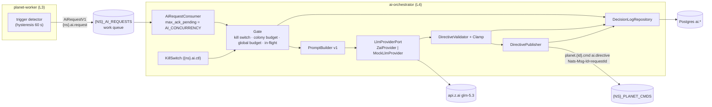
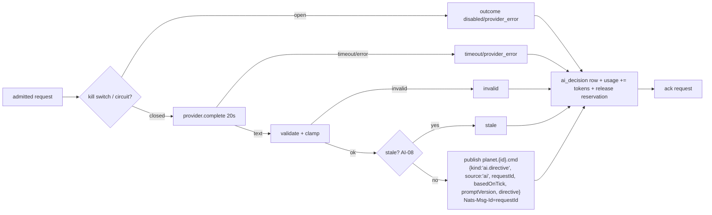

# Epic TA-09 — AI Orchestrator (Z.ai glm-5.3)

> **Orchestrator:** [`EXECUTION_ORCHESTRATOR.md`](../EXECUTION_ORCHESTRATOR.md) · **Status Board:** [`STATUS.md`](../STATUS.md)
> **Spec:** [`ARCHITECTURE.md`](../../spec/ARCHITECTURE.md) §6, §10, §15 · [`AI_ORCHESTRATOR.md`](../../spec/AI_ORCHESTRATOR.md) · [`DECISIONS.md`](../../spec/DECISIONS.md) D-05, D-09 · [`autonomous-colony-spec.md`](../../../autonomous-colony-spec.md) §10

## Overview

`backend/ai-orchestrator` is an internal NestJS service, the colony's strategic director. It consumes `AiRequestV1` messages that workers emit on significant events. It enforces strict per-colony and global budgets, asks Z.ai `glm-5.3` for a compact JSON `DirectiveV1`, validates and clamps it, and publishes it as an ordinary planet command. Colonies keep running on the rule engine whether or not the AI answers. That is what makes offline play cheap and safe.

## Epic analytics

- **Goal / user value:** colonies react sensibly to attacks, shortages and trade offers while the player is away, at ≤ $0.10/colony/day typical cost.
- **Success metrics:**
  - ≥ 98 % of attempted calls end `applied` or `invalid` = 0 % in the mock eval; ≥ 98 % valid in the live eval.
  - p95 provider latency ≤ 8 s.
  - 0 directives applied twice (`Nats-Msg-Id` dedupe).
  - Daily spend never exceeds `AI_DAILY_TOKEN_BUDGET`.
  - Kill switch effective in < 5 s.
- **In scope:** provider port + Z.ai adapter + mock; trigger intake, limits, budgets; prompt builder; `DirectiveV1` validation and clamping; publish + decision log; kill switch; cost accounting; eval harness.
- **Out of scope:** the rule engine and the application of directives in the sim (TA-06.7); away-mode policy enforcement (TA-08.2); emitting `AiRequestV1` and building `ColonyBriefV1` in the worker (TA-07.7 / TA-08.2); admin UI (TA-04.7 sends `ai.ctl`).
- **Key risks:**
  - Model id or endpoint wrong → TA-09.1 live smoke + owner confirm.
  - JSON mode unsupported → strict parser + schema in the system prompt.
  - Runaway spend → DB-gated budgets + kill switch.
  - Prompt drift → versioned prompt + eval gate.

## Architecture overview



Module layout (`backend/ai-orchestrator/src`): `main.ts`, `app.module.ts`, `config/`, `provider/` (port, `zai.provider.ts`, `mock.provider.ts`), `intake/` (consumer, `rate-limiter.service.ts`, `budget.service.ts`), `prompt/` (`system-prompt.v1.ts`, `prompt-builder.ts`), `directive/` (`directive-validator.ts`, `clamp.ts`), `publish/` (`directive-publisher.ts`), `persistence/` (`decision-log.repository.ts`, `colony-budget.repository.ts`, `usage.repository.ts`), `ops/` (`kill-switch.service.ts`, `metrics.ts`, `circuit-breaker.ts`), `eval/`.

## Task index

| Task | Title | Wave / Lane | Depends On |
|---|---|---|---|
| `TA-09.1` | AI service skeleton + Z.ai `glm-5.3` client behind `LlmProviderPort` + mock provider | W1 / L4 | TA-01.3, TA-01.6, TA-03.2, TA-13.1 |
| `TA-09.2` | Trigger intake from `{NS}_AI_REQUESTS`, per-colony rate limits, dedupe, daily budget | W2 / L4 | TA-09.1, TA-02.2 |
| `TA-09.3` | Prompt builder (compact state) + `DirectiveV1` JSON schema & validation | W3 / L4 | TA-09.2 |
| `TA-09.4` | Directive publish to command stream, decision log, timeouts & fallback | W3 / L4 | TA-09.3 |
| `TA-09.5` | Cost controls & ops: token accounting, kill switch, eval harness | W4 / L4 | TA-09.4 |

---

## Tasks

### `TA-09.1` — AI service skeleton + Z.ai `glm-5.3` client behind `LlmProviderPort` + mock provider

- **Status:** `[ ] Todo`
- **Wave / Lane:** `W1 / L4`
- **Depends On:** `TA-01.3`, `TA-01.6`, `TA-03.2`, `TA-13.1`
- **Spec:** [`AI_ORCHESTRATOR.md`](../../spec/AI_ORCHESTRATOR.md) §2 (AI-13, AI-14), §4, §5.3, §11 · [`ARCHITECTURE.md`](../../spec/ARCHITECTURE.md) §3, §15 · [D-09](../../spec/DECISIONS.md#d-09--zai-glm-53), [D-14](../../spec/DECISIONS.md#d-14--all-backend-services-are-nestjs)
- **Target Files:**
  - `backend/ai-orchestrator/package.json`, `tsconfig.json`, `.env.example`
  - `backend/ai-orchestrator/src/main.ts`, `src/app.module.ts`, `src/config/ai.config.ts`
  - `backend/ai-orchestrator/src/health/health.controller.ts` (`/healthz`, `/readyz`, `/metrics`)
  - `backend/ai-orchestrator/src/provider/llm-provider.port.ts`, `zai.provider.ts`, `mock.provider.ts`, `provider.module.ts`
  - `backend/ai-orchestrator/src/ops/circuit-breaker.ts`, `src/ops/metrics.ts`
  - `backend/ai-orchestrator/scripts/smoke-live.ts` (`ai:smoke`)
  - `backend/ai-orchestrator/test/provider/*.spec.ts`, `tests/integration/edge/ai-boot.spec.ts`
- **Verify:** `TA_NS=l4 npm run test -w @terra/ai-orchestrator && npm run test:integration -- --suite edge`

#### Analytics
- **Problem & goal:** we need a bootable internal service with a provider abstraction, so that every other lane and test can run without network or cost, and so that the real Z.ai integration is proven once with a key.
- **Constraints:**
  - Internal only: health/metrics port 3200 prod / 4003 dev (4403 in L4).
  - No HTTP from other services.
  - The provider must honour a hard 20 s deadline (`AbortController`).
  - `ZAI_API_KEY` is read from `ZAI_API_KEY_FILE` in prod.
  - The model id is not yet confirmed by the owner.
- **Risks → mitigations:**
  - `response_format`/`thinking` unsupported by Z.ai → adapter feature flags `AI_JSON_MODE`, `AI_DISABLE_THINKING`, auto-off on HTTP 400 `unsupported_parameter` + warn log.
  - The key leaks in logs → pino redaction paths + `redaction.spec.ts`.
  - Accidental live calls in CI → the config refuses `AI_PROVIDER=zai` without `AI_LIVE=1` outside production (AI-13).
- **Alternatives rejected:** OpenAI SDK pointed at Z.ai (extra dependency, hides the request shape, harder to strip unsupported params); calling the LLM from the worker (puts network on the tick host and violates D-05).
- **Telemetry (proves it works):**
  - `ai_provider_latency_seconds{model,status}` (histogram)
  - `ai_tokens_total{kind}` (counter)
  - `ai_circuit_open` (gauge)
  - `ai_provider_errors_total{code}` (counter)
  - log `ai.boot {provider, model, baseUrl, liveAllowed}`

#### Architecture
```ts
export interface LlmCompletion { text: string; promptTokens: number; completionTokens: number; latencyMs: number; model: string }
export interface LlmProviderPort {
  readonly name: 'zai' | 'mock';
  complete(req: { system: string; user: string; maxTokens: number; signal: AbortSignal }): Promise<LlmCompletion>;
}
```
- `ZaiProvider`: `POST ${AI_BASE_URL}/chat/completions` (Node `fetch`, keep-alive agent) with the body from spec §5.3. It maps `usage.prompt_tokens/completion_tokens`, and maps errors to `ProviderError{code: 'auth'|'rate_limited'|'server'|'network'|'timeout'|'bad_request', retryable}`.
- `CircuitBreaker`: 5 consecutive retryable failures → open 60 s → half-open probe.
- `MockLlmProvider`: rule-based on the brief text, with `AI_MOCK_MODE` fault injection (spec §11).
- Readiness: NATS connected + Postgres `SELECT 1` + provider config valid. It does **not** call Z.ai.
- Nest bootstrap: shared config/logging/NATS/Prisma modules from `@terra/config` + `@terra/db`.

#### Definition of Ready (DoR)
- [ ] `@terra/config` env loader exists (TA-01.6), and the AI keys from spec §4 are in its schema. **Contract change request (lead pre-step):** add `AI_PROVIDER`, `AI_LIVE`, `AI_DAILY_TOKEN_BUDGET`, `AI_MAX_TOKENS`, `AI_CONCURRENCY`, `AI_LOG_RAW`, `AI_MOCK_MODE`, `AI_JSON_MODE`, `AI_DISABLE_THINKING`, `ZAI_API_KEY(_FILE)` to `@terra/config` if absent.
- [ ] `ai.*` tables exist in Prisma v1 (TA-03.1): `ai_decision`, `ai_colony_budget`, `ai_usage_daily`, `ai_settings`. **Migration change request** if absent.
- [ ] The owner has provided a Z.ai key for the L4 live smoke (`OWNER_TASKS.md`). Without it, the live smoke DoD item is `[!] Blocked`, the rest proceeds.

#### Definition of Done (DoD)
- [ ] `npm run start -w @terra/ai-orchestrator` boots in compose with `TA_NS=l4`. `/healthz` 200, `/readyz` 200 with PG + NATS up, 503 when NATS is down.
- [ ] `zai.provider.spec.ts` (HTTP mocked): request body has `model=glm-5.3`, `max_tokens`, `response_format`; `Authorization` header set; usage parsed; 401 → `auth` non-retryable; 429/503 → retryable; abort at 20 s → `timeout`; 400 `unsupported_parameter` → param disabled and retried once.
- [ ] `mock.provider.spec.ts`: deterministic output per trigger fixture; every `AI_MOCK_MODE` produces the documented failure.
- [ ] `circuit-breaker.spec.ts`: open after 5 failures, half-open after 60 s (fake clock).
- [ ] `config.spec.ts` (AI-13): `NODE_ENV=production` + `AI_PROVIDER=mock` refused; non-prod `zai` without `AI_LIVE=1` refused.
- [ ] `redaction.spec.ts` (AI-14): the API key never appears in the captured logs.
- [ ] Live smoke (L4 only): `AI_LIVE=1 AI_PROVIDER=zai npm run ai:smoke -w @terra/ai-orchestrator` returns parseable JSON and prints model, latency and tokens. The result is recorded in the PR (or `[!] Blocked: no key`).
- [ ] `tests/integration/edge/ai-boot.spec.ts` green on the lane DB / NS.
- [ ] Status synced in orchestrator, issue file and STATUS.md (§1.6).

---

### `TA-09.2` — Trigger intake from `{NS}_AI_REQUESTS`, per-colony rate limits, dedupe, daily budget

- **Status:** `[ ] Todo`
- **Wave / Lane:** `W2 / L4`
- **Depends On:** `TA-09.1`, `TA-02.2`
- **Spec:** [`AI_ORCHESTRATOR.md`](../../spec/AI_ORCHESTRATOR.md) §2 (AI-02..05), §3, §4 · [`ARCHITECTURE.md`](../../spec/ARCHITECTURE.md) §6.1 (`{ns}.ai.request`), §10
- **Target Files:**
  - `backend/ai-orchestrator/src/intake/ai-request.consumer.ts`
  - `backend/ai-orchestrator/src/intake/gate.service.ts`, `rate-limiter.service.ts`, `budget.service.ts`
  - `backend/ai-orchestrator/src/persistence/colony-budget.repository.ts`, `usage.repository.ts`
  - `backend/ai-orchestrator/test/intake/*.spec.ts`
  - `tests/integration/edge/ai-intake.spec.ts`, `ai-budget.int.spec.ts`, `ai-dedupe.int.spec.ts`
- **Verify:** `npm run test -w @terra/ai-orchestrator && npm run test:integration -- --suite edge`

#### Analytics
- **Problem & goal:** LLM cost and latency must be bounded no matter how noisy planets are. Every request is gated by the kill switch, the per-colony interval (300 s normal / 120 s critical), the 150/day cap, the global token budget and in-flight exclusivity, atomically across replicas.
- **Constraints:**
  - The JetStream work queue delivers each message to one consumer.
  - Explicit ack; `ack_wait 30 s` > `AI_TIMEOUT_S`; `max_deliver 2`; `max_ack_pending = AI_CONCURRENCY` (8).
  - Requests older than 10 min are useless (stream `max_age` 10 m set by TA-02.2).
- **Risks → mitigations:**
  - Two replicas double-spend a colony's slot → single atomic `UPDATE … RETURNING` (spec §4).
  - Requests pile up behind a slow provider → `max_ack_pending` backpressure + staleness drop (AI-08 in TA-09.4).
  - Clock skew → all time comparisons use Postgres `now()`.
- **Alternatives rejected:** NATS KV for limits (not auditable, and lost if a bucket is recreated); in-memory token bucket (breaks with >1 replica or a restart).
- **Telemetry (proves it works):**
  - `ai_requests_total{trigger,severity,outcome}` (counter; outcomes `allowed|rate_limited|budget_exhausted|disabled|duplicate`)
  - `ai_inflight` (gauge)
  - `ai_budget_used_ratio` (gauge)
  - `ai_request_age_seconds` (histogram, enqueue → gate)

#### Architecture
- `AiRequestConsumer`: durable pull consumer `ai-orchestrator` on `{NS}_AI_REQUESTS`. It parses `AiRequestV1` with zod (invalid → ack + `ai_requests_total{outcome="malformed"}`).
- `GateService.admit(req)` → `{ allowed: true, reservation } | { allowed: false, outcome }`, in this order:
  1. kill switch (in-memory, from `ai_settings`)
  2. global budget: `ai_usage_daily` row for today, `estimate = promptEstimate + AI_MAX_TOKENS`
  3. per-colony atomic update (spec §4 SQL)
- A reservation holds `in_flight_until = now()+20s`. It is released or committed in TA-09.4.
- Dedupe has two layers: JetStream `duplicate_window 2m` on the worker-set `Nats-Msg-Id` (`colonyId:trigger:floor(tick/600)`), and the DB in-flight check (AI-05).
- Until TA-09.3/09.4 land, an admitted request is completed by the mock provider and only logged, never published.

#### Definition of Ready (DoR)
- [ ] `AiRequestV1` exists in `@terra/contracts`. **Contract change request (lead, W2 pre-step):** `AiRequestV1 { v:1, requestId uuid, planetId, colonyId, trigger: AiTrigger, severity: 'critical'|'normal', basedOnTick, enqueuedAtMs, brief: ColonyBriefV1 }` + the `AiTrigger` enum from spec §3. `ColonyBriefV1` must be agreed with L3/L2 (TA-07.7) in the same pre-step.
- [ ] Stream `{NS}_AI_REQUESTS` (work queue, `max_age 10m`, `duplicate_window 2m`) is in the contracts stream table and bootstrapped (TA-02.2).
- [ ] `ai.ai_colony_budget` and `ai.ai_usage_daily` exist (TA-03.1 or migration CR).

#### Definition of Done (DoD)
- [ ] `rate-limiter.spec.ts` (fake clock via a SQL `now()` override in tests): normal blocked < 300 s, allowed at 300 s; critical allowed at 120 s after a normal call; 151st call/day refused; rollover at 00:00 UTC.
- [ ] `budget.service.spec.ts`: refuses when `used + estimate > AI_DAILY_TOKEN_BUDGET`; `ai_budget_used_ratio` updated.
- [ ] `ai-budget.int.spec.ts`: 2 consumer instances × 50 concurrent requests for one colony → exactly 1 admitted.
- [ ] `ai-dedupe.int.spec.ts`: the same `Nats-Msg-Id` twice → one delivery; a different trigger for the same colony while in flight → `duplicate`.
- [ ] `ai-intake.spec.ts`: a malformed payload is acked and counted, not redelivered; consumer backpressure holds ≤ `AI_CONCURRENCY` in flight.
- [ ] All outcomes are visible in `ai_requests_total`, asserted in tests.
- [ ] Status synced in orchestrator, issue file and STATUS.md (§1.6).

---

### `TA-09.3` — Prompt builder (compact state) + `DirectiveV1` JSON schema & validation

- **Status:** `[ ] Todo`
- **Wave / Lane:** `W3 / L4`
- **Depends On:** `TA-09.2`
- **Spec:** [`AI_ORCHESTRATOR.md`](../../spec/AI_ORCHESTRATOR.md) §5, §6 (AI-06, AI-07) · [`colony-economy-and-buildings-spec.md`](../../../colony-economy-and-buildings-spec.md) §3–4 (catalog ids)
- **Target Files:**
  - `backend/ai-orchestrator/src/prompt/system-prompt.v1.ts`, `prompt-builder.ts`, `token-estimate.ts`
  - `backend/ai-orchestrator/src/directive/directive-validator.ts`, `clamp.ts`
  - `backend/ai-orchestrator/test/prompt/prompt-builder.spec.ts` (+ `__snapshots__/`)
  - `backend/ai-orchestrator/test/directive/directive-validator.spec.ts`, `clamp.spec.ts`
- **Verify:** `npm run test -w @terra/ai-orchestrator`

#### Analytics
- **Problem & goal:** keep each call to about 700 input and 200 output tokens while giving the model enough context. Untrusted model output must never reach the sim unvalidated.
- **Constraints:**
  - The brief is ≤ 1200 chars, integers only, with a fixed field order (stable for caching and snapshots).
  - The system prompt is static per `PROMPT_VERSION`.
  - Priority names must equal the sim/HUD sliders (`economy`, `expansion`, `defense`, `power`, `terraform`).
  - Catalog ids come from `@terra/sim` data tables (read-only import of data, not logic).
- **Risks → mitigations:**
  - Prompt injection through player-controlled strings (colony names) → the brief contains no free text except ids; colony names are replaced by short ids (`C-7`).
  - Hallucinated ids → the reference check drops them.
  - Over-spending → the affordability clamp.
  - Model returns prose around the JSON → one `{…}` extraction attempt, then `invalid`.
- **Alternatives rejected:** a full state JSON in the prompt (3–10× the tokens); function/tool calling (provider-specific, and harder to mock and validate than a single JSON object).
- **Telemetry (proves it works):**
  - `ai_prompt_chars` (histogram)
  - `ai_prompt_tokens_estimate` (histogram)
  - `ai_directive_validation_total{result=valid|invalid_json|schema|reference}` (counter)
  - `ai_clamped_fields_total{field}` (counter)

#### Architecture
- `PromptBuilder.build(brief: ColonyBriefV1, trigger) → { system, user, estimateTokens }`, following the format in spec §5.2.
- `system-prompt.v1.ts` embeds the JSON Schema produced from `DirectiveV1` by `zod-to-json-schema` at build time. The schema text is snapshot-tested so a contract change forces a `PROMPT_VERSION` bump.
- `DirectiveValidator.validate(text, brief) → { ok: true, directive, clampedFields } | { ok: false, reason, issues }`: parse → `DirectiveV1.safeParse` → reference checks → `clamp()` (spec §6.3).
- The clamp is a pure function with no I/O. Affordability uses the catalog cost tables.

#### Definition of Ready (DoR)
- [ ] **Contract change request (lead, W3 pre-step):** `DirectiveV1`, `DirectiveActionV1`, the `ai.directive` command kind and `ColonyBriefV1` final fields in `@terra/contracts`, per spec §6.1, reconciled with TA-06.7 (priority names, building/robot ids) and TA-07.7 (brief producer).
- [ ] `@terra/sim` exports read-only catalog data (`BUILDINGS`, `ROBOTS` cost tables), from TA-06.4/06.6.
- [ ] The away flag and `raidsAllowed` fields are agreed with TA-08.2 (default `raidsAllowed=false`).

#### Definition of Done (DoD)
- [ ] `prompt-builder.spec.ts`: ≥ 10 brief fixtures (both planet types, every trigger) → snapshot; every user prompt ≤ 1200 chars; the system prompt plus the largest brief estimate ≤ 900 input tokens.
- [ ] `directive-validator.spec.ts`: valid JSON passes; prose-wrapped JSON is extracted; an unknown action kind, extra fields (`.strict()`) or a bad tier fail with `schema`; an unknown building id or `offerId` is dropped as `reference`.
- [ ] `clamp.spec.ts` (table-driven, ≥ 25 cases): priority normalisation sums to 100; zero priorities dropped; > 5 actions truncated; counts clamped to affordability; trade give ≤ 20 % of stock; raid removed when away without `raidsAllowed`; `ttlTicks` clamped.
- [ ] The mock provider's outputs for all fixtures validate with 0 `invalid` (regression baseline for TA-09.5).
- [ ] Status synced in orchestrator, issue file and STATUS.md (§1.6).

---

### `TA-09.4` — Directive publish to command stream, decision log, timeouts & fallback

- **Status:** `[ ] Todo`
- **Wave / Lane:** `W3 / L4`
- **Depends On:** `TA-09.3`
- **Spec:** [`AI_ORCHESTRATOR.md`](../../spec/AI_ORCHESTRATOR.md) §2 (AI-01, AI-08..10, AI-14), §7, §10 · [`ARCHITECTURE.md`](../../spec/ARCHITECTURE.md) §6.1 (`planet.{id}.cmd`), §9 (commands are the only inputs)
- **Target Files:**
  - `backend/ai-orchestrator/src/pipeline/decision.pipeline.ts` (gate → prompt → provider → validate → publish → log)
  - `backend/ai-orchestrator/src/publish/directive-publisher.ts`
  - `backend/ai-orchestrator/src/persistence/decision-log.repository.ts` (+ 30-day purge job)
  - `backend/ai-orchestrator/test/pipeline/*.spec.ts`
  - `tests/integration/edge/ai-fallback.spec.ts`, `ai-publish.int.spec.ts`, `decision-log.int.spec.ts`
- **Verify:** `npm run test -w @terra/ai-orchestrator && npm run test:integration -- --suite edge`

#### Analytics
- **Problem & goal:** close the loop. A valid directive becomes exactly one durable planet command. Every attempt is auditable. Every failure degrades to "rule engine continues".
- **Constraints:**
  - The 20 s end-to-end deadline includes one retry (only if ≥ 8 s remain).
  - Publish uses the JetStream `PubAck` before the request is acked (at-least-once + dedupe = effectively once).
  - The sim is the authority on applying the directive (away limits, affordability at the apply tick).
- **Risks → mitigations:**
  - Publish succeeds but the ack of the request is lost → redelivery → same `requestId` → JetStream dedupe by `Nats-Msg-Id`.
  - The decision-log insert fails after publish → the log write is retried. The publish is not rolled back, and the metric `ai_decision_log_failures_total` alerts.
  - A stale directive is applied to a changed state → the AI-08 staleness check + `basedOnTick` lets the sim reject it.
- **Alternatives rejected:** sending directives straight to the worker via request/reply (not durable, lost on failover, and not part of the replay log).
- **Telemetry (proves it works):**
  - `ai_requests_total{outcome=applied|invalid|timeout|stale|provider_error}` (counter)
  - `ai_end_to_end_seconds` (histogram, enqueue → publish)
  - `ai_decision_log_failures_total` (counter)
  - log `ai.decision {requestId, colonyId, outcome, latencyMs, promptTokens, completionTokens}`

#### Architecture

- On every exit path, the reservation's `in_flight_until` is cleared, and actual tokens are added to `ai_usage_daily` (estimate replaced by actuals).
- The purge job deletes `ai_decision` rows older than 30 days, daily, under an advisory lock.

#### Definition of Ready (DoR)
- [ ] The `ai.directive` command kind and the envelope of `{ns}.planet.{id}.cmd` are in `@terra/contracts` (W3 pre-step CR from TA-09.3).
- [ ] The `ai.ai_decision` table has the columns from spec §10. **Migration change request (W3 pre-step)** for any missing column (`clamped_fields`, `prompt_version`, hashes, raw text).
- [ ] Stream `{NS}_PLANET_CMDS` dedupe window ≥ 2 min (TA-02.2).

#### Definition of Done (DoD)
- [ ] `ai-publish.int.spec.ts`: a valid directive → exactly one message on `{ns}.planet.{id}.cmd` with the expected headers; forced redelivery of the same request → still one message (stream dedupe).
- [ ] `ai-fallback.spec.ts` (AI-01): mock `timeout`, `invalid_json`, `schema_violation`, `http_500` → no command published, request acked, correct outcome row, reservation released.
- [ ] `staleness.spec.ts` (AI-08): enqueue age > 20 s → `stale`.
- [ ] `decision-log.int.spec.ts` (AI-10): one row per attempted call with tokens and latency; no row for rejected-before-call; raw text null when `AI_LOG_RAW=0` (AI-14).
- [ ] End-to-end on the lane NS with the mock provider: a fake worker publishes `AiRequestV1` → `ai.directive` appears on the planet cmd stream in < 1 s.
- [ ] Status synced in orchestrator, issue file and STATUS.md (§1.6).

---

### `TA-09.5` — Cost controls & ops: token accounting, kill switch, eval harness

- **Status:** `[ ] Todo`
- **Wave / Lane:** `W4 / L4`
- **Depends On:** `TA-09.4`
- **Spec:** [`AI_ORCHESTRATOR.md`](../../spec/AI_ORCHESTRATOR.md) §2 (AI-11), §8, §9, §12, §13
- **Target Files:**
  - `backend/ai-orchestrator/src/ops/kill-switch.service.ts` (`{ns}.ai.ctl` handler + `ai_settings`)
  - `backend/ai-orchestrator/src/ops/cost.service.ts` (est. USD from `AI_PRICE_IN_PER_M` / `AI_PRICE_OUT_PER_M`)
  - `backend/ai-orchestrator/eval/fixtures/*.json` (≥ 30), `eval/run-eval.ts`, `eval/README.md`
  - `backend/ai-orchestrator/package.json` (`ai:eval`)
  - `tests/integration/edge/kill-switch.int.spec.ts`
- **Verify:** `npm run test -w @terra/ai-orchestrator && npm run test:integration -- --suite edge && npm run ai:eval -w @terra/ai-orchestrator`

#### Analytics
- **Problem & goal:** the owner needs to see and cap spend, switch the AI off instantly (globally or per planet), and tell whether a prompt or model change made decisions better or worse.
- **Constraints:**
  - Kill switch effective < 5 s across replicas.
  - The per-planet disable is used by core admin (TA-04.7) and by the away policy (TA-08.2).
  - The eval runs live only in L4 with `AI_LIVE=1`.
  - Prices are third-party until verified (`AI_PRICE_IN_PER_M=1.40`, `AI_PRICE_OUT_PER_M=4.40` defaults).
- **Risks → mitigations:**
  - A kill-switch message is missed by a replica → each replica also re-reads `ai_settings` every 30 s.
  - A noisy live eval → property-based expectations + 3 runs, median.
  - The cost estimate drifts from the invoice → monthly owner reconciliation in `OWNER_TASKS.md`.
- **Alternatives rejected:** a kill switch only via env (needs a redeploy); LLM-as-judge eval (costs more, and is non-deterministic for gating).
- **Telemetry (proves it works):**
  - `ai_est_cost_usd_total` (counter)
  - `ai_budget_used_ratio` (gauge, alert 0.8/1.0 wired in TA-13.2)
  - `ai_enabled{scope}` (gauge)
  - eval report `eval/out/report.json`: `validity`, `propertyPass`, `p95LatencyMs`, `meanTokens`

#### Architecture
- `{ns}.ai.ctl` request/reply: `{op:'disable'|'enable'|'status', scope:'global'|{planetId}}` → `{enabled, scope, updatedAt}`. It upserts `ai_settings`, updates the in-memory cache and broadcasts `{ns}.ai.ctl.changed` so other replicas refresh.
- The gate (TA-09.2) checks both global and `planet:{id}` scopes.
- Cost: `est = prompt × in/1e6 + completion × out/1e6`, added to `ai_usage_daily.est_cost_usd`.
- Eval: loads fixtures → builds prompts → provider (mock by default, `--live` = Z.ai) → validator → property checks → report. The gate thresholds are in spec §12.

#### Definition of Ready (DoR)
- [ ] **Contract change request (lead, W4 pre-step):** subject `{ns}.ai.ctl` (+ `.changed`) and payloads `AiCtlReqV1`/`AiCtlResV1` in `@terra/contracts`; core admin (TA-04.7) uses them.
- [ ] `ai.ai_settings` table exists (migration CR if absent).
- [ ] Owner decision on `AI_DAILY_TOKEN_BUDGET` (default 20M) recorded in `OWNER_TASKS.md`.

#### Definition of Done (DoD)
- [ ] `kill-switch.int.spec.ts` (AI-11): `disable global` → the next request is acked `disabled` within 5 s on 2 replicas; `disable planet:X` affects only X; the setting survives a service restart.
- [ ] `cost.service.spec.ts`: estimated USD matches hand-computed values for 3 token mixes.
- [ ] `npm run ai:eval -w @terra/ai-orchestrator` (mock) → 100 % validity, report written. With `--live` (L4, owner key) → thresholds from spec §12 met, or the gaps are written up in the PR with the report attached.
- [ ] ≥ 30 fixtures covering all 14 triggers × both planet types (at least one each).
- [ ] Budget alarms exposed as metrics for TA-13.2 (`ai_budget_used_ratio`, `ai_circuit_open`, `ai_provider_errors_total`).
- [ ] Status synced in orchestrator, issue file and STATUS.md (§1.6).
