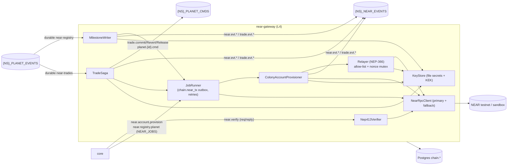
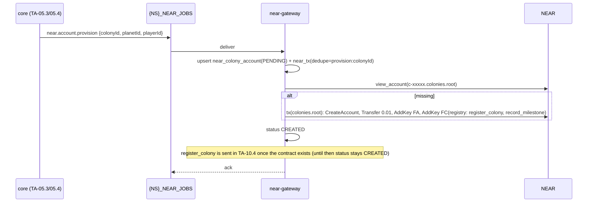
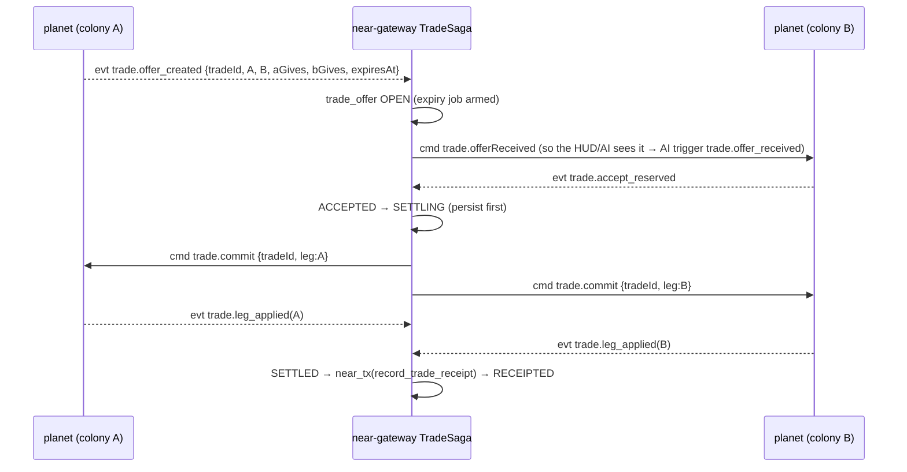

# Epic TA-10 — NEAR Gateway

> **Orchestrator:** [`EXECUTION_ORCHESTRATOR.md`](../EXECUTION_ORCHESTRATOR.md) · **Status Board:** [`STATUS.md`](../STATUS.md)
> **Spec:** [`ARCHITECTURE.md`](../../spec/ARCHITECTURE.md) §6, §11, §15 · [`NEAR.md`](../../spec/NEAR.md) · [`DECISIONS.md`](../../spec/DECISIONS.md) D-05, D-10, D-11 · [`autonomous-colony-spec.md`](../../../autonomous-colony-spec.md) §11

## Overview

`backend/near-gateway` is the only service that talks to NEAR. It verifies NEP-413 wallet signatures for core, creates and funds an invisible NEAR sub-account per colony, relays meta-transactions so colonies never hold gas, writes milestones to the `colony-registry` contract, and runs the inter-colony trade saga (in-game settlement plus an on-chain receipt). Every chain interaction is asynchronous to gameplay.

## Epic analytics

- **Goal / user value:** "chain is invisible" ownership. Every colony has a verifiable on-chain identity and history. Players can link a wallet without ever signing gameplay.
- **Success metrics:**
  - `near.verify` p95 < 1.5 s and 0 false accepts in the test vectors.
  - ≥ 99 % of colonies `REGISTERED` within 5 min of founding (testnet).
  - 0 duplicate on-chain milestones.
  - Trade OPEN→SETTLED p95 < 2 s (same planet).
  - 0 trades stuck in `SETTLING` > 5 min.
- **In scope:** service skeleton, key management, RPC client with fallback; NEP-413 verify; colony account provisioning + relayer; `colony-registry` contract (Rust) + milestone writes; trade saga + receipts; testnet/sandbox; mainnet guard.
- **Out of scope:** core's challenge/nonce, identity merge and JWT (TA-04.3); the client wallet-selector UI (TA-11); sim-side trade reservations/commands (owned by TA-06.4, W2 / L2); real NEAR Intents (D-11 later); player claim of colony accounts (NEAR.md open question 3).
- **Key risks:**
  - Nonce races on the relayer → per-signer mutex + retry.
  - RPC rate limits → paid provider + fallback URL.
  - Key compromise → envelope encryption, file secrets, allow-listed relaying.
  - Sim trade legs misbehave under failover → shared replay scenarios with TA-13.4.

> **Resolved by lead (2026-10-29):** the reservation model and trade command handlers were added to TA-06.4 (W2 / L2); contract kinds/events land in the W2 pre-step, so TA-10.5 (W4) runs against the real sim.

## Architecture overview



Module layout (`backend/near-gateway/src`): `config/`, `chain/` (`near-rpc.client.ts`, `key-store.ts`, `signer.ts`, `account-id.ts`), `verify/` (`nep413.verifier.ts`, `verify.handler.ts`), `jobs/` (`job-runner.ts`, `near-tx.repository.ts`), `accounts/` (`provision.consumer.ts`, `provisioner.ts`), `relayer/` (`relayer.service.ts`), `registry/` (`registry.client.ts`, `milestone.consumer.ts`), `trades/` (`trade-saga.service.ts`, `trade.repository.ts`, `trade-events.consumer.ts`). Contract: `backend/near-contracts/colony-registry/`.

## Task index

| Task | Title | Wave / Lane | Depends On |
|---|---|---|---|
| `TA-10.1` | NEAR gateway skeleton: network config, key management, RPC client | W1 / L4 | TA-01.3, TA-01.6, TA-03.2, TA-13.1 |
| `TA-10.2` | NEP-413 verification on `{ns}.near.verify` | W1 / L4 | TA-10.1 |
| `TA-10.3` | Colony account provisioning job + relayer (meta-tx, NEP-366) | W2 / L4 | TA-10.1, TA-02.2 |
| `TA-10.4` | `colony-registry` contract + milestone writes | W3 / L4 | TA-10.3, TA-07.7 |
| `TA-10.5` | Inter-colony trades: offer/accept saga, in-game settlement, on-chain receipt | W4 / L4 | TA-10.4, TA-06.4 |

---

## Tasks

### `TA-10.1` — NEAR gateway skeleton: network config, key management, RPC client

- **Status:** `[ ] Todo`
- **Wave / Lane:** `W1 / L4`
- **Depends On:** `TA-01.3`, `TA-01.6`, `TA-03.2`, `TA-13.1`
- **Spec:** [`NEAR.md`](../../spec/NEAR.md) §2, §8 · [`ARCHITECTURE.md`](../../spec/ARCHITECTURE.md) §3, §11 · [D-14](../../spec/DECISIONS.md#d-14--all-backend-services-are-nestjs)
- **Target Files:**
  - `backend/near-gateway/package.json`, `tsconfig.json`, `.env.example`
  - `backend/near-gateway/src/main.ts`, `src/app.module.ts`, `src/config/near.config.ts`
  - `backend/near-gateway/src/health/health.controller.ts`
  - `backend/near-gateway/src/chain/near-rpc.client.ts`, `key-store.ts`, `signer.ts`, `account-id.ts`
  - `backend/near-gateway/test/chain/*.spec.ts`
  - `tests/integration/edge/near-boot.spec.ts`, `tests/integration/edge/near-sandbox.ts` (sandbox helper, L4 only)
- **Verify:** `TA_NS=l4 npm run test -w @terra/near-gateway && npm run test:integration -- --suite edge`

#### Analytics
- **Problem & goal:** a bootable gateway with safe key handling and a resilient RPC client, testable against `near-sandbox` without testnet.
- **Constraints:**
  - Internal port 3300 prod / 4004 dev (4404 L4).
  - `near-sandbox` on `:13030` in L4 only.
  - Keys from file secrets (`NEAR_*_KEY_FILE`, `NEAR_COLONY_KEK_FILE`).
  - The `@near-js/*` modular packages (per `tech-stack-spec.md` §5).
  - `NEAR_NETWORK ∈ {sandbox, testnet, mainnet}`; mainnet requires `NEAR_ALLOW_MAINNET=1`.
- **Risks → mitigations:**
  - Public RPC throttling → `NEAR_RPC_URL` + `NEAR_RPC_FALLBACK_URL`, failover on 429/5xx/timeout (2.5 s).
  - Secrets in logs → redaction + test.
  - Wrong network keys → at boot, `view_access_key` of the parent and relayer keys must succeed, else not ready.
- **Alternatives rejected:** monolithic `near-api-js` (heavier); a KMS/HSM for colony keys at MVP (cost and complexity; KEK envelope encryption keeps that path open).
- **Telemetry (proves it works):**
  - `near_rpc_latency_seconds{method,endpoint}` (histogram)
  - `near_rpc_failover_total` (counter)
  - `near_balance_near{account}` (gauge, polled every 5 min)
  - log `near.boot {network, root, rpc}`

#### Architecture
- `NearRpcClient`: `query`, `block`, `sendTxAsync` + `txStatus` polling (`wait_until=FINAL` with a 30 s cap), automatic endpoint failover, and typed errors (`InvalidNonce`, `AccountDoesNotExist`, `NotEnoughBalance`, `Timeout`).
- `KeyStore`: loads parent and relayer key files. `encrypt(secret)`/`decrypt(row)` use AES-256-GCM with `NEAR_COLONY_KEK` (and `kek_version`).
- `AccountId`: derives `colonies.<root>`, `relayer.<root>`, `registry.<root>`, and `colonyAccountId(colonyId) = c-<base32(sha256(colonyId))[0..5]>.colonies.<root>` with a collision check (extend to 7 chars on clash).
- Readiness: PG + NATS + RPC `status` + parent/relayer keys valid on chain.

#### Definition of Ready (DoR)
- [ ] **Contract change request (lead pre-step):** `@terra/config` keys `NEAR_NETWORK`, `NEAR_RPC_URL`, `NEAR_RPC_FALLBACK_URL`, `NEAR_ACCOUNT_ROOT`, `NEAR_SIGNIN_RECIPIENT`, `NEAR_COLONY_DEPOSIT`, `NEAR_MIN_RELAYER_BALANCE`, `NEAR_MIN_PARENT_BALANCE`, `NEAR_ALLOW_MAINNET`, `NEAR_PARENT_KEY_FILE`, `NEAR_RELAYER_KEY_FILE`, `NEAR_COLONY_KEK_FILE`.
- [ ] `chain.*` tables exist in Prisma v1 (TA-03.1): `near_colony_account`, `near_tx`, `trade_offer` ([`NEAR.md`](../../spec/NEAR.md) §10). **Migration CR** if absent.
- [ ] `near-sandbox` binary/container available to L4 (`npm i -D near-sandbox` in the gateway workspace).

#### Definition of Done (DoD)
- [ ] Boots with `TA_NS=l4`, `NEAR_NETWORK=sandbox`. `/readyz` 200 when the sandbox and keys are valid, 503 with `reason` otherwise.
- [ ] `near-rpc.client.spec.ts`: failover on 429/5xx/timeout; typed error mapping; `txStatus` polling stops at FINAL or the 30 s cap.
- [ ] `key-store.spec.ts`: encrypt→decrypt roundtrip; a wrong KEK fails; `kek_version` preserved; secrets redacted in logs.
- [ ] `account-id.spec.ts`: deterministic ids; 10k random colonyIds → no unhandled collision; network suffixes per `NEAR_NETWORK`.
- [ ] `config.spec.ts`: `mainnet` without `NEAR_ALLOW_MAINNET=1` refused.
- [ ] `tests/integration/edge/near-boot.spec.ts` green with the sandbox: creates root/parent/relayer accounts in the sandbox fixture and reaches ready.
- [ ] Status synced in orchestrator, issue file and STATUS.md (§1.6).

---

### `TA-10.2` — NEP-413 verification on `{ns}.near.verify`

- **Status:** `[ ] Todo`
- **Wave / Lane:** `W1 / L4`
- **Depends On:** `TA-10.1`
- **Spec:** [`NEAR.md`](../../spec/NEAR.md) §3 (NEAR-01..06) · [`ARCHITECTURE.md`](../../spec/ARCHITECTURE.md) §6.1 (`{ns}.near.verify`) · [D-10](../../spec/DECISIONS.md#d-10--guest-first-auth-near-link-optional)
- **Target Files:**
  - `backend/near-gateway/src/verify/nep413.verifier.ts`, `verify.handler.ts`
  - `backend/near-gateway/test/verify/nep413.verifier.spec.ts`, `test/verify/fixtures/*.json`
  - `tests/integration/edge/near-verify.int.spec.ts`
- **Verify:** `npm run test -w @terra/near-gateway && npm run test:integration -- --suite edge`

#### Analytics
- **Problem & goal:** core must link a NEAR wallet to a guest player without trusting the client. The gateway proves that the signature is valid and that the key is a full-access key of the claimed account.
- **Constraints:**
  - Stateless; nonce single-use is core's job (NEAR-04).
  - Reply ≤ 3 s.
  - Must accept signatures produced by wallet-selector `signMessage` (MyNearWallet, Meteor, HOT, …).
  - Only FullAccess keys.
- **Risks → mitigations:**
  - Borsh layout mistakes → test vectors generated per spec plus ≥ 1 recorded real-wallet fixture.
  - Key removed after signing → check at `final` finality at verify time.
  - Replay across sites → recipient check (NEAR-03).
- **Alternatives rejected:** verifying in core (puts NEAR deps and RPC in core, against the "only the gateway talks to NEAR" rule); trusting a wallet-provided `accountId` without an access-key lookup (an impersonation hole).
- **Telemetry (proves it works):**
  - `near_verify_total{result=ok|bad_signature|key_not_found|not_full_access|wrong_network|recipient_mismatch|rpc_unavailable}` (counter)
  - `near_verify_seconds` (histogram)

#### Architecture
```ts
// NearVerifyReqV1 → NearVerifyResV1 (contracts)
const payload = borsh.serialize(Nep413PayloadSchema, { tag: 2147484061 /* 2^31+413 */, message, nonce /*32B*/, recipient, callbackUrl: null });
const ok = ed25519.verify(sha256(payload), signature, publicKey);
// then: query view_access_key {account_id, public_key} finality=final → permission === 'FullAccess'
```
- Handler: subscribe to `{ns}.near.verify` (queue group `near-gateway`) and reply `{ ok, accountId, keyPermission } | { ok:false, reason }`. Never throw across NATS.

#### Definition of Ready (DoR)
- [ ] `NearVerifyReqV1`/`NearVerifyResV1` exist in `@terra/contracts` (TA-01.3). **Contract change request (W1 pre-step)** if the reason enum differs from NEAR.md §3.
- [ ] One real wallet signature fixture captured by the owner or L4 on testnet (message, nonce, recipient, accountId, publicKey, signature). If unavailable, mark that DoD item `[!]` and proceed with generated vectors.

#### Definition of Done (DoD)
- [ ] `nep413.verifier.spec.ts`: generated key signs a valid payload → ok; a tampered message, nonce or recipient → `bad_signature`/`recipient_mismatch`; wrong network suffix → `wrong_network`; the real-wallet fixture → ok.
- [ ] `near-verify.int.spec.ts` (sandbox): FA key → ok; function-call key → `not_full_access`; unknown key → `key_not_found`; RPC stopped → `rpc_unavailable` within 3 s.
- [ ] Reply p95 < 1.5 s over 100 sandbox verifications (asserted in the test).
- [ ] Status synced in orchestrator, issue file and STATUS.md (§1.6).

---

### `TA-10.3` — Colony account provisioning job + relayer (meta-tx, NEP-366)

- **Status:** `[ ] Todo`
- **Wave / Lane:** `W2 / L4`
- **Depends On:** `TA-10.1`, `TA-02.2`
- **Spec:** [`NEAR.md`](../../spec/NEAR.md) §2, §4 (NEAR-10..14), §5, §8 · [`ARCHITECTURE.md`](../../spec/ARCHITECTURE.md) §6.1 (`{ns}.near.account.provision`)
- **Target Files:**
  - `backend/near-gateway/src/jobs/job-runner.ts`, `near-tx.repository.ts`
  - `backend/near-gateway/src/accounts/provision.consumer.ts`, `provisioner.ts`, `account-status.handler.ts`
  - `backend/near-gateway/src/relayer/relayer.service.ts`, `nonce-manager.ts`
  - `backend/near-gateway/test/{jobs,accounts,relayer}/*.spec.ts`
  - `tests/integration/edge/provision.int.spec.ts`, `relayer.int.spec.ts`
- **Verify:** `npm run test -w @terra/near-gateway && npm run test:integration -- --suite edge`

#### Analytics
- **Problem & goal:** every new colony gets its own NEAR account without the player noticing and without blocking the seat confirmation. Colony accounts never need gas, because the relayer pays.
- **Constraints:**
  - Work queue `{NS}_NEAR_JOBS` (exact subjects, see the NEAR.md §9 caution).
  - Idempotent (deterministic account id).
  - Retry 5 s → 30 s → 2 m → 10 m → 1 h, then FAILED.
  - Deposit 0.01 NEAR.
  - The relayer only relays allow-listed `registry.*` methods.
- **Risks → mitigations:**
  - Nonce conflicts under parallel jobs → a per-signer async mutex + nonce cache with a refresh on `InvalidNonce`.
  - Parent balance drained → provisioning pauses < 1 NEAR + `near_balance_low` alert.
  - Duplicate jobs → `chain.near_tx.dedupe_key` unique + `view_account` pre-check.
- **Alternatives rejected:** implicit (64-hex) accounts (no human-readable link to the game, and needs a funding transfer anyway); a public HTTP relayer (open abuse surface).
- **Telemetry (proves it works):**
  - `near_jobs_total{kind="provision",result}` (counter)
  - `near_job_failed_total{kind}` (counter)
  - `near_tx_pending` (gauge)
  - `near_relayer_nonce_retries_total` (counter)
  - `near_provision_seconds` (histogram, job enqueue → REGISTERED)

#### Architecture

- `JobRunner`: a generic outbox processor over `chain.near_tx` (`PENDING → SENT → FINAL | FAILED`, `next_attempt_at`), single-flight per `dedupe_key`, resumes after restart.
- `Relayer.relay(signedDelegate)`: allow-list check (`receiver_id = registry.<root>`, methods ⊂ {`register_colony`,`record_milestone`}) → wrap as `Action::Delegate` from `relayer.<root>` → send. Exercised in this task against a tiny sandbox test contract; real use starts in TA-10.4.
- `{ns}.near.account.status` request/reply for core's profile view.

#### Definition of Ready (DoR)
- [ ] **Contract change request (lead, W2 pre-step):** `NearProvisionJobV1`, `{ns}.near.account.status` subject + `NearAccountStatusV1` in `@terra/contracts`; `{NS}_NEAR_JOBS` stream with exact subjects `{ns}.near.account.provision`, `{ns}.near.registry.>` (TA-02.2 bootstraps it).
- [ ] Core enqueues provisioning on seat confirmation (TA-05.3 DoD references this subject). Until then, the integration test publishes jobs directly.
- [ ] Owner has created and funded `colonies.terraagent.testnet` and `relayer.terraagent.testnet` (`OWNER_TASKS.md`) for the testnet smoke. The sandbox covers CI.

#### Definition of Done (DoD)
- [ ] `provision.int.spec.ts` (sandbox): job → account exists with FA + FC keys and a 0.01 NEAR balance; the same job again → no new tx, status unchanged (NEAR-10); RPC failure injected → retries with backoff → FAILED after 5 attempts + `near_job_failed_total` incremented (NEAR-13); a restart mid-job resumes from `chain.near_tx`.
- [ ] `relayer.int.spec.ts` (sandbox): a delegate action to the allow-listed method is relayed and the colony balance is unchanged; a non-allow-listed receiver/method is refused (NEAR-20); parallel relays from 5 signers succeed with nonce retry ≤ 1 each.
- [ ] `job-runner.spec.ts`: single-flight per dedupe key; backoff schedule exact.
- [ ] `account-status.handler` returns `{accountId, status}` for known colonies and `null` for unknown.
- [ ] `{ns}.near.evt.account_provisioned` / `account_failed` published to `{NS}_NEAR_EVENTS` exactly once per transition (asserted in `provision.int.spec.ts`).
- [ ] Testnet smoke (L4, owner accounts funded): `npm run near:smoke -w @terra/near-gateway -- --provision` creates one colony account. The tx hash is recorded in the PR, or the item is `[!] Blocked`.
- [ ] Status synced in orchestrator, issue file and STATUS.md (§1.6).

---

### `TA-10.4` — `colony-registry` contract + milestone writes

- **Status:** `[ ] Todo`
- **Wave / Lane:** `W3 / L4`
- **Depends On:** `TA-10.3`, `TA-07.7`
- **Spec:** [`NEAR.md`](../../spec/NEAR.md) §5, §6 · [`ARCHITECTURE.md`](../../spec/ARCHITECTURE.md) §6.1 (`PLANET_EVENTS`, `near.registry.*`), §11
- **Target Files:**
  - `backend/near-contracts/colony-registry/Cargo.toml`, `src/lib.rs`, `src/events.rs`, `src/types.rs`
  - `backend/near-contracts/colony-registry/tests/workspaces.rs` (near-workspaces)
  - `backend/near-contracts/package.json` (`near:contract:test`, `near:contract:build`, `near:contract:deploy`)
  - `backend/near-contracts/scripts/deploy.ts`
  - `backend/near-gateway/src/registry/registry.client.ts`, `milestone.consumer.ts`, `planet-registry.consumer.ts`
  - `backend/near-gateway/test/registry/*.spec.ts`, `tests/integration/edge/milestones.int.spec.ts`
- **Verify:** `npm run test -w @terra/near-gateway && npm run test:integration -- --suite edge && npm run near:contract:test`

#### Analytics
- **Problem & goal:** a verifiable public record of planets, colonies, milestones (founded, terraform %, rocket, eliminated, planet result) and trade receipts. This is the "games with real economies" proof point.
- **Constraints:**
  - near-sdk 5.x.
  - Storage bounded (≤ 64 milestones/colony).
  - Idempotent re-recording.
  - The colony self-registers via meta-tx. Eliminated colonies are recorded by the operator.
  - Writes are triggered by `{NS}_PLANET_EVENTS` (durable consumer `near-registry`) and `{ns}.near.registry.planet` jobs.
- **Risks → mitigations:**
  - Event kind names differ from TA-07.7 → mapping table in NEAR.md §6, reconciled in the W3 pre-step.
  - Contract bugs after deploy → owner-only versioned `migrate`; sandbox + testnet before mainnet.
  - Storage exhaustion → a storage-balance metric + operator top-up runbook.
- **Alternatives rejected:** writing milestones from core (spreads chain logic); NFTs per milestone (NEP-171 cost/complexity; possible later on top of the same events).
- **Telemetry (proves it works):**
  - `near_jobs_total{kind="milestone"|"planet"|"register_colony",result}` (counter)
  - `near_registry_storage_bytes` (gauge)
  - `near_milestone_lag_seconds` (histogram, event time → FINAL)
  - NEP-297 events on chain (`milestone_recorded`, …)

#### Architecture
- Contract interface and events exactly as [`NEAR.md`](../../spec/NEAR.md) §6. `record_milestone` is a no-op when `(colony, kind, tick)` already exists.
- `MilestoneConsumer`: filtered PLANET_EVENTS → `near_tx` outbox (`dedupe_key = milestone:{colony}:{kind}:{tick}`) → JobRunner → relayer (colony-signed) or operator call.
- `register_colony` is queued after provisioning reaches `CREATED`. That moves the status to `REGISTERED` (completes NEAR-12/14).
- Deploy script: `near:contract:deploy -- --network testnet` builds wasm (`cargo near build`), deploys to `registry.<root>` and calls `new(owner, [relayer])`. Mainnet deploy is an owner action.

#### Definition of Ready (DoR)
- [ ] **Contract change request (lead, W3 pre-step):** PLANET_EVENTS kinds `colony.founded`, `terraform.milestone`, `rocket.launched`, `colony.eliminated`, `planet.ended` and the `{ns}.near.registry.planet` payload in `@terra/contracts`, aligned with TA-07.7. If the terraform/rocket events only arrive in W4 (TA-06.10), the consumer handles them when they appear and the tests use synthetic events.
- [ ] Rust toolchain + `cargo-near` + `near-workspaces` available in the L4 environment (document in `backend/near-contracts/README.md`).
- [ ] Owner has created `registry.terraagent.testnet` (or allows the gateway to create it from the root in the testnet smoke).

#### Definition of Done (DoD)
- [ ] `cargo test` unit tests: operator-only methods reject strangers; self-registration requires `predecessor == colony`; the milestone cap of 64 is enforced; duplicate milestones are no-ops; views paginate.
- [ ] `tests/workspaces.rs` (sandbox): full flow `register_planet` → meta-tx `register_colony` via relayer → `record_milestone` → `record_milestone_for(ColonyEliminated)` → NEP-297 logs asserted.
- [ ] `milestones.int.spec.ts`: synthetic PLANET_EVENTS → exactly one on-chain milestone each, even with redelivery and a gateway restart; provisioning `CREATED → REGISTERED` asserted.
- [ ] `{ns}.near.evt.milestone_recorded` published once per FINAL milestone (asserted in `milestones.int.spec.ts`).
- [ ] Contract deployed to testnet (tx hash + account in the PR) or `[!] Blocked` on owner accounts.
- [ ] Status synced in orchestrator, issue file and STATUS.md (§1.6).

---

### `TA-10.5` — Inter-colony trades: offer/accept saga, in-game settlement, on-chain receipt

- **Status:** `[ ] Todo`
- **Wave / Lane:** `W4 / L4`
- **Depends On:** `TA-10.4`, `TA-06.4` (sim reservations + trade legs)
- **Spec:** [`NEAR.md`](../../spec/NEAR.md) §7 (NEAR-30..35) · [D-11](../../spec/DECISIONS.md#d-11--trades-in-game-settlement--on-chain-receipt-in-mvp) · [`AI_ORCHESTRATOR.md`](../../spec/AI_ORCHESTRATOR.md) §6 (`tradeOffer`/`tradeRespond` directive actions)
- **Target Files:**
  - `backend/near-gateway/src/trades/trade-saga.service.ts`, `trade.repository.ts`, `trade-events.consumer.ts`, `trade-expiry.job.ts`, `trade-query.handler.ts`
  - `backend/near-gateway/test/trades/*.spec.ts`
  - `tests/integration/edge/trade-saga.int.spec.ts`
- **Verify:** `npm run test -w @terra/near-gateway && npm run test:integration -- --suite edge`

#### Analytics
- **Problem & goal:** neighbouring colonies, human or AI-directed and even while the owner is away, can swap resources safely. Neither side may lose goods on failure, and a receipt goes on-chain.
- **Constraints:**
  - Settlement happens through commands only (D-01: commands are the sole sim inputs, so trades replay on failover).
  - MVP is same-planet, with a planet-generic saga.
  - ≤ 3 open offers per colony; give ≤ 50 % of stock; TTL 10 min.
  - The receipt never blocks or reverses settlement.
- **Risks → mitigations:**
  - Double settlement → idempotent `(tradeId, leg, op)` commands + `Nats-Msg-Id`.
  - Gateway crash mid-saga → state persisted before each publish (outbox), resumed on boot.
  - A colony eliminated mid-trade → `trade.leg_rejected` → compensation.
  - Sim behaviour drift → saga unit tests use a stub sim responder; integration tests use the real `@terra/sim` from TA-06.4.
- **Alternatives rejected:** a 2PC lock across planets (blocks ticks); real NEAR Intents now (needs tokenised resources and solvers; D-11 later); settling in core (core should not drive sim state machines).
- **Telemetry (proves it works):**
  - `trade_saga_total{state}` (counter)
  - `trade_settle_seconds` (histogram)
  - `trade_stuck_total` (counter, SETTLING > 5 min)
  - `near_jobs_total{kind="trade_receipt",result}` (counter)
  - log `trade.state_changed {tradeId, from, to}`

#### Architecture
State machine and rules exactly as [`NEAR.md`](../../spec/NEAR.md) §7.


- Compensation: one leg rejected → `trade.revert` on the applied leg + `trade.release` on the other → `COMPENSATED`.
- Expiry job: every 10 s, OPEN offers past `expires_at` → `trade.release(A)` → `EXPIRED`.
- `{ns}.trade.offer.list` request/reply serves open offers for core/HUD.

#### Definition of Ready (DoR)
- [ ] TA-06.4 trade legs are `[x] Done` (W2); trade command kinds/events already landed in the W2 pre-step.
- [ ] **Contract change request (lead, W4 pre-step):** subject `{ns}.trade.offer.list` + DTOs (command kinds and trade events landed in W2).
- [ ] `chain.trade_offer` table matches NEAR.md §10 (migration CR if not).

#### Definition of Done (DoD)
- [ ] `trade-saga.service.spec.ts`: every transition in NEAR.md §7 incl. decline, cancel, expiry and compensation; illegal transitions rejected.
- [ ] `trade-saga.int.spec.ts` (lane NS, stub or real sim): happy path → both legs applied once each and the receipt FINAL on the sandbox; redelivered events → no duplicate commands; gateway killed in SETTLING → resumes and settles; leg B rejected → A reverted, B released, `COMPENSATED`; offer limit (4th open offer) rejected.
- [ ] With the real sim: stock balances on both colonies change by exactly the traded amounts after settlement, and failover replay gives the same balances (shared with TA-13.4 scenarios).
- [ ] Every state transition publishes `{ns}.trade.evt.state_changed` and the FINAL receipt publishes `{ns}.trade.evt.receipt_recorded` (`Nats-Msg-Id = tradeId:state`), asserted in `trade-saga.int.spec.ts`.
- [ ] p95 OPEN→SETTLED < 2 s in the integration test (same planet).
- [ ] Status synced in orchestrator, issue file and STATUS.md (§1.6).
