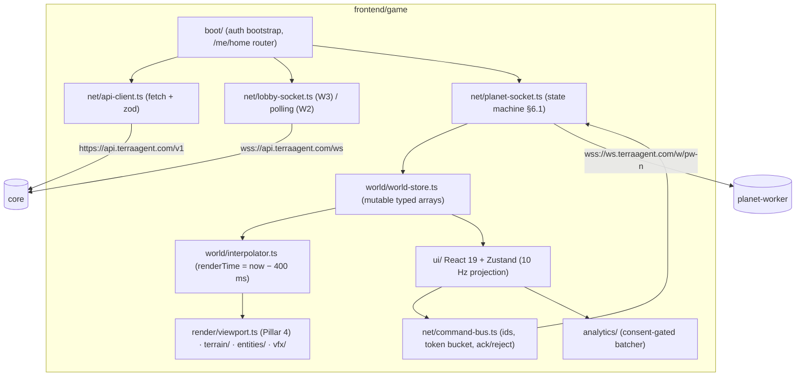

# Epic TA-11 — Game Client (`frontend/game`, `game.terraagent.com`)

> **Orchestrator:** [`EXECUTION_ORCHESTRATOR.md`](../EXECUTION_ORCHESTRATOR.md) · **Status Board:** [`STATUS.md`](../STATUS.md)
> **Spec:** [`ARCHITECTURE.md`](../../spec/ARCHITECTURE.md) §4, §7, §12, §13 · [`CLIENT.md`](../../spec/CLIENT.md) · [`DECISIONS.md`](../../spec/DECISIONS.md) D-01, D-10, D-15 · Visual pillars: [`AGENTS.md`](../../../AGENTS.md), `.agents/skills/*`
> **Lane:** `L5` Clients & Infra. Owned path: `frontend/game/**` (+ `tests/e2e/**` journey specs).

## Overview

This epic builds the browser game: boot and auth, the planet picker and queue, the dive-in and resume flow with the away digest, the planet WebSocket client with world store and interpolation, the diorama viewport and hex terrain, instanced kitbashed entities, the HUD, and building placement. The client is a view of a server-authoritative simulation (D-01). It renders snapshots and deltas and sends intents (`cmd`).

## Epic analytics

- **Goal / user value:**
  - A first-time visitor lands in a live colony within one minute.
  - A returning player is back in their colony in ≤ 3 s, with a summary of what happened while they were away.
  - The colony looks like a tabletop diorama (4 pillars), not raw primitives.
- **Success metrics:**
  - Boot → routed screen ≤ 1.5 s p75.
  - `/` → first frame for a returning player ≤ 3 s p75.
  - 60 FPS with 300 buildings + 500 robots on reference hardware.
  - ≤ 60 draw calls per frame.
  - Funnel: play_click → seated ≥ 60 %, seated → first_command ≥ 70 % (CLIENT.md §10.3).
  - `ws_reconnect` success rate ≥ 99 % after `4009`/`4012`.
- **In scope:**
  - Routes `/`, `/planets`, `/play`, `/recap/*`, `/inspect` (dev/e2e only).
  - Guest auth. Picker/queue on REST polling, then lobby WS.
  - Planet WS client. MVP archetypes (D-15). HUD. Placement and upgrade.
  - Opt-in analytics client.
- **Out of scope:**
  - 3D on phones.
  - WebGPU/TSL renderer (deferred, CLIENT.md §8).
  - Spectating other planets.
  - Trade UI. This is a TA-10.5 follow-up; the HUD shows trade events only.
  - NEAR wallet-link UI beyond one Settings button. The button calls the TA-04.3 flow and is wired in TA-11.7.
- **Key risks:**
  - Delta decode cost at 500+ entities.
  - Interpolation jitter under server tick drift.
  - The visual quality bar drifting to "programmer art".
  - Contract churn in W2/W3.
  - Close-code races during failover.

## Architecture overview

Source layout (target): `frontend/game/{index.html, vite.config.ts, src/{main.tsx, boot/, net/, world/, render/{viewport.ts, terrain/, entities/, vfx/, inspect/}, ui/{screens/, hud/, modals/}, analytics/, i18n/, debug/}, test/}`.

## Task index

| Task | Title | Wave / Lane | Depends On |
|---|---|---|---|
| `TA-11.1` | Game app shell: Vite/TS, router, auth bootstrap, API client, React HUD root | W1 / L5 | TA-01.1, TA-01.4, TA-01.6 |
| `TA-11.2` | Planet picker & queue UI (lobby WS / polling fallback) | W2 / L5 | TA-11.1 |
| `TA-11.4` | Planet WS client: snapshot/delta store, interpolation buffer, reconnect | W2 / L5 | TA-11.1, TA-01.2 |
| `TA-11.5` | Diorama viewport & hex terrain renderer (Pillar 4) | W2 / L5 | TA-11.1, TA-11.4 (store interface) |
| `TA-11.3` | Home routing & resume UX: dive-in, retry, away digest modal | W3 / L5 | TA-11.2, TA-11.4 |
| `TA-11.6` | Instanced entity rendering: robots & buildings (Pillars 1/3) | W3 / L5 | TA-11.5 |
| `TA-11.7` | HUD: resources, power, task queue, priorities, event log | W3 / L5 | TA-11.4 |
| `TA-11.8` | Building placement & upgrade UX → commands | W4 / L5 | TA-11.6, TA-11.7 |

---

## Tasks

### `TA-11.1` — Game app shell: Vite/TS, router, auth bootstrap, API client, React HUD root

- **Status:** `[ ] Todo`
- **Wave / Lane:** `W1 / L5`
- **Depends On:** `TA-01.1`, `TA-01.4`, `TA-01.6`
- **Spec:** [`CLIENT.md`](../../spec/CLIENT.md) §2 (`CL-01`, `CL-03`, `CL-11`, `CL-12`, `CL-15`), §3, §10 · [`ARCHITECTURE.md`](../../spec/ARCHITECTURE.md) §4, §7 · D-10
- **Target Files:**
  - `frontend/game/package.json`, `frontend/game/vite.config.ts`, `frontend/game/tsconfig.json`, `frontend/game/index.html`, `frontend/game/.env.example`
  - `frontend/game/src/main.tsx`, `frontend/game/src/app/router.tsx`, `frontend/game/src/app/App.tsx`
  - `frontend/game/src/boot/boot.ts`, `frontend/game/src/boot/home-router.ts`
  - `frontend/game/src/net/api-client.ts`, `frontend/game/src/net/auth.ts`
  - `frontend/game/src/ui/screens/{BootSplash,PlanetsPlaceholder,PlayPlaceholder,Recap}.tsx`
  - `frontend/game/src/analytics/{consent.ts,batcher.ts,events.ts}`
  - `frontend/game/src/debug/terra-debug.ts`, `frontend/game/src/i18n/en.ts`
  - `frontend/game/test/{boot.test.ts,api-client.test.ts,analytics.test.ts}`, `frontend/game/eslint.config.mjs`
- **Verify:** `npm run test -w @terra/game && npm run build -w @terra/game && ! grep -r __terraDebug frontend/game/dist`

#### Analytics
- **Problem & goal:** every later client task needs a bootable SPA that authenticates silently as a guest, asks core where to go (`/v1/me/home`) and routes. Without a single typed API client and boot router, each screen would reinvent auth refresh and state handling.
- **Constraints:**
  - The access JWT stays in memory only. The refresh/device credential is an httpOnly cookie on `api.terraagent.com`, so every request needs `credentials: "include"` and CORS from `https://game.terraagent.com` (TA-02.4).
  - Contract types come only from `@terra/contracts`.
  - In W1, core's guest auth (TA-04.2) is built in parallel, so tests use a mock server built from the contracts.
- **Risks → mitigations:**
  - Third-party cookie blocking. `api.` and `game.` share the site `terraagent.com`, so the cookie is first-party with `SameSite=None; Secure`. The e2e test runs in Chromium and WebKit.
  - Token refresh storms. Use a single-flight refresh promise.
  - Analytics leaking before consent. The consent gate is unit-tested (`CL-11`).
- **Alternatives rejected:**
  - Next.js / SSR: no SEO need for the game, and it adds a server.
  - Token in localStorage: XSS exfiltration risk.
  - React Router data APIs with loaders: the boot flow is a tiny state machine. `wouter` or React Router 7 in plain mode is enough.
- **Telemetry (proves it works):**
  - `guest_created`, `planet_picker_view` client events (opt-in).
  - Debug counters `boot_ms`, `auth_refresh_total`, `api_error_total{code}` in `__terraDebug` (dev/e2e only).
  - Server counter `ta_auth_guest_created_total` (TA-04.2) used to cross-check.

#### Architecture
- `boot()`:
  1. `auth.ensureAccessToken()` calls `POST /v1/auth/refresh`, falling back to `POST /v1/auth/guest` on 401.
  2. `api.getHome()`.
  3. `homeRouter(home)` returns a route: `NEW|QUEUED → /planets`, `ACTIVE → /play`, `ELIMINATED → /recap/eliminated`, `PLANET_ENDED → /recap/ended`.
  4. The `home` payload is passed to the target screen via the Zustand `sessionStore`.
- `api-client.ts`:
  - `request<T>(method, path, schema, body?)` adds the Bearer token and `credentials:"include"`.
  - On 401 it refreshes once and retries once.
  - It parses with zod: strict in dev/test, warn in prod (`CL-04`).
  - It maps the contract error codes (`@terra/contracts/errors`) to typed `ApiError`.
- Config (`import.meta.env`): `VITE_API_URL` (dev default `http://127.0.0.1:4001`, lanes `http://127.0.0.1:4{K}01`), `VITE_E2E`.
- Analytics: `consent.ts` reads and writes the `ta_consent` cookie (Domain `.terraagent.com`; host-only in dev). `batcher.ts` is a no-op until consent, then posts `AnalyticsBatchV1` every 10 s and on `pagehide` via `sendBeacon`.
- ESLint bans `alert`, `confirm` and `prompt` (`CL-12`), and bans `three` imports in `ui/**` to keep React away from the scene graph.
- `__terraDebug` is attached only when `import.meta.env.DEV || VITE_E2E === "1"` and is tree-shaken otherwise (`CL-15`).

#### Definition of Ready (DoR)
- [ ] `@terra/contracts` exports the auth DTOs, the `HomeResponse` discriminated union (`NEW|QUEUED|ACTIVE|ELIMINATED|PLANET_ENDED`) and error codes (TA-01.4).
- [ ] **Contract change request (lead pre-step):** `AnalyticsBatchV1` schema plus `POST /v1/analytics/events` in REST DTOs. Owned by TA-04.7 (W4 / L1); until it is merged the batcher stays behind `VITE_ANALYTICS_ENABLED=0`.
- [ ] CORS origins and cookie attributes from ARCHITECTURE §4 / D-10 are confirmed with the TA-04.2 owner (L1).
- [ ] The router choice (`wouter` or React Router 7) is recorded in the PR.

#### Definition of Done (DoD)
- [ ] `boot.test.ts` covers all 5 home states, both refresh and guest-create paths, and the single-flight refresh, all against a mock core built from the contract schemas.
- [ ] `api-client.test.ts` covers: the token is never written to `localStorage`/`sessionStorage`; `credentials:"include"` is set; 401 triggers one refresh and one retry; strict vs warn zod modes.
- [ ] `analytics.test.ts` covers: zero network calls and no `ta_aid` cookie before consent; batching ≤ 20 events; flush on `pagehide`.
- [ ] `npm run build -w @terra/game` succeeds. The initial JS is ≤ 450 KB gzip, with the size printed in the build log. The prod `dist/` contains no `__terraDebug`.
- [ ] `frontend/game/.env.example` lists `VITE_API_URL`, `VITE_E2E`, `VITE_ANALYTICS_ENABLED`.
- [ ] Status synced in orchestrator, issue file and STATUS.md (§1.6).

---

### `TA-11.2` — Planet picker & queue UI (lobby WS / polling fallback)

- **Status:** `[ ] Todo`
- **Wave / Lane:** `W2 / L5`
- **Depends On:** `TA-11.1`
- **Spec:** [`CLIENT.md`](../../spec/CLIENT.md) §4 (`CL-14`) · [`ARCHITECTURE.md`](../../spec/ARCHITECTURE.md) §8, §13 (lobby messages) · `MATCHMAKING.md` (TA-05)
- **Target Files:**
  - `frontend/game/src/ui/screens/PlanetPicker.tsx`, `frontend/game/src/ui/picker/{PlanetCard,NewPlanetCard,QueuePanel,PlanetThumb}.tsx`
  - `frontend/game/src/net/lobby-socket.ts`, `frontend/game/src/net/lobby-polling.ts`
  - `frontend/game/src/state/queue-machine.ts`
  - `frontend/game/test/{picker.test.ts,queue-machine.test.ts}`
  - `tests/e2e/journeys/w2-first-play.spec.ts` (picker → seated part)
- **Verify:** `npm run test -w @terra/game && npm run test:e2e -- --grep @w2`

#### Analytics
- **Problem & goal:**
  - A first-time player (`home.state = NEW`) must see the recruiting planets and a "New planet" option, request a seat, and follow the queue until seated (G5, G6).
  - Sealed and old planets must never be offered.
  - Races (a planet fills between list and click) must resolve in one click.
- **Constraints:**
  - The lobby WS (TA-04.6) arrives in **W3**, so W2 ships REST polling: planets every 10 s, ticket every 2 s.
  - The WS client is written against the contract now and enabled by a feature flag once `/ws` answers.
  - The seat TTL is 90 s.
  - The queue is FIFO and the server decides placement.
- **Risks → mitigations:**
  - Polling load at scale. Polling pauses while the tab is hidden, and the WS replaces it in W3.
  - Stale list. The server re-validates on join and returns `planet_unavailable`, which the UI turns into a one-click "fresh planet" fallback.
  - Duplicate join clicks. The button is disabled while `requesting`, and the server has an idempotency key per click (contract change request if absent).
- **Alternatives rejected:**
  - Auto-matching without showing planets: the owner wants available planets to be visible.
  - SSE for queue updates: the lobby WS is already in the architecture.
- **Telemetry (proves it works):** `planet_picker_view`, `join_requested {kind}`, `seated {queue_ms}` client events; debug counters `lobby_transport{ws|poll}`, `queue_state_transitions_total{from,to}`; server counters `ta_match_tickets_created_total`, `ta_match_seated_total` used to cross-check.

#### Architecture
- `queue-machine.ts` is a pure reducer implementing CLIENT.md §4.2 (`idle → requesting → queued → seated → entering`, plus `failed|expired|cancelled`). It is fully unit-tested without React.
- Transport adapter interface `LobbyTransport { subscribePlanets(cb); subscribeTicket(id, cb); close() }`, with two implementations:
  - `lobby-polling.ts` (W2): `GET` planet list, `GET` ticket status.
  - `lobby-socket.ts` (W3 flag on): `hello {accessToken}`, `subscribe {topic}`; handles `planets.list|planets.changed|queue.position|match.assigned|match.failed`; reconnects with backoff and falls back to polling after 3 failures (`CL-14`).
- On `seated`, poll `/me/home` until `ACTIVE` (≤ 10 s, CLIENT.md §12), then navigate to `/play`.
- `PlanetThumb` renders a 96×96 procedural mini-map from `seed` + `type` on a Canvas2D (no network), using a cheap noise function that is not the sim generator. It is decorative only.
- The sort and filter rules live in CLIENT.md §4.1. The component always renders the "New planet" cards.

#### Definition of Ready (DoR)
- [ ] TA-05.2/TA-05.3 DTOs are in `@terra/contracts`: `PlanetSummary { id, type, seatsFilled, capacity, createdAt, admissionClosesAt, endsAt, seed }`, `CreateMatchTicketRequest { planetId } | { newPlanetType }`, `MatchTicketStatus { id, state, position, etaS?, failureCode? }`.
- [ ] **Contract change request (lead pre-step):** `Idempotency-Key` header accepted by the create-ticket endpoint, and failure codes `planet_unavailable`, `queue_full`, `already_has_colony` in the error enum.
- [ ] Lobby message schemas from ARCHITECTURE §13 exist in contracts (TA-01.2), even though the server side lands in W3.

#### Definition of Done (DoD)
- [ ] `queue-machine.test.ts`: every transition in CLIENT.md §4.2, including `planet_unavailable → one-click new planet` and the `expired` requeue.
- [ ] `picker.test.ts`: the empty state shows only "New planet" cards; sealed/ended planets are never rendered even if the server sends them (defensive filter on `status`); the list sort order is correct; polling pauses on `document.hidden`; the WS → polling fallback happens after 3 failures.
- [ ] Reloading the page while queued restores the panel from `/me/home` (`QUEUED`).
- [ ] The e2e test `w2-first-play.spec.ts` part A passes: guest → `/planets` shows ≥ 1 recruiting planet → Join → seated → `/play`.
- [ ] All picker strings come from `i18n/en.ts`. Keyboard-only flow works (Tab/Enter/Esc).
- [ ] Status synced in orchestrator, issue file and STATUS.md (§1.6).

---

### `TA-11.4` — Planet WS client: snapshot/delta store, interpolation buffer, reconnect

- **Status:** `[ ] Todo`
- **Wave / Lane:** `W2 / L5`
- **Depends On:** `TA-11.1`, `TA-01.2`
- **Spec:** [`CLIENT.md`](../../spec/CLIENT.md) §6, §7 (`CL-02`, `CL-04`, `CL-05`, `CL-08`, `CL-09`, `CL-10`) · [`ARCHITECTURE.md`](../../spec/ARCHITECTURE.md) §7, §13 · `PROTOCOL.md`
- **Target Files:**
  - `frontend/game/src/net/planet-socket.ts`, `frontend/game/src/net/command-bus.ts`, `frontend/game/src/net/clock-sync.ts`, `frontend/game/src/net/decoder.ts`
  - `frontend/game/src/world/{world-store.ts,entity-table.ts,interpolator.ts,hud-projection.ts}`
  - `frontend/game/test/{planet-socket.test.ts,command-bus.test.ts,world-store.test.ts,interpolator.test.ts,decoder.test.ts}`, `frontend/game/test/fixtures/mock-worker.ts`
- **Verify:** `npm run test -w @terra/game`

#### Analytics
- **Problem & goal:** the game must show a live, smooth view of a 10 TPS server simulation delivered as 5 Hz deltas, survive reconnects and failover without user action, and send commands exactly once. This is the core of "online by WebSockets" on the client side.
- **Constraints:**
  - Single-use 60 s tickets (`CL-02`), so every reconnect starts with `/me/home`.
  - Close codes per ARCHITECTURE §13.
  - ≤ 10 cmds/s.
  - Delta decode + apply ≤ 2 ms p95 at 500 entities.
  - React must not re-render at 60 Hz.
- **Risks → mitigations:**
  - GC churn from per-delta object allocation. The entity table uses typed-array slots with a free-list.
  - Tick gaps after a tab freeze. Detect `fromTick ≠ lastAppliedTick`, then resync.
  - Double-applied commands after a reconnect. Unacked commands are never resent; they are marked "unknown" (`CL-08`).
  - Reconnect storms across many clients after a worker drain. Jittered backoff, and `4012` jitter of 0–1 s.
- **Alternatives rejected:**
  - Client-side prediction of the sim: violates D-01 and is costly.
  - Socket.IO: the architecture specifies plain WS with a custom envelope.
  - Storing entities in Zustand: re-render cost; `CL-05`.
- **Telemetry (proves it works):** debug/opt-in events `ws_reconnect {code}`, `resync`, `cmd_reject {code}`; gauges in `__terraDebug`: `rtt_ms`, `clock_offset_ms`, `last_tick`, `interp_underruns_total`, `delta_apply_ms_p95`, `pending_cmds`. Server cross-check: `ta_planet_ws_welcome_total`, `ta_planet_cmd_acked_total`.

#### Architecture
- `planet-socket.ts` implements the CLIENT.md §6.1 machine (`resolving → connecting → welcomed → streaming ↔ resyncing → reconnecting | terminal | waitingRelocation`).
  - It is injected with `resolveHome()` (which calls the API) and a `WebSocket` factory for tests.
  - The close-code table in §6.3 is encoded as data (`closePolicy: Record<number, Action>`).
- `decoder.ts` handles envelope `{v,t,id?,tick?,d}`. It validates fully in dev/test and validates the envelope only for `delta` in prod.
- `world-store.ts`:
  - `applyWelcome(snapshot)` and `applyDelta({fromTick,toTick,ops})`, where ops are `add|update|remove|terrain|territory|stats`.
  - `subscribeEvents(cb)`.
  - `version` counter for renderers.
- `entity-table.ts`: SoA layout with `Float32Array` positions (3 samples × q, r, heading, tick), `Uint16Array` archetype, `Uint8Array` state, `Float32Array` hp/progress, and an `id → slot` map.
- `interpolator.ts`:
  - `renderTime = clock.serverNow() − 400 ms`.
  - Lerp between the bracketing samples; extrapolate ≤ 200 ms, then hold.
  - Output goes into reusable matrices consumed by TA-11.6.
- `command-bus.ts`:
  - `send(kind, args) → Promise<Ack|Reject|Timeout>`.
  - Token bucket 10/s, burst 20.
  - 5 s timeout. A pending map that is cleared to `unknown` on reconnect.
- `clock-sync.ts`: EWMA offset from `welcome.serverTimeMs` and `pong` round-trips.
- `hud-projection.ts`: copies colony stats, recent events and the selection into the Zustand HUD store at ≤ 10 Hz.

#### Definition of Ready (DoR)
- [ ] `@terra/contracts` WS schemas: `welcome`, `delta` op union, `event` kinds, `cmd.ack`, `cmd.reject` codes, close-code enum (TA-01.2).
- [ ] **Contract change request (lead pre-step):**
  - client → worker `resync {}`;
  - `pong { serverTimeMs }`;
  - `welcome.planet.dayLengthTicks`.
  - Until these land, use the fallback behaviour in CLIENT.md §6.2/§7.
- [ ] A mock worker fixture (in-process `ws` server driven by contract fixtures) is agreed as the test double. The real worker WS (TA-07.3) lands in the same wave.

#### Definition of Done (DoD)
- [ ] `planet-socket.test.ts` has one case per close code in CLIENT.md §6.3. It also covers: a new `/me/home` (and ticket) on every reconnect, the backoff sequence with jitter bounds, the `ws:null` relocation wait, and `visibilitychange` immediate reconnect.
- [ ] `world-store.test.ts`: welcome then 100 deltas gives the expected entity set; a tick gap triggers resync; the HUD projection is ≤ 10 Hz.
- [ ] `interpolator.test.ts`: positions are monotonic between samples; underrun extrapolation is capped at 200 ms.
- [ ] `command-bus.test.ts`: ack, reject, timeout; no resend after reconnect; the token bucket blocks the 21st burst command.
- [ ] Bench `test/bench/delta-apply.bench.ts`: apply ≤ 2 ms p95 for a delta touching 500 entities on CI hardware (reported, warn-only on CI).
- [ ] Against the real worker at the W2 barrier: `welcome` + ≥ 10 deltas are applied, and the founder robot position changes in the store.
- [ ] Status synced in orchestrator, issue file and STATUS.md (§1.6).

---

### `TA-11.5` — Diorama viewport & hex terrain renderer (Pillar 4)

- **Status:** `[ ] Todo`
- **Wave / Lane:** `W2 / L5`
- **Depends On:** `TA-11.1`, `TA-11.4` (WorldStore interface; can start against a fixture snapshot)
- **Spec:** [`CLIENT.md`](../../spec/CLIENT.md) §8, §9 (`CL-06`) · [`AGENTS.md`](../../../AGENTS.md) Pillar 4 · [`agent-3d-coding-rules.md`](../../../agent-3d-coding-rules.md) §3 · [`textures-shaders-lighting-spec.md`](../../../textures-shaders-lighting-spec.md) §3.1, §4 · [`tech-stack-spec.md`](../../../tech-stack-spec.md) §3.3
- **Target Files:**
  - `frontend/game/src/render/viewport.ts` (`createColonyViewport`), `frontend/game/src/render/camera-rig.ts`, `frontend/game/src/render/quality-tiers.ts`
  - `frontend/game/src/render/terrain/{TerrainChunks.ts,terrain-material.ts,territory-overlay.ts,fog-of-war.ts,hex-picking.ts}`
  - `frontend/game/src/render/lighting/{solar-cycle.ts,light-pool.ts}`
  - `frontend/game/src/visuals/Palette.ts`
  - `frontend/game/src/render/inspect/DiagnosticTurntable.ts`, `frontend/game/src/ui/screens/Inspect.tsx`
  - `frontend/game/test/{viewport.test.ts,hex-picking.test.ts}`
  - `tests/e2e/journeys/w2-first-play.spec.ts` (viewport render assertions)
- **Verify:** `npm run test -w @terra/game && npm run build -w @terra/game && npm run test:e2e -- --grep @w2`

#### Analytics
- **Problem & goal:** players need to see their planet as a readable, attractive diorama: the terrain, their territory and fog-of-war, with smooth camera controls and correct picking of hex tiles. This sets the visual baseline every later render task builds on.
- **Constraints:**
  - The 4 pillars are non-negotiable (AGENTS.md).
  - Terrain ≤ 16 draw calls.
  - Picking via a mathematical ground plane plus axial rounding (no mesh raycasts).
  - The day/night cycle must be derived from the server tick (deterministic and the same for all players).
  - Hex math must come from the `@terra/sim` presentation-safe helpers, not a re-implementation.
- **Risks → mitigations:**
  - WebGPU vs WebGL decision churn. The MVP uses the proven WebGL + EffectComposer recipe (CLIENT.md §8, open question 1).
  - Shadow shimmer. The shadow frustum follows the target and snaps to texels (`planetary-lighting-and-lightning`).
  - Low-end GPUs. Quality tiers are auto-selected in the first 5 s.
- **Alternatives rejected:**
  - One mesh per hex tile: thousands of draw calls.
  - Heightmap plane: loses the hex readability that territory needs.
  - React Three Fiber: rejected in tech-stack-spec §2.
- **Telemetry (proves it works):** `__terraDebug.drawCalls`, `.triangles`, `.fps`, `.qualityTier`; opt-in event `quality_tier_auto {tier}`; e2e assertion: a non-black frame, terrain draw calls ≤ 16.

#### Architecture
- `createColonyViewport(container, biome)` follows `agent-3d-coding-rules.md` §3 exactly:
  - 28° camera; ACES at exposure 1.1; PMREM `RoomEnvironment`; hemisphere + sun;
  - 2048 PCF soft shadows; `UnrealBloomPass(0.45, 0.35, 1.1)`; `OutputPass`; `FogExp2(biome.fogColor, 0.007)`.
  - Returns `{scene, camera, renderer, composer, sunLight, dispose}`.
- `camera-rig.ts`: target-based pan (WASD/drag/edge), zoom clamp, rotate in 90° steps (Q/E), Home focuses the hub. The rig updates the sun shadow frustum centre every frame.
- `TerrainChunks`: 32×32 tile chunks, each one merged `BufferGeometry` with hex prisms, vertex attributes `aTileType` and `aHeight`. Chunks are culled by the camera frustum. Only chunks touched by `terrain`/`territory` ops are rebuilt.
- `terrain-material.ts`: a unified-material variant with triplanar grain, the biome palette (Temperate/Desert), and a splatmap `DataTexture` (terraform/moisture) per `shader-texture-tuning`. Textures come from `procedural-texture-synthesis` (no image downloads).
- `territory-overlay.ts`: an edge-only line mesh per owner (colour + dash/hatch pattern).
- `fog-of-war.ts`: a per-tile visibility `DataTexture` sampled by the terrain shader.
- `solar-cycle.ts`: `phase = (tick mod dayLengthTicks) / dayLengthTicks`, driving sun angle/colour and hemisphere intensity (`planetary-lighting-and-lightning` Part 1).
- `hex-picking.ts`: screen → ray → plane `y=0` → axial `(q,r)` via `@terra/sim` hex helpers.
- `/inspect` route (dev/e2e only): `DiagnosticTurntable` with `iso/front/side/top` presets (`diorama-viewport-auditor`).

#### Definition of Ready (DoR)
- [ ] Read and applied: `.agents/skills/diorama-viewport-auditor/SKILL.md`, `.agents/skills/shader-texture-tuning/SKILL.md`, `.agents/skills/procedural-texture-synthesis/SKILL.md`, `.agents/skills/planetary-lighting-and-lightning/SKILL.md` (AGENTS.md §1 routing table).
- [ ] The welcome snapshot terrain layout (tile types, heights, owner array, visibility) is defined in contracts (TA-01.2) and matches the TA-06.2/06.9 codec.
- [ ] **Contract change request (lead pre-step):** `@terra/sim` exposes a browser-safe entry point `@terra/sim/hex` (axial math, footprints) with no kernel imports; `welcome.planet.dayLengthTicks`.
- [ ] The three.js version is pinned (exact version, ≥ 2 weeks old) in `frontend/game/package.json`.

#### Definition of Done (DoD)
- [ ] `viewport.test.ts` asserts the renderer/camera/post config matches Pillar 4 values (FOV 28, ACES, exposure ∈ [1.05,1.15], `scene.environment` set, bloom threshold 1.1, fog matches background).
- [ ] `hex-picking.test.ts` covers 1,000 random screen points round-tripped to the expected axial tiles at 4 camera rotations.
- [ ] 4-view screenshots (`iso/front/side/top`) of a Temperate and a Desert fixture planet are captured via `/inspect` and attached to the PR. They are checked against the auditor QA list (no black metals, bloom only on emissives, readable territory edges).
- [ ] The e2e test `w2-first-play.spec.ts` asserts that the `/play` canvas renders a non-uniform frame, `drawCalls` for terrain ≤ 16, and fps ≥ 50 on the CI headless GPU profile (warn-only if software GL).
- [ ] Quality tier auto-selection is covered by a unit test with a mocked frame-time series.
- [ ] Status synced in orchestrator, issue file and STATUS.md (§1.6).

---

### `TA-11.3` — Home routing & resume UX: dive-in, retry, away digest modal

- **Status:** `[ ] Todo`
- **Wave / Lane:** `W3 / L5`
- **Depends On:** `TA-11.2`, `TA-11.4`
- **Spec:** [`CLIENT.md`](../../spec/CLIENT.md) §3.2, §5, §12 (`CL-01`, `CL-13`) · [`ARCHITECTURE.md`](../../spec/ARCHITECTURE.md) §7 · `CONTINUITY.md` (TA-08)
- **Target Files:**
  - `frontend/game/src/boot/home-router.ts` (extend), `frontend/game/src/boot/relocation-wait.ts`
  - `frontend/game/src/ui/modals/{AwayDigestModal,TakeoverOverlay,ReconnectPill}.tsx`
  - `frontend/game/src/ui/screens/{RecapEliminated,RecapEnded}.tsx`
  - `frontend/game/test/{home-router.test.ts,away-digest.test.ts,resume.test.ts}`
  - `tests/e2e/journeys/w3-leave-and-return.spec.ts`
- **Verify:** `npm run test -w @terra/game && npm run test:e2e -- --grep @w3`

#### Analytics
- **Problem & goal:**
  - The owner's core promise: the player leaves, the colony keeps working, and coming back drops them straight into the colony (G4, G5) with a clear summary of what happened.
  - Failover and device switching must feel like a short "reconnecting" moment, not an error.
- **Constraints:**
  - Home states and `awaySummary` come from core (TA-08.4) and the worker digest (TA-08.3), both built in W3 in parallel. Code against the contract.
  - The `ws:null + retryAfterMs` relocation wait must never navigate away from `/play`.
  - The `4001` takeover must not ping-pong between devices.
- **Risks → mitigations:**
  - Digest too long or noisy. Cap the sections (top 5 AI decisions, 3 alerts) and link to the HUD log.
  - Users stuck on "relocating". After 60 s show "still trying" plus manual retry, and count `relocation_wait_ms`.
  - The modal hiding urgent danger. "Under attack" status is shown in the modal header, and "Show me" pans the camera.
- **Alternatives rejected:**
  - A separate "welcome back" page before the game: an extra click that violates `CL-13`.
  - Push notifications while away: out of MVP scope.
- **Telemetry (proves it works):** `return_visit {away_ms_bucket}`, `away_modal_action {continue|show_me|close}`, `ws_reconnect {code}` opt-in events; debug `relocation_wait_ms`, `takeover_total`; e2e asserts the time from `/` to first frame is ≤ 3 s for a returning player.

#### Architecture
- `home-router` routes `ACTIVE` to `/play`, passing `{colony, planet, ws, ticket, awaySummary?}` via the session store. `planet-socket` (TA-11.4) consumes `ws`/`ticket` on its first connect only.
- `relocation-wait.ts`: loop `GET /me/home` with `retryAfterMs` and jittered backoff capped at 10 s. The `ReconnectPill` shows the state. After 60 s, show the "still trying" copy plus a Retry button.
- `AwayDigestModal` renders the `AwaySummaryV1` sections from CLIENT.md §5.3:
  - It is a focus-trapped dialog with `aria-labelledby`, closable with Esc.
  - "Show me" calls `cameraRig.focus(q,r)`.
- `TakeoverOverlay` appears on `4001`. "Play here" re-runs `boot()`.
- Recap screens render `ELIMINATED`/`PLANET_ENDED` payloads (cause, timeline, ranking) with a CTA back to `/planets`. Sending the player to a new planet is always a fresh queue request (G6).

#### Definition of Ready (DoR)
- [ ] `AwaySummaryV1`, recap payloads for `ELIMINATED`/`PLANET_ENDED`, and `ACTIVE.retryAfterMs` are in `@terra/contracts` (lead pre-step, from the TA-08.3/08.4/08.5 requests).
- [ ] The TA-11.4 close-code policy is merged (`4001`, `4009`, `4012` paths exist).
- [ ] The W3 barrier scenario (a) and (b) wording in the orchestrator is agreed as the e2e acceptance.

#### Definition of Done (DoD)
- [ ] `home-router.test.ts`: all 5 states, `ACTIVE` with `ws:null` stays on `/play` and retries, direct `/play` deep link without home goes through boot.
- [ ] `away-digest.test.ts`: renders every section from a fixture; the modal is keyboard-accessible (focus trap, Esc); "Show me" pans the camera; the modal does not pause rendering.
- [ ] `resume.test.ts`: `4001` shows the overlay and does not reconnect automatically; `4009`/`4012` re-resolve without user action.
- [ ] E2E `w3-leave-and-return.spec.ts` `@w3`:
  - join, close the page, advance the compressed clock (harness `TICK_MS` override, TA-13.1), reopen;
  - it lands on `/play` with **no** clicks and the away modal shows resource deltas > 0 and ≥ 1 AI decision;
  - a second browser context takes over and the first shows the overlay.
- [ ] Status synced in orchestrator, issue file and STATUS.md (§1.6).

---

### `TA-11.6` — Instanced entity rendering: robots & buildings (Pillars 1/3)

- **Status:** `[ ] Todo`
- **Wave / Lane:** `W3 / L5`
- **Depends On:** `TA-11.5`
- **Spec:** [`CLIENT.md`](../../spec/CLIENT.md) §8, §9 (`CL-06`, `CL-07`) · [`AGENTS.md`](../../../AGENTS.md) Pillars 1–3 · [`agent-3d-coding-rules.md`](../../../agent-3d-coding-rules.md) §2, §4, §5 · [`ai-3d-visuals-and-models-spec.md`](../../../ai-3d-visuals-and-models-spec.md) §3, §5 · [`colony-economy-and-buildings-spec.md`](../../../colony-economy-and-buildings-spec.md) §3–§4 · D-15
- **Target Files:**
  - `frontend/game/src/render/entities/{EntityRenderer.ts,archetype-registry.ts,instance-attributes.ts,selection-outline.ts}`
  - `frontend/game/src/visuals/kitbash/{KitbashRegistry.ts,greebles/*.ts,archetypes/*.ts}`
  - `frontend/game/src/visuals/materials/createUnifiedColonyMaterial.ts`
  - `frontend/game/src/render/vfx/{construction-scaffold.ts,damage-flash.ts}`
  - `frontend/game/test/{archetypes.test.ts,entity-renderer.test.ts}`
- **Verify:** `npm run test -w @terra/game && npm run build -w @terra/game`

#### Analytics
- **Problem & goal:**
  - Render every robot, building, fauna and deposit of the MVP catalog (D-15) with one draw call per archetype, animated on the GPU and driven by the interpolated world store.
  - Quality must meet the visual pillars (no snowman primitives).
  - This is what makes the colony readable ("which bot is mining, which building is offline").
- **Constraints:**
  - ≤ 25 entity draw calls.
  - ≥ 7 sub-parts per archetype plus a silhouette breaker.
  - 60/30/10 material split; emissive ≥ 3.0 for HDR bloom.
  - `RoundedBoxGeometry`, never sharp `BoxGeometry` for hulls.
  - Merged `BufferGeometry` with an `aPartAnim` attribute.
  - Every mesh uses `createUnifiedColonyMaterial()`.
  - Ground contact at `minY == 0`.
  - 500 robots + 300 buildings at 60 FPS.
- **Risks → mitigations:**
  - Instance-capacity overflow. Each `InstancedMesh` has a growable capacity (doubling, rebuilt off-frame).
  - Per-frame CPU from matrix updates. Only dirty instances are written, and `instanceMatrix.updateRange` is used.
  - Archetype explosion as tiers grow. A data-driven `archetype-registry` maps the sim archetype id to a kitbash blueprint.
- **Alternatives rejected:**
  - `AnimationMixer` skinning: CPU cost, per tech-stack-spec §3.2.
  - AI `.glb` for the MVP: needs the Pillar 2 pipeline and more time; procedural kitbash is enough.
  - `BatchedMesh` for buildings in MVP: `InstancedMesh` per archetype is simpler and within budget. Revisit at T3.
- **Telemetry (proves it works):** `__terraDebug.drawCalls` (entities ≤ 25), `.instances{archetype}`, `.matrixWritesPerFrame`; e2e perf probe `fps_p50 ≥ 58` in the 300/500 fixture.

#### Architecture
- `archetype-registry.ts` maps a sim archetype id (`miner_t1`, `builder_t1`, `combat_t1`, `hub_t1`, `hub_t2`, `beacon_t1`, `beacon_t2`, `pylon_t1`, `capacitor_t1`, `solar_t1`, `solar_t2`, `wind_t1`, `coal_t1`, `mine_t1`, `mine_t2`, `pump_t1`, `depot_t1`, `dca_t1`, `factory_t1`, `turret_t1`, `fauna_swarmer`, `nest`, `deposit_*`) to `{ blueprint, lods, footprint }`.
- `KitbashRegistry.registerGreeble/registerArchetype`, per the AGENTS.md §3 extension architecture. Blueprints are merged at startup into one `BufferGeometry` each, with vertex colours encoding the part channels (`R` chassis, `G` rotor/turret, `B` hover/wheel, `A` emissive).
- `EntityRenderer`:
  - one `InstancedMesh` per archetype;
  - each frame, reads the interpolator output and writes `instanceMatrix`, `aStateColor` (faction tint, hp, powered/offline, under construction) and `aAnimData` (`animPhase, speed, taskState, hitFlash`).
- `createUnifiedColonyMaterial({ biome })` provides triplanar grain, ground-up biome weathering 0–1.1 m, and a Fresnel rim, via `onBeforeCompile` on `MeshStandardMaterial` (the WebGL path, CLIENT.md §8).
- Construction uses a scaffold/ghost uniform driven by `progress`. Offline/unpowered turns emissive off and adds a slow amber blink. Selection uses an outline via the stencil pass on the selected instance only.

#### Definition of Ready (DoR)
- [ ] Read and applied: `.agents/skills/procedural-kitbash-3d/SKILL.md`, `.agents/skills/shader-texture-tuning/SKILL.md`, `.agents/skills/procedural-texture-synthesis/SKILL.md`, `.agents/skills/diorama-viewport-auditor/SKILL.md`. Also `.agents/skills/ai-mesh-pipeline/SKILL.md` if any `.glb` is introduced.
- [ ] The archetype id list and entity state fields are in the contracts view types (TA-01.2), matching the TA-06.4/06.6 catalog.
- [ ] The TA-11.5 viewport and `/inspect` turntable are merged.

#### Definition of Done (DoD)
- [ ] `archetypes.test.ts`, for every registered archetype: geometry `minY == 0` (±1e-4); ≥ 7 parts; a silhouette-breaker part present; material zone ratio within 60/30/10 ± 10 % by vertex count; emissive parts intensity ≥ 3.0; no `BoxGeometry` in hull parts.
- [ ] 4-view `/inspect` screenshots for every archetype, in both biomes, are attached to the PR and pass the auditor QA checklist (ground contact, connected parts, edge highlights, bloom selectivity).
- [ ] `entity-renderer.test.ts`: add/update/remove keep the instance count consistent; capacity growth works; only dirty instances are written.
- [ ] The perf fixture (300 buildings + 500 robots) renders with entity draw calls ≤ 25 and total ≤ 60 (`renderer.info`).
- [ ] Status synced in orchestrator, issue file and STATUS.md (§1.6).

---

### `TA-11.7` — HUD: resources, power, task queue, priorities, event log

- **Status:** `[ ] Todo`
- **Wave / Lane:** `W3 / L5`
- **Depends On:** `TA-11.4`
- **Spec:** [`CLIENT.md`](../../spec/CLIENT.md) §6.4, §11 (`CL-05`, `CL-08`) · [`autonomous-colony-spec.md`](../../../autonomous-colony-spec.md) §10, §13 · [`colony-economy-and-buildings-spec.md`](../../../colony-economy-and-buildings-spec.md) §1 · `AI_ORCHESTRATOR.md` (directive display)
- **Target Files:**
  - `frontend/game/src/ui/hud/{HudRoot,ResourceBar,PowerPanel,SupplyMeter,TaskQueue,PrioritySliders,AutopilotToggle,EventLog,AiDirectorPanel,PlanetInfo,ConnectionBadge,Settings}.tsx`
  - `frontend/game/src/state/hud-store.ts`
  - `frontend/game/test/{hud.test.tsx,task-queue.test.tsx,priorities.test.tsx}`
- **Verify:** `npm run test -w @terra/game && npm run build -w @terra/game`

#### Analytics
- **Problem & goal:**
  - Indirect control is the game (design pillar 1). The player steers through priorities, the task queue and autopilot, and reads the colony's state (resources vs caps, power balance and brownouts, robot supply), what the AI director decided, and why.
  - The HUD is where `first_command` happens.
- **Constraints:**
  - The HUD reads only the 10 Hz projection (`CL-05`).
  - All mutations go through `command-bus` with ack/reject UX (`CL-08`).
  - WCAG 2.2 AA (CLIENT.md §11).
  - Brownout shed order per economy spec §1.2.
- **Risks → mitigations:**
  - Information overload. Collapsible panels; critical alerts only in a toast + `aria-live`.
  - Slider spam. Debounce `setPriorities` at 500 ms and keep it within the token bucket.
  - Misleading optimistic UI. Pending state is shown until ack; a reject reverts with the mapped reason.
- **Alternatives rejected:**
  - A canvas-drawn HUD: worse accessibility and text rendering (tech-stack-spec §2).
  - Separate pages for the queue and log: breaks the "glanceable" RTS overlay.
- **Telemetry (proves it works):** `first_command {kind}` opt-in event; debug `hud_commit_ms_p95` (≤ 3 ms), `cmd_reject_total{code}`; server cross-check `ta_planet_cmd_acked_total{kind}`.

#### Architecture
- `hud-store.ts` (Zustand) holds `resources{metals,minerals,petroleum,energy,water}` with `cap` and `ratePerS`; `power{gen,demand,stored,state: ok|brownout|offline, shedTier}`; `supply{used,cap}`; `taskQueue[]`; `priorities`; `autopilot`; `events[]` (last 200); `aiDecisions[]`; `planet{status,seats,endsAt}`; `connection{state,rttMs}`.
- Components:
  - `TaskQueue`: drag reorder (keyboard alternative: Alt+↑/↓) sends `enqueueTask`/`cancelTask`; reorder is a cancel+enqueue pair until a `reorderTask` kind exists (contract change request).
  - `PrioritySliders`: debounced `setPriorities`.
  - `AutopilotToggle`: `setAutopilot`.
  - `EventLog`: filters hazards/combat/economy/AI.
  - `AiDirectorPanel`: shows the `DirectiveV1` summary and rationale from `event` messages.
  - `ConnectionBadge`: socket state + RTT.
  - `Settings`: quality tier, analytics consent toggle, "Link NEAR wallet" button (calls the TA-04.3 flow via api-client; hidden if the endpoint is absent).
- Keyboard shortcuts with a `?` overlay. `aria-live` regions: polite for the log, assertive for "under attack" and "power offline".

#### Definition of Ready (DoR)
- [ ] Command arg schemas (`setPriorities`, `enqueueTask`, `cancelTask`, `setAutopilot`) and the `stats` delta op shape are in `@terra/contracts`.
- [ ] Priority dimensions are agreed with TA-06.7 (rule engine), e.g. `expand | economy | defense | terraform | research`, as a contract enum.
- [ ] **Contract change request (lead pre-step):** optional `reorderTask {taskId, index}` command kind; `event` kind `ai.directive {summary, rationale, actions[]}` (with TA-09.4).

#### Definition of Done (DoD)
- [ ] `hud.test.tsx`: renders from a fixture projection; resource-at-cap warning; brownout state shows the shed tier; supply meter.
- [ ] `task-queue.test.tsx` / `priorities.test.tsx`: commands are sent with the correct args; pending → ack → applied; reject reverts with the message; slider debounce ≤ 2 commands/s.
- [ ] Accessibility: `axe` check in jsdom with 0 serious/critical violations; keyboard-only operation of the queue and sliders.
- [ ] HUD commit ≤ 3 ms p95 in the perf fixture (React Profiler, reported).
- [ ] Status synced in orchestrator, issue file and STATUS.md (§1.6).

---

### `TA-11.8` — Building placement & upgrade UX → commands

- **Status:** `[ ] Todo`
- **Wave / Lane:** `W4 / L5`
- **Depends On:** `TA-11.6`, `TA-11.7`
- **Spec:** [`CLIENT.md`](../../spec/CLIENT.md) §6.4 (`CL-08`, `CL-12`) · [`colony-economy-and-buildings-spec.md`](../../../colony-economy-and-buildings-spec.md) §1 (in-place upgrade, territory rule), §2, §3 · D-15
- **Target Files:**
  - `frontend/game/src/ui/build/{BuildMenu,BuildingCard,SelectionPanel,DemolishConfirm}.tsx`
  - `frontend/game/src/render/placement/{GhostPreview.ts,footprint-validator.ts}`
  - `frontend/game/src/net/reject-messages.ts`
  - `frontend/game/test/{footprint-validator.test.ts,placement.test.tsx}`
  - `tests/e2e/journeys/w4-build-upgrade.spec.ts`
- **Verify:** `npm run test -w @terra/game && npm run test:e2e -- --grep @w4`

#### Analytics
- **Problem & goal:**
  - Let the player express concrete intents: place a building on owned territory, upgrade T1 → T2 in place (paying only the Δ cost when the +1 ring is free and owned), or demolish.
  - Show costs, footprint, power drain and validity before sending.
  - The server stays authoritative.
- **Constraints:**
  - Client validation is a **hint only**; `cmd.reject` codes are final.
  - Footprint and catalog data must come from the shared catalog (no duplicate balance table in the client).
  - Territory/immutable-border rules per economy spec §2.
  - No native `confirm()` (`CL-12`).
- **Risks → mitigations:**
  - Client/server catalog drift. Import the catalog from the `@terra/sim` browser-safe catalog entry (contract change request) and assert its version against `welcome.catalogVersion`.
  - Ghost flicker on high latency. The ghost stays "pending" until ack.
  - Misplaced clicks. Snap to the hex footprint and show the invalid reason tooltip.
- **Alternatives rejected:**
  - Free-form placement with server-side snapping: confusing.
  - Optimistic placement without pending state: lies to the player when rejected.
- **Telemetry (proves it works):** opt-in `first_command {kind: placeBuilding}`, `cmd_reject {code}`; debug `placement_attempts_total{valid|invalid}`; server cross-check `ta_planet_cmd_acked_total{kind="placeBuilding"|"upgradeBuilding"}`.

#### Architecture
- `BuildMenu` lists the MVP catalog by category (Command & Territory, Power, Extraction, Supply, Production, Defense) with cost (M/Min/Pet/W), footprint, build time, `−E/s`, tier, and affordability vs the current resources.
- `GhostPreview` is a translucent instanced ghost following `hex-picking`. Colour shows validity: owned + free + affordable; reasons are listed otherwise.
- Rotation (R) only where the footprint is asymmetric.
- Click sends `placeBuilding {archetype, q, r, rot}`. The pending ghost stays until `cmd.ack`; the delta then adds the real entity (scaffold).
- `SelectionPanel` shows HP, power state, production and "Upgrade to T2" with the Δ cost (`Cost_{T2} − Cost_{T1}`). Upgrade is disabled with a reason if the +1 ring is not free/owned, otherwise it sends `upgradeBuilding {entityId}`.
- "Demolish" opens the in-app `DemolishConfirm` and sends `demolish {entityId}`.
- `reject-messages.ts` maps codes (`not_owned_tile`, `tile_occupied`, `insufficient_resources`, `border_collision`, `tier_locked`, `supply_cap`, `invalid_target`) to i18n strings.

#### Definition of Ready (DoR)
- [ ] **Contract change request (lead pre-step):** browser-safe `@terra/sim/catalog` (MVP building data + footprints) and `welcome.catalogVersion`. `cmd.reject` code enum including the codes above.
- [ ] Read `.agents/skills/procedural-kitbash-3d/SKILL.md` and `.agents/skills/shader-texture-tuning/SKILL.md` for the ghost/scaffold material.
- [ ] TA-06.3/06.4 (territory, construction, upgrade) and TA-07.4 (command ingestion) are `[x] Done`.

#### Definition of Done (DoD)
- [ ] `footprint-validator.test.ts`: owned/free/affordable matrix; in-place upgrade ring check; border collision tiles invalid; matches the sim's own validator on 500 random fixture placements (same input → same verdict).
- [ ] `placement.test.tsx`: pending ghost until ack; reject reverts with the mapped message; demolish uses the in-app modal (no `window.confirm`).
- [ ] E2E `w4-build-upgrade.spec.ts` `@w4`: place a Solar T1 → ack → scaffold → completed; upgrade Mine T1 → T2 with Δ cost deducted; invalid placement on a foreign tile shows `not_owned_tile`.
- [ ] Status synced in orchestrator, issue file and STATUS.md (§1.6).
