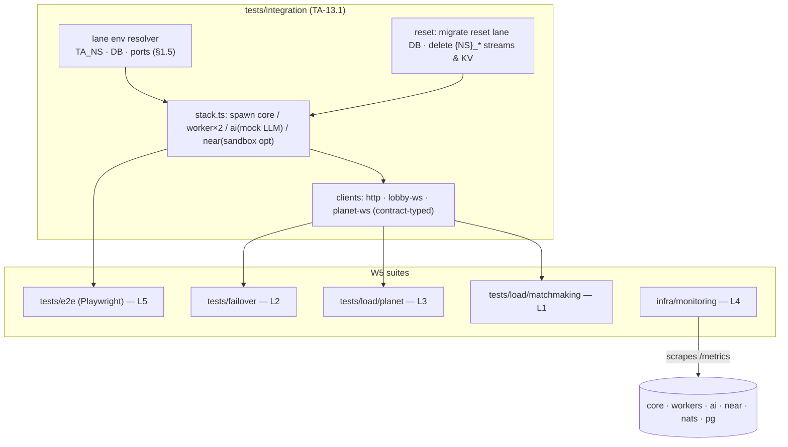

# Epic TA-13 — QA, Observability & Load

> **Orchestrator:** [`EXECUTION_ORCHESTRATOR.md`](../EXECUTION_ORCHESTRATOR.md) · **Status Board:** [`STATUS.md`](../STATUS.md)
> **Spec:** [`ARCHITECTURE.md`](../../spec/ARCHITECTURE.md) §5–§9, §13–§15 · [`CLIENT.md`](../../spec/CLIENT.md) §9, §13 · `CONTINUITY.md` (failover), `MATCHMAKING.md` (invariants), `SIMULATION.md` (determinism), `DEPLOYMENT.md`
> **Lanes:**
> - `TA-13.1` is W0 (Lead).
> - `TA-13.2..13.7` are W5. Their owned paths are the orchestrator §3 "Extra owned paths in W5":
>   - `L1` → `tests/load/matchmaking/**`
>   - `L2` → `tests/failover/**`
>   - `L3` → `tests/load/planet/**`
>   - `L4` → `infra/monitoring/**`
>   - `L5` → `tests/e2e/**`, `infra/deploy/**`

## Overview

This epic builds the proof machinery: an integration harness that lets five agent lanes test against one Postgres and one NATS without cross-talk (W0), then, in W5, the launch evidence. That evidence is end-to-end journeys for the owner's promises (play → leave → colony keeps running → return), a failover determinism suite, measured worker capacity, a matchmaking soak that proves sealed/full planets never receive new players, production observability, and a launch checklist with a production smoke test.

## Epic analytics

- **Goal / user value:** every claim in ARCHITECTURE §1 (G1–G10) is backed by an automated test or a dashboard before launch.
- **Success metrics:**
  - All barrier gates are automated; zero manual steps in W1–W4 barriers.
  - E2E flake rate < 1 % over 20 consecutive CI runs.
  - Failover: 20/20 kill-runs restore with an identical `stateHash` and RTO ≤ 30 s.
  - Capacity: `WORKER_MAX_PLANETS` set from measurement with tick p99 ≤ 50 ms.
  - Soak: 0 invariant violations across 200 players.
  - All alerts have a runbook link.
- **In scope:**
  - Harness, e2e (Playwright), failover, load (WS + planets), matchmaking soak.
  - Prometheus/Grafana/Loki config and alert rules.
  - Launch checklist and prod smoke.
- **Out of scope:**
  - Chaos testing of Postgres/NATS clusters (single-node MVP).
  - Third-party APM.
  - Security pentest (owner task).
- **Key risks:**
  - Long wall-clock scenarios (hours of game time). Mitigation: `TICK_MS` and lifecycle tunables overridden in test (deterministic per tick, so compression is valid).
  - Shared NATS/PG between lanes leaking state. Mitigation: `TA_NS` + per-lane DB, verified by the harness self-test.
  - Load numbers from dev laptops being misleading. Mitigation: run the baseline profile on prod-sized hardware.

## Architecture overview

## Task index

| Task | Title | Wave / Lane | Depends On |
|---|---|---|---|
| `TA-13.1` | Integration test harness with per-lane isolation (`test:integration --suite …`) | W0 / Lead | TA-01.1, TA-01.6, TA-02.1, TA-03.2 |
| `TA-13.6` | Matchmaking soak: 200 synthetic players | W5 / L1 | W4 barrier |
| `TA-13.4` | Failover determinism suite (kill worker mid-tick) | W5 / L2 | W4 barrier |
| `TA-13.5` | Load test: planets/worker & sockets/worker capacity | W5 / L3 | W4 barrier |
| `TA-13.2` | Observability: dashboards, alerts, log correlation | W5 / L4 | W4 barrier |
| `TA-13.3` | E2E journeys: first visit → play → leave → return | W5 / L5 | W4 barrier |
| `TA-13.7` | Launch checklist & production smoke (after the other W5 tasks) | W5 / L5 | TA-13.2, TA-13.3, TA-13.4, TA-13.5, TA-13.6 |

---

## Tasks

### `TA-13.1` — Integration test harness with per-lane isolation (`test:integration --suite …`)

- **Status:** `[ ] Todo`
- **Wave / Lane:** `W0 / Lead`
- **Depends On:** `TA-01.1`, `TA-01.6`, `TA-02.1`, `TA-03.2`
- **Spec:** [`EXECUTION_ORCHESTRATOR.md`](../EXECUTION_ORCHESTRATOR.md) §1.5, §2 (barrier commands) · [`ARCHITECTURE.md`](../../spec/ARCHITECTURE.md) §5, §6, §15 · D-07
- **Target Files:**
  - `tests/integration/package.json` (`@terra/tests-integration`), `tests/integration/vitest.config.ts`
  - `tests/integration/harness/{lane-env.ts,stack.ts,reset-db.ts,reset-nats.ts,wait-ready.ts,clock.ts}`
  - `tests/integration/harness/clients/{http.ts,lobby-ws.ts,planet-ws.ts,nats.ts}`
  - `tests/integration/harness/fixtures/{players.ts,planets.ts}`
  - `tests/integration/smoke/{harness-selftest.spec.ts,infra.spec.ts}`
  - `tests/integration/barrier/README.md` (barrier suites `w1..w4` are written by the lead in each wave pre-step)
  - `tests/integration/{core,worker,edge}/.gitkeep` (lane-owned folders)
  - `tests/e2e/package.json` (`@terra/tests-e2e`), `tests/e2e/playwright.config.ts`, `tests/e2e/fixtures/{stack.ts,game-page.ts}`, `tests/e2e/journeys/.gitkeep`
  - `tests/{failover,load/planet,load/matchmaking}/README.md` (placeholders)
  - root `package.json` scripts: `test:integration`, `test:e2e`, `test:failover`, `test:load`, `test:soak:mm`, `infra:up`, `infra:down`
- **Verify:** `npm run infra:up && npm run db:migrate && npm run test:integration -- --suite smoke`

#### Analytics
- **Problem & goal:**
  - Every barrier and lane Verify command in the orchestrator calls `npm run test:integration -- --suite <x>`.
  - Five lanes run concurrently against one dev NATS and one Postgres.
  - Without one harness that boots the real services with lane-scoped `TA_NS`, DB and ports, and resets them, tests would collide or each lane would build its own incompatible harness.
- **Constraints:**
  - Lane isolation exactly per orchestrator §1.5: `terraagent_lane{K}_test`, `TA_NS=l{K}`, ports `4K01..4K06`.
  - No Docker-in-tests: services run as Node child processes. Docker is only used for the shared PG and NATS.
  - Real Z.ai and NEAR are off by default: mock LLM provider, and NEAR sandbox only in L4 with `NEAR_SANDBOX=1`.
  - Long game-time scenarios must run in minutes.
- **Risks → mitigations:**
  - Orphan child processes. Process-group kill in `afterAll`, plus a `globalTeardown` that reaps by port.
  - Leaking streams/KV between runs. `reset-nats.ts` deletes every stream/bucket with prefix `{NS}_` and re-runs the TA-02.2 bootstrap. (Before TA-02.2 lands, the harness creates streams from the `@terra/contracts` definitions directly.)
  - Barrier suites passing with zero tests. `--suite` fails if no spec matches (`--require-specs` default on).
  - Time compression breaking semantics. Only the tick duration (`TICK_MS`) and the lifecycle tunables (§15) are overridden; per-tick logic is untouched (D-01 determinism).
- **Alternatives rejected:**
  - Testcontainers per test file: slow, and parallel lanes would each start PG/NATS.
  - In-process Nest testing modules only: they miss the cross-process NATS/WS paths the barriers must prove.
  - Jest: Vitest is faster for ESM/TS and is used across the workspaces (TA-01.1).
- **Telemetry (proves it works):** the harness prints a per-suite timing table and a `stack.log` per service under `tests/integration/.artifacts/<suite>/`. `harness-selftest.spec.ts` asserts that two lanes' namespaces do not see each other's KV keys.

#### Architecture
- `lane-env.ts` reads `TA_LANE=1..5`, or derives values from `TA_NS`/`TEST_DATABASE_URL`, and returns `{ ns, dbUrl, ports: {core, worker, worker2, ai, near, game, landing}, natsUrl }`. Defaults (no lane) are `ta_test`, `terraagent_test`, and ports `40x1..`.
- `stack.ts`: `startStack({ services: ["core","worker","worker2","ai","near"], overrides })` spawns `node backend/<app>/dist/main.js` (or `tsx` in watch-less mode) with env from `@terra/config` + overrides, waits on `/readyz`, and returns handles with `.kill(signal)`, `.restart()`, `.logs()`. Failover tests need `kill("SIGKILL")` and `SIGSTOP`/`SIGCONT`.
- `clock.ts` exports time-compression presets:
  - `fast`: `TICK_MS=10` gives 10× real time.
  - `lifecycle-short`: `PLANET_ADMISSION_WINDOW_H=0.01` (36 s), `PLANET_LIFETIME_D=0.002` (~3 min), `MATCH_SEAT_TTL_S=5`, `AWAY_AFTER_S=3`, `AI_MIN_INTERVAL_S=5`.
  - The tunables must accept fractional values (change request to `@terra/config`, TA-01.6).
- `clients/*`:
  - `http` is a typed client over `@terra/contracts` REST DTOs, with guest-login helpers.
  - `lobby-ws` and `planet-ws` speak the WS envelope with zod validation (strict).
  - `nats` provides a JetStream/KV inspector for assertions (e.g. read a lease, count commands).
- Suite selection: `npm run test:integration -- --suite <name>` maps to the Vitest project `tests/integration/<name>/**` (`smoke`, `core`, `worker`, `edge`, `w1`..`w4` → `barrier/w{N}`).
- E2E scaffold: Playwright with Chromium (+ WebKit project), base URLs from lane ports (or `*.terraagent.localhost` when `E2E_NGINX=1`), tag convention `@w2/@w3/@w4/@consent/@journey`, and `fixtures/stack.ts` reusing `harness/stack.ts`.
- Placeholder scripts: `test:failover`, `test:load`, `test:soak:mm` exit non-zero with "no specs yet (TA-13.x)" until their W5 owners fill them. `test:failover -- --quick` maps to `tests/integration/worker/failover-quick.spec.ts` (see DoR).

#### Definition of Ready (DoR)
- [ ] TA-01.1 (workspaces, Vitest), TA-01.6 (`@terra/config` with `TA_NS` + lane port helpers), TA-02.1 (compose with PG `15434`, NATS `14222`, lane DB init) and TA-03.2 (lane test-DB harness / migrate) are done.
- [ ] **Decision to record (lead):** barrier suites `tests/integration/barrier/w{N}/**` are **lead-owned** and written in each wave pre-step from the orchestrator barrier text. Add them to orchestrator §1.3.
- [ ] **Decision to record (lead):** the W3 barrier `test:failover -- --quick` runs a quick failover spec that **TA-07.6 (L3, W3)** must add at `tests/integration/worker/failover-quick.spec.ts`. Add this to the TA-07.6 DoD. The full suite is TA-13.4 in W5.
- [ ] `@terra/config` accepts fractional lifecycle tunables (change request folded into TA-01.6).

#### Definition of Done (DoD)
- [ ] `harness-selftest.spec.ts`:
  - two stacks with `TA_NS=l1` and `l2` run concurrently;
  - KV/stream names are prefixed and invisible to each other;
  - DBs are distinct;
  - all ports come from §1.5.
- [ ] `infra.spec.ts`: PG reachable with the `terra` role; NATS JetStream enabled; a stream create/delete round-trip.
- [ ] `--suite` with no matching specs exits non-zero. `--suite smoke` passes in < 60 s on a laptop.
- [ ] The Playwright scaffold runs an empty smoke spec against `vite preview` of a stub page in CI (proves browsers are installed and the config resolves).
- [ ] Root scripts exist and are documented in `tests/integration/README.md`, including the lane env table copied from orchestrator §1.5.
- [ ] Status synced in orchestrator, issue file and STATUS.md (§1.6).

---

### `TA-13.6` — Matchmaking soak: 200 synthetic players

- **Status:** `[ ] Todo`
- **Wave / Lane:** `W5 / L1`
- **Depends On:** W4 barrier (TA-05.1..05.6, TA-04.5, TA-04.6, TA-08.5)
- **Spec:** [`ARCHITECTURE.md`](../../spec/ARCHITECTURE.md) §8, §15 · `MATCHMAKING.md` (rules + invariants) · D-08, D-12
- **Target Files:**
  - `tests/load/matchmaking/{soak.ts,players.ts,invariants.ts,report.ts,README.md}`
  - `tests/load/matchmaking/profiles/{default.json,leader-failover.json}`
  - `tests/load/matchmaking/reports/.gitkeep`
- **Verify:** `npm run test:soak:mm`

#### Analytics
- **Problem & goal:**
  - Prove the owner's matchmaking rules under realistic concurrency:
    - full planets (5) and long-running planets (> admission window) **never** receive new players;
    - new players land on new or recruiting planets;
    - no seat is double-assigned;
    - the queue keeps moving when the leader core replica dies.
- **Constraints:**
  - Uses the public API and lobby WS only (black box), plus NATS/PG read-only inspectors for invariants.
  - Lifecycle tunables are compressed (`lifecycle-short` preset) so admission windows expire during the run.
  - Two core replicas are required to test the advisory-lock leader failover (D-08).
- **Risks → mitigations:**
  - The soak hitting `MAX_ACTIVE_PLANETS` and stalling. The profile sets `MAX_ACTIVE_PLANETS=60` and asserts that queued tickets show positions rather than errors.
  - False positives from eventual consistency. Invariants are checked on committed DB state after quiescence and continuously on `match.assigned` events.
- **Alternatives rejected:**
  - Unit-level matchmaker tests only: these exist in TA-05.x but miss lobby WS, multi-replica and timing races.
- **Telemetry (proves it works):** the report includes:
  - tickets created/seated/expired/cancelled;
  - `queue_ms` p50/p95/p99;
  - planets created per type;
  - seats-per-planet histogram;
  - invariant violations (must be 0);
  - leader failover gap (s).
  
  It is cross-checked with `ta_match_*` metrics scraped during the run.

#### Architecture
- `players.ts`:
  - 200 synthetic guests arrive as a Poisson process over 10 min (λ ≈ 0.33/s), each with its own guest token.
  - 60 % pick a listed recruiting planet (random from `planets.list`), 40 % pick "New planet" (type 50/50).
  - 10 % cancel while queued, 5 % let the seat TTL expire (never confirm/connect), 5 % reconnect lobby WS mid-queue.
- The leader-failover profile `SIGKILL`s the core replica holding `pg_try_advisory_lock(hashtext('ta.matchmaker'))` at t = 5 min.
- `invariants.ts`, checked continuously and at the end:
  - **I1** no planet with > `PLANET_CAPACITY` live colonies;
  - **I2** no colony created on a planet whose status at seat time was `SEALED|ENDED|ARCHIVED` or age ≥ admission window;
  - **I3** no player with > 1 live colony;
  - **I4** every ticket ends in exactly one terminal state (`SEATED|CANCELLED|EXPIRED|FAILED`);
  - **I5** queue positions are monotonically non-increasing per ticket;
  - **I6** warm pool restored to `WARM_POOL_PER_TYPE` within 30 s after consumption;
  - **I7** no lost tickets across leader failover.
- Report: `reports/soak-<date>.md` + JSON.

#### Definition of Ready (DoR)
- [ ] W4 barrier is green. `MATCHMAKING.md` invariants list matches I1–I7 (update the spec via the lead if it differs).
- [ ] The harness supports two core replicas (`stack.ts` `services: ["core","core2",…]`, ports `4K01`/`4K11`). This is a change request to the TA-13.1 harness through the lead if it is missing.
- [ ] Read-only DB role or query helper available for the invariant checks.

#### Definition of Done (DoD)
- [ ] `npm run test:soak:mm` (default profile) passes with 0 invariant violations, `queue_ms` p95 ≤ 10 s while capacity exists, and all 200 tickets terminal.
- [ ] The leader-failover profile passes: the queue resumes within ≤ 15 s of the leader kill (advisory-lock takeover), I7 holds.
- [ ] Reports committed under `tests/load/matchmaking/reports/`, with a summary pasted into the PR.
- [ ] Status synced in orchestrator, issue file and STATUS.md (§1.6).

---

### `TA-13.4` — Failover determinism suite (kill worker mid-tick)

- **Status:** `[ ] Todo`
- **Wave / Lane:** `W5 / L2`
- **Depends On:** W4 barrier (TA-07.5, TA-07.6, TA-05.5, TA-06.x)
- **Spec:** [`ARCHITECTURE.md`](../../spec/ARCHITECTURE.md) §6.2, §9, §14 · `CONTINUITY.md` §Failover · `SIMULATION.md` (determinism, `stateHash`) · D-01, D-02, D-05
- **Target Files:**
  - `tests/failover/{failover.spec.ts,split-brain.spec.ts,drain.spec.ts,durability.spec.ts,reference-replay.ts,README.md}`
  - `tests/failover/vitest.config.ts`
- **Verify:** `npm run test:failover`

#### Analytics
- **Problem & goal:**
  - Prove RPO = 0 commands and RTO ≤ 30 s for planet failover.
  - Prove the restored state is **bit-identical** to an uninterrupted run. This is the guarantee behind "the colony keeps working", even through crashes and deploys.
- **Constraints:**
  - Uses real worker processes and NATS KV leases (`LEASE_TTL_S=15`, heartbeat 5 s), with no shortened TTLs for the RTO assertion.
  - The reference run is computed offline with `@terra/sim` (same seed + the same command log from JetStream).
  - L2 owns this suite because determinism is the sim's contract. Worker internals are black-boxed.
- **Risks → mitigations:**
  - Non-determinism hidden by luck. Use 20 runs with random kill offsets across tick phases (before, during and after snapshot write) and a hostile scenario (hazards + fauna + PvP).
  - Split-brain (a paused worker resumes after losing its lease). Dedicated test: `SIGSTOP` > TTL, then `SIGCONT`. It must stop ticking and close sockets with `4009`.
- **Alternatives rejected:**
  - Comparing only coarse stats (resources): misses divergence.
  - Snapshot-only restore without replay: violates RPO = 0.
- **Telemetry (proves it works):** a per-run table: kill tick, snapshot tick, replayed commands, restore ms, RTO s, hash match (bool). Cross-check with `ta_worker_planet_restore_seconds` and `ta_planet_lease_takeover_total`.

#### Architecture
- `failover.spec.ts`, for each of 20 runs:
  1. Start the stack with 2 workers.
  2. Create a planet with scripted players: commands every 0.5–3 s through the planet WS and AI mock directives.
  3. Run N seconds, then `SIGKILL` the owning worker at a random offset (including during the 30 s snapshot write).
  4. Measure the time until the lease is held by the other worker and the first post-restore delta reaches a client (RTO).
  5. At a checkpoint tick T, read `stateHash` from the worker (`ctl inspect`) and compare with `reference-replay.ts`, which replays seed + all commands up to T through `@terra/sim`.
- `durability.spec.ts`: every command the client saw `cmd.ack` for before the kill is present after restore (`appliedAtTick` preserved).
- `split-brain.spec.ts`: `SIGSTOP` the owner for 20 s → takeover → `SIGCONT`. The old worker must not tick (no events with its `workerId` after resume), must close sockets with `4009`, and must not write snapshots with a stale `epoch`.
- `drain.spec.ts`: `SIGTERM`/`drain` gives a graceful handoff, clients get `4012`, there are zero lost commands, and RTO ≤ 10 s.

#### Definition of Ready (DoR)
- [ ] TA-07.6 exposes `stateHash` via `{ns}.planet.{id}.ctl inspect` and stamps `appliedAtTick` on acks.
- [ ] `@terra/sim` provides a Node-side replay entry (`restore` + `step`) usable by tests, per the `api.ts` facade.
- [ ] The quick failover spec from W3 (`tests/integration/worker/failover-quick.spec.ts`) exists and passes, as the baseline.

#### Definition of Done (DoD)
- [ ] 20/20 runs: hash match = true, RTO p95 ≤ 30 s, RPO = 0 (durability spec green).
- [ ] Split-brain and drain specs green.
- [ ] The suite runs in CI nightly (`test:ci:full`) in < 20 min. The run table is attached to the PR.
- [ ] Status synced in orchestrator, issue file and STATUS.md (§1.6).

---

### `TA-13.5` — Load test: planets/worker & sockets/worker capacity

- **Status:** `[ ] Todo`
- **Wave / Lane:** `W5 / L3`
- **Depends On:** W4 barrier (TA-07.x, TA-08.2, TA-06.x)
- **Spec:** [`ARCHITECTURE.md`](../../spec/ARCHITECTURE.md) §9, §13, §14, §15 (`WORKER_MAX_PLANETS`, `TICK_MS`, `DELTA_HZ`) · D-02, D-13
- **Target Files:**
  - `tests/load/planet/{load.ts,synthetic-colony.ts,ws-client-pool.ts,collect-metrics.ts,report.ts,README.md}`
  - `tests/load/planet/profiles/{baseline.json,sockets.json,stress.json}`
  - `tests/load/planet/reports/.gitkeep`
- **Verify:** `npm run test:load -- --profile baseline`

#### Analytics
- **Problem & goal:**
  - Many games must run in parallel, and planets tick at full rate even with nobody connected (D-13).
  - Measure how many planets and sockets one worker sustains within the tick budget, and set `WORKER_MAX_PLANETS` from data instead of the placeholder 50.
- **Constraints:**
  - Tick budget 100 ms. The target is a scheduler-wide tick p99 ≤ 50 ms (headroom for GC and snapshots), event-loop lag p99 ≤ 30 ms, zero missed ticks.
  - Measured on prod-sized hardware (record CPU/RAM), with AI on the mock provider.
  - Each planet runs 5 colonies with an active rule engine, hazards and fauna on (hostile scenario).
- **Risks → mitigations:**
  - The load generator becoming the bottleneck. Run the generator on a separate host/process with its own CPU metrics.
  - Unrealistic idle planets. Synthetic colonies send commands at the human rate (1 per 5–20 s) on 20 % of colonies, and the rest run on autopilot (the realistic away ratio).
- **Alternatives rejected:**
  - k6 WS: possible, but the Node generator reuses the contract-typed `planet-ws` client and ticket flow from the harness. Documented in the README as an option.
- **Telemetry (proves it works):** scraped from worker `/metrics` (TA-07.8):
  - `ta_worker_tick_duration_seconds` (histogram), `ta_worker_tick_missed_total`, `ta_worker_event_loop_lag_seconds`;
  - `ta_worker_planets`, `ta_worker_sockets`;
  - `ta_worker_delta_bytes_total`, `ta_worker_snapshot_duration_seconds`;
  - `process_resident_memory_bytes`.
  
  The report shows the capacity curve.

#### Architecture
- `baseline.json`: 1 worker; ramp planets 10 → 20 → 40 → 60 → 80 → 100, 5 colonies each, holding each step 5 min. 1 socket per connected colony (20 % connected).
- The step at which tick p99 > 50 ms or missed ticks > 0 is the **knee**. Recommended `WORKER_MAX_PLANETS = floor(0.7 × knee)`.
- `sockets.json`: a fixed 30 planets; ramp sockets per worker 200 → 500 → 1000 → 2000 (spectator-style connections on the same colonies via takeover-free test tickets, or one socket per colony across more planets). Measures delta fan-out cost and the RSS per socket.
- `stress.json`: 1.5× knee for 10 min. The worker must shed load (TA-07.8: refuse new `assignPlanet`, keep existing planets ticking) and not crash.
- Synthetic colonies obtain tickets through core (real path) and speak WS via `ws-client-pool.ts` (one event loop, many sockets).

#### Definition of Ready (DoR)
- [ ] TA-07.8 metrics and load shedding are merged. Hardware for the run is provisioned (owner or ops; record specs in the report).
- [ ] **Contract change request (lead pre-step), if needed:** a test-only "load" planet flag so synthetic planets do not appear in the public picker (`hidden: true`), shared with TA-13.7 smoke.

#### Definition of Done (DoD)
- [ ] The baseline report shows the knee, memory per planet, CPU per planet, delta bytes/s per socket and snapshot duration p99. The recommended `WORKER_MAX_PLANETS` is filed as an env-default change (lead updates ARCHITECTURE §15 in the merge commit).
- [ ] Sockets profile: a sockets-per-worker limit recorded, with RSS per socket.
- [ ] Stress profile: no crash, new assignments refused, existing planets' tick p99 ≤ 100 ms.
- [ ] Reports committed under `tests/load/planet/reports/`.
- [ ] Status synced in orchestrator, issue file and STATUS.md (§1.6).

---

### `TA-13.2` — Observability: dashboards, alerts, log correlation

- **Status:** `[ ] Todo`
- **Wave / Lane:** `W5 / L4`
- **Depends On:** W4 barrier (every service's `/metrics` from TA-04.1, TA-07.1/07.8, TA-09.1/09.5, TA-10.1)
- **Spec:** [`ARCHITECTURE.md`](../../spec/ARCHITECTURE.md) §3 (`/healthz` `/readyz` `/metrics`), §6, §14, §15 · `DEPLOYMENT.md`
- **Target Files:**
  - `infra/monitoring/docker-compose.monitoring.yml` (Prometheus, Grafana, Loki, Promtail, nats-exporter, postgres-exporter)
  - `infra/monitoring/prometheus/{prometheus.yml,rules/*.yml}`
  - `infra/monitoring/grafana/provisioning/{datasources,dashboards}/*.yml`, `infra/monitoring/grafana/dashboards/{overview,planet-workers,matchmaking,ai-orchestrator,near-gateway,nats,postgres}.json`
  - `infra/monitoring/loki/{loki.yml,promtail.yml}`
  - `infra/monitoring/runbooks/*.md`, `infra/monitoring/scripts/check.mjs`
- **Verify:** `npm run monitoring:check`

#### Analytics
- **Problem & goal:**
  - A world that runs while nobody watches needs operators who are told when it breaks:
    - workers dying, lease churn, ticks overrunning;
    - queues stalling;
    - AI budget burning;
    - NEAR jobs failing.
  - Logs must be correlatable by `planetId`, `colonyId`, `workerId` and `traceId` across NATS hops.
- **Constraints:**
  - Self-hosted, internal only: Grafana is not publicly routed. Access is through an SSH tunnel, or optionally `ops.terraagent.com` behind basic auth plus an IP allow-list (owner decision; ARCHITECTURE §4 lists no ops host).
  - The overlay compose must attach to the prod compose network without editing `infra/deploy/**` (L5's path).
  - Log format is the pino JSON already emitted by the services.
- **Risks → mitigations:**
  - Alert fatigue. Every alert has a runbook, a `for:` duration and a severity; pages only for user-visible impact.
  - Cardinality explosion. Metrics never use `colonyId` or `playerId` labels; `planetId` is allowed only on low-rate worker gauges, capped by `WORKER_MAX_PLANETS`.
- **Alternatives rejected:**
  - A hosted APM (Datadog/Grafana Cloud): cost and data egress; possible later.
  - OpenTelemetry tracing backend (Tempo) in MVP: `traceId` in logs + NATS headers is enough. Tempo can be added later without code changes if OTel SDK hooks exist.
- **Telemetry (proves it works):** `monitoring:check` validates the rules (`promtool check rules`), the dashboards' JSON and datasource provisioning. A smoke test in the overlay stack fires a synthetic alert (`TestAlwaysFiring`) and asserts it reaches the Alertmanager webhook receiver.

#### Architecture
- Scrape targets: `core:3000/metrics`, `planet-worker-*:3100/metrics` (file-based SD generated from the nginx worker map list), `ai-orchestrator:3200`, `near-gateway:3300`, `nats-exporter`, `postgres-exporter`.
- Alert rules (initial):

| Alert | Expr (sketch) | For | Severity |
|---|---|---|---|
| `WorkerDown` | `up{job="planet-worker"} == 0` | 30s | page |
| `PlanetLeaseOrphaned` | `ta_planets_without_lease > 0` (core scheduler gauge) | 45s | page |
| `TickOverrun` | `histogram_quantile(0.99, rate(ta_worker_tick_duration_seconds_bucket[5m])) > 0.08` | 5m | warn |
| `TicksMissed` | `increase(ta_worker_tick_missed_total[5m]) > 0` | 5m | warn |
| `FailoverSlow` | `ta_worker_planet_restore_seconds{quantile="0.95"} > 30` | 0m | warn |
| `MatchQueueStalled` | `ta_match_queue_depth > 0 and rate(ta_match_seated_total[5m]) == 0` | 5m | page |
| `MatchWaitHigh` | `histogram_quantile(0.95, rate(ta_match_wait_seconds_bucket[10m])) > 30` | 10m | warn |
| `AiBudget80` | `ta_ai_tokens_used_today / ta_ai_tokens_budget_today > 0.8` | 0m | warn |
| `AiErrorRate` | `rate(ta_ai_calls_total{result!="ok"}[10m]) / rate(ta_ai_calls_total[10m]) > 0.2` | 10m | warn |
| `NearJobsFailing` | `rate(ta_near_jobs_total{result="failed"}[15m]) > 0` | 15m | warn |
| `NatsStreamLag` | consumer pending on `{NS}_PLANET_EVENTS` > 10k | 10m | warn |
| `PostgresDown` / `NatsDown` | exporter `up == 0` | 30s | page |
| `Http5xx` | `rate(ta_http_requests_total{status=~"5.."}[5m]) / rate(ta_http_requests_total[5m]) > 0.02` | 5m | page |

- Metric names above are the contract for the service tasks. Any mismatch found at W5 is fixed by a lead change request to the owning lane, not by renaming in dashboards.
- Log correlation: Promtail parses the pino JSON. Labels: `service`, `workerId`, `level`. `planetId`, `colonyId` and `traceId` stay as JSON fields (queryable in LogQL, not labels). `traceId` propagates via the NATS header `traceparent` (contract change request if `@terra/contracts` lacks the header helper).
- Dashboards:
  - **overview** (G1–G10 health);
  - **planet-workers** (ticks, planets, sockets, leases, restores);
  - **matchmaking** (depth, wait, seats, planets by status, warm pool);
  - **ai** (calls, tokens, latency, fallbacks);
  - **near** (jobs, relayer balance);
  - **nats**, **postgres**.
- Runbooks: one per alert (`runbooks/<Alert>.md`): symptoms, first checks, mitigation (e.g. `npm run deploy -- --drain pw-2`), escalation.

#### Definition of Ready (DoR)
- [ ] All alert/dashboard metric names exist in the `shared/contracts/src/metrics.ts` registry (orchestrator §1.7 normalization). Known renames to verify: `mm_queue_depth` → `ta_core_match_queue_depth`; `ai_*` → `ta_ai_*`; worker `_ms` histograms → `_seconds`; `ta_planets_without_lease` must be emitted by the core planet scheduler (TA-05.5).
- [ ] Each service exposes the metric names in the table above. If any are missing, the lead files change requests to the owning lanes' W5 scope before this task starts. (Alternative: mark `[!] Blocked`.)
- [ ] Owner decision on Grafana access (SSH tunnel vs `ops.terraagent.com`) and the alert receiver (Telegram, email or Slack webhook) is recorded in `OWNER_TASKS.md`.
- [ ] The prod compose network name from TA-02.5 is known.

#### Definition of Done (DoD)
- [ ] `npm run monitoring:check` green (promtool rules check, dashboard JSON schema, provisioning lint).
- [ ] Overlay stack up against the local prod-like stack (TA-02.6): all targets `up`, every dashboard renders data, and a synthetic alert reaches the receiver.
- [ ] A forced `WorkerDown` (stop a worker) fires within 1 min and resolves after restart. The `TA-13.4` failover run is visible on the planet-workers dashboard.
- [ ] Every alert links to an existing runbook.
- [ ] Status synced in orchestrator, issue file and STATUS.md (§1.6).

---

### `TA-13.3` — E2E journeys: first visit → play → leave → return

- **Status:** `[ ] Todo`
- **Wave / Lane:** `W5 / L5`
- **Depends On:** W4 barrier (journeys from TA-11.2/11.3/11.5/11.8, TA-12.2 exist)
- **Spec:** [`CLIENT.md`](../../spec/CLIENT.md) §3–§6, §9, §13 · [`ARCHITECTURE.md`](../../spec/ARCHITECTURE.md) §1 (G1–G10), §7, §8 · `CONTINUITY.md`
- **Target Files:**
  - `tests/e2e/journeys/{j1-first-visit.spec.ts,j2-leave-and-return.spec.ts,j3-device-takeover.spec.ts,j4-sealed-planet.spec.ts,j5-worker-drain.spec.ts,j6-elimination.spec.ts,j7-near-link.spec.ts,j8-perf-probe.spec.ts}`
  - `tests/e2e/fixtures/{scenarios.ts,admin.ts}`
  - `tests/e2e/playwright.config.ts` (projects: chromium, webkit; retries 1; trace on-first-retry)
- **Verify:** `npm run test:e2e`

#### Analytics
- **Problem & goal:**
  - Consolidate the per-wave journey specs into a launch-grade suite that proves the owner's promises end to end in a real browser:
    - online play;
    - the colony running without the player;
    - return-and-continue;
    - first-timer vs returning routing;
    - matchmaking sealing;
    - failover/drain transparency.
- **Constraints:**
  - Runs against the full local stack (2 workers, AI mock, NEAR sandbox for J7), optionally behind nginx (`E2E_NGINX=1`, `*.terraagent.localhost`).
  - Time compression via the harness presets.
  - Flake rate < 1 %.
  - Headless GPU may be software GL, so perf assertions are warn-only there.
- **Risks → mitigations:**
  - Flaky timing. Assertions wait on `__terraDebug` state (`socketState`, `lastTick`) and contract events, never on sleeps.
  - Long runtime. Journeys run in parallel workers, each with its own planet created via the admin API (TA-04.7).
- **Alternatives rejected:**
  - Cypress: weaker multi-context and WebSocket support.
  - API-only journeys: miss rendering, routing and consent.
- **Telemetry (proves it works):** Playwright HTML report + traces; a flake dashboard from 20 consecutive CI runs (pass rate per journey); perf probe numbers (fps p50, draw calls) recorded per run.

#### Architecture

| Journey | Proves | Steps & assertions |
|---|---|---|
| **J1** first visit | G1, G5 | landing → Play → guest → `/planets` (≥ 1 recruiting + New planet cards) → join → seated → `/play` welcome → place Solar T1 → ack → scaffold visible. |
| **J2** leave & return | G3, G4 | J1 colony → close context → `fast` clock 10 min of game time → new context same cookies → lands on `/play` with **no clicks** → away modal shows resource deltas > 0, ≥ 1 AI decision, buildings completed ≥ 1. |
| **J3** device takeover | G4 | Context A playing → context B opens → B welcomes, A shows `4001` overlay → A "Play here" → A takes back. |
| **J4** sealed planet | G6 | Admin creates planet P with 4 synthetic colonies → player 5 joins P (seated) → P `SEALED` → player 6's picker does not list P; a join attempt on P's id returns `planet_unavailable` → offered a new planet. Second variant: P with 2 colonies + admission window elapsed (`lifecycle-short`) → not listed. |
| **J5** worker drain | G2, §14 | Player on worker A → admin drain A → client shows reconnect pill → resumes on worker B within 10 s → the command sent before the drain was acked and is present. |
| **J6** elimination | §7 | Admin `inspect`/test command eliminates the colony → `4011` → `/recap/eliminated` → "Found a new colony" → `/planets`. |
| **J7** NEAR link | G7 | Settings → link wallet (sandbox key signs NEP-413 via a test wallet shim) → `/me` shows the linked account → a new browser with wallet sign-in resumes the same colony. |
| **J8** perf probe | CLIENT §9 | Fixture planet with 300 buildings + 500 robots → draw calls ≤ 60, entity calls ≤ 25, fps p50 ≥ 58 (GPU runner) / warn on software GL. |

#### Definition of Ready (DoR)
- [ ] The admin/test API (TA-04.7) supports: create a hidden planet with N synthetic colonies, drain a worker, eliminate a colony (test-only, guarded by `TA_TEST_ADMIN=1`). **Contract change request** if the elimination test hook is missing.
- [ ] Harness presets `fast` and `lifecycle-short` (TA-13.1) are available. NEAR sandbox wiring is in place from L4 (TA-10.x).
- [ ] A CI runner with GPU (or acceptance that J8 is warn-only) is agreed with the owner.

#### Definition of Done (DoD)
- [ ] J1–J8 green on Chromium; J1–J4 green on WebKit.
- [ ] 20 consecutive CI runs with pass rate ≥ 99 % per journey (flake report attached).
- [ ] `npm run test:e2e -- --grep "@w2\|@w3\|@w4"` remains green (the per-wave specs are kept or folded into J-specs with the tags preserved).
- [ ] The suite runtime is ≤ 15 min in CI with 4 Playwright workers.
- [ ] Status synced in orchestrator, issue file and STATUS.md (§1.6).

---

### `TA-13.7` — Launch checklist & production smoke (after the other W5 tasks)

- **Status:** `[ ] Todo`
- **Wave / Lane:** `W5 / L5`
- **Depends On:** `TA-13.2`, `TA-13.3`, `TA-13.4`, `TA-13.5`, `TA-13.6`, `TA-02.5`, `TA-02.6`
- **Spec:** [`ARCHITECTURE.md`](../../spec/ARCHITECTURE.md) §4, §14, §15 · `DEPLOYMENT.md` · [`OWNER_TASKS.md`](../OWNER_TASKS.md) · [`CLIENT.md`](../../spec/CLIENT.md) §10
- **Target Files:**
  - `infra/deploy/LAUNCH_CHECKLIST.md`
  - `infra/deploy/scripts/smoke-prod.mjs`
  - `infra/deploy/scripts/smoke-prod.test.mjs`
- **Verify:** `npm run smoke:prod -- --base terraagent.com` (and `--base terraagent.localhost` against TA-02.6 before the real launch)

#### Analytics
- **Problem & goal:**
  - The final gate. It confirms that production on the real domains works end to end the same way the local stack did, that every owner-side prerequisite is done (DNS, TLS, keys, legal text, budgets), and that rollback is rehearsed.
  - The smoke test must prove a real join without polluting public planets.
- **Constraints:**
  - The smoke test must not consume a public seat or show up in the picker: it uses a hidden smoke planet created via the admin API (`hidden: true`), then retires the colony and ends the planet.
  - It must run in < 3 min.
  - Root script `smoke:prod` and `test:ci:full` composition are shared paths, so they come through a lead change request.
- **Risks → mitigations:**
  - The smoke test leaving garbage. A `finally` block cleans up and is idempotent by smoke-run id.
  - A green smoke on a half-configured CDN. It also asserts headers (HSTS, CSP, `frame-ancestors`) and WebSocket upgrade through Cloudflare/nginx on both `api` and `ws` hosts.
- **Alternatives rejected:**
  - A manual launch walk-through only: not repeatable after each deploy.
- **Telemetry (proves it works):** smoke output as a JSON summary (step, ms, ok), also pushed as a Prometheus push metric `ta_smoke_success` (optional, via the TA-13.2 overlay) so the overview dashboard shows the last smoke.

#### Architecture
- `smoke-prod.mjs --base <domain> [--admin-key env:TA_ADMIN_KEY]` steps:
  1. DNS resolves `<base>`, `www.`, `game.`, `api.`, `ws.`.
  2. TLS is valid for ≥ 14 days.
  3. `https://www.<base>` → `301` apex.
  4. Landing `200` + HSTS, CSP, `frame-ancestors 'none'`, `Referrer-Policy`.
  5. Game `200` + SPA fallback (`/play` → `index.html`).
  6. `POST api/v1/auth/guest` → `GET /v1/me/home` = `NEW`.
  7. `GET /v1/planets` lists ≥ 1 `RECRUITING` (warm pool).
  8. Lobby WS `wss://api.<base>/ws` hello → `planets.list`.
  9. Admin creates hidden smoke planet → join → seated → `/me/home` `ACTIVE` → planet WS `wss://ws.<base>/w/{id}` → `welcome` + ≥ 3 deltas → send `setPriorities` → `cmd.ack`.
  10. Cleanup: retire colony, end planet.
  11. Summary.
- `LAUNCH_CHECKLIST.md` sections:
  - **Owner items** (from `OWNER_TASKS.md`): domains and DNS, Cloudflare/TLS, NEAR accounts and funding, Z.ai key and budget, legal text replacing the "Draft" pages, alert receiver.
  - **Config**: `WORKER_MAX_PLANETS` from TA-13.5; `MAX_ACTIVE_PLANETS`; AI budget; `NEAR_NETWORK`.
  - **Evidence links**: TA-13.3 flake report, TA-13.4 run table, TA-13.5 capacity report, TA-13.6 soak report, TA-13.2 alert test.
  - **Rollback rehearsal**: deploy N → N-1 with worker drain, zero lost commands.
  - **Backups**: Postgres daily dump + restore test; JetStream file store on a persistent volume.
  - **Go/No-go sign-off.**

#### Definition of Ready (DoR)
- [ ] All other W5 tasks are `[x] Done`. TA-02.5 prod compose and TA-02.6 local prod-like stack are working.
- [ ] **Contract change request (lead pre-step):** admin API supports `hidden` planets plus retire/end for smoke (TA-04.7). Root scripts `smoke:prod` and `test:ci:full` (= `ci:fast` + `test:integration` all suites + `test:e2e` + `test:failover` + `monitoring:check`) are added to root `package.json`.
- [ ] Owner provides production credentials out-of-band (never committed): `TA_ADMIN_KEY` for the smoke run.

#### Definition of Done (DoD)
- [ ] `smoke-prod.test.mjs` unit-tests each step's success and failure parsing against a mocked server.
- [ ] `npm run smoke:prod -- --base terraagent.localhost` green on the TA-02.6 stack. On launch day, `--base terraagent.com` green, with the output attached.
- [ ] `LAUNCH_CHECKLIST.md` complete, with all evidence linked and the owner's go/no-go recorded.
- [ ] Rollback rehearsal done with zero lost commands (from the TA-13.4 drain spec or a manual run log).
- [ ] Status synced in orchestrator, issue file and STATUS.md (§1.6). W5 barrier executed by the lead.
