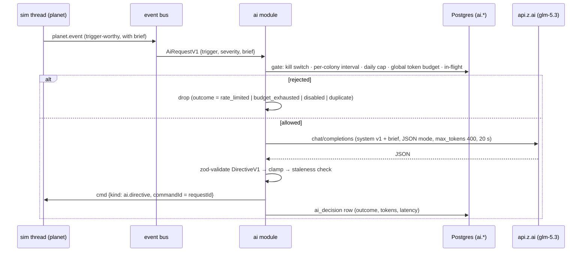

# TerraAgent — AI Orchestrator Specification

> **Status:** v0.2 (2026-10-30) · **Module:** `ai` inside the one app (`backend/app/src/ai`, D-24). There is no separate service, NATS or work queue.
> **Parent:** [`ARCHITECTURE.md`](./ARCHITECTURE.md) §6, §10, §15 · **Decisions:** [D-09](./DECISIONS.md#d-09--zai-glm-53), D-17, D-24, D-25, D-26 · **Plan:** [`TA-09`](../plan/issues/TA-09-ai-orchestrator.md)
> **Game design:** [`docs/game/autonomous-colony-spec.md`](../game/autonomous-colony-spec.md) §10 (rules first, LLM rarely)

---

## 1. Purpose

The colony is autonomous. The rule engine inside `@terra/sim` (TA-06.7) makes **90–95 %** of decisions every tick for free. The AI orchestrator is the **strategic director** for the remaining **5–10 %**: rare, event-driven decisions such as re-prioritising after an attack, answering a trade offer, deciding when to start a rocket. It runs whether the player is connected or away. Away behaviour follows [`CONTINUITY.md`](./CONTINUITY.md) and TA-08.2.

It never touches simulation state directly. Triggers come **straight from sim events** on the in-process event bus. The module reads a compact **colony brief** from the sim thread and returns a validated **`DirectiveV1`**. The directive goes to the planet's sim thread as an ordinary command (`ai.directive`), which is applied at the next step.



---

## 2. Rules

| ID | Rule |
|---|---|
| `AI-01` | The orchestrator MUST NOT be on the tick path. A missing, late or invalid directive MUST leave the colony running on the rule engine with the player's last priorities. |
| `AI-02` | LLM calls are triggered only by `AiRequestV1` built from sim events on the event bus (§3). The only timer is the `idle.checkpoint` trigger, which the `game` module emits. In-memory requests are lost on restart, which is accepted (`AI-01`). |
| `AI-03` | Per colony there MUST be at most **1 call / `AI_MIN_INTERVAL_S` (300 s)** for `normal` triggers, at most **1 call / `AI_CRITICAL_INTERVAL_S` (120 s)** for `critical` triggers, and at most **`AI_MAX_CALLS_PER_DAY` (150)** calls per UTC day. A critical call also resets the normal interval. |
| `AI-04` | A global daily token budget `AI_DAILY_TOKEN_BUDGET` MUST be enforced before each call, using an estimate of prompt tokens plus `max_tokens`. When it is exhausted, requests get `budget_exhausted` until 00:00 UTC. |
| `AI-05` | At most one in-flight call per colony. A second request for the same colony while one is in flight MUST be dropped as `duplicate`. |
| `AI-06` | Every provider response MUST be parsed as JSON and validated against `DirectiveV1` (zod, `.strict()`). Invalid → outcome `invalid` and nothing is published. |
| `AI-07` | Valid directives MUST be **clamped** (§6.3) before they are published. Clamping is logged as `clampedFields[]`. |
| `AI-08` | A directive MUST be dropped as `stale` if more than `AI_TIMEOUT_S` (20 s) passed since the request was enqueued, or if the request's `basedOnTick` is older than the planet's latest known tick by more than 600 ticks (60 s). |
| `AI-09` | Directives are posted to the sim thread with `commandId = requestId`. The sim ignores a second directive with the same `requestId`. |
| `AI-10` | Every attempted provider call MUST write exactly one `ai.ai_decision` row. Rejections before the call are counted in metrics and are not written as rows. |
| `AI-11` | `AI_ENABLED=false` (env) or the runtime kill switch (admin endpoint, persisted in `ai.ai_settings`) MUST stop all provider calls within 5 s. Requests are dropped as `disabled`. |
| `AI-12` | Away-mode limits (TA-08.2) are enforced **in the sim** when the directive is applied, for example no raids on other players while away unless allowed. The AI side only avoids proposing them (system prompt + clamp). The sim is the authority. |
| `AI-13` | Tests and every lane except L4 MUST use the mock provider. Real Z.ai calls require `AI_PROVIDER=zai` **and** `AI_LIVE=1` outside production. |
| `AI-14` | Secrets (`ZAI_API_KEY`) MUST never be logged. Prompts and responses are stored as a SHA-256 hash plus the parsed directive. Raw text is stored when `AI_LOG_RAW=1`, which is **on in prod** (owner decision). Raw columns are purged after **14 days**; hashes and directives follow the 30-day `ai_decision` retention. Prompts contain no PII. |
| `AI-15` | **No per-player throttling beyond the budgets (D-25).** The per-colony intervals, the daily cap and the global token budget are cost controls. There are no abuse checks. |

---

## 3. Triggers

Event kinds are owned by `@terra/contracts` (TA-01.3 / TA-07.7). This table maps them to AI triggers. The **`game` module** decides when to emit an `AiRequestV1` from sim events, using its own hysteresis (re-emit no more than once per 60 s per trigger while the condition persists). The AI service enforces the limits in §2.

| Trigger (`AiRequestV1.trigger`) | Source condition (sim event) | Severity |
|---|---|---|
| `colony.under_attack` | fauna or another colony damages a building or robot owned by the colony, with no attack in the last 120 s | **critical** |
| `power.collapse` | brownout shedding reached group ≥ 3 (extractors/depots) or generation < 50 % of demand for 30 s | **critical** |
| `hub.critical` | Command Hub HP < 50 % | **critical** |
| `resource.critical` | a consumed resource reaches 0 within ≤ 120 s at the current net rate | **critical** |
| `resource.shortage` | a consumed resource reaches 0 within ≤ 600 s | normal |
| `storage.full` | any resource ≥ 95 % of its cap for 60 s (mining halted) | normal |
| `supply.capped` | robot supply used = cap and the build queue holds robots | normal |
| `neighbor.contact` | first territory border contact with another colony | normal |
| `trade.offer_received` | an incoming trade offer arrived (TA-10.5) | normal |
| `building.destroyed` | a building of the colony was destroyed (hazard, fauna or raid) | normal |
| `hazard.ended` | a weather hazard ended and repairs are pending | normal |
| `rocket.available` | rocket prerequisites met (TA-06.10). Decide launch timing and destination type | normal |
| `away.started` | player marked away (`AWAY_AFTER_S` = 60 s), so set the autopilot strategy | normal |
| `idle.checkpoint` | no AI call for this colony in 30 min **and** the player is away | normal |

---

## 4. Rate limits & budgets

| Key | Default | Meaning |
|---|---|---|
| `AI_ENABLED` | `true` | Global env switch (restart). The runtime switch is the admin endpoint (§9). |
| `AI_PROVIDER` | `zai` in prod, `mock` otherwise | `zai` \| `mock` |
| `AI_MODEL` | `glm-5.3` | Owner-confirmed ([D-09](./DECISIONS.md#d-09--zai-glm-53)); check account rate limits in the Z.ai console |
| `AI_BASE_URL` | `https://api.z.ai/api/paas/v4` | OpenAI-compatible **general** endpoint (owner-confirmed) |
| `AI_MIN_INTERVAL_S` | `300` | Normal trigger interval per colony |
| `AI_CRITICAL_INTERVAL_S` | `120` | Critical trigger interval per colony |
| `AI_MAX_CALLS_PER_DAY` | `150` | Per colony per UTC day |
| `AI_DAILY_TOKEN_BUDGET` | `20000000` (≈ $40/day, §8) | Global, input + output tokens. Owner-confirmed for launch. Includes `away.story` calls (CONTINUITY CT-34). |
| `AI_TIMEOUT_S` | `20` | End-to-end per call, including one retry |
| `AI_MAX_TOKENS` | `400` | Completion cap |
| `AI_CONCURRENCY` | `8` | Max parallel provider calls |
| `AI_LOG_RAW` | `1` in prod | Store raw prompt and response text (14-day retention, AI-14) |
| `AI_RAW_RETENTION_D` | `14` | Purge window for `raw_prompt` / `raw_response` |

**State.** Per-colony limits live in Postgres (`ai.ai_colony_budget`). The gate is one atomic `UPDATE … WHERE … RETURNING`, so limits survive restarts and can be audited together with `ai_decision`.

```sql
UPDATE ai.ai_colony_budget
   SET last_call_at = now(),
       last_critical_at = CASE WHEN $sev = 'critical' THEN now() ELSE last_critical_at END,
       calls_today = CASE WHEN day = current_date THEN calls_today + 1 ELSE 1 END,
       day = current_date,
       in_flight_until = now() + interval '20 seconds'
 WHERE colony_id = $1
   AND (in_flight_until IS NULL OR in_flight_until < now())
   AND (day <> current_date OR calls_today < $maxPerDay)
   AND ( ($sev = 'critical' AND (last_critical_at IS NULL OR last_critical_at < now() - $critInterval))
      OR ($sev = 'normal'   AND (last_call_at     IS NULL OR last_call_at     < now() - $minInterval)) )
RETURNING colony_id;
```

---

## 5. Prompt shape

### 5.1 System prompt (static, versioned `PROMPT_VERSION = 1`)
- Role: "strategic director of an autonomous robot colony; the rule engine executes; you only set priorities and up to 5 high-level actions".
- Output: **JSON only**, matching the embedded JSON Schema generated from `DirectiveV1` (`zod-to-json-schema`). No prose outside `rationale` (≤ 200 chars).
- Constraints: use only the building/robot ids listed in the catalog line; do not exceed the stock shown; when `away=yes`, follow the player's stated away policy and never propose `raid` unless `raidsAllowed=yes`.
- Size target: ≤ 450 tokens, identical on every call so the provider's context cache can be used where supported (verify for Z.ai).

### 5.2 User message: compact brief (≤ 1200 chars, ~150–300 tokens)

Built only from `ColonyBriefV1` (contract, produced by the sim thread). Fixed field order. Numbers rounded to integers in the brief.

```text
T=18342 planet=desert day=2.1 night=no weather=sandstorm(90s)
trigger=resource.critical(W eta=95s) sev=critical
res M=820/1500 Min=310/1500 Pet=40/1500 W=12/1500 | E +14/s (gen 62 use 48) batt 40%
bld hub1:1 beacon1:2 solar1:4 coal1:1 mine1:3 pump1:0 depot1:1 dca1:1 fac1:1 turret1:1
bots miner1:5 builder1:2 combat1:1 supply 9/10 queue: mine1,miner1
threats nest@NE d=14 lvl1 | neighbors C-7 border=yes hostile=no
offers in: #o81 C-7 gives W150 wants M200 exp=240s
prio econ60 exp20 def10 pow10 terra0 | away=yes 47m raidsAllowed=no
catalog bld=[hub,beacon,pylon,capacitor,solar,wind,coal,mine,pump,depot,dca,factory,turret] bots=[miner,builder,combat]
```

### 5.3 Provider request (Z.ai, OpenAI-compatible)

```http
POST {AI_BASE_URL}/chat/completions
Authorization: Bearer ${ZAI_API_KEY}
{
  "model": "glm-5.3",
  "messages": [{"role":"system","content":"<v1>"},{"role":"user","content":"<brief>"}],
  "response_format": {"type": "json_object"},
  "temperature": 0.3,
  "max_tokens": 400,
  "thinking": {"type": "disabled"}
}
```
`response_format` and `thinking` support must be **verified against Z.ai docs** in TA-09.1. If either is unsupported, the provider adapter drops it and relies on the system prompt plus a strict parser.

---

## 6. `DirectiveV1`

### 6.1 Schema (lives in `@terra/contracts/ai`; contract change request for the W1/W3 pre-step)

```ts
export const Priority = z.number().int().min(0).max(100);
export const DirectiveActionV1 = z.discriminatedUnion('kind', [
  z.object({ kind: z.literal('queueBuild'),   building: BuildingId, tier: z.literal(1).or(z.literal(2)), near: z.enum(['hub','frontier','deposit:metals','deposit:minerals','deposit:petroleum','deposit:water']), count: z.number().int().min(1).max(3) }).strict(),
  z.object({ kind: z.literal('queueRobot'),   robot: RobotId, tier: z.literal(1), count: z.number().int().min(1).max(5) }).strict(),
  z.object({ kind: z.literal('upgrade'),      building: BuildingId, toTier: z.literal(2) }).strict(),
  z.object({ kind: z.literal('tradeOffer'),   give: ResAmount, want: ResAmount, to: ColonyId.optional() }).strict(),
  z.object({ kind: z.literal('tradeRespond'), offerId: z.string(), accept: z.boolean() }).strict(),
  z.object({ kind: z.literal('rally'),        target: z.enum(['hub','frontier','nest','enemyBorder']) }).strict(),
  z.object({ kind: z.literal('raid'),         targetColonyId: ColonyId }).strict(),
]);
export const DirectiveV1 = z.object({
  v: z.literal(1),
  rationale: z.string().max(200),
  priorities: z.object({ economy: Priority, expansion: Priority, defense: Priority, power: Priority, terraform: Priority }).strict().optional(),
  actions: z.array(DirectiveActionV1).max(5),
  ttlTicks: z.number().int().min(600).max(6000).default(3000),
}).strict();
```
The sim command that wraps it: `{ kind: 'ai.directive', source: 'ai', colonyId, requestId, basedOnTick, promptVersion, directive: DirectiveV1 }`.

Priority names must equal the player's priority sliders in TA-06.7 and TA-11.7. Reconcile them in the W1 pre-step.

### 6.2 Validation
1. `JSON.parse`. On failure, try once to extract the first `{…}` block, then fail as `invalid`.
2. `DirectiveV1.safeParse`. On failure → `invalid`, with zod issues stored in `ai_decision.error`.
3. Reference checks against the brief: building and robot ids are in the catalog; `offerId` exists in `offers in`; `targetColonyId` is a known neighbor.

### 6.3 Clamping (deterministic, unit-tested)

| Field | Clamp |
|---|---|
| `priorities` | If present, normalise so the sum is 100, rounding to integers with the remainder going to the largest. All zeros → drop `priorities`. |
| `actions` | Drop unknown ids. Dedupe identical actions. Keep the first 5. |
| `queueBuild.count` / `queueRobot.count` | `min(count, affordableNow)`. Affordability is estimated from brief stock × catalog cost (from `@terra/sim` data tables, read-only). |
| `tradeOffer.give.amount` | ≤ 20 % of current stock of that resource. ≤ 50 % is the player-level hard cap enforced by the sim/trade saga. |
| `raid` | Removed when `away=yes && raidsAllowed=no` or `hostile=no` with no prior attack, and logged as clamped. |
| `ttlTicks` | Clamp into [600, 6000]. |

---

## 7. Fallback & failure handling

| Failure | Behaviour | Outcome code |
|---|---|---|
| Kill switch / `AI_ENABLED=false` | No call | `disabled` |
| Interval/day cap hit | No call | `rate_limited` |
| Global budget hit | No call; `ai_budget_exhausted` gauge = 1 | `budget_exhausted` |
| In-flight for the colony | No call | `duplicate` |
| HTTP 429 / 5xx / network | 1 retry with jitter if ≥ 8 s remain, else give up | `provider_error` |
| HTTP 401/403 | No retry; circuit opens; `ai_provider_auth_error` alert | `provider_error` |
| Timeout (20 s) | Abort | `timeout` |
| Invalid JSON / schema | Nothing published | `invalid` |
| Late (§2 `AI-08`) | Nothing published | `stale` |
| Valid | Published | `applied`. Sim-side rejection arrives later as `cmd.rejected` and is joined in analytics, not here. |

**Circuit breaker:** 5 consecutive `provider_error`/`timeout` → open 60 s (all requests `provider_error` without calling) → half-open with 1 probe.

In every case the rule engine continues with the player's last priorities (`AI-01`).

---

## 8. Cost model (estimate)

Prices **per third-party listing, verify on the Z.ai console**: input **$1.40 / 1M**, output **$4.40 / 1M** tokens for `glm-5.3`.

| Item | Tokens | Cost / call |
|---|---|---|
| System prompt v1 | ~450 in | $0.00063 |
| Brief | ~250 in | $0.00035 |
| Directive | ~200 out | $0.00088 |
| **Total** | **~700 in + 200 out** | **≈ $0.0019** |

| Scenario | Calls / colony / day | $ / colony / day | 1,000 colonies (200 planets × 5, future scale) / day |
|---|---|---|---|
| Quiet (mostly `idle.checkpoint` while away) | 20 | $0.04 | $38 |
| Typical (events + checkpoints) | 45 | $0.09 | $86 |
| Worst case (hard cap) | 150 | $0.29 | $285 |

`AI_DAILY_TOKEN_BUDGET = 20M` tokens/day (≈ 22k calls ≈ $40/day) is owner-confirmed. It caps spend below the "typical" scenario at full scale; at the budget, colonies still run on rules. With the launch host (D-23, `MAX_ACTIVE_PLANETS` 60 ⇒ ≤ 300 colonies) the typical scenario is ≈ $26/day, so the cap is rarely hit at launch. Hard offline mode (D-17) makes away calls (`idle.checkpoint`, critical triggers) more valuable; keep them inside the per-colony caps. Context caching of the static system prompt (if Z.ai bills cached input lower) would cut input cost by ~60 %.

---

## 9. Kill switch & ops

- **Env:** `AI_ENABLED=false` → the module drops every request as `disabled`.
- **Runtime:** admin endpoint `POST /v1/admin/ai {op: 'disable' | 'enable' | 'status', scope: 'global' | {planetId}}`. State is held in memory and persisted to `ai.ai_settings`, so a restart keeps it.
- **Budget alarms:** `ai_budget_used_ratio` gauge, alert at 0.8 and 1.0 (TA-13.2).

---

## 10. Persistence (`ai` namespace)

| Table | Columns (key ones) | Notes |
|---|---|---|
| `ai.ai_decision` | `id uuid`, `request_id` (unique), `planet_id`, `colony_id`, `trigger`, `severity`, `based_on_tick`, `prompt_version`, `model`, `prompt_tokens`, `completion_tokens`, `latency_ms`, `outcome` enum, `directive jsonb`, `clamped_fields text[]`, `prompt_sha256`, `response_sha256`, `raw_prompt text null`, `raw_response text null`, `error text null`, `created_at` | Retention 30 days; raw columns nulled after 14 days (daily purge job) |
| `ai.ai_colony_budget` | `colony_id` PK, `last_call_at`, `last_critical_at`, `day date`, `calls_today int`, `in_flight_until` | Created lazily on first request |
| `ai.ai_usage_daily` | `day` PK, `calls`, `prompt_tokens`, `completion_tokens`, `est_cost_usd numeric(10,4)` | Budget source of truth |
| `ai.ai_settings` | `scope` PK (`global` or `planet:{id}`), `enabled bool`, `updated_by`, `updated_at` | Runtime kill switch |

These must exist in Prisma schema v1 (TA-03.1). Anything missing is a migration change request for the W1 pre-step.

---

## 11. Mock provider

`MockLlmProvider` implements `LlmProviderPort` deterministically from the brief:
- `resource.critical(X)` → `queueBuild` of the extractor for `X` near the matching deposit + `priorities.economy` high.
- `colony.under_attack` → `rally: hub` + `queueRobot combat` + `defense` high.
- `trade.offer_received` → accept if `want` ≤ 20 % of stock and `give` is a resource below 25 % of cap.
- otherwise → `priorities` echo + no actions.

Fault injection via `AI_MOCK_MODE`: `ok` (default) · `timeout` · `invalid_json` · `schema_violation` · `http_429` · `http_500` · `slow:<ms>`. Integration tests in every lane and the barrier suites use it.

---

## 12. Eval harness

`npm run ai:eval -w @terra/app [-- --live]`
- Fixtures: `backend/app/src/ai/eval/fixtures/*.json`, ≥ 30 `{ brief, expectations[] }` cases covering every trigger in §3 and both planet types.
- Expectations are properties, not exact text. Examples: `actions contains queueBuild(pump)`, `no raid`, `priorities.defense ≥ 40`, `tradeRespond(o81).accept = true`.
- Report `eval/out/report.json`: validity rate, property-pass rate, clamp rate, p50/p95 latency, tokens/call.
- **Gate (live, L4 only, owner key):** validity ≥ 98 %, property-pass ≥ 80 %, p95 latency ≤ 8 s, mean total tokens ≤ 1,000. The mock run must be 100 % valid (regression test for the clamper and validator).

---

## 13. Telemetry

| Name | Type | Labels |
|---|---|---|
| `ai_requests_total` | counter | `trigger`, `severity`, `outcome` |
| `ai_provider_latency_seconds` | histogram | `model`, `status` |
| `ai_tokens_total` | counter | `kind` = prompt\|completion |
| `ai_est_cost_usd_total` | counter | — |
| `ai_budget_used_ratio` | gauge | — |
| `ai_circuit_open` | gauge | — |
| `ai_clamped_fields_total` | counter | `field` |
| `ai_inflight` | gauge | — |
| Log event `ai.decision` | structured log | `requestId`, `colonyId`, `outcome`, `latencyMs`, tokens |

---

## 14. Test matrix

| Rule | Test | Task |
|---|---|---|
| AI-01 | `backend/app/test/ai/ai-fallback.spec.ts`: mock `timeout` → no command posted | TA-09.4 |
| AI-03 | `rate-limiter.spec.ts`: normal 300 s / critical 120 s / 150/day with a fake clock; `ai-budget.int.spec.ts`: two concurrent requests → one call | TA-09.2 |
| AI-04 | `budget.service.spec.ts`: estimate gate; rollover at 00:00 UTC | TA-09.2 |
| AI-05 | `ai-dedupe.int.spec.ts`: same colony twice → 1 call, 1 `duplicate` | TA-09.2 |
| AI-06/07 | `directive-validator.spec.ts`, `clamp.spec.ts` (table-driven, ≥ 25 cases) | TA-09.3 |
| AI-08 | `staleness.spec.ts` | TA-09.4 |
| AI-09 | `ai-directive-dedupe.spec.ts`: the same `requestId` twice → applied once | TA-09.4 |
| AI-10 | `decision-log.int.spec.ts` | TA-09.4 |
| AI-11 | `kill-switch.int.spec.ts`: admin disable → next request `disabled` in < 5 s | TA-09.5 |
| AI-13 | `config.spec.ts`: prod + `mock` refused; non-prod `zai` without `AI_LIVE=1` refused | TA-09.1 |
| AI-14 | `redaction.spec.ts`: logger never contains the key; raw text null by default | TA-09.1 / TA-09.4 |

---

## 15. Owner decisions (2026-10-29 / 2026-10-30)

| # | Question | Decision | Ref | Consequence for this spec |
|---|---|---|---|---|
| 1 | Model and endpoint | **`glm-5.3`, general `/api/paas/v4`**; check rate limits in the console | D-09 | §4 rows confirmed |
| 2 | Daily spend cap | **20M tokens/day (~$40)** | D-09 | §4, §8 |
| 3 | AI-initiated raids while away | **Opt-in per colony, default off** | D-17 | §6.3 `raid` clamp: removed when `away=yes` unless `awayRaids=true` (CONTINUITY AW-11) |
| 4 | Show `rationale` in the HUD | **Yes**, as "Director: …" in the event log | D-09 | CLIENT §5.3 / HUD |
| 5 | Raw prompt logging | **Raw in prod, 14-day retention** | D-09 | AI-14, §4, §10 |
| 6 | One app (no NATS, no separate service) | **Yes** | D-24 | Triggers from the event bus; directives posted to the sim thread; admin endpoint kill switch |
| 7 | Anti-abuse throttling | **None beyond budgets** | D-25 | `AI-15` |
| 8 | NEAR economy | The director key (F4) signs `autoTrade` market orders within the away budget; briefs add market prices, cargo and Guild offers | D-26 | §5.2 brief fields, `DirectiveV1` v2 `marketOrder` action (contract change) |

Also affecting this spec (D-16, D-17):
- `DirectiveV1` v2: `queueUnit`, `queueGoal`, `truceOffer` and `truceRespond` (units spec §7, rows 7 and 16).
- New triggers `diplomacy.truce_offered` and `away.story`. The away story is one call per return, behind a flag.
- `autoTrade`: offers the AI makes or accepts while away must fit the player's `autoTrade` limits (CONTINUITY AW-13).
