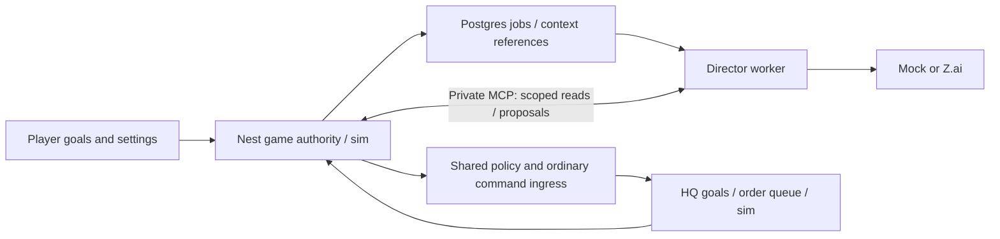

# TerraAgent — AI Director Specification

> **Status:** W16 replan, 2026-11-04; specification only, not implemented or live-validated.
> **Plan:** [W16](../plan/waves/W16-ai-director.md). **Decisions:** D-09, D-17, D-24/W16 amendment, D-25, D-31, D-37, D-42.
> **Integration:** landed [W08 goals](../../shared/sim/src/systems/goals/catalog.ts), [W11 foundations](../plan/waves/W11-lobby-planets.md), [W27 scale](../plan/waves/W27-planet-sectors.md).

## 1. Purpose and process boundary

The director makes occasional strategic choices; the rule engine and HQ goal executors handle routine work. Players choose objectives and how much gameplay risk to take. Both mock and live Z.ai adapters ship in W16; the live evaluation is a required release gate, separate from deterministic e2e.

W16 adds **`backend/director/`**, a separately runnable Node/TypeScript worker in this monorepo. NestJS remains the HTTP/WS, identity and game authority. The worker owns provider calls, bounded planning, skill selection and evaluations. It has no sim memory access, game-table write privileges, player sessions or signing keys. CPU/memory and DB pool limits are independent of the game process. This is a scoped D-24 exception, not a split of the game into microservices.

The game publishes immutable context references and consumes proposed directives through a durable Postgres queue. A private MCP endpoint in `backend/app/src/ai/mcp/` exposes bounded game queries and proposal submission to the worker. MCP is the tool protocol, not a job scheduler, LLM provider, or authorization policy. `shared/contracts/src/ai/` owns wire schemas; pure policy predicates live in `shared/sim`. Neither backend application imports the other's internals. Infrastructure uses the existing stack scripts; no public director web app is required. Player controls stay in the existing game HUD.

## 2. Invariants and threat boundary

| Rule | Requirement |
|---|---|
| AI-01 | Provider, worker or queue outage leaves rule-engine play running with the player's settings. No network/DB/provider work on the sim tick. |
| AI-02 | Only authoritative events trigger work; player HTTP/WS input cannot impersonate a director job or set its principal. |
| AI-03 | Per-colony minimum normal interval 300 s, critical interval 120 s, 150 provider requests/day; atomic reservations, including every model turn/retry. |
| AI-04 | Global 20M tokens/UTC day; reserve maximum possible input/output before every provider attempt, reconcile actual usage, retain reservation for unknown billed outcomes. No midnight overspend from outstanding requests. |
| AI-05 | At most one running and one coalesced pending plan per colony; fencing rejects late workers. |
| AI-06 | Strict bounded Zod schemas for every job, tool argument/result and directive; unknown action, extra field, malformed JSON or oversized response is rejected. |
| AI-07 | Deterministic policy checks before proposing and again at authoritative application; shared game rules own placement, affordability, stage, permissions and away policy. |
| AI-08 | Reject expired context, changed player intent, changed planet epoch, revoked authority or stale dependencies even if provider responded within its deadline. |
| AI-09 | Deterministic request/action IDs, replay fencing and transactional proposal outbox; queue delivery is at least once, never a claim of exactly-once external effects. |
| AI-10 | Record each provider attempt, decision, tool use and per-action authoritative result. `proposed` is not `applied`; only sim acknowledgement establishes application. |
| AI-11 | Global/planet/colony kill switch effective within 5 s, checked at claim, each tool/turn and apply. Cancels pending/in-flight work and revokes capabilities. |
| AI-12 | Player orders, locked goals, away permissions and spending ceilings always win over either risk profile. Risk never grants authority. |
| AI-13 | Mock by default outside production; explicit `zai` without `AI_LIVE=1` fails boot. Unknown adapter fails boot. Prod refuses mock without explicit override. |
| AI-14 | No secrets, session tokens, wallet keys or PII in prompts/logs. Redact before storage; raw logging follows D-09 (AI_LOG_RAW=1 by default in prod, 14-day purge), decision metadata 30 days. |
| AI-15 | Identity, authorization, isolation and bounded-load controls are mandatory; this does not add anti-cheat/farm detection prohibited by D-25. |
| AI-16 | Conservative/Risky strategy and all skill permissions are enforced as data, not merely prompt instructions. |
| AI-17 | Context is scoped to the authorized colony and its permitted knowledge; no full-world dumps, hidden deposits or unrelated player history. |
| AI-18 | No shell, filesystem, SQL, arbitrary HTTP, package installation, remote skill loading or wallet-signing tool is exposed to the model. |

MCP uses Streamable HTTP on an internal listener with authenticated workload identity, short-lived audience-bound credentials, and request-specific capabilities bound to job, colony, planet, allowed tools and expiry. Credentials are injected by the worker host, never model arguments. Server resolves the principal independently on every call; session IDs alone are not authentication. Reject token passthrough, wrong audience, scope escalation, guessed IDs and replay after revocation. TLS is required across hosts; bind local development to loopback. Validate Origin against an explicit browser allowlist (or reject browser origins for the worker-only endpoint); missing Origin does not bypass workload authentication. Do not expose the endpoint through public nginx routes.

Pin the owned MCP server/tool schema versions. Tool descriptions and annotations are hints, never permission checks. Allowlisted provider/MCP URLs come only from operator config: block arbitrary redirects, metadata/link-local destinations and DNS-rebinding routes, with explicit fixed private-service destinations permitted. Egress credentials are service-specific. Remote MCP discovery, sampling, elicitation and resource subscriptions are disabled unless a later reviewed feature needs them.

Player text, colony names, diplomacy messages and tool results are untrusted data. Delimit and length-limit them; never concatenate them into system instructions. Do not send other players' free text unless required. Validate output IDs against scoped observations, escape rationales as text in the UI, and reject secret/URL requests. Injection tests must pass by authorization boundaries even when the model follows malicious instructions. Admin kill/config endpoints require admin auth and audit; player settings require colony ownership, version checks and existing CSRF/session protection. Dev fault tools remain unavailable in production.

## 3. Triggers and player awareness

Retain resource critical/shortage, storage full, supply capped, power collapse, hub critical, under attack, building destroyed, hazard ended, neighbor contact, trade offer, rocket available, away started and away-only 30-minute checkpoint. Add `player.intent_changed`, `goal.blocked`, `goal.completed`, `diplomacy.truce_offered` and meaningful observed sector threat/resource changes. Debounce each condition (60 s baseline), coalesce related events and suppress director-generated feedback loops. Player edits invalidate work immediately; they do not bypass call budgets.

Store a bounded authoritative event summary: recent player commands and cancellations, current manual orders, goal queue/order/budgets, locked entities/areas, recently rejected proposals and reasons. Retain at most 32 summarized events and 10 decisions per planning context; never replay an unbounded transcript. Every player change to priorities, goals, permissions or protected orders increments `intentRevision`. An older plan becomes `superseded`. Temporary AI priorities are an overlay with expiry; never overwrite the player's baseline. Cancelling an AI goal suppresses equivalent re-proposals for a tunable 10-minute default, persisted across restart.

## 4. Player strategy and risk settings

Reuse W08's independent `economy`, `expansion`, `defense`, `power`, `terraform` sliders (0–100); **do not normalize their sum to 100**. The landed defaults are all 50. UI steps are 10; away overrides stay within ±10 of the last explicit player values, including across repeated calls. W08 HQ goals, 2/3/5 open-slot limits, stage gates, learned-lane rules, budgets and progressive order payment remain authoritative.

Presets are editable views over those settings and skill preferences: **Defence, Resources, Terraforming, Expansion, Aggressive, Balanced**. Aggressive favors combat goals only when their owning waves/stages and player permissions allow them. It neither makes peaceful targets hostile nor enables away raids. A free-text intent note (max 500 chars) may explain preferences but grants no permissions. Preview preset changes before applying; persist per colony and show the effective settings.

| Tunable | Conservative (default) | Risky |
|---|---|---|
| Reserve floor for discretionary actions | Keep 40% of unearmarked stock | Keep 15% of unearmarked stock |
| New discretionary commitment per planning cycle | At most 15% of unearmarked stock | At most 35% of unearmarked stock |
| Optional combat candidate threshold | Estimated friendly/enemy strength ≥ 1.5 | ≥ 0.9; uncertain intel requires scouting |
| Expansion | Connected, observed, defended routes | Longer observed frontier routes and opportunistic outposts |
| Economic tactics | Redundancy, stable supply, repair first | Specialization, timed stockpiling, temporary low reserves |
| Candidate diversity | Two alternatives including hold | Up to four, including flank, diversion or staged expansion |

These are initial balance parameters, not measured win-rate guarantees. Resource ratios apply per resource after player earmarks; energy uses its shared power policy. Player reserve floors and spend ceilings can tighten either profile; the effective limit is the strictest player, profile, goal, away and game limit. Risky cannot relax trade hard caps, `autoTrade`, director-key allowance, newcomer shields, tier-up consent or launch consent. Defence emergency behavior uses existing rule-engine rules, never an AI override of reserves.

Persist a versioned `DirectorPolicy` with risk, skill allow/deny, objective references, reserve/spend settings, protected areas/entities, optional note and revision. Authority changes apply at sim acknowledgement and invalidate older proposals. UI shows risk, goals inherited from W08, effective permissions, pause/rules-only, next-call time and budget. Explain each action with goal served, expected cost, uncertainty and why it fits the selected style; expose rejected/clamped reasons and an ordinary cancel control. No modal approval for every move: the player's configured delegation authorizes valid actions.

## 5. Context, W11 and W27

`ColonyBriefV2` is a bounded, versioned projection, built from sim read views and maintained event aggregates, not a scan per request. Include world/colony IDs, global tile/sector IDs, atlas/config version, epoch, tick, simulation time, observed-at time, intent/goal/permission revisions, enabled waves, unlock stage, HQ tier, resources/net rates/reservations, power/solar state, current goals and player actions, policies, threats and available skills.

W11 supplies the three canonical persistent planets, stable spatial identities, cross-sector colonies and authoritative lifecycle/admission status. Include home versus occupied sectors and open/full/paused/faulted state where relevant; a full founding sector does not prohibit expansion. Never infer lifecycle from age, create overflow planets or relocate units. W11-off dev worlds use a bounded compatibility view with explicit capabilities.

W27 enriches the same context contract with continent/sector summaries, observation freshness, residency and route availability. Query owned territory plus bounded neighboring/goal-relevant sectors, independently of the player's camera. Unloaded, unknown and absent are distinct. A query returns `unavailable`/`stale` rather than fabricating zero resources or loading all sectors. Cross-sector actions use global identities and the existing shared path/placement services. AI cannot request unlimited sector residency or discover hidden terrain for free. W27 owns real scale adapter acceptance; W16 ships its contract and fake streaming fixtures without making W27 a prerequisite.

W11/W27 summaries must apply the AI knowledge policy even where legacy clients receive full state. Known observations may be stale; the model sees their age and confidence. Brief cache keys include colony, epoch, policy/intent revision and summary version; never share private context across tenants.

Replace the old 1,200-character limit with an **8 KiB serialized brief** and **4,000 input-token aggregate per planning cycle**, including system prompts, tool schemas/results and repeated context across all turns. Bound each read result to 8 KiB / 64 records and each provider response to 16 KiB. Initial active-skill selection ≤6; full skill catalog stays server-side. Truncate optional history before critical state; if mandatory context cannot fit, fail closed with `context_too_large`. Enforce byte caps before parsing and token caps before sending.

## 6. Skills, tools and directives

Runtime skills are versioned game strategies, not Codex SKILL.md files or downloadable executable scripts. `DirectorSkillRegistry` entries declare id/version, purpose, required waves/stages, allowed tools/actions, preconditions, conservative/risky variants, cost/reserve limits, termination conditions and fixture IDs. Registry is the superset; a request receives only applicable authorized skills. Skill text cannot expand tool authority.

| Skill family | Shared goal/action integration | Risky possibilities within permissions |
|---|---|---|
| Recovery and survival | establish_colony, secure_power, repair orders | Recover critical infrastructure with staged resource commitments |
| Resource strategy | grow_economy, shared extraction/production | Specialize and stockpile ahead of known shortages |
| Defence and fortification | defend_colony, W14 walls | Forward defence, mobile interception, deliberate fallback |
| Scouting and nest control | clear_corridor, movement/observation | Scout a flank, clear a corridor for a later expansion |
| Expansion | expand_territory, W05 beacons | Frontier outpost and alternate route after failed access |
| Terraforming | terraform_zone, shared terrain preparation | Staged reclamation or defensive terrain shaping |
| Logistics and trade | negotiate_supply, W10/W13 cargo/market | Opportunistic trade within stock, price and allowance ceilings |
| Technology and forces | tech_up, build_army (W17/W19) | Specialize composition; upgrades still need existing consent |
| Diplomacy and aggression | W18 truce/raid_target | Feints, flanks and opportunistic raids on eligible targets |
| Settlement | build_rocket / W21 transfer | Prepare alternatives; launch/transfer needs existing player authority |
| Away stewardship | W09 policy, existing goals | Greater permitted commitment, never implicit away raids |
| Guild and reporting | W15 strategy; W09 away story | Distinct NPC principal; narrative output has no command authority |

Unavailable executors are absent from the tool list, not advertised as working skills. Register strategies over existing executors; do not implement alternate build, payment, pathing or battle loops. Read tools: `colony.readBrief`, `goals.list`, `world.readSectorSummaries`, `world.queryObserved`, `actions.preview`. One proposal tool: `director.propose` accepts a validated batch, never mutates the world directly. Read-only annotations describe the tools; permission checks enforce them. Batch reads against the same context version; cache within a job.

`DirectiveV2` references existing command argument schemas (queueGoal, queueUnit, permitted build/repair/terraform, priorities, trade, diplomacy) instead of duplicating catalog enums. Its envelope binds request ID, job/fence, colony/world, epoch, intent/permission/context revisions, deadline, maximum context age of 60 simulation seconds (use the authoritative solar/simulation clock, never a fixed tick-to-seconds assumption), selected skills/versions, rationale ≤200 chars and ≤5 actions with stable action IDs. The host supplies identity fields. Include observed dependencies and expected policy version; the model supplies only proposal content.

Preview and apply call the same shared predicates over current authority state (D-37). Validate cumulative batch commitments, goal slots and dependencies, not each action against the same initial stock. Sim processes in order and acknowledges each accepted/rejected action; never retry a rejected batch wholesale. Economic costs flow through existing progressive payment and earmarks (D-42). Priority overrides expire, preserve manual values and obey away guard bands. Player-source work is never cancelled/reordered by AI; only its own still-authorized work may be revised. Unknown actions are rejected, not guessed or mapped to an arbitrary fallback.

## 7. Durable scheduling and failure handling

Use **pg-boss** behind `DirectorJobPort` with the existing Postgres service. Queue payloads hold immutable context references, scoped IDs, trigger summary, enqueue time and deadline; secrets and raw history stay out. Separate planning, narrative and Guild queues under one global provider concurrency/budget allocator. Atomic admission caps pending work (initial default 512 globally, one per colony); coalesce before inserting, prefer critical over routine, round-robin across colonies with aging, and reserve at least one slot for critical work. Overflow drops routine requests with an observable outcome; never blocks a sim tick. A separate durable trigger intent/outbox reconciles enqueue failures; reconcile only fresh events.

Initial global provider concurrency is 4 (hard configurable maximum 8 on the launch host); per-colony concurrency 1. Scheduler fairness must not starve ordinary colonies during critical floods; cap consecutive critical claims and measure oldest eligible wait. Planning deadline is **20 seconds from original enqueue**, including waiting, tool calls and retries. Never reset it on retry/coalescing. Expired jobs are discarded before paid calls; fresh events can create fresh jobs. Provider timeout uses remaining deadline. Maximum 3 model turns, 6 tool calls, 5 actions, 1 transport retry total per job; disable SDK/queue nested automatic provider retries. Retry only 429/5xx/network with jitter/Retry-After when sufficient time remains; 401/403 opens circuit and alerts.

Reserve token maxima atomically for each attempt under the global and colony budgets, including parallel workers, narrative and Guild calls. Unknown usage remains charged at the reservation until reconciliation; UTC rollover accounts to reservation day. Tokens are not dollars: an independent configured cost ceiling uses verified provider prices; missing prices prevent live rollout. Queue retry is allowed for safe delivery/reconciliation, not automatic repeat of an ambiguously completed paid call.

Worker claims include expiring execution leases and monotonically increasing fencing tokens. Proposal acceptance writes result/outbox atomically and deduplicates `requestId/actionId`. Game ingress checks the fence, current permissions, epoch and expiry. A worker crash after response cannot cause duplicate commands. Persist decision IDs with the authoritative snapshot; on game restart increment epoch and invalidate old proposals/outboxes rather than replaying effects lost in a pre-crash snapshot. D-24's possible ≤60 s rollback remains; W16 does not invent durable simulation replay. External economic effects retain their existing saga/outbox idempotency.

Outcomes include disabled, rate_limited, budget_exhausted, coalesced, overloaded, expired, superseded, unauthorized, context_unavailable, invalid, proposed, applied, partially_applied, rejected, timeout and provider_error. Five consecutive provider failures open a 60 s circuit, then one probe. Stopping a worker returns rules-only status in the HUD. Kill-switch acknowledgement is independent of provider completion; late results are rejected even if cancellation cannot stop upstream billing.

## 8. Library selection and compatibility gate

Research checked 2026-11-04; select exact stable versions and security patches at implementation, lock them, and verify Node/Postgres/Zod compatibility. No packages are installed by this planning change.

| Choice | Why it fits / alternative |
|---|---|
| Official MCP TypeScript SDK | Owned server and typed protocol client; avoid custom JSON-RPC. Verify supported stable release/transport against [official SDK](https://github.com/modelcontextprotocol/typescript-sdk). |
| `ai` + `@ai-sdk/openai-compatible` | Typed model/tool orchestration behind LlmProviderPort, explicit abort and step budgets; [provider support](https://ai-sdk.dev/providers/openai-compatible-providers). Plain fetch remains a small fallback adapter if Z.ai compatibility fails. |
| `@ai-sdk/mcp` | Allowlisted MCP-to-model tool bridge with explicit input/output schemas; [MCP tooling](https://ai-sdk.dev/docs/ai-sdk-core/mcp-tools). Use one client lifecycle; do not create a connection per tool call. |
| Existing Zod 4 | Shared strict contracts and native `z.toJSONSchema()`; remove planned zod-to-json-schema dependency. [Zod docs](https://zod.dev/json-schema). |
| `pg-boss` | Durable Node queue on existing Postgres, concurrent claims via SKIP LOCKED; [project](https://github.com/timgit/pg-boss). Keep tenant fencing and command dedupe above queue semantics. |
| BullMQ + `@nestjs/bullmq` | Strong Nest integration, but requires Redis; retain as an alternative only if measured Postgres contention justifies another service. [Nest queues](https://docs.nestjs.com/techniques/queues). |
| Existing pino / prom-client / Vitest | Structured audits, bounded-label metrics and contract/failure tests; no second logging stack. |

A graph framework is not needed for this bounded plan/read/propose loop. Reconsider only if durable branching workflows exceed explicit state-machine complexity. Add package license/advisory checks, lockfile verification, dependency update policy and provider contract fixtures. Never assume OpenAI-compatible means identical tool/JSON/usage/abort behavior. Z.ai `glm-5.3` remains the owner's configured target, **not verified availability**: live smoke must verify the model, JSON/tool schemas, usage accounting, unsupported options and cancellation. Disable unsupported fields explicitly; never silently change model or provider.

MCP security requirements above are grounded in the [official security guidance](https://modelcontextprotocol.io/specification/2025-11-25/basic/security_best_practices). Our colony capability and game-policy checks are application requirements in addition to the protocol.

## 9. Kill switch and operations

Nest owns authenticated admin controls and durable settings; workers get read access to their effective settings and bounded queue/audit tables. Database grants separate game, worker and migration roles. Worker compromise cannot update player policy, balances, identities or game state. Workload keys rotate independently of provider keys. Health exposes provider/queue state without secrets; worker failure is not game readiness failure.

Deployment adds a capped director container/process, restricted egress and graceful drain/abort. Document local startup, mock fault modes, live enablement, migrations, rollback and private port configuration in DEV_TOOLS when implemented. Wave-off starts no jobs or MCP listener. Rolling back preserves player policy/audit data and falls back to rules. No automatic expansion to more workers than global budget/concurrency can support.

## 10. Persistence

Game-owned: versioned DirectorPolicy, player intent revision, immutable context snapshots with expiry, proposal outbox and acknowledged action results. Worker-owned: job attempts/fences, skill/prompt/model versions, decision/usage records and circuit state. Queue schema belongs to pg-boss; schema changes are controlled migrations. Add indexed expiry cleanup and bounded retention; pending context is short-lived, sanitized raw prompts 14 days, decision audit 30 days. Store current durable preferences separately from expiring context. Log hashes plus parsed results; keep authorization credentials out of all records. Tenant-scoped reads protect director history and explanations.

## 11. Mock and local mode

Mock uses the same registry, MCP schemas, policies, queue and command path as live. Provide deterministic conservative/risky variants plus timeout, invalid_json, schema_violation, http_429, http_500, slow, prompt_injection, cross_colony, over_budget, stale_revision and raid_proposal fixtures. Away stories remain ≤600 chars, one per digest close behind AWAY_STORY_ENABLED; failures omit the paragraph. No fake provider success bypasses authoritative checks. Browser local-host mode runs pure mock policy/command parity without remote credentials; private MCP and durable multi-process scheduling are online-only and marked unavailable locally.

## 12. Evaluation and performance gates

Retain `ai:eval` / `--live` as planned commands. At least 60 fixtures span three biomes, both risks, all skills/triggers, manual interventions and wave masks. Paired cases must show meaningful permitted strategic variation; always choosing hold fails the behavior score. Mandatory invariants have **zero violations**, separately from model quality thresholds. Live gate: ≥98% valid, ≥80% behavior properties, p95 planning latency ≤8 s on admitted non-overloaded jobs, all jobs bounded by 20 s; report queue wait separately. Cost/token distributions replace the obsolete 1,000-token mean gate: enforce 4,000 aggregate input and 1,200 aggregate output tokens/job, report cost using verified prices and demonstrate daily caps under retries.

Run real Postgres integration tests for duplicate deliveries, two workers, claim crash, response-before-ack crash, outbox retry, game epoch restart, UTC rollover, permission revocation and kill during tool execution. Security fixtures include hostile player text/tool output, IDOR, forged source/colony/epoch, expired/wrong-audience capabilities, SSRF/redirect attempts, overlong/deep JSON, arbitrary tool names and escaped HUD text. No real funds or harmful game mutation is needed for these fixtures.

Performance comparison uses fixed seeds, populations and hardware with director off/on: sim p95 step and WS p95 command latency regress ≤5%, no whole-atlas scans or resident-sector growth from AI reads. Exercise W11 small atlas and W27 150/450-sector synthetic summaries now; repeat on the real W27 streaming stack when it lands. Inject 1,000 simultaneous triggers, sustained critical floods and DB/provider stalls: queue stays ≤512 pending, per-colony bound holds, memory plateaus and gameplay remains responsive. Publish measured RSS, CPU, DB pool/lock latency and p95 brief build/read costs; initial targets 512 MiB worker RSS, 5 ms brief projection and 50 ms bounded MCP read at reference load. These are acceptance targets, not measured claims; failing targets block scale rollout and require revising capacity, not weakening guards.

## 13. Telemetry

Retain requests/latency/tokens/estimated cost/budget/circuit/clamp metrics. Add queue depth/oldest age/wait, coalesces/drops, tool latency/denials, context bytes/tokens, revision invalidations, per-action results, worker restarts and game performance deltas. Metric labels are bounded enums (trigger, skill, risk, outcome); IDs go in sampled structured audit records, never metric labels. Budget alarms at 0.8/1.0; alerts for queue starvation, repeated authorization failures and missing worker heartbeat. Player rationale is a short explanation, not hidden chain-of-thought.

## 14. Release acceptance

W16 DoD requires mock e2e, policy parity, hostile-input tests, Postgres crash/replay suite, player-control UI check, W11 compatibility fixtures, W27 streaming contract fixtures, load report and manual live-provider report. The live gate cannot be replaced by a successful mock demo. If credentials/provider support are unavailable, label delivery mock-complete/live-blocked and leave W16 live acceptance open. W27 later runs the same director cases against its real streaming implementation. Prior-wave suites pass with W16 off.

## 15. Decisions and limitations

Owner requested MCP, broader strategic skills, conservative/risky player control, world awareness and separate-app consideration on 2026-11-04. This plan adopts a separate worker with shared Postgres, preserving game authority. D-09 model/budgets, D-17 away opt-in and D-25 no anti-cheat remain. Initial risk tuning, library/provider compatibility and performance measurements are tracked in [AI director limitations](../questions-and-limitations/ai-director.md); these must be resolved or explicitly accepted before rollout.
