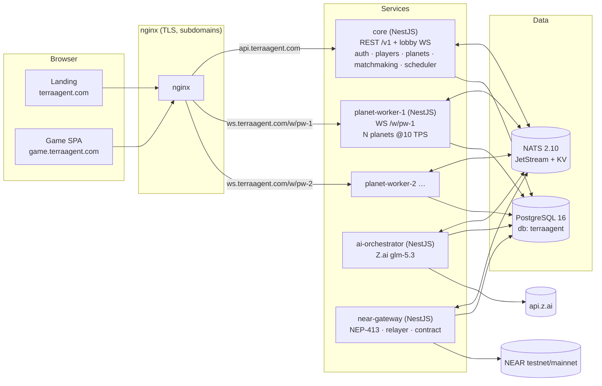
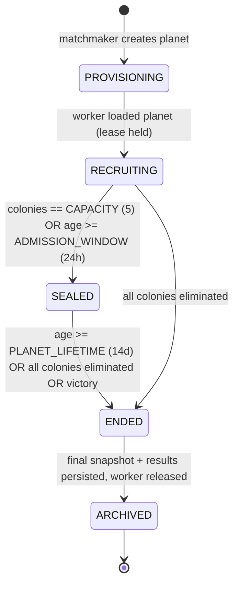

# TerraAgent — Online System Architecture

> **Status:** Draft v0.1 (2026-10-29) — for owner review ("grilling").
> **Decisions:** [`DECISIONS.md`](./DECISIONS.md) · **Plan:** [`../plan/EXECUTION_ORCHESTRATOR.md`](../plan/EXECUTION_ORCHESTRATOR.md)
> **Game design (unchanged, still authoritative for gameplay):** [`autonomous-colony-spec.md`](../../autonomous-colony-spec.md) · [`colony-economy-and-buildings-spec.md`](../../colony-economy-and-buildings-spec.md) · [`tech-stack-spec.md`](../../tech-stack-spec.md) (client rendering parts) · [`AGENTS.md`](../../AGENTS.md) (3D visual pillars)

This document is the **single source of truth for cross-service topology**: app inventory, domains, ports, data stores, NATS subjects, WebSocket envelope, the player → colony → planet → worker lookup path, and every tunable number. Topic specs in this folder refine it; they must not contradict it. If they do, this file wins for topology and numbers until a decision in `DECISIONS.md` changes it; [`PROTOCOL.md`](./PROTOCOL.md) wins for message-level detail (fields, kinds, codes) and [`DATA_MODEL.md`](./DATA_MODEL.md) for table-level detail.

---

## 1. Goals the architecture must satisfy

| # | Requirement (from owner) | How it is met |
|---|---|---|
| G1 | Online multiplayer over WebSockets | Planet workers expose WS; core exposes a lobby WS. |
| G2 | Many games in parallel | Each **planet** is an independent simulation; many planets run per **planet-worker** process; workers scale horizontally. |
| G3 | Colony keeps working when the player leaves | Simulation is **server-authoritative** and runs while a planet is alive, with or without connected players (D-01). |
| G4 | Return and continue | `GET /v1/me/home` resolves the player's live colony and returns a one-round-trip **planet ticket** to the right worker (§7). |
| G5 | First-timers see available planets; returning players dive straight in | Home state machine `NEW → (picker) / ACTIVE → (dive in)` (§7). |
| G6 | Managed matchmaking; full or long-running planets don't take new players; new players go to new planets | Planet lifecycle `RECRUITING → SEALED` with capacity **and** admission-window gates + a managed queue in core (§8, [`MATCHMAKING.md`](./MATCHMAKING.md)). |
| G7 | NEAR integration as its own app | `near-gateway` service (§3). |
| G8 | AI orchestration as its own app on Z.ai GLM | `ai-orchestrator` service, model `glm-5.3` (D-09). |
| G9 | Persistence + inter-service messaging | PostgreSQL 16 + NATS 2.10 with JetStream and KV (§5, §6). |
| G10 | Landing + game apps, nginx, subdomains | `terraagent.com`, `game.terraagent.com`, `api.terraagent.com`, `ws.terraagent.com` (§4). |

---

## 2. System diagram



Rules:
- **Only `core` and `planet-worker-*` are reachable from the internet** (through nginx). `ai-orchestrator` and `near-gateway` are internal; they talk only via NATS (plus their own outbound HTTPS to Z.ai / NEAR RPC).
- **No service calls another service over HTTP.** Inter-service traffic is NATS request/reply, NATS JetStream streams, or NATS KV (D-05).
- The browser never talks to NATS or Postgres.

---

## 3. App inventory & repository layout

Monorepo with **npm workspaces** (D-03), mirroring the `../freightchain` top-level split (`backend/`, `frontend/`, `infra/`, `docs/`, `tests/`, `scripts/`) plus a `shared/` folder for packages used by both backend and frontend.

```text
TerraAgent/
├── package.json                 # npm workspaces root; scripts delegate (check, ci:fast, dev:*)
├── tsconfig.base.json
├── shared/
│   ├── contracts/               # @terra/contracts — zod schemas: WS messages, NATS subjects+payloads, REST DTOs, error codes, ticket claims
│   ├── config/                  # @terra/config   — zod env loader, port/namespace helpers
│   ├── db/                      # @terra/db       — the ONE Prisma schema + migrations + repositories + test-DB harness
│   └── sim/                     # @terra/sim      — deterministic simulation (ECS, grid, territory, economy, power, robots, rule engine, hazards)
├── backend/
│   ├── core/                    # @terra/core            NestJS — api.terraagent.com
│   ├── planet-worker/           # @terra/planet-worker   NestJS — ws.terraagent.com/w/{workerId}
│   ├── ai-orchestrator/         # @terra/ai-orchestrator NestJS — internal
│   ├── near-gateway/            # @terra/near-gateway    NestJS — internal
│   └── near-contracts/          # colony-registry contract (Rust near-sdk) — built/deployed by near-gateway lane
├── frontend/
│   ├── landing/                 # @terra/landing  Vite static — terraagent.com
│   └── game/                    # @terra/game     Vite + TS + Three.js + React HUD — game.terraagent.com
├── infra/
│   ├── docker-compose.yml       # dev: postgres, nats (+ nats-box)
│   ├── nats/                    # JetStream stream + KV bootstrap (generated from @terra/contracts)
│   ├── postgres/                # init scripts (lane test DBs)
│   └── deploy/                  # prod compose, Dockerfiles, nginx templates, TLS, deploy scripts
├── tests/
│   ├── integration/             # cross-service harness (per-lane isolation)
│   ├── e2e/                     # headless browser journeys
│   ├── failover/                # worker-kill determinism tests
│   └── load/                    # WS/planet capacity + matchmaking soak
├── scripts/                     # ci-fast.sh etc.
└── docs/
    ├── spec/                    # this folder
    └── plan/                    # execution plan, status, issues
```

| App | Package | Kind | Public? | Internal port (prod) | Dev port | Owns DB tables (prefix) |
|---|---|---|---|---|---|---|
| core | `@terra/core` | NestJS (HTTP + `@nestjs/platform-ws`) | `api.terraagent.com` | `3000` | `4001` | `player*`, `auth*`, `planet*`, `colony*`, `match*`, `admin*` |
| planet-worker | `@terra/planet-worker` | NestJS app context + `ws` server | `ws.terraagent.com/w/{workerId}` | `3100` | `4002` (+10 per extra local worker: `4012`, `4022`) | `planet_snapshot*`, `planet_event_digest*` |
| ai-orchestrator | `@terra/ai-orchestrator` | NestJS microservice (NATS) | no | `3200` (health/metrics only) | `4003` | `ai_*` |
| near-gateway | `@terra/near-gateway` | NestJS microservice (NATS) | no | `3300` (health/metrics only) | `4004` | `near_*`, `trade_*` |
| landing | `@terra/landing` | Vite static | `terraagent.com` | served by nginx | `5174` | — |
| game | `@terra/game` | Vite SPA | `game.terraagent.com` | served by nginx | `5173` | — |

Every backend app exposes `GET /healthz` (liveness), `GET /readyz` (deps: PG + NATS), and `GET /metrics` (Prometheus) on its internal port. Only `core`'s `/v1/*` and `/ws` and the worker's `/w/{id}` WS are routed publicly.

---

## 4. Domains & nginx routing

| Host | Target | Notes |
|---|---|---|
| `terraagent.com` | static `frontend/landing/dist` | Long cache for hashed assets; `index.html` no-cache. |
| `www.terraagent.com` | `301 → https://terraagent.com$request_uri` | |
| `game.terraagent.com` | static `frontend/game/dist` | SPA fallback `try_files $uri /index.html`. |
| `api.terraagent.com` | `core:3000` | `/v1/*` REST; `/ws` lobby WebSocket (upgrade). CORS allow-list: `https://game.terraagent.com`, `https://terraagent.com`. |
| `ws.terraagent.com` | `/w/{workerId}` → `planet-worker-{n}:3100` | Path-based worker addressing (D-06). `{workerId}` regex `^pw-[0-9]{1,3}$`, mapped by an nginx `map` to the compose service name; unknown id → `404`. WS idle timeout `75s` (client pings every `20s`). |

Local equivalents use `*.terraagent.localhost` (browsers resolve `*.localhost` to 127.0.0.1): `terraagent.localhost`, `game.terraagent.localhost`, `api.terraagent.localhost`, `ws.terraagent.localhost`. Plain dev without nginx uses the dev ports above with Vite proxying.

TLS: Cloudflare in front (proxied, WebSockets enabled) + origin certificate on nginx, or Let's Encrypt via certbot if Cloudflare is not used (owner choice, see `OWNER_TASKS.md`). Headers: HSTS, CSP (game needs `connect-src https://api.terraagent.com wss://api.terraagent.com wss://ws.terraagent.com`), `frame-ancestors 'none'`, `Referrer-Policy: strict-origin-when-cross-origin`.

---

## 5. Data stores

### 5.1 PostgreSQL
- One cluster, one database `terraagent` (prod/dev), Postgres 16.
- **One Prisma schema** in `shared/db/prisma/schema.prisma` (D-04). Postgres schemas used as namespaces: `core`, `world`, `ai`, `chain`. Each service only writes tables of its own namespace; reads of foreign tables go through the owning service's NATS API, except these read-only allowances (see [`DATA_MODEL.md`](./DATA_MODEL.md) §8): worker and test harness read `world.planet_snapshot`; core reads `world.colony_digest` / `world.colony_result` so `/me/home` works while a planet is failing over; the worker reads `core.planet`.
- Migrations are **forward-only** and land **only in a wave pre-step** (see orchestrator §1.4).
- Test DBs: `terraagent_test` (CI) and `terraagent_lane{1..5}_test` (parallel agents). Role `terra` / `terra_dev_password`, port `15434` on the host (dev compose).

### 5.2 NATS
- NATS `2.10+`, JetStream enabled, host port `14222` (dev), monitoring `18222`.
- **Namespace prefix** `TA_NS` (default `ta`; lanes use `l1`..`l5`) prefixes every subject, stream and KV bucket so parallel agents can share one NATS server (D-07).

---

## 6. Inter-service messaging (NATS)

All payloads are zod schemas in `@terra/contracts/nats`. `{ns}` = `TA_NS`.

### 6.1 Subjects

| Subject | Pattern | Producer → Consumer | Purpose |
|---|---|---|---|
| `{ns}.planet.{planetId}.cmd` | JetStream stream `{NS}_PLANET_CMDS` (retention: limits, max age **48h**) | core / ai / near / worker-WS-ingress → owning worker | **Every** input that changes a planet: player commands, AI directives, trade settlements, admin actions. The ordered command log used for failover replay. |
| `{ns}.planet.{planetId}.tick` | same stream `{NS}_PLANET_CMDS` | owning worker only | **Tick marker** `TickMarkerV1 {planetId, tick, lastCmdSeq, count, leaseEpoch, stateHash?}`: published (and pub-acked) before applying a tick that contains new commands, and on every `tick % 100 == 0` with `stateHash`. Records which commands were applied at which tick ⇒ bit-exact replay. Details: [`PROTOCOL.md`](./PROTOCOL.md) NT-11. |
| `{ns}.planet.{planetId}.evt.{type}` | JetStream stream `{NS}_PLANET_EVENTS` (max age **7d**) | worker → core, ai, near | Significant events (colony founded, attack, shortage, building destroyed, colony eliminated, rocket launched, planet ended). Feeds AI triggers and the "while you were away" digest. |
| `{ns}.planet.{planetId}.ctl` | request/reply | core → owning worker | `spawnColony`, `retireColony`, `seal`, `end`, `inspect`, `getAwayDigest`. State-changing kinds are converted to commands so they are in the replay log. |
| `{ns}.worker.{workerId}.ctl` | request/reply | core scheduler → worker | `assignPlanet`, `releasePlanet`, `drain`. |
| `{ns}.ai.request` | JetStream work-queue stream `{NS}_AI_REQUESTS` | worker (on trigger) → ai-orchestrator | Ask the director for a decision for one colony. |
| `{ns}.near.verify` | request/reply | core → near-gateway | NEP-413 signed-message verification. |
| `{ns}.near.account.provision` | JetStream work-queue `{NS}_NEAR_JOBS` | core → near-gateway | Create/fund the player's colony account (chain stays invisible). |
| `{ns}.near.registry.*` | JetStream work-queue `{NS}_NEAR_JOBS` | core/worker events → near-gateway | On-chain milestones (colony founded, rocket launched). |
| `{ns}.trade.*` | request/reply + events | core ↔ near-gateway | Inter-colony trade offers/acceptance; settlement emitted as `planet.{id}.cmd`. |
| `{ns}.near.evt.*`, `{ns}.trade.evt.*` | JetStream stream `{NS}_NEAR_EVENTS` (max age **7d**) | near-gateway → core, worker | Results of NEAR jobs and trade saga steps (account provisioned, milestone written, trade receipt). |
| `{ns}.worker.{workerId}.evt.overloaded` | pub/sub | worker → core scheduler | Load shedding signal (TA-07.8): scheduler stops placing planets on this worker. |
| `{ns}.lobby.player.{playerId}` | core pub/sub | core (any replica) → the replica holding the player's lobby socket | Per-player lobby pushes (`queue.position`, `match.assigned`, `match.failed`). |
| `{ns}.ai.ctl` (+ `{ns}.ai.changed`) | request/reply (+ pub/sub) | core admin → ai-orchestrator | Kill switch / per-planet disable / status (AI_ORCHESTRATOR §9). |
| `{ns}.near.account.status`, `{ns}.trade.offer.list` | request/reply | core → near-gateway | Colony account state; open trade offers for the HUD. |
| `{ns}.mm.changed` | core pub/sub | core → core (all replicas) → lobby WS | Planet list / queue position changed. |

### 6.2 KV buckets

| Bucket | Key | Value | TTL | Writer |
|---|---|---|---|---|
| `{ns}_workers` | `workerId` | `{ url, capacity, planets, load, version, startedAt }` | **15s**, heartbeat every **5s** | each worker |
| `{ns}_planet_leases` | `planetId` | `{ workerId, epoch, since }` | **15s**, renewed every **5s** | owning worker (create-if-absent / CAS update) |
| `{ns}_presence` | `colonyId` | `{ connected: bool, since, workerId }` | none (explicit) | worker |

A planet is owned by **exactly one worker**: the holder of the lease (CAS on revision). Losing the lease (renew fails) ⇒ the worker stops ticking that planet immediately and closes its sockets with code `4009 lease_lost`.

---

## 7. Player → colony → planet → worker lookup (resume path)

```mermaid
sequenceDiagram
  participant G as Game SPA
  participant C as core
  participant K as NATS KV
  participant W as planet-worker
  G->>C: GET /v1/me/home (Bearer access JWT)
  C->>C: load player + live colony (Postgres)
  alt no live colony
    C-->>G: { state: "NEW" | "ELIMINATED" | "PLANET_ENDED", planets: [...RECRUITING] }
  else colony queued
    C-->>G: { state: "QUEUED", ticketId, position }
  else colony alive
    C->>K: get planet_leases[planetId] → workerId; workers[workerId] → url
    C-->>G: { state: "ACTIVE", colony, planet, ws: "wss://ws.terraagent.com/w/pw-2", ticket (60s), awayHeadline? }
    G->>W: WS connect /w/pw-2  →  hello { ticket }
    W->>W: verify ticket (Ed25519, aud=planet, planetId owned here)
    W-->>G: welcome { fullSnapshot, tick, colonyId, awayDigest? }
    W-->>G: delta … (5 Hz)
  end
```

- **Home states:** `NEW` (never had a colony) · `QUEUED` (matchmaking ticket open) · `ACTIVE` (colony alive; includes a short `awayHeadline` from `planet.{id}.ctl getAwayDigest` when the player was away ≥ 60 s — the full digest arrives in the worker `welcome.awayDigest`) · `ELIMINATED` (colony destroyed; show recap, then picker) · `PLANET_ENDED` (planet reached end; show results, then picker). Full rules: [`CONTINUITY.md`](./CONTINUITY.md).
- **Planet ticket:** JWT signed with core's **Ed25519** key (`EdDSA`), claims `{ sub: playerId, colonyId, planetId, workerId, aud: "planet", exp: now+60s, jti }`. Workers hold only the public key. Single use (`jti` cached on the worker for 120 s).
- If the planet is mid-failover (no lease), `/me/home` returns `ACTIVE` with `ws: null, retryAfterMs: 2000`; the client retries.
- One active game socket per colony: a new connection with a valid ticket **takes over** and the old socket is closed with `4001 replaced`.

---

## 8. Planet lifecycle & matchmaking (summary)



- **New players only join `RECRUITING` planets**, i.e. planets that are both **not full** and **younger than the admission window**. Planet **age** is measured from `firstColonyAt` (an empty warm-pool planet does not age). Fullness uses the monotonic counter `seatsTaken` (every founded colony counts, including eliminated ones), so freed seats are never refilled. A planet that has been running for days is `SEALED` and never receives new players (G6). Freed seats on a sealed planet are **not** refilled.
- The picker lists `RECRUITING` planets (type, seats `n/5`, age, ends-in) plus a **"New planet"** option per planet type. Choosing either creates a **match ticket** in the queue; the player does not get a seat until the matchmaker confirms it.
- The **matchmaker** (single leader inside core, D-08) processes the queue FIFO: reserve seat (TTL 90 s) → `planet.{id}.ctl spawnColony` → confirm → push `match.assigned` over lobby WS. If no `RECRUITING` planet fits and none can be created (global cap), the ticket waits with a visible position.
- **Warm pool:** the matchmaker keeps `WARM_POOL_PER_TYPE = 1` empty `RECRUITING` planet per enabled planet type so a "New planet" request is served instantly.
- Full spec, edge cases and admin controls: [`MATCHMAKING.md`](./MATCHMAKING.md).

---

## 9. Simulation model

- **Authoritative on the server** in `planet-worker`, using `@terra/sim` (D-01). The browser renders snapshots/deltas and interpolates; it never decides outcomes. (This **overrides** the "simulation in a browser Web Worker" layout in `tech-stack-spec.md` §2/§4; the client still keeps rendering in vanilla Three.js + React HUD.)
- **Deterministic:** fixed tick **10 TPS** (`TICK_MS = 100`), seeded PRNG per planet (`seed` stored on the planet row), integer / fixed-point math only (milli-units), no `Date`, no `Math.random`, stable iteration order. A `stateHash` (xxhash64 of canonical state) is computed every `100` ticks.
- **Inputs are only commands** from the `{NS}_PLANET_CMDS` stream. The worker records the tick at which each command range is applied with a durable **tick marker** (`{ns}.planet.{id}.tick`, §6.1) and acks the producer only after that marker is pub-acked. Presence changes that affect autopilot are themselves commands (`core.presence`), so away-mode is replayed exactly. Hazards/fauna come from the seeded PRNG ⇒ `restore(snapshot) + replay(commands since snapshot.tick)` reproduces state bit-exactly (failover, tests).
- **Public API** (`@terra/sim`): `createPlanet(params)`, `restore(snapshotBytes)`, `step(state, commandsForTick) → { state, events }`, `snapshot(state) → bytes`, `diff(prevView, state, colonyId) → delta`, `view(state, colonyId)` (fog-of-war filtered), `hash(state)`.
- **Persistence cadence:** snapshot to `world.planet_snapshot` every **30 s** (300 ticks) and on unload/seal/end; keep the last **20** plus one per hour for **48 h**. Command stream max age **48 h** ≥ snapshot interval, so replay is always possible.
- **Planets tick whether or not anyone is connected** (G3). Away colonies are run by the rule engine using the player's last priorities, plus AI director decisions (§10).
- Full spec: [`SIMULATION.md`](./SIMULATION.md).

---

## 10. AI orchestration (summary)

- 90–95 % of decisions: rule engine inside `@terra/sim`, every tick, free.
- 5–10 %: `ai-orchestrator` via Z.ai **`glm-5.3`** (OpenAI-compatible chat completions, JSON output), triggered by significant events only.
- **Caps (per colony):** at most **1 call / 5 min** normally, **1 call / 2 min** for `critical` triggers (under attack, energy collapse), hard cap **150 calls / colony / day**; global daily token budget `AI_DAILY_TOKEN_BUDGET`; kill switch `AI_ENABLED=false` ⇒ rule engine only.
- Output is a validated `DirectiveV1` (priorities, build/queue intents, trade suggestions) → published as a normal command to `planet.{id}.cmd`. Invalid / late (> 20 s) responses are dropped and logged; the rule engine continues.
- Full spec: [`AI_ORCHESTRATOR.md`](./AI_ORCHESTRATOR.md).

---

## 11. NEAR integration (summary)

- **Sign-in:** guest first (device-bound), optional NEAR wallet link via **NEP-413** signed message verified by `near-gateway` (D-10).
- **Invisible chain:** each colony gets a NEAR sub-account under the game's account (`{colonyShortId}.colonies.terraagent.testnet`) created and funded by the gateway; the player never signs gameplay.
- **On-chain record:** `colony-registry` contract stores milestones (colony founded, rocket launched, planet result).
- **Trades:** inter-colony trades are agreed via `trade.*`; MVP settles in-game (commands to both planets) and writes a receipt on-chain; full NEAR Intents settlement is a later step (D-11).
- Testnet until owner flips `NEAR_NETWORK=mainnet`. Full spec: [`NEAR.md`](./NEAR.md).

---

## 12. Client (summary)

- `frontend/game`: Vite + TypeScript, vanilla Three.js renderer (diorama viewport per the 4 visual pillars in `AGENTS.md`), React 19 + Zustand HUD overlay.
- Routes: `/` (boot → `/v1/me/home` → redirect), `/planets` (picker + queue), `/play` (game), `/away` modal on resume.
- Network: lobby WS to `api` while in picker/queue; planet WS to `ws` while playing; exponential reconnect (0.5 s → 10 s cap) and fresh `/me/home` on every reconnect (tickets are single-use).
- Rendering consumes `@terra/contracts` view types only; it imports nothing from `@terra/sim` except pure presentation helpers (interpolation, hex math).
- Full spec: [`CLIENT.md`](./CLIENT.md).

---

## 13. WebSocket protocol (summary)

Envelope (JSON in v1; binary MessagePack for `delta` allowed later behind `proto: 2` negotiation):

```ts
type Envelope<T extends string, D> = {
  v: 1;            // protocol version
  t: T;            // message type
  id?: string;     // client-generated id for request/ack correlation
  tick?: number;   // simulation tick (server → client)
  d: D;            // payload (zod-validated)
};
```

| Direction | Types |
|---|---|
| client → worker | `hello {ticket}` · `cmd {kind, args}` (`setPriorities`, `enqueueTask`, `cancelTask`, `placeBuilding`, `upgradeBuilding`, `demolish`, `setAutopilot`) · `ping` · `ack.delta {tick}` |
| worker → client | `welcome {colonyId, planet, snapshot, tick, serverTimeMs}` · `delta {fromTick, toTick, ops[]}` · `event {kind, …}` · `cmd.ack {id, appliedAtTick}` · `cmd.reject {id, code}` · `pong` · `bye {code, reason}` |
| client → core lobby | `hello {accessToken}` · `subscribe` / `unsubscribe {topic: "planets" \| "queue"}` · `reauth` · `ping` |
| core lobby → client | `ready` · `planets.list` · `planets.changed` · `queue.position` · `match.assigned {home}` · `match.failed {code}` · `pong` · `bye` |

The complete, authoritative message list (including `resync`, `welcome.awayDigest`, reject codes) is in [`PROTOCOL.md`](./PROTOCOL.md).

Close codes: `4000 bad_hello`, `4001 replaced`, `4003 forbidden`, `4004 planet_not_here`, `4008 rate_limited`, `4009 lease_lost`, `4010 planet_ended`, `4011 colony_eliminated`, `4012 server_draining`.

Rates: client → worker **≤ 10 cmds/s** per socket (burst 20); worker → client delta **5 Hz**; full resync if client is > 50 ticks behind its last ack. Full spec: [`PROTOCOL.md`](./PROTOCOL.md).

---

## 14. Failover & scaling (summary)

- Worker heartbeats `{ns}_workers`; leases in `{ns}_planet_leases`.
- If a lease expires (worker died / partitioned), core's **planet scheduler** picks the least-loaded live worker and sends `worker.{id}.ctl assignPlanet`. The new worker acquires the lease with the **fencing epoch** issued by core (`core.planet.leaseEpoch`, incremented on every assignment and sent in `assignPlanet`; KV TTL keys cannot hold a monotonic counter), loads the latest snapshot, replays commands from the stream with `tick > snapshot.tick`, verifies `stateHash` at the last checkpoint, and resumes. **Target RTO ≤ 30 s, RPO = 0 commands** (commands are durable in JetStream before they are acked to the client).
- Graceful drain (`deploy`): worker stops accepting new planets, snapshots each planet, releases its lease, and core reassigns; clients get `4012 server_draining` and auto-resume.
- Scaling: add a `planet-worker-{n}` service + nginx map line. Default capacity **`WORKER_MAX_PLANETS = 50`**, to be confirmed by the load test (TA-13.5).
- Full spec: [`CONTINUITY.md`](./CONTINUITY.md) §Failover.

---

## 15. Tunables (all env-configurable, defaults here)

| Key | Default | Owner service |
|---|---|---|
| `PLANET_CAPACITY` | `5` colonies | core |
| `PLANET_ADMISSION_WINDOW_H` | `24` | core |
| `PLANET_LIFETIME_D` | `14` | core |
| `WARM_POOL_PER_TYPE` | `1` | core |
| `MAX_ACTIVE_PLANETS` | `200` (global cap) | core |
| `MATCH_SEAT_TTL_S` | `90` | core |
| `MATCH_QUEUE_MAX` | `1000` | core |
| `PLANET_TICKET_TTL_S` | `60` | core |
| `ACCESS_JWT_TTL_M` / `REFRESH_TTL_D` | `15` / `30` | core |
| `AWAY_AFTER_S` | `60` | worker |
| `TICK_MS` | `100` | worker / sim |
| `DELTA_HZ` | `5` | worker |
| `SNAPSHOT_EVERY_TICKS` | `300` | worker |
| `LEASE_TTL_S` / `HEARTBEAT_S` | `15` / `5` | worker |
| `WORKER_MAX_PLANETS` | `50` | worker |
| `AI_ENABLED` | `true` | ai |
| `AI_MODEL` / `AI_BASE_URL` | `glm-5.3` / `https://api.z.ai/api/paas/v4` | ai |
| `AI_MIN_INTERVAL_S` / `AI_CRITICAL_INTERVAL_S` / `AI_MAX_CALLS_PER_DAY` | `300` / `120` / `150` | ai |
| `AI_TIMEOUT_S` | `20` | ai |
| `AI_DAILY_TOKEN_BUDGET` | `20000000` (≈ $40/day at listed glm-5.3 prices, verify) | ai |
| `AI_PROVIDER` / `AI_LIVE` | `zai` / `0` (mock unless `1`) | ai |
| `AI_MAX_TOKENS` / `AI_CONCURRENCY` / `AI_LOG_RAW` | `400` / `8` / `0` | ai |
| `NEAR_ALLOW_MAINNET` | `false` (guard for `NEAR_NETWORK=mainnet`; other `NEAR_*` keys in [`NEAR.md`](./NEAR.md)) | near |
| `PLANET_WORKERS` | `2` (prod compose) | deploy |
| `TLS_MODE` | `cloudflare` \| `certbot` | deploy |
| `CSP_CONNECT_EXTRA` / `CSP_FRAME_EXTRA` | empty | deploy |
| `NEAR_NETWORK` | `testnet` | near |
| `MATCH_TICKET_MAX_WAIT_S` | `900` | core |
| `MM_LOOP_MS` / `MM_BATCH` | `500` / `50` | core |
| `MM_PRIORITY_AGING_MIN` | `5` | core |
| `PICKER_HIDE_BEFORE_CLOSE_MIN` | `15` | core |
| `PLANET_TYPES_ENABLED` | `temperate,desert` | core |
| `TA_NS` | `ta` | all |

Lifecycle/time tunables accept fractional values (e.g. `PLANET_ADMISSION_WINDOW_H=0.01`) so integration and E2E suites can run on a compressed clock (TA-01.6).
