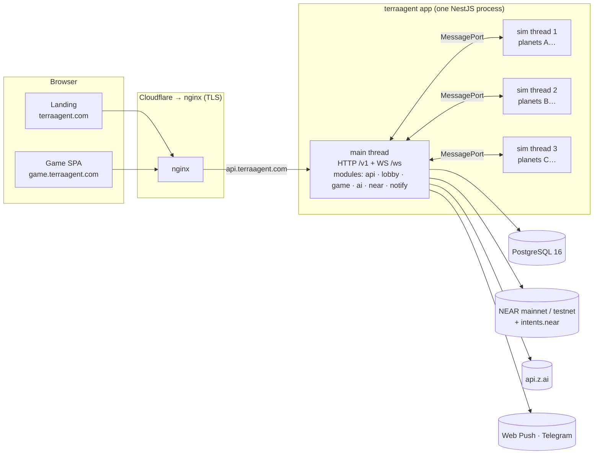
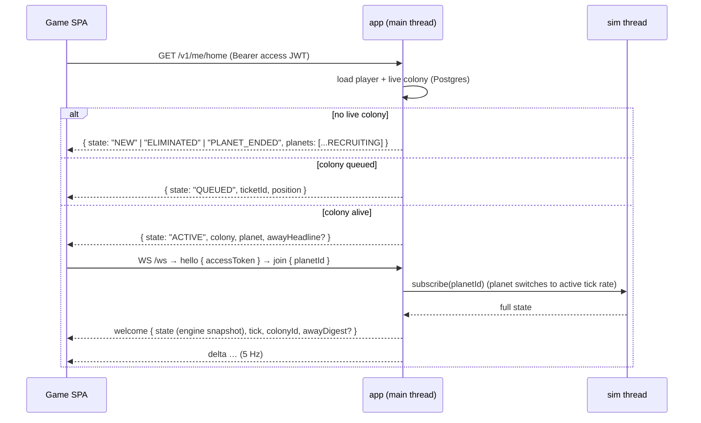
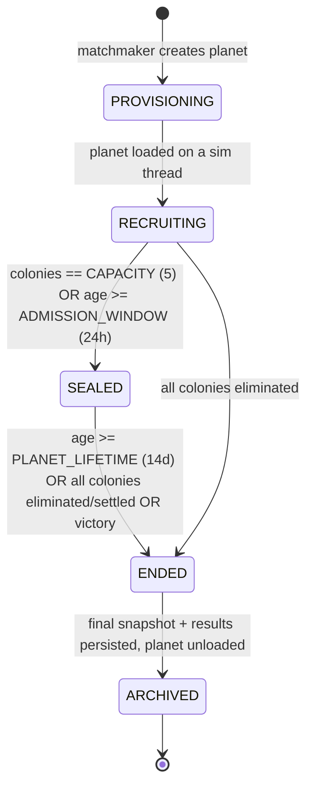

# TerraAgent — Online System Architecture

> **Status:** v0.2 (2026-10-30). This is the **simplified one-app architecture** (D-24, D-25, D-26). The earlier distributed design (four services, NATS, leases, deterministic replay) is summarised in §16 as **Future**.
> **Decisions:** [`DECISIONS.md`](./DECISIONS.md) · **Plan:** [`../plan/EXECUTION_ORCHESTRATOR.md`](../plan/EXECUTION_ORCHESTRATOR.md) · **Hackathon cut:** [`../plan/HACKATHON_CUT.md`](../plan/HACKATHON_CUT.md)
> **Game design (authoritative for gameplay):** [`docs/game/autonomous-colony-spec.md`](../game/autonomous-colony-spec.md) · [`docs/game/colony-economy-and-buildings-spec.md`](../game/colony-economy-and-buildings-spec.md) · [`docs/game/units-orders-and-progression-spec.md`](../game/units-orders-and-progression-spec.md) · [`docs/game/near-economy-features-spec.md`](../game/near-economy-features-spec.md) · [`AGENTS.md`](../../AGENTS.md) (3D visual pillars)

This document is the **single source of truth for topology and tunables**: modules, domains, data stores, threads, the WebSocket envelope, the resume path and every tunable number. Topic specs refine it and must not contradict it. For message-level detail (fields, kinds, codes) [`PROTOCOL.md`](./PROTOCOL.md) wins; for table-level detail [`DATA_MODEL.md`](./DATA_MODEL.md) wins.

---

## 1. Goals the architecture must satisfy

| # | Requirement (from owner) | How it is met |
|---|---|---|
| G1 | Online multiplayer over WebSockets | One WS endpoint on the app (`/ws`) for lobby and planet traffic. |
| G2 | Many games in parallel | Each **planet** is an independent simulation, sharded over a pool of `worker_threads` (§9). |
| G3 | The colony keeps working while the player is away | The simulation runs **on the server** for every live planet, with or without connected players. Empty planets tick coarse (D-24). |
| G4 | Return and continue | `GET /v1/me/home` resolves the live colony and returns the planet to join (§7). |
| G5 | First-timers see available planets; returning players dive straight in | Home state machine `NEW → picker`, `ACTIVE → dive in` (§7). |
| G6 | Managed matchmaking; full or old planets take no new players | Planet lifecycle `RECRUITING → SEALED` plus a managed queue in the `lobby` module ([`MATCHMAKING.md`](./MATCHMAKING.md)). |
| G7 | NEAR integration, economy is the gameplay | `near` module: accounts, relayer, cargo tokens, markets, Guild NPCs, deeds, treasury, bounties (D-26). |
| G8 | Swap mock ↔ real integrations without touching game code | **Ports and adapters (D-30).** Abstract-class ports are the DI tokens, bound in one infrastructure module per integration, and chosen per port by a fail-closed env flag (`NEAR_ADAPTER_<PORT>`, `LLM_ADAPTER`, `NOTIFY_ADAPTER`). **Phase 1 = all NEAR ports mocked**, each with a Postgres-backed mock and a contract suite shared by mock and real ([`NEAR.md`](./NEAR.md) §1a). |
| G8 | AI orchestration on Z.ai GLM | `ai` module, model `glm-5.3` (D-09). |
| G9 | Simple, efficient, cheap to run | **One NestJS app + Postgres** on a 4 vCPU / 8 GB host. No NATS, no leases, no anti-cheat machinery (D-24, D-25). |
| G10 | Landing + game apps, subdomains | `terraagent.com`, `game.terraagent.com`, `api.terraagent.com` (§4). |

---

## 2. System diagram



Rules:
- **One process, one public port.** Modules call each other in-process (Nest providers plus an in-process event bus). There is no service-to-service HTTP and no message broker.
- **Sim threads own planet state.** The main thread never mutates planet state. It sends commands to the owning thread and receives deltas and events back.
- The browser never talks to Postgres, Z.ai or NEAR RPC directly. The only exception is the player's own wallet, if they claimed their account (D-18).

---

## 3. App inventory & repository layout

Monorepo with **npm workspaces** (D-03).

```text
TerraAgent/
├── package.json                 # npm workspaces root; scripts delegate (check, ci:fast, dev)
├── tsconfig.base.json
├── shared/
│   ├── contracts/               # @terra/contracts — zod schemas: WS messages, REST DTOs, error codes
│   ├── config/                  # @terra/config   — zod env loader
│   ├── db/                      # @terra/db       — the ONE Prisma schema + migrations + repositories
│   └── sim/                     # @terra/sim      — simulation (ECS, grid, territory, economy, power, units, rule engine, hazards)
├── backend/
│   ├── app/                     # @terra/app — the one NestJS app: modules api, lobby, game, ai, near, notify
│   └── near-contracts/          # Rust near-sdk: cargo (NEP-245), deed (NEP-171), bounty escrow, registry
├── frontend/
│   ├── landing/                 # @terra/landing  Vite — terraagent.com (live mini-diorama, D-22)
│   └── game/                    # @terra/game     Vite + TS + Three.js + React HUD — game.terraagent.com
├── infra/
│   ├── docker-compose.yml       # dev: postgres
│   └── deploy/                  # prod compose, Dockerfile, nginx, deploy script
├── tests/
│   ├── integration/  e2e/  load/
└── docs/  spec/ · plan/
```

| Module | Responsibility | Public surface | Owns DB tables (schema) |
|---|---|---|---|
| `api` | Auth (guest, social login, wallet link), players, `/me/home`, admin | `/v1/*` | `core.player*`, `core.auth*` |
| `lobby` | Planet lifecycle, picker, queue, parties, matchmaker loop | `/v1/planets*`, lobby WS topics | `core.planet*`, `core.colony*`, `core.match*`, `core.party*` |
| `game` | Sim thread pool, planet scheduler, snapshots, planet WS sessions, away digest | WS `/ws` planet topics | `world.*` |
| `ai` | Director triggers, Z.ai calls, budgets, decision log | — | `ai.*` |
| `near` | Named accounts, NEP-366 relayer, cargo mint/burn, market matching + `intents.near` settlement, Guild NPCs, deeds, staking, treasury, bounties | `/v1/near/*`, `/v1/market/*` | `chain.*` |
| `notify` | Web Push + Telegram delivery | `/v1/notify/*` | `core.notify*` |

The app exposes `GET /healthz`, `GET /readyz` (Postgres reachable, sim threads alive) and `GET /metrics` (Prometheus) on its port.

---

## 4. Domains & routing

| Host | Target | Notes |
|---|---|---|
| `terraagent.com` | static `frontend/landing/dist` | Long cache for hashed assets; `index.html` no-cache. |
| `www.terraagent.com` | `301 → https://terraagent.com$request_uri` | |
| `game.terraagent.com` | static `frontend/game/dist` | SPA fallback `try_files $uri /index.html`. |
| `api.terraagent.com` | `app:3000` | `/v1/*` REST and `/ws` WebSocket (lobby + planet). CORS allow-list: the two web origins. WS idle timeout `75 s` (client pings every `20 s`). |

TLS: Cloudflare proxy (D-23), origin certificate on nginx, no HSTS preload at launch. CSP `connect-src https://api.terraagent.com wss://api.terraagent.com` plus the NEAR RPC and social-login origins.

---

## 5. Data stores

- **PostgreSQL 16**, one database `terraagent`, **one Prisma schema** (D-04) with namespaces `core`, `world`, `ai`, `chain`. Every module writes only its own namespace. Since all modules share one process, reads across namespaces go through the owning module's provider, not raw SQL.
- Migrations are forward-only.
- Snapshots live in `world.planet_snapshot` (compressed). Object storage comes later (DATA_MODEL).
- There is no NATS and no KV store. Presence, planet→thread assignment and queues are in-memory in the app and rebuilt on start from Postgres.

---

## 6. In-process messaging

| Channel | From → to | Purpose |
|---|---|---|
| `MessagePort` `cmd` | main → sim thread | Validated commands for a planet (player, AI directive, trade settlement, admin, presence). Applied at the next tick. |
| `MessagePort` `delta` / `event` | sim thread → main | Entity deltas (5 Hz per active planet), significant events, snapshot bytes. |
| Event bus `planet.event` | game → ai, notify, near, lobby | Significant events: attack, shortage, eliminated, rocket launched, planet ended, export requested. |
| Event bus `near.*` | near → game | Settlement results: cargo minted or burned, trade settled, bounty paid. These become commands to the planet. |

Message schemas live in `@terra/contracts` ([`PROTOCOL.md`](./PROTOCOL.md)).

---

## 7. Player → colony → planet lookup (resume path)



- **Home states:** `NEW` · `QUEUED` · `ACTIVE` · `ELIMINATED` · `PLANET_ENDED` (rules in [`CONTINUITY.md`](./CONTINUITY.md)).
- There are **no planet tickets and no worker URLs**. The access JWT authorises `join` for the player's own colony's planet.
- One active planet socket per colony. A new `join` takes over, and the old socket is closed with `4001 replaced`.

---

## 8. Planet lifecycle & matchmaking (summary)



- New players join only `RECRUITING` planets: not full **and** younger than the admission window. Seats freed by elimination are refilled only within the first 2 h (D-12). Planets seal at 24 h even with only 1–2 colonies.
- The matchmaker is a loop inside the `lobby` module. There is one app instance, so there is **no leader election**. It processes the queue FIFO (parties are kept together, D-22): reserve seats → `spawnColony` command → confirm → push `match.assigned`.
- **Warm pool:** `WARM_POOL_PER_TYPE = 1` empty `RECRUITING` planet per enabled type.
- Full spec: [`MATCHMAKING.md`](./MATCHMAKING.md).

---

## 9. Simulation model

- **Server simulation** in `@terra/sim`, hosted by the `game` module in a pool of **`SIM_THREADS = cores − 1`** `worker_threads` (3 on the launch host). Planets are sharded across threads by `hash(planetId) % SIM_THREADS`. **The same engine runs in the browser (D-31)** as an exact replica with client-side prediction, and as a single-player local host for testing (`?host=local`); online, the server decides every outcome.
- **Tick rates (D-24):** a planet with ≥ 1 connected player runs at **5 TPS** (`TICK_MS = 200`). An **empty** planet runs **coarse**: 1 step per second with `dt = 5` base ticks. All rates in the data tables are per second, and `compileData` converts design numbers. Coarse steps make combat and raid resolution on unattended colonies less granular, which is accepted.
- **Reproducible, not bit-exact:** fixed system order and a seeded PRNG per planet keep tests and the balance duel harness reproducible. Floats are allowed. There are **no state hashes, no durable command log and no replay**.
- **Inputs are commands** delivered from the main thread over `MessagePort` and applied at the next tick. Validation (D-25): zod schema, **the command controls only the sender's own colony**, and game rules. Nothing else.
- **Persistence:** snapshot every **60 s** to `world.planet_snapshot`, and on seal, end and graceful shutdown; keep the last 10 plus one per hour for 48 h. **On restart:** load the latest snapshot, **fast-run the missed wall-clock time in coarse mode** (cap `RESTART_FASTRUN_MAX_H = 24`), then resume. A crash loses ≤ 60 s of player actions.
- **Network view:** every client on a planet gets the **full planet state** plus deltas. The client draws fog-of-war itself (D-25).
- Full spec: [`SIMULATION.md`](./SIMULATION.md).

---

## 10. AI orchestration (summary)

- 90–95 % of decisions are made by the rule engine inside `@terra/sim`, every tick, for free.
- 5–10 % come from the `ai` module through Z.ai **`glm-5.3`** (OpenAI-compatible, JSON output), triggered directly by sim events on the event bus.
- **Caps per colony:** 1 call / 5 min normally, 1 call / 2 min for critical triggers, 150 calls per colony per day; global `AI_DAILY_TOKEN_BUDGET`; kill switch `AI_ENABLED=false`. These are cost caps, not anti-abuse (D-25).
- Output is a validated `DirectiveV1` (v2 adds goals, units, truces), applied as a normal command. The director's key also signs `autoTrade` orders within the away budget (F4).
- Full spec: [`AI_ORCHESTRATOR.md`](./AI_ORCHESTRATOR.md).

---

## 11. NEAR integration (summary)

- **Invisible chain (F5).** Guest play first. Social login creates a named account `name.terraagent.near`, plus colony sub-accounts. Every transaction is a gasless **NEP-366 meta-transaction** through the app's relayer. Accounts are claimable by the player (D-18).
- **Cargo tokens (F1).** One NEP-245 contract (`res.terraagent.near`). The **server simulation is the mint authority**: export at a Trade Hub mints from simulated stock, and import burns. Tokens are open in beta (D-26); mint caps are economic pacing.
- **Player-owned markets (F2).** Trade Hub owners list orders and set a fee. The `near` module is the **message bus**: it matches orders and submits paired `token_diff` intents with `execute_intents` on `intents.near` (mainnet only).
- **Orbital Guild NPCs (F3)** with sub-account wallets act as market makers and are the only cross-planet trade route. **Director key (F4)** with an allowance equal to the away budget.
- **Colony Deed NFT (F6)** plus own-NEAR staking, **Planet Treasury DAO (F7)**, **bounty escrow and mercenary NPCs (F8)**.
- Full spec: [`NEAR.md`](./NEAR.md), [`docs/game/near-economy-features-spec.md`](../game/near-economy-features-spec.md).

---

## 12. Client (summary)

- `frontend/game`: Vite + TypeScript, Three.js on WebGL2 (diorama viewport per `AGENTS.md`), React 19 + Zustand HUD. Full gameplay on phones in landscape fullscreen (D-22).
- One WS to `api.terraagent.com/ws` for lobby and planet. Exponential reconnect (0.5 s → 10 s cap) and a fresh `/me/home` on every reconnect.
- The client receives full planet state and **draws fog-of-war itself**.
- A **sim worker** runs `@terra/sim` (D-31): replica of the server state, client-side prediction of the player's commands, and the local host for single-player testing (`?host=local`). See SIMULATION §6a.
- Full spec: [`CLIENT.md`](./CLIENT.md).

---

## 13. WebSocket protocol (summary)

```ts
type Envelope<T extends string, D> = {
  v: 1;            // protocol version
  t: T;            // message type
  id?: string;     // client-generated id for request/ack correlation
  tick?: number;   // simulation tick (server → client)
  d: D;            // payload (zod-validated)
};
```

| Direction | Types |
|---|---|
| client → app | `hello {accessToken}` · `join {planetId}` · `leave` · `cmd {kind, args}` · `subscribe/unsubscribe {topic}` · `ping` |
| app → client | `welcome {colonyId, planet, state (engine snapshot), simVersion, dataHash, tick, serverTimeMs, awayDigest?}` · `delta {fromTick, toTick, diff (engine diff)}` (D-31) · `event {kind, …}` · `cmd.ack {id, appliedAtTick}` · `cmd.reject {id, code}` · lobby pushes · `pong` · `bye {code}` |

JSON in v1; MessagePack if the load test shows more than 30 KB/s per socket. Close codes: `4000 bad_hello`, `4001 replaced`, `4003 forbidden`, `4010 planet_ended`, `4011 colony_eliminated`, `4012 server_restarting`. **No rate limits** (D-25). Full spec: [`PROTOCOL.md`](./PROTOCOL.md).

---

## 14. Restart & scaling (summary)

- **Restart / crash:** the process restarts (container restart policy), loads each live planet's latest snapshot, fast-runs missed time in coarse mode, and resumes. Clients see `4012 server_restarting` or a dropped socket and auto-reconnect.
- **Deploy:** stop → snapshot all planets → start the new version (≈ 10–30 s of downtime). There is no drain or lease handover.
- **Scaling:** more sim threads on a bigger host first. A second host means the Future design (§16).
- **Capacity target:** ≥ `MAX_ACTIVE_PLANETS = 60` on 3 sim threads, confirmed by the load test.
- Full spec: [`CONTINUITY.md`](./CONTINUITY.md).

---

## 15. Tunables (all env-configurable, defaults here)

| Key | Default | Module |
|---|---|---|
| `PLANET_CAPACITY` | `5` colonies | lobby |
| `PLANET_ADMISSION_WINDOW_H` | `24` | lobby |
| `PLANET_LIFETIME_D` | `14` | lobby |
| `SEAT_REFILL_WINDOW_H` | `2` | lobby |
| `PARTY_MAX` | `5` (= capacity; MATCHMAKING MM-55) | lobby |
| `WARM_POOL_PER_TYPE` | `1` | lobby |
| `MAX_ACTIVE_PLANETS` | `60` (4 vCPU / 8 GB, D-23) | lobby |
| `MATCH_SEAT_TTL_S` / `MATCH_QUEUE_MAX` / `MATCH_TICKET_MAX_WAIT_S` | `90` / `1000` / `900` | lobby |
| `MM_LOOP_MS` / `MM_BATCH` / `MM_PRIORITY_AGING_MIN` | `500` / `50` / `5` | lobby |
| `PICKER_HIDE_BEFORE_CLOSE_MIN` | `15` | lobby |
| `PLANET_TYPES_ENABLED` | `temperate,desert` (hackathon: `temperate`) | lobby |
| `ACCESS_JWT_TTL_M` / `REFRESH_TTL_D` | `15` / `30` | api |
| `AWAY_AFTER_S` | `60` | game |
| `SIM_THREADS` | `cores − 1` | game |
| `TICK_MS` | `200` (5 TPS active) | game / sim |
| `COARSE_STEP_MS` / `COARSE_DT` | `1000` / `5` (empty planets) | game / sim |
| `DELTA_HZ` | `5` | game |
| `SNAPSHOT_EVERY_S` | `60` | game |
| `RESTART_FASTRUN_MAX_H` | `24` | game |
| `AI_ENABLED` | `true` | ai |
| `AI_MODEL` / `AI_BASE_URL` | `glm-5.3` / `https://api.z.ai/api/paas/v4` | ai |
| `AI_MIN_INTERVAL_S` / `AI_CRITICAL_INTERVAL_S` / `AI_MAX_CALLS_PER_DAY` | `300` / `120` / `150` | ai |
| `AI_TIMEOUT_S` / `AI_MAX_TOKENS` / `AI_CONCURRENCY` | `20` / `400` / `8` | ai |
| `AI_DAILY_TOKEN_BUDGET` | `20000000` (≈ $40/day, verify) | ai |
| `AI_PROVIDER` / `AI_LIVE` / `AI_LOG_RAW` | `zai` / `0` (mock unless `1`) / `1` (14 days) | ai |
| `NEAR_NETWORK` | `testnet` (Intents and cargo need `mainnet`, see NEAR.md) | near |
| `NEAR_ALLOW_MAINNET` | `false` (guard) | near |
| `CARGO_MINT_CAP_PER_DAY` | per colony, see NEAR.md | near |
| `TLS_MODE` | `cloudflare` | deploy |

Time tunables accept fractional values so test suites can run on a compressed clock.

---

## 16. Future: distributed design (not built now)

Kept for when one host is no longer enough (D-24 "Future"). In summary:
- Separate services: `core`, `planet-worker-{n}`, `ai-orchestrator`, `near-gateway`.
- NATS JetStream as the only inter-service transport: a per-planet command stream, event stream and work queues, prefixed by `TA_NS` (D-05, D-07).
- Planets owned by one worker through **KV leases** with fencing epochs. Path-based routing `ws.terraagent.com/w/{workerId}` with single-use planet tickets (D-06).
- **Deterministic, integer-only simulation** with tick markers in the command stream, so `restore(snapshot) + replay` is bit-exact. This enables failover with zero acked-command loss, catch-up ticking (former D-20) and replay audits as an anti-cheat option.
- Server-side fog-of-war views and per-colony diffs.

Short Future sections in SIMULATION, PROTOCOL and CONTINUITY keep the key rules of that design.
