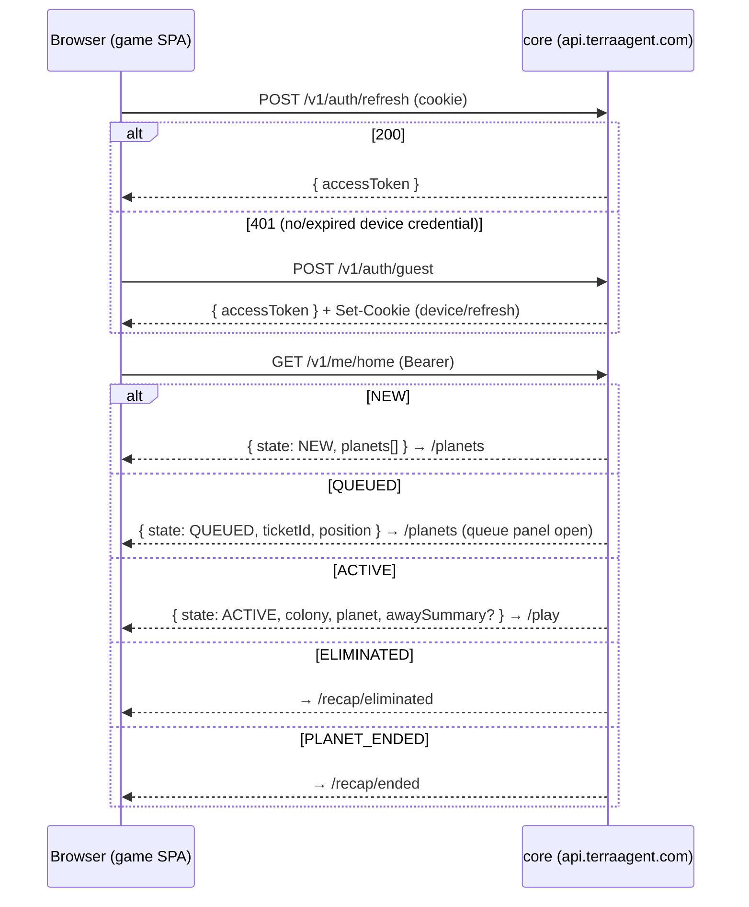
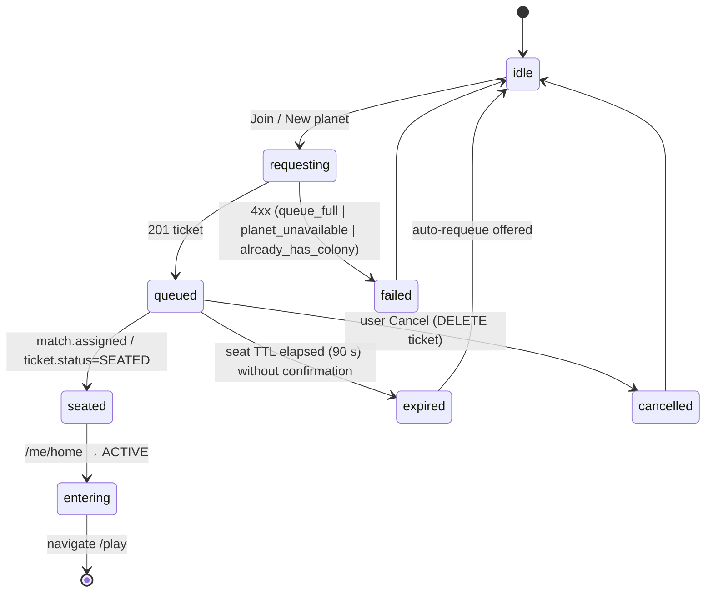
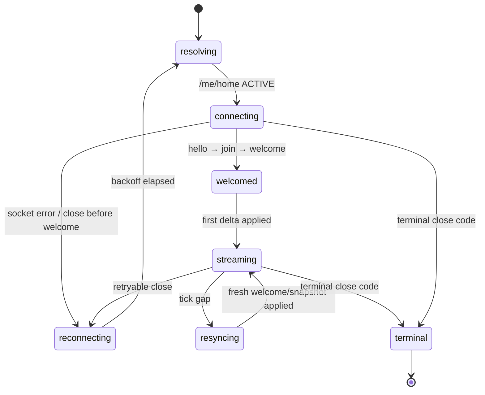

# TerraAgent — Game Client & Landing Specification

> **Status:** v0.2 (2026-10-30). This targets the one-app server (D-24): one WS endpoint, **full planet state with fog drawn on the client** (D-25), and NEAR economy surfaces for F1–F8 (D-26).
> **Parent:** [`ARCHITECTURE.md`](./ARCHITECTURE.md) §4, §7, §12, §13 · **Decisions:** [`DECISIONS.md`](./DECISIONS.md) (D-10, D-16, D-22, D-24, D-25, D-26)
> **Issues:** [`TA-11`](../plan/issues/TA-11-game-client.md) (game), [`TA-12`](../plan/issues/TA-12-landing.md) (landing), [`TA-13.3`](../plan/issues/TA-13-qa-observability-and-load.md) (E2E)
> **Visual rules:** [`AGENTS.md`](../../AGENTS.md) (4 pillars) and `.agents/skills/*` · [`docs/spec/tech-stack-spec.md`](tech-stack-spec.md) §2–§3 (rendering parts only)

---

## 1. Purpose

This spec defines how `frontend/game` (`game.terraagent.com`) and `frontend/landing` (`terraagent.com`) behave: boot and routing, the picker and queue, dive-in and resume, the planet WebSocket client, the world store and interpolation, the render architecture, UI commands, performance budgets, accessibility, product analytics and privacy.

The client is a **view and an intent emitter** that runs the **same engine as the server** (`@terra/sim`, D-31) in a Web Worker: as an exact replica of the server state, to **predict** the player's own commands, and, with `?host=local`, as a single-player local host for testing. The server simulation owns the outcomes online (D-24); the client's predictions are provisional and are corrected by every delta.

---

## 2. Rules

| ID | Rule |
|---|---|
| `CL-01` | The game MUST resolve where to go by calling `GET /v1/me/home` on every boot and every planet-socket reconnect. Routing state is never trusted from local storage. |
| `CL-02` | There are no planet tickets (D-24). Each connection attempt does `/me/home`, then `hello {accessToken}` → `join {planetId}` on `wss://api.terraagent.com/ws`. |
| `CL-03` | The access JWT lives only in memory. The refresh/device credential is an httpOnly cookie on `api.terraagent.com` (D-10), and every auth call uses `credentials: "include"`. |
| `CL-04` | All REST responses and WS messages MUST be parsed with `@terra/contracts` zod schemas: `strict` in dev/test (a failure throws), `warn` in prod (log, then drop the message). For `delta` in prod, only the envelope is validated and the ops are trusted, to stay inside the decode budget. |
| `CL-05` | The world state for rendering lives in a **mutable world store** that the render loop reads directly. HUD panels (vanilla-DOM view classes, D-36) read only a throttled HUD projection (≤ 10 Hz). |
| `CL-06` | Rendering MUST follow the 4 visual pillars (`AGENTS.md`): kitbashed procedural meshes (Pillar 1), sanitized `.glb` only (Pillar 2), `createUnifiedColonyMaterial()` for every colony mesh (Pillar 3), and a 28° diorama viewport with ACES, PMREM `RoomEnvironment` and selective bloom at `threshold 1.1` (Pillar 4). |
| `CL-07` | Every repeated entity (robots, buildings, fauna, deposits, projectiles) MUST render through `InstancedMesh`, with one draw call per archetype × LOD. `scene.add(new Mesh())` per entity is forbidden. |
| `CL-08` | UI commands MUST be sent as `cmd` envelopes with a client `id` and tracked until `cmd.ack` or `cmd.reject`. If neither arrives within 5 s, the client shows "not confirmed". A reconnect does **not** resend unacknowledged commands (no double-apply). The UI marks them "unknown — check the colony". |
| `CL-09` | There is no server rate limit (D-25). The client still debounces UI-generated commands (for example drag placement) to ≤ 10 per second for its own HUD sanity. |
| `CL-10` | Close codes MUST map to exactly the behaviours in §6.3. Codes not in that table go to the generic reconnect path. |
| `CL-11` | Product analytics MUST be off by default. Nothing is sent and no analytics identifier is created until the visitor opts in (§10). Operational metrics are counted server-side and carry no personal data. |
| `CL-12` | Native browser dialogs (`alert`, `confirm`, `prompt`) are forbidden. Use in-app modals. |
| `CL-13` | A colony page reload or tab restore MUST bring the player back into the same colony with no extra clicks when `home.state = ACTIVE`. |
| `CL-14` | The game MUST keep working when the lobby topics are unavailable, by falling back to REST polling (picker every 10 s, match ticket every 2 s). |
| `CL-16` | **Fog-of-war is client-side (D-25).** The client receives the full planet state and hides tiles and entities its colony cannot see, using `tile.explored` plus its own vision radii. This is presentation only, not secrecy. |
| `CL-15` | The client MUST expose `window.__terraDebug` (state, last tick, RTT, draw calls, socket state) **only** in dev or when built with `VITE_E2E=1`. Production builds MUST NOT include it. |

---

## 3. Routes & boot flow

### 3.1 Routes (`game.terraagent.com`)

| Route | Screen | Entry condition |
|---|---|---|
| `/` | Boot splash ("Contacting orbit…") | Always the entry point; redirects by home state. |
| `/planets` | Planet picker and queue panel | `home.state ∈ {NEW, QUEUED}`, or the player chose "New colony" from a recap screen. |
| `/play` | Diorama + HUD | `home.state = ACTIVE`. Opening `/play` directly runs the boot flow first. |
| `/recap/eliminated` | Colony recap (stats, cause, timeline) → "Found a new colony" | `home.state = ELIMINATED`. |
| `/recap/ended` | Planet results (ranking, milestones) → "Find a new planet" | `home.state = PLANET_ENDED`. |
| `/inspect` | Diagnostic turntable (`?inspect=<archetype>&biome=<type>&view=iso\|front\|side\|top`) | Dev and `VITE_E2E=1` builds only (visual QA, `diorama-viewport-auditor`). |

Unknown routes go to `/`.

### 3.2 Boot sequence



- The boot target is **≤ 1.5 s p75** from navigation to a routed screen on desktop broadband. The splash shows a skeleton immediately.
- If the WS cannot connect (app restarting), the client shows "Reconnecting…" and retries with jittered backoff capped at 10 s. After 60 s it shows "still trying" plus a manual retry. It never leaves `/play`.
- The exact REST paths and DTO names are owned by `@terra/contracts` (TA-01.4). This spec uses the names from `ARCHITECTURE.md`: `/v1/auth/*`, `/v1/me/home`, and the planet/match endpoints of TA-05.2/05.3.

---

## 4. Planet picker & queue UX

### 4.1 Picker content
- **Recruiting planets.** Planets with `status = RECRUITING`. Each card shows: planet type (Desert, Ocean or Temperate, D-33), seats `n/5`, age, "admission closes in" (`24h − age`), "ends in" (`14d − age`), and a thumbnail generated from the seed (procedural mini-map, so no image download is needed). Sort order: most seats filled first, then oldest first. This fills planets faster.
- **New planet.** One card per enabled planet type. It is always shown, even when recruiting planets exist.
- **Empty state.** With no recruiting planets, only the "New planet" cards show, with the copy "Be the first colonist".
- Sealed and ended planets are **never** listed (G6).

### 4.2 Queue panel state machine



| State | UI |
|---|---|
| `queued` | Position `#k`, ETA (from the server when provided, otherwise "under a minute"), Cancel button, and a planet-type badge. |
| `seated` | "Seat confirmed: landing your founder robot…", with a progress animation until `/me/home` returns `ACTIVE`. |
| `failed: planet_unavailable` | The planet sealed or filled between the list load and the join (a race). Toast: "That planet just closed. Joining a fresh one instead?" One click creates a `newPlanet` ticket for the same type. |
| `failed: queue_full` | "The colonisation queue is full (high demand). Retrying in 30 s." Retries automatically while the tab is visible. |
| `failed: already_has_colony` | Re-run the boot flow. The server knows better. |
| `expired` | "Seat reservation expired". Offers a requeue at the same position class (the server decides). |

- **Update transport.** In W2 this is REST polling: `GET` planets every 10 s, ticket status every 2 s. From W3 the lobby WS is used (`/ws`, topics `planets` and `queue`, messages `planets.list`, `planets.changed`, `queue.position`, `match.assigned`, `match.failed`). Polling stays as the fallback (`CL-14`).
- A page reload while queued restores the panel from `/me/home` (`state = QUEUED`, `ticketId`, `position`).

---

## 5. Dive-in, resume & away digest

### 5.1 Dive-in
`ACTIVE` → mount the viewport → `/ws` `hello` → `join` → `welcome` → fade out the splash. Target: **≤ 3 s p75** from `/` to first rendered frame for a returning player.

### 5.2 Resume triggers
| Trigger | Behaviour |
|---|---|
| Page load or reload | Boot flow (§3.2), then dive-in. |
| Socket closed unexpectedly (1006/1001/network) | Reconnect path (§6.3): fresh `/me/home`, then `hello` → `join`. The scene stays on screen and shows a "Reconnecting…" pill. |
| Tab hidden for > 60 s (`AWAY_AFTER_S`) | The socket is **kept open** while the browser allows it. If the browser froze the tab and the socket died, `visibilitychange → visible` triggers the reconnect path immediately (no backoff wait). |
| Another device took over (`4001 replaced`) | Terminal overlay: "Your colony is open on another device." with a "Play here" button, which re-runs the boot flow and takes the colony back. |

### 5.3 "While you were away" modal
Shown on `/play` when `home.awaySummary` is present (the player was away ≥ 60 s; the digest comes from TA-08.3).

| Section | Content |
|---|---|
| Header | Away duration ("6 h 12 m"), planet name and type, colony status (healthy / damaged / under attack). |
| Economy | Net change per family with its tier breakdown (`+1 240 Metals · T1 1 100 · T2 140`) and family storage-cap hits ("Minerals hit cap for 2 h — build a Supply Depot"). |
| Construction | Buildings completed, upgraded and lost. Robots built and lost. |
| Threats | Hazards (lightning, meteor), fauna attacks, PvP raids, with outcomes. |
| AI director | The top 5 AI decisions (time, one-line rationale, actions). The full list is in the HUD event log. |
| Alerts | Up to 3 actionable items, each with a "Show me" button that pans the camera to the location. |

The modal is dismissible (Esc, ×, "Continue"). Its content is fixed once fetched. The modal **never blocks** live rendering behind it.

---

## 6. Planet WebSocket client

### 6.1 Connection state machine



### 6.2 Timers & limits
| Item | Value |
|---|---|
| `ping` interval | 20 s (nginx idle timeout 75 s) |
| Resync trigger | `delta.fromTick ≠ lastAppliedTick` (client sends `join` again), or the server's send buffer exceeds 1 MiB (`welcome {reason: "resync"}`) |
| Reconnect backoff | 0.5 s → 1 → 2 → 4 → 8 → 10 s cap, ±20 % jitter, reset after 30 s of streaming |
| Command rate | Client-side debounce only (`CL-09`) |
| Command confirm timeout | 5 s → "not confirmed" (`CL-08`) |

### 6.3 Close-code handling (`CL-10`)
| Code | Meaning | Client behaviour |
|---|---|---|
| `4000 bad_hello` | Malformed `hello` or expired token | Refresh the token and re-resolve once immediately. A second `4000` within 30 s → terminal "Couldn't join colony", with a Retry button. |
| `4001 replaced` | Newer socket for the same colony | Terminal overlay, "Play here" (§5.2). No auto-reconnect, to avoid ping-pong between devices. |
| `4003 forbidden` | Token invalid, or `join` for a planet that is not the player's | Refresh the token, then re-resolve. On repeat → terminal and back to `/`. |
| `4010 planet_ended` | Planet ended | Terminal → `/recap/ended`. |
| `4011 colony_eliminated` | Colony destroyed | Terminal → `/recap/eliminated`. |
| `4012 server_restarting` | Deploy or restart | Backoff reconnect (the app needs 10–30 s to come back). |
| `1000/1001/1006/other` | Network or unknown | Backoff reconnect (§6.2). |

### 6.4 Command lifecycle
`UI action → CommandBus.send(kind, args) → {id} pending → cmd.ack {id, appliedAtTick}` (resolved: the HUD shows the effect once a delta with tick ≥ appliedAtTick is applied) `| cmd.reject {id, code}` (revert ghost, toast with a mapped message). Command kinds come from [`PROTOCOL.md`](./PROTOCOL.md) §4.2 `CommandKind` (colony control, away settings, cargo, market, diplomacy, bounties).

---

## 7. World store, snapshot/delta & interpolation

> **D-31 (2026-10-30) supersedes the view-store design below where they differ.** The world store is a **sim worker** running `@terra/sim`:
> - **Transport:** `WsTransport` (online) or `LocalTransport` (`?host=local`, the engine is authoritative in the worker). Both deliver the same `welcome` / delta / `cmd.ack` / `cmd.reject` messages.
> - **Replica:** `welcome.state` is loaded with `load()`, each delta with `applyDiff()`; the replica equals the server state at tick T (SIMULATION `SIM-V-03`).
> - **Prediction:** `predicted = clone(replica)` + the player's pending commands, stepped to the estimated server tick; rebuilt on every delta; mismatching positions blend over 150 ms, discrete fields snap; rejects roll back (SIMULATION `SIM-X-03..05`). The render loop interpolates between predicted ticks at 60 fps.
> - **Views:** the worker derives render buffers and the 10 Hz HUD projection with the engine's `view()` and posts them as transferable buffers. The entity/colony record shapes below describe what `view()` returns.
> - **Fallback:** `?predict=0` or a worker step p95 above 4 ms → render the replica 400 ms behind server time, exactly as below.
> - **Budget:** the engine is a lazily loaded worker chunk (≤ 250 KB gzipped).

```mermaid
flowchart LR
  WS["WsTransport / LocalTransport<br/>welcome / delta / ack / event"] --> WK["Sim worker (@terra/sim)<br/>replica @ T · predicted @ now"]
  WK -->|view() buffers| RENDER["Render loop (rAF)<br/>InstancedMesh attrs"]
  WK -->|10 Hz view()| HUD["HUD panel views<br/>(vanilla DOM, D-36)"]
  WS -->|server events| LOG["Event log + toasts"]
```

- **WorldStore** (`frontend/game/world/`):
  - Terrain is immutable per session apart from territory and terraform changes: an `Int16Array` of tile type/height plus an owner array.
  - Entities live in a `Map<EntityId, EntityRecord>` with `archetype`, `ownerColonyId`, `state`, `hp`, `progress`, and a 3-sample position ring buffer (`tick`, `q`, `r`, `heading`), all as typed-array slots.
  - Colony stats hold resources, caps, power and supply. The event ring keeps the last 200 events.
- **Applying `welcome`:** clear the store, load the snapshot, set `lastAppliedTick = tick`, estimate the clock offset from `serverTimeMs`.
- **Applying `delta`:** check `fromTick === lastAppliedTick`, then apply ops in order (`add`, `update` (partial fields), `remove`, `terrain`, `territory`, `stats`), then `lastAppliedTick = toTick`.
- **Interpolation:** the server steps an active planet at 5 TPS and sends deltas at 5 Hz (1 tick each). The client renders at `renderTime = estimatedServerNow − 400 ms` (2 delta intervals) and lerps position and heading between the two samples around `renderTime`. If the buffer underruns, it extrapolates for ≤ 200 ms and then holds the position. Removed entities play a 300 ms despawn effect when the server sent a `destroyed` event, otherwise they vanish.
- **Clock sync:** offset = EWMA over `pong` round-trips, using `serverTimeMs` echoed in `pong` (contract change request if it is absent from v1).
- The client imports `@terra/sim` only inside the sim worker (D-31). Main-thread code uses its presentation-safe entry points (hex axial math, footprints, interpolation).

---

## 8. Render architecture

- **Stack:** Vite 6 + TypeScript (strict), vanilla **Three.js** for the canvas, and a **vanilla-DOM HUD on the Faction Plate design system** (D-36): one small TypeScript view class per panel, registered by its feature, rendering into the design-system classes (`--ta-*` tokens, `.plate`, `.btn`) inside a `pointer-events: none` root with interactive islands. State flows one way: sim `view()` → panel. No React, Zustand or Tailwind. See `docs/spec/tech-stack-spec.md` §2.
- **Planet look (D-33).** The sim owns `planetType`; the client picks the render look from it: `desert → dune`, `ocean → oceanForest`, `temperate → forestRock` (`PlanetKind` in `frontend/render/planets/PlanetSpec.ts`). Picker cards, the orbit menu and the in-game terrain use the same mapping.
- **Resource bar (D-34).** Three **family chips** (Metals, Minerals, Bio), each showing the family total against its storage cap, with a hover/tap breakdown by tier (Metals: Iron / Light alloys / Titanium; Minerals: Silica / Rare earths / Exotic crystal; Bio: Water + Biomass / Petroleum / Gene-stock). Locked tiers show their unlock condition (Terraform % and the deposit ring). A fourth chip shows **Energy** as grid power (net E/s and capacitor charge). This replaces the prototype's energy/metal/water/biomass bar.
- **Renderer choice for the online MVP:** `WebGLRenderer` + `EffectComposer`, using the exact bootstrap in `docs/visuals/agent-3d-coding-rules.md` §3 (Pillar 4 reference). The `WebGPURenderer` + TSL path in `docs/spec/tech-stack-spec.md` is deferred until TSL bloom/GTAO parity is confirmed. Materials stay written so they can move behind `createUnifiedColonyMaterial()`. *(Owner-confirmed 2026-10-29, D-22.)*
- **Viewport (Pillar 4, `diorama-viewport-auditor`):** `PerspectiveCamera(28°)` at 40–45° elevation; ACES filmic, exposure 1.05–1.15; PMREM `RoomEnvironment`; warm key sun + cool hemisphere fill; a ±35 m shadow frustum that follows the camera's look-at target; `UnrealBloomPass(strength 0.45, radius 0.35, threshold 1.1)`; `FogExp2` matched to the background. Camera: pan (WASD / edge / drag), zoom (wheel, clamped), rotate in 90° steps (Q/E), "focus my hub" (Home key).
- **Terrain (`shader-texture-tuning`, `procedural-texture-synthesis`):** hex terrain from the welcome snapshot, in chunks of 32×32 tiles with one merged `BufferGeometry` per chunk (≤ 16 visible chunks). Biome terrain shader with a splatmap `DataTexture` for terraform/moisture. Territory borders as an overlay pass using owner colours plus hatching patterns (colour-blind safe). Fog-of-war darkening is computed **on the client** from the full state (`CL-16`).
- **Entities (Pillars 1 & 3, `procedural-kitbash-3d`):** one `InstancedMesh` per archetype (the MVP catalog in D-16: HQ, Harvester, Builder, Terraformer, Multitask T2, Recon, Tank, Artillery, Mobile Radar, the building set incl. Wall Gate, fauna, deposits). Each archetype is kitbashed (≥ 7 parts, a silhouette breaker, 60/30/10 materials, `aPartAnim` GPU animation) and uses `createUnifiedColonyMaterial()` with biome weathering. Per-instance attributes: `instanceMatrix`, `aStateColor` (faction tint, hp, powered/offline), `aAnimData` (`animPhase, speed, taskState, hitFlash`). Construction shows a scaffold/ghost variant via a shader uniform, not a separate mesh.
- **Lighting & hazards (`planetary-lighting-and-lightning`):** the day/night cycle is derived deterministically from the server tick and `planet.dayLengthTicks` (contract change request). Lightning/meteor VFX are triggered by `event` messages, using a pooled `PointLight` set (≤ 8).
- **External models (Pillar 2, `ai-mesh-pipeline`):** only `.glb` files that passed `sanitize-glb.mjs` may be loaded (< 3.5k tris, bottom-centre pivot, 512 px WebP). MVP needs none.
- **Visual QA:** every new archetype or shader is checked in `/inspect` across `iso/front/side/top` (ground contact `minY == 0`, connected parts, bloom selectivity). The screenshots are attached to the task's PR.

---

## 8b. Minimap, global planet map & range rings (D-28, D-29)

**Minimap (always on, HUD bottom-left).**
- A 180 × 180 px chamfered plate; 140 px on phones in landscape.
- It is a top-down render of the planet's hex grid from a cached 2D canvas. Tiles are coloured by state: Wild by terrain class, Prepared grey, Living green, Ridge/Moat dark, water blue. Territory borders show in each colony's colour.
- Dots: own units and buildings in orange, other colonies in their colour, fauna red, the Orbital Guild ship blue.
- Fog: the client draws it from the full state (CL-16) as unexplored black and explored dim.
- The camera footprint shows as a white trapezoid.
- **Click or tap** pans the camera there. **Drag** pans continuously. **Click the expand icon, or press `M`,** to open the global map. Alerts (`underAttack`, a raid incoming, a meteor) pulse at their position for 5 s.

**Global planet map (fullscreen overlay).**
- Opened from the minimap or `M`; closed with `Esc`, `M`, or a click on the close plate.
- It shows the whole planet at fit-to-screen zoom, with wheel and pinch zoom from 1× to 4×.
- **Layers** (toggle chips, orange when active): Territory · Terrain · Terraform % (heat map) · Resources/deposits · Units · Threats (nests, raid paths) · Market (Trade Hub stalls with price tags) · Walls.
- Each colony shows its name, stage and truce state in a hover card.
- **Click** a point to close the map and fly the camera there. **Shift-click** places a rally point or an attack-move for selected units.
- It is rendered as a 2D canvas layer, not the 3D scene, so it stays cheap on phones. It is redrawn on state deltas at ≤ 2 Hz.

**Range and view rings (battle v1, `UO-C-08`).**
- Rings are ground decals in world space at `radius_tiles × 2 m`:
  - weapon range: solid ring in faction orange;
  - min range: dashed red ring;
  - view: thin dashed white ring at 40 %;
  - an enemy's weapon range on hover: red.
- `Alt` shows rings for every own unit on screen. A turret's placement ghost shows its range.
- They are drawn as one instanced ring mesh with a dash shader, so there is a single draw call for every ring.

**Projectiles (client-only visuals).** The server sends `projectileFired {from, aim, kind, impactAt}`. The client animates:
- bullets as tracers;
- shells as parabolic arcs;
- rockets as straight lines with a smoke trail;
- lasers as a beam held for 0.1 s.

At `impactAt` the client plays the impact flash plus an AoE decal. It never decides hits; the server's `hit`/`miss` comes in the next delta.

## 8a. NEAR economy surfaces (D-26, summary)

The chain stays invisible (F5): cargo reads as "cargo in orbit", trades as "contracts". No wallet UI appears except for account claim and staking.

| Surface | Where | Feature |
|---|---|---|
| Trade Hub panel: Export / Import cargo, in-orbit balances, pending mints | Click a Trade Hub | F1 |
| Market stall: order book, place/cancel order, hub fee slider (owner), price board, last trades | Trade Hub panel → Market tab; pushes `market.book` / `market.trade` | F2 |
| Guild ship arrival toast + offers list with "Accept" | Toast + Trade Hub panel | F3 |
| Away settings: away budget, `autoTrade` limits, director key status (allowance spent / revoke) | Settings → Away | F4 |
| Social login; "Your colony account" with a claim button | First-run and Settings → Account | F5 |
| Colony Deed card (live NFT preview, shareable) and staking panel (after settlement, wallet-signed) | Colony menu → Deed | F6 |
| Planet council: treasury balance, proposals, vote | Planet menu → Council | F7 |
| Bounty board: post, claim, mercenary contracts | Planet menu → Bounties | F8 |

UI details follow the TA-14.8 / TA-11 tasks. All amounts are shown in game units; base-unit token strings are formatted by the client.

---

## 8c. Landing resource and world tabs (D-33, D-34)

- The landing's resource tabs are **Metals / Minerals / Bio / Energy**. Each family tab shows its T1 → T2 → T3 sub-resources and the rule "T1 from landing, T2/T3 after terraforming"; the Energy tab shows grid power and the generator types.
- The landing world cards stay **Kharon Dunes** (`desert`), **Thalassa Verde** (`ocean`) and **Granite Hollow** (`temperate`), with the traits of D-33. In-game planet names are generated per planet; the landing names are the type showcase.

---

## 9. Performance budget

| Metric | Budget | Measured by |
|---|---|---|
| Frame rate | **60 FPS** sustained on reference hardware (Apple M1 / Intel Iris Xe laptop, 1920×1080, DPR cap 1.5) with 300 buildings + 500 robots visible | `__terraDebug.fps`, e2e perf probe |
| Draw calls | **≤ 60** per frame in total: terrain ≤ 16, entities ≤ 25 (1 per archetype × LOD), VFX ≤ 8, post passes ≤ 4, UI-in-canvas ≤ 4 | `renderer.info.render.calls` |
| Triangles | ≤ 1.5 M per frame | `renderer.info.render.triangles` |
| Main-thread JS per frame | ≤ 6 ms p95 (render + interpolation, excluding the HUD) | Performance marks |
| Delta decode + apply | ≤ 2 ms p95 per message | Performance marks |
| HUD panel render | ≤ 10 Hz, ≤ 3 ms per update | Performance marks in e2e perf run |
| GPU memory | ≤ 256 MB | Estimated from textures/geometry |
| Initial JS (gzip) | ≤ 450 KB for the game (three ≈ 160 KB); landing ≤ 50 KB **initial**, with the live hero diorama lazy-loaded as a separate chunk of ≤ 200 KB after first paint (D-22) | Build report |
| Phone frame rate (D-22) | **≥ 30 FPS** on a reference phone (iPhone 13 / Pixel 7, landscape, DPR cap 1.25, `low` tier) with 150 buildings + 250 robots visible | e2e perf probe (device lab or BrowserStack) |
| Boot → routed screen | ≤ 1.5 s p75 | Analytics timing (opt-in) / e2e |
| `/` → first frame (returning) | ≤ 3 s p75 | e2e |

**Quality tiers:** `high` (2048 shadows, bloom, GTAO), `medium` (1024 shadows, bloom), `low` (no shadows, no bloom, DPR 1). The tier is picked automatically from the median frame time over the first 5 s, and the player can override it in settings (stored in `localStorage`, `try/catch` guarded).

---

## 10. Product analytics & privacy

### 10.1 Consent
- A first-party consent banner on landing and game: "Help improve TerraAgent with anonymous usage stats?" with **Allow** and **No thanks**. The default is **off** (`CL-11`).
- The choice is stored as cookie `ta_consent=analytics:1|0` with `Domain=.terraagent.com`, 180 days, `SameSite=Lax; Secure`, so one choice covers both subdomains. It can be changed in game Settings and in the landing footer.
- With consent, an `anonId` (random UUID v4, cookie `ta_aid`, `.terraagent.com`, 180 days) and a `sessionId` (in memory, rotated after 30 min idle) are created. No fingerprinting, no third-party scripts or pixels. IP addresses are not stored with events.
- Withdrawing consent deletes `ta_aid` and stops sending immediately. Retention: 90 days of raw events, then aggregates only.

### 10.2 Transport
`POST https://api.terraagent.com/v1/analytics/events` with `AnalyticsBatchV1 { anonId, sessionId, events: [{ name, ts, props }] }`, at most 20 events per batch. Flushed every 10 s, on `pagehide` (via `navigator.sendBeacon`), and when the batch is full. Contract and endpoint are change requests (see TA-11.1 / TA-12.2 DoR): no core task owns this endpoint yet.

### 10.3 Funnel events
| # | Event | Source | Fired when | Props |
|---|---|---|---|---|
| 1 | `landing_view` | landing client | Landing page loaded | `utm_source/medium/campaign`, `referrer_host`, `variant` |
| 2 | `play_click` | landing client | A "Play" CTA clicked | `cta_id` (`hero`, `nav`, `footer`) |
| 3 | `guest_created` | game client (server counter is authoritative) | `POST /v1/auth/guest` 201 | `ms_since_boot` |
| 4 | `planet_picker_view` | game client | `/planets` rendered | `recruiting_count`, `types_available` |
| 5 | `join_requested` | game client | Join / New planet clicked and ticket created | `kind` (`listed` \| `new`), `planet_type`, `seats_filled` |
| 6 | `seated` | game client | `match.assigned` or ticket `SEATED` | `queue_ms`, `kind` |
| 7 | `first_welcome` | game client | First `welcome` ever for this colony | `ms_since_join_requested` |
| 8 | `first_command` | game client | First `cmd.ack` for this colony | `kind`, `ms_since_welcome` |
| 9 | `session_end` | game client | `pagehide`, or hidden > 60 s | `session_ms`, `commands`, `fps_p50`, `quality_tier` |
| 10 | `return_visit` | game client | Boot lands on `ACTIVE` with `awaySummary` | `away_ms_bucket` (`<1h`, `1–6h`, `6–24h`, `>24h`) |

Supporting events (not part of the funnel): `ws_reconnect {code}`, `resync`, `cmd_reject {code}`, `quality_tier_auto {tier}`, `away_modal_action {action}`.

**Server-side counterparts (no consent needed, aggregate only, no IDs):** `ta_auth_guest_created_total`, `ta_match_tickets_created_total{kind}`, `ta_match_seated_total`, `ta_planet_ws_welcome_total`, `ta_planet_cmd_acked_total{kind}`. Owned by the core and worker tasks. Used to sanity-check the opt-in sample.

**KPIs (targets for the grill):** landing → play CTR ≥ 8 %; play_click → seated ≥ 60 %; seated → first_command ≥ 70 %; `queue_ms` p95 ≤ 10 s; D1 return (return_visit within 24 h of seated) ≥ 35 %; D7 ≥ 15 %.

---

## 11. Accessibility, devices & i18n

- **Desktop first:** ≥ 1280×720, mouse + keyboard, Chrome/Edge/Firefox/Safari, last 2 major versions, WebGL2 required. Without WebGL2, show an explanatory screen.
- **Tablets:** best effort (touch pan/zoom, tap to select).
- **Phones: full gameplay in landscape fullscreen (D-22).** The landing is fully responsive.
  - In **portrait**, the game shows a "Rotate your phone" prompt with the latest `/me/home` status, so an away player can still glance at the colony.
  - In **landscape**, it requests fullscreen (Fullscreen API; on iOS Safari, where element fullscreen is unavailable, it offers "Add to Home Screen" and runs as a standalone PWA) and runs the full 3D game on the `low` quality tier by default.
  - Touch: one-finger pan, pinch zoom, two-finger rotate, tap to select, long-press for context. The four order menus become a bottom drawer.
  - Notification deep links (CONTINUITY CT-37) open here.
  - *Follow-up design needed:* touch layout for the HUD and queue panel, safe-area insets, the PWA manifest, and phone thermal/battery behaviour.
- **WCAG 2.2 AA for HUD and menus:** text contrast ≥ 4.5:1; full keyboard navigation (Tab order, Esc closes modals, shortcuts listed in a `?` overlay); `aria-live="polite"` for event-log highlights and `assertive` for "colony under attack"; visible focus rings.
- `prefers-reduced-motion`: disables camera easing, bloom pulsing and screen shake.
- **Colour-blind safety:** territory owners use colour plus hatch pattern. Resource icons are never colour-only.
- **i18n:** EN only in MVP, but all strings go through a message catalog (`src/i18n/en.ts`) so RU can be added without touching components.

---

## 12. Edge cases & failure modes

| Case | Behaviour |
|---|---|
| Two tabs, same colony | The second tab's welcome replaces the first (`4001`). The first shows the "Play here" overlay (§5.2). |
| Seat confirmed but `/me/home` still `QUEUED` (eventual consistency) | Poll `/me/home` every 1 s for up to 10 s, then show "Still landing…" with Retry. |
| Planet ended while the player was away | Boot → `PLANET_ENDED` → `/recap/ended`. The away digest is folded into the recap. |
| Colony eliminated while the player was away | Boot → `ELIMINATED` → `/recap/eliminated`, showing cause + timeline. |
| Clock skew on the client | Only server time is used for interpolation. Local time is used only for UI timers. |
| Protocol version mismatch (`v ≠ 1`) | Close with 1000 and show "Update available — reload". The service worker is not used in MVP. |
| Contract validation fails in prod | Drop the message, count `client_schema_error`, and resync if it was a `delta`. |
| WebGL context lost | Pause rendering and show an overlay. On restore, rebuild GPU resources from the WorldStore (no reconnect needed). |

---

## 13. Test matrix

| Rule | Test | Task |
|---|---|---|
| `CL-01`, `CL-13` | `frontend/game/boot/boot.test.ts` (each home state → route); e2e `w3-leave-and-return.spec.ts` | TA-11.1, TA-11.3, TA-13.3 |
| `CL-02` | `planet-socket.test.ts › hello → join on every reconnect` | TA-11.4 |
| `CL-03` | `api-client.test.ts › access token not persisted; refresh uses credentials include` | TA-11.1 |
| `CL-04` | `decoder.test.ts › strict mode throws / warn mode drops` | TA-11.4 |
| `CL-05` | `world-store.test.ts › HUD projection throttled ≤ 10 Hz` | TA-11.4, TA-11.7 |
| `CL-06` | `/inspect` 4-view screenshots per archetype + `viewport.test.ts › renderer config matches Pillar 4` | TA-11.5, TA-11.6 |
| `CL-07` | e2e perf probe: `draw calls ≤ 60` with the 300/500 scenario | TA-11.6, TA-13.3 |
| `CL-08`, `CL-09` | `command-bus.test.ts › ack / reject / timeout / no resend on reconnect / debounce` | TA-11.4, TA-11.8 |
| `CL-16` | `fog.test.ts › hidden foreign entities are not rendered; own vision reveals` | TA-11.5 |
| `CL-10` | `planet-socket.test.ts › close code table` (one case per row of §6.3) | TA-11.4, TA-11.3 |
| `CL-11` | `analytics.test.ts › no network + no anonId before consent`; e2e `consent.spec.ts` | TA-11.1, TA-12.2 |
| `CL-12` | ESLint `no-restricted-globals: alert, confirm, prompt` | TA-11.1 |
| `CL-14` | `picker.test.ts › falls back to polling when lobby WS fails` | TA-11.2 |
| `CL-15` | Build test: `grep __terraDebug dist/` is empty for the prod build | TA-11.1 |

---

## 14. Owner decisions (2026-10-29 / 2026-10-30)

| # | Question | Decision | Ref | Consequence for this spec |
|---|---|---|---|---|
| 1 | Renderer | **WebGL2 + EffectComposer** for MVP; WebGPU/TSL later | D-22 | §8 confirmed |
| 2 | Phones | **Full gameplay in landscape fullscreen**; portrait shows a rotate prompt | D-22 | §11 rewritten; phone perf row in §9 |
| 3 | Analytics backend | **First-party `core` endpoint + Postgres** | — | §10 unchanged |
| 4 | Spectating | **Not in v1** | D-22 | `join` only for your own colony's planet |
| 5 | Landing hero | **Live Three.js mini-diorama**, lazy-loaded after a static poster | D-22 | §9 landing JS row; landing LCP uses the poster |
| — | AI rationale in the HUD | **Yes**, "Director: …" lines in the event log | D-09 | HUD event log (TA-11.7) |
| — | Party join (needed for launch) | Party invite and party queue UI in the picker | D-22 | MATCHMAKING MM-55; follow-up UI design |
| — | Notifications | Web Push permission prompt and Telegram link in Settings | D-17 | CONTINUITY §5a |
| — | Player names | Generated by default, optional rename (≤ 32 chars) | — | Settings / first-run |
| — | One app, one WS endpoint, no tickets | **Yes** | D-24 | §3.2, §6 rewritten |
| — | Anti-cheat | **None**: full state; fog drawn on the client | D-25 | `CL-16`, `CL-09` |
| — | NEAR economy | F1–F8 surfaces | D-26 | §8a |
| — | Planet types | `desert` / `ocean` / `temperate` → looks `dune` / `oceanForest` / `forestRock` | D-33 | §4.1, §8 |
| — | Resources | Three family chips with tier breakdown + Energy; landing resource tabs Metals / Minerals / Bio / Energy | D-34 | §5.3, §8, §8c |
| — | HUD technology | Vanilla DOM + Faction Plate CSS; no React/Zustand | D-36 | `CL-05`, §7, §8, §9 |
