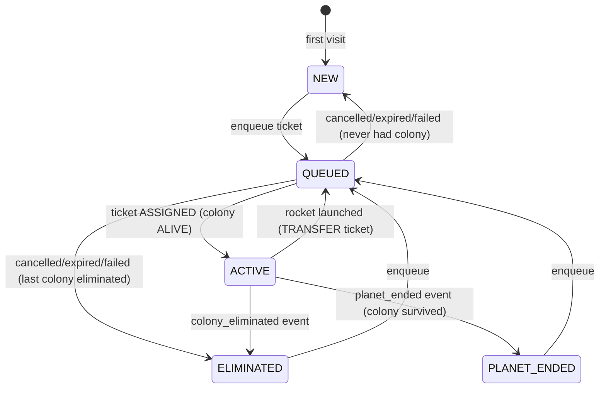

# TerraAgent — Continuity Specification (Offline Play, Resume, Failover)

> **Status:** v0.2 (2026-10-30). This is the simplified one-app host (D-24). A restart resumes from the last snapshot and fast-runs the missed time. There is no failover, lease or drain machinery.
> **Parent:** [`ARCHITECTURE.md`](./ARCHITECTURE.md) §7, §9, §10, §14, §15 · **Decisions:** D-17, D-24, D-25 · **Related:** [`MATCHMAKING.md`](./MATCHMAKING.md)
> **Plan:** [`TA-08`](../plan/issues/TA-08-continuity-offline-and-resume.md) · [`TA-04.4`/`TA-04.5`](../plan/issues/TA-04-core-api-auth-and-home.md) · [`TA-07.3`/`TA-07.5`/`TA-07.6`](../plan/issues/TA-07-planet-worker.md) · [`TA-05.5`](../plan/issues/TA-05-matchmaking-and-planet-lifecycle.md) · [`TA-11.3`](../plan/issues/TA-11-game-client.md)

---

## 1. Purpose

The owner's promise: **the colony works without the player**, and **the player can come back at any time and continue**. This spec defines:

1. How the game decides where to send a player on open (**home state machine**, §2).
2. How the server knows a player is away (**presence**, §3).
3. What the colony may and may not do while the player is away (**away-mode autopilot safety rules**, §4).
4. What the player is told on return (**away digest**, §5).
5. How a reconnect/resume works, including multi-device takeover (§6).
6. How a planet survives an app crash or deploy (**restart & fast-run**, §7).

---

## 2. Home state machine

`GET /v1/me/home` (core, TA-04.4) is the **only** entry point the game client uses on boot and on every reconnect. Home is **computed**, never stored, by the pure function `resolveHome(facts) → HomeV1`.

### 2.1 Inputs ("facts")

| Fact | Source |
|---|---|
| `liveColony` — colony in `FOUNDING`/`ALIVE` | `core.colony` |
| `openTicket` — ticket in `QUEUED`/`RESERVED`/`SPAWNING` | `core.match_ticket` |
| `lastColony` — most recent colony in a terminal state (`ELIMINATED`/`TRANSFERRED`/`RETIRED`) and its planet state | `core.colony`, `core.planet` |
| `everHadColony` | `core.colony` count > 0 |
| `away` — `{since, durationS}` if last presence is `away` | `core.colony.last_seen_at` + presence event (TA-08.4) |

### 2.2 Resolution table (first match wins)

| # | Condition | State | Payload |
|---|---|---|---|
| H1 | `liveColony.state = ALIVE` | `ACTIVE` | `colony`, `planet`, `awaySummary?` (the client then sends `join {planetId}` on `/ws`) |
| H2 | `liveColony.state = FOUNDING` or `openTicket` exists | `QUEUED` | `ticketId`, `state`, `position`, `etaS`, `planetId?` |
| H3 | `lastColony.state = ELIMINATED` and no newer ticket | `ELIMINATED` | `recap` (planet, survivedS, peak stats, cause), `recapSeen`, `planets` (picker data) |
| H4 | `lastColony`'s planet `ENDED`/`ARCHIVED` while colony survived (`RETIRED` reason `planet_ended`) | `PLANET_ENDED` | `results` (`core.planet_result`), `recapSeen`, `planets` |
| H5 | `lastColony.state = TRANSFERRED` and no live colony yet | `QUEUED` (transfer ticket is open) | as H2 |
| H6 | otherwise (`everHadColony=false`) | `NEW` | `planets` (picker data, [`MATCHMAKING.md`](./MATCHMAKING.md) §4) |



| ID | Rule |
|---|---|
| `CT-01` | The client MUST route on `home.state` only: `NEW`/`ELIMINATED`/`PLANET_ENDED` → `/planets` (recap/results modal first if `recapSeen=false`), `QUEUED` → `/planets` with queue panel, `ACTIVE` → `/play` (dive straight in). |
| `CT-02` | Resume costs **one** REST round-trip plus one WS `hello` → `join`. There are no planet tickets (D-24). |
| `CT-03` | `resolveHome` is a pure function with a table-driven unit test covering H1..H6 and every combination of facts. |
| `CT-04` | `/v1/me/home` p95 ≤ **80 ms** server time (excluding the optional `awaySummary` call, budget 300 ms, omitted on timeout). |
| `CT-05` | `POST /v1/me/recap/seen {colonyId}` sets `recapSeenAt`; the recap is still available via `GET /v1/me/colonies/:id/recap`. |

---

## 3. Presence

| ID | Rule |
|---|---|
| `CT-10` | The `game` module is the presence authority. It holds presence in memory: `join` marks the colony connected; socket close marks it disconnected and starts an away timer. |
| `CT-11` | A colony is **away** when it has had **no** planet socket for `AWAY_AFTER_S` (60 s). Reconnecting within 60 s is a "blip": no away transition, no digest. |
| `CT-12` | Presence changes that affect gameplay enter the sim as a command: `system.presence { colonyId, away }` when the colony becomes away or comes back. |
| `CT-13` | On every presence change, the `game` module updates `core.colony.last_seen_at` and `core.player.last_seen_at`. |
| `CT-14` | **Planet stepping follows presence (D-24).** While at least one colony on the planet has a connected socket, the planet steps at 5 TPS. When none has, it steps coarse (1 step per second, `dt = 5`). After an app restart every colony starts disconnected; colonies that were away stay away. |

---

## 4. Away-mode autopilot & safety rules

Autonomy is the design (the colony is always run by the rule engine following player priorities). "Away mode" only **narrows** what automated actors may do when no human is watching, so the player never returns to a colony that was gambled away.

> **Hard mode (D-17).** Away colonies **can be eliminated** by other players, fauna or the environment. The away rules stop automation from *gambling* the colony away; they do not guarantee survival. Automation therefore puts defense and repair first (uncapped, AW-20), and the player is notified of danger in time to come back (§5a).

**Actors:** the rule engine (in `@terra/sim`, every step), the AI director (`ai` module directives as commands), and automated trades (`near` module, `autoTrade` and the director key F4).

**Player setting** (`setAutopilot` command): `director` (default: rule engine + AI director) · `rules_only` (rule engine only; AI requests are not sent for this colony). Both are subject to the rules below while away.

| ID | While away the colony **MAY** … |
|---|---|
| `AW-01` | keep executing the player's task queue and last priorities (rule engine). |
| `AW-02` | repair damaged buildings, power lines and robots; rebuild **destroyed** buildings that existed when the player left (same tier, same tile) if affordable. |
| `AW-03` | build/upgrade defenses (turrets, shields) and power capacity in response to `attack`/`brownout` events, within the spend cap AW-20. |
| `AW-04` | produce worker and combat units up to the supply cap to replace losses (types the colony already owns, ≤ current `unlockStage`). |
| `AW-05` | shed load per the brownout priority order (`docs/game/colony-economy-and-buildings-spec.md` §1.2). |
| `AW-06` | accept AI director `setPriorities` within the **guard band**: each weight may move at most ±1 step from the player's last explicit setting. |
| `AW-07` | claim unowned territory with already-queued beacons. |

| ID | While away the colony **MUST NOT** … |
|---|---|
| `AW-10` | demolish or downgrade any player-placed building. |
| `AW-11` | start offensive PvP (raids on other colonies), **unless** the player opted in for this colony before leaving (`setAutopilot.awayRaids = true`, default `false`; AI_ORCHESTRATOR Q3). Defensive combat and counter-attacking units inside own territory are always allowed. |
| `AW-12` | launch the rocket / start a planet transfer (needs explicit player confirmation; a `rocket.ready` alert is put in the digest instead). |
| `AW-13` | accept, propose or settle trades **outside the player's `autoTrade` limits**. `autoTrade` **ships in MVP**: per resource, the max give per trade and per away session, the min stock floor, and allowed partners (truce partners / anyone). Truce offers may be proposed or accepted while away; cancelling a truce never happens (units spec `UO-DIP-05`). |
| `AW-14` | change `setAutopilot`, abandon/retire the colony, or change anything account- or chain-related. |
| `AW-15` | build T3 structures or start projects whose cost exceeds AW-20 (big strategic bets wait for the player). |

| ID | Enforcement |
|---|---|
| `AW-20` | **Away budget (player-set, D-17):** before leaving (or at any time), the player sets an away budget in the HUD, as a % of stock per resource, defaulting to the old caps: **40 %** per automated directive and **60 %** of the away-start stock per away session. Spending on **defense and repair is never capped**: repairs, rebuilding destroyed defenses, turrets, walls and combat units within the supply cap. Hard-mode losses must not come from a budget the player forgot to raise. `autoTrade` limits (AW-13) are separate. |
| `AW-21` | The policy is a **pure, versioned function** `awayPolicy(view, command) → allow | reject(reason)` evaluated inside the sim's `commands` system when a command is applied. `AWAY_POLICY_VERSION` is stored in snapshots. |
| `AW-22` | Rejected automated commands produce `cmd.reject {code:'away_policy', rule:'AW-1x'}` in the decision log and count in `away_policy_rejections_total{rule}`; the `ai` module receives the rejection so it does not retry the same directive. |
| `AW-23` | Player commands are never subject to away policy (the player is, by definition, present). |

---

## 5. "While you were away" digest

| ID | Rule |
|---|---|
| `CT-30` | When a colony becomes away (CT-11), the `game` module opens a digest row in `world.planet_event_digest` with a **baseline**: resources, energy balance, building counts by type, robot counts, territory tiles, terraform %. |
| `CT-31` | While away, the `game` module folds the colony's significant events from the event bus into the row (counters plus capped lists, max 20 items per list). The row is flushed with each snapshot (60 s), so the digest survives a restart. |
| `CT-32` | On reconnect after ≥ `AWAY_AFTER_S`, the `game` module closes the digest (end baseline, `durationS`) and sends it in `welcome.away`. `/me/home` reads the headline `awaySummary` from the digest row. |
| `CT-33` | Digests are kept for **7 days**, then purged. Only the latest unseen digest per colony is delivered; older unseen ones are merged into it. |

```ts
type AwayDigestV1 = {
  colonyId: string; awayFrom: string; awayTo: string; durationS: number;
  resources: Record<ResourceKey, { before: number; after: number }>;   // D-34: the 10 sub-resource keys (SIMULATION §5)
  energy: { before: number; after: number };                        // net grid power, E/s (not a stored resource)
  built: { kind: string; tier: number; count: number }[];
  lost: { kind: string; tier: number; count: number; cause: 'fauna'|'raid'|'lightning'|'meteor'|'other' }[];
  robots: { before: number; after: number; produced: number; lost: number };
  territory: { before: number; after: number };
  attacks: { count: number; repelled: number; byColony: { displayName: string; count: number }[] };
  hazards: { kind: string; at: string; damage: number }[];
  ai: { decisions: number; rejected: number; highlights: { at: string; summary: string }[] };
  trades: { settled: number; items: { with: string; gave: string; got: string }[] };
  alerts: { code: 'rocket_ready'|'power_deficit'|'storage_full'|'supply_cap'|'under_attack'; message: string }[];
};
```

- `CT-34` **Away story (flag `AWAY_STORY_ENABLED`, default on in prod).** On digest close, the `ai` module may make one LLM call (`trigger: away.story`) that turns the digest into one paragraph of at most 600 characters. It is shown above the structured digest. The call counts against the daily AI budget, and the structured digest is always shown even if the call fails.

## 5a. Notifications (D-17)

| ID | Rule |
|---|---|
| `CT-35` | Channels in MVP: **Web Push** (service worker + VAPID; desktop and Android; iOS only for an installed PWA) and a **Telegram bot** (the player links it once with a one-time code from the HUD). Email is out of scope. |
| `CT-36` | Notified events (per colony, player-configurable, all on by default): `under_attack` (debounced 10 min), `colony_critical`, `colony_eliminated`, `energy_collapse`, `rocket_ready`, `truce_offered`, `trade_offer` (only when it is outside `autoTrade`), `away_budget_exhausted`. |
| `CT-37` | A notification deep-links to `game.terraagent.com/c/{colonyId}`. On a phone this opens the full game in landscape fullscreen (CLIENT, D-22). |
| `CT-38` | Delivery runs in the `notify` module from the event bus, idempotent per `(colonyId, eventId, channel)`. There is no notification while the player is connected. |

Follow-up design needed: the Telegram link flow and bot hosting, and VAPID key management. The `core.notification_subscription` table is sketched in DATA_MODEL.

---

## 6. Resume sequence & multi-device takeover

```mermaid
sequenceDiagram
  participant G as Game (tab B)
  participant A as app
  participant O as Game (tab A, old)
  G->>A: GET /v1/me/home
  A-->>G: ACTIVE {colony, planet, awaySummary?}
  G->>A: WS /ws  hello{accessToken} → join{planetId}
  A->>O: bye 4001 replaced (close)
  A-->>G: welcome {state, tick, away?}
  A->>A: presence connected; system.presence{away:false} if it was away
  Note over G,A: on any close (except 4001/4010/4011): backoff 0.5 s→10 s, then GET /v1/me/home again
```

| ID | Rule |
|---|---|
| `CT-40` | Every reconnect goes through `/v1/me/home`, then `hello` → `join`. |
| `CT-41` | One planet socket per colony. A `join` for a colony that already has a socket **takes over**: the old socket gets `bye 4001 replaced`. The replaced client MUST NOT auto-reconnect; it shows "Opened on another device/tab — Resume here". |
| `CT-43` | Close codes drive client behaviour: `4012 server_restarting` → reconnect with backoff; `4010 planet_ended` → home (`PLANET_ENDED`); `4011 colony_eliminated` → home (`ELIMINATED`); `4003 forbidden` → refresh auth, then re-home. |
| `CT-44` | Commands the client sent without seeing `cmd.ack` before a disconnect are **not** resent automatically. The client re-reads state from `welcome`, and the HUD shows them as "unconfirmed". |
| `CT-45` | Resume target: **≤ 2 s** from page load to the first rendered frame of the planet on a warm cache (p75, measured by `client.resume_ms`). |

---

## 7. Restart & deploy (D-24)

| ID | Rule |
|---|---|
| `CT-50` | **Snapshots.** Every live planet is snapshotted every **60 s** and on graceful shutdown (SIMULATION `SIM-H-06`). Commands are not durable: a crash loses at most the player actions since the last snapshot (≤ 60 s). |
| `CT-51` | **Restart fast-run.** On start the app loads each live planet's latest snapshot. It runs the missed wall-clock time (`now − savedAt`, capped at `RESTART_FASTRUN_MAX_H` = 24 h) in coarse steps, faster than real time, then resumes. Away digests, lifetimes and seal/end timers use wall clock. |
| `CT-52` | **Deploy.** Stop intake → snapshot all planets (graceful shutdown, budget 30 s) → start the new version → fast-run the gap. Clients get `4012 server_restarting` and reconnect. There is no drain, lease handover or second worker. |
| `CT-53` | **Fault.** A planet whose `step()` throws is quarantined and retried once from its latest snapshot (SIMULATION `SIM-H-08`). Other planets keep running. |
| `CT-54` | **Hard mode during downtime (D-17).** The fast-run applies the same rules as live play, so a colony can take damage during missed time. Notifications for events found during the fast-run are sent once it completes, deduplicated per event. |

---

## 8. Numbers

| Key | Default | Source |
|---|---|---|
| `AWAY_AFTER_S` | 60 | ARCHITECTURE §15 |
| `SNAPSHOT_EVERY_S` | 60 | ARCHITECTURE §15 |
| `RESTART_FASTRUN_MAX_H` | 24 | ARCHITECTURE §15 |
| Active / coarse stepping | 5 TPS / 1 step per s with `dt = 5` | ARCHITECTURE §15 |
| Digest retention | 7 d | local |
| Away budget defaults (AW-20) | 40 % per directive, 60 % per away session; player-adjustable; defense/repair uncapped | D-17 |
| Client reconnect backoff | 0.5 s → 10 s cap, jitter ±20 % | ARCHITECTURE §12 |

---

## 9. Telemetry

| Name | Type | Meaning |
|---|---|---|
| `presence_colonies{state}` | gauge (game) | connected / away colonies |
| `presence_transitions_total{to}` | counter | connected / away / blip |
| `away_policy_rejections_total{rule,actor}` | counter | AW-22 |
| `away_digest_delivered_total` / `away_digest_bytes` | counter / histogram | CT-32 |
| `home_requests_total{state}` | counter (api) | distribution of home states |
| `home_resolve_seconds` | histogram (api) | CT-04 |
| `ws_takeover_total` | counter (game) | CT-41 |
| `restart_fastrun_seconds{planet}` | histogram (game) | CT-51 |
| `planet_faulted_total` | counter (game) | CT-53 |
| `notify_sent_total{channel,kind}` | counter (notify) | CT-35..38 |
| `client.resume_ms` | client beacon | CT-45 |

---

## 10. Test matrix

| Rule | Test | Task |
|---|---|---|
| CT-01..05 | `resolve-home.spec.ts` (table), `me-home.int-spec.ts` | TA-04.4, TA-08.4 |
| CT-10..14 | `presence.int-spec.ts` (blip < 60 s, away ≥ 60 s, active/coarse switch, restart init) | TA-08.1 |
| AW-01..23 | `away-policy.spec.ts` (one case per rule), `away-reproducible.spec.ts` (same inputs give the same decisions) | TA-08.2 |
| CT-30..33 | `away-digest.int-spec.ts` (fold, flush, restart survival, merge) | TA-08.3 |
| CT-40..44 | `resume-flow.int-spec.ts`, `takeover.int-spec.ts` | TA-08.4, TA-07.3 |
| CT-45 | e2e `@w3 resume` journey with timing assertion | TA-11.3, TA-13.3 |
| CT-50..54 | `restart-fastrun.int-spec.ts` (kill -9, restart, gap simulated, ≤ 60 s command loss) | TA-07 |
| Elimination / end | `elimination-flow.int-spec.ts`, `planet-end-flow.int-spec.ts` | TA-08.5 |

---

## 11. Owner decisions (2026-10-29 / 2026-10-30)

| # | Question | Decision | Ref | Consequence for this spec |
|---|---|---|---|---|
| Q1 | AI director while away | **Yes**, within the AW rules | D-17 | AW-06 unchanged |
| Q2 | Spend caps | **Player-set away budget** (defaults 40 % / 60 %), defense and repair uncapped | D-17 | AW-20 rewritten |
| Q3 | Auto-trade | **Ships in MVP** | D-17 | AW-13 rewritten |
| Q4 | Notifications | **Web Push + Telegram bot** in MVP | D-17 | New §5a (CT-35..38) |
| Q5 | Away story | **Yes**, behind a flag | D-17 | CT-34 |
| — | Away-mode raids | Opt-in per colony, default off | D-17 | AW-11 |
| — | Offline difficulty | **Hard**: colonies can be eliminated while away | D-17 | §4 note |
| — | Failover downtime | ~~Fast-forwarded by catch-up~~ → restart from snapshot + coarse fast-run (≤ 24 h) | D-20 → D-24 | §7 rewritten |
| — | One app, simplified host | **Yes**: no leases, drain or tickets; presence in memory | D-24 | §3, §6, §7 |
| — | Anti-cheat / anti-bot | **None**; `/me/home` has no rate limit | D-25 | CT-04 |
