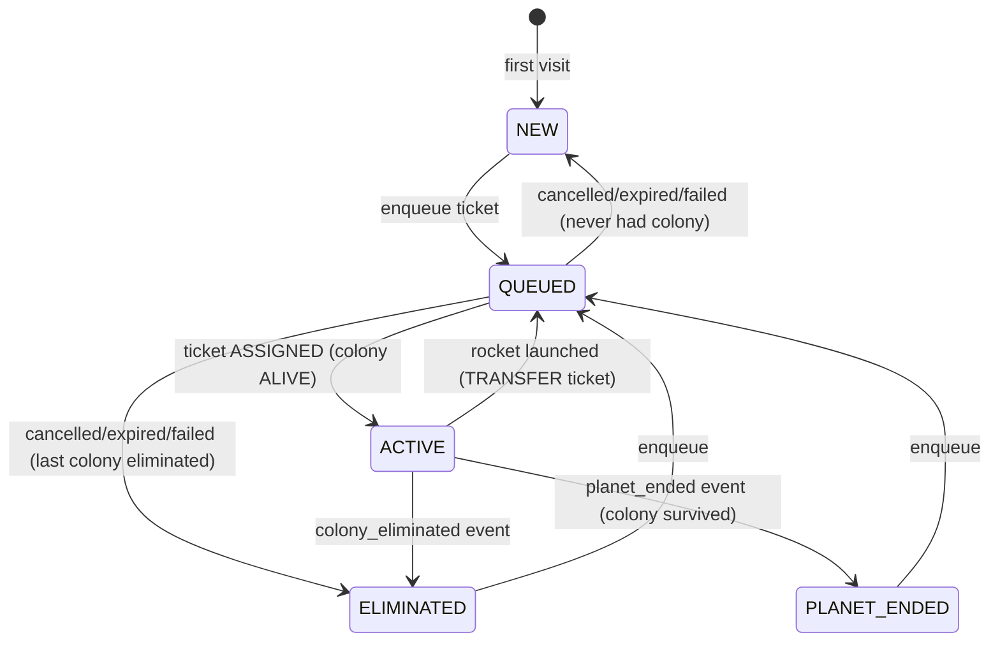
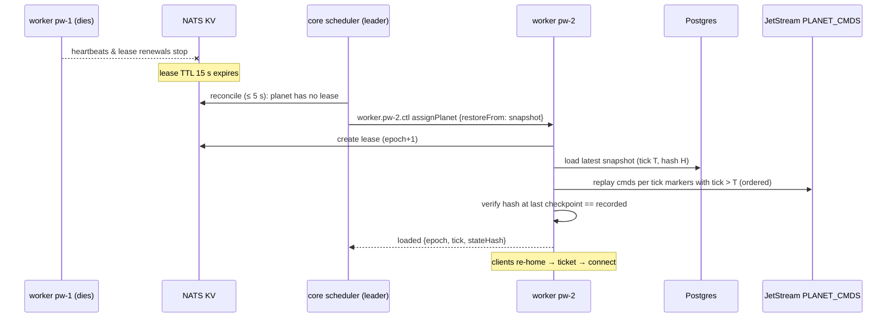

# TerraAgent — Continuity Specification (Offline Play, Resume, Failover)

> **Status:** Draft v0.1 (2026-10-29) — for owner review.
> **Parent:** [`ARCHITECTURE.md`](./ARCHITECTURE.md) §7, §9, §10, §14, §15 · **Decisions:** D-01, D-02, D-05, D-13 · **Related:** [`MATCHMAKING.md`](./MATCHMAKING.md)
> **Plan:** [`TA-08`](../plan/issues/TA-08-continuity-offline-and-resume.md) · [`TA-04.4`/`TA-04.5`](../plan/issues/TA-04-core-api-auth-and-home.md) · [`TA-07.3`/`TA-07.5`/`TA-07.6`](../plan/issues/TA-07-planet-worker.md) · [`TA-05.5`](../plan/issues/TA-05-matchmaking-and-planet-lifecycle.md) · [`TA-11.3`](../plan/issues/TA-11-game-client.md)

---

## 1. Purpose

The owner's promise: **the colony works without the player**, and **the player can come back at any time and continue**. This spec defines:

1. How the game decides where to send a player on open (**home state machine**, §2).
2. How the server knows a player is away (**presence**, §3).
3. What the colony may and may not do while the player is away (**away-mode autopilot safety rules**, §4).
4. What the player is told on return (**away digest**, §5).
5. How a reconnect/resume works, including multi-device takeover (§6).
6. How a planet survives a worker crash or deploy with no lost commands (**failover & drain**, §7).

---

## 2. Home state machine

`GET /v1/me/home` (core, TA-04.4) is the **only** entry point the game client uses on boot and on every reconnect. Home is **computed**, never stored, by the pure function `resolveHome(facts) → HomeV1`.

### 2.1 Inputs ("facts")

| Fact | Source |
|---|---|
| `liveColony` — colony in `FOUNDING`/`ALIVE` | `core.colony` |
| `openTicket` — ticket in `QUEUED`/`RESERVED`/`SPAWNING` | `core.match_ticket` |
| `lastColony` — most recent colony in a terminal state (`ELIMINATED`/`TRANSFERRED`/`RETIRED`) and its planet state | `core.colony`, `core.planet` |
| `everHadColony` | `core.colony` count > 0 |
| `endpoint` — `{workerId, wsUrl}` for the live colony's planet, or `null` | worker directory (KV, TA-04.5) |
| `away` — `{since, durationS}` if last presence is `away` | `core.colony.last_seen_at` + presence event (TA-08.4) |

### 2.2 Resolution table (first match wins)

| # | Condition | State | Payload |
|---|---|---|---|
| H1 | `liveColony.state = ALIVE` | `ACTIVE` | `colony`, `planet`, `ws` (or `null` + `retryAfterMs: 2000` if no lease), `ticket` (if `ws`), `awaySummary?` |
| H2 | `liveColony.state = FOUNDING` or `openTicket` exists | `QUEUED` | `ticketId`, `state`, `position`, `etaS`, `planetId?` |
| H3 | `lastColony.state = ELIMINATED` and no newer ticket | `ELIMINATED` | `recap` (planet, survivedS, peak stats, cause), `recapSeen`, `planets` (picker data) |
| H4 | `lastColony`'s planet `ENDED`/`ARCHIVED` while colony survived (`RETIRED` reason `planet_ended`) | `PLANET_ENDED` | `results` (`core.planet_result`), `recapSeen`, `planets` |
| H5 | `lastColony.state = TRANSFERRED` and no live colony yet | `QUEUED` (transfer ticket is open) | as H2 |
| H6 | otherwise (`everHadColony=false`) | `NEW` | `planets` (picker data, [`MATCHMAKING.md`](./MATCHMAKING.md) §4) |



| ID | Rule |
|---|---|
| `CT-01` | The client MUST route on `home.state` only: `NEW`/`ELIMINATED`/`PLANET_ENDED` → `/planets` (recap/results modal first if `recapSeen=false`), `QUEUED` → `/planets` with queue panel, `ACTIVE` → `/play` (dive straight in). |
| `CT-02` | `ACTIVE` with `ws != null` MUST include a fresh single-use planet ticket so resume costs **one** REST round-trip + one WS connect. |
| `CT-03` | `resolveHome` is a pure function with a table-driven unit test covering H1..H6 and every combination of facts. |
| `CT-04` | `/v1/me/home` p95 ≤ **80 ms** server time (excluding the optional `awaySummary` call, budget 300 ms, omitted on timeout). Rate limit 30/min/player. |
| `CT-05` | `POST /v1/me/recap/seen {colonyId}` sets `recapSeenAt`; the recap is still available via `GET /v1/me/colonies/:id/recap`. |

---

## 3. Presence

| ID | Rule |
|---|---|
| `CT-10` | The worker owning the planet is the presence authority. On `welcome` it writes `{ns}_presence[colonyId] = {connected:true, since, workerId}`; on socket close it writes `connected:false` and starts an away timer. |
| `CT-11` | A colony is **away** when it has had **no** game socket for `AWAY_AFTER_S` (60 s). Reconnecting within 60 s is a "blip": no away transition, no digest. |
| `CT-12` | Presence changes that affect gameplay MUST enter the deterministic log: the worker appends `core.presence { colonyId, away: true|false }` to `{NS}_PLANET_CMDS` when the colony becomes away / comes back. Replays therefore reproduce away-mode behaviour exactly. |
| `CT-13` | The worker publishes `{ns}.planet.{id}.evt.presence { colonyId, state: 'connected'|'away', at }`. Core consumes it and updates `core.colony.last_seen_at` (on `away`, `last_seen_at = disconnect time`) and `core.player.last_seen_at`. |
| `CT-14` | After failover the new worker initialises every colony as `connected:false` with `since = restore time`; colonies already away (per restored sim state) stay away; colonies that were connected become away only after `AWAY_AFTER_S` without reconnect. |

---

## 4. Away-mode autopilot & safety rules

Autonomy is the design (the colony is always run by the rule engine following player priorities). "Away mode" only **narrows** what automated actors may do when no human is watching, so the player never returns to a colony that was gambled away.

**Actors:** rule engine (in `@terra/sim`, every tick), AI director (`ai-orchestrator` directives as `cmd`), automated trade acceptance (`near-gateway`/core trades).

**Player setting** (`setAutopilot` command): `director` (default: rule engine + AI director) · `rules_only` (rule engine only; AI requests are not sent for this colony). Both are subject to the rules below while away.

| ID | While away the colony **MAY** … |
|---|---|
| `AW-01` | keep executing the player's task queue and last priorities (rule engine). |
| `AW-02` | repair damaged buildings, power lines and robots; rebuild **destroyed** buildings that existed when the player left (same tier, same tile) if affordable. |
| `AW-03` | build/upgrade defenses (turrets, shields) and power capacity in response to `attack`/`brownout` events, within the spend cap AW-20. |
| `AW-04` | produce T1 robots up to the supply cap to replace losses. |
| `AW-05` | shed load per the brownout priority order (`colony-economy-and-buildings-spec.md` §1.2). |
| `AW-06` | accept AI director `setPriorities` within the **guard band**: each weight may move at most ±1 step from the player's last explicit setting. |
| `AW-07` | claim unowned territory with already-queued beacons. |

| ID | While away the colony **MUST NOT** … |
|---|---|
| `AW-10` | demolish or downgrade any player-placed building. |
| `AW-11` | start offensive PvP (raids on other colonies). Defensive combat and counter-attacking units inside own territory are allowed. |
| `AW-12` | launch the rocket / start a planet transfer (needs explicit player confirmation; a `rocket.ready` alert is put in the digest instead). |
| `AW-13` | accept, propose or settle trades, unless the player enabled `autoTrade` with explicit per-resource limits before leaving. |
| `AW-14` | change `setAutopilot`, abandon/retire the colony, or change anything account- or chain-related. |
| `AW-15` | build T3 structures or start projects whose cost exceeds AW-20 (big strategic bets wait for the player). |

| ID | Enforcement |
|---|---|
| `AW-20` | **Spend cap:** a single automated directive (AI) or rebuild batch may not spend more than **40 %** of the current stock of any resource; total automated spending on non-repair items while away is capped at **60 %** of the stock the colony had when it went away, per resource, per away session. |
| `AW-21` | The policy is a **pure, versioned function** `awayPolicy(view, command) → allow | reject(reason)` evaluated on the worker inside the deterministic apply path at the tick-marked tick (same inputs on replay ⇒ same decision). `AWAY_POLICY_VERSION` is stored in snapshots; changing it is a sim-compatibility change. |
| `AW-22` | Rejected automated commands produce `cmd.reject {code:'away_policy', rule:'AW-1x'}` in the decision log and count in `away_policy_rejections_total{rule}`; the AI orchestrator receives the rejection so it does not retry the same directive. |
| `AW-23` | Player commands are never subject to away policy (the player is, by definition, present). |

---

## 5. "While you were away" digest

| ID | Rule |
|---|---|
| `CT-30` | When a colony becomes away (CT-11), the worker opens a digest row in `world.planet_event_digest` with a **baseline**: resources, energy balance, building counts by type, robot counts, territory tiles, terraform %. |
| `CT-31` | While away, the worker folds the colony's significant events from `{NS}_PLANET_EVENTS` into the row (counters + capped lists, max 20 items per list), flushed with each snapshot (30 s), so the digest survives failover. |
| `CT-32` | On reconnect after ≥ `AWAY_AFTER_S`, the worker closes the digest (end baseline, `durationS`) and sends it in `welcome.awayDigest`. Core may expose a headline `awaySummary` in `/me/home` via `{ns}.planet.{id}.ctl getAwayDigest { colonyId, headline: true }` (300 ms budget). |
| `CT-33` | Digests are kept for **7 days**, then purged. Only the latest unseen digest per colony is delivered; older unseen ones are merged into it. |

```ts
type AwayDigestV1 = {
  colonyId: string; awayFrom: string; awayTo: string; durationS: number;
  resources: Record<'metals'|'minerals'|'petroleum'|'water'|'energy', { before: number; after: number }>;
  built: { kind: string; tier: number; count: number }[];
  lost: { kind: string; tier: number; count: number; cause: 'fauna'|'raid'|'lightning'|'meteor'|'other' }[];
  robots: { before: number; after: number; produced: number; lost: number };
  territory: { before: number; after: number };
  attacks: { count: number; repelled: number; byColony: { displayName: string; count: number }[] };
  hazards: { kind: string; at: string; damage: number }[];
  ai: { decisions: number; rejected: number; highlights: { at: string; summary: string }[] };
  trades: { settled: number; items: { with: string; gave: string; got: string }[] };
  alerts: { code: 'rocket_ready'|'power_deficit'|'storage_full'|'supply_cap'|'under_attack'; message: string }[];
};
```

---

## 6. Resume sequence & multi-device takeover

```mermaid
sequenceDiagram
  participant G as Game (tab B)
  participant C as core
  participant W as planet-worker
  participant O as Game (tab A, old)
  G->>C: GET /v1/me/home
  C-->>G: ACTIVE {ws, ticket(jti, 60 s), awaySummary?}
  G->>W: WS /w/{workerId}  hello{ticket}
  W->>W: verify EdDSA + aud=planet + planet leased here + jti unused
  W->>O: bye 4001 replaced (close)
  W-->>G: welcome {snapshot, tick, awayDigest?}
  W->>W: presence connected; core.presence{away:false} if was away
  Note over G,W: on any close (except 4010/4011): backoff 0.5 s→10 s, then GET /v1/me/home again
```

| ID | Rule |
|---|---|
| `CT-40` | Tickets are single use (`jti` remembered 120 s on the worker). Every reconnect MUST go through `/v1/me/home` (or `POST /v1/me/ticket`, which returns only `{ws, ticket}` for the live colony). |
| `CT-41` | One game socket per colony. A valid `hello` for a colony that already has a socket **takes over**: old socket gets `bye 4001 replaced`. The replaced client MUST NOT auto-reconnect; it shows "Opened on another device/tab — Resume here". |
| `CT-42` | If the planet has no lease (failover in progress), home returns `ACTIVE` with `ws: null, retryAfterMs: 2000`; the client shows "Reconnecting to planet…" and retries. |
| `CT-43` | Close codes drive client behaviour: `4009 lease_lost`, `4012 server_draining` → immediate re-home (no backoff for first try); `4010 planet_ended` → home (`PLANET_ENDED`); `4011 colony_eliminated` → home (`ELIMINATED`); `4003 forbidden` → refresh auth then re-home; `4008 rate_limited` → backoff ≥ 5 s. |
| `CT-44` | Commands the client sent but did not see `cmd.ack` for before a disconnect are **not** resent automatically (they may have been applied). The client re-reads state from `welcome` and the HUD shows pending items as "unconfirmed". |
| `CT-45` | Resume target: **≤ 2 s** from page load to first rendered frame of the planet on a warm cache (p75, measured by `client.resume_ms`). |

---

## 7. Failover & graceful drain

### 7.1 Crash failover



| ID | Rule |
|---|---|
| `CT-50` | **RPO = 0 commands.** A command is acked to its producer (client `cmd.ack`, core, AI) only after JetStream `PubAck`. The tick-marked tick is persisted with the command (tick marker record in the stream, TA-07.4) before it is applied. |
| `CT-51` | **RTO ≤ 30 s** (p95) from worker death to the planet ticking again: lease expiry ≤ 15 s + detection ≤ 5 s + assign ≤ 1 s + restore/replay ≤ 5 s (≤ 300 ticks since snapshot at 10 TPS) + slack. Measured by `sched_failover_seconds`. |
| `CT-52` | **Fencing:** every lease has a monotonically increasing `epoch`. Snapshot writes are conditional (`INSERT … WHERE epoch >= current planet epoch`); a worker whose lease renewal has not succeeded within `LEASE_TTL_S − 2×HEARTBEAT_S` (5 s) MUST stop ticking that planet and close its sockets with `4009`. No two workers ever tick the same planet past a stale epoch. |
| `CT-53` | **Determinism check:** after replay the restored `stateHash` at the last recorded checkpoint MUST equal the recorded one; mismatch ⇒ planet `health=FAULTED`, restore from the previous snapshot is attempted once, alert `planet.desync`. |
| `CT-54` | Wall-clock time lost during failover is **not** fast-forwarded (D-13): the planet resumes at the tick it reached. Away digests and lifetimes use wall-clock so the player sees "away 3 h" correctly. |

### 7.2 Graceful drain (deploys)

| ID | Rule |
|---|---|
| `CT-60` | `worker.{id}.ctl drain` (admin or deploy script) sets `draining=true` in the worker heartbeat; the scheduler stops placing planets on it. |
| `CT-61` | For each planet, sequentially in batches of 5: stop command intake → finish current tick → snapshot at tick T → publish `planet.{id}.evt.handoff {tick: T}` → **delete** the lease key (no TTL wait) → close sockets `4012 server_draining`. |
| `CT-62` | The scheduler sees the missing lease (KV watch) and places the planet immediately; the new worker restores from the T snapshot with zero commands to replay. Commands published during handoff wait in JetStream and are applied by the new owner. |
| `CT-63` | Targets: per-planet handoff ≤ 3 s; whole-worker drain (50 planets) ≤ 60 s; zero lost commands (`deploy:drain` asserts command counts before/after). |

---

## 8. Numbers

| Key | Default | Source |
|---|---|---|
| `AWAY_AFTER_S` | 60 | ARCHITECTURE §15 |
| `PLANET_TICKET_TTL_S` | 60 | ARCHITECTURE §15 |
| `LEASE_TTL_S` / `HEARTBEAT_S` | 15 / 5 | ARCHITECTURE §15 |
| `SNAPSHOT_EVERY_TICKS` | 300 (30 s) | ARCHITECTURE §15 |
| Command stream max age | 48 h | ARCHITECTURE §6 |
| Digest retention | 7 d | local |
| Away spend caps (AW-20) | 40 % per directive, 60 % per away session | local |
| Client reconnect backoff | 0.5 s → 10 s cap, jitter ±20 % | ARCHITECTURE §12 |

---

## 9. Telemetry

| Name | Type | Meaning |
|---|---|---|
| `presence_colonies{state}` | gauge (worker) | connected / away colonies |
| `presence_transitions_total{to}` | counter | connected / away / blip |
| `away_policy_rejections_total{rule,actor}` | counter | AW-22 |
| `away_digest_delivered_total` / `away_digest_bytes` | counter / histogram | CT-32 |
| `home_requests_total{state}` | counter (core) | distribution of home states |
| `home_resolve_seconds` | histogram (core) | CT-04 |
| `resume_ticket_issued_total{result}` | counter (core) | `ok` / `no_lease` |
| `ws_takeover_total` | counter (worker) | CT-41 |
| `sched_failover_seconds` | histogram (core) | CT-51 |
| `planet_restore_seconds`, `planet_replay_commands` | histogram (worker) | restore cost |
| `planet_desync_total` | counter (worker) | CT-53 |
| `drain_handoff_seconds` | histogram (worker) | CT-63 |
| `client.resume_ms` | client beacon | CT-45 |

---

## 10. Test matrix

| Rule | Test | Task |
|---|---|---|
| CT-01..05 | `resolve-home.spec.ts` (table), `me-home.int-spec.ts` | TA-04.4, TA-08.4 |
| CT-10..14 | `presence.int-spec.ts` (blip < 60 s, away ≥ 60 s, failover init) | TA-08.1 |
| AW-01..23 | `away-policy.spec.ts` (one case per rule), `away-replay.spec.ts` (replay yields same decisions) | TA-08.2 |
| CT-30..33 | `away-digest.int-spec.ts` (fold, flush, failover survival, merge) | TA-08.3 |
| CT-40..44 | `resume-flow.int-spec.ts`, worker `takeover.int-spec.ts` | TA-08.4, TA-07.3 |
| CT-45 | e2e `@w3 resume` journey with timing assertion | TA-11.3, TA-13.3 |
| CT-50..54 | `tests/failover` kill -9 suite (hash equality, RTO) | TA-07.6, TA-05.5, TA-13.4 |
| CT-60..63 | `drain.int-spec.ts`, `deploy:drain` command-count assertion | TA-07.5, TA-02.5 |
| Elimination / end | `elimination-flow.int-spec.ts`, `planet-end-flow.int-spec.ts` | TA-08.5 |

---

## 11. Open questions for the owner

- **Q1 — AI while away.** Is the AI director allowed to act while the player is away (current: yes, within AW rules), or should away colonies be rules-only to save tokens?
- **Q2 — Spend caps.** Are 40 % / 60 % right, or should the player set an "away budget" in the HUD before leaving?
- **Q3 — Auto-trade.** Ship `autoTrade` (AW-13 exception) in MVP or leave trades strictly manual?
- **Q4 — Notifications.** Push/email/Telegram on "under attack" or "rocket ready" while away? (Out of scope; would need a notification service and player contact.)
- **Q5 — Digest narrative.** Add a one-paragraph LLM-written story of the away period (one extra `glm-5.3` call per return)?
