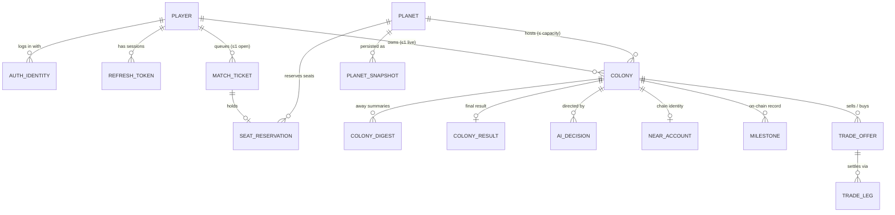

# TerraAgent — Data Model (PostgreSQL / Prisma)

> **Status:** Draft v0.1 (2026-10-29) — for owner review.
> **Parent:** [`ARCHITECTURE.md`](./ARCHITECTURE.md) §5.1, §8, §9 · **Decisions:** D-04 (one Prisma schema, namespaces, wave pre-step migrations), D-08 (Postgres is matchmaking truth), D-12 (lifecycle numbers)
> **Implemented by:** [`TA-03`](../plan/issues/TA-03-database-and-persistence.md) (`TA-03.1` schema + `0001_init`, `TA-03.2` `@terra/db`, `TA-03.3` snapshot store). Later waves extend it only through the lead's pre-step (orchestrator §1.4).
> **Code home:** `shared/db/prisma/schema.prisma`, `shared/db/prisma/migrations/**`, `shared/db/src/**`.

---

## 1. Purpose

Define every persistent table, which service owns (writes) it, the invariants the database itself enforces, indexes for the hot queries, and retention. In-flight game state lives in the planet worker's memory and in `world.planet_snapshot` + the JetStream command log; Postgres is **not** written per tick.

---

## 2. Rules

| ID | Rule |
|---|---|
| `DM-01` | One database `terraagent`; Prisma `multiSchema` with Postgres schemas `core`, `world`, `ai`, `chain`. One `schema.prisma`, one migration history. |
| `DM-02` | **Write ownership:** `core.*` ← core · `world.*` ← planet-worker · `ai.*` ← ai-orchestrator · `chain.*` ← near-gateway. A service MUST NOT write another namespace. Reads across namespaces are allowed only where listed in §8 (everything else goes through NATS). Enforced by a dependency-cruiser rule on repository imports + a Postgres role per service in production (§9). |
| `DM-03` | Migrations are forward-only, generated by the lead in a wave pre-step. Invariants Prisma cannot express (partial unique indexes, `CHECK`s) are appended as raw SQL to the same migration's `migration.sql` and listed in §7. |
| `DM-04` | Primary keys are prefixed ULID strings (`PROTOCOL.md` PR-02) stored as `text` with `CHECK (id ~ '^xx_[0-9A-HJKMNP-TV-Z]{26}$')`, except append-only high-volume tables (`planet_snapshot`) which use `bigint` identity. |
| `DM-05` | All timestamps are `timestamptz` (`@db.Timestamptz(3)`), UTC. Ticks are `bigint`. Resource amounts in milli-units are `bigint`. |
| `DM-06` | No hard deletes of players, planets or colonies (soft states). Retention jobs delete only rows listed in §6. |
| `DM-07` | Every enum below is a Postgres enum created by Prisma; adding a value is an additive migration. |

---

## 3. Entity overview



---

## 4. Schema sketch (`shared/db/prisma/schema.prisma`)

> Prisma 6.x pinned in `shared/db/package.json`; `previewFeatures = ["multiSchema"]` only if the pinned version still requires the flag. Field names are camelCase in Prisma and `@map`ped to snake_case columns; models `@@map` to snake_case tables.

### 4.1 `core` — players, auth, planets, colonies, matchmaking, ops

```prisma
generator client { provider = "prisma-client-js" }
datasource db { provider = "postgresql"; url = env("DATABASE_URL"); schemas = ["core", "world", "ai", "chain"] }

enum PlayerKind     { GUEST LINKED                         @@schema("core") }
enum PlayerStatus   { ACTIVE BANNED                        @@schema("core") }
enum IdentityKind   { DEVICE NEAR                          @@schema("core") }
enum PlanetType     { TEMPERATE DESERT                     @@schema("core") }
enum PlanetState    { PROVISIONING RECRUITING SEALED ENDED ARCHIVED FAULTED @@schema("core") }
enum ColonyState    { FOUNDING ACTIVE ELIMINATED RETIRED TRANSFERRED ENDED  @@schema("core") }
enum TicketMode     { CHOSEN AUTO NEW_PLANET               @@schema("core") }
enum TicketState    { QUEUED RESERVED ASSIGNED CANCELLED EXPIRED FAILED @@schema("core") }
enum SeatState      { HELD CONFIRMED RELEASED EXPIRED      @@schema("core") }

model Player {
  id          String       @id                         // pr_…
  displayName String       @db.VarChar(32)
  kind        PlayerKind   @default(GUEST)
  status      PlayerStatus @default(ACTIVE)
  createdAt   DateTime     @default(now()) @db.Timestamptz(3)
  lastSeenAt  DateTime     @default(now()) @db.Timestamptz(3)
  identities  AuthIdentity[]
  refreshTokens RefreshToken[]
  colonies    Colony[]
  tickets     MatchTicket[]
  @@schema("core") @@map("player")
}

model AuthIdentity {
  id         String       @id                          // id_… (auth identity)
  playerId   String
  kind       IdentityKind
  subject    String       @db.VarChar(128)             // DEVICE: sha256(deviceSecret) hex; NEAR: accountId
  publicKey  String?      @db.VarChar(128)             // NEAR: ed25519:… used at link time
  createdAt  DateTime     @default(now()) @db.Timestamptz(3)
  lastUsedAt DateTime     @default(now()) @db.Timestamptz(3)
  player     Player       @relation(fields: [playerId], references: [id])
  @@unique([kind, subject])                             // one NEAR account ↔ one player
  @@index([playerId])
  @@schema("core") @@map("auth_identity")
}

model RefreshToken {
  id           String    @id                           // rt_…
  playerId     String
  familyId     String                                  // rotation family; reuse of a rotated token revokes the family
  tokenHash    String    @unique @db.Char(64)          // sha256 of opaque token
  userAgent    String?   @db.VarChar(200)
  createdAt    DateTime  @default(now()) @db.Timestamptz(3)
  expiresAt    DateTime  @db.Timestamptz(3)            // + REFRESH_TTL_D (30 d)
  rotatedAt    DateTime? @db.Timestamptz(3)
  revokedAt    DateTime? @db.Timestamptz(3)
  player       Player    @relation(fields: [playerId], references: [id])
  @@index([playerId, revokedAt])
  @@index([familyId])
  @@schema("core") @@map("refresh_token")
}

model NearLoginNonce {
  nonce      String    @id @db.Char(44)              // base64 32 bytes
  accountId  String    @db.VarChar(64)
  playerId   String?                                  // set when linking an existing guest
  expiresAt  DateTime  @db.Timestamptz(3)            // + 5 min
  usedAt     DateTime? @db.Timestamptz(3)
  @@schema("core") @@map("near_login_nonce")
}

model Planet {
  id              String      @id                     // pl_…
  name            String      @db.VarChar(40)
  type            PlanetType
  seed            BigInt                               // sim PRNG seed (D-01)
  simVersion      Int                                  // @terra/sim SIM_VERSION at creation; restore refuses mismatch majors
  state           PlanetState @default(PROVISIONING)
  capacity        Int         @default(5)              // PLANET_CAPACITY at creation
  seatsTaken      Int         @default(0)              // colonies ever seated; never decremented (seats are not refilled)
  seatsReserved   Int         @default(0)              // HELD reservations
  workerId        String?     @db.VarChar(8)           // last assigned worker (truth for routing is KV lease)
  leaseEpoch      Int         @default(0)              // incremented by core on every assignPlanet
  createdAt       DateTime    @default(now()) @db.Timestamptz(3)
  recruitingAt    DateTime?   @db.Timestamptz(3)
  admissionEndsAt DateTime?   @db.Timestamptz(3)       // recruitingAt + PLANET_ADMISSION_WINDOW_H
  sealedAt        DateTime?   @db.Timestamptz(3)
  sealReason      String?     @db.VarChar(24)          // capacity | admission_window | admin
  endsAt          DateTime?   @db.Timestamptz(3)       // recruitingAt + PLANET_LIFETIME_D
  endedAt         DateTime?   @db.Timestamptz(3)
  endReason       String?     @db.VarChar(24)          // lifetime | all_eliminated | victory | admin
  archivedAt      DateTime?   @db.Timestamptz(3)
  colonies        Colony[]
  reservations    SeatReservation[]
  @@index([state, type, createdAt])                    // picker: RECRUITING by type, oldest first
  @@index([state, admissionEndsAt])                    // sealing sweep
  @@index([state, endsAt])                             // ending sweep
  @@schema("core") @@map("planet")
}

model Colony {
  id           String      @id                        // co_…
  shortId      String      @unique @db.VarChar(8)     // lowercase base32, NEAR sub-account label
  planetId     String
  playerId     String
  name         String      @db.VarChar(32)
  color        Int
  state        ColonyState @default(FOUNDING)
  spawnQ       Int?
  spawnR       Int?
  priorities   Json                                  // last Priorities (PROTOCOL §4.2) — mirror for /me/home; sim holds truth
  autopilot    Json
  seatReservationId String? @unique
  foundedAt    DateTime?   @db.Timestamptz(3)
  foundedTick  BigInt?
  eliminatedAt DateTime?   @db.Timestamptz(3)
  endedAt      DateTime?   @db.Timestamptz(3)
  lastSeenAt   DateTime?   @db.Timestamptz(3)        // last WS disconnect (from presence), for away detection
  transferredToColonyId String? @unique              // rocket transfer chain (TA-06.10)
  createdAt    DateTime    @default(now()) @db.Timestamptz(3)
  planet       Planet      @relation(fields: [planetId], references: [id])
  player       Player      @relation(fields: [playerId], references: [id])
  @@unique([planetId, playerId])                     // a player never re-joins the same planet
  @@index([playerId, state])
  @@index([planetId, state])
  @@schema("core") @@map("colony")
}

model MatchTicket {
  id                String      @id                   // mt_…
  playerId          String
  mode              TicketMode
  planetType        PlanetType
  requestedPlanetId String?                           // CHOSEN only
  state             TicketState @default(QUEUED)
  priority          Int         @default(0)           // admin-adjustable (TA-05.6); higher first
  attempts          Int         @default(0)
  failureCode       String?     @db.VarChar(32)
  assignedPlanetId  String?
  assignedColonyId  String?     @unique
  createdAt         DateTime    @default(now()) @db.Timestamptz(3)
  updatedAt         DateTime    @updatedAt @db.Timestamptz(3)
  player            Player      @relation(fields: [playerId], references: [id])
  reservation       SeatReservation?
  @@index([state, priority(sort: Desc), createdAt])  // FIFO within priority; SELECT … FOR UPDATE SKIP LOCKED
  @@index([playerId, createdAt(sort: Desc)])
  @@schema("core") @@map("match_ticket")
}

model SeatReservation {
  id        String    @id                             // sr_…
  ticketId  String    @unique
  planetId  String
  playerId  String
  state     SeatState @default(HELD)
  expiresAt DateTime  @db.Timestamptz(3)              // now + MATCH_SEAT_TTL_S (90 s)
  createdAt DateTime  @default(now()) @db.Timestamptz(3)
  ticket    MatchTicket @relation(fields: [ticketId], references: [id])
  planet    Planet      @relation(fields: [planetId], references: [id])
  @@index([state, expiresAt])                          // expiry sweep
  @@index([planetId, state])
  @@schema("core") @@map("seat_reservation")
}

model RuntimeSetting {
  key       String   @id @db.VarChar(64)              // e.g. "mm.paused", "mm.maxActivePlanets", "mm.enabledTypes"
  value     Json
  updatedBy String   @db.VarChar(64)
  updatedAt DateTime @updatedAt @db.Timestamptz(3)
  @@schema("core") @@map("runtime_setting")
}

model AdminAudit {
  id         BigInt   @id @default(autoincrement())
  actor      String   @db.VarChar(64)
  action     String   @db.VarChar(64)                 // planet.seal, planet.end, worker.drain, queue.pause, ticket.reprioritize …
  targetType String   @db.VarChar(32)
  targetId   String   @db.VarChar(64)
  payload    Json
  requestId  String   @db.VarChar(40)
  at         DateTime @default(now()) @db.Timestamptz(3)
  @@index([targetType, targetId, at])
  @@schema("core") @@map("admin_audit")
}
```

### 4.2 `world` — planet persistence (planet-worker)

```prisma
enum SnapshotKind { PERIODIC UNLOAD SEAL END FAILOVER HOURLY @@schema("world") }

model PlanetSnapshot {
  id          BigInt       @id @default(autoincrement())
  planetId    String
  tick        BigInt
  cmdSeq      BigInt                                  // JetStream seq of last command included (PROTOCOL NT-13)
  stateHash   String       @db.Char(16)               // xxhash64 hex from @terra/sim hash()
  simVersion  Int
  codec       String       @db.VarChar(16)            // "sim1+br" (sim binary codec + brotli)
  sizeBytes   Int                                     // compressed size
  rawBytes    Int                                     // uncompressed size
  crc32       Int                                     // of compressed bytes; corruption ⇒ fall back to previous
  kind        SnapshotKind
  workerId    String       @db.VarChar(8)
  leaseEpoch  Int                                     // fencing token (DM-14)
  data        Bytes
  createdAt   DateTime     @default(now()) @db.Timestamptz(3)
  @@unique([planetId, tick])
  @@index([planetId, tick(sort: Desc)])
  @@schema("world") @@map("planet_snapshot")
}

model ColonyDigest {
  id         String   @id                              // dg_…
  colonyId   String
  planetId   String
  fromTick   BigInt
  toTick     BigInt
  fromAt     DateTime @db.Timestamptz(3)
  toAt       DateTime @db.Timestamptz(3)
  counters   Json                                     // { built: n, destroyed: n, mined: Resources, attacks: n, … }
  highlights Json                                     // top ≤ 10 PlanetEventV1 (eventId, kind, tick, data)
  summary    String?  @db.VarChar(600)                // optional LLM one-paragraph summary (TA-08.3)
  consumedAt DateTime? @db.Timestamptz(3)             // shown to the player
  createdAt  DateTime @default(now()) @db.Timestamptz(3)
  @@index([colonyId, toAt(sort: Desc)])
  @@schema("world") @@map("colony_digest")
}

model ColonyResult {
  colonyId   String   @id
  planetId   String
  rank       Int
  score      BigInt
  stats      Json                                     // territory %, terraform %, buildings, kills, rockets
  finalTick  BigInt
  createdAt  DateTime @default(now()) @db.Timestamptz(3)
  @@index([planetId, rank])
  @@schema("world") @@map("colony_result")
}
```

> **Reconciliation (lead, 2026-10-29) — `ai` and `chain` namespaces.** The domain specs were written in parallel and name a few tables differently. For these two namespaces the **domain spec column sets win** and TA-03.1 implements them under these final names:
>
> | Sketch below | Final table (source) |
> |---|---|
> | `ai.ai_decision` | `ai.ai_decision` (unchanged; add columns from [`AI_ORCHESTRATOR.md`](./AI_ORCHESTRATOR.md) §10 if missing) |
> | `ai.ai_budget_day` | split into `ai.ai_colony_budget` (per-colony gate, atomic `UPDATE … RETURNING`) and `ai.ai_usage_daily` (global token/cost budget) — AI_ORCHESTRATOR §10 |
> | — | `ai.ai_settings` (persisted kill switch / per-planet disable) — AI_ORCHESTRATOR §9–10 |
> | `chain.near_account` | `chain.near_colony_account` (adds `public_key`, `encrypted_secret`, `kek_version`) — [`NEAR.md`](./NEAR.md) §10 |
> | `chain.near_job` | `chain.near_tx` outbox (`dedupe_key` unique, `status PENDING/SENT/FINAL/FAILED`) — NEAR.md §10 |
> | `chain.milestone`, `chain.trade_offer`, `chain.trade_leg` | unchanged; align columns with NEAR.md §10 |
> | — | `core.analytics_event` (W4 migration, TA-04.7; consented events only, 90-day retention) |

### 4.3 `ai` — director decisions & budgets (ai-orchestrator)

```prisma
enum AiStatus { OK INVALID TIMEOUT ERROR SKIPPED_RATE SKIPPED_BUDGET SKIPPED_DISABLED STALE @@schema("ai") }

model AiDecision {
  id               String   @id                         // ad_…
  requestId        String   @unique                     // rq_… from AiRequestV1 (idempotency)
  planetId         String
  colonyId         String
  triggerKind      String   @db.VarChar(40)
  severity         String   @db.VarChar(8)
  tick             BigInt
  playerPresent    Boolean
  model            String   @db.VarChar(40)             // e.g. glm-5.3
  promptTokens     Int      @default(0)
  completionTokens Int      @default(0)
  latencyMs        Int      @default(0)
  status           AiStatus
  directive        Json?                               // validated DirectiveV1
  rawResponse      String?                              // truncated to 8 KiB; nulled after 7 d
  cmdId            String?                              // cm_ of the published ai.directive
  createdAt        DateTime @default(now()) @db.Timestamptz(3)
  @@index([colonyId, createdAt(sort: Desc)])
  @@index([createdAt])
  @@schema("ai") @@map("ai_decision")
}

model AiBudgetDay {
  day        DateTime @db.Date
  scope      String   @db.VarChar(40)                   // "global" | colonyId
  calls      Int      @default(0)
  tokensIn   BigInt   @default(0)
  tokensOut  BigInt   @default(0)
  @@id([day, scope])
  @@schema("ai") @@map("ai_budget_day")
}
```

### 4.4 `chain` — NEAR accounts, jobs, milestones, trades (near-gateway)

```prisma
enum NearAccountKind  { COLONY_SUB                        @@schema("chain") }   // player wallets live in core.auth_identity
enum NearAccountState { PENDING ACTIVE FAILED              @@schema("chain") }
enum JobState         { PENDING RUNNING DONE FAILED DEAD   @@schema("chain") }
enum MilestoneKind    { COLONY_FOUNDED ROCKET_LAUNCHED PLANET_RESULT @@schema("chain") }
enum TradeState       { OPEN ACCEPTED ESCROWED SETTLED REFUNDED CANCELLED EXPIRED FAILED @@schema("chain") }
enum TradeLegKind     { ESCROW RELEASE REFUND          @@schema("chain") }

model NearAccount {
  id          String           @id                      // na_…
  colonyId    String           @unique
  accountId   String           @unique @db.VarChar(64)  // {shortId}.colonies.terraagent.testnet
  kind        NearAccountKind  @default(COLONY_SUB)
  publicKey   String           @db.VarChar(128)
  state       NearAccountState @default(PENDING)
  createTx    String?          @db.VarChar(64)
  fundedYocto Decimal          @default(0) @db.Decimal(40, 0)
  createdAt   DateTime         @default(now()) @db.Timestamptz(3)
  @@schema("chain") @@map("near_account")
}

model NearJob {
  id         String   @id                               // jb_… (= JetStream Msg-Id suffix)
  kind       String   @db.VarChar(40)                   // account.provision | registry.colonyFounded | …
  payload    Json
  state      JobState @default(PENDING)
  attempts   Int      @default(0)
  lastError  String?  @db.VarChar(400)
  txHash     String?  @db.VarChar(64)
  createdAt  DateTime @default(now()) @db.Timestamptz(3)
  updatedAt  DateTime @updatedAt @db.Timestamptz(3)
  @@index([state, updatedAt])
  @@schema("chain") @@map("near_job")
}

model Milestone {
  id        String        @id                           // ms_…
  colonyId  String
  planetId  String
  kind      MilestoneKind
  tick      BigInt
  payload   Json
  txHash    String?       @db.VarChar(64)
  state     JobState      @default(PENDING)
  createdAt DateTime      @default(now()) @db.Timestamptz(3)
  @@unique([colonyId, kind, tick])
  @@schema("chain") @@map("milestone")
}

model TradeOffer {
  id             String     @id                         // tr_…
  sellerColonyId String
  sellerPlanetId String
  buyerColonyId  String?
  buyerPlanetId  String?
  give           Json                                  // Resources (milli-units)
  want           Json
  state          TradeState @default(OPEN)
  expiresAt      DateTime   @db.Timestamptz(3)
  acceptedAt     DateTime?  @db.Timestamptz(3)
  settledAt      DateTime?  @db.Timestamptz(3)
  receiptTx      String?    @db.VarChar(64)
  failureCode    String?    @db.VarChar(32)
  version        Int        @default(0)                 // optimistic concurrency for saga steps
  createdAt      DateTime   @default(now()) @db.Timestamptz(3)
  legs           TradeLeg[]
  @@index([state, expiresAt])
  @@index([sellerColonyId, state])
  @@index([buyerColonyId, state])
  @@schema("chain") @@map("trade_offer")
}

model TradeLeg {
  id            String       @id                        // tl_…
  tradeId       String
  planetId      String
  colonyId      String
  kind          TradeLegKind
  cmdId         String       @unique                    // cm_ published to planet.{id}.cmd
  appliedAtTick BigInt?
  outcome       String?      @db.VarChar(32)            // applied | rejected:<code>
  createdAt     DateTime     @default(now()) @db.Timestamptz(3)
  trade         TradeOffer   @relation(fields: [tradeId], references: [id])
  @@unique([tradeId, colonyId, kind])
  @@schema("chain") @@map("trade_leg")
}
```

Cross-namespace relations (`ai_decision.colony_id → core.colony.id`, `chain.near_account.colony_id → core.colony.id`, `world.planet_snapshot.planet_id → core.planet.id`) are real foreign keys (`ON DELETE RESTRICT`) declared in raw SQL (§7), not Prisma relations, so each service's generated client stays within its namespace.

---

## 5. Invariants enforced by the database

| ID | Invariant | Mechanism |
|---|---|---|
| `DM-10` | A player has **at most one live colony** (`FOUNDING`/`ACTIVE`). | Partial unique index `colony_one_live_per_player ON core.colony(player_id) WHERE state IN ('FOUNDING','ACTIVE')`. |
| `DM-11` | A player has **at most one open match ticket** (`QUEUED`/`RESERVED`). | Partial unique index `match_ticket_one_open_per_player ON core.match_ticket(player_id) WHERE state IN ('QUEUED','RESERVED')`. |
| `DM-12` | **Seats never exceed capacity:** `seats_taken + seats_reserved <= capacity`, both ≥ 0. | `CHECK planet_seats_le_capacity`. Reservation is a single conditional `UPDATE core.planet SET seats_reserved = seats_reserved + 1 WHERE id = $1 AND state = 'RECRUITING' AND seats_taken + seats_reserved < capacity AND now() < admission_ends_at RETURNING …` inside the reservation transaction; 0 rows ⇒ planet full/closed. Confirmation moves one seat from reserved to taken in the same transaction that sets the colony `FOUNDING → ACTIVE` link. |
| `DM-13` | Only `RECRUITING` planets accept reservations; sealed seats never refill. | Same conditional `UPDATE` (state + admission window); `seats_taken` is never decremented (no code path, asserted by test `planet.seats-monotonic.spec.ts`). |
| `DM-14` | **Snapshot fencing:** a worker that lost its lease cannot persist a snapshot over a newer owner's. | `INSERT … SELECT … WHERE NOT EXISTS (SELECT 1 FROM world.planet_snapshot WHERE planet_id = $1 AND lease_epoch > $epoch)`; 0 rows ⇒ `FencedError`, worker stops the planet. |
| `DM-15` | One seat reservation per ticket; one colony per reservation. | `seat_reservation.ticket_id` unique; `colony.seat_reservation_id` unique. |
| `DM-16` | A NEAR account is linked to at most one player. | `auth_identity (kind, subject)` unique. |
| `DM-17` | Trade legs are idempotent. | `trade_leg (trade_id, colony_id, kind)` unique + `cmd_id` unique. |
| `DM-18` | Planet state transitions are legal. | Application state machine (MATCHMAKING.md) + `CHECK` that timestamps exist for the state (e.g. `state <> 'SEALED' OR sealed_at IS NOT NULL`). |
| `DM-19` | IDs are well-formed. | `CHECK (id ~ '^{prefix}_[0-9A-HJKMNP-TV-Z]{26}$')` per table. |

---

## 6. Retention

| Table | Keep | Mechanism (owner) |
|---|---|---|
| `core.refresh_token` | until `expires_at + 7 d` (or `revoked_at + 7 d`) | nightly job in core |
| `core.near_login_nonce` | 1 h after `expires_at` | core, hourly |
| `core.match_ticket` + `seat_reservation` (terminal states) | 30 d | core, nightly |
| `core.player`, `core.planet`, `core.colony` | forever (soft states) | — |
| `core.admin_audit` | forever | — |
| `world.planet_snapshot` | last **20** per planet + first snapshot of each hour for **48 h**; `END` and last `SEAL` snapshot of every planet forever; `ARCHIVED` planets keep only the `END` snapshot | `SnapshotStore.prune(planetId)` after every save (TA-03.3) + nightly sweep |
| `world.colony_digest` | 30 d | worker, nightly |
| `world.colony_result` | forever | — |
| `ai.ai_decision` | 30 d; `raw_response` nulled after 7 d | ai, nightly |
| `ai.ai_budget_day` | 400 d | — |
| `chain.near_job` | 90 d after terminal | near, nightly |
| `chain.milestone`, `chain.trade_offer`, `chain.trade_leg`, `chain.near_account` | forever | — |

Sizing (to validate in TA-13.5): snapshot ≈ 50–200 KiB compressed; 200 planets × ~68 retained ≈ 13.6 k rows ≈ 1–3 GiB. `planet_snapshot.data` uses `STORAGE EXTERNAL` (already compressed; skip TOAST compression).

---

## 7. Raw SQL appended to `0001_init/migration.sql`

```sql
CREATE UNIQUE INDEX colony_one_live_per_player ON core.colony (player_id) WHERE state IN ('FOUNDING','ACTIVE');
CREATE UNIQUE INDEX match_ticket_one_open_per_player ON core.match_ticket (player_id) WHERE state IN ('QUEUED','RESERVED');
ALTER TABLE core.planet ADD CONSTRAINT planet_seats_le_capacity
  CHECK (seats_taken >= 0 AND seats_reserved >= 0 AND seats_taken + seats_reserved <= capacity);
ALTER TABLE core.planet ADD CONSTRAINT planet_state_timestamps CHECK (
  (state <> 'RECRUITING' OR recruiting_at IS NOT NULL) AND
  (state NOT IN ('SEALED') OR sealed_at IS NOT NULL) AND
  (state NOT IN ('ENDED','ARCHIVED') OR ended_at IS NOT NULL));
ALTER TABLE world.planet_snapshot ALTER COLUMN data SET STORAGE EXTERNAL;
ALTER TABLE world.planet_snapshot ADD CONSTRAINT planet_snapshot_planet_fk FOREIGN KEY (planet_id) REFERENCES core.planet(id) ON DELETE RESTRICT;
ALTER TABLE ai.ai_decision ADD CONSTRAINT ai_decision_colony_fk FOREIGN KEY (colony_id) REFERENCES core.colony(id) ON DELETE RESTRICT;
ALTER TABLE chain.near_account ADD CONSTRAINT near_account_colony_fk FOREIGN KEY (colony_id) REFERENCES core.colony(id) ON DELETE RESTRICT;
-- + one CHECK (id ~ '^xx_[0-9A-HJKMNP-TV-Z]{26}$') per ULID-keyed table (DM-19)
```

A schema test (`shared/db/test/invariants.spec.ts`) asserts each named index/constraint exists after `migrate deploy`, so a later `prisma migrate dev` cannot silently drop them.

---

## 8. Allowed cross-namespace reads

| Reader | Reads | Why |
|---|---|---|
| planet-worker | `core.planet` (`id, type, seed, sim_version, state, lease_epoch`) on `assignPlanet` | create/restore parameters (also sent in the ctl payload; DB read is a consistency check) |
| core | `world.colony_digest` (latest for colony) and `world.colony_result` | `/me/home` `away` and `PLANET_ENDED` results without a NATS hop while the planet may be failing over |
| core | `chain.near_account` (`account_id, state`) | profile display |
| test harness / admin | everything | diagnostics |

Everything else crosses services via NATS (D-05).

---

## 9. Roles & connections

| Role | Grants | Used by |
|---|---|---|
| `terra_core` | RW `core.*`; R `world.colony_digest`, `world.colony_result`, `chain.near_account` | core |
| `terra_world` | RW `world.*`; R `core.planet` | planet-worker |
| `terra_ai` | RW `ai.*` | ai-orchestrator |
| `terra_chain` | RW `chain.*` | near-gateway |
| `terra_migrator` | DDL on all | `npm run db:migrate` only |
| `terra` | owner (dev/test only) | local + lane DBs |

Dev and lane test DBs use the single `terra` role (`terra_dev_password`, port `15434`); production roles are created by `infra/deploy` (TA-02.5). Pool sizes: core 20, each worker 5, ai 5, near 5 (Prisma `connection_limit`).

---

## 10. Test matrix

| Rule | Test | Task |
|---|---|---|
| DM-01, DM-03, DM-19 | `shared/db/test/invariants.spec.ts` (constraints/indexes present) | TA-03.1 |
| DM-10, DM-11, DM-15 | `shared/db/test/invariants.spec.ts` (violations raise `23505`) | TA-03.1 |
| DM-12, DM-13 | `shared/db/test/seat-race.spec.ts` (50 concurrent reservations for 5 seats ⇒ exactly 5 succeed) | TA-03.1 (core repo tests in TA-05.3) |
| DM-14 | `shared/db/test/snapshot-store.spec.ts` (`FencedError` on stale epoch) | TA-03.3 |
| §6 snapshot retention | `shared/db/test/snapshot-retention.spec.ts` (synthetic 48 h of snapshots ⇒ 20 + hourly kept) | TA-03.3 |
| DM-02 | `.dependency-cruiser.cjs` rule `no-foreign-namespace-repos` | TA-01.5 |

---

## 11. Open questions for the owner

1. **Player display names**: free text (moderation needed) or generated names ("Colony Vega-7")? Sketch assumes free text ≤ 32 chars with a server-side profanity filter later.
2. **Rejoining a planet** after elimination is forbidden (`unique(planet_id, player_id)`); confirm.
3. **Snapshot storage** in Postgres is fine up to a few GiB; move to object storage (S3/R2) if planets × retention grows (keep `codec`/`data` columns as a pointer then).
