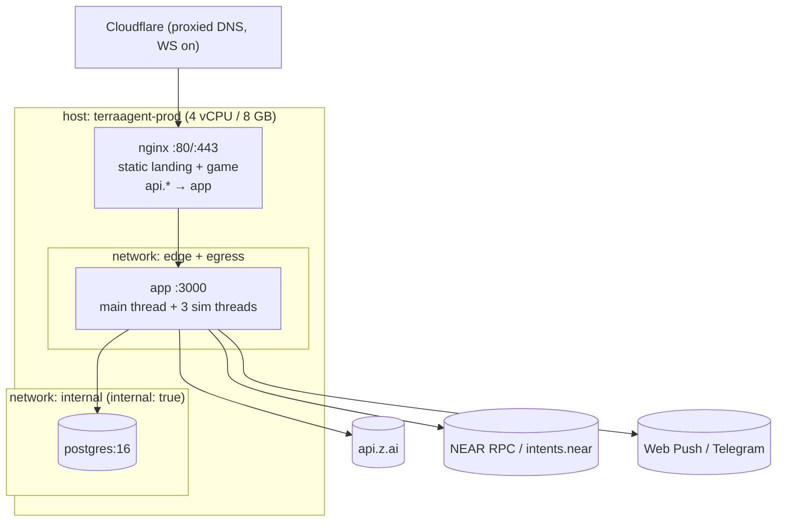

# TerraAgent — Deployment Specification

> **Status:** v0.2 (2026-10-30). One app container plus Postgres plus nginx behind Cloudflare, on one 4 vCPU / 8 GB host (D-23, D-24). No NATS, no planet workers, no drain. · **Parent:** [`ARCHITECTURE.md`](./ARCHITECTURE.md) §3, §4, §5, §14 · **Plan:** [`TA-02`](../plan/issues/TA-02-infra-nats-postgres-nginx.md), [`TA-13.7`](../plan/issues/TA-13-qa-observability-and-load.md)
> **Reference:** `../freightchain/infra/deploy`, which provides a one-command deploy: plan → confirm → backup → migrate → swap → smoke → auto-rollback.

---

## 1. Topology (single host)

One Linux host (Ubuntu 22.04+ / Debian 12, Docker + compose plugin) runs everything. The compose project is `terraagent-prod`.



| Service | Image | Networks | Published | Replicas |
|---|---|---|---|---|
| `nginx` | `terraagent-nginx:${RELEASE}` (nginx 1.27-alpine + both static `dist/`) | edge | `80`, `443` | 1 |
| `app` | `terraagent-app:${RELEASE}` (`SIM_THREADS` = cores − 1) | edge, internal, egress | — | 1 |
| `postgres` | `postgres:16-alpine` | internal | — | 1, volume `pgdata` |
| `migrate` | `terraagent-app:${RELEASE}` running `prisma migrate deploy` (profile `ops`) | internal | — | one-off |

- `internal: true` blocks egress for Postgres. The app joins `egress` for Z.ai, NEAR RPC, push and Telegram.
- Containers run as the non-root `node` user, with `read_only: true` + `tmpfs: /tmp`, `no-new-privileges`, a `/readyz` healthcheck, `restart: unless-stopped`, and json-file logging with rotation (10 MB × 5).

---

## 2. Domains & nginx

| Host | Behaviour |
|---|---|
| `terraagent.com` | static `/srv/www/landing`; `/assets/*` immutable for a year; `index.html` `no-cache` |
| `www.terraagent.com` | `301 https://terraagent.com$request_uri` |
| `game.terraagent.com` | static `/srv/www/game`; SPA fallback `try_files $uri /index.html` |
| `api.terraagent.com` | `/v1/` → `app:3000`; `/ws` → `app:3000` (upgrade); everything else `404` |

```nginx
map $http_upgrade $connection_upgrade { default upgrade; '' close; }
include /etc/nginx/generated/cf-ips.conf;   # set_real_ip_from … (Cloudflare)
real_ip_header CF-Connecting-IP;

server {
  listen 443 ssl; http2 on; server_name api.${TA_DOMAIN};
  include /etc/nginx/snippets/tls.conf;
  include /etc/nginx/snippets/security-headers.conf;
  client_max_body_size 256k;
  location /v1/  { proxy_pass http://app:3000; include /etc/nginx/snippets/proxy.conf; }
  location = /ws { proxy_pass http://app:3000; include /etc/nginx/snippets/ws.conf; }
  location / { return 404; }
}
# snippets/ws.conf: HTTP/1.1, Upgrade/Connection headers, proxy_read_timeout 75s, proxy_buffering off
```

- **No `limit_req` / `limit_conn` zones** (D-25: no anti-abuse machinery). Cloudflare's default DDoS shield stays on.
- **Security headers:** `Strict-Transport-Security: max-age=31536000; includeSubDomains` (no `preload` at launch), `X-Content-Type-Options`, `Referrer-Policy`, `Permissions-Policy`.
- **CSP (game):** `connect-src 'self' https://api.${TA_DOMAIN} wss://api.${TA_DOMAIN} ${CSP_CONNECT_EXTRA}`, where `CSP_CONNECT_EXTRA` holds the NEAR RPC and social-login origins (NEAR.md). The landing page adds `'wasm-unsafe-eval'` for the live diorama's decoders (D-22).
- CORS is handled by the app (allow-list of the two web origins, credentials on).

---

## 3. TLS

**Cloudflare proxied + Origin CA** (owner decision, D-23). DNS records `@`, `www`, `game` and `api` are proxied with SSL mode **Full (strict)**. A 15-year Origin CA certificate for `terraagent.com, *.terraagent.com` is mounted as file secrets. Port 443 is reachable only from Cloudflare ranges. `TLS_MODE=certbot` remains as a fallback.

---

## 4. Secrets & env

| File (server, outside git) | Content |
|---|---|
| `/srv/terraagent/.env` (chmod 600) | all non-file env (`infra/deploy/.env.example`); `CHANGE_ME…` placeholders are refused |
| `secrets/jwt.key` | access/refresh JWT secret |
| `secrets/zai_api_key` | Z.ai key |
| `secrets/near-*.json`, `near-kek` | NEAR keys: relayer, cargo mint authority, Guild NPC accounts, colony key KEK |
| `secrets/vapid.json`, `secrets/telegram_bot_token` | notifications |
| `secrets/tls/origin.pem`, `origin.key` | TLS |
| `secrets/pg_password` | DB |

- `npm run deploy:init` generates the JWT secret, KEK, VAPID keys and PG password. It never overwrites existing files.
- `validate-env.mjs` gate: no `CHANGE_ME`; `AI_PROVIDER=zai` in prod; `NEAR_NETWORK=mainnet` only with `NEAR_ALLOW_MAINNET=1` (cargo and Intents need mainnet, NEAR.md).

---

## 5. Backup & restore

| What | How | When | Kept |
|---|---|---|---|
| Postgres (includes planet snapshots) | `pg_dump -Fc` → `/srv/terraagent/backups/db-<ts>.dump` | before every deploy, plus daily 04:00 UTC | 14 daily + 5 pre-deploy |
| Off-site | `rclone copy backups/ r2:terraagent-backups` (**Cloudflare R2**, D-23) | after each backup | 30 days |

- **App crash:** at most 60 s of player actions lost (snapshot interval, CONTINUITY `CT-50`).
- **Host loss:** RPO ≤ 24 h. On-chain state (cargo, deeds, trades) is unaffected and is reconciled on restore by the `near` module.
- **Restore:** stop the app → `pg_restore --clean` → start the app. Planets fast-run from their snapshots (CONTINUITY `CT-51`).

---

## 6. Deploy & rollback

`npm run deploy`: **checks → plan → confirm → upload `git archive HEAD` → build image on server → backup → migrate → restart app → swap nginx static → smoke → done | auto-rollback.**

- **Restart app:** `SIGTERM` → the app stops intake, snapshots all planets (budget 30 s) and exits → the new container starts and fast-runs the gap. Downtime is about 10–30 s. Clients get `4012 server_restarting` and reconnect. There is no drain or lease handover (D-24).
- **Migrations are expand-only within a release.** Rollback (`npm run deploy:rollback`) restarts the previous image with no down-migration. Restoring a backup (`deploy:restore`) is manual.
- **Server layout:** `/srv/terraagent/{.env, secrets/, releases/<tag>/, backups/, state/{current,previous,releases.log}}`.

---

## 7. Local prod-like stack

- `npm run stack:local` brings up the prod compose plus a local override, with `TA_DOMAIN=terraagent.localhost`, `TLS_MODE=selfsigned`, `AI_PROVIDER=mock` and `NEAR_NETWORK=testnet` (Intents and cargo stubbed).
- `npm run stack:local:smoke` checks:
  - landing returns 200 with a CSP header; game returns 200 with the SPA fallback;
  - `/v1/healthz` returns 200;
  - `/ws` upgrades, and a bad `hello` closes with `4000`;
  - guest login → `/me/home` = `NEW`;
  - a restart resumes planets from snapshot.

---

## 8. Rules

| ID | Rule |
|---|---|
| `DEP-01` | Only nginx publishes ports. Postgres is on an `internal: true` network. |
| `DEP-02` | Every public host serves HSTS + security headers. Game and landing serve their CSP. |
| `DEP-03` | Unknown hosts and paths return 404. |
| `DEP-04` | Secrets are files under `/srv/terraagent/secrets` (600) or the `.env` (600), never in images, git or logs. |
| `DEP-05` | Every deploy takes a Postgres backup before migrating. |
| `DEP-06` | Migrations within a release are expand-only. |
| `DEP-07` | The app is stopped with `SIGTERM` and given ≥ 30 s to snapshot all planets before `SIGKILL`. |
| `DEP-08` | `validate-env` must pass before anything is uploaded. |
| `DEP-09` | Images are built from `git archive HEAD`. |

## 9. Test matrix

| Rule | Test |
|---|---|
| DEP-01 | `infra/deploy/test/compose-config.test.mjs` (only nginx has `ports`) |
| DEP-02, 03 | `npm run nginx:test` |
| DEP-04, 08 | `validate-env.test.mjs` |
| DEP-05, 06, 07, 09 | `deploy:dry-run` plan assertions + `stack:local:smoke` restart step |

## 10. Owner decisions (2026-10-29 / 2026-10-30)

| # | Question | Decision | Ref | Consequence for this spec |
|---|---|---|---|---|
| 1 | TLS | **Cloudflare proxy** + Origin CA | D-23 | §3 |
| 2 | Launch host size | **4 vCPU / 8 GB**, single region | D-23 | Sizing note below |
| 3 | Off-site backups | **Cloudflare R2** | D-23 | §5 |
| 4 | HSTS preload | **Not at launch** | D-23 | §2 |
| 5 | One app, no NATS, no workers | **Yes** | D-24 | §1, §6 rewritten; no worker map, no `ws.` host, no JetStream backups |
| 6 | Anti-abuse | **None** | D-25 | No nginx rate-limit zones |

**Sizing note for 4 vCPU / 8 GB (proposed, verify with the load test):**
- **Memory:** Postgres ~1.5 GB (`shared_buffers` 512 MB), nginx/OS ~0.6 GB, app main thread ~0.6 GB. That leaves about **5 GB** for the 3 sim threads.
- **Planets:** at ≤ 40 MB per planet, plus thread overhead, that supports `MAX_ACTIVE_PLANETS = 60` with headroom. Coarse stepping of empty planets keeps CPU low.
- **Restart fast-run:** after a long outage, fast-running up to 24 h × 60 planets can keep the 3 sim threads busy for several minutes. Planets resume one by one as each finishes.
- **Disk:** 80 GB is enough (snapshots only). 160 GB if available.
