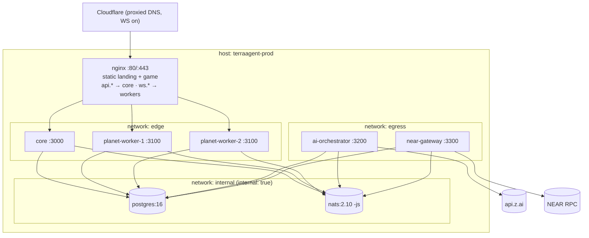

# TerraAgent — Deployment Specification

> **Status:** Draft v0.1 (2026-10-29) · **Parent:** [`ARCHITECTURE.md`](./ARCHITECTURE.md) §3, §4, §5, §14 · **Decisions:** [D-06](./DECISIONS.md#d-06--path-based-worker-routing), [D-07](./DECISIONS.md#d-07--ta_ns-namespace) · **Plan:** [`TA-02`](../plan/issues/TA-02-infra-nats-postgres-nginx.md), [`TA-13.7`](../plan/issues/TA-13-qa-observability-and-load.md)
> **Reference:** `../freightchain/infra/deploy` (one-command deploy with plan → confirm → backup → migrate → swap → smoke → auto-rollback). TerraAgent keeps that flow and adds workers, NATS and a containerised nginx.

---

## 1. Topology (single host, MVP)

One Linux host (Ubuntu 22.04+/Debian 12, Docker + compose plugin) runs everything. The compose project is `terraagent-prod`. Scaling out is done by adding hosts for planet workers later. Workers only need NATS + Postgres + an nginx route.



| Service | Image | Networks | Published | Replicas |
|---|---|---|---|---|
| `nginx` | `terraagent-nginx:${RELEASE}` (nginx 1.27-alpine + both static `dist/`) | edge | `80`, `443` | 1 |
| `core` | `terraagent-core:${RELEASE}` | edge, internal | — | 1 (2 later; matchmaker leader via advisory lock, D-08) |
| `planet-worker-{n}` | `terraagent-planet-worker:${RELEASE}`, env `WORKER_ID=pw-{n}` | edge, internal | — | `PLANET_WORKERS` count (default 2) |
| `ai-orchestrator` | `terraagent-ai-orchestrator:${RELEASE}` | internal, egress | — | 1 |
| `near-gateway` | `terraagent-near-gateway:${RELEASE}` | internal, egress | — | 1 |
| `postgres` | `postgres:16-alpine` | internal | — | 1, volume `pgdata` |
| `nats` | `nats:2.10-alpine` (`-js -sd /data -m 8222`) | internal | — | 1, volume `natsdata` |
| `migrate` | `terraagent-migrate:${RELEASE}` (profile `ops`) | internal | — | one-off |
| `nats-bootstrap` | `terraagent-migrate:${RELEASE}` running `infra/nats/bootstrap` (profile `ops`) | internal | — | one-off |

- `internal: true` blocks egress for Postgres and NATS. AI and NEAR join `egress` because they call external APIs. Core and workers need no egress.
- Workers are emitted by `infra/deploy/scripts/gen-workers.mjs` from `PLANET_WORKERS=2` into `docker-compose.workers.yml` (a YAML anchor `x-planet-worker` + `planet-worker-1..N`). The same script writes `infra/deploy/nginx/generated/workers.map`.
- All app containers: non-root `node` user, `read_only: true` + `tmpfs: /tmp`, `no-new-privileges`, healthcheck on `/readyz`, `restart: unless-stopped`, logging to a journald namespace (freightchain pattern) or the json-file driver with rotation (10 MB × 5).

---

## 2. Domains & nginx

| Host | Behaviour |
|---|---|
| `terraagent.com` | static `/srv/www/landing` (landing `dist`); `/assets/*` `Cache-Control: public, max-age=31536000, immutable`; `index.html` `no-cache` |
| `www.terraagent.com` | `301 https://terraagent.com$request_uri` |
| `game.terraagent.com` | static `/srv/www/game`; SPA fallback `try_files $uri /index.html` |
| `api.terraagent.com` | `/v1/` → `core:3000`; `/ws` → `core:3000` (upgrade); everything else `404` |
| `ws.terraagent.com` | `^/w/(pw-[0-9]{1,3})$` → mapped worker; everything else `404` |

### 2.1 Config sketch (`infra/deploy/nginx/templates/*.conf.template`, rendered by the official image's envsubst)

```nginx
# conf.d/00-maps.conf
map $http_upgrade $connection_upgrade { default upgrade; '' close; }
include /etc/nginx/generated/workers.map;   # map $worker_id $worker_upstream { default ""; pw-1 planet-worker-1:3100; pw-2 planet-worker-2:3100; }

limit_req_zone  $binary_remote_addr zone=ta_api:10m      rate=20r/s;
limit_req_zone  $binary_remote_addr zone=ta_auth:10m     rate=5r/s;
limit_req_zone  $binary_remote_addr zone=ta_ws_open:10m  rate=2r/s;
limit_conn_zone $binary_remote_addr zone=ta_ws_conn:10m;
limit_req_status 429; limit_conn_status 429;

# Cloudflare real IP (option A); list kept in generated/cf-ips.conf, refreshed by deploy
include /etc/nginx/generated/cf-ips.conf;   # set_real_ip_from …;
real_ip_header CF-Connecting-IP;

# --- api.${TA_DOMAIN} ---
server {
  listen 443 ssl; http2 on; server_name api.${TA_DOMAIN};
  include /etc/nginx/snippets/tls.conf;
  include /etc/nginx/snippets/security-headers.conf;
  client_max_body_size 64k;
  location /v1/auth/ { limit_req zone=ta_auth burst=10 nodelay; proxy_pass http://core:3000; include /etc/nginx/snippets/proxy.conf; }
  location /v1/      { limit_req zone=ta_api  burst=40 nodelay; proxy_pass http://core:3000; include /etc/nginx/snippets/proxy.conf; }
  location = /ws     { limit_req zone=ta_ws_open burst=10; limit_conn ta_ws_conn 10;
                       proxy_pass http://core:3000; include /etc/nginx/snippets/ws.conf; }
  location / { return 404; }
}

# --- ws.${TA_DOMAIN} ---
server {
  listen 443 ssl; http2 off; server_name ws.${TA_DOMAIN};
  include /etc/nginx/snippets/tls.conf;
  resolver 127.0.0.11 valid=10s ipv6=off;          # docker DNS: worker restarts get new IPs
  location ~ ^/w/(?<worker_id>pw-[0-9]{1,3})$ {
    if ($worker_upstream = "") { return 404; }
    limit_req zone=ta_ws_open burst=10; limit_conn ta_ws_conn 20;
    proxy_pass http://$worker_upstream;             # variable → URI passed unchanged (/w/pw-2)
    include /etc/nginx/snippets/ws.conf;
  }
  location / { return 404; }
}

# snippets/ws.conf
proxy_http_version 1.1;
proxy_set_header Upgrade $http_upgrade;
proxy_set_header Connection $connection_upgrade;
proxy_set_header Host $host;
proxy_set_header X-Forwarded-For $remote_addr;     # after real_ip, = client IP
proxy_set_header X-Forwarded-Proto https;
proxy_read_timeout 75s; proxy_send_timeout 75s;    # client pings every 20 s; Cloudflare idle limit is 100 s
proxy_buffering off;
```

- The worker checks that the path id equals its own `WORKER_ID`. A mismatch closes with `4004 planet_not_here`.
- `TA_DOMAIN` = `terraagent.com` in prod, `terraagent.localhost` locally (§7).

### 2.2 Security headers (`snippets/security-headers.conf`, static hosts + api)
- `Strict-Transport-Security: max-age=31536000; includeSubDomains` (add `preload` only after the owner confirms)
- `X-Content-Type-Options: nosniff` · `Referrer-Policy: strict-origin-when-cross-origin` · `Permissions-Policy: camera=(), microphone=(), geolocation=()`
- **CSP (game):**
  `default-src 'self'; script-src 'self' 'wasm-unsafe-eval'; style-src 'self' 'unsafe-inline'; img-src 'self' data: blob:; font-src 'self'; connect-src 'self' https://api.${TA_DOMAIN} wss://api.${TA_DOMAIN} wss://ws.${TA_DOMAIN} ${CSP_CONNECT_EXTRA}; worker-src 'self' blob:; frame-src ${CSP_FRAME_EXTRA}; frame-ancestors 'none'; base-uri 'self'; object-src 'none'; form-action 'self'`
  - `'wasm-unsafe-eval'` is for Meshopt/KTX2/Draco WASM decoders (visual pillars).
  - `CSP_CONNECT_EXTRA` / `CSP_FRAME_EXTRA` hold the NEAR RPC and wallet-selector origins chosen in TA-11 (empty by default).
- **CSP (landing):** same base. `connect-src 'self' https://api.${TA_DOMAIN}` (live stats).
- CORS is handled by **core** (allow-list `https://game.${TA_DOMAIN}`, `https://${TA_DOMAIN}`, credentials). nginx does not add CORS headers.

---

## 3. TLS

| Option | How | Pros | Cons |
|---|---|---|---|
| **A (recommended): Cloudflare proxied + Origin CA** | DNS records `@`, `www`, `game`, `api`, `ws` proxied (orange). SSL mode **Full (strict)**. A 15-year Origin CA cert for `terraagent.com, *.terraagent.com` mounted as file secrets `tls/origin.pem`, `tls/origin.key`. WebSockets on (default). Optional Authenticated Origin Pulls. Firewall allows 443 only from Cloudflare ranges. | No renewals, DDoS shield, hides origin IP, wildcard cert makes the D-06 subdomain-per-worker alternative trivial | CF WebSocket idle timeout 100 s (we ping every 20 s); real-IP config needed |
| B: certbot (Let's Encrypt) | `certbot` sidecar with webroot `/.well-known/acme-challenge/` served by nginx; `certbot renew` timer twice a day + `nginx -s reload` hook; names `-d terraagent.com -d www… -d game… -d api… -d ws…` | No third party | Renewal moving part; origin IP exposed; wildcard needs DNS-01 |
| C: host nginx (freightchain style) | nginx on the host with certbot `--nginx`; containers publish on `127.0.0.1` | Same as freightchain ops | Two nginx configs to keep in sync; worker map lives outside compose |

Owner picks A or B in `OWNER_TASKS.md`. TA-02.5 implements both behind `TLS_MODE=cloudflare|certbot`. Option C is documented, not built.

---

## 4. Secrets & env

| File (server, outside git) | Content | Mounted into |
|---|---|---|
| `/srv/terraagent/.env` (chmod 600) | all non-file env (from `infra/deploy/.env.example`; every key documented; `CHANGE_ME…` placeholders refused) | all via `env_file` |
| `/srv/terraagent/secrets/planet-ticket-ed25519.pem` | ticket **private** key | core only |
| `/srv/terraagent/secrets/planet-ticket-ed25519.pub` | ticket public key | workers |
| `/srv/terraagent/secrets/jwt.key` | access/refresh JWT secret | core |
| `/srv/terraagent/secrets/zai_api_key` | Z.ai key | ai-orchestrator |
| `/srv/terraagent/secrets/near-colonies.json`, `near-relayer.json`, `near-colony-kek` | NEAR keys + KEK | near-gateway |
| `/srv/terraagent/secrets/tls/origin.pem`, `origin.key` | TLS (option A) | nginx |
| `/srv/terraagent/secrets/pg_password`, `nats_*` | DB / NATS credentials | respective services |

- Compose `secrets:` (file-based) → `/run/secrets/*`. Apps read `*_FILE` env variants (`@terra/config` supports `X_FILE` for every secret key; contract change request to the W1 pre-step if missing).
- `npm run deploy:init` generates the ticket keypair, JWT secret, KEK, PG/NATS passwords. It never overwrites.
- `infra/deploy/scripts/validate-env.mjs` (prod gate): no `CHANGE_ME`; `AI_PROVIDER=zai` (mock refused); `NEAR_NETWORK=mainnet` only with `NEAR_ALLOW_MAINNET=1`; `TA_NS=ta`; `PLANET_WORKERS ≥ 1`; ticket public key matches private key.
- NATS auth: one user per service (`core`, `worker`, `ai`, `near`, `bootstrap`) with subject permissions scoped by role (e.g. `ai` may publish `{ns}.planet.*.cmd` and `{ns}.ai.*` only). Defined in `infra/nats/nats-server.prod.conf`.

---

## 5. Backup & restore

| What | How | When | Kept |
|---|---|---|---|
| Postgres | `pg_dump -Fc` via `docker compose exec postgres` → `/srv/terraagent/backups/db-<ts>.dump` | before every deploy + daily 04:00 UTC (systemd timer) | 14 daily + 5 pre-deploy |
| JetStream `{NS}_PLANET_CMDS`, `{NS}_PLANET_EVENTS` | `nats stream backup <stream> /srv/terraagent/backups/js-<ts>/` (bootstrap user) | same times, right after the pg dump | same |
| Off-site | `rclone copy backups/ remote:terraagent-backups` (S3-compatible, owner provides bucket) | after each backup | 30 days |

- **Process crash / worker loss:** RPO 0 (JetStream + snapshots; see [`CONTINUITY.md`](./CONTINUITY.md)).
- **Host loss:** RPO ≤ 24 h (daily backups). Lower it later with WAL archiving + JetStream replicas on a second host.
- **Restore order:** stop apps → restore Postgres (`pg_restore --clean`) → restore streams (`nats stream restore`) → `nats-bootstrap` (KV buckets are recreated empty; leases and presence are ephemeral) → start core → start workers. The scheduler reassigns planets, and workers replay commands newer than each snapshot.
- Restore is rehearsed by `npm run stack:local:restore-drill` (part of TA-02.6 smoke, optional flag).

---

## 6. Deploy & rollback

`npm run deploy` (from the developer machine, like freightchain): **checks → plan → confirm → upload `git archive HEAD` → build images on server → backup → migrate → nats-bootstrap → rolling swap → smoke → done | auto-rollback.**

```mermaid
sequenceDiagram
  participant D as deploy.sh
  participant S as server
  D->>S: upload release, build images (RELEASE=yyyymmdd-HHMMSS-sha)
  D->>S: backup (pg_dump + stream backup)
  D->>S: migrate (forward-only, expand-only)
  D->>S: nats-bootstrap (idempotent; refuses destructive stream changes)
  D->>S: swap ai-orchestrator, near-gateway (stop old → start new; work queues buffer)
  D->>S: swap core (start new → /readyz → nginx keeps name core → stop old)
  loop each planet-worker-n
    D->>S: core admin: worker.{id}.ctl drain → wait until KV workers[pw-n].planets == 0 (timeout 120 s)
    D->>S: recreate planet-worker-n with new image → wait registered in {ns}_workers
  end
  D->>S: swap nginx (new static dist) → nginx -t → reload
  D->>S: smoke (smoke:prod) → ok → record current/previous
  Note over D,S: any failure → rollback to previous RELEASE images (same drain loop), keep failed logs
```

- **Draining** (TA-07.5 + TA-05.5): the worker stops accepting `assignPlanet`, snapshots each planet, releases the leases, and closes sockets with `4012 server_draining`. The core scheduler reassigns the planets to other live workers. Clients reconnect through `/v1/me/home`. With a single worker, planets are unowned until the new container registers (target ≤ 30 s, within ARCHITECTURE §14 RTO).
- **Capacity rule:** with N workers, the rolling drain needs `(N−1) × WORKER_MAX_PLANETS ≥ live planets`. Otherwise the script warns and drains anyway, accepting longer reassignment.
- **Migrations are expand-only during a release** (add columns/tables, never drop or rename in the same release). Contract migrations ship in a later release. This keeps rollback safe without down-migrations.
- **Rollback:** `npm run deploy:rollback` re-runs the swap with the previous `RELEASE`. It does not restore the DB (expand-only rule). `deploy:restore <backup>` is a separate manual command.
- **Server layout** (freightchain pattern): `/srv/terraagent/{.env, secrets/, releases/<tag>/, backups/, state/{current,previous,releases.log}, current -> releases/<tag>}`.
- Commands: `deploy`, `deploy -- --dry-run`, `deploy:init`, `deploy:setup`, `deploy:status`, `deploy:logs`, `deploy:backup`, `deploy:rollback`, `deploy:restore`.

---

## 7. Local prod-like stack (`*.terraagent.localhost`)

- `npm run stack:local` → `docker compose -f infra/deploy/docker-compose.prod.yml -f infra/deploy/local/docker-compose.local.yml up`, with `TA_DOMAIN=terraagent.localhost`, `TLS_MODE=selfsigned` (mkcert if installed, otherwise a generated self-signed cert, or `TLS_MODE=off` for HTTP on :80), `PLANET_WORKERS=2`, `AI_PROVIDER=mock`, `NEAR_NETWORK=sandbox` (sandbox container in the local override).
- Browsers resolve `*.localhost` to 127.0.0.1. Node/curl may not, so the smoke script uses a custom DNS lookup / `--resolve` pinned to 127.0.0.1.
- `npm run stack:local:smoke` checks: landing 200 + CSP header; game 200 + SPA fallback on `/play`; `api…/v1/healthz` 200; `api…/nope` 404; `wss://ws…/w/pw-1` upgrade succeeds and a bad `hello` closes with `4000`; `/w/pw-99` → 404; guest login → `/v1/me/home` = `NEW`; rate limit → 429 after burst; `worker.drain` of `pw-1` → its planets appear on `pw-2` within 30 s.
- Runs only in lane L5 or at a barrier (ports 80/443).

---

## 8. Rules

| ID | Rule |
|---|---|
| `DEP-01` | Only nginx publishes ports. Postgres and NATS are on an `internal: true` network. |
| `DEP-02` | Every public host serves HSTS + security headers. The game and landing serve the CSP in §2.2. |
| `DEP-03` | Unknown worker ids and unknown hosts return 404. nginx never proxies to an arbitrary host taken from the URL. |
| `DEP-04` | Secrets are files under `/srv/terraagent/secrets` (600) or the `.env` (600), never in images, git or logs. |
| `DEP-05` | Every deploy takes a Postgres + JetStream backup before migrating. |
| `DEP-06` | Migrations within a release are expand-only. Rollback never requires a down-migration. |
| `DEP-07` | Workers are replaced only after a successful drain (or timeout with a warning). No `docker compose up -d` of all workers at once. |
| `DEP-08` | `validate-env` must pass before anything is uploaded. |
| `DEP-09` | Images are built from `git archive HEAD`. Uncommitted changes are never deployed. |

## 9. Test matrix

| Rule | Test | Task |
|---|---|---|
| DEP-01 | `infra/deploy/test/compose-config.test.mjs`: parse rendered compose → only nginx has `ports`; pg/nats only on internal | TA-02.5 |
| DEP-02, 03 | `npm run nginx:test` (routing + headers against stub upstreams) | TA-02.4 |
| DEP-04, 08 | `validate-env.test.mjs` (CHANGE_ME, mock in prod, mainnet gate) | TA-02.5 |
| DEP-05, 06, 07, 09 | `deploy:dry-run` plan assertions + `stack:local:smoke` drain step | TA-02.5 / TA-02.6 |

## 10. Open questions for the owner

1. TLS option A (Cloudflare) or B (certbot)?
2. Host size for launch (suggest 8 vCPU / 16 GB / 160 GB NVMe until the TA-13.5 load test says otherwise).
3. Off-site backup target (S3 / R2 / B2 bucket + credentials).
4. HSTS `preload`: yes or no?
