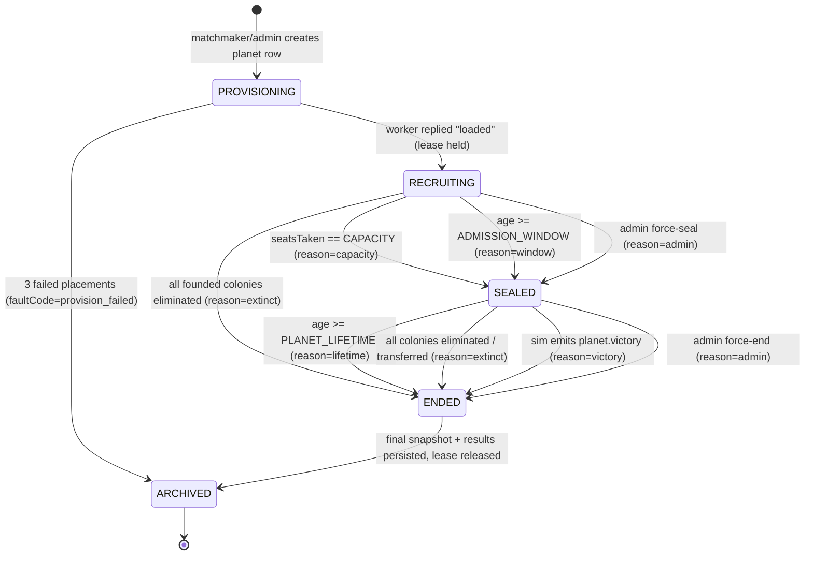
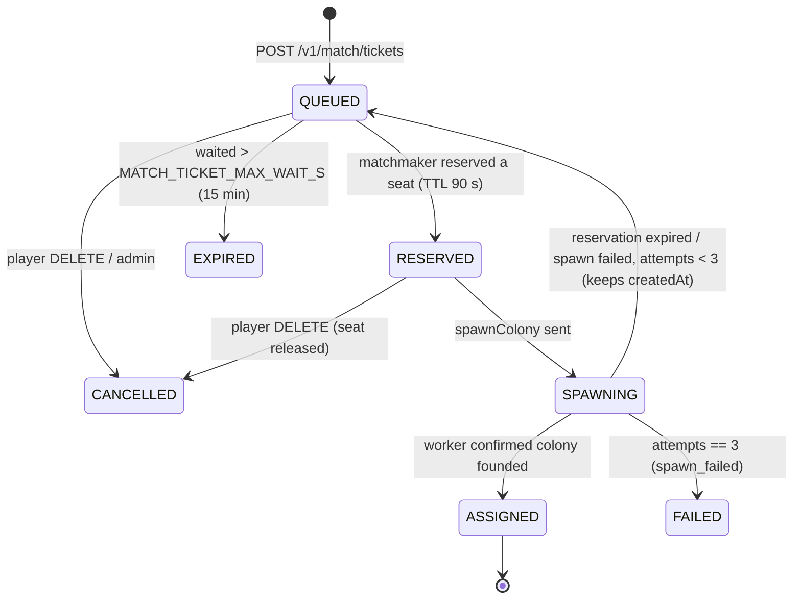

# TerraAgent — Matchmaking & Planet Lifecycle Specification

> **Status:** Draft v0.1 (2026-10-29) — for owner review.
> **Parent:** [`ARCHITECTURE.md`](./ARCHITECTURE.md) §7, §8, §14, §15 · **Decisions:** [`DECISIONS.md`](./DECISIONS.md) D-02, D-08, D-12 · **Related:** [`CONTINUITY.md`](./CONTINUITY.md)
> **Plan:** [`TA-05`](../plan/issues/TA-05-matchmaking-and-planet-lifecycle.md) (lifecycle, queue, matchmaker, scheduler) · [`TA-04`](../plan/issues/TA-04-core-api-auth-and-home.md) (home, tickets, lobby WS, admin)

---

## 1. Purpose

Decide **which planet a player's new colony is founded on**, and **when a planet stops accepting new colonies**, so that:

1. A first-time player sees the planets they can join and gets a seat within seconds.
2. A planet that is full, or that has been running for a long time, never receives new players ("if 5 players are on the planet for days → no new players"). New players only go to **young, open (`RECRUITING`) planets** or to **brand-new planets**.
3. A returning player with a live colony **never touches the queue** — they dive straight back in (see [`CONTINUITY.md`](./CONTINUITY.md)).
4. The queue is **managed**: bounded, pausable, observable, prioritisable by operators, and safe under concurrency (no seat is ever double-assigned).

Everything here runs inside **core** (`backend/core/src/matchmaking/**`, `backend/core/src/planets/**`). Postgres is the source of truth (D-08); NATS only notifies and carries control requests to workers.

---

## 2. Vocabulary

| Term | Meaning |
|---|---|
| **Planet** | One independent simulation (`core.planet` row + sim state on exactly one worker). |
| **Colony** | One player's presence on one planet (`core.colony`). A player has **at most one** colony in `FOUNDING` or `ALIVE` at any time. |
| **Seat** | One of `PLANET_CAPACITY` (5) slots on a planet. A seat is *taken* by a founded colony (any later state) or *held* by an active reservation. |
| **Match ticket** | A player's request to be placed (`core.match_ticket`). |
| **Reservation** | A seat held for a ticket for `MATCH_SEAT_TTL_S` (90 s) while the colony is spawned. |
| **Age** (of a planet) | `now − firstColonyAt`. A planet with no colony yet has age `0` (empty warm-pool planets do not age). |
| **Matchmaker** | The single leader loop in core that turns tickets into seats (MM-30..). |
| **Scheduler** | The core loop that places planets on workers and reassigns them on failure (MM-50..). |

---

## 3. Planet lifecycle



### 3.1 Rules

| ID | Rule |
|---|---|
| `MM-01` | A planet MUST be in exactly one lifecycle state. Transitions MUST go through `PlanetLifecycle.transition(planet, event)` (pure; guard table §3.2) and be persisted with optimistic concurrency (`UPDATE … WHERE id=$1 AND version=$2`). |
| `MM-02` | Only `RECRUITING` planets accept new seat reservations. `PROVISIONING`, `SEALED`, `ENDED`, `ARCHIVED` MUST reject them. |
| `MM-03` | A planet MUST seal **immediately** (same transaction that founds the 5th colony) when `seatsTaken == PLANET_CAPACITY`. |
| `MM-04` | A planet MUST seal when `age >= PLANET_ADMISSION_WINDOW_H` (24 h). The sweeper checks every **30 s**; worst-case lateness 30 s. |
| `MM-05` | `seatsTaken` counts **founded colonies in any state** (`FOUNDING`, `ALIVE`, `ELIMINATED`, `TRANSFERRED`, `RETIRED`). A seat freed by elimination is **never refilled** — on any planet, sealed or not. *(Open question Q1.)* |
| `MM-06` | Sealing MUST NOT cancel reservations taken before the seal; those tickets complete normally. Capacity sealing cannot over-commit because reservations count toward seats (MM-33). |
| `MM-07` | A planet ends when: `age >= PLANET_LIFETIME_D` (14 d), or every founded colony is `ELIMINATED`/`TRANSFERRED`/`RETIRED` (and ≥ 1 was founded), or the sim emits `planet.victory`, or an admin force-ends it. |
| `MM-08` | `ENDED → ARCHIVED` MUST persist: final snapshot (worker), `core.planet_result` (per-colony rank, territory %, terraform %, survived), lease release, and enqueue `near.registry.planetResult`. Only then is the planet `ARCHIVED`. |
| `MM-09` | An **empty** `RECRUITING` planet (warm pool) does not age, does not seal by window, and does not end by lifetime. It is archived only by admin or by warm-pool trimming (MM-42). |
| `MM-10` | Every planet row stores `seed` (64-bit, CSPRNG at creation), `type`, `simVersion` (major of `@terra/sim` that created it), `capacity` (copied from env at creation; changing env never shrinks existing planets). |

### 3.2 Guard table

| From | Event | Guard | To |
|---|---|---|---|
| `PROVISIONING` | `loaded` | reply from the worker holding the lease, `epoch` ≥ stored | `RECRUITING` |
| `PROVISIONING` | `provision_failed` | `placementAttempts >= 3` | `ARCHIVED` |
| `RECRUITING` | `colony_founded` | `seatsTaken == capacity` after increment | `SEALED` |
| `RECRUITING` | `tick_sweep` | `firstColonyAt != null && now - firstColonyAt >= window` | `SEALED` |
| `RECRUITING`/`SEALED` | `admin_seal` / `admin_end` | admin key | `SEALED` / `ENDED` |
| `RECRUITING`/`SEALED` | `extinct` | founded ≥ 1 and alive = 0 | `ENDED` |
| `SEALED` | `tick_sweep` | `now - firstColonyAt >= lifetime` | `ENDED` |
| `SEALED` | `victory` | sim event | `ENDED` |
| `ENDED` | `archived` | final snapshot ack + results row | `ARCHIVED` |

Planet health is orthogonal to lifecycle: `health ∈ {OK, FAILING_OVER, FAULTED}` (D-02). A `FAULTED` planet keeps its lifecycle state, is hidden from the picker, and alerts.

---

## 4. Picker listing ("available planets")

`GET /v1/planets?type=<temperate|desert>&limit=<≤20>` (auth: any player incl. guest).

| ID | Rule |
|---|---|
| `MM-20` | The list MUST contain only planets with `state = RECRUITING`, `health = OK`, `seatsFree > 0` and, if `firstColonyAt` is set, `admissionClosesAt − now ≥ 15 min` (planets about to seal are hidden so a join does not bounce). |
| `MM-21` | Sort: `seatsTaken DESC` (join friends-in-progress planets first), then `firstColonyAt ASC NULLS LAST`. Empty warm-pool planets are **not** listed individually; they back the `newPlanet` options. |
| `MM-22` | Response also contains `newPlanet: [{ type, available, etaS }]` per enabled type. `available=false` when `MAX_ACTIVE_PLANETS` is reached **and** there is no empty warm-pool planet of that type. |
| `MM-23` | The list is cached in-process for **2 s** and pushed over the lobby WS topic `planets` as `planets.changed` (coalesced ≤ 1/s). |
| `MM-24` | Players who already have a `FOUNDING`/`ALIVE` colony MAY view the list, but every join attempt returns `409 already_has_colony` with their `home` (MM-31). |

```ts
type PlanetSummaryV1 = {
  id: string; name: string;            // generated, e.g. "Kepler-7c Dunes"
  type: 'temperate' | 'desert';
  seatsTaken: number; capacity: number;
  firstColonyAt: string | null;        // ISO
  admissionClosesAt: string | null;    // firstColonyAt + window
  endsAt: string | null;               // firstColonyAt + lifetime
  colonies: { displayName: string; foundedAt: string }[];  // public info only
};
type PlanetListV1 = { planets: PlanetSummaryV1[]; newPlanet: { type: string; available: boolean; etaS: number | null }[]; queuePaused: boolean };
```

Public, unauthenticated stats for the landing page: `GET /v1/planets/stats` → `{ planetsActive, coloniesAlive, playersOnline, updatedAt }` (cached 10 s).

---

## 5. Match tickets & the managed queue

### 5.1 Ticket model

```ts
type MatchMode = 'JOIN_PLANET' | 'NEW_PLANET' | 'AUTO' | 'TRANSFER';
type TicketState = 'QUEUED' | 'RESERVED' | 'SPAWNING' | 'ASSIGNED' | 'CANCELLED' | 'EXPIRED' | 'FAILED';

// core.match_ticket
{ id, playerId, mode, planetId?, planetType?, priority /*int, default 0*/,
  state, createdAt, updatedAt,
  colonyId /*pre-allocated UUID, idempotency key for spawn*/,
  reservedPlanetId?, reservationExpiresAt?, attempts /*spawn attempts*/,
  failureCode?, fallbackFromPlanetId? }
```



### 5.2 Rules

| ID | Rule |
|---|---|
| `MM-30` | `POST /v1/match/tickets {mode, planetId?, planetType?}` MUST be idempotent per player: a partial unique index allows one ticket in `QUEUED/RESERVED/SPAWNING` per player. Re-posting the **same** intent returns `200` with the existing ticket; a **different** intent returns `409 ticket_open` (cancel first). An `Idempotency-Key` header is honoured for 10 min. |
| `MM-31` | **Returning players bypass the queue.** If the player has a `FOUNDING`/`ALIVE` colony, enqueue MUST return `409 already_has_colony` + `home`. A partial unique index `core.colony(player_id) WHERE state IN ('FOUNDING','ALIVE')` enforces it in the DB as well. |
| `MM-32` | **New players only go to young or new planets.** Assignment targets MUST be `RECRUITING` planets (MM-02) or a planet created/taken from the warm pool for this ticket. A `SEALED` planet is never a target, even if it has free seats (MM-05). |
| `MM-33` | Seat reservation MUST run in one transaction: `SELECT … FROM core.planet WHERE id=$1 AND state='RECRUITING' FOR UPDATE`; check `seatsTaken + activeReservations < capacity`; set ticket `RESERVED`, `reservedPlanetId`, `reservationExpiresAt = now + MATCH_SEAT_TTL_S`; insert `core.colony(id=ticket.colonyId, state='FOUNDING')`. Tickets are claimed with `SELECT … FOR UPDATE SKIP LOCKED`. |
| `MM-34` | Target selection per mode: **`JOIN_PLANET`** → the requested planet; if it is no longer eligible, **fall back to `AUTO` of the same type** and set `fallbackFromPlanetId` (client shows "That planet just filled — you've been placed on …"). **`AUTO {type?}`** → eligible `RECRUITING` planet with the most seats taken (fill first), tie → oldest `firstColonyAt`; if none, empty warm-pool planet; if none, create one. **`NEW_PLANET {type}`** → empty warm-pool planet of that type, else create. **`TRANSFER`** (rocket, TA-06.10) → like `NEW_PLANET`, `priority = 10`. *(Open question Q2 on fallback.)* |
| `MM-35` | Spawning: core sends `{ns}.planet.{planetId}.ctl spawnColony { colonyId, playerId, ticketId, displayName, carryOver? }` (timeout 5 s). The worker appends a `system.spawnColony` command to `{NS}_PLANET_CMDS` with `Nats-Msg-Id = colonyId` (JetStream dedupe ⇒ retries are idempotent) and replies `{ colonyId, appliedAtTick, spawnTile }` once applied. |
| `MM-36` | On success, in one transaction: colony `FOUNDING → ALIVE` (`foundedAt`), planet `seatsTaken++`, set `firstColonyAt` if null, ticket `ASSIGNED`, seal if full (MM-03). Then publish `{ns}.mm.changed` and push `match.assigned { home }` to the player's lobby sockets. |
| `MM-37` | On spawn timeout/error: retry up to 3 times **within** the reservation TTL with backoff 1 s/2 s/4 s. If the planet has no lease (failover), keep the reservation and retry until TTL. On TTL expiry: colony row → `ABANDONED`, ticket back to `QUEUED` (`attempts++`, original `createdAt` kept so the player keeps their place). After 3 attempts → `FAILED spawn_failed`, push `match.failed`. |
| `MM-38` | **Orphan reconciliation:** if a `colony.founded` event arrives for a colony whose core row is `ABANDONED`, core MUST publish `system.retireColony { colonyId, reason: 'reservation_expired' }` to that planet; the seat it briefly took is still counted (MM-05) and the event is logged as `mm.orphan_colony`. |
| `MM-39` | Cancel: `DELETE /v1/match/tickets/current` allowed in `QUEUED`/`RESERVED` (reservation and `FOUNDING` colony released in the same tx). In `SPAWNING` it returns `409 too_late`. |
| `MM-40` | Tickets waiting longer than `MATCH_TICKET_MAX_WAIT_S` (900 s) in `QUEUED` expire (`EXPIRED`, push `match.failed {code:'timeout'}`); the client offers "try again". |

### 5.3 Matchmaker loop (leader)

| ID | Rule |
|---|---|
| `MM-41` | Exactly one core replica runs the loop: the one holding `pg_try_advisory_lock(hashtext('ta.matchmaker'))` on a dedicated connection. Losing the connection releases the lock; another replica acquires within one loop period. `mm_leader` gauge = 1 on the leader. |
| `MM-42` | Loop period **500 ms**, woken early by Postgres `NOTIFY ta_mm` (on enqueue/cancel) and by `{ns}.mm.changed`. Each iteration: (1) expire reservations (MM-37) and old tickets (MM-40); (2) time-based seal/end sweep every 30 s (MM-04, MM-07); (3) claim up to **50** `QUEUED` tickets ordered `priority DESC, createdAt ASC` with `SKIP LOCKED`, process each (MM-33..37); (4) top up the warm pool to `WARM_POOL_PER_TYPE` empty planets per enabled type, and trim extras older than 1 h. |
| `MM-43` | Planet creation respects `MAX_ACTIVE_PLANETS` (200, counting `PROVISIONING`+`RECRUITING`+`SEALED`+`ENDED`). At cap, tickets needing a new planet stay `QUEUED`; `newPlanet.available=false`; `mm_capacity_blocked_total` increments. |
| `MM-44` | Creating a planet: insert `PROVISIONING` row → scheduler places it (MM-50) → `loaded` reply → `RECRUITING`. A ticket waiting for a planet being provisioned does **not** hold a reservation until the planet is `RECRUITING`. |

### 5.4 Managed queue controls

| ID | Rule |
|---|---|
| `MM-45` | **Backpressure:** when open tickets ≥ `MATCH_QUEUE_MAX` (1000), enqueue returns `503 queue_full` with `Retry-After: 30`. |
| `MM-46` | **Pause:** `core.mm_settings.paused=true` stops step (3) of the loop; enqueue still accepted (up to MM-45); picker shows `queuePaused: true`. Expiry (MM-40) is suspended while paused. |
| `MM-47` | **Priority:** integer, default 0; `TRANSFER` = 10; admins may set −10..100 per ticket. |
| `MM-48` | **Position & ETA:** `position` = count of open tickets ahead (`priority >` mine, or equal priority and earlier `createdAt`); `etaS` = position × EWMA(assignment seconds, α=0.2), `null` when paused or at cap. Pushed on `queue.position` at most every 2 s per ticket. |
| `MM-49` | **Admin** (TA-04.7): list/inspect queue, pause/resume, set priority, cancel a ticket, force-seal/end a planet, create a warm planet, drain a worker. Every action is written to `core.admin_audit`. |

---

## 6. Planet scheduler (placement & failover)

| ID | Rule |
|---|---|
| `MM-50` | Placement candidates: workers present in `{ns}_workers` (heartbeat fresh), not `draining`, `planets < WORKER_MAX_PLANETS`, and `simVersions` containing `planet.simVersion`. Score = `planets / WORKER_MAX_PLANETS + load` (load = tick-time utilisation 0..1 from heartbeat); lowest wins; tie → lowest `workerId`. *(W2 static placement uses only the first three filters + lowest `workerId`.)* |
| `MM-51` | Placement = `{ns}.worker.{workerId}.ctl assignPlanet { planetId, seed, type, simVersion, restoreFrom: 'snapshot' | 'new' }` (timeout 10 s). The worker acquires the lease (`epoch+1`), loads, and replies `loaded { epoch, tick, stateHash }`. On timeout → next candidate; `placementAttempts++`. |
| `MM-52` | Reconcile every **5 s** (and on KV watch events): for every planet in `RECRUITING`/`SEALED`/`ENDED`(not archived) — **no lease key** ⇒ mark `health=FAILING_OVER` and place it (MM-50/51) with `restoreFrom:'snapshot'`; **lease held by a worker absent from `{ns}_workers`** ⇒ wait for lease TTL; **lease held but planet `ARCHIVED`** ⇒ send `releasePlanet`. |
| `MM-53` | Herd control: at most **10** concurrent `assignPlanet` per target worker; failover of a dead worker's planets is spread round-robin across candidates. |
| `MM-54` | The scheduler also runs only on the matchmaker leader (same advisory lock), so placement decisions are serialised. |

Failover timing, epochs and replay are specified in [`CONTINUITY.md`](./CONTINUITY.md) §6.

---

## 7. Edge cases

| # | Situation | Required behaviour |
|---|---|---|
| E1 | Player double-clicks "Join" (two concurrent POSTs) | Partial unique index → one ticket; second request returns the same ticket `200` (MM-30). |
| E2 | Player opens two tabs, joins different planets | Second POST with different intent → `409 ticket_open`. |
| E3 | Player already has a live colony and calls enqueue (stale picker tab) | `409 already_has_colony` + `home`; client redirects to `/play` (MM-31). |
| E4 | Target planet fills or seals while ticket is `QUEUED` | Fallback to `AUTO` same type, `fallbackFromPlanetId` set (MM-34). |
| E5 | Planet seals by window while ticket is `RESERVED` | Reservation honoured; colony founded (MM-06). |
| E6 | Reservation expires (worker slow/down) | `ABANDONED` colony, ticket re-queued with original place, `attempts++` (MM-37). |
| E7 | Spawn actually succeeds after reservation expired | Orphan reconciliation retires it (MM-38). |
| E8 | Worker dies during `spawnColony` | No lease → retries wait for failover within TTL; command is in JetStream so the restored planet applies it exactly once (dedupe by `colonyId`); confirmation arrives from the new worker. |
| E9 | Matchmaker leader dies mid-transaction | Tx rolls back; `SKIP LOCKED` rows unlock; new leader re-processes; spawn idempotent by `colonyId`. |
| E10 | Global cap reached and no recruiting planet of the type | Ticket waits; `newPlanet.available=false`; `AUTO` without type may use another type. |
| E11 | Admin pauses queue with 300 tickets waiting | No assignments; positions frozen; ETA `null`; no expiry while paused (MM-46). |
| E12 | Colony eliminated within an hour on a `RECRUITING` planet | Seat stays taken (MM-05); planet keeps recruiting until full or 24 h. |
| E13 | All 5 colonies eliminated on day 3 | `extinct` → `ENDED` → `ARCHIVED`; players see `ELIMINATED` home (CONTINUITY). |
| E14 | Eliminated player wants back in | Home `ELIMINATED` → picker → new ticket → only `RECRUITING`/new planets (never their old sealed planet). |
| E15 | Env `PLANET_CAPACITY` changed 5 → 6 | Only new planets get 6 (MM-10). |
| E16 | Worker running a newer `simVersion` only | Old planets are never placed on it (MM-50); deploy keeps ≥ 1 worker per live sim major. |

---

## 8. Numbers (from ARCHITECTURE §15, plus matchmaking-local)

| Key | Default | Notes |
|---|---|---|
| `PLANET_CAPACITY` | 5 | per planet, copied at creation |
| `PLANET_ADMISSION_WINDOW_H` | 24 | from `firstColonyAt` |
| `PLANET_LIFETIME_D` | 14 | from `firstColonyAt` |
| `WARM_POOL_PER_TYPE` | 1 | empty `RECRUITING` planets per type |
| `MAX_ACTIVE_PLANETS` | 200 | global |
| `MATCH_SEAT_TTL_S` | 90 | reservation |
| `MATCH_QUEUE_MAX` | 1000 | open tickets |
| `MATCH_TICKET_MAX_WAIT_S` | 900 | *local to this spec* |
| `MM_LOOP_MS` | 500 | *local* |
| `MM_BATCH` | 50 | *local* |
| `PICKER_HIDE_BEFORE_CLOSE_MIN` | 15 | *local* |

---

## 9. Telemetry

| Name | Type | Meaning |
|---|---|---|
| `mm_queue_depth{state}` | gauge | open tickets by state |
| `mm_ticket_wait_seconds{mode}` | histogram | enqueue → `ASSIGNED` |
| `mm_assignments_total{mode,result}` | counter | `assigned`/`fallback`/`requeued`/`failed`/`expired`/`cancelled` |
| `mm_reservations_expired_total` | counter | MM-37 |
| `mm_orphan_colonies_total` | counter | MM-38 |
| `mm_planets{state,type}` | gauge | lifecycle census |
| `mm_planet_created_total{type,source}` | counter | `warm_pool`/`on_demand`/`admin` |
| `mm_planet_sealed_total{reason}` | counter | `capacity`/`window`/`admin` |
| `mm_planet_ended_total{reason}` | counter | `lifetime`/`extinct`/`victory`/`admin` |
| `mm_capacity_blocked_total` | counter | MM-43 |
| `mm_spawn_latency_seconds` | histogram | `spawnColony` request → reply |
| `mm_leader` | gauge | 1 on the leader replica |
| `sched_placements_total{result,reason}` | counter | `new`/`failover`/`drain` |
| `sched_failover_seconds` | histogram | lease missing → `loaded` |

Log events: `mm.ticket.created`, `mm.ticket.assigned`, `mm.ticket.fallback`, `mm.orphan_colony`, `planet.transition` (from, to, reason).

---

## 10. Test matrix

| Rule | Test | Task |
|---|---|---|
| MM-01, guard table | `planet-lifecycle.spec.ts` — every row of §3.2 + illegal transitions throw | TA-05.1 |
| MM-03, MM-05, MM-06 | `seat-reservation.int-spec.ts` — 5th colony seals in same tx; eliminated seat not refilled; reservation survives window seal | TA-05.3 / TA-05.4 |
| MM-04, MM-07, MM-09 | `planet-sweeper.int-spec.ts` with fake clock — 24 h seal, 14 d end, empty planet never ages | TA-05.4 |
| MM-20..23 | `planet-browser.int-spec.ts` — filters, sort, close-soon hiding, `newPlanet.available` | TA-05.2 |
| MM-30, E1, E2 | `match-ticket-idempotency.int-spec.ts` — 20 concurrent POSTs → 1 ticket | TA-05.3 |
| MM-31, E3 | `enqueue-with-live-colony.int-spec.ts` | TA-05.3 |
| MM-33, MM-41 | `matchmaker-concurrency.int-spec.ts` — 2 loops + 30 tickets for 1 planet → exactly 5 seats | TA-05.4 |
| MM-34, E4 | `join-fallback.int-spec.ts` | TA-05.4 |
| MM-35..38, E6..E8 | `spawn-saga.int-spec.ts` with fake worker (timeouts, late success, dedupe) | TA-05.3 / TA-05.4 |
| MM-42..44 | `warm-pool.int-spec.ts`, `global-cap.int-spec.ts` | TA-05.4 |
| MM-45..48 | `queue-controls.int-spec.ts` | TA-05.6 |
| MM-50..54 | `scheduler-placement.spec.ts`, `scheduler-failover.int-spec.ts` (2 fake workers, kill one) | TA-05.5 |
| End-to-end | `tests/load/matchmaking` soak — 200 synthetic players → all planets ≤ 5, no join into sealed | TA-13.6 |

---

## 11. Open questions for the owner

- **Q1 — Seat refill.** Should a seat freed by early elimination on a still-`RECRUITING` planet be refilled? Current: no (simpler, and avoids dropping a new player next to established colonies). Alternative: refill only within the first 2 h.
- **Q2 — Join fallback.** When the chosen planet fills, auto-place on another planet of the same type (current) or return to the picker with an error?
- **Q3 — Small planets.** A planet with 1–2 colonies after 24 h stays sealed and small. Acceptable, or should the admission window extend (e.g. up to 48 h) while `seatsTaken < 3`?
- **Q4 — Friends / parties.** Joining a specific planet together (party tickets) is out of scope for MVP. Needed for launch?
- **Q5 — Regions.** One region (single host) for MVP; multi-region placement would add `region` to `MM-50` scoring.
