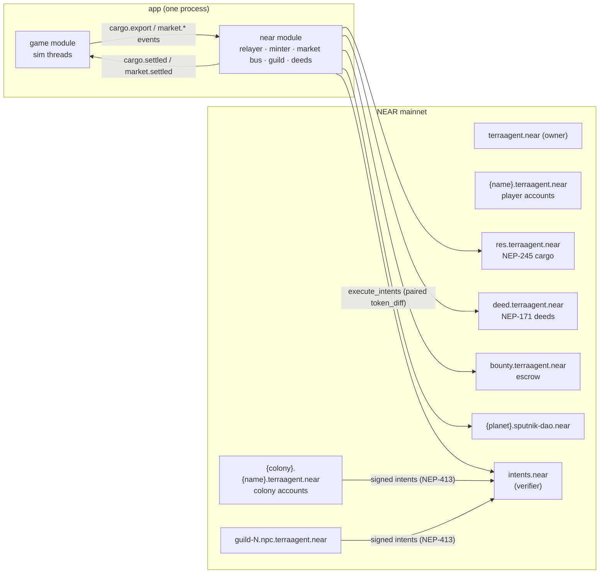
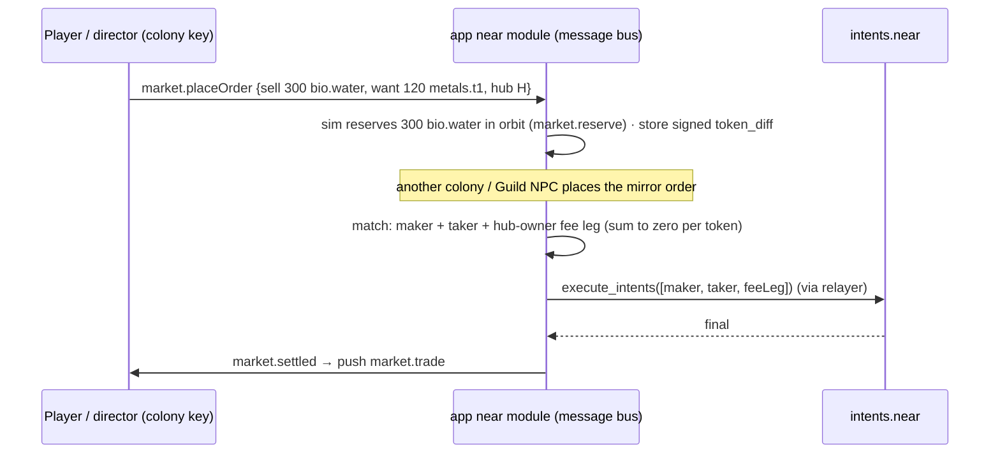

# TerraAgent — NEAR Integration Specification

> **Status:** v0.2 (2026-10-30). Rewritten around the NEAR economy features **F1–F8** (D-26), hosted by the `near` module of the one app (D-24). There is no `near-gateway` service and no NATS.
> **Parent:** [`ARCHITECTURE.md`](./ARCHITECTURE.md) §11 · **Feature design:** [`docs/game/near-economy-features-spec.md`](../game/near-economy-features-spec.md) · **Decisions:** D-10, D-18, D-19, D-23, D-25, D-26 · **Plan:** [`TA-10`](../plan/issues/TA-10-near-gateway.md)
> **Game design:** [`docs/game/autonomous-colony-spec.md`](../game/autonomous-colony-spec.md) §11, §13 pillar 5 ("chain is invisible") · Hackathon track 09 "Games With Real Economies".

---

## 1. Purpose & principles

1. **Players never notice the chain (F5).** Guest play first, then social login with a named account. Every gameplay transaction is signed by keys the app holds and paid by the app's relayer (NEP-366). Wallets appear only for account claim and staking (D-18).
2. **The server simulation is the mint authority (D-26).** Cargo tokens are minted only from simulated stock exported at a Trade Hub, and burned on import. No client claim ever mints.
3. **The economy touches the chain at one door: the Trade Hub.** Production, combat and terraforming stay in the sim. Cargo, markets, NPC traders, deeds, the treasury and bounties are on-chain.
4. **Gameplay never blocks on the chain, except a trade's own settlement.** Mint, burn and settlement are async outbox jobs (`chain.*_tx`). If NEAR or `intents.near` is unreachable, the market and cargo commands return `market_unavailable` and the planet keeps running.
5. **No anti-cheat and no anti-bot (D-25).** Cargo is **open in beta**: it can be swapped for NEAR or USDC through Intents. Mint caps are economic pacing, not security.
6. **Only the `near` module talks to NEAR RPC and `intents.near`.** Other modules call it in-process.

---

## 1a. Ports, adapters and the mock-first rule (D-30)

**Phase 1 runs every NEAR feature (F1–F8) on mock adapters.** The game code depends only on **ports**, so a real adapter replaces the mock without touching game or application code. The patterns are copied from galaxyqube's `casino-core-systems` (see `AGENTS-MCP.md` there).

**Pattern rules.**
1. **Ports are abstract classes**, and the class is the DI token. Example: `export abstract class CargoTokenPort { abstract mint(cmd: MintCargo): Promise<ChainReceipt> … }`. Files are named `*.port.ts` and live in `backend/app/src/near/application/ports/`.
2. **All bindings live in one place**, `near/infrastructure/near-infrastructure.module.ts`, for example `{ provide: CargoTokenPort, useClass: MockCargoTokenAdapter }`. No other file imports an adapter.
3. **Adapter selection happens at module composition, per port.** It uses a **fail-closed env predicate** that can be read before DI, so a typo can never select the real chain:
   - `NEAR_ADAPTER_<PORT>=mock|testnet|mainnet`, default `mock`.
   - `nearAdapterFor(port)` accepts only the exact strings `testnet` or `mainnet`; anything else means `mock`.
   - In production, a `mock` setting is allowed only when `NEAR_ALLOW_MOCK_IN_PROD=true`, so a demo can run on mocks on purpose.
4. **The mock is real-shaped.** `Mock*Adapter` classes keep their state in Postgres tables (`mock_chain_*`: accounts, balances, NFTs, intents, DAO proposals). They produce the same receipts, using fake tx hashes with the prefix `mock:`. They return the same errors (`CoreException` subclasses with stable `errorCode`s such as `NEAR_INSUFFICIENT_BALANCE` and `NEAR_INTENT_DIFF_NOT_ZERO`). They simulate a latency of 300–1 500 ms and an injectable failure rate, so the UI's pending and failed states get exercised.
5. **Shared contract tests.** `describeNearPortContract(name, makeAdapter)` lives in `near/__contract__/*.contract.ts`. The **same suite** runs against the mock in CI and against the real adapter in a manual or nightly job, so "replace the implementation" is checked rather than hoped for. galaxyqube lacks this; we add it.
6. **Side effects go through an outbox with idempotency keys.** Every chain write (mint, burn, intent execution, NFT mint, DAO action) is written in the same Postgres transaction as the game state change, as `chain_outbox (opId unique, port, payload, status)`. A relay then calls the port. `opId` is deterministic, e.g. `cargo-export:{colonyId}:{exportSeq}`, so a retry can never double-mint, whether the adapter is mock or real.
7. **Every boundary is validated with zod:** env, port inputs and adapter responses. No `any`.
8. **In-memory fakes** (`InMemoryCargoToken extends CargoTokenPort`) are for unit tests only. The Postgres mock is for running the game.

| Port | Feature | Main methods | Mock behaviour | Real adapter (later) |
|---|---|---|---|---|
| `IdentityPort` | F5 | `loginSocial`, `createNamedAccount`, `claimAccount` | Fake OAuth screen; account `name.terraagent.mock` | Social-login provider (to be chosen) + account creation |
| `RelayerPort` | F5 | `submitMetaTx` | Instant, deterministic `mock:` hash | NEP-366 relayer |
| `CargoTokenPort` | F1 | `mint`, `burn`, `balanceOf`, `transfer` | Postgres ledger (NEP-245 semantics, token ids = `ResourceKey`: `metals.t1` …) | NEP-245 contract `res.terraagent.near` |
| `IntentsPort` | F2, F4 | `deposit`, `signTokenDiff`, `simulate`, `execute`, `withdraw` | Diffs checked to sum to zero, then applied atomically to the mock ledger | `intents.near` (`execute_intents`, `simulate_intents`) |
| `AgentWalletPort` | F3, F4 | `createSubAccount`, `addLimitedKey(allowance)`, `revokeKey` | Mock keys with allowance accounting | Sub-accounts + function-call keys |
| `DeedNftPort` / `BadgeNftPort` | F6, achievements | `mint`, `updateMetadata`, `ownerOf` | Postgres NFTs with a metadata JSON history | NEP-171 contract |
| `StakingPort` | F6 | `stake`, `unstake`, `rewards` | Fake validator pool at 9 % APY over game time | Whitelisted staking pools |
| `TreasuryDaoPort` | F7 | `createDao`, `propose`, `vote`, `finalize`, `deposit` | Postgres DAO with SputnikDAO-like states | SputnikDAO / Trezu |
| `EscrowPort` | F8 | `open`, `claim`, `refund` | Postgres escrow | Escrow contract |
| `ChainReadPort` | all | `explorerUrl`, `receipt`, `health` | `mock:` receipts; no explorer link | RPC (FastNEAR + fallback) |

**Swap order after phase 1:** F5 (`IdentityPort`, `RelayerPort`) → F1 (`CargoTokenPort`) → F2 (`IntentsPort`, mainnet only, starting with `dry: true` quotes) → F3/F4 (`AgentWalletPort`) → F6 → F7 → F8. A port goes real only after its contract suite passes against the real adapter. The README must state which ports are real and which are mocked.

The same pattern applies outside NEAR: `LlmProviderPort` (AI director: mock and Z.ai) and `NotifierPort` (mock, Web Push, Telegram).

## 2. Accounts & key custody (F5)

| Account | Role | Keys held by the app |
|---|---|---|
| `terraagent.near` (+ `terraagent.testnet` for dev) | Owner/root; creates the sub-accounts below | **None.** It stays on the owner's hardware or cold wallet. |
| `relayer.terraagent.near` | Pays gas for meta-transactions; operator of the game contracts | Full-access, file secret |
| `minter.terraagent.near` | Sole mint/burn authority on `res.terraagent.near` | Full-access, file secret |
| `{name}.terraagent.near` | **Player named account**, created on social login (F5) | Per-player key, envelope-encrypted (KEK) until claimed |
| `{colony}.{name}.terraagent.near` | **Colony account**: holds cargo, signs market intents, owns the deed, stakes after claim | Per-colony key, envelope-encrypted until claimed |
| `guild-N.npc.terraagent.near` | Orbital Guild NPC traders (F3) | Function-call keys for `intents.near` and `res.*` only |

- **Keys.** The app generates ed25519 keys and encrypts the secrets with AES-256-GCM under `NEAR_KEK` (stored in `chain.near_colony_account.encrypted_secret` with `kek_version`).
- **Account claim (D-18, at launch).** The player links a wallet (NEP-413, §3). The app adds the player's key as full-access and removes its own full-access key. It keeps only a **function-call key with an allowance** scoped to `intents.near` and `res.*`. Gameplay keeps working, but the game can no longer move the player's NEAR. Claiming is one-way and is required for staking.
- **Director key (F4).** A separate key on the colony account whose allowance equals the player's away budget for trading. The AI director uses it to sign `autoTrade` orders. The player revokes it in one tap; the HUD shows spent versus allowance.
- **Social-login provider: verify in docs.** HOT is a listed hackathon partner; other providers must be checked for NEAR named-account support. TA-10 decides.

---

## 3. Wallet link: NEP-413 (optional)

The flow is unchanged in substance. The app issues a challenge `{nonce (32 B), recipient: "terraagent.com", message}`, and the wallet signs it (`signMessage`). The app verifies `borsh({tag: 2^31+413, message, nonce, recipient, callbackUrl?})` → SHA-256 → ed25519 against a **FullAccess** key of the account at `final` finality (`view_access_key`). The nonce is single-use with a 5-minute expiry. A wrong network suffix is rejected. A link is needed only for account claim, staking and cross-device portability (D-10).

---

## 4. Relayer (NEP-366)

- **Signing.** Colony, player and NPC keys sign `DelegateAction`s. `relayer.*` wraps them in `Action::Delegate` and pays gas.
- **In-process only.** The relayer has no public HTTP surface.
- **Allow-list** of receiver contracts: `res.terraagent.near`, `deed.terraagent.near`, `bounty.terraagent.near`, the planet DAOs, and `intents.near`. This is cost control, not anti-cheat (D-25).
- **Nonces.** A per-signer async mutex plus an access-key nonce cache, with one retry on `InvalidNonce`.

---

## 5. F1 — Cargo tokens (NEP-245)

| ID | Rule |
|---|---|
| `NEAR-50` | One NEP-245 multi-token contract, `res.terraagent.near`. **One token id per tradable sub-resource (D-34)**, equal to the sim's `ResourceKey`: `metals.t1`, `metals.t2`, `metals.t3`, `minerals.t1`, `minerals.t2`, `minerals.t3`, `bio.water`, `bio.biomass`, `bio.t2`, `bio.t3` (18 decimals; energy is not a token). T1 tokens trade from day one; T2/T3 tokens can be bought by a colony that cannot mine them yet. `mt_mint` and `mt_burn` are callable only by `minter.*`. Transfers are **unrestricted in beta** (D-26). |
| `NEAR-51` | **Export.** `cargo.export {resource, amount}` (SIMULATION `SIM-C-05`): the sim removes the stock and records `pendingMint`. The `near` module writes a `chain.cargo_tx` row and calls `mt_mint` to the colony account; on final it answers `cargo.settled {ok: true}`. On failure (after retries) it answers `{ok: false}` and the sim refunds. |
| `NEAR-52` | **Import.** `cargo.import`: the module burns tokens from the colony account (colony key, via the relayer). On final, the sim credits the stock, capped by storage, with any overflow kept in orbit. |
| `NEAR-53` | **Mint caps (economic pacing).** Per colony: export ≤ Trade Hub throughput (250 / 900 / 3 500 units per min by tier) and ≤ `CARGO_MINT_CAP_PER_DAY`. Proposed default: 20 000 units per sub-resource per day. Over the cap → `mint_cap`. |
| `NEAR-54` | **Rocket carry-over.** Cargo stays in the colony account and follows the player. The new colony can import it (`system.arrive` lists the balance). |
| `NEAR-55` | **Deposit path into `intents.near`.** Cargo must be deposited into the verifier to trade there (`mt_transfer_call` to `intents.near`, credited as an `nep245:res.terraagent.near:<id>` balance). **Verify the exact deposit method and token-id format in the Intents docs.** If NEP-245 deposits are not supported, fall back to one NEP-141 token per sub-resource (10). |

---

## 6. F2 — Player-owned markets on NEAR Intents

| ID | Rule |
|---|---|
| `NEAR-60` | An order is a **signed `token_diff` intent** (NEP-413 payload) from the maker's colony account. It covers in-orbit cargo (or NEAR / USDC balances in the verifier) and has a deadline equal to the order TTL. The app stores it in `chain.market_order`. |
| `NEAR-61` | **Matching.** The `near` module is the **message bus**. Each planet has one order book per token pair (sub-resource × sub-resource, or sub-resource × NEAR / USDC), with price-time priority. A match builds the batch `[maker, taker, feeLeg]`. The fee leg pays `fee_bp` (0–3 %, set by the Trade Hub owner with `market.setHubFee`) to the hub owner's colony account. Per token, the batch must sum to zero, or `execute_intents` rejects the whole batch. |
| `NEAR-62` | **Settlement.** The batch is submitted through the relayer. When it is final, the app writes `chain.intent_trade` and sends `market.settled` to both sims (they release reservations, and trade history feeds the price board). On failure, orders go back to the book or expire and reservations are released. |
| `NEAR-63` | **Scope.** Same-planet order books only (D-19). Cross-planet flow comes only from Guild NPCs (F3). A Trade Hub T1 is required to place orders; truces are not. |
| `NEAR-64` | **Dev and test.** `intents.near` is **mainnet only, with no testnet**. Development uses dedicated mainnet dev accounts with tiny amounts plus `simulate_intents` / `dry: true` quotes. CI stubs the verifier. |
| `NEAR-65` | **Open in beta.** Orders may be priced in NEAR or USDC (via verifier balances). The 1Click API may be used for external swaps (0.2 % fee without a JWT). **Verify the API details in the docs.** |

---

## 7. F3 — Orbital Guild NPC traders

| ID | Rule |
|---|---|
| `NEAR-70` | Guild NPCs are app-run agents with **their own sub-account wallets** and function-call keys. They hold cargo and NEAR inventories and sign their own intents. They act as **market makers** on every planet book. |
| `NEAR-71` | **Pricing core** (deterministic, in the app): the NPC's mid price drifts with its inventory and the planet's last 24 h of settled trades. The spread widens when inventory is thin. An optional LLM layer (the `ai` module, within the same budget) picks routes and stockpile goals about once an hour. |
| `NEAR-72` | **Visits.** NPCs travel a schedule between planets (`chain.guild_visit`). While docked they quote offers to that planet's Trade Hubs (`guild.arrived` push). They are the **only cross-planet trade route**. |
| `NEAR-73` | **Funding.** NPC wallets are seeded from the owner treasury with a small NEAR float plus initial cargo minted by `minter.*`. They are capped in size so a bug cannot drain the treasury. |

---

## 8. F4 — Colony director key

| ID | Rule |
|---|---|
| `NEAR-80` | `POST /v1/near/director-key` adds a function-call / intents key to the colony account. Its allowance equals the away trading budget (CONTINUITY AW-13 / AW-20). Revoke deletes the key. |
| `NEAR-81` | The AI director signs orders with this key only within `autoTrade` limits. The sim and the `near` module both check the limits before matching. |

---

## 9. F6 — Colony Deed (NEP-171) & own-NEAR staking

| ID | Rule |
|---|---|
| `NEAR-90` | `deed.terraagent.near` mints one NFT per colony at founding, owned by the colony account. It replaces the earlier `colony-registry` milestone log. |
| `NEAR-91` | **Dynamic metadata.** The relayer (operator) updates `extra` (stage, terraform %, walls, trade volume, truces, rank) on milestones, debounced to at most one update per colony per 10 min. The image is rendered by the app from the colony snapshot. |
| `NEAR-92` | **Settled Deed.** On `colonySettled` (SIMULATION §7.7) the deed is marked settled and becomes the home for **own-NEAR staking**. The player, through a **claimed** account, sends NEAR to the colony account, which calls `deposit_and_stake` on a pool from `NEAR_STAKING_POOLS`. Validator rewards accrue to the player. The game never pays NEAR and never holds the player's funds. |
| `NEAR-93` | In-game perks are independent of the staked amount (no pay-to-win). |

*Follow-up:* the staking UI is wallet-signed and sits outside the "invisible chain"; validator whitelist governance; legal review.

---

## 10. F7 — Planet Treasury DAO

| ID | Rule |
|---|---|
| `NEAR-100` | Each planet gets a SputnikDAO instance (`{planet}.sputnik-dao.near`) when it is created. Members are the colony accounts on the planet. |
| `NEAR-101` | A share of every market fee leg (proposed: 20 % of `fee_bp`) goes to the planet DAO. |
| `NEAR-102` | Proposal kinds map to sim effects: `meteor_shield` (hazard reduction for N hours), `terraform_boost` (Living-op cost −X %), and `guild_subsidy` (extra Guild visit). When a proposal passes, the app sends the effect to the sim as a `system.*` command. |

---

## 11. F8 — Bounties & mercenary NPCs

| ID | Rule |
|---|---|
| `NEAR-110` | `bounty.terraagent.near` escrows cargo or NEAR for a posted target: clear a nest, defend an area for N hours, or deliver X units. |
| `NEAR-111` | The sim emits `bountyCompleted {bountyId, claimer}` when the target condition is met. The app then releases the escrow to the claimer's colony account (operator call). |
| `NEAR-112` | **Mercenary NPCs** are app-run agents (sub-accounts like the Guild) that accept defense bounties. They spawn NPC combat units on the poster's territory for the contract duration and are paid from escrow. |

---

## 12. Network switch & funding

| Key | Default | Notes |
|---|---|---|
| `NEAR_NETWORK` | `testnet` for accounts and deeds in dev; **`mainnet` for cargo + markets** (Intents has no testnet) | `NEAR_ALLOW_MAINNET=1` required |
| `NEAR_RPC_URL` / `NEAR_RPC_FALLBACK_URL` | **FastNEAR** / a second provider | D-23 |
| `NEAR_ACCOUNT_ROOT` | `terraagent.near` | |
| `NEAR_STAKING_POOLS` | whitelist of validator pools | NEAR-92 |
| `CARGO_MINT_CAP_PER_DAY` | 20 000 per sub-resource per colony (proposed) | NEAR-53 |
| `MARKET_FEE_BP_MAX` / `TREASURY_FEE_SHARE_BP` | 300 / 2 000 | NEAR-61, NEAR-101 |
| `NEAR_MIN_RELAYER_BALANCE` | 5 NEAR | alert below |

**Cost estimate** (verify in TA-10): account creation ≈ 0.01 NEAR; mint/burn and intent batches ≈ 0.0005–0.002 NEAR each in gas, paid by the relayer; NEP-245 and NEP-171 storage deposits paid by the relayer.

---

## 13. Persistence

Tables (sketches in DATA_MODEL §4.4 / §4.4.1):
- `chain.near_colony_account` and the outbox `chain.near_tx`;
- `chain.cargo_tx`, `chain.market_order`, `chain.intent_trade`;
- `chain.guild_npc`, `chain.guild_visit`, `chain.director_key`;
- `chain.deed`, `chain.staking_position`;
- `chain.treasury`, `chain.treasury_proposal`, `chain.bounty`.

---

## 14. Telemetry

`near_rpc_latency_seconds{method}` · `near_tx_total{kind,result}` · `near_tx_pending` · `near_balance_near{account}` · `cargo_minted_total{resource}` · `cargo_burned_total{resource}` · `market_orders_open{planet}` · `market_trades_total{planet,maker_kind}` (player/npc) · `intent_batch_failed_total{reason}` · `guild_inventory{npc,resource}` · `treasury_balance{planet}`.

---

## 15. Test matrix

| Rule | Test |
|---|---|
| §3 | `nep413.verifier.spec.ts` (vectors, tampering, wrong network) |
| §4 | `relayer.spec.ts` (allow-list, nonce retry) |
| NEAR-50..55 | `res-contract` `cargo test` + `near-workspaces`; `cargo.int.spec.ts` (export → mint → settled; failure → refund; cap) |
| NEAR-60..65 | `market-matcher.spec.ts` (price-time priority, fee leg, zero-sum batch); `intents-settle.int.spec.ts` (stubbed verifier + `simulate_intents` on mainnet dev account, manual) |
| NEAR-70..73 | `guild-pricing.spec.ts` (inventory drift, spread) |
| NEAR-80..81 | `director-key.int.spec.ts` (allowance enforced, revoke) |
| NEAR-90..93 | `deed` contract tests; `deed-metadata.spec.ts` |
| NEAR-100..112 | DAO proposal → sim effect; bounty escrow release (workspaces) |

---

## 16. Owner decisions (2026-10-29 / 2026-10-30)

| # | Question | Decision | Ref | Consequence for this spec |
|---|---|---|---|---|
| 1 | Root accounts | Register `terraagent.testnet` and `terraagent.near` now | D-23 | Owner task |
| 2 | RPC provider | **FastNEAR** + fallback | D-23 | §12 |
| 3 | Player claim of a colony account | **At launch** | D-18 | §2 |
| 4 | Cross-planet trades | **Same-planet only** for players; Guild NPCs carry goods between planets | D-19, D-26 | NEAR-63, NEAR-72 |
| 5 | NEAR Intents settlement | **In MVP** | D-19 | §6 (designed; replaces the D-11 receipt saga) |
| 6 | Colony left after the rocket | **Settled**; own-NEAR staking through the deed and colony account | D-18 | §9 |
| 7 | One app, no gateway service or NATS | **Yes** | D-24 | The `near` module is in-process |
| 8 | Anti-cheat / anti-bot | **None** | D-25 | Principle 5 |
| 9 | NEAR economy features | **F1–F8**; cargo **open in beta** | D-26 | §5–§11 |

**Verify in docs before building:** the social-login provider with NEAR named accounts (§2); the exact NEP-245 deposit path and token-id format in `intents.near` (NEAR-55); 1Click API details (NEAR-65).
**Schedule risk:** F1–F8 ≈ 20 dev-days against a 14-day solo window. Build order and cut line are in D-27.
