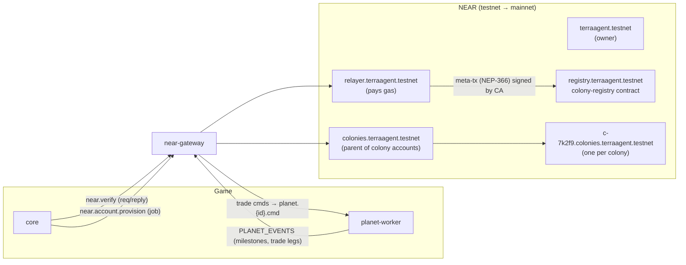
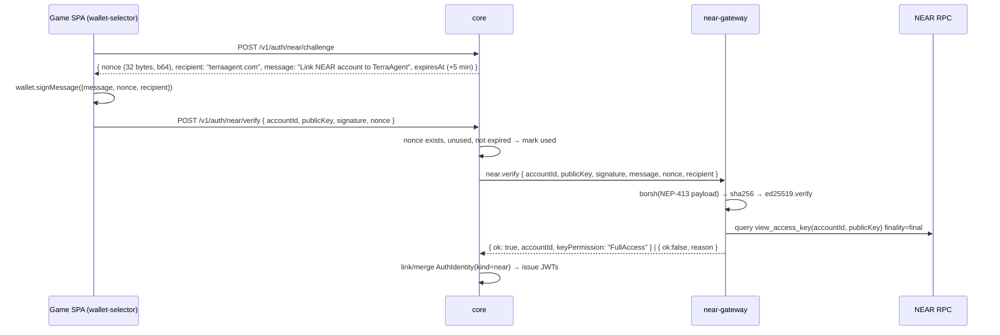
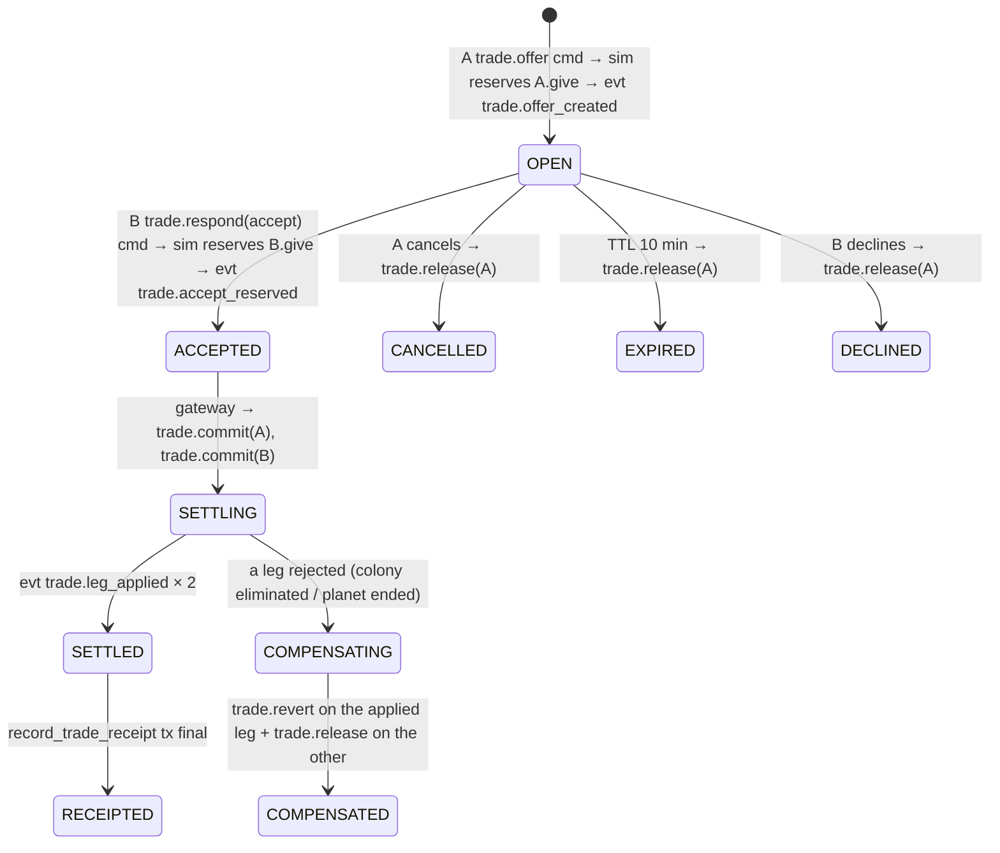

# TerraAgent — NEAR Integration Specification

> **Status:** Draft v0.1 (2026-10-29) · **Service:** `backend/near-gateway` (`@terra/near-gateway`, internal, port `3300` prod / `4004` dev) · **Contract:** `backend/near-contracts/colony-registry`
> **Parent:** [`ARCHITECTURE.md`](./ARCHITECTURE.md) §6, §11 · **Decisions:** [D-10](./DECISIONS.md#d-10--guest-first-auth-near-link-optional), [D-11](./DECISIONS.md#d-11--trades-in-game-settlement--on-chain-receipt-in-mvp) · **Plan:** [`TA-10`](../plan/issues/TA-10-near-gateway.md), core side [`TA-04.3`](../plan/issues/TA-04-core-api-auth-and-home.md)
> **Game design:** [`autonomous-colony-spec.md`](../../autonomous-colony-spec.md) §11, §13 pillar 5 ("chain is invisible")

---

## 1. Purpose & principles

1. **The chain is invisible.** Players never sign gameplay. Every gameplay transaction is signed by keys the gateway holds, and gas is paid by the game's relayer.
2. **The chain is a record, not the engine.** Simulation state lives in planet workers and Postgres. On-chain we store identity (colony accounts), milestones and trade receipts, which are verifiable and portable.
3. **Nothing in gameplay waits for the chain.** Every chain write is an async job with retries. A NEAR outage delays receipts but never stops a planet.
4. **Only `near-gateway` talks to NEAR RPC.** Other services use NATS (§9).



---

## 2. Accounts & key custody

| Account (testnet) | Mainnet | Role | Keys held by gateway |
|---|---|---|---|
| `terraagent.testnet` | `terraagent.near` | Owner/root. Creates the accounts below. | **Not** on the server. Owner's hardware or cold wallet. |
| `colonies.terraagent.testnet` | `colonies.terraagent.near` | Parent. Creates colony sub-accounts. | Full-access key, file secret `near-colonies.json` |
| `relayer.terraagent.testnet` | `relayer.terraagent.near` | Pays gas for meta-transactions | Full-access key, file secret `near-relayer.json` |
| `registry.terraagent.testnet` | `registry.terraagent.near` | Hosts `colony-registry`. Owner = `terraagent.*`, operator = `relayer.*` | Deploy key **not** on the server after deploy |
| `{shortId}.colonies.terraagent.testnet` | `…colonies.terraagent.near` | One per colony (`shortId` = `c-` + 5 base32 chars from `colonyId`, collision-checked) | Per-colony key pair, envelope-encrypted in Postgres |

**Colony keys.** The gateway generates an ed25519 key per colony. The secret is encrypted with AES-256-GCM using the key-encryption key `NEAR_COLONY_KEK` (32-byte hex, file secret) and stored in `chain.near_colony_account.encrypted_secret` with `kek_version`. The colony account gets:
- this key as a **function-call key** restricted to `registry.*` methods `register_colony` and `record_milestone` (allowance 0.25 NEAR; in practice unused, because the relayer pays gas through delegate actions), and
- the same key as **full-access** in MVP so the gateway can later hand the account to the player.

**Player claim (later).** When a NEAR-linked player claims a colony, the gateway adds the player's public key as full-access and deletes its own full-access key. That is out of scope for the MVP tasks and listed as an open question.

**Rotation.** `NEAR_COLONY_KEK` rotation re-encrypts rows lazily (`kek_version`). Relayer/parent keys rotate via `AddKey`/`DeleteKey` run by the owner.

---

## 3. Sign-in: NEP-413 (wallet link)

Guest-first ([D-10](./DECISIONS.md#d-10--guest-first-auth-near-link-optional)). Linking a NEAR wallet is optional and makes the account portable across devices.



| ID | Rule |
|---|---|
| `NEAR-01` | The signed payload is `borsh({ tag: u32 = 2^31 + 413, message: string, nonce: [u8;32], recipient: string, callbackUrl: Option<string> })`, hashed with SHA-256 and verified with ed25519 against `publicKey`. |
| `NEAR-02` | `publicKey` MUST be a **FullAccess** key of `accountId` at `final` finality. A function-call key → `reason: "not_full_access"`. Unknown → `"key_not_found"`. |
| `NEAR-03` | `recipient` MUST equal `NEAR_SIGNIN_RECIPIENT` (`terraagent.com`). `message` MUST equal the challenge message exactly. |
| `NEAR-04` | Nonce single-use and expiry are enforced by **core** (it owns the challenge row). The gateway is stateless for verify. |
| `NEAR-05` | `near.verify` reply within 3 s (RPC timeout 2.5 s, one RPC fallback URL). A timeout → `reason: "rpc_unavailable"`, and core returns `503 near_unavailable`. |
| `NEAR-06` | The account id network suffix MUST match `NEAR_NETWORK` (`.testnet` vs `.near` / implicit 64-hex). Otherwise `"wrong_network"`. |

---

## 4. Colony account provisioning

Triggered by core when a colony is founded (seat confirmed, TA-05.3/05.4) via a job on `{ns}.near.account.provision` (`{NS}_NEAR_JOBS` work queue).

| ID | Rule |
|---|---|
| `NEAR-10` | Provisioning MUST be idempotent: the account id is deterministic from `colonyId`. If `view_account` already exists with our key → mark `CREATED` and continue. |
| `NEAR-11` | One transaction from `colonies.*`: `CreateAccount` → `Transfer(NEAR_COLONY_DEPOSIT = 0.01 NEAR)` → `AddKey(FA colony key)` → `AddKey(FC key → registry)`. |
| `NEAR-12` | Then `register_colony` via meta-tx (§5) signed by the colony key and relayed by `relayer.*`. |
| `NEAR-13` | Retries: exponential (5 s, 30 s, 2 min, 10 min, 1 h), max 5. After that the row goes `FAILED` + alert `near_job_failed_total`. Gameplay is unaffected. |
| `NEAR-14` | States: `PENDING → CREATED → REGISTERED` (or `FAILED`). The status is visible to core via the `{ns}.near.account.status` request (contract change request) for the profile UI. |

---

## 5. Relayer: meta-transactions (NEP-366)

- The colony key signs a `DelegateAction { sender_id: colonyAccount, receiver_id: registry.*, actions: [FunctionCall], nonce: accessKeyNonce+1, max_block_height: head+100, public_key }` → `SignedDelegateAction`.
- The relayer wraps it in a transaction `Action::Delegate` from `relayer.*` and pays gas.
- **In-process:** the relayer is a module inside `near-gateway`, not a public HTTP relayer, so there is no open relay attack surface.
- **Nonce management:** a per-signer async mutex plus an access-key nonce cache refreshed on `InvalidNonce` (one retry).
- **Allow-list:** the relayer only relays delegate actions whose `receiver_id = registry.*` and methods are in `{register_colony, record_milestone}`. Anything else is refused (`NEAR-20`).
- Operator-only methods (`register_planet`, `record_trade_receipt`) are signed directly by `relayer.*` (the contract operator) without meta-tx.

---

## 6. `colony-registry` contract (Rust, near-sdk 5.x)

```rust
#[near(contract_state)]
pub struct Registry {
    owner_id: AccountId,
    operators: IterableSet<AccountId>,          // relayer.*
    planets: LookupMap<String, Planet>,         // planet_id → Planet
    colonies: LookupMap<AccountId, Colony>,     // colony account → Colony
    milestones: LookupMap<AccountId, Vector<Milestone>>, // capped at MAX_MILESTONES_PER_COLONY = 64
    trades: LookupMap<String, TradeReceipt>,    // trade_id → receipt
}

pub enum MilestoneKind { ColonyFounded, TerraformPct { pct: u8 }, RocketLaunched { to_planet_type: String },
                         ColonyEliminated, PlanetResult { rank: u8, colonies: u8 } }

// --- change methods ---
#[init] fn new(owner_id: AccountId, operators: Vec<AccountId>) -> Self;
fn register_planet(&mut self, planet_id: String, planet_type: String, seed_hash: Base64VecU8, created_at_ms: u64); // operator
fn register_colony(&mut self, planet_id: String, player_ref: String /* sha256(playerId) hex */, founded_tick: u64); // predecessor = colony account (meta-tx) — the colony registers itself
fn record_milestone(&mut self, kind: MilestoneKind, tick: u64, state_hash: String); // predecessor = colony account, OR operator with explicit `colony: AccountId` via record_milestone_for
fn record_milestone_for(&mut self, colony: AccountId, kind: MilestoneKind, tick: u64, state_hash: String); // operator (eliminated colonies may no longer sign)
fn record_trade_receipt(&mut self, trade_id: String, a: AccountId, b: AccountId, a_gives: Vec<ResAmount>, b_gives: Vec<ResAmount>,
                        a_tick: u64, b_tick: u64); // operator
fn set_operators(&mut self, operators: Vec<AccountId>); // owner
// --- views ---
fn get_planet(&self, planet_id: String) -> Option<Planet>;
fn get_colony(&self, account: AccountId) -> Option<Colony>;
fn get_milestones(&self, account: AccountId, from: u32, limit: u32) -> Vec<Milestone>;
fn get_trade(&self, trade_id: String) -> Option<TradeReceipt>;
```

- **Events (NEP-297):** `EVENT_JSON:{"standard":"terraagent","version":"1.0.0","event":"<name>","data":[…]}` for `planet_registered`, `colony_registered`, `milestone_recorded`, `trade_recorded`.
- **Storage:** paid by the contract balance. The operator tops it up, and `storage_balance` is monitored. Re-recording the same `(colony, kind, tick)` is a no-op, which makes jobs idempotent.
- **Upgrades:** owner-only `migrate` with a versioned state.
- **Tests:** `cargo test` (unit) and `near-workspaces` sandbox tests (`npm run near:contract:test`).

### Milestones written

| Planet event (from `{NS}_PLANET_EVENTS`) | Contract call | Signer |
|---|---|---|
| `planet.created` (core sends `{ns}.near.registry.planet`) | `register_planet` | relayer (operator) |
| `colony.founded` | `register_colony` (after provisioning) | colony via meta-tx |
| `terraform.milestone` (25/50/75/100 %) | `record_milestone(TerraformPct)` | colony via meta-tx |
| `rocket.launched` | `record_milestone(RocketLaunched)` | colony via meta-tx |
| `colony.eliminated` | `record_milestone_for(ColonyEliminated)` | operator |
| `planet.ended` | `record_milestone_for(PlanetResult)` × colonies | operator |

The gateway consumes `{NS}_PLANET_EVENTS` with the durable consumer `near-registry`, filtered to the kinds above. Each write is a row in the `chain.near_tx` outbox (dedupe key `kind:colony:tick`), processed by the job runner (§4 retry policy).

---

## 7. Trades ([D-11](./DECISIONS.md#d-11--trades-in-game-settlement--on-chain-receipt-in-mvp))

MVP trades are between colonies on the **same planet** (neighbors). The saga is written generically over two planets' command streams, so cross-planet trades can be enabled later without redesign. Settlement is **in-game** (sim commands). The chain gets a **receipt** after settlement.



| ID | Rule |
|---|---|
| `NEAR-30` | All trade commands carry `tradeId` and are idempotent in the sim (applying the same `(tradeId, leg, op)` twice is a no-op). They are published with `Nats-Msg-Id = tradeId:leg:op`. |
| `NEAR-31` | Reservations lock goods in the colony storage (not spendable) until commit or release. The sim rejects an offer if `give` > available − reserved. |
| `NEAR-32` | Limits: ≤ 3 open offers per colony; `give.amount` ≤ 50 % of the colony's stock of that resource; offer TTL 10 min. |
| `NEAR-33` | The saga state is persisted in `chain.trade_offer` **before** each step's commands are published (outbox pattern), so a gateway restart resumes it. |
| `NEAR-34` | The on-chain receipt is written only after `SETTLED`. Receipt failure never reverses the trade. It retries per `NEAR-13`. |
| `NEAR-35` | Gas and storage for receipts are paid by the relayer and contract, never by players. |

**Resolved by lead (2026-10-29):** the reservation model and trade command handlers were added to TA-06.4 (W2 / L2); contract kinds/events land in the W2 pre-step, so TA-10.5 (W4) runs against the real sim.

---

## 8. Network switch & funding

| Key | Default | Notes |
|---|---|---|
| `NEAR_NETWORK` | `testnet` | `testnet` \| `mainnet` \| `sandbox` (L4 local `near-sandbox` on `:13030`) |
| `NEAR_RPC_URL` / `NEAR_RPC_FALLBACK_URL` | provider URLs (owner picks a provider; public `rpc.*.near.org` endpoints are rate-limited) | |
| `NEAR_ACCOUNT_ROOT` | `terraagent.testnet` | Derived suffixes: `colonies.`, `relayer.`, `registry.` |
| `NEAR_SIGNIN_RECIPIENT` | `terraagent.com` | |
| `NEAR_COLONY_DEPOSIT` | `0.01` NEAR | |
| `NEAR_MIN_RELAYER_BALANCE` / `NEAR_MIN_PARENT_BALANCE` | `5` / `5` NEAR | Below threshold → `near_balance_low` alert; provisioning pauses below 1 NEAR |
| `NEAR_ALLOW_MAINNET` | `0` | `validate-env` refuses `mainnet` unless `1` and the registry account exists |

**Cost estimate (to verify on testnet in TA-10.3/10.4):** gas price ≈ 1e8 yN/gas → 1 Tgas ≈ 0.0001 NEAR; storage 1 NEAR per 100 kB.

| Item | NEAR |
|---|---|
| Colony account (deposit incl. storage for 2 keys) | 0.01 |
| `register_colony` + ~8 milestones (≈ 5 Tgas + ~200 B storage each) | ≈ 0.02 |
| **Per colony lifetime** | **≈ 0.03** |
| 1,000 colonies | ≈ 30 NEAR (+ receipts ≈ 0.003 each) |

The switch to mainnet is an owner action (`OWNER_TASKS.md`): create the 4 mainnet accounts, fund them, deploy the contract, set the env, run `deploy`.

---

## 9. NATS interface (owned by `@terra/contracts`)

| Subject | Kind | Payload → Reply |
|---|---|---|
| `{ns}.near.verify` | request/reply | `NearVerifyReqV1` → `NearVerifyResV1` |
| `{ns}.near.account.provision` | `{NS}_NEAR_JOBS` | `NearProvisionJobV1 { colonyId, planetId, playerId }` |
| `{ns}.near.account.status` | request/reply (**CR**) | `{ colonyId }` → `{ accountId, status }` |
| `{ns}.near.registry.planet` | `{NS}_NEAR_JOBS` | `{ planetId, planetType, seedHash, createdAtMs }` |
| `{ns}.trade.offer.list` | request/reply (**CR**) | for HUD/core: open offers for a colony |
| consumes `{NS}_PLANET_EVENTS` | durable `near-registry`, `near-trades` | milestone + trade events |
| publishes `{ns}.planet.{id}.cmd` | trade commands | `trade.commit`/`trade.revert`/`trade.release` |
| publishes `{NS}_NEAR_EVENTS` | `{ns}.near.evt.account_provisioned` · `{ns}.near.evt.account_failed` · `{ns}.near.evt.milestone_recorded` · `{ns}.trade.evt.state_changed` · `{ns}.trade.evt.receipt_recorded` | results for core (profile, admin) and worker (HUD notifications); `Nats-Msg-Id` = dedupe key of the job/transition |

**Stream subject caution:** `{NS}_NEAR_JOBS` must list **exact** subjects (`…near.account.provision`, `…near.registry.>`). If a stream captured `{ns}.near.>` it would also capture `near.verify` requests, and JetStream would answer them with a PubAck.

---

## 10. Persistence (`chain` namespace)

| Table | Key columns |
|---|---|
| `chain.near_colony_account` | `colony_id` PK, `account_id` unique, `public_key`, `encrypted_secret bytea`, `kek_version`, `status`, `attempts`, `last_error`, `created_tx`, `registered_tx`, timestamps |
| `chain.near_tx` | `id`, `dedupe_key` unique, `kind`, `payload jsonb`, `status` (`PENDING/SENT/FINAL/FAILED`), `tx_hash`, `attempts`, `next_attempt_at`, `last_error` |
| `chain.trade_offer` | `trade_id` PK, `planet_a`, `colony_a`, `planet_b`, `colony_b`, `a_gives jsonb`, `b_gives jsonb`, `state`, `expires_at`, `legs jsonb`, `receipt_tx`, timestamps |

Must be present in Prisma v1 (TA-03.1). Anything missing → migration CR for the next pre-step.

---

## 11. Telemetry

`near_rpc_latency_seconds{method}` (histogram) · `near_verify_total{result}` · `near_jobs_total{kind,result}` · `near_job_failed_total{kind}` · `near_tx_pending` (gauge) · `near_balance_near{account}` (gauge) · `near_relayer_nonce_retries_total` · `trade_saga_total{state}` · `trade_settle_seconds` (histogram, OPEN→SETTLED) · log events `near.tx.final`, `trade.state_changed`.

---

## 12. Test matrix

| Rule | Test | Task |
|---|---|---|
| NEAR-01..03, 06 | `nep413.verifier.spec.ts`: generated vectors, a recorded real-wallet signature fixture, tampered message/nonce/recipient, wrong network | TA-10.2 |
| NEAR-02, 05 | `near-verify.int.spec.ts` against `near-sandbox`: FA ok, FC refused, RPC down → `rpc_unavailable` < 3 s | TA-10.2 |
| NEAR-10..13 | `provision.int.spec.ts` (sandbox): create, re-run idempotent, RPC failure → retry → FAILED after 5 | TA-10.3 |
| NEAR-20 | `relayer.spec.ts`: non-allow-listed receiver/method refused; nonce retry | TA-10.3 |
| §6 | `colony-registry` `cargo test` + `near-workspaces` tests: operator auth, self-registration via meta-tx, milestone cap 64, idempotency, events emitted | TA-10.4 |
| NEAR-30..35 | `trade-saga.int.spec.ts`: happy path, expiry, decline, leg rejected → compensated, gateway restart mid-SETTLING resumes, receipt on sandbox | TA-10.5 |

---

## 13. Open questions for the owner

1. Root account names: is `terraagent.testnet` / `terraagent.near` available and owned by you?
2. RPC provider for testnet and mainnet (FastNEAR, Lava, Pagoda successor, self-hosted)?
3. Player **claim** of a colony account (add the player's key, drop ours): in scope for launch or later?
4. Cross-planet trades: allowed after rockets (needs a transport-delay mechanic), or same-planet only?
5. Do we want real **NEAR Intents** settlement (tokenised resources) in a later season, or are on-chain receipts enough?
