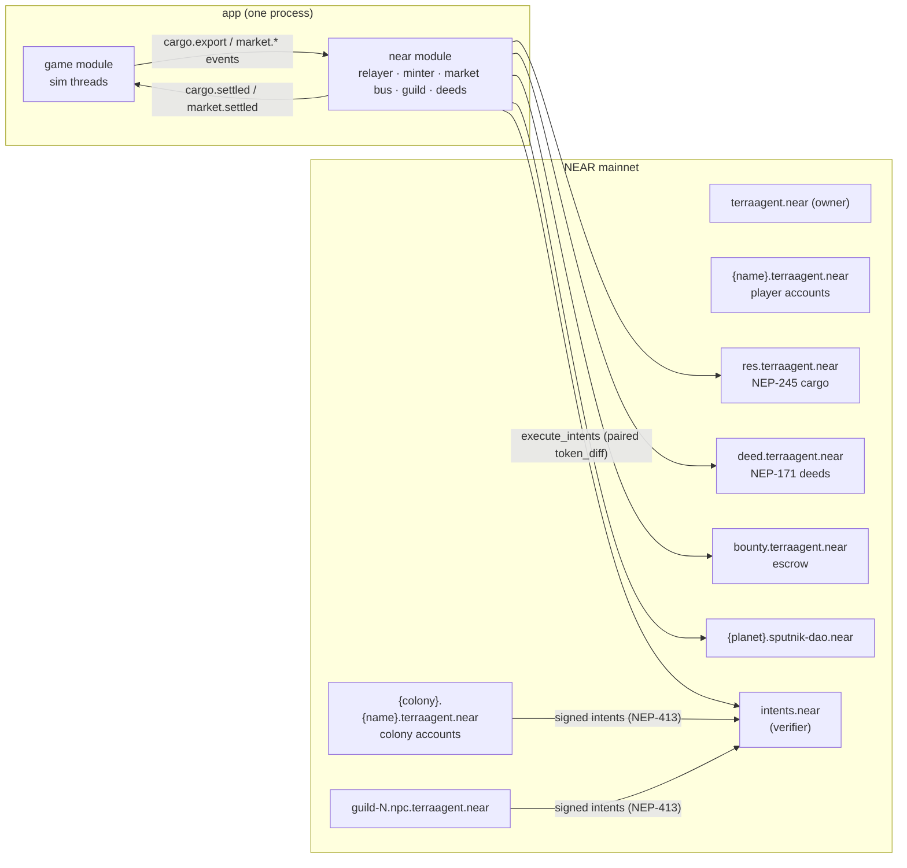
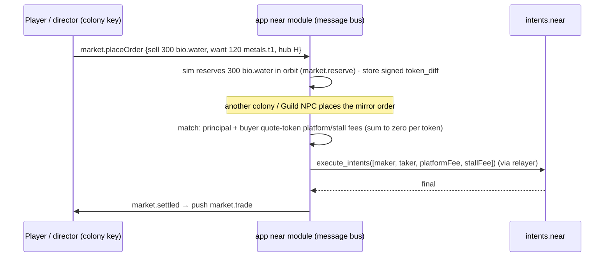

# TerraAgent — NEAR Integration Specification

> **D-44 economy revision:** [ECONOMY](ECONOMY.md) specifies exact buyer quote-token fees, database profiles, funded NPC limits, open cargo mobility and cash-launch evidence. W13 is mock-first; acceptance of the design does not enable real money.

> **Status:** v0.2 (2026-10-30). Rewritten around the NEAR economy features **F1–F8** (D-26), hosted by the `near` module of the one app (D-24). There is no `near-gateway` service and no NATS.
> **Parent:** [`ARCHITECTURE.md`](./ARCHITECTURE.md) §11 · **Feature design:** [`docs/game/near-economy-features-spec.md`](../game/near-economy-features-spec.md) · **Decisions:** D-10, D-18, D-19, D-23, D-25, D-26 · **Plan:** [`TA-10`](../plan/issues/TA-10-near-gateway.md)
> **Game design:** [`docs/game/autonomous-colony-spec.md`](../game/autonomous-colony-spec.md) §11, §13 pillar 5 ("chain is invisible") · Hackathon track 09 "Games With Real Economies".

---

## 1. Purpose & principles

1. **Players never notice the chain (F5).** Guest play first, then social login with a named account. Every gameplay transaction is signed by keys the app holds and paid by the app's relayer (NEP-366). Wallets appear only for account claim and staking (D-18).
2. **The server simulation is the mint authority (D-26).** Cargo tokens are minted only from simulated stock exported at a Trade Hub, and burned on import. No client claim ever mints.
3. **The economy touches the chain at one door: the Trade Hub.** Production, combat and terraforming stay in the sim. Cargo, markets, NPC traders, deeds, the treasury and bounties are on-chain.
4. **Gameplay never blocks on the chain, except a trade's own settlement.** Mint, burn and settlement are async outbox jobs (`chain.*_tx`). If NEAR or `intents.near` is unreachable, the market and cargo commands return `market_unavailable` and the planet keeps running.
5. **No anti-cheat and no anti-bot (D-25).** Cargo is **open in beta**: it can be swapped for NEAR or USDC through Intents. Mint caps are economic pacing, not security.
6. **Only the `near` module talks to NEAR RPC and `intents.near`.** Other modules call it in-process.

---

## 1a. Ports, adapters and the mock-first rule (D-30)

**Phase 1 runs every NEAR feature (F1–F8) on mock adapters.** The game code depends only on **ports**, so a real adapter replaces the mock without touching game or application code. The patterns are copied from galaxyqube's `casino-core-systems` (see `AGENTS-MCP.md` there).

**Pattern rules.**
1. **Ports are abstract classes**, and the class is the DI token. Example: `export abstract class CargoTokenPort { abstract mint(cmd: MintCargo): Promise<ChainReceipt> … }`. Files are named `*.port.ts` and live in `backend/app/src/near/application/ports/`.
2. **All bindings live in one place**, `near/infrastructure/near-infrastructure.module.ts`, for example `{ provide: CargoTokenPort, useClass: MockCargoTokenAdapter }`. No other file imports an adapter.
3. **Adapter selection happens at module composition, per port.** It uses a **fail-closed env predicate** that can be read before DI, so a typo can never select the real chain:
   - `NEAR_ADAPTER_<PORT>=mock|testnet|mainnet`, default `mock`.
   - `nearAdapterFor(port)` accepts only the exact strings `testnet` or `mainnet`; anything else means `mock`.
   - In production, a `mock` setting is allowed only when `NEAR_ALLOW_MOCK_IN_PROD=true`, so a demo can run on mocks on purpose.
4. **The mock is real-shaped.** `Mock*Adapter` classes keep their state in Postgres tables (`mock_chain_*`: accounts, balances, NFTs, intents, DAO proposals). They produce the same receipts, using fake tx hashes with the prefix `mock:`. They return the same errors (`CoreException` subclasses with stable `errorCode`s such as `NEAR_INSUFFICIENT_BALANCE` and `NEAR_INTENT_DIFF_NOT_ZERO`). They simulate a latency of 300–1 500 ms and an injectable failure rate, so the UI's pending and failed states get exercised.
5. **Shared contract tests.** `describeNearPortContract(name, makeAdapter)` lives in `near/__contract__/*.contract.ts`. The **same suite** runs against the mock in CI and against the real adapter in a manual or nightly job, so "replace the implementation" is checked rather than hoped for. galaxyqube lacks this; we add it.
6. **Side effects go through an outbox with idempotency keys.** Every chain write (mint, burn, intent execution, NFT mint, DAO action) is written in the same Postgres transaction as the game state change, as `chain_outbox (opId unique, port, payload, status)`. A relay then calls the port. `opId` is deterministic, e.g. `cargo-export:{colonyId}:{exportSeq}`, so a retry can never double-mint, whether the adapter is mock or real.
7. **Every boundary is validated with zod:** env, port inputs and adapter responses. No `any`.
8. **In-memory fakes** (`InMemoryCargoToken extends CargoTokenPort`) are for unit tests only. The Postgres mock is for running the game.

| Port | Feature | Main methods | Mock behaviour | Real adapter (later) |
|---|---|---|---|---|
| `IdentityPort` | F5 | `loginSocial`, `createNamedAccount`, `claimAccount` | Fake OAuth screen; account `name.terraagent.mock` | Social-login provider (to be chosen) + account creation |
| `RelayerPort` | F5 | `submitMetaTx` | Instant, deterministic `mock:` hash | NEP-366 relayer |
| `CargoTokenPort` | F1 | `mint`, `burn`, `balanceOf`, `transfer` | Postgres ledger (NEP-245 semantics, token ids = `ResourceKey`: `metals.t1` …) | NEP-245 contract `res.terraagent.near` |
| `IntentsPort` | F2, F4 | `deposit`, `signTokenDiff`, `simulate`, `execute`, `withdraw` | Diffs checked to sum to zero, then applied atomically to the mock ledger | `intents.near` (`execute_intents`, `simulate_intents`) |
| `AgentWalletPort` | F3, F4 | `createSubAccount`, `addLimitedKey(allowance)`, `revokeKey` | Mock keys with allowance accounting | Sub-accounts + function-call keys |
| `DeedNftPort` / `BadgeNftPort` | F6, achievements | `mint`, `updateMetadata`, `ownerOf` | Postgres NFTs with a metadata JSON history | NEP-171 contract |
| `StakingPort` | F6 | `stake`, `unstake`, `rewards` | Fake validator pool at 9 % APY over game time | Whitelisted staking pools |
| `TreasuryDaoPort` | F7 | `createDao`, `propose`, `vote`, `finalize`, `deposit`, `addMember`, `removeMember`, `get` | Postgres DAO with SputnikDAO-like states | SputnikDAO / Trezu |
| `EscrowPort` | F8 | `open`, `claim`, `refund` | Postgres escrow | Escrow contract |
| `ChainReadPort` | all | `explorerUrl`, `receipt`, `health` | `mock:` receipts; no explorer link | RPC (FastNEAR + fallback) |

**Swap order after phase 1:** F5 (`IdentityPort`, `RelayerPort`) → F1 (`CargoTokenPort`) → F2 (`IntentsPort`, mainnet only, starting with `dry: true` quotes) → F3/F4 (`AgentWalletPort`) → F6 → F7 → F8. A port goes real only after its contract suite passes against the real adapter. The README must state which ports are real and which are mocked.

The same pattern applies outside NEAR: `LlmProviderPort` (AI director: mock and Z.ai) and `NotifierPort` (mock, Web Push, Telegram).

## 2. Accounts & key custody (F5)

| Account | Role | Keys held by the app |
|---|---|---|
| `terraagent.near` (+ `terraagent.testnet` for dev) | Owner/root; deploys the 6 Rust contracts (`res`, `deed`, `bounty`, `staking`, `dao`, `pilots`) | **None in production.** Stays on the owner's cold wallet (`pilots.<root>` mints pilot accounts via `relayer.<root>`). |
| `protocol.terraagent.near` | Protocol treasury recipient (`80%` platform fee, `20%` staking yield, `10%` escrow slashes) | View/treasury account (`GET /v1/near/protocol`) |
| `relayer.terraagent.near` | Pays gas for NEP-366 meta-transactions; operator of `pilots`, `deed`, `bounty`, `staking`, `dao` | Full-access, env/file secret |
| `minter.terraagent.near` | Sole mint/burn authority on `res.terraagent.near` | Full-access, env/file secret |
| `{name}.pilots.terraagent.near` (or `{name}.terraagent.near`) | **Player named account**, created on social login via `pilots.<root>` (F5) | Per-player key, envelope-encrypted (`NEAR_KEK`) until claimed |
| `{colony}.{name}.pilots.terraagent.near` | **Colony account**: holds cargo, signs market intents, owns the deed, stakes after claim | Per-colony key, envelope-encrypted until claimed (`encryptedSecret = 'claimed'` after `[AddKey, DeleteKey]`) |
| `guild-N.npc.terraagent.near` | Orbital Guild NPC traders (F3) | Function-call keys for `intents.near` and `res.*` only |

- **Keys.** The app generates ed25519 keys and encrypts the secrets with AES-256-GCM under `NEAR_KEK` (stored in `chain.near_colony_account.encrypted_secret` with `kek_version`).
- **Account claim (D-18, at launch).** The player links a wallet (NEP-413, §3). The app verifies `colony.playerId === request.playerId` plus `FullAccess` ownership of `walletPublicKey` on `walletAccountId` at `final` finality, then atomically executes `[addFullAccessKey(walletPublicKey), deleteKey(custodialPublicKey)]` and sets `encryptedSecret = 'claimed'`. Once claimed, the server cannot sign custodial orders (`NEAR_NOT_OWNER`) and automatically evicts pre-claim resting custodial orders on match; the game can never move the player's NEAR. Claiming is one-way (idempotent on same-wallet replay) and unlocks Day-1 staking.
- **Director key (F4).** A separate key on the colony account whose allowance equals the player's away budget for trading. The AI director uses it to sign `autoTrade` orders. The player revokes it in one tap; the HUD shows spent versus allowance.
- **Social-login provider: verify in docs.** HOT is a listed hackathon partner; other providers must be checked for NEAR named-account support. TA-10 decides.

---

## 3. Wallet link: NEP-413 (optional)

The flow is unchanged in substance. The app issues a challenge `{nonce (32 B), recipient: "terraagent.com", message}`, and the wallet signs it (`signMessage`). The app verifies `borsh({tag: 2^31+413, message, nonce, recipient, callbackUrl?})` → SHA-256 → ed25519 against a **FullAccess** key of the account at `final` finality (`view_access_key`). The nonce is single-use with a 5-minute expiry. A wrong network suffix is rejected. A link is needed only for account claim, staking and cross-device portability (D-10).

---

## 4. Relayer (NEP-366)

- **Signing.** Colony, player and NPC keys sign `DelegateAction`s. `relayer.*` wraps them in `Action::Delegate` and pays gas.
- **In-process only.** The relayer has no public HTTP surface.
- **Allow-list** of receiver contracts: `res.terraagent.near`, `deed.terraagent.near`, `bounty.terraagent.near`, the planet DAOs, and `intents.near`. This is cost control, not anti-cheat (D-25).
- **Nonces.** A per-signer async mutex plus an access-key nonce cache, with one retry on `InvalidNonce`.

---

## 5. F1 — Cargo tokens (NEP-245)

| ID | Rule |
|---|---|
| `NEAR-50` | One NEP-245 multi-token contract, `res.terraagent.near`. **One token id per tradable sub-resource (D-34)**, equal to the sim's `ResourceKey`: `metals.t1`, `metals.t2`, `metals.t3`, `minerals.t1`, `minerals.t2`, `minerals.t3`, `bio.water`, `bio.biomass`, `bio.t2`, `bio.t3` (18 decimals; energy is not a token). T1 tokens trade from day one; T2/T3 tokens can be bought by a colony that cannot mine them yet. `mt_mint` and `mt_burn` are callable only by `minter.*`. Transfers are **unrestricted in beta** (D-26). |
| `NEAR-51` | **Export.** `cargo.export {resource, amount}` (SIMULATION `SIM-C-05`): the sim removes the stock and records `pendingMint`. The `near` module writes a `chain.cargo_tx` row and calls `mt_mint` to the colony account; on final it answers `cargo.settled {ok: true}`. On failure (after retries) it answers `{ok: false}` and the sim refunds. |
| `NEAR-52` | **Import.** `cargo.import`: the module burns tokens from the colony account (colony key, via the relayer). On final, the sim credits the stock, capped by storage, with any overflow kept in orbit. |
| `NEAR-53` | **Mint caps (economic pacing).** Per colony: export ≤ Trade Hub throughput (250 / 900 / 3 500 units per min by tier) and ≤ `CARGO_MINT_CAP_PER_DAY`. Proposed default: 20 000 units per sub-resource per day. Over the cap → `mint_cap`. |
| `NEAR-54` | **Rocket carry-over.** Cargo stays in the colony account and follows the player. The new colony can import it (`system.arrive` lists the balance). |
| `NEAR-55` | **Deposit path into `intents.near`.** Cargo must be deposited into the verifier to trade there (`mt_transfer_call` to `intents.near`, credited as an `nep245:res.terraagent.near:<id>` balance). **Verify the exact deposit method and token-id format in the Intents docs.** If NEP-245 deposits are not supported, fall back to one NEP-141 token per sub-resource (10). |

---

## 6. F2 — Player-owned markets on NEAR Intents

| ID | Rule |
|---|---|
| `NEAR-60` | Orders pin policy/fee version, beneficiary accounts, exact price/quantity, deadline and maximum spend; custodial fills receive fill-sized NEP-413 signatures, claimed accounts use all-or-nothing signed orders. Persist terms and reservations in `chain.market_order`. |
| `NEAR-61` | **Matching and fees (D-44).** Planet/pair price-time books, maker execution price. Buyer receives full base and pays quote notional plus platform 100 bp and maker-stall 0–100 bp (default 100), independent of maker/taker role. Exact cumulative rounding, minimum notional, fee-inclusive reservations and policy compatibility follow ECONOMY §3. Build principal/platform/stall legs (plus allocation to W22 treasury from platform fee); aggregate identical accounts, conserve each token. Same-colony orders never match. Custodial accounts may fill partially; claimed accounts are all-or-nothing (`NEAR-60`). The buyer fee is never taken from the received base resource. |
| `NEAR-62` | **Settlement.** Idempotent outbox executes the atomic batch; final receipt updates orders, fills, reservations and `chain.intent_trade` once. Final failure restores executable orders with funds reacquired atomically, or expires them. Unknown chain outcomes remain pending/quarantined until reconciled; never release uncertain funds. Concurrent fills/cancels and restarts are tested. |
| `NEAR-63` | **Scope (D-44).** Our books are same-planet; an online Trade Hub is required. External cargo transfers remain unrestricted and owned cargo can be imported on the receiving colony planet under published Hub/transport rules. Guild transport is a service, not an exclusive cross-planet route; external-market fee leakage is accepted. |
| `NEAR-64` | **Dev and test.** `intents.near` is **mainnet only, with no testnet**. Development uses dedicated mainnet dev accounts with tiny amounts plus `simulate_intents` / `dry: true` quotes. CI stubs the verifier. |
| `NEAR-65` | **Quote assets.** USDC is the default; barter and optional NEAR remain supported. Token decimals and chain IDs are explicit registry metadata, amounts are exact atomic integers and the UI displays all fees. W13 uses mock balances; W23 verifies current adapter documentation and requires ECONOMY §7 gates before public cash activation. External swaps are optional integrations, not assumed liquidity. |
| `NEAR-66` | **Related-volume classification (D-44).** Every fill records buyer/seller actor kinds and an `organic` flag. A fill is `organic = true` only when both sides are actor kind `player` or `bot` (D-45), different colonies **and** different owners. Same-owner (known related colonies), fixture/seed, subsidy, `npc` and Guild fills are `organic = false`: excluded from reference prices and organic-volume metrics, never rewarded with withdrawable subsidies. Unknown wallets cannot be proven independent. A bot-only market can establish a reference price; bot demand counts only as far as the bot consumes what it buys (hypothesis, LED-18). |
| `NEAR-67` | **Bot trading accounts (D-45).** Actor kind `bot` is an agent-operated colony account. An API key (shown once, stored hashed, revocable) is bound to one colony account and calls `/v1/trade/*` ([PROTOCOL](./PROTOCOL.md) §8a); every order enters the sim as `market.placeOrder` with command source `'bot'` and takes the human path (reserve, match, fee legs, settlement). Per-key allowances: max open orders, max order notional, daily spend/loss budget, allowed pairs, price band versus the reference price, kill switch, idempotency keys, rate limits. Allowances are reserved on placement and consumed on final settlement (ECONOMY §4). Bots never hold or sign with a chain key; signing stays with the colony's custodial/relayer path (W06) and, in W23, the same ports on real accounts. |
| `NEAR-68` | **Emulated chain for tests (D-45).** The W13 mock Intents/relayer/cargo adapters form a fully emulated NEAR chain with deterministic, seedable fault injection: fail-before-submit, unknown outcome, delayed finality, duplicate delivery and insufficient funds. The same contract suites run against the real adapters in W23 (`simulate` only on mainnet). |

---

## 7. F3 — Orbital Guild NPC traders

| ID | Rule |
|---|---|
| `NEAR-70` | Guild NPCs are app-run agents with **their own sub-account wallets** and function-call keys. They hold cargo and NEAR inventories and sign their own intents. They act as **market makers** on every planet book. From D-45 they are one kind of agent on the same bot API and quote library (NEAR-67); their actor kind stays `npc`, so their fills are never organic. |
| `NEAR-71` | **Pricing (D-44).** Shared pure inventory-adjusted quote function uses eligible finalized trades, concentration/volume/staleness and bounded-price checks. Only organic fills (NEAR-66) establish references; Guild, fixture, subsidy and same-owner fills are excluded. The quote library is the W13 need/value library (ECONOMY §4). Pause real cash bids on insufficient data; temporary bootstrap quotes require an explicit finite subsidy budget. Re-quote after fills. LLM strategy cannot bypass risk checks; ECONOMY §4. |
| `NEAR-72` | **Visits.** NPC schedules and inventories persist across planets. They provide transport and market-making alongside permitted external transfers/imports. With W11 off the route loops locally; no independent planet clock. |
| `NEAR-73` | **Funding (D-44).** Explicit finite owner allocation; real cargo is purchased or exported from treasury-owned sim stock. Mock mint grants are labeled fixtures. Persist per-NPC and global cash/inventory/spend/loss budgets and reservations; no automatic refill. Enforce before signing and on fills/restart, with a kill switch. Versioned DB policies and tests are required, not stretch. |

---

## 8. F4 — Colony director key

| ID | Rule |
|---|---|
| `NEAR-80` | `POST /v1/near/director-key` adds a function-call / intents key to the colony account. Its allowance equals the away trading budget (CONTINUITY AW-13 / AW-20). Revoke deletes the key. |
| `NEAR-81` | Director orders use one shared shortage/surplus and limit check in sim and matcher. Reserve full fee-inclusive principal/allowance before placement, consume on final settlement, release on cancel/expiry/final failure. Revoke stops unsubmitted work; already submitted settlement reconciles. Native key gas allowance is not an asset-spend limit; enforce asset authorization through the verified adapter/payload and reservation ledger. |

---

## 9. F6 — Colony Deed (NEP-171) & own-NEAR staking

| ID | Rule |
|---|---|
| `NEAR-90` | `deed.terraagent.near` mints one NFT per colony at founding, owned by the colony account. It replaces the earlier `colony-registry` milestone log. |
| `NEAR-91` | **Dynamic metadata.** The relayer (operator) updates `extra` (stage, terraform %, walls, trade volume, truces, rank) on milestones, debounced to at most one update per colony per 10 min. The image is rendered by the app from the colony snapshot. |
| `NEAR-92` | **Day-1 Lossless Staking & Settled Deed.** Any **claimed** human account can stake `NEAR` from Day 1 on `staking.<root>` (`9.0%` gross validator pool APY, `80%` player / `20%` `protocol.<root>` yield split, `2` game-day unbonding; `>= 10 NEAR` staked unlocks `0.50%` platform trade fee + Managed Server `NEAR.AI` Autopilot). On `colonySettled` (SIMULATION §7.7) the deed is marked settled on `deed.<root>`. Real-network `stake`, `unstake`, and `withdraw` verify a live `NEP-413` `walletSignature` against the claimed account; AI/bot keys always receive `403 AI_STAKING_FORBIDDEN`. |
| `NEAR-93` | In-game simulation perks are strictly zero (no combat or mining buffs — `@terra/sim` never reads staking). |

*Follow-up:* the staking UI is wallet-signed and sits outside the "invisible chain"; validator whitelist governance; legal review.

---

## 10. F7 — Planet Treasury DAO

| ID | Rule |
|---|---|
| `NEAR-100` | Each planet gets a SputnikDAO instance (`{planet}.sputnik-dao.near`) when it is created. Members are the colony accounts on the planet. |
| `NEAR-101` | W22 allocates `TREASURY_FEE_SHARE_BP` (default 2 000 bp) of the platform fee to the planet DAO. No additional buyer surcharge and no reduction of stall fee. Preserve exact cumulative allocation rounding and report retained platform fees separately. |
| `NEAR-102` | Proposal kinds map to sim effects: `meteor_shield` (hazard reduction for N hours), `terraform_boost` (Living-op cost −X %), and `guild_subsidy` (extra Guild visit). When a proposal passes, the app sends the effect to the sim as a `system.*` command. |

---

## 11. F8 — Bounties & mercenary NPCs

| ID | Rule |
|---|---|
| `NEAR-110` | `bounty.terraagent.near` escrows cargo or NEAR for a posted target: clear a nest, defend an area for N hours, or deliver X units. |
| `NEAR-111` | The sim emits `bountyCompleted {bountyId, claimer}` when the target condition is met. The app then releases the escrow to the claimer's colony account (operator call). |
| `NEAR-112` | **Mercenary NPCs** are app-run agents (sub-accounts like the Guild) that accept defense bounties. They spawn NPC combat units on the poster's territory for the contract duration and are paid from escrow. |

---

## 12. Network switch & funding

| Key | Default | Notes |
|---|---|---|
| `NEAR_MODE` | `mock` (`testnet` for staging; `mainnet` for live `intents.near`) | `NEAR_ALLOW_MAINNET=1` required whenever any port resolves to `mainnet` |
| `NEAR_RPC_PRIMARY` / `NEAR_RPC_FALLBACK` | **FastNEAR** (`test.rpc.fastnear.com` / `free.rpc.fastnear.com`) + official NEAR RPC fallback | D-23 |
| `NEAR_ROOT_ACCOUNT`, `NEAR_PROTOCOL_ACCOUNT` | `terraagent.testnet` (`terraagent.near` on mainnet), `protocol.<root>` | 6 Rust contracts (`res`, `deed`, `bounty`, `staking`, `dao`, `pilots`) + `relayer.<root>` + `minter.<root>` |
| `NEAR_CONTRACT_PILOTS`, `NEAR_USE_PILOTS_FACTORY` | `pilots.<root>`, auto (`true` when `NEAR_ROOT_SECRET_KEY` unset) | Cold-root `{pilot}.pilots.<root>` factory operated by `relayer.<root>` |
| `NEAR_STAKING_POOLS` | whitelist of validator pools | NEAR-92 |
| `CARGO_MINT_CAP_PER_DAY` | 20 000 per sub-resource per colony (proposed) | NEAR-53 |
| `MARKET_PLATFORM_FEE_BP` / `MARKET_FEE_BP_MAX` / `TREASURY_FEE_SHARE_BP` | 100 / 100 / 2 000 (versioned DB profile) | NEAR-61, NEAR-101 |
| `NEAR_MIN_RELAYER_BALANCE` | 5 NEAR | alert below |

**Cost estimate** (verify in TA-10): account creation ≈ 0.01 NEAR; mint/burn and intent batches ≈ 0.0005–0.002 NEAR each in gas, paid by the relayer; NEP-245 and NEP-171 storage deposits paid by the relayer.

---

## 13. Persistence

Tables (sketches in DATA_MODEL §4.4 / §4.4.1):
- `chain.near_colony_account` and the outbox `chain.near_tx`;
- `chain.cargo_tx`, `chain.market_order`, `chain.intent_trade`;
- `chain.guild_npc`, `chain.guild_visit`, `chain.director_key`;
- `chain.deed`, `chain.staking_position`;
- `chain.treasury`, `chain.treasury_proposal`, `chain.bounty`.

---

## 14. Telemetry

`near_rpc_latency_seconds{method}` · `near_tx_total{kind,result}` · `near_tx_pending` · `near_balance_near{account}` · `cargo_minted_total{resource}` · `cargo_burned_total{resource}` · `market_orders_open{planet}` · `market_trades_total{planet,maker_kind}` (player/npc) · `intent_batch_failed_total{reason}` · `guild_inventory{npc,resource}` · `treasury_balance{planet}`.

---

## 15. Test matrix

| Rule | Test |
|---|---|
| §3 | `nep413.verifier.spec.ts` (vectors, tampering, wrong network) |
| §4 | `relayer.spec.ts` (allow-list, nonce retry) |
| NEAR-50..55 | `res-contract` `cargo test` + `near-workspaces`; `cargo.int.spec.ts` (export → mint → settled; failure → refund; cap) |
| NEAR-60..65 | `market-matcher.spec.ts` (price-time priority, fee leg, zero-sum batch); `intents-settle.int.spec.ts` (stubbed verifier + `simulate_intents` on mainnet dev account, manual) |
| NEAR-70..73 | `guild-pricing.spec.ts` (inventory drift, spread) |
| NEAR-80..81 | `director-key.int.spec.ts` (allowance enforced, revoke) |
| NEAR-90..93 | `deed` contract tests; `deed-metadata.spec.ts` |
| NEAR-100..112 | DAO proposal → sim effect; bounty escrow release (workspaces) |

---

## 16. Owner decisions (2026-10-29 / 2026-10-30)

| # | Question | Decision | Ref | Consequence for this spec |
|---|---|---|---|---|
| 1 | Root accounts | Register `terraagent.testnet` and `terraagent.near` now | D-23 | Owner task |
| 2 | RPC provider | **FastNEAR** + fallback | D-23 | §12 |
| 3 | Player claim of a colony account | **At launch** | D-18 | §2 |
| 4 | Cross-planet trades | Planet-local books; unrestricted external cargo transfers/imports, Guild transport service (D-44) | D-19, D-26 | NEAR-63, NEAR-72 |
| 5 | NEAR Intents settlement | **In MVP** | D-19 | §6 (designed; replaces the D-11 receipt saga) |
| 6 | Colony left after the rocket | **Settled**; own-NEAR staking through the deed and colony account | D-18 | §9 |
| 7 | One app, no gateway service or NATS | **Yes** | D-24 | The `near` module is in-process |
| 8 | Anti-cheat / anti-bot | **None** | D-25 | Principle 5 |
| 9 | NEAR economy features | **F1–F8**; cargo **open in beta** | D-26 | §5–§11 |

**Verify in docs before building:** the social-login provider with NEAR named accounts (§2); the exact NEP-245 deposit path and token-id format in `intents.near` (NEAR-55); 1Click API details (NEAR-65).
**Schedule risk:** F1–F8 ≈ 20 dev-days against a 14-day solo window. Build order and cut line are in D-27.
