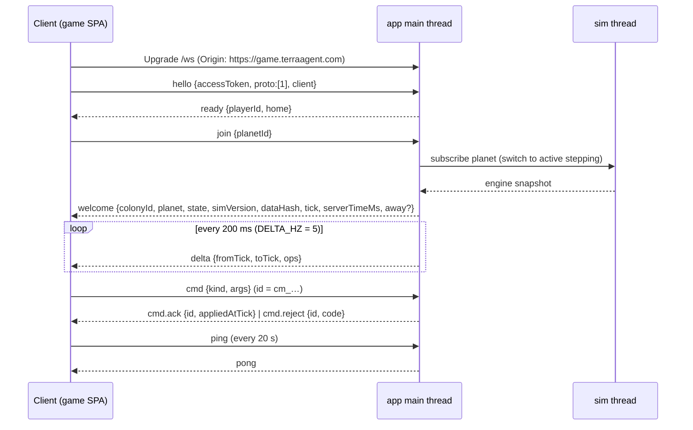

# TerraAgent — Wire Protocols (WebSocket, in-process messages, REST)

> **Status:** v0.2 (2026-10-30). This covers the simplified one-app design (D-24) with no rate limits and no fog filtering (D-25), plus the NEAR economy messages (D-26). The NATS contract and planet tickets are summarised in §13 as Future.
> **Parent:** [`ARCHITECTURE.md`](./ARCHITECTURE.md) §6, §7, §13 · **Decisions:** [`DECISIONS.md`](./DECISIONS.md) D-24, D-25, D-26
> **Code home:** `shared/contracts/src/{ws,bus,rest}/**` (`@terra/contracts`). Every shape below is a zod schema there; this document is the human-readable mirror. On conflict, ARCHITECTURE.md wins, then this file, then code (code must be fixed).

---

## 1. Purpose

One place that defines every message that crosses a boundary:
1. Browser ⇄ app **WebSocket** `wss://api.terraagent.com/ws`, for both lobby and planet traffic.
2. **In-process** messages between the main thread and sim threads, and on the app event bus.
3. A summary of the **REST** surface `https://api.terraagent.com/v1/*`, including the NEAR economy endpoints.

---

## 2. Global rules

| ID | Rule |
|---|---|
| `PR-01` | Every message MUST validate against its zod schema in `@terra/contracts`. The server parses **inbound** client messages with `.strict()`: unknown keys are rejected. This is crash protection, not anti-cheat (D-25). Clients parse server messages permissively, ignoring unknown keys and unknown `event.kind`s. |
| `PR-02` | IDs are prefixed ULIDs: `pr_` player, `co_` colony, `pl_` planet, `mt_` match ticket, `pt_` party, `cm_` command, `tr_` trade, `or_` market order, `bt_` bounty, `tc_` truce. |
| `PR-03` | Timestamps on the wire are integer ms since epoch (`…Ms`). Sim time is `tick` (5 TPS, `TICK_MS = 200`). |
| `PR-04` | Resource amounts, HP and positions are plain JSON numbers in design units (resources in units, positions in tiles). Floats are allowed (D-24). **On-chain token amounts** are decimal strings in base units (`"1200000000000000000000"`). |
| `PR-05` | Envelope field `v` = **1**. Additive changes stay in `v: 1`. Removing or renaming a field needs `v: 2`. |
| `PR-06` | `@terra/contracts` exports a JSON-Schema snapshot that CI diffs. A diff without a matching change to this file fails CI. |

---

## 3. WebSocket envelope

```ts
// contracts/src/ws/envelope.ts
export const Envelope = <T extends string, D extends z.ZodTypeAny>(t: T, d: D) =>
  z.object({
    v: z.literal(1),
    t: z.literal(t),
    id: z.string().min(1).max(40).optional(),        // client correlation id (cm_ ULID for commands)
    tick: z.number().int().nonnegative().optional(), // server → client only
    d: d,
  }).strict();
```

| ID | Rule |
|---|---|
| `WS-01` | Text frames, UTF-8 JSON, one envelope per frame. `permessage-deflate` on (threshold 1 KiB). |
| `WS-02` | Max inbound frame: **64 KiB** (crash protection only). A larger frame closes the socket with `1009`. |
| `WS-03` | `welcome` carries the **full planet state** (≈ 1 MB before compression at MVP scale). Deltas are typically ≤ 64 KiB. |
| `WS-04` | MessagePack (`proto: 2`) only if the load test shows > 30 KB/s per socket. Not in v1. |

---

## 4. App WebSocket (`wss://api.terraagent.com/ws`)

### 4.1 Connection lifecycle



| ID | Rule |
|---|---|
| `WS-10` | The first frame MUST be `hello` within **5 s**, or the socket closes `4000 bad_hello`. The access JWT is verified with the REST verifier. |
| `WS-11` | Origin allow-list: `https://game.terraagent.com`, plus `localhost` origins in non-production. |
| `WS-12` | `join {planetId}` is accepted only for the planet of the player's **own live colony**. Otherwise `bye 4003 forbidden`. There are no planet tickets and no worker URLs (D-24). |
| `WS-13` | **One planet socket per colony.** A second `join` for the same colony closes the older socket with `4001 replaced`, after the new `welcome` is sent. |
| `WS-14` | The client pings every **20 s**. The server closes sockets that are silent for **60 s** with `1001`. |
| `WS-15` | If the planet ends, the colony is eliminated, or the app restarts, the server sends `bye {code}` and closes with the same code (`4010`, `4011`, `4012`). |
| `WS-16` | **No rate limits** (D-25). A client may send commands as fast as it likes; they are applied in arrival order at the next step. |

### 4.2 Client → app messages

```ts
// contracts/src/ws/client.ts (all .strict())
const Hello     = Envelope("hello", z.object({ accessToken: z.string().max(4096), proto: z.array(z.number().int()).nonempty(), client: z.object({ app: z.literal("game"), version: z.string().max(32) }) }));
const Join      = Envelope("join",  z.object({ planetId: PlanetId }));
const Leave     = Envelope("leave", z.object({}));
const Subscribe = Envelope("subscribe",   z.object({ topic: z.enum(["planets", "queue", "party", "market"]), planetType: PlanetType.optional() }));
const Unsub     = Envelope("unsubscribe", z.object({ topic: z.enum(["planets", "queue", "party", "market"]) }));
const Reauth    = Envelope("reauth", z.object({ accessToken: z.string().max(4096) }));
const Ping      = Envelope("ping",   z.object({ clientTimeMs: z.number().int() }));
const Cmd       = Envelope("cmd", z.object({ kind: CommandKind, args: z.unknown() /* per-kind schema */ })).required({ id: true });
```

**`CommandKind` (authoritative list).** SIMULATION §4, NEAR, AI_ORCHESTRATOR and CONTINUITY use these exact names.

| Group | Kinds |
|---|---|
| Colony control | `setPriorities` · `enqueueTask` (`build`, `upgrade`, `repair`, `terraform {op, tiles}`, `buildUnit {unit, count, repeat}`, `queueGoal {goal, params}`, `raid`, `launchRocket`) · `cancelTask` · `placeBuilding` · `upgradeBuilding` · `demolish` · `setStance` · `attackMove` · `setRally` · `setHarvestWeights` |
| Away & autopilot | `setAutopilot {aiDirector, awayRaids}` · `setAwayBudget {perResource}` · `setAutoTrade {limits}` |
| Cargo (F1) | `cargo.export {resource, amount}` · `cargo.import {resource, amount}` (`resource`: `ResourceKey`, any tier; T1 trades from day one, D-34) |
| Market (F2/F3) | `market.placeOrder {side, resource: ResourceKey, amount, price: {resource: ResourceKey \| "NEAR" \| "USDC", amount}, ttlS}` · `market.cancelOrder {orderId}` · `market.setHubFee {bp}` · `market.acceptGuildOffer {offerId}` |
| Diplomacy & bounties (F8) | `diplomacy.proposeTruce` · `diplomacy.respondTruce` · `diplomacy.cancelTruce` · `bounty.post {target, reward}` · `bounty.claim {bountyId}` |
| Module-only (never from clients) | `ai.directive` · `cargo.settled` · `market.settled` · `bounty.paid` · `system.spawnColony` · `system.retireColony` · `system.seal` · `system.end` · `system.presence` · `system.arrive` |

`Priorities = { economy, expansion, defense, power, terraform }`, each an integer 0..100 (canonical set, units spec §7 row 8).

### 4.3 App → client messages

```ts
const Ready   = Envelope("ready", z.object({ playerId: PlayerId, home: HomeResponse }));
const Welcome = Envelope("welcome", z.object({
  reason: z.enum(["join", "resync"]),
  colonyId: ColonyId,
  planet: z.object({ id: PlanetId, type: PlanetType, state: PlanetState, name: z.string(), endsAtMs: z.number().int(), seats: z.object({ taken: z.number().int(), capacity: z.number().int() }) }),
  state: SimSnapshotFrame,                // D-31: engine snapshot (shared codec, binary frame) — everything on the planet, no fog filtering (D-25)
  simVersion: z.number().int(), dataHash: z.string(), // a client whose engine differs reloads (SIM-X-08)
  tick: z.number().int(), serverTimeMs: z.number().int(),
  tickMs: z.literal(200), deltaHz: z.literal(5),
  away: AwaySummary.optional(),
}));
const Delta = Envelope("delta", z.object({ fromTick: z.number().int(), toTick: z.number().int(), diff: SimDiffFrame /* D-31: engine diffSince(fromTick), binary */ }));
// The DeltaOp union below is the pre-D-31 view format, kept as the shape of the client's view() output:
const DeltaOp = z.discriminatedUnion("op", [
  z.object({ op: z.literal("e+"), e: EntityView }),
  z.object({ op: z.literal("e~"), id: z.string(), f: EntityView.partial() }),
  z.object({ op: z.literal("e-"), id: z.string(), why: z.enum(["destroyed", "removed"]) }),
  z.object({ op: z.literal("t"),  tiles: z.array(TileChange) }),
  z.object({ op: z.literal("c"),  colonyId: ColonyId, f: ColonyView.partial() }),
  z.object({ op: z.literal("q"),  colonyId: ColonyId, lanes: OrderLanesView, goals: z.array(GoalView) }),
  z.object({ op: z.literal("planet"), state: PlanetState, seatsTaken: z.number().int() }),
]);
const Event     = Envelope("event", z.object({ kind: EventKind, severity: z.enum(["info", "warn", "critical"]), atTick: z.number().int(), colonyIds: z.array(ColonyId), data: z.record(z.unknown()) }));
const CmdAck    = Envelope("cmd.ack",    z.object({ id: CmdId, appliedAtTick: z.number().int() }));
const CmdReject = Envelope("cmd.reject", z.object({ id: CmdId, code: RejectCode, detail: z.string().max(200).optional() }));
const Pong      = Envelope("pong", z.object({ clientTimeMs: z.number().int(), serverTimeMs: z.number().int(), tick: z.number().int().optional() }));
const Bye       = Envelope("bye",  z.object({ code: CloseCode, reason: z.string().max(120) }));
// lobby + economy pushes on the same socket
// planets.list · planets.changed · queue.position · match.assigned · match.failed · party.updated
// market.book {planetId, bids, asks, last} · market.trade {tradeId, …} · guild.arrived {shipId, offers}
// cargo.status {colonyId, inOrbit, pending} · notify.test
```

`RejectCode` = `invalid_args` · `unknown_kind` · `not_own_colony` · `colony_inactive` · `not_own_territory` · `site_blocked` · `terrain_unbuildable` · `insufficient_resources` · `supply_cap` · `tier_locked` · `worker_tier_locked` · `stage_locked` · `no_trade_hub` · `raid_protected` · `truce_active` · `would_isolate` · `launch_gate` · `mint_cap` · `market_unavailable` · `planet_ended` · `internal`.

### 4.4 Command semantics

| ID | Rule |
|---|---|
| `WS-20` | **Validation (D-25):** the envelope and per-kind zod schema; the colony is the sender's own (derived server-side, `not_own_colony` otherwise); then game rules in the sim. Accepted commands are posted to the planet's sim thread and applied at the next step. |
| `WS-21` | `cmd.ack` is sent when the command has been **applied** at a step. `cmd.reject` is sent for schema, ownership or game-rule failures. Commands are **not durable**: if the app crashes before the next snapshot, they are lost (≤ 60 s, D-24). |
| `WS-22` | **Resync:** if the socket's `bufferedAmount` exceeds **1 MiB**, the server stops deltas and sends `welcome {reason: "resync"}` once the buffer drains below 256 KiB. A client that sees a gap (`fromTick ≠` previous `toTick`) sends `join` again. |
| `WS-23` | Within a socket, messages are delivered in send order. Events for ticks ≤ `toTick` are sent before the `delta` that covers them. |

### 4.5 State views

> Since D-31 these shapes are **not sent on the wire**: they are what the engine's `view()` returns on the client (and in server tools). The wire carries engine snapshots and diffs (§4.3).

```ts
const PlanetStateViewV1 = z.object({
  tick: z.number().int(),
  colonies: z.array(ColonyView),         // ALL colonies, including resources and queues (D-25)
  tiles: z.array(TileView),              // all tiles; client draws fog from `explored` + own vision
  entities: z.array(EntityView),         // all entities
  market: MarketSnapshot.optional(),     // order book + last trades on this planet (F2)
});
const ColonyView = z.object({ colonyId: ColonyId, name: z.string(), color: z.number().int(), status: ColonyStatus,
  resources: Stock, caps: FamilyCaps, supply: z.object({ used: z.number(), cap: z.number() }), power: PowerView,
  priorities: Priorities, stage: z.number().int(), threatStage: z.number().int(), cargo: CargoView, present: z.boolean() });
const PlanetType  = z.enum(["desert", "ocean", "temperate"]);                 // D-33
const ResourceKey = z.enum(["metals.t1", "metals.t2", "metals.t3", "minerals.t1", "minerals.t2", "minerals.t3",
                            "bio.water", "bio.biomass", "bio.t2", "bio.t3"]);   // D-34; also the NEP-245 cargo token ids
const Stock      = z.record(ResourceKey, z.number());                            // every key present in views; partial in payloads
const FamilyCaps = z.object({ metals: z.number(), minerals: z.number(), bio: z.number() }); // one storage cap per family
// Energy is grid power, not stock: see PowerView (gen, demand, stored in capacitors).
const TileView  = z.object({ i: z.number().int(), terrain: z.number().int(), prep: z.number().int(), owner: ColonyId.nullable(), deposit: z.number().int().nullable(), explored: z.number().int() /* bitmask per colony */ });
const EntityView = z.object({ id: z.string(), kind: z.enum(["building", "unit", "fauna", "nest", "projectile", "hazard"]),
  arch: z.string(), tier: z.number().int(), owner: ColonyId.nullable(), pos: z.tuple([z.number(), z.number()]),
  rot: z.number(), hp: z.number(), hpMax: z.number(), state: z.string(), progress: z.number().min(0).max(1).optional() });
const PowerView = z.object({ gen: z.number(), demand: z.number(), stored: z.number(), storeCap: z.number(), state: z.enum(["ok", "brownout", "blackout", "overload"]) });
const CargoView = z.object({ inOrbit: Stock, pendingMint: Stock });
```

| ID | Rule |
|---|---|
| `WS-30` | There is **no server-side fog-of-war filtering** (D-25). Every client receives the whole planet. The client hides what its colony cannot see. |

### 4.6 Close codes

| Code | Name | Sent when | Client action |
|---|---|---|---|
| `1001` | going away | idle 60 s / normal shutdown | reconnect |
| `1009` | too big | inbound frame > 64 KiB | bug; report |
| `4000` | `bad_hello` | missing or invalid first frame | reconnect |
| `4001` | `replaced` | another device or tab took over | show "playing elsewhere"; no auto-reconnect |
| `4003` | `forbidden` | bad or expired token, or `join` to a foreign planet | refresh auth, `/v1/me/home` |
| `4010` | `planet_ended` | planet reached `ENDED` | `/v1/me/home` → `PLANET_ENDED` |
| `4011` | `colony_eliminated` | colony destroyed | `/v1/me/home` → `ELIMINATED` |
| `4012` | `server_restarting` | deploy or restart | reconnect with backoff |

Reconnect backoff: 0.5 s, 1 s, 2 s, 4 s, 8 s, cap 10 s, ±20 % jitter.

---

## 5. Lobby topics (same socket)

| ID | Rule |
|---|---|
| `LB-01` | Lobby topics (`planets`, `queue`, `party`) work without a `join`. |
| `LB-02` | The socket closes `4003` at access-token `exp` unless `reauth` arrived first. |
| `LB-03` | `planets.changed` carries an increasing `version`. On a gap the client re-subscribes. |
| `LB-04` | Every lobby push has a REST equivalent for polling (`GET /v1/planets`, `GET /v1/match/tickets/current`, `GET /v1/party`). |

---

## 6. In-process messages

| Channel | Shape | Notes |
|---|---|---|
| main → sim thread | `{ t: "cmd", planetId, cmd: SimCommandV1 }` · `{ t: "subscribe" \| "unsubscribe", planetId }` · `{ t: "load", planetId, snapshot? }` · `{ t: "snapshotNow" }` | `SimCommandV1` in SIMULATION §4 |
| sim thread → main | `{ t: "delta", planetId, delta }` · `{ t: "event", planetId, events }` · `{ t: "ack" \| "reject", planetId, commandId, … }` · `{ t: "snapshot", planetId, bytes }` · `{ t: "fullState", planetId, state }` | Deltas are built once per planet and broadcast to all its sockets |
| event bus | `planet.event` (`PlanetEventV1 { planetId, tick, kind, severity, colonyIds, data }`) · `near.cargo.settled` · `near.market.settled` · `near.bounty.paid` | Feeds `ai`, `notify`, `near`, `lobby`, digest. In-memory only (no durability); `near` jobs are persisted in their own tables |

---

## 7. NEAR economy messages (summary, D-26)

Design in [`NEAR.md`](./NEAR.md) and [`docs/game/near-economy-features-spec.md`](../game/near-economy-features-spec.md).

| Feature | WS command / push | REST | Chain action (by the `near` module) |
|---|---|---|---|
| F1 Cargo | `cargo.export` / `cargo.import`, push `cargo.status` | `GET /v1/near/cargo` | NEP-245 `mt_mint` / `mt_burn` on `res.terraagent.near` (server = mint authority) |
| F2 Markets | `market.placeOrder` / `cancelOrder` / `setHubFee`, push `market.book` / `market.trade` | `GET /v1/market/{planetId}` | Paired `token_diff` intents (NEP-413 signed) → `execute_intents` on `intents.near` |
| F3 Guild | `market.acceptGuildOffer`, push `guild.arrived` | `GET /v1/market/guild` | Guild NPC sub-accounts sign their own intents |
| F4 Director key | `setAutoTrade`, `setAwayBudget` | `POST /v1/near/director-key` (add/revoke) | `add_public_key` intent / function-call key with allowance |
| F5 Accounts | — | `POST /v1/auth/social`, `POST /v1/near/claim` | Named account creation; NEP-366 meta-tx relayer |
| F6 Deed + staking | push `deed.updated` | `GET /v1/near/deed`, `POST /v1/near/stake` | NEP-171 deed metadata update; stake to a whitelisted pool |
| F7 Treasury | push `treasury.proposal` | `GET/POST /v1/near/treasury/{planetId}` | SputnikDAO proposals and votes |
| F8 Bounties | `bounty.post` / `bounty.claim` | `GET /v1/bounties/{planetId}` | Escrow contract deposit / release |

---

## 8. REST surface (summary)

Base `https://api.terraagent.com/v1`. JSON only. Auth: `Authorization: Bearer <access JWT>` (15 min), refresh via the httpOnly cookie `ta_rt`.

| Method & path | Auth | Request → response |
|---|---|---|
| `POST /auth/guest` | none | `{ deviceSecret? }` → `{ accessToken, player }` + sets `ta_rt` |
| `POST /auth/social` | optional bearer | `{ provider, token }` → `{ accessToken, player, accountId }` (F5; provider still to be chosen, NEAR.md) |
| `POST /auth/refresh` · `POST /auth/logout` | cookie | rotate / revoke |
| `POST /auth/near/challenge` · `POST /auth/near/verify` | optional bearer | NEP-413 wallet link |
| `GET /me` · `GET /me/home` | bearer | `PlayerDto` · `HomeResponse` |
| `GET /planets?type=` | bearer | `{ version, planets, newPlanetTypes }` |
| `POST /match/tickets` · `GET/DELETE /match/tickets/current` | bearer | matchmaking (MATCHMAKING) |
| `POST /party` · `POST /party/join` · `DELETE /party` · `GET /party` | bearer | parties (MM-55) |
| `POST /notify/push` · `POST /notify/telegram/link` · `DELETE /notify/*` | bearer | notification channels (CONTINUITY §5a) |
| `/near/*`, `/market/*`, `/bounties/*` | bearer | §7 |
| `GET /stats/public` | none | `{ planetsActive, coloniesActive, playersOnline }` (cached 30 s) |
| `/admin/*` | admin key | admin |

```ts
export const HomeResponse = z.discriminatedUnion("state", [
  z.object({ state: z.literal("NEW"), planets: z.array(PlanetSummary), newPlanetTypes: z.array(PlanetType) }),
  z.object({ state: z.literal("QUEUED"), ticketId: MatchTicketId, position: z.number().int(), etaS: z.number().int().nullable() }),
  z.object({ state: z.literal("ACTIVE"), colony: ColonySummary, planet: PlanetSummary, away: AwaySummary.optional() }),
  z.object({ state: z.literal("ELIMINATED"), recap: ColonyRecap, planets: z.array(PlanetSummary), newPlanetTypes: z.array(PlanetType) }),
  z.object({ state: z.literal("PLANET_ENDED"), results: PlanetResults, planets: z.array(PlanetSummary), newPlanetTypes: z.array(PlanetType) }),
]);
```

Error envelope (all non-2xx): `{ error: { code, message, details? }, requestId }`. Codes: `validation_error` (400), `unauthorized` (401), `forbidden` (403), `not_found` (404), `already_queued` (409), `has_live_colony` (409), `planet_not_recruiting` (409), `queue_full` (503), `near_unavailable` (503), `internal` (500). There is no `rate_limited` code (D-25).

---

## 9. Numbers (mirror of ARCHITECTURE §15 — do not change here)

| Item | Value |
|---|---|
| Tick / delta rate (active) | 5 TPS / 5 Hz |
| Coarse step (empty planet) | 1 / s, `dt = 5` |
| Hello deadline / ping interval / idle close | 5 s / 20 s / 60 s |
| Max inbound frame | 64 KiB |
| Resync buffer threshold | 1 MiB (resume below 256 KiB) |
| Snapshot interval (= max command loss on crash) | 60 s |

---

## 10. Edge cases & failure modes

| Case | Behaviour |
|---|---|
| App restarts while a client is connected | `bye 4012` if graceful; otherwise the socket drops. The client reconnects with backoff, then `hello` → `join` → `welcome`. Commands applied after the last snapshot are lost. |
| Client sends a command for another colony | `cmd.reject not_own_colony`. The colony is always derived from the token. |
| Cargo mint fails on chain | `cargo.settled {ok: false}` refunds the stock to the colony; push `cargo.status`. |
| Market settlement fails (`execute_intents` batch rejected) | Both orders return to the book (or expire). Reserved sim stock is released with `market.release`. |
| `intents.near` or RPC unreachable | Market and cargo commands are rejected with `market_unavailable`. Gameplay continues. |

---

## 11. Test matrix

| Rule | Test |
|---|---|
| PR-01, PR-06 | `contracts/test/schema-snapshot.spec.ts` |
| WS-10..16 | `backend/app/test/ws/handshake-join.spec.ts` |
| WS-20..23 | `backend/app/test/ws/commands.spec.ts`, `ws/resync.spec.ts` |
| WS-30 | `backend/app/test/ws/full-state.spec.ts` (everything is present) |
| LB-01..04 | `backend/app/test/lobby/lobby-topics.spec.ts` |
| §6 | `backend/app/test/game/thread-messages.spec.ts` |
| §7 | `backend/app/test/near/{cargo,market,guild}.int.spec.ts` (mainnet calls stubbed; dry-run quotes) |

---

## 12. Owner decisions (2026-10-29 / 2026-10-30)

| # | Question | Decision | Ref | Consequence for this spec |
|---|---|---|---|---|
| 1 | Tick markers | ~~Keep~~ → **dropped**; no durable command log | D-20 → D-24 | §13 Future |
| 2 | Delta encoding | **JSON in v1**; MessagePack only if the load test shows > 30 KB/s per socket | — | Unchanged |
| 3 | Spectators | **Not in v1** | D-22 | `join` only for your own colony's planet |
| 4 | One app, one WS endpoint | **Yes** | D-24 | No planet tickets, no worker routing, lobby and planet on one socket |
| 5 | Anti-cheat / anti-bot | **None**: no rate limits, full state | D-25 | `WS-16`, `WS-30` |
| 6 | NEAR economy | F1–F8 messages | D-26 | §7 |

---

## 13. Future: NATS contract & planet tickets (not built now)

Kept for the distributed design (ARCHITECTURE §16):
- **Streams.** `{NS}_PLANET_CMDS` (commands plus tick markers, used for bit-exact replay), `{NS}_PLANET_EVENTS`, `{NS}_AI_REQUESTS`, `{NS}_NEAR_JOBS` and `{NS}_NEAR_EVENTS`, with `Nats-Msg-Id` idempotency.
- **KV buckets** for workers, leases (CAS + fencing epoch) and presence.
- **Request/reply** `planet.{id}.ctl` and `worker.{id}.ctl` (assign, release, drain).
- **Planet tickets.** Single-use Ed25519 JWTs bound to a `workerId`, connecting to `wss://ws.terraagent.com/w/{workerId}`.
- Per-socket rate limits, and fog-filtered `ColonyViewV1` views.
