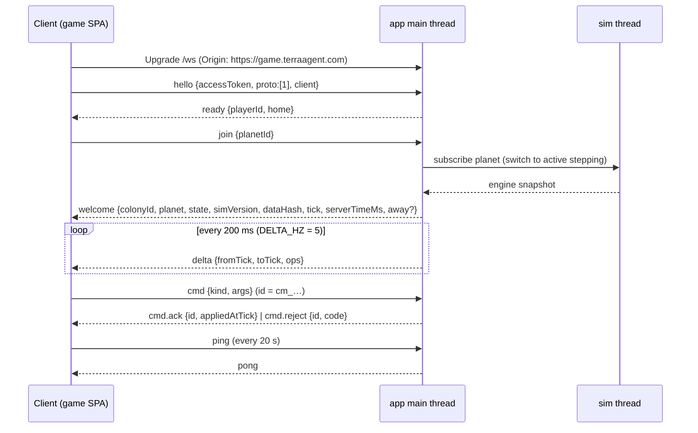

# TerraAgent — Wire Protocols (WebSocket, in-process messages, REST)

> **Planned W13 economy interface (D-44):** [ECONOMY](ECONOMY.md) governs policy-version/hash fields, exact decimal-string token amounts, inclusive buy limits, platform/stall/treasury fee breakdown and structured experiment APIs. W13-36 generates shared schemas; W13-46 exposes the authenticated tooling listed in DEV_TOOLS. No new endpoint is claimed implemented here.

> **W11/W27 amendment (2026-11-04): W11 pins atlas/sector identities, wide owners and save versions while retaining bounded small-world replication. W27 adds negotiated interest epochs, sector baselines/deltas and partial replicas; full-world welcome/delta assumptions below remain only for supported small/legacy worlds. Incompatible clients/flags reject atlas saves without resetting them. Follow the W11/W27 wave contract gates.**

> **Status:** v0.2 (2026-10-30). This covers the simplified one-app design (D-24) with no anti-cheat and no fog filtering (D-25; only crash/load limits, WS-16), plus the NEAR economy messages (D-26). The NATS contract and planet tickets are summarised in §13 as Future.
> **Parent:** [`ARCHITECTURE.md`](./ARCHITECTURE.md) §6, §7, §13 · **Decisions:** [`DECISIONS.md`](./DECISIONS.md) D-24, D-25, D-26
> **Code home:** `shared/contracts/src/{envelope,ws,rest,errors,commands,events}/**` (`@terra/contracts`; the server's internal bus payloads are `backend/app/src/bus/channels.ts`). Every shape below is a zod schema there; this document is the human-readable mirror. On conflict, ARCHITECTURE.md wins, then this file, then code (code must be fixed).

---

## 1. Purpose

One place that defines every message that crosses a boundary:
1. Browser ⇄ app **WebSocket** `wss://api.terraagent.com/ws`, for both lobby and planet traffic.
2. **In-process** messages between the main thread and sim threads, and on the app event bus.
3. A summary of the **REST** surface `https://api.terraagent.com/v1/*`, including the NEAR economy endpoints.

---

## 2. Global rules

| ID | Rule |
|---|---|
| `PR-01` | Every message MUST validate against its zod schema in `@terra/contracts`. The server parses **inbound** client messages with `.strict()`: unknown keys are rejected. This is crash protection, not anti-cheat (D-25). Clients parse server messages permissively, ignoring unknown keys and unknown `event.kind`s. |
| `PR-02` | IDs are prefixed ULIDs: `pr_` player, `co_` colony, `pl_` planet, `mt_` match ticket, `pt_` party, `cm_` command, `tr_` trade, `or_` market order, `bt_` bounty, `tc_` truce. |
| `PR-03` | Timestamps on the wire are integer ms since epoch (`…Ms`). Sim time is `tick` (5 TPS, `TICK_MS = 200`). |
| `PR-04` | Resource amounts, HP and positions are plain JSON numbers in design units (resources in units, positions in tiles). Floats are allowed (D-24). **On-chain token amounts** are decimal strings in base units (`"1200000000000000000000"`). |
| `PR-05` | Envelope field `v` = **1**. Additive changes stay in `v: 1`. Removing or renaming a field needs `v: 2`. |
| `PR-06` | `@terra/contracts` exports a JSON-Schema snapshot (`schema/contracts.schema.json`); `npm run gen:check` fails on a stale one. This file is kept in step by review (no automated check). |

---

## 3. WebSocket envelope

```ts
// contracts/src/ws/envelope.ts
export const Envelope = <T extends string, D extends z.ZodTypeAny>(t: T, d: D) =>
  z.object({
    v: z.literal(1),
    t: z.literal(t),
    id: z.string().min(1).max(40).optional(),        // client correlation id (cm_ ULID for commands)
    tick: z.number().int().nonnegative().optional(), // server → client only
    d: d,
  }).strict();
```

| ID | Rule |
|---|---|
| `WS-01` | Text frames, UTF-8 JSON, one envelope per frame, except messages that carry engine bytes (`welcome`, `delta`, D-31): those are one binary frame holding the MessagePack of the whole envelope (`shared/contracts/src/ws/wire.ts`). `permessage-deflate` on (threshold 1 KiB). |
| `WS-02` | Max inbound frame: **64 KiB** (crash protection only). A larger frame closes the socket with `1009`. |
| `WS-03` | `welcome` carries the **full planet state** (≈ 1 MB before compression at MVP scale). Deltas are typically ≤ 64 KiB. |
| `WS-04` | A MessagePack protocol for every message (`proto: 2`) only if the load test shows > 30 KB/s per socket. Not in v1 (only the byte-carrying `welcome` / `delta` are MessagePack, WS-01). |

---

## 4. App WebSocket (`wss://api.terraagent.com/ws`)

### 4.1 Connection lifecycle



| ID | Rule |
|---|---|
| `WS-10` | The first frame MUST be `hello` within **5 s**, or the socket closes `4000 bad_hello`. The access JWT is verified with the REST verifier. |
| `WS-11` | Origin allow-list from the `CORS_ORIGINS` env, plus loopback origins on any port outside production (`backend/app/src/core/cors.ts`); a request without `Origin` is accepted. |
| `WS-12` | `join {planetId}` is accepted only for the planet of the player's **own live colony**. Otherwise `bye 4003` (reason `not_your_planet`; `forbidden` when the planet is not loaded). There are no planet tickets and no worker URLs (D-24). Dev only: a `dev:<name>` session (refused in production) may join any loaded planet, and on a scenario planet without colony rows it plays colony 0. |
| `WS-13` | **One planet socket per player** (as built in W01; one colony per player). A second `join` for the same player closes the older socket with `4001 replaced`, after the new `welcome` is sent. |
| `WS-14` | The client pings every **20 s**. The server closes sockets that are silent for **60 s** with `1001`. |
| `WS-15` | If the planet ends, the colony is eliminated, or the app restarts, the server sends `bye {code}` and closes with the same code (`4010`, `4011`, `4012`). |
| `WS-16` | **Crash/load protection only** (D-25, amended 2026-11-01): each player has one token bucket at the ingress, shared by all of its sockets and planets (20 commands/s, bursts of 40); extra commands get `cmd.reject rate_limited`. A player's commands are applied in arrival order at the next step. |

### 4.2 Client → app messages

```ts
// contracts/src/ws/client.ts (all .strict())
const Hello     = Envelope("hello", z.object({ accessToken: z.string().max(4096), proto: z.array(z.number().int()).nonempty(), client: z.object({ app: z.literal("game"), version: z.string().max(32) }) }));
const Join      = Envelope("join",  z.object({ planetId: PlanetId }));
const Leave     = Envelope("leave", z.object({}));
const Subscribe = Envelope("subscribe",   z.object({ topic: z.enum(["planets", "queue", "party", "market"]), planetType: PlanetType.optional() }));
const Unsub     = Envelope("unsubscribe", z.object({ topic: z.enum(["planets", "queue", "party", "market"]) }));
const Reauth    = Envelope("reauth", z.object({ accessToken: z.string().max(4096) }));
const Ping      = Envelope("ping",   z.object({ clientTimeMs: z.number().int() }));
const Cmd       = Envelope("cmd", z.object({ kind: CommandKind, args: z.unknown() /* per-kind schema */ })).required({ id: true });
```

**`CommandKind` (authoritative list).** SIMULATION §4, NEAR, AI_ORCHESTRATOR and CONTINUITY use these exact names.

| Group | Kinds |
|---|---|
| Colony control | `setPriorities` · `enqueueTask` (`build`, `upgrade`, `repair`, `terraform {op, tiles}`, `buildUnit { unit, tier, count, repeat }` (worker: `unit: 'worker'`, `tier: 1|2|3`), `queueGoal {goal, params}`, `raid`, `launchRocket`) · `cancelTask {taskId}` (W01: an order id, the client's own id = the command id that created it, or a building's entity id; `'active'` = the first manual terraform order, `'current'` = the open construction order, never crossing lanes; a Hub's linked prep cancels the Hub; no match → `unknown_entity`) · `landPod` (W01: open the own descending pod once it has descended `hq.startingKit.podLandMinS`) · `placeBuilding` · `upgradeBuilding` · `demolish` · `setStance` · `attackMove` · `setRally` · `setHarvestWeights` |
| Away & autopilot | `setAutopilot {aiDirector, awayRaids}` · `setAwayBudget {perResource}` · `setAutoTrade {limits}` |
| Cargo (F1) | `cargo.export {resource, amount}` · `cargo.import {resource, amount}` (`resource`: `ResourceKey`, any tier; T1 trades from day one, D-34) |
| Market (F2/F3) | `market.placeOrder {side, resource: ResourceKey, amount, price: {token, amount}, ttlS, stallId?, maxStallFeeBp?}` · `market.cancelOrder {orderId}` · `market.setHubFee {bp}` · `market.acceptGuildOffer {offerId}` (details: §4.4.1) |
| Diplomacy & bounties (F8) | `diplomacy.proposeTruce` · `diplomacy.respondTruce` · `diplomacy.cancelTruce` · `bounty.post {target, reward}` · `bounty.claim {bountyId}` |
| Module-only (never from clients) | `ai.directive` · `cargo.settled` · `market.reserve` · `market.release` · `market.settled` · `bounty.paid` · `system.spawnColony` · `system.retireColony` · `system.seal` · `system.end` · `system.presence` · `system.arrive` |

`Priorities = { economy, expansion, defense, power, terraform }`, each an integer 0..100 (canonical set, units spec §7 row 8).

### 4.3 App → client messages

> **As built (W01):** the code (`shared/contracts/src/ws/{client,server,sim}.ts`) is the source of truth where it differs from the target sketch below: `ready {playerId, home?, flags}`; `welcome {reason, colonyId | null, planet {id, type, name, …lobby fields optional}, state (snapshot bytes), simVersion, dataHash, overrides?, tick, serverTimeMs, tickMs, deltaHz, flags, warp?}` (no `away`); `delta {fromTick, toTick, diff (bytes), events?}` (no `ops`); `planetId` is a `HomePlanetId` (`pl_…`), not a ULID; `cmd.kind` is any string of 1–64 characters, unknown kinds are rejected `unknown_kind` by `precheckClientCommand`. `CommandKind` in W01 also includes `moveUnit`, `stopUnit`, `landPod` and the `dev.*` kinds (`COMMAND_KINDS`, generated).

```ts
const Ready   = Envelope("ready", z.object({ playerId: PlayerId, home: HomeResponse }));
const Welcome = Envelope("welcome", z.object({
  reason: z.enum(["join", "resync"]),
  colonyId: ColonyId,
  planet: z.object({ id: PlanetId, type: PlanetType, state: PlanetState, name: z.string(), endsAtMs: z.number().int(), seats: z.object({ taken: z.number().int(), capacity: z.number().int() }) }),
  state: SimSnapshotFrame,                // D-31: engine snapshot (shared codec, binary frame) — everything on the planet, no fog filtering (D-25)
  simVersion: z.number().int(), dataHash: z.string(), // a client whose engine differs reloads (SIM-X-08)
  tick: z.number().int(), serverTimeMs: z.number().int(),
  tickMs: z.literal(200), deltaHz: z.literal(5),
  away: AwaySummary.optional(),
}));
const Delta = Envelope("delta", z.object({ fromTick: z.number().int(), toTick: z.number().int(), diff: SimDiffFrame /* D-31: engine diffSince(fromTick), binary */ }));
// The DeltaOp union below is the pre-D-31 view format, kept as the shape of the client's view() output:
const DeltaOp = z.discriminatedUnion("op", [
  z.object({ op: z.literal("e+"), e: EntityView }),
  z.object({ op: z.literal("e~"), id: z.string(), f: EntityView.partial() }),
  z.object({ op: z.literal("e-"), id: z.string(), why: z.enum(["destroyed", "removed"]) }),
  z.object({ op: z.literal("t"),  tiles: z.array(TileChange) }),
  z.object({ op: z.literal("c"),  colonyId: ColonyId, f: ColonyView.partial() }),
  z.object({ op: z.literal("q"),  colonyId: ColonyId, lanes: OrderLanesView, goals: z.array(GoalView) }),
  z.object({ op: z.literal("planet"), state: PlanetState, seatsTaken: z.number().int() }),
]);
const Event     = Envelope("event", z.object({ kind: EventKind, severity: z.enum(["info", "warn", "critical"]), atTick: z.number().int(), colonyIds: z.array(ColonyId), data: z.record(z.unknown()) }));
const CmdAck    = Envelope("cmd.ack",    z.object({ id: CmdId, appliedAtTick: z.number().int() }));
const CmdReject = Envelope("cmd.reject", z.object({ id: CmdId, code: RejectCode, detail: z.string().max(200).optional() }));
const Pong      = Envelope("pong", z.object({ clientTimeMs: z.number().int(), serverTimeMs: z.number().int(), tick: z.number().int().optional() }));
const Bye       = Envelope("bye",  z.object({ code: CloseCode, reason: z.string().max(120) }));
// lobby + economy pushes on the same socket
// planets.list · planets.changed · queue.position · match.assigned · match.failed · party.updated
// market.book {planetId, bids, asks, last} · market.trade {tradeId, …} · guild.arrived {shipId, offers}
// cargo.status {colonyId, inOrbit, pending} · notify.test
```

`RejectCode` = `invalid_args` · `unknown_kind` · `not_own_colony` · `colony_inactive` · `not_own_territory` · `site_blocked` · `terrain_unbuildable` · `insufficient_resources` · `supply_cap` · `tier_locked` · `worker_tier_locked` · `stage_locked` · `no_trade_hub` · `raid_protected` · `truce_active` · `would_isolate` · `launch_gate` · `mint_cap` · `market_unavailable` · `planet_ended` · `internal` · `unknown_entity` · `wave_disabled` · `host_unavailable` · `rate_limited` · `fee_out_of_range` · `order_limit` · `order_too_small` · `unknown_order` (W13-01 market codes; the full list, with the W01 additions `already_landed`, `landing_site_taken`, `queue_full` (terraform lane full), `planet_full` (8 colonies per planet), is `REJECT_CODES` in `shared/contracts/src/errors/index.ts`). A sim rejection may carry a `detail` (e.g. the placement block text `not your territory`); hosts pass it in `cmd.reject.detail`.

### 4.4 Command semantics

| ID | Rule |
|---|---|
| `WS-20` | **Validation (D-25):** the envelope and per-kind zod schema; the colony is the sender's own (derived server-side, `not_own_colony` otherwise); then game rules in the sim. Accepted commands are posted to the planet's sim thread and applied at the next step. |
| `WS-21` | `cmd.ack` is sent when the command has been **applied** at a step. `cmd.reject` is sent for per-kind args, ownership or game-rule failures (a frame that fails the envelope schema is logged and dropped without a reply). Commands are **not durable**: if the app crashes before the next snapshot, they are lost (≤ 60 s, D-24). |
| `WS-22` | **Resync:** if the socket's `bufferedAmount` exceeds **1 MiB**, the server stops deltas and sends `welcome {reason: "resync"}` once the buffer drains below 256 KiB. A client that sees a gap (`fromTick ≠` previous `toTick`) sends `join` again. |
| `WS-23` | Within a socket, messages are delivered in send order. Events of a delta window travel inside that `delta` (`d.events`); a bare `event` is sent only for host notices or planets nobody subscribes to. |

#### 4.4.1 Market commands, events and pushes (W13-01 contracts, D-44)

Code: `shared/contracts/src/{market,commands/market-*,events/market-*}`; rationale and defaults: [LED-20](../questions-and-limitations/economy-ledger.md). Fee and fill rules are [ECONOMY](ECONOMY.md) §3 and [NEAR](NEAR.md) §6.

| ID | Rule |
|---|---|
| `WS-30` | **`market.placeOrder {side, resource, amount, price: {token, amount}, ttlS, stallId?, maxStallFeeBp?}`.** `amount` is a positive integer of whole base units (lot 1). `price.amount` is the **total** quote for the full `amount` as an atomic decimal string (`numeric(78,0)` on the server; "300 water for 10 USDC" = `amount 300, price {USDC, "10000000"}`); the limit price is the exact rational `price.amount / amount`, compared by cross-multiplication. `price.token` is the pair's quote (USDC, NEAR or a resource key for barter) and must differ from `resource`. `ttlS` is one of the policy's TTL options. The command source is `'client'`, `'director'` or (D-45) `'bot'`; a `'bot'` order comes from the bot API (§8a) and is checked against that key's allowances before the normal validation. `stallId` defaults to the colony's online Trade Hub. `maxStallFeeBp` is the buyer's explicit maximum maker-stall fee (default: the policy maximum) and is reserved in full. Fees are charged to the buyer in the quote token (platform 100 bp plus the maker stall's 0-100 bp), never taken from the received base and never by maker/taker role. The order pins policy version/hash and fee terms at placement. |
| `WS-31` | **`market.cancelOrder {orderId}`** (server id or sim order ref; owner only; `unknown_order` otherwise). **`market.setHubFee {bp, hubId?}`** sets the stall fee for new maker orders (policy range 0-100 bp, else `fee_out_of_range`); open orders keep their pinned fee. |
| `WS-32` | **Module-only commands:** `market.reserve {ref, orderId?, deltas}` mirrors a held reservation in `reservedInOrbit`, `market.release {ref, deltas, reason, code?}` (`cancelled`, `expired`, `rejected`, `settlement_failed`, `filled`) and `market.settled {tradeId, role: buyer \| seller \| stall, deltas, released?, trade}` after a FINAL batch. `deltas` are **whole-unit resource deltas only**; USDC and NEAR never enter the sim. None changes sim stock beyond what the delta states. |
| `WS-33` | **Sim-first flow.** Every client market command is a normal command into the planet sim (`wave_disabled` for free). The sim checks Trade Hub, size, TTL and fee range, then emits `marketOrderRequested`, `marketCancelRequested` or `marketHubFeeSet` (audience server/player as in the event definitions); the market module acts on them in Postgres and answers with the module commands above. Checks that need server state (verifier balance, open-order count) run as a synchronous `CommandPrechecks` precheck before the sim and again under lock afterwards; a difference between the two is reported by `marketOrderRejected {code}`. A sim-accepted order lost by a crash before the module handles the event reserves nothing. |
| `WS-34` | **Events.** `marketOrderRequested`, `marketCancelRequested`, `marketHubFeeSet`, `marketOrderRejected`, `tradeSettled` (player: price, notional, platform and stall fee, stall name, tx hash) and `feeEarned` (the stall owner's fee). |
| `WS-35` | **Reject codes** added by W13-01: `fee_out_of_range`, `order_limit` (open-order cap), `order_too_small` (below the pair's lot or minimum notional), `unknown_order`; existing `no_trade_hub`, `insufficient_cargo`, `market_unavailable` apply. |
| `WS-36` | **Pushes** (topic `market`): `market.book {planetId, pair, bids, asks, last?, seq}` (top levels, debounced 1 Hz per pair; a client drops a push older than its `seq`) and `market.trade {planetId, trade}` (one finalized settlement; `trade` carries the exact fee breakdown and the `organic` classification). Related-colony, Guild and fixture fills are flagged and excluded from organic price/volume metrics (ECONOMY §3). |

### 4.5 State views

> Since D-31 these shapes are **not sent on the wire**. They are the target view of later waves; what is built is the engine's `SimView` (`shared/sim/src/host/view.ts`), returned by `view()` on the client and in server tools. The wire carries engine snapshots and diffs (§4.3).

```ts
const PlanetStateViewV1 = z.object({
  tick: z.number().int(),
  colonies: z.array(ColonyView),         // ALL colonies, including resources and queues (D-25)
  tiles: z.array(TileView),              // all tiles; client draws fog from `explored` + own vision
  entities: z.array(EntityView),         // all entities
  market: MarketSnapshot.optional(),     // order book + last trades on this planet (F2)
});
const ColonyView = z.object({ colonyId: ColonyId, name: z.string(), color: z.number().int(), status: ColonyStatus,
  resources: Stock, caps: FamilyCaps, supply: z.object({ used: z.number(), cap: z.number() }), power: PowerView,
  priorities: Priorities, stage: z.number().int(), threatStage: z.number().int(), cargo: CargoView, present: z.boolean() });
const PlanetType  = z.enum(["desert", "ocean", "temperate"]);                 // D-33
const ResourceKey = z.enum(["metals.t1", "metals.t2", "metals.t3", "minerals.t1", "minerals.t2", "minerals.t3",
                            "bio.water", "bio.biomass", "bio.t2", "bio.t3"]);   // D-34; also the NEP-245 cargo token ids
const Stock      = z.record(ResourceKey, z.number());                            // every key present in views; partial in payloads
const FamilyCaps = z.object({ metals: z.number(), minerals: z.number(), bio: z.number() }); // one storage cap per family
// Energy is grid power, not stock: see PowerView (gen, demand, stored in capacitors).
const TileView  = z.object({ i: z.number().int(), terrain: z.number().int(), prep: z.number().int(), owner: ColonyId.nullable(), deposit: z.number().int().nullable(), explored: z.number().int() /* bitmask per colony */ });
const EntityView = z.object({ id: z.string(), kind: z.enum(["building", "unit", "fauna", "nest", "projectile", "hazard"]),
  arch: z.string(), tier: z.number().int(), owner: ColonyId.nullable(), pos: z.tuple([z.number(), z.number()]),
  rot: z.number(), hp: z.number(), hpMax: z.number(), state: z.string(), progress: z.number().min(0).max(1).optional() });
const PowerView = z.object({ gen: z.number(), demand: z.number(), stored: z.number(), storeCap: z.number(), state: z.enum(["ok", "brownout", "blackout", "overload"]) });
const CargoView = z.object({ inOrbit: Stock, pendingMint: Stock });
```

| ID | Rule |
|---|---|
| `WS-30` | There is **no server-side fog-of-war filtering** (D-25). Every client receives the whole planet. The client hides what its colony cannot see. |

### 4.6 Close codes

| Code | Name | Sent when | Client action |
|---|---|---|---|
| `1001` | going away | idle 60 s / normal shutdown | reconnect |
| `1009` | too big | inbound frame > 64 KiB | bug; report |
| `4000` | `bad_hello` | missing or invalid first frame | reconnect |
| `4001` | `replaced` | another device or tab took over | show "playing elsewhere"; no auto-reconnect |
| `4003` | `forbidden` | bad or expired token, `join` to a foreign planet (reason `not_your_planet`), or the full state cannot be built on join / resync (reason `planet_unavailable`) | `not_your_planet`: terminal at once; `forbidden` / `planet_unavailable`: refresh auth, `/v1/me/home`, retry once |
| `4010` | `planet_ended` | planet reached `ENDED` | `/v1/me/home` → `PLANET_ENDED` |
| `4011` | `colony_eliminated` | colony destroyed | `/v1/me/home` → `ELIMINATED` |
| `4012` | `server_restarting` | deploy or restart, or the joined planet went down (reason `planet_down`: its thread died or a step failed) | reconnect with backoff |

Reconnect backoff: 0.5 s, 1 s, 2 s, 4 s, 8 s, cap 10 s, ±20 % jitter.

---

## 5. Lobby topics (same socket)

| ID | Rule |
|---|---|
| `LB-01` | Lobby topics (`planets`, `queue`, `party`) work without a `join`. |
| `LB-02` | The socket closes `4003` at access-token `exp` unless `reauth` arrived first. |
| `LB-03` | `planets.changed` carries an increasing `version`. On a gap the client re-subscribes. |
| `LB-04` | Every lobby push has a REST equivalent for polling (`GET /v1/planets`, `GET /v1/match/tickets/current`, `GET /v1/party`). |

---

## 6. In-process messages

| Channel | Shape | Notes |
|---|---|---|
| main → sim thread | `{ t: "cmd", planetId, cmd: SimCommandV1 }` · `{ t: "subscribe" \| "unsubscribe", planetId }` · `{ t: "load", planetId, snapshot? \| params: { type, … } }` · `{ t: "snapshotNow" }` · `{ t: "landingSite", planetId, reqId, colony }` (seating asks the planet's sim where a colony lands) | `SimCommandV1` in SIMULATION §4. Full list: `backend/app/src/game/thread/protocol.ts` |
| sim thread → main | `{ t: "delta", planetId, fromTick, toTick, diff, events }` · `{ t: "event", planetId, events }` · `{ t: "ledger", planetId, tick, postings }` (every step's postings, host-only) · `{ t: "ack" \| "reject", planetId, commandId, appliedAtTick, code?, detail? }` · `{ t: "snapshot", planetId, tick, bytes }` · `{ t: "fullState", planetId, reqId, tick, warp, bytes, simVersion, dataHash, planetType, overrides? }` · `{ t: "landingSite", reqId, answer }` · `{ t: "planetFailed", planetId, message }` (a step threw: the failed step's `ledger` postings and its commands' real outcomes from `StepError` are posted first, then `internal` for the commands without one; the planet is dropped) | Deltas are built once per planet and broadcast to all its sockets. A planet that goes down (its thread died or `planetFailed`) has its waiting commands answered `thread_down`, its sockets get `bye 4012 planet_down`, and it is restored from its latest snapshot (at most 3 times per 10 min) |
| event bus | `planet.event` (`PlanetEventV1 { planetId, tick, kind, severity, colonyIds, data }`) · `near.cargo.settled` · `near.market.settled` · `near.bounty.paid` | Feeds `ai`, `notify`, `near`, `lobby`, digest. In-memory only (no durability); `near` jobs are persisted in their own tables |

---

## 7. NEAR economy messages (summary, D-26)

Design in [`NEAR.md`](./NEAR.md) and [`docs/game/near-economy-features-spec.md`](../game/near-economy-features-spec.md).

| Feature | WS command / push | REST | Chain action (by the `near` module) |
|---|---|---|---|
| F1 Cargo | `cargo.export` / `cargo.import`, push `cargo.status` | `GET /v1/near/cargo` | NEP-245 `mt_mint` / `mt_burn` on `res.terraagent.near` (server = mint authority) |
| F2 Markets | `market.placeOrder` / `cancelOrder` / `setHubFee`, push `market.book` / `market.trade` | `GET /v1/market/{planetId}`; bot API `/v1/trade/*` (§8a) | Paired `token_diff` intents (NEP-413 signed) → `execute_intents` on `intents.near` |
| F3 Guild | `market.acceptGuildOffer`, push `guild.arrived` | `GET /v1/market/guild` | Guild NPC sub-accounts sign their own intents |
| F4 Director key | `setAutoTrade`, `setAwayBudget` | `POST /v1/near/director-key` (add/revoke) | `add_public_key` intent / function-call key with allowance |
| F5 Accounts | — | `POST /v1/auth/social`, `POST /v1/near/claim` | Named account creation; NEP-366 meta-tx relayer |
| F6 Deed + staking | push `deed.updated` | `GET /v1/near/deed`, `POST /v1/near/stake` | NEP-171 deed metadata update; stake to a whitelisted pool |
| F7 Treasury | push `treasury.proposal` | `GET/POST /v1/near/treasury/{planetId}` | SputnikDAO proposals and votes |
| F8 Bounties | `bounty.post` / `bounty.claim` | `GET /v1/bounties/{planetId}` | Escrow contract deposit / release |

---

## 8. REST surface (summary)

Base `https://api.terraagent.com/v1`. JSON only. Auth: `Authorization: Bearer <access JWT>` (15 min), refresh via the httpOnly cookie `ta_rt`.

| Method & path | Auth | Request → response |
|---|---|---|
| `POST /auth/guest` | none | `{ deviceSecret? }` → `{ accessToken, player }` + sets `ta_rt` |
| `POST /auth/social` | optional bearer | `{ provider, token }` → `{ accessToken, player, accountId }` (F5; provider still to be chosen, NEAR.md) |
| `POST /auth/refresh` · `POST /auth/logout` | cookie | rotate / revoke |
| `POST /auth/near/challenge` · `POST /auth/near/verify` | optional bearer | NEP-413 wallet link |
| `GET /me/home[?type=desert\|ocean\|temperate]` | bearer | `HomeResponse` (`GET /me` is not built) |
| `GET /planets?type=` | bearer | `{ version, planets, newPlanetTypes }` |
| `POST /match/tickets` · `GET/DELETE /match/tickets/current` | bearer | matchmaking (MATCHMAKING) |
| `POST /party` · `POST /party/join` · `DELETE /party` · `GET /party` | bearer | parties (MM-55) |
| `POST /notify/push` · `POST /notify/telegram/link` · `DELETE /notify/*` | bearer | notification channels (CONTINUITY §5a) |
| `/near/*`, `/market/*`, `/bounties/*` | bearer | §7 |
| `/trade/*` | bot API key | §8a (bot trading API, D-45) |
| `GET /stats/public` | none | `{ planetsActive, coloniesActive, playersOnline }` (cached 30 s) |
| `/admin/*` | admin key | admin |

```ts
export const HomeResponse = z.discriminatedUnion("state", [
  z.object({ state: z.literal("NEW"), planets: z.array(PlanetSummary), newPlanetTypes: z.array(PlanetType) }),
  z.object({ state: z.literal("QUEUED"), ticketId: MatchTicketId, position: z.number().int(), etaS: z.number().int().nullable() }),
  z.object({ state: z.literal("ACTIVE"), colony: ColonySummary, planet: PlanetSummary, away: AwaySummary.optional() }),
  z.object({ state: z.literal("ELIMINATED"), recap: ColonyRecap, planets: z.array(PlanetSummary), newPlanetTypes: z.array(PlanetType) }),
  z.object({ state: z.literal("PLANET_ENDED"), results: PlanetResults, planets: z.array(PlanetSummary), newPlanetTypes: z.array(PlanetType) }),
]);
```

### 8a. Bot trading API `/v1/trade/*` (W13, D-45)

Auth: `Authorization: Bearer ta_bot_<key>`. An API key is bound to one colony account and acts as actor kind `bot`; humans and bots share the same per-planet books. Keys are created and revoked by the colony owner (Settings, or `POST /v1/trade/keys`); the secret is shown once and stored hashed. Orders become `market.placeOrder` with command source `'bot'`.

| Method & path | Request → response |
|---|---|
| `GET /trade/me` | key id, colony, allowances and current usage (open orders, spend today, loss today), kill-switch state |
| `GET /trade/pairs` | tradable pairs with lot/tick/min notional, fee policy, reference price and its quality |
| `GET /trade/book/{planetId}/{pair}` | depth snapshot with `seq` |
| `GET /trade/orders` · `POST /trade/orders` · `DELETE /trade/orders/{orderId}` | list my orders · `{side, resource, amount, price:{token, amount}, ttlS, maxStallFeeBp?}` plus header `Idempotency-Key` · cancel; same body and errors as WS-30 |
| `GET /trade/fills` | my finalized fills with fee attribution and `organic` flag |
| `GET /trade/cargo` | my orbital cargo only (account plus free verifier balance, reserved shown separately) |
| `GET /trade/stream` (SSE, or WebSocket `/trade/ws`) | `book` (debounced 1 Hz per pair), `order`, `fill`, `allowance` and `killswitch` events with `seq` |
| `POST /trade/kill` | owner or operator sets the key's (or the colony's) kill switch; resting orders cancel, in-flight settlement reconciles |

Allowance errors (stable codes): `bot_key_invalid`, `bot_killed`, `bot_pair_not_allowed`, `bot_order_limit`, `bot_notional_limit`, `bot_budget_exhausted`, `bot_price_band`, `rate_limited` (with `Retry-After`), `idempotency_conflict`. A repeated `Idempotency-Key` with the same body returns the original result; a different body is `idempotency_conflict`. Per-key and per-IP rate limits apply to reads and to order writes separately.

Error envelope (all non-2xx): `{ errorCode, error: { code, message, details? }, requestId }`. `errorCode` is the stable UPPER_SNAKE domain code (`COLONY_SEAT_REJECTED`, `LEDGER_UNAVAILABLE`, `HOME_UNAVAILABLE`, `VALIDATION_ERROR`, …); `error.code` is the REST code below, from the domain code when it has its own, else generic by status. Codes: `validation_error` (400), `unauthorized` (401), `forbidden` (403), `not_found` (404), `already_queued` (409), `has_live_colony` (409), `seat_rejected` (409: the sim refused to land the new colony, sim code in `details.code`, e.g. `landing_site_taken` when the planets' sims have no site left, `host_unavailable`), `planet_not_recruiting` (409), `conflict` (any other 409), `payload_too_large` (413), `rate_limited` (429: per-IP throttle of `POST /auth/guest` and `GET /me/home`), `queue_full` (503), `near_unavailable` (503, NEAR codes only), `unavailable` (any other 503, e.g. a home planet that cannot be loaded), `internal` (500).

---

## 9. Numbers (mirror of ARCHITECTURE §15 — do not change here)

| Item | Value |
|---|---|
| Tick / delta rate (active) | 5 TPS / 5 Hz |
| Coarse step (empty planet) | 1 / s, `dt = 5` |
| Hello deadline / ping interval / idle close | 5 s / 20 s / 60 s |
| Max inbound frame | 64 KiB |
| Resync buffer threshold | 1 MiB (resume below 256 KiB) |
| Snapshot interval (= max command loss on crash) | 60 s |

---

## 10. Edge cases & failure modes

| Case | Behaviour |
|---|---|
| App restarts while a client is connected | `bye 4012` if graceful; otherwise the socket drops. The client reconnects with backoff, then `hello` → `join` → `welcome`. Commands applied after the last snapshot are lost. |
| Client sends a command for another colony | `cmd.reject not_own_colony`. The colony is always derived from the token. |
| Client floods commands | Each player has a token bucket at the ingress (20 commands/s, bursts of 40): extra commands get `cmd.reject rate_limited` before validation or any planet work. The local host (`?host=local`) has no limit. |
| Cargo mint fails on chain | `cargo.settled {ok: false}` refunds the stock to the colony; push `cargo.status`. |
| Market settlement fails (`execute_intents` batch rejected) | Both orders return to the book (or expire). Reserved sim stock is released with `market.release`. |
| `intents.near` or RPC unreachable | Market and cargo commands are rejected with `market_unavailable`. Gameplay continues. |

---

## 11. Test matrix

| Rule | Test |
|---|---|
| PR-01, PR-06 | `shared/contracts/test/schema-snapshot.spec.ts` |
| WS-10..16 | `backend/app/test/ws/handshake-join.spec.ts` |
| WS-20..23 | `backend/app/test/ws/commands.spec.ts`, `backend/app/test/ws/resync.spec.ts` |
| WS-30 | `backend/app/test/ws/full-state.spec.ts` (everything is present) |
| LB-01..04 | `backend/app/test/lobby/lobby-topics.spec.ts` |
| §6 | `backend/app/test/game/thread-messages.spec.ts` |
| §7 | `backend/app/test/near/{cargo,market,guild}.int.spec.ts` (mainnet calls stubbed; dry-run quotes) |

---

## 12. Owner decisions (2026-10-29 / 2026-10-30)

| # | Question | Decision | Ref | Consequence for this spec |
|---|---|---|---|---|
| 1 | Tick markers | ~~Keep~~ → **dropped**; no durable command log | D-20 → D-24 | §13 Future |
| 2 | Delta encoding | **JSON in v1**; MessagePack only if the load test shows > 30 KB/s per socket | — | Changed by D-31: `welcome` / `delta` carry engine bytes in one MessagePack binary frame; every other message stays JSON |
| 3 | Spectators | **Not in v1** | D-22 | `join` only for your own colony's planet |
| 4 | One app, one WS endpoint | **Yes** | D-24 | No planet tickets, no worker routing, lobby and planet on one socket |
| 5 | Anti-cheat / anti-bot | **None**: full state, no abuse detection; only crash/load limits (command token bucket, per-IP guest throttle; amended 2026-11-01) | D-25 | `WS-16`, `WS-30` |
| 6 | NEAR economy | F1–F8 messages | D-26 | §7 |

---

## 13. Future: NATS contract & planet tickets (not built now)

Kept for the distributed design (ARCHITECTURE §16):
- **Streams.** `{NS}_PLANET_CMDS` (commands plus tick markers, used for bit-exact replay), `{NS}_PLANET_EVENTS`, `{NS}_AI_REQUESTS`, `{NS}_NEAR_JOBS` and `{NS}_NEAR_EVENTS`, with `Nats-Msg-Id` idempotency.
- **KV buckets** for workers, leases (CAS + fencing epoch) and presence.
- **Request/reply** `planet.{id}.ctl` and `worker.{id}.ctl` (assign, release, drain).
- **Planet tickets.** Single-use Ed25519 JWTs bound to a `workerId`, connecting to `wss://ws.terraagent.com/w/{workerId}`.
- Per-socket rate limits, and fog-filtered `ColonyViewV1` views.

## Planned W07 fauna directive extension (D-43)

The [fauna online contract](../game/fauna-hives-spec.md#3-determinism-and-online-transport) requires versioned, sequenced, tick-stamped hive/cohort directives in the existing transport, with authoritative combat events, bootstrap checkpoints and sparse corrections. This is planned; current generic entity diffs do not yet implement it. W07-33 owns shared contract/codec changes and backend replay recovery, W07-35 proves browser/local/server parity. Never omit fauna transforms until the receiving replica can reconstruct them, handle gaps and restore checkpoints. Hidden world salt is not exposed; fauna uses intentionally public seeded domains.
