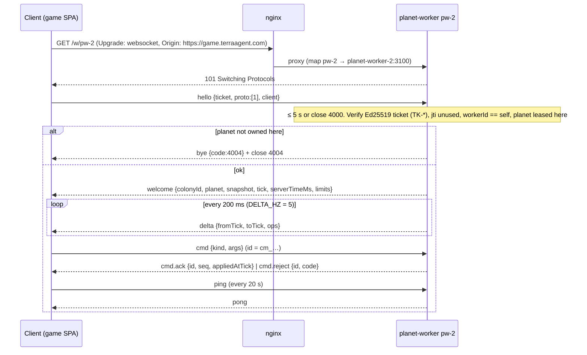

# TerraAgent — Wire Protocols (WebSocket, NATS, REST surface)

> **Status:** Draft v0.1 (2026-10-29) — for owner review.
> **Parent:** [`ARCHITECTURE.md`](./ARCHITECTURE.md) §6 (NATS), §7 (resume path), §13 (WS summary) · **Decisions:** [`DECISIONS.md`](./DECISIONS.md) D-01, D-05, D-06, D-07
> **Implemented by:** `TA-01.2` (WS schemas), `TA-01.3` (NATS), `TA-01.4` (REST DTOs, errors, ticket) in [`TA-01`](../plan/issues/TA-01-monorepo-and-shared-contracts.md); consumed by TA-04/05/07/09/10/11.
> **Code home:** `shared/contracts/src/{ws,nats,rest}/**` (`@terra/contracts`). Every shape below is a zod schema there; this document is the human-readable mirror. On conflict, ARCHITECTURE.md wins, then this file, then code (code must be fixed).

---

## 1. Purpose

One place that defines every byte that crosses a process boundary:
1. Browser ⇄ **planet-worker** WebSocket (`wss://ws.terraagent.com/w/{workerId}`).
2. Browser ⇄ **core lobby** WebSocket (`wss://api.terraagent.com/ws`).
3. Service ⇄ service over **NATS** (subjects, JetStream streams, KV buckets).
4. A summary of the **REST** surface of core (`https://api.terraagent.com/v1/*`) and the **planet ticket**.

---

## 2. Global rules

| ID | Rule |
|---|---|
| `PR-01` | Every message on every channel MUST validate against its zod schema in `@terra/contracts`. Servers parse **inbound** client/service messages with `.strict()` (unknown keys ⇒ reject). Clients parse **outbound** server messages permissively (unknown keys ignored, unknown `event.kind` ignored) so additive server changes don't break old clients. |
| `PR-02` | IDs are prefixed ULIDs (Crockford base32, 26 chars after prefix): `pr_` player, `co_` colony, `pl_` planet, `mt_` match ticket, `sr_` seat reservation, `cm_` command, `ev_`-style event ids are **derived** (see `NT-12`), `tr_` trade, `rq_` request, `jb_` job. `workerId` is `pw-{n}` (`^pw-[0-9]{1,3}$`). Schemas live in `contracts/src/ids.ts`. |
| `PR-03` | All timestamps on the wire are integer **milliseconds since epoch** (`…Ms`) and are informational only; the simulation never reads them (D-01). Simulation time is `tick` (integer, 10 TPS). |
| `PR-04` | Resource amounts and positions on the wire are **integers** (milli-units for resources, milli-tiles for continuous positions) — the same fixed-point the sim uses, so the client never rounds differently. |
| `PR-05` | Protocol version: envelope field `v` = **1**. Additive changes (new optional field, new message type the receiver may ignore, new `event.kind`, new reject code) stay in `v: 1`. Any change that removes/renames a field or changes semantics requires `v: 2`, served side-by-side with `v: 1` for at least one deploy cycle. |
| `PR-06` | `@terra/contracts` exports a JSON-Schema snapshot (`shared/contracts/schema/contracts.v1.json`) that CI diffs (`TA-01.5`). A diff without a matching `PROTOCOL.md` change fails CI. |

---

## 3. WebSocket envelope

```ts
// contracts/src/ws/envelope.ts
export const Envelope = <T extends string, D extends z.ZodTypeAny>(t: T, d: D) =>
  z.object({
    v: z.literal(1),
    t: z.literal(t),
    id: z.string().min(1).max(40).optional(),   // client-generated correlation id (ULID, cm_ prefix for commands)
    tick: z.number().int().nonnegative().optional(), // server → client only
    d: d,
  }).strict();
```

| ID | Rule |
|---|---|
| `WS-01` | Text frames, UTF-8 JSON, one envelope per frame. `permessage-deflate` enabled on both servers (threshold 1 KiB). |
| `WS-02` | Max inbound frame from client: **16 KiB** (worker and lobby). Larger ⇒ close `4000 bad_hello` if before hello, otherwise `cmd.reject{code:"invalid_args"}` is not possible (frame unparsed) ⇒ close `1009` (message too big). |
| `WS-03` | Max outbound `welcome` ≈ **2 MiB** uncompressed (fog-of-war view only). Deltas are ≤ 64 KiB typical. |
| `WS-04` | Binary MessagePack for `delta` MAY be added later behind `hello.proto` negotiation (`proto: 2`) — not in v1. |

---

## 4. Planet-worker WebSocket (`wss://ws.terraagent.com/w/{workerId}`)

### 4.1 Connection lifecycle



| ID | Rule |
|---|---|
| `WS-10` | The first client frame MUST be `hello` within **5 s** of upgrade; otherwise close `4000 bad_hello`. Any other first frame ⇒ `4000`. |
| `WS-11` | Origin allow-list: `https://game.terraagent.com`, `https://game.terraagent.localhost`, and `http://localhost:{5173,4105,4205,4305,4405,4505}` in non-production. Others ⇒ HTTP `403` before upgrade. |
| `WS-12` | Ticket verification (see §7): signature, `aud == "planet"`, `exp` not passed (clock skew ≤ 5 s), `workerId` equals this worker, `planetId` currently leased by this worker, `jti` not seen in the last **120 s** (in-memory LRU). Failure ⇒ `bye` + close `4003 forbidden`; planet not here ⇒ `4004 planet_not_here`. |
| `WS-13` | **One game socket per colony.** A second valid `hello` for the same `colonyId` closes the older socket with `4001 replaced` **after** the new socket's `welcome` is sent. |
| `WS-14` | Client sends `ping` every **20 s**; nginx idle timeout is 75 s; worker closes sockets silent for **60 s** with `1001`. |
| `WS-15` | If the planet is ended, the colony eliminated, the lease lost or the worker drains, the worker sends `bye {code, reason}` then closes with the same code (`4010`, `4011`, `4009`, `4012`). |

### 4.2 Client → worker messages

```ts
// contracts/src/ws/worker.ts  (all .strict())
const Hello = Envelope("hello", z.object({
  ticket: z.string().max(2048),
  proto: z.array(z.number().int()).nonempty(),     // supported versions, e.g. [1]
  client: z.object({ app: z.literal("game"), version: z.string().max(32) }),
}));

const Cmd = Envelope("cmd", z.discriminatedUnion("kind", [
  z.object({ kind: z.literal("setPriorities"),  args: Priorities }),
  z.object({ kind: z.literal("enqueueTask"),    args: TaskSpec }),
  z.object({ kind: z.literal("cancelTask"),     args: z.object({ taskId: z.string().max(40) }) }),
  z.object({ kind: z.literal("placeBuilding"),  args: z.object({ archetype: BuildingArchetype, tier: z.literal(1).or(z.literal(2)).or(z.literal(3)), q: z.number().int(), r: z.number().int(), rot: z.number().int().min(0).max(5) }) }),
  z.object({ kind: z.literal("upgradeBuilding"),args: z.object({ buildingId: z.string().max(40) }) }),
  z.object({ kind: z.literal("demolish"),       args: z.object({ buildingId: z.string().max(40) }) }),
  z.object({ kind: z.literal("setAutopilot"),   args: Autopilot }),
])).required({ id: true });                       // cmd MUST carry id (cm_ ULID) — idempotency key

const Ping     = Envelope("ping", z.object({ clientTimeMs: z.number().int() }));
const AckDelta = Envelope("ack.delta", z.object({ tick: z.number().int().nonnegative() }));

// shared value types
const Priorities = z.object({            // weights 0..100, need not sum to 100
  economy: z.number().int().min(0).max(100),
  expansion: z.number().int().min(0).max(100),
  defense: z.number().int().min(0).max(100),
  terraforming: z.number().int().min(0).max(100),
}).strict();
const TaskSpec = z.discriminatedUnion("type", [
  z.object({ type: z.literal("build"),   archetype: BuildingArchetype, tier: z.number().int().min(1).max(3), q: z.number().int(), r: z.number().int(), rot: z.number().int().min(0).max(5) }),
  z.object({ type: z.literal("upgrade"), buildingId: z.string().max(40) }),
  z.object({ type: z.literal("repair"),  targetId: z.string().max(40) }),
  z.object({ type: z.literal("harvest"), q: z.number().int(), r: z.number().int() }),
  z.object({ type: z.literal("produce"), robot: RobotArchetype, tier: z.number().int().min(1).max(3), count: z.number().int().min(1).max(10) }),
]);
const Autopilot = z.object({
  aiDirector: z.boolean(),                                    // allow ai-orchestrator directives
  awayPolicy: z.enum(["conservative", "balanced", "aggressive"]), // TA-08.2
}).strict();
```

`BuildingArchetype` / `RobotArchetype` are string enums generated from the MVP catalog (D-15) in `contracts/src/catalog.ts` (ids like `command_hub`, `claim_beacon`, `pylon`, `capacitor`, `solar`, `wind`, `fossil_plant`, `mine`, `water_pump`, `supply_depot`, `drone_array`, `robotics_factory`, `turret`, `rocket_silo`; robots `miner`, `builder`, `combat`).

### 4.3 Worker → client messages

```ts
const Welcome = Envelope("welcome", z.object({
  reason: z.enum(["join", "resync"]),          // "resync" = full re-send after lag/backpressure (WS-22)
  colonyId: ColonyId,
  planet: z.object({ id: PlanetId, type: PlanetType, state: PlanetState, name: z.string(), endsAtMs: z.number().int(), seats: z.object({ taken: z.number().int(), capacity: z.number().int() }) }),
  snapshot: ColonyViewV1,                       // fog-of-war filtered view (§4.5)
  tick: z.number().int(),
  serverTimeMs: z.number().int(),
  tickMs: z.literal(100),
  deltaHz: z.literal(5),
  limits: z.object({ cmdPerSec: z.literal(10), cmdBurst: z.literal(20) }),
  away: AwaySummary.optional(),                 // present when the colony was away ≥ AWAY_AFTER_S (TA-08.3)
}));

const Delta = Envelope("delta", z.object({
  fromTick: z.number().int(), toTick: z.number().int(),   // fromTick == previous delta's toTick
  ops: z.array(DeltaOp).max(5000),
}));
const DeltaOp = z.discriminatedUnion("op", [
  z.object({ op: z.literal("ent"),    e: EntityView }),              // upsert entity (full entity view)
  z.object({ op: z.literal("del"),    id: z.string() }),             // entity left view / destroyed
  z.object({ op: z.literal("tile"),   q: z.number().int(), r: z.number().int(), t: TileView }), // ownership/biome/terraform change, newly revealed
  z.object({ op: z.literal("res"),    r: Resources, cap: Resources }), // own colony stock + caps
  z.object({ op: z.literal("power"),  p: PowerView }),
  z.object({ op: z.literal("tasks"),  q: z.array(TaskView) }),       // own task queue (replace)
  z.object({ op: z.literal("prio"),   p: Priorities, a: Autopilot }),
  z.object({ op: z.literal("planet"), state: PlanetState, seatsTaken: z.number().int() }),
]);

const Event = Envelope("event", z.object({
  kind: EventKind,                  // same enum as NATS PlanetEventV1.kind (NT-12), filtered to what this colony may see
  severity: z.enum(["info", "warn", "critical"]),
  atTick: z.number().int(),
  data: z.record(z.unknown()),      // kind-specific; schemas in contracts/src/events.ts
}));

const CmdAck    = Envelope("cmd.ack",    z.object({ id: CmdId, seq: z.number().int(), appliedAtTick: z.number().int() }));
const CmdReject = Envelope("cmd.reject", z.object({ id: CmdId, code: RejectCode, appliedAtTick: z.number().int().optional(), detail: z.string().max(200).optional() }));
const Pong      = Envelope("pong", z.object({ clientTimeMs: z.number().int(), serverTimeMs: z.number().int(), tick: z.number().int() }));
const Bye       = Envelope("bye",  z.object({ code: CloseCode, reason: z.string().max(120) }));
```

`RejectCode` = `invalid_args` · `unknown_kind` · `rate_limited` · `duplicate` · `not_owner` · `not_in_territory` · `footprint_blocked` · `insufficient_resources` · `supply_cap` · `tier_locked` · `colony_eliminated` · `planet_ended` · `internal`.

### 4.4 Command semantics (client path)

| ID | Rule |
|---|---|
| `WS-20` | **Pre-validation** on the worker before publishing: envelope schema, `id` present, per-socket token bucket **10 cmd/s, burst 20**. Failures answer `cmd.reject` immediately (`invalid_args`, `rate_limited`) and are **not** published. A socket exceeding the bucket 3× within 10 s is closed `4008 rate_limited`. |
| `WS-21` | Accepted commands are published to `{ns}.planet.{planetId}.cmd` as `CommandV1` (§6.3) with `source:"player"`, `Nats-Msg-Id: player:{colonyId}:{cmdId}`. The worker answers `cmd.ack` **only after** the command was durably stored (JetStream pub-ack) **and** applied at a tick; semantic failures found by the sim at apply time answer `cmd.reject{appliedAtTick}`. A re-sent `cmdId` inside the 10-min duplicate window answers the original outcome (`duplicate` only if the original outcome is no longer cached). |
| `WS-22` | **Resync:** the client sends `ack.delta{tick}` at most once per second. If `currentTick − lastAck > 50` ticks, or the socket's `bufferedAmount` exceeds **1 MiB**, the worker stops sending deltas and sends `welcome{reason:"resync"}` once the buffer drains below 256 KiB. If `bufferedAmount` stays above **4 MiB** for 10 s the socket is closed `1013` (try again later); the client resumes via `/v1/me/home`. |
| `WS-23` | Deltas are cumulative per socket: `delta.fromTick` equals the previous message's `toTick` (or `welcome.tick`). A client that detects a gap MUST reconnect (fresh ticket). |
| `WS-24` | Ordering: within one socket, messages are delivered in send order; `event`s for ticks ≤ `toTick` are sent **before** the `delta` that covers that tick. |

### 4.5 View types (`ColonyViewV1`)

```ts
const ColonyViewV1 = z.object({
  tick: z.number().int(),
  self: z.object({ colonyId: ColonyId, name: z.string(), resources: Resources, caps: Resources, supply: z.object({ used: z.number().int(), cap: z.number().int() }), power: PowerView, priorities: Priorities, autopilot: Autopilot, tasks: z.array(TaskView) }),
  neighbors: z.array(z.object({ colonyId: ColonyId, name: z.string(), color: z.number().int(), present: z.boolean() })), // no resources of others
  tiles: z.array(z.tuple([z.number().int(), z.number().int(), TileView])), // only revealed tiles
  entities: z.array(EntityView),       // own entities + foreign entities inside vision
});
const Resources = z.object({ metals: z.number().int(), minerals: z.number().int(), petroleum: z.number().int(), water: z.number().int(), energy: z.number().int() }); // milli-units
const TileView = z.object({ biome: z.number().int(), owner: ColonyId.nullable(), deposit: z.number().int().nullable(), terraform: z.number().int().min(0).max(1000) });
const EntityView = z.object({
  id: z.string(), kind: z.enum(["building", "robot", "fauna", "nest", "projectile", "hazard"]),
  arch: z.string(), tier: z.number().int(), owner: ColonyId.nullable(),
  pos: z.tuple([z.number().int(), z.number().int()]),     // milli-tiles (axial q,r ×1000)
  rot: z.number().int(), hp: z.number().int(), hpMax: z.number().int(),
  state: z.string(),                                       // e.g. "building","online","offline","mining","moving"
  progress: z.number().int().min(0).max(1000).optional(),  // construction / production ‰
});
const PowerView = z.object({ gen: z.number().int(), demand: z.number().int(), stored: z.number().int(), storeCap: z.number().int(), state: z.enum(["ok", "brownout", "blackout"]) });
```

| ID | Rule |
|---|---|
| `WS-30` | A client never receives another colony's resources, task queue, priorities, or entities outside its vision (fog-of-war is computed by `@terra/sim` `view()`). Contract test: `worker.view.no-leak.spec.ts`. |

### 4.6 Close codes

| Code | Name | Sent when | Client action |
|---|---|---|---|
| `1001` | going away | idle 60 s / normal shutdown | reconnect via `/v1/me/home` |
| `1009` | too big | inbound frame > 16 KiB | bug; report |
| `1013` | try again later | backpressure (WS-22) | backoff, reconnect |
| `4000` | `bad_hello` | missing/invalid first frame | reconnect with fresh ticket |
| `4001` | `replaced` | another device/tab took over | show "playing elsewhere", no auto-reconnect |
| `4003` | `forbidden` | bad/expired/reused ticket, bad origin (lobby: bad/expired token) | refresh auth, `/v1/me/home` |
| `4004` | `planet_not_here` | planet not leased by this worker | `/v1/me/home` (new worker URL) |
| `4008` | `rate_limited` | repeated command flooding | backoff ≥ 5 s |
| `4009` | `lease_lost` | worker lost the planet lease | `/v1/me/home` after `retryAfterMs` |
| `4010` | `planet_ended` | planet reached `ENDED` | `/v1/me/home` → `PLANET_ENDED` |
| `4011` | `colony_eliminated` | colony destroyed | `/v1/me/home` → `ELIMINATED` |
| `4012` | `server_draining` | graceful drain / deploy | `/v1/me/home` immediately |

Reconnect backoff (client, TA-11.4): 0.5 s, 1 s, 2 s, 4 s, 8 s, cap 10 s, ±20 % jitter; every reconnect fetches a new ticket (tickets are single-use).

---

## 5. Core lobby WebSocket (`wss://api.terraagent.com/ws`)

Used while the player is on the picker / in the queue (TA-04.6, TA-11.2). Gameplay never goes through it.

```ts
// contracts/src/ws/lobby.ts
// client → core
const LHello     = Envelope("hello",     z.object({ accessToken: z.string().max(4096) }));
const LReauth    = Envelope("reauth",    z.object({ accessToken: z.string().max(4096) }));   // before access JWT expiry
const LSubscribe = Envelope("subscribe", z.object({ topic: z.enum(["planets", "queue"]), planetType: PlanetType.optional() }));
const LUnsub     = Envelope("unsubscribe", z.object({ topic: z.enum(["planets", "queue"]) }));
const LPing      = Envelope("ping",      z.object({ clientTimeMs: z.number().int() }));
// core → client
const LReady          = Envelope("ready",          z.object({ playerId: PlayerId, home: HomeResponse }));      // after hello/reauth
const LPlanetsList    = Envelope("planets.list",   z.object({ version: z.number().int(), planets: z.array(PlanetSummary), newPlanetTypes: z.array(PlanetType) }));
const LPlanetsChanged = Envelope("planets.changed",z.object({ version: z.number().int(), upsert: z.array(PlanetSummary), remove: z.array(PlanetId) }));
const LQueuePosition  = Envelope("queue.position", z.object({ ticketId: MatchTicketId, state: MatchTicketState, position: z.number().int(), etaS: z.number().int().nullable() }));
const LMatchAssigned  = Envelope("match.assigned", z.object({ ticketId: MatchTicketId, home: HomeResponse }));  // home.state == "ACTIVE" incl. ws url + ticket
const LMatchFailed    = Envelope("match.failed",   z.object({ ticketId: MatchTicketId, code: z.enum(["seat_expired", "planet_unavailable", "queue_closed", "spawn_failed", "cancelled_by_admin"]) }));
const LPong           = Envelope("pong", z.object({ clientTimeMs: z.number().int(), serverTimeMs: z.number().int() }));
const LBye            = Envelope("bye",  z.object({ code: CloseCode, reason: z.string().max(120) }));
```

| ID | Rule |
|---|---|
| `LB-01` | `hello` within 5 s, access JWT verified (same verifier as REST). Failure ⇒ `4003`. |
| `LB-02` | The socket is closed `4003` at access-token `exp` unless a `reauth` with a newer valid token arrived. Clients send `reauth` ~60 s before expiry after refreshing via REST. |
| `LB-03` | Client → core ≤ **5 msgs/s**, burst 10; abuse ⇒ `4008`. |
| `LB-04` | `planets.changed` carries a monotonically increasing `version`; a client seeing a gap sends `subscribe{topic:"planets"}` again to receive a fresh `planets.list`. |
| `LB-05` | Fan-out: any core replica that changes match/planet state publishes `{ns}.mm.changed`; every replica re-reads and pushes to its own sockets (no sticky sessions needed). |
| `LB-06` | The lobby is optional: every lobby message has a REST equivalent (`GET /v1/planets`, `GET /v1/match/tickets/current`) for polling fallback (every 3 s). |

---

## 6. NATS contract

`{ns}` = `TA_NS` (default `ta`, lanes `l1`..`l5`); `{NS}` = upper-cased `{ns}` used in stream names (`TA_PLANET_CMDS`, `L3_PLANET_CMDS`). All subject builders live in `contracts/src/nats/subjects.ts` as functions of `ns` — no string literals elsewhere (lint rule, TA-01.5).

### 6.1 General NATS rules

| ID | Rule |
|---|---|
| `NT-01` | Payloads are JSON, UTF-8, validated with zod on **both** publish and consume. A consumer that receives an invalid payload `term`s it (JetStream) / replies `{ok:false, code:"invalid_payload"}` (request/reply) and increments `nats_invalid_payload_total{subject}`. |
| `NT-02` | Every JetStream publish sets `Nats-Msg-Id` to the message's **idempotency key** (column "Msg-Id" below). Streams set `duplicate_window` as listed so retries after timeouts never double-apply. |
| `NT-03` | Request/reply calls have an explicit timeout (default **5 s**, `spawnColony` **10 s**) and return `{ ok: true, … } \| { ok: false, code, detail? }`. No exceptions cross the wire. |
| `NT-04` | Headers carried on every message: `ta-trace-id` (W3C trace id, for log correlation TA-13.2), `ta-source` (service name), `ta-v` (payload schema version, `1`). |
| `NT-05` | **Every state change of a planet goes through `{NS}_PLANET_CMDS`** — including core's `spawnColony`, admin `seal`/`end`, AI directives and trade settlements. A `ctl` handler that changes state publishes a command and replies after it is applied. This is what makes failover replay complete (ARCHITECTURE §9, §14). |

### 6.2 Streams

| Stream | Subjects | Retention / limits | Storage | Dup window | Consumers |
|---|---|---|---|---|---|
| `{NS}_PLANET_CMDS` | `{ns}.planet.*.cmd`, `{ns}.planet.*.tick` | `limits`, `max_age 48h`, `discard old`, `max_msg_size 64 KiB` | file | **10 min** | Owning worker: **ordered ephemeral consumer** per planet, `filter_subjects [{ns}.planet.{id}.cmd, {ns}.planet.{id}.tick]`, `deliver_policy by_start_sequence` (= snapshot `cmdSeq + 1`) |
| `{NS}_PLANET_EVENTS` | `{ns}.planet.*.evt.>` | `limits`, `max_age 7d` | file | **5 min** | durable `core-lifecycle` (core; filter `*.evt.colony.>`, `*.evt.planet.>`); durable `near-milestones` (near-gateway; `colony.founded`, `rocket.launched`, `planet.ended`); durable `digest-builder` (planet-worker, pull, shared by all workers) |
| `{NS}_AI_REQUESTS` | `{ns}.ai.request` | `workqueue`, `max_age 10 min` (stale decisions are useless) | file | 10 min | durable pull `ai-orchestrator`, `ack_wait 30s`, `max_deliver 3` |
| `{NS}_NEAR_JOBS` | `{ns}.near.account.provision`, `{ns}.near.registry.>` | `workqueue`, `max_age 7d` | file | 1 h | durable pull `near-gateway`, `ack_wait 60s`, `max_deliver 10`, `backoff [5s,30s,2m,10m,30m]` |
| `{NS}_NEAR_EVENTS` | `{ns}.near.evt.>`, `{ns}.trade.evt.>` | `limits`, `max_age 30d` | file | 5 min | durable `core-near` (core: account provisioned, trade state for UI) |

Replicas: `1` in dev/lanes; prod single-node NATS in MVP (`1`), `3` when NATS is clustered (OWNER decision). Stream/KV definitions are **data** in `contracts/src/nats/streams.ts`; `infra/nats` bootstrap (TA-02.2) is generated from them and is idempotent (`add` or `update`, never delete).

> **Refinement of ARCHITECTURE §6.1** (to be confirmed by lead): the `.tick` marker subject in `PLANET_CMDS` (NT-11) and the `{NS}_NEAR_EVENTS` stream for `near.evt.*` / `trade.evt.*` are not listed in ARCHITECTURE §6.1 yet.

### 6.3 Planet command log — `{ns}.planet.{planetId}.cmd`

```ts
// contracts/src/nats/commands.ts
export const CommandV1 = z.object({
  v: z.literal(1),
  cmdId: CmdId,                                    // cm_ ULID, generated by the producer
  planetId: PlanetId,
  colonyId: ColonyId.nullable(),                   // null for planet-wide commands
  source: z.enum(["player", "ai", "core", "near", "admin"]),
  issuedBy: z.string().max(64),                    // playerId | service name | admin id
  issuedAtMs: z.number().int(),                    // informational only (PR-03)
  kind: CommandKind,
  args: z.unknown(),                               // validated per kind (discriminated union below)
}).strict();

// AUTHORITATIVE list of command kinds. Other specs (SIMULATION §4, NEAR §7, AI_ORCHESTRATOR §6, CONTINUITY) use these exact names.
export const CommandKind = z.enum([
  // player (same as WS cmd kinds)
  "setPriorities", "enqueueTask", "cancelTask", "placeBuilding", "upgradeBuilding", "demolish", "setAutopilot",
  // core
  "core.spawnColony",   // { colonyId, playerId, seatReservationId, name, color, spawnHint? }
  "core.retireColony",  // { colonyId, reason: "player_quit" | "transferred" | "admin" }
  "core.seal",          // { reason: "capacity" | "admission_window" | "admin" }
  "core.end",           // { reason: "lifetime" | "all_eliminated" | "victory" | "admin" }
  "core.presence",      // { colonyId, away: boolean } — away-mode is sim-visible (CONTINUITY CT-12, TA-08.2) so it must be logged
  // ai
  "ai.directive",       // DirectiveV1 (AI_ORCHESTRATOR.md), requestId inside
  // near / trades
  "trade.offer", "trade.respond", "trade.offerReceived", // offer lifecycle; sim reserves the giving side (NEAR.md §7)
  "trade.commit", "trade.revert", "trade.release",      // settlement legs / compensation / reservation release
  // rocket transfer
  "core.arrive",        // { colonyId, playerId, carriedResources, founderTier } — TA-06.10
]);
```

| ID | Rule |
|---|---|
| `NT-10` | **Msg-Id** = `{source}:{colonyId ?? planetId}:{cmdId}` (e.g. `player:co_…:cm_…`, `trade:co_…:tr_…-commit-A`). Producers retry with the same `cmdId`. |
| `NT-11` | **Tick markers.** Only the owning worker publishes `{ns}.planet.{id}.tick` = `TickMarkerV1 { v:1, planetId, tick, lastCmdSeq, count, leaseEpoch, stateHash? }`, **before** applying a tick that includes ≥ 1 new command, and waits for the pub-ack. It also publishes a marker on every `tick % 100 == 0` carrying `stateHash` (checkpoint for replay verification, `count` may be 0). All `.cmd` messages with stream seq in `(prevMarker.lastCmdSeq, lastCmdSeq]` are applied at `tick`, in stream-sequence order. Other ticks without new commands publish no marker. Replay (failover, tests) reads the same stream and reproduces the exact tick assignment ⇒ bit-exact state. `Msg-Id` = `tick:{planetId}:{tick}` — a zombie worker re-publishing the same tick is deduplicated; markers with a `leaseEpoch` lower than the highest seen are ignored on replay (fencing). |
| `NT-12` | Commands that fail sim validation are still part of the log (they were applied as no-ops with a reject outcome); this keeps replay identical. |
| `NT-13` | Snapshots record `cmdSeq` = `lastCmdSeq` of the last marker applied at or before `snapshot.tick`; restore starts the ordered consumer at `cmdSeq + 1`. |

### 6.4 Planet events — `{ns}.planet.{planetId}.evt.{kind}`

```ts
export const PlanetEventV1 = z.object({
  v: z.literal(1),
  eventId: z.string(),               // `${planetId}:${tick}:${n}` — n = index within the tick; deterministic
  planetId: PlanetId,
  tick: z.number().int(),
  kind: EventKind,
  severity: z.enum(["info", "warn", "critical"]),
  colonyIds: z.array(ColonyId),      // colonies concerned (visibility + routing)
  data: z.record(z.unknown()),       // per-kind schema in contracts/src/events.ts
}).strict();

export const EventKind = z.enum([
  "colony.founded", "colony.eliminated", "colony.retired", "colony.transferred",
  "attack.started", "attack.ended", "raid.incoming",
  "building.completed", "building.destroyed", "robot.destroyed",
  "resource.shortage", "storage.full", "energy.brownout", "energy.blackout",
  "hazard.lightning", "hazard.meteor", "fauna.nest.cleared",
  "rocket.launched", "trade.settled", "ai.directive.applied",
  "planet.sealed", "planet.ending", "planet.ended",
]);
```

| ID | Rule |
|---|---|
| `NT-20` | Only **significant** events are published (catalog above); per-tick noise (movement, mining increments) is never on NATS. Budget: ≤ **20 events/s per planet** sustained; the worker coalesces bursts (e.g. one `attack.started` per attacker group per 30 s). |
| `NT-21` | `Msg-Id` = `eventId`. Because `eventId` is deterministic, a worker that replays ticks after failover re-publishes identical events and JetStream deduplicates them (dup window 5 min ≥ snapshot interval 30 s + lease TTL 15 s + restore time). |
| `NT-22` | `severity: "critical"` kinds (`attack.started` on hub/beacon, `energy.blackout`, `colony.eliminated`) also qualify as AI triggers at the shorter interval (`AI_CRITICAL_INTERVAL_S`). |

### 6.5 Control (request/reply)

**`{ns}.planet.{planetId}.ctl`** — served by the lease holder only (others don't subscribe to that planet's subject).

| `op` | Request `d` | Reply `ok:true` | Error codes |
|---|---|---|---|
| `spawnColony` | `{ requestId, colonyId, playerId, seatReservationId, name, color, spawnHint? }` | `{ colonyId, spawn:{q,r}, appliedAtTick }` | `planet_not_recruiting`, `no_spawn_site`, `duplicate_player`, `timeout` |
| `retireColony` | `{ requestId, colonyId, reason }` | `{ appliedAtTick }` | `unknown_colony` |
| `seal` / `end` | `{ requestId, reason }` | `{ appliedAtTick }` | `invalid_state` |
| `inspect` | `{}` | `{ tick, stateHash, lastSnapshotTick, colonies:[{colonyId, alive, present}], entityCount, tickP99Ms }` | — |

All mutating `op`s publish a `core.*` command (NT-05) with `cmdId = requestId` and reply after it is applied (timeout 10 s). Envelope: `{ v:1, op, d }`.

**`{ns}.worker.{workerId}.ctl`**

| `op` | Request `d` | Reply `ok:true` | Error codes |
|---|---|---|---|
| `assignPlanet` | `{ planetId, epoch, reason: "new" \| "failover" \| "rebalance", create?: { type, seed, name } }` | `{ leaseRevision, tick }` (after restore/creation and first tick) | `capacity`, `draining`, `lease_held`, `snapshot_missing`, `restore_failed` |
| `releasePlanet` | `{ planetId, reason }` | `{ snapshotTick }` (after final snapshot + lease delete) | `not_owner` |
| `drain` | `{ deadlineS }` | `{ planets: number }` (accepted; progress via KV `workers.draining`) | — |

### 6.6 AI requests — `{ns}.ai.request`

```ts
export const AiRequestV1 = z.object({
  v: z.literal(1), requestId: RequestId, planetId: PlanetId, colonyId: ColonyId, tick: z.number().int(),
  trigger: z.object({ kind: EventKind.or(z.literal("periodic")), severity: z.enum(["info", "warn", "critical"]), eventIds: z.array(z.string()).max(10) }),
  playerPresent: z.boolean(),
  priorities: Priorities, autopilot: Autopilot,
  state: z.record(z.unknown()),     // compact summary built by sim `summarize()` (≤ 2 KiB JSON); schema in AI_ORCHESTRATOR.md
}).strict();
```

| ID | Rule |
|---|---|
| `NT-30` | Producer = owning worker (rule engine decides a trigger qualifies). `Msg-Id` = `ai:{colonyId}:{trigger.kind}:{floor(tick/600)}` (one request per colony per kind per minute of sim time). Rate caps (1/5 min, 1/2 min critical, 150/day) are enforced by `ai-orchestrator` (TA-09.2). |
| `NT-31` | The AI answer is **not** a reply — it is a `CommandV1{source:"ai", kind:"ai.directive", cmdId}` published to the planet's command subject with `Msg-Id = ai:{colonyId}:{requestId}`. Late directives (planet tick > request tick + 200, i.e. 20 s) are rejected by the sim as stale (no-op, logged). |

### 6.7 NEAR & trades

| Subject | Kind | Payload (sketch) | Msg-Id / idempotency |
|---|---|---|---|
| `{ns}.near.verify` | req/reply (core → near) | `{ accountId, publicKey, signature, message, nonce(32B b64), recipient:"terraagent.com" }` → `{ ok, accountId, publicKey }` / `{ok:false, code:"bad_signature"\|"key_not_on_account"\|"nonce_mismatch"\|"rpc_unavailable"}` | nonce single-use (core) |
| `{ns}.near.account.provision` | job | `{ jobId, playerId, colonyId, colonyShortId }` | `near:provision:{colonyId}` |
| `{ns}.near.registry.colonyFounded` / `.rocketLaunched` / `.planetResult` | job | `{ jobId, colonyId, planetId, tick, data }` | `near:registry:{kind}:{colonyId}:{tick}` |
| `{ns}.near.evt.accountProvisioned` / `.accountFailed` / `.milestoneWritten` | event | `{ colonyId, accountId?, txHash?, code? }` | `nearevt:{kind}:{colonyId}:{jobId}` |
| `{ns}.trade.offer.create` / `.accept` / `.cancel` | req/reply (core → near) | `{ requestId, tradeId?, sellerColonyId, buyerColonyId?, give: Resources, want: Resources, ttlS }` → `{ ok, tradeId, state }` | `requestId` |
| `{ns}.trade.evt.{created\|accepted\|escrowed\|settled\|refunded\|expired\|failed}` | event | `{ tradeId, state, legs:[{planetId, colonyId, cmdId, appliedAtTick?}], receiptTxHash? }` | `tradeevt:{tradeId}:{state}` |

Trade lifecycle and settlement legs are `trade.offer` / `trade.respond` / `trade.offerReceived` / `trade.commit` / `trade.revert` / `trade.release` commands on each planet's command subject (NT-05); details in [`NEAR.md`](./NEAR.md).

### 6.8 Matchmaking notify — `{ns}.mm.changed`

Core-internal pub/sub (no stream): `{ topic: "planets" | "queue", planetId?, ticketId?, version }`. Lost messages are tolerated (clients re-sync per LB-04; REST polling fallback LB-06).

### 6.9 KV buckets

| Bucket | Key | Value | TTL / history | Writer | Readers |
|---|---|---|---|---|---|
| `{ns}_workers` | `pw-{n}` | `WorkerInfoV1 { workerId, url:"wss://ws.terraagent.com/w/pw-2", capacity, planets, load:{tickP99Ms, sockets}, draining, version, startedAtMs }` | TTL **15 s**, put every **5 s**, history 1 | that worker | core scheduler, core ticket issuer |
| `{ns}_planet_leases` | `planetId` | `LeaseV1 { workerId, epoch, sinceMs }` | TTL **15 s**, renewed every **5 s** via `update(key, value, lastRevision)` (CAS), history 1 | lease holder | core (`/me/home`, scheduler), workers |
| `{ns}_presence` | `colonyId` | `PresenceV1 { connected, sinceMs, workerId }` | no TTL (explicit put on connect/disconnect; a new lease holder rewrites all `connected:false` on restore) | lease holder | core (`/me/home` away detection), ai (playerPresent) |

| ID | Rule |
|---|---|
| `NT-40` | Lease acquire = `create(key)` (fails if exists); renew = CAS `update` with last revision; on CAS failure the worker **immediately** stops ticking the planet and closes its sockets `4009` (ARCHITECTURE §6.2). `epoch` is taken from `assignPlanet.epoch` (core increments it in Postgres per assignment) and stamped into tick markers and snapshots for fencing (NT-11, DATA_MODEL `planet_snapshot.lease_epoch`). |

---

## 7. Planet ticket (`TK-*`)

```ts
// contracts/src/ticket.ts
export const PlanetTicketClaims = z.object({
  iss: z.literal("core"), aud: z.literal("planet"),
  sub: PlayerId, colonyId: ColonyId, planetId: PlanetId, workerId: WorkerId,
  iat: z.number().int(), exp: z.number().int(),   // exp = iat + PLANET_TICKET_TTL_S (60)
  jti: z.string().length(26),
}).strict();
```

| ID | Rule |
|---|---|
| `TK-01` | JWS compact, `alg: "EdDSA"` (Ed25519), header `kid`. Core signs with `PLANET_TICKET_PRIVATE_KEY`; workers verify with `PLANET_TICKET_PUBLIC_KEYS` (JSON map `kid → base64 public key`, ≥ 2 keys during rotation). |
| `TK-02` | Single use (`jti` LRU 120 s on the worker, WS-12); bound to one `workerId`. A ticket for a planet that moved workers is refused `4004`; the client asks `/v1/me/home` again. |
| `TK-03` | Shared verification code lives in `@terra/contracts/ticket` (pure, `jose`-based) so worker and tests use the same function. |

---

## 8. REST surface of core (summary)

Base `https://api.terraagent.com/v1`. JSON only. DTOs in `contracts/src/rest/*.ts` (`TA-01.4`). Auth: `Authorization: Bearer <access JWT>` (15 min), refresh via httpOnly cookie `ta_rt` (`SameSite=None; Secure; Domain=api.terraagent.com; Path=/v1/auth`).

| Method & path | Auth | Request → Response | Task |
|---|---|---|---|
| `POST /auth/guest` | none | `{ deviceSecret? }` → `{ accessToken, player }` + sets `ta_rt` | TA-04.2 |
| `POST /auth/refresh` | cookie | — → `{ accessToken }` (rotates `ta_rt`, reuse ⇒ family revoked) | TA-04.2 |
| `POST /auth/logout` | bearer + cookie | — → `204` (revokes refresh family) | TA-04.2 |
| `POST /auth/near/challenge` | optional bearer | `{ accountId }` → `{ nonce, message, recipient }` | TA-04.3 |
| `POST /auth/near/verify` | optional bearer | `{ accountId, publicKey, signature, nonce }` → `{ accessToken, player, linked: boolean }` | TA-04.3 |
| `GET /me` | bearer | → `PlayerDto` | TA-04.4 |
| `GET /me/home` | bearer | → `HomeResponse` (ARCHITECTURE §7) | TA-04.4, TA-08.4 |
| `GET /planets?type=` | bearer | → `{ version, planets: PlanetSummary[], newPlanetTypes }` | TA-05.2 |
| `POST /match/tickets` | bearer | `{ mode: "chosen" \| "auto" \| "new", planetId?, planetType }` → `MatchTicketDto` (`201`, or `409 already_queued` / `409 has_live_colony`) | TA-05.3 |
| `GET /match/tickets/current` | bearer | → `MatchTicketDto \| 404` | TA-05.3 |
| `DELETE /match/tickets/current` | bearer | → `204` | TA-05.3 |
| `GET /stats/public` | none | → `{ planetsActive, coloniesActive, playersOnline }` (cached 30 s) | TA-12.1 |
| `/admin/*` | admin key | see TA-04.7 | TA-04.7 |

```ts
export const HomeResponse = z.discriminatedUnion("state", [
  z.object({ state: z.literal("NEW"), planets: z.array(PlanetSummary), newPlanetTypes: z.array(PlanetType) }),
  z.object({ state: z.literal("QUEUED"), ticketId: MatchTicketId, position: z.number().int(), etaS: z.number().int().nullable() }),
  z.object({ state: z.literal("ACTIVE"), colony: ColonySummary, planet: PlanetSummary,
             ws: z.string().url().nullable(), ticket: z.string().nullable(), retryAfterMs: z.number().int().optional(),
             away: AwaySummary.optional() }),
  z.object({ state: z.literal("ELIMINATED"), recap: ColonyRecap, planets: z.array(PlanetSummary), newPlanetTypes: z.array(PlanetType) }),
  z.object({ state: z.literal("PLANET_ENDED"), results: PlanetResults, planets: z.array(PlanetSummary), newPlanetTypes: z.array(PlanetType) }),
]);
export const PlanetSummary = z.object({ id: PlanetId, name: z.string(), type: PlanetType, state: PlanetState,
  seats: z.object({ taken: z.number().int(), reserved: z.number().int(), capacity: z.number().int() }),
  ageS: z.number().int(), admissionClosesInS: z.number().int(), endsInS: z.number().int() });
```

Error envelope (all non-2xx): `{ error: { code: ErrorCode, message: string, details?: unknown }, requestId: string }`. `ErrorCode` (contracts `errors.ts`): `validation_error` (400), `unauthorized` (401), `forbidden` (403), `not_found` (404), `already_queued` (409), `has_live_colony` (409), `planet_not_recruiting` (409), `queue_full` (429/503 with `Retry-After`), `rate_limited` (429), `near_unavailable` (503), `internal` (500).

---

## 9. Numbers (mirror of ARCHITECTURE §13/§15 — do not change here)

| Item | Value |
|---|---|
| Tick / delta rate | 10 TPS / 5 Hz |
| Client cmd rate | 10/s, burst 20 per socket |
| Resync threshold | > 50 ticks behind last `ack.delta` |
| Hello deadline / ping interval / idle close | 5 s / 20 s / 60 s (nginx 75 s) |
| Ticket TTL / jti cache | 60 s / 120 s |
| Lease TTL / renew; worker heartbeat | 15 s / 5 s; 5 s |
| `PLANET_CMDS` max age / dup window | 48 h / 10 min |
| `PLANET_EVENTS` max age / dup window | 7 d / 5 min |
| `AI_REQUESTS` max age / ack wait / max deliver | 10 min / 30 s / 3 |

---

## 10. Edge cases & failure modes

| Case | Behaviour |
|---|---|
| Client sends `cmd` during failover (socket closed `4009`) | Command never reached the stream ⇒ client shows it as failed; on reconnect the HUD re-reads the task queue from `welcome`. |
| Worker crashes after JetStream stored a `.cmd` but before applying | New owner replays it at the next marker tick ⇒ applied exactly once; client never got `cmd.ack`, re-sends with same `cmdId` ⇒ dedup (NT-10) returns the existing outcome. |
| Zombie worker (lost lease, still running) publishes a tick marker | CAS renew failed ⇒ it stops ticking first (NT-40); if a marker slips out, `Msg-Id` dedupe + `leaseEpoch` fencing on replay discard it (NT-11). |
| Two core replicas send `spawnColony` for the same seat | Same `requestId`/`cmdId` ⇒ deduplicated in the stream; the seat reservation row is the real guard (DATA_MODEL `DM-12`). |
| Lobby `planets.changed` lost | Version gap ⇒ client re-subscribes (LB-04). |
| NATS unavailable | Worker keeps ticking already-owned planets for ≤ lease TTL, then stops (cannot renew); WS commands are rejected `internal`; core `/readyz` fails ⇒ nginx keeps serving static apps. |

---

## 11. Test matrix

| Rule | Test | Task |
|---|---|---|
| PR-01, PR-06 | `contracts/test/schema-snapshot.spec.ts` (JSON-Schema snapshot diff) | TA-01.2, TA-01.5 |
| WS-10..15 | `backend/planet-worker/test/ws-handshake.spec.ts` | TA-07.3 |
| WS-20..24 | `backend/planet-worker/test/ws-commands.spec.ts`, `ws-resync.spec.ts` | TA-07.3, TA-07.4 |
| WS-30 | `backend/planet-worker/test/view.no-leak.spec.ts` | TA-07.3 |
| LB-01..06 | `backend/core/test/lobby-gateway.spec.ts` | TA-04.6 |
| NT-01..05 | `contracts/test/nats-payloads.spec.ts`, `tests/integration/*/nats-contract.spec.ts` | TA-01.3 |
| NT-10..13 | `tests/integration/worker/command-log-replay.spec.ts`, `tests/failover/*` | TA-07.4, TA-07.6, TA-13.4 |
| NT-20..22 | `backend/planet-worker/test/events.spec.ts` | TA-07.7 |
| NT-30..31 | `backend/ai-orchestrator/test/intake.spec.ts` | TA-09.2, TA-09.4 |
| NT-40 | `tests/integration/worker/lease-cas.spec.ts` | TA-07.5 |
| TK-01..03 | `contracts/test/ticket.spec.ts`, `backend/core/test/ticket-issuer.spec.ts` | TA-01.4, TA-04.5 |

---

## 12. Open questions for the owner

1. **Tick markers** (NT-11) add one NATS round-trip (~1 ms locally) to ticks that carry commands. Alternative: worker is the sole writer and producers send to an inbox subject — simpler replay, but core/AI/NEAR lose durable direct publish. Recommendation: keep markers.
2. JSON for deltas in v1 is simplest to debug; MessagePack (`proto: 2`) roughly halves bandwidth. Switch only if load test (TA-13.5) shows > 30 KB/s per socket.
3. Should spectators (non-owners) ever connect to a planet socket (e.g. friends watching)? Not in v1; tickets are colony-bound.
