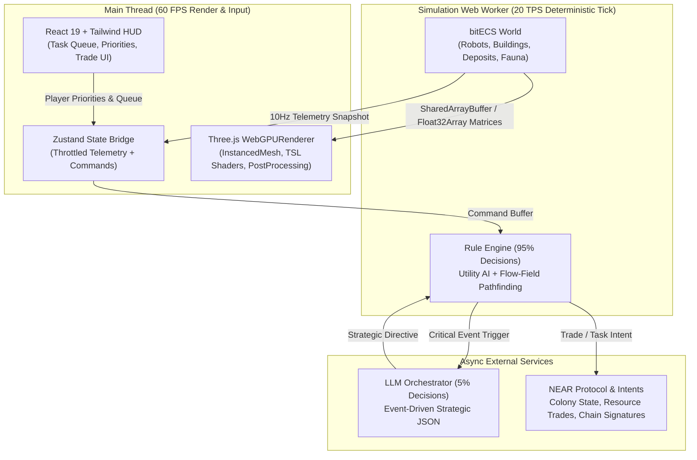

# TerraAgent — Browser 3D Tech Stack & Architecture Specification

**Target Project:** Autonomous Colony Builder (NEAR Hackathon 2026)  
**Target Platform:** Modern Web Browser (60 FPS Desktop & Laptop, Zero Install)  
**Core Engine:** Three.js (`r170+` WebGPU / WebGL2 Hybrid)

---

## 1. Executive Summary & Architectural Philosophy

An autonomous colony builder ("Factorio-lite" + RTS + multi-planet simulation) has very different technical constraints from a typical 3D website:
1. **High Entity Count:** Hundreds of autonomous robots, resource nodes, buildings, projectiles, and terrain tiles active simultaneously.
2. **Continuous Simulation + Heavy UI:** Complex economy telemetry, task queues, AI orchestrator logs, and NEAR blockchain intents must never stutter the 60 FPS 3D viewport.
3. **Rapid Hackathon Iteration:** The stack must be 100% TypeScript, hot-reload instantaneously, and be maximally ergonomic for **AI coding agents** to read, write, and extend without hallucinating legacy APIs.

### Recommended Core Stack at a Glance

| Layer | Technology Choice | Why This Wins for TerraAgent |
| :--- | :--- | :--- |
| **Build & Bundler** | **Vite 6 + TypeScript** | Instant HMR, native Web Worker bundling, clean asset pipeline. |
| **3D Engine** | **Vanilla Three.js (`r170+`)** (`WebGPURenderer` + TSL) | Direct control over `InstancedMesh`, `BatchedMesh`, and GPU buffers without React reconciliation overhead on 1,000+ moving units. |
| **Shader System** | **TSL (Three.js Shading Language)** | Write shaders in TypeScript (NodeMaterials) instead of fragile GLSL strings; compiles to both WebGPU (WGSL) and WebGL2 (GLSL). |
| **ECS / Simulation** | **bitECS** (or **Miniplex**) in a Fixed Timestep | Structure-of-Arrays (SoA) typed arrays map directly to Three.js `InstancedBufferAttribute` matrices for zero-GC-pause updates. |
| **Pathfinding & Sim** | **Web Worker** (`RedBlobGames` Hex Flow Fields / A*) | Keeps pathfinding, rule-engine scoring, and terrain cellular automata off the main UI/render thread. |
| **2D UI / HUD Overlay** | **React 19 + Tailwind CSS v4 + Zustand** | HTML/CSS is vastly superior to 3D canvas UI for complex RTS dashboards, priority queues, trade tables, and NEAR wallet modals. |
| **Audio / Juice** | **Howler.js** + **Motion (Framer)** | Spatial SFX for mining/lasers/weather + crisp HUD micro-animations. |
| **3D Asset Pipeline** | **@gltf-transform/cli** + **Meshopt** + **KTX2** | Compresses AI-generated `.glb` models by 80–90% and normalizes pivots, polycounts, and materials automatically. |
| **Web3 & AI Layer** | **NEAR JS SDK (`@near-js/*`)** + **NEAR Intents** + **JSON Schema LLM** | Non-blocking async intents; 95% local deterministic Rule Engine + 5% event-driven LLM Director calls. |

---

## 2. Why Vanilla Three.js Core + React HUD (Instead of Full React Three Fiber)

While **React Three Fiber (R3F)** is great for product configurators, in a simulation/RTS game where AI coding agents write procedural generators, custom instanced buffers, and tick-by-tick simulation loops:
- **Vanilla Three.js for the Canvas** avoids React component lifecycle clashes with imperative `InstancedMesh` matrix updates, `BufferGeometryUtils` kitbashing, and TSL node graphs.
- **React for the 2D HUD Overlay** sits as a transparent `<div class="pointer-events-none fixed inset-0">` over the `<canvas>`, subscribing to simulation state via **Zustand** (throttled to 10–15 Hz for resource counters so React never re-renders at 60 Hz).



---

## 3. High-Performance Rendering Architecture for Colony Scale

To render an entire planet sector with hundreds of active robots, factories, turrets, trees, rocks, and weather effects at a locked 60 FPS in a browser:

### 3.1 Zero-Draw-Call Explosion via `InstancedMesh` & `BatchedMesh`
Never call `scene.add(new THREE.Mesh())` for individual units, resources, or projectiles.
1. **Homogeneous Entities (`THREE.InstancedMesh`):**
   - One `InstancedMesh` per unit archetype (e.g., `MinerBot`, `CombatBot`, `CrystalDeposit`, `AlienSwarmer`, `LaserBolt`).
   - Attach custom `InstancedBufferAttribute` buffers for:
     - `instanceColor` / `aStateColor`: Health status, faction tint, or energy charge level.
     - `aAnimData` (`vec4`): `[animPhase, speed, taskState, hitFlash]` — used by the vertex shader to animate hover-bobbing, wheel rotation, mining lasers, or damage flashes **entirely on the GPU** without CPU `AnimationMixer` overhead.
2. **Heterogeneous Buildings (`THREE.BatchedMesh` or Merged Archetypes):**
   - Buildings (Solar Panels, Wind Turbines, Hydro Dams, Factories, Rocket Silos) share a **single unified Triplanar/Palette NodeMaterial** so the entire colony base renders in **< 10 draw calls**.

### 3.2 GPU-Driven Animation (Vertex Shaders via TSL)
Instead of rigging and skinning 500 robots on the CPU:
- Encode part IDs into **Vertex Colors** (`R` = chassis, `G` = rotating turret/rotor/dish, `B` = hovering thruster/wheel, `A` = emissive mask).
- In Three.js **TSL (Three Shading Language)**, rotate vertices where `vertexColor.g > 0.5` around their local pivot using `time * instanceSpeed`, and bob vertices where `vertexColor.b > 0.5` using `sin(time * 4.0 + instanceId)`.
- Result: Thousands of animated wind turbines, radar dishes, and mining bots at **zero CPU cost**.

### 3.3 Planetary Terrain & Terraforming Grid
- **Hexagonal or Dual-Grid Chunk System:**
  - Logical simulation runs on a **2D Hex Grid** (axial coordinates `q, r`) or **Square Dual-Grid** (where visual tiles sit offset by `0.5` from logical vertices, automatically producing smooth organic coastlines and biome transitions with only 16 tile permutations).
- **GPU Terraforming Splatmap:**
  - Store planet terraforming progress, moisture, and pollution in a dynamic `THREE.DataTexture` (`RGBA`, e.g., `256x256` covering the map).
  - As terraforming machines run, update pixels in the `DataTexture` and set `texture.needsUpdate = true`.
  - The terrain TSL shader blends smoothly between **Barren/Arid/Ice rock** and **Lush Terraformed grass/water** with a glowing terraforming frontier ring—no mesh rebuilding required!

---

## 4. Recommended Project Directory Structure

```text
TerraAgent/
├── public/
│   ├── assets/
│   │   ├── models/          # Optimized, Meshopt-compressed .glb files
│   │   ├── matcaps/         # Curated 512x512 matcap & LUT textures
│   │   └── hdri/            # Compressed .hdr / .ktx2 environment maps
├── scripts/
│   └── optimize-assets.mjs  # Automated gltf-transform pipeline for AI 3D models
├── src/
│   ├── core/
│   │   ├── Engine.ts        # WebGPURenderer, Camera, PostProcessing pipeline
│   │   ├── AssetManager.ts  # GLTF + KTX2 loader + Material Unifier override
│   │   └── InputManager.ts  # Raycasting against mathematical ground plane / hex grid
│   ├── visuals/
│   │   ├── Palette.ts       # Strict physically-based color & emissive constants
│   │   ├── materials/       # Unified TSL NodeMaterials (Triplanar, Toon-PBR, Hologram)
│   │   ├── kitbash/         # Procedural hard-surface generator & greeble library
│   │   ├── TerrainMesh.ts   # Hex/Dual-grid terrain + GPU terraforming splatmap
│   │   └── VFXManager.ts    # Instanced particles (sandstorms, meteors, lasers, smoke)
│   ├── simulation/
│   │   ├── worker.ts        # Fixed-timestep simulation loop
│   │   ├── ecs/             # bitECS components & systems
│   │   ├── RuleEngine.ts    # 95% autonomous colony utility AI
│   │   └──LLMDirector.ts    # 5% event-driven strategic LLM orchestrator
│   ├── near/
│   │   └── NearIntents.ts   # Invisible chain signatures & inter-colony trade intents
│   └── ui/
│       ├── HUD.tsx          # Tactical orbital overlay, task queue, priority sliders
│       └── store.ts         # Zustand bridge between Worker and React UI
```

---

## 5. Core NPM Dependencies Blueprint

```json
{
  "dependencies": {
    "three": "^0.174.0",
    "bitecs": "^0.4.0",
    "zustand": "^5.0.0",
    "react": "^19.0.0",
    "react-dom": "^19.0.0",
    "lucide-react": "^0.470.0",
    "howler": "^2.2.4",
    "@near-js/accounts": "^1.2.0",
    "@near-js/transactions": "^1.2.0"
  },
  "devDependencies": {
    "@gltf-transform/cli": "^4.1.0",
    "@gltf-transform/core": "^4.1.0",
    "@gltf-transform/extensions": "^4.1.0",
    "@gltf-transform/functions": "^4.1.0",
    "meshoptimizer": "^0.22.0",
    "typescript": "^5.7.0",
    "vite": "^6.1.0",
    "tailwindcss": "^4.0.0"
  }
}
```
