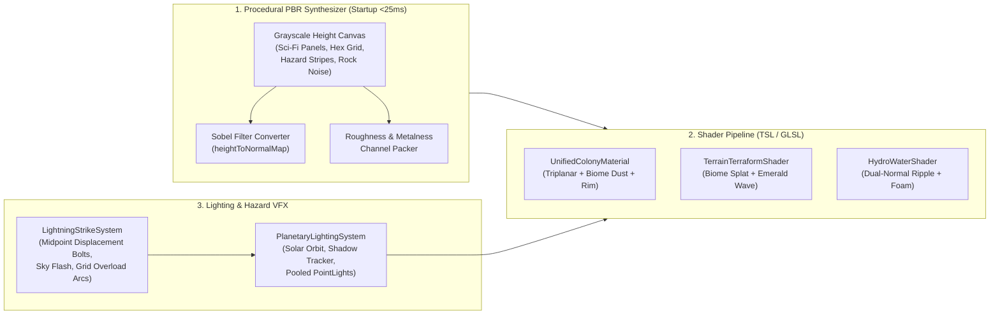

# TerraAgent — Procedural Texturing, Shaders, Lighting & Lightning VFX Specification

**Target Project:** Autonomous Colony Builder (NEAR Hackathon 2026)  
**Scope:** Zero-External-Asset Procedural PBR Texturing, Terrain/Water/VFX Shaders, Dynamic Planetary Lighting, and Procedural 3D Lightning Hazard System

---

## 1. Why Procedural Texturing + Unified Shaders Beat Static Texture Files

When AI coding agents build 3D games, static `.png`/`.jpg` texture files are a major bottleneck:
- Coding agents cannot directly "paint" binary PNG files in code, so they fall back to untextured solid colors.
- External textures from different sources have mismatched texel densities, seams, and megabytes of download overhead.

### The Solution: Startup Canvas2D / `DataTexture` PBR Synthesis (`< 25ms`)
By synthesizing tileable `512x512` Height, Normal (via Sobel filter), Roughness, and Emissive maps on an offscreen `<canvas>` or `Uint8Array` `DataTexture` at startup:
1. **Coding agents have 100% programmatic control** over panel seams, rivets, hexagonal solar cells, hazard stripes, and rock/sand/ice strata.
2. **Automatic Normal Maps:** Agents only draw a grayscale height pattern (`0.0 = groove`, `1.0 = raised plate`); the `heightToNormalMap()` utility automatically computes tangent-space `RGB` normal maps so every panel line catches directional sunlight!
3. **Combined with Triplanar Mapping:** Even meshes with zero or broken UV coordinates receive crisp, distortion-free panel lines and surface grain.

---

## 2. Procedural Texture Catalog (`procedural-texture-synthesis`)

Every colony structure, robot, and terrain tile draws from 5 core procedural PBR texture generators:

| Generator ID | Generated Maps | Visual Pattern | Used On |
| :--- | :--- | :--- | :--- |
| `scifiHullPanels` | `normalMap`, `roughnessMap`, `aoMap` | Interlocking chamfered rectangular plates, recessed seam grooves, corner bolt indentations, and micro-scratches. | Robot hulls, Factories, Rocket Silo, Command Hub |
| `solarHexGrid` | `map`, `normalMap`, `roughnessMap`, `emissiveMap` | Deep photovoltaic blue hexagonal cells framed by raised silver busbars and subtle cyan charge glow. | Solar Stations, Satellite Wings |
| `industrialHazardStripes` | `map`, `roughnessMap` | 45-degree alternating safety-amber (`#E59838`) and dark gunmetal (`#242933`) caution stripes with edge wear. | Foundation plinths, Miner bumpers, Landing pads |
| `CoolingLouverVents` | `normalMap`, `aoMap`, `emissiveMap` | Parallel Recessed dark slats with optional internal thermal orange/cyan heat glow. | Nuclear Reactors, Generators, Robot exhausts |
| `biomeTerrainNoise` | `DataTexture (RGBA)` | `R`: Multi-octave FBM height, `G`: Voronoi rock cracks, `B`: Moisture/ripple mask, `A`: Detail grain. | Temperate, Arid Desert, and Ice terrain + Ground-Up Weathering |

---

## 3. Core Game Shader Systems (`shader-texture-tuning`)

### 3.1 Multi-Biome Terrain & Dynamic Terraforming Frontier Shader
- **Inputs:**
  - `uTerraformMap` (`256x256` dynamic `DataTexture` updated whenever terraforming machines operate).
  - Biome preset colors (`barrenLow`, `barrenHigh`, `slopeRock`, `terraformedLush`).
- **Shader Logic:**
  1. **Slope & Elevation Splatting:** Steep slopes (`normal.y < 0.75`) automatically expose striated cliff rock via triplanar projection; flat basins accumulate sand/snow/soil.
  2. **Terraforming Wave Transition:** Where `uTerraformMap.r` crosses `0.5`, the shader renders a **glowing HDR emerald plasma ring** (`COLONY_PALETTE.terraformEmerald`, `intensity: 3.5`) with animated hex scanlines, smoothly morphing barren dust into lush terraformed ground inside the radius.

### 3.2 Hydro / Coolant / Ice-Thaw Water Shader
- Used for **Temperate rivers**, **Hydro Energy Stations**, and **Terraforming Thaws**:
  1. **Dual-Scrolling Procedural Normals:** Two octaves of procedural wave normals scrolling at opposing angles (`vec2(1.0, 0.4)` and `vec2(-0.6, 0.8)`) create shimmering specular sun reflections.
  2. **Depth & Shoreline Foam:** Compares fragment height against terrain height (`waterY - terrainY`); shallow edges (`< 0.18m`) render crisp animated white shoreline foam and higher transparency.

---

## 4. Dynamic Planetary Lighting System (`planetary-lighting-and-lightning`)

In `autonomous-colony-spec.md`, **Solar Energy depends on time of day and weather**, and **Night / Storms** create tactical vulnerability. The lighting system links simulation state directly to Three.js rendering:

### 4.1 Orbital Solar Cycle (Day $\rightarrow$ Golden Hour $\rightarrow$ Night)
- Controlled by `solarElevation` (`-0.3` to `+1.0`):
  - **Midday (`elevation > 0.35`):** Crisp high-angle shadows, warm white sun (`intensity: 3.2`), 100% Solar Station output.
  - **Dusk / Dawn (`0.0` to `0.35`):** Sun angle drops to `15°`, `sunLight.color` shifts to deep amber-coral (`0xff7b47`), long dramatic shadows across the colony, 40% Solar output.
  - **Night (`elevation < 0.0`):** Key light transitions to cool orbital moonlight (`0x4cc9f0`, `intensity: 0.65`), while **colony building emissives and pooled point lights automatically ramp up by `1.5x`**, making energy grids and robot headlights glow dramatically under `UnrealBloomPass`.

### 4.2 Zero-Stutter Pooled Dynamic Point Lights (`LightPool`)
- **Problem:** Adding or removing `THREE.PointLight` objects at runtime forces Three.js to recompile every PBR shader in the scene, causing a `100ms–400ms` frame freeze!
- **Best Practice Solution:** Pre-allocate a fixed pool of **8 `THREE.PointLight` instances** at scene init with `intensity = 0` and `distance = 12`.
- Whenever a mining laser fires, a lightning bolt strikes, a turret shoots, or a rocket ignites, lease a light from `LightPool`, tween its intensity/position, and return it to `intensity = 0` when finished—**zero shader recompilations ever**.

### 4.3 Target-Following Shadow Frustum
- Every frame, snap `sunLight.target.position` to the camera's ground intersection point (quantized to `1.0m` texel increments to prevent shadow-edge shimmering when panning the camera).

---

## 5. Procedural 3D Lightning & Weather Hazard System

Section 6 of `autonomous-colony-spec.md` specifies **Lightning (damages power grid)**, **Sandstorms**, **Blizzards**, and **Radiation Anomalies**.

### 5.1 Midpoint-Displacement 3D Lightning Bolts
Instead of flat 2D sprites, lightning strikes are generated procedurally in 3D:
1. **Main Trunk:** Subdivide the segment from sky `(targetX + jitter, 45, targetZ + jitter)` to the target building `(targetX, buildingTopY, targetZ)` across 6 recursive midpoint-displacement passes (`offset *= 0.5` per pass).
2. **Branching Forks:** At 30% of interior nodes, spawn secondary child branches angled outward at `25°–40°` that taper to zero radius.
3. **HDR Plasma Material:** Render using an additive/unlit `MeshBasicMaterial` with HDR color `[0.4 * 6.0, 0.85 * 6.0, 1.0 * 6.0]` so `UnrealBloomPass` surrounds the jagged core with an intense electric corona.
4. **Synchronized Multi-Sensory Impact:**
   - **Sky Exposure Flash:** Spikes `hemiLight.intensity` by `+4.0` with a double-flicker decay curve (`t = 0ms`, `t = 70ms`).
   - **Pooled PointLight Flash:** Leases a `LightPool` node at the impact point (`intensity: 15.0`, `distance: 25m`) casting real local illumination on nearby robots and buildings.
   - **Power-Grid Overload Arcs:** When a power station is damaged by lightning, smaller procedural electric arcs jump across its hull every `0.4s` until repaired by a robot!
