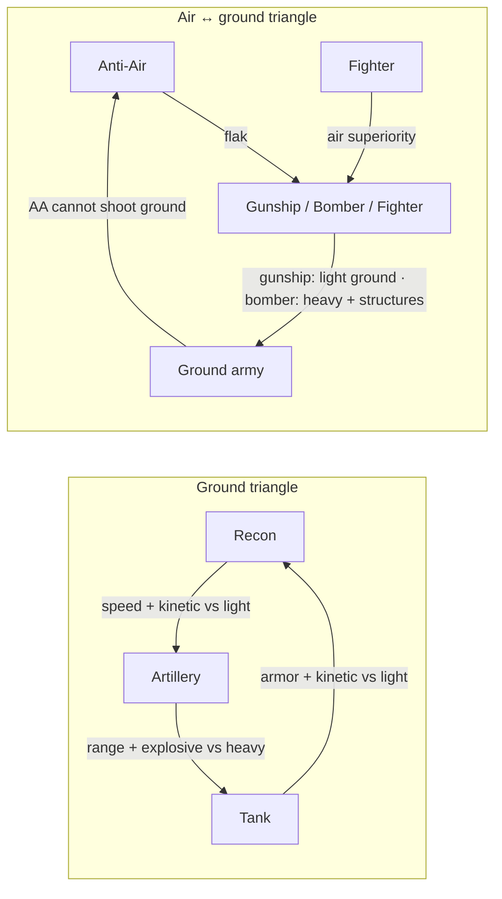

# TerraAgent — Unit Roster, Orders & Learning-Curve Specification

> **Status:** Draft v0.1 (2026-10-29) — for owner review. Proposes decision **D-16** ([`docs/spec/DECISIONS.md`](./docs/spec/DECISIONS.md)).
> **Supersedes:** robot table in [`colony-economy-and-buildings-spec.md`](./colony-economy-and-buildings-spec.md) §4 and [`docs/spec/SIMULATION.md`](./docs/spec/SIMULATION.md) §7.2.
> **Builds on:** buildings, costs, power and territory from `colony-economy-and-buildings-spec.md`; tick model, commands and rule engine from `SIMULATION.md`; away-mode rules from `CONTINUITY.md`; directives from `AI_ORCHESTRATOR.md`.
> **Reference game:** read "Total Commander" as **Total Annihilation / Supreme Commander**: one irreplaceable Commander who builds the base, worker tiers that gate tech, build queues that wait for resources, and counter-based army composition.

Numbers are **proposed** and owner-tunable. They will live in `shared/sim/src/data/*.ts` and never in system code. Rule IDs (`UO-…`) are for tracing into tests.

---

## 1. Design goals

1. **A small roster.** 14 unit types in total. Each one has one job that no other unit does as well.
2. **Indirect control.** The player gives orders through four menus (Construction, Terraform, Units, HQ Goals). Every order goes into the colony's local queue. Workers and factories pick orders up when resources and a capable worker are available.
3. **Rock–paper–scissors combat.** Counters come from a damage-type × armor-class matrix plus range and speed differences, not from hidden bonuses. §5.5 verifies them with equal-cost duels.
4. **A strict learning curve.** Content unlocks in 11 stages (S0–S10). Each stage teaches **one** new mechanic and adds **at most two** new unit types. Threat scales with the colony's stage, not with wall-clock time. Every new unit first meets a PvE enemy it counters (§6).

---

## 2. Roster (14 types)

| # | Id | Name | Role | Armor | Built at | Stage | Visual archetype (kitbash) |
|---|---|---|---|---|---|---|---|
| 1 | `hq` | **HQ Drone** (Commander) | Builds the Command Hub, holds the HQ goal queue, negotiates; multirole from T2 | Command | Drop pod / reprinted by Hub | S0 | `robot.hero` (exists) |
| 2 | `harvester` | Harvester Drone (T1) | Harvests surface deposits, clears tiles | Light | Command Hub T1+ | S1 | `robot.miner` (exists) |
| 3 | `builder` | Builder / Repair Drone (T1) | Builds T1 structures, repairs anything | Light | Command Hub T1+ | S2 | `robot.builder` (exists) |
| 4 | `terraformer` | Terraform Drone (T1) | Tile operations: level, irrigate, seed | Light | Command Hub T1+ | S4 | `robot.terraformer` (new) |
| 5 | `multitask` | Multitask Drone (T2, T3) | Any worker lane; builds T2 (T3) structures | Light | Command Hub T2 (T3) | S5 / S10 | `robot.multitask` (new) |
| 6 | `recon` | Recon Battle Drone | Fast skirmisher, scouting, kills light targets | Light | Robotics Factory T1+ | S3 | `robot.combat` (exists, re-skin) |
| 7 | `tank` | Close-Combat Tank | Armored line holder, kills light targets | Heavy | Robotics Factory T2+ | S6 | `unit.tank` (new) |
| 8 | `artillery` | Long-Range Artillery | Siege; kills heavy units and structures | Light | Robotics Factory T2+ | S6 | `unit.artillery` (new) |
| 9 | `radar` | Mobile Radar Drone | Wide detection, spots for artillery | Light | Robotics Factory T2+ | S7 | `unit.radar` (new) |
| 10 | `aa` | Anti-Air Track | Ground unit, shoots air only | Heavy | Robotics Factory T1+ | S8 | `unit.aa` (new) |
| 11 | `airRecon` | Air Recon | Fastest unit, wide vision, unarmed | Air | Aero Hangar T2+ | S8 | `air.recon` (new) |
| 12 | `fighter` | Air Fighter | Air superiority, shoots air only | Air | Aero Hangar T2+ | S9 | `air.fighter` (new) |
| 13 | `gunship` | Air Gunship | Hovering anti-light-ground | Air | Aero Hangar T2+ | S9 | `air.gunship` (new) |
| 14 | `bomber` | Air Bomber | Strategic siege of heavy units and structures | Air | Aero Hangar T3 | S10 | `air.bomber` (new) |

There are three worker lanes and one army. There are no tiers inside combat types: variety comes from **types**, as in Total Annihilation, not from Mk.II versions of the same unit. Workers have tiers only where the user asked for them: specialists are T1, Multitask is T2/T3, and the HQ is T1–T3.

New 3D archetypes follow `AGENTS.md` Pillar 1 (`procedural-kitbash-3d`): at least 7 parts, a silhouette breaker, and the 60/30/10 material split. Each role should be readable from its silhouette: AA has upward barrels, artillery a long barrel, radar a dish, the tank is low and wide, and recon is small and tall-legged.

---

## 3. Core rules

### 3.1 Lanes and who works them (`UO-L`)

| Worker | Construction | Harvest | Terraform | Max structure tier it can build | Work rate |
|---|:-:|:-:|:-:|:-:|:-:|
| HQ T1 | ✔ | — | Clear only | T1 + Command Hub (any tier) | 1.5× |
| HQ T2 | ✔ | ✔ | ✔ | T2 + Command Hub | 2.5× |
| HQ T3 | ✔ | ✔ | ✔ | All ("build all") | 4.0× |
| Harvester | — | ✔ | Clear only | — | 1.0× |
| Builder | ✔ (+ repair) | — | — | T1 | 1.0× |
| Terraformer | — | — | ✔ | — | 1.0× |
| Multitask T2 | ✔ | ✔ | ✔ | T2 | 2.0× |
| Multitask T3 | ✔ | ✔ | ✔ | T3 | 5.0× |

- `UO-L-01` **Harvest is a standing job, not a queue.** Harvest-capable workers that are not busy work the nearest surface deposit of the most-needed resource. The weighting comes from the `economy` priority and the per-resource harvest weights in the Construction menu. They never need an order.
- `UO-L-02` **Tech rule.** A worker can build or upgrade a structure only up to its own max tier. **Repair has no tier limit.** Every worker that can build can repair, and the Builder repairs at 1.5× its build rate. This keeps the cheap Builder useful late in the game.
- `UO-L-03` **The Command Hub is HQ-only.** Only the HQ Drone can build a Command Hub or upgrade one in place. Hub tier is the colony's tech level. A structure of tier N needs Hub tier ≥ N **and** a worker of tier ≥ N. This breaks the "T2 worker needs a T2 Hub, which needs a T2 worker" loop.
- `UO-L-04` **Assist.** Up to 4 workers can work on one construction job, and their rates add. A terraform area order splits its tiles across up to 8 workers.
- `UO-L-05` "Build time" in every table means seconds at **1.0×**. Actual time = build time ÷ Σ assigned rates.

### 3.2 HQ Drone (Commander) (`UO-HQ`)

| Tier | HP | Armor | Speed | Vision | Weapon (self-defense) | Work rate / lanes | Active HQ goals | Open trade offers | Reprint at Hub (cost / time) |
|---|---|---|---|---|---|---|---|---|---|
| T1 | 900 | Command | 1.6 t/s | 9 | 12 DPS kinetic, range 5 | 1.5× construction | 2 | 1 (≤ 250 units) | 200/100/50/50 · 60 s |
| T2 | 2 200 | Command | 1.8 t/s | 10 | 25 DPS kinetic, range 5 | 2.5× all lanes | 3 | 3 (≤ 900 units) | 500/300/150/100 · 90 s |
| T3 | 5 000 | Command | 2.0 t/s | 12 | 60 DPS kinetic, range 6 | 4.0× all lanes, all tiers | 5 | 6 (≤ 3 500 units) | 1 200/800/400/300 · 150 s |

- `UO-HQ-01` **HQ tier follows Hub tier.** When a Hub upgrade completes, the HQ docks at the Hub for a free 20 s refit and comes back at the new tier. There is only one HQ per colony. It costs **0 supply** and has **no grid draw** (it has its own power cell).
- `UO-HQ-02` The **Command** armor class takes 75 % damage from every damage type, so the HQ is hard to snipe.
- `UO-HQ-03` **Self-preservation.** Below 40 % HP the HQ drops its current job, retreats to the Hub and self-repairs at 1 % HP/s inside Hub range. The player cannot override this while the newcomer shield (§6.3) is active.
- `UO-HQ-04` **Loss and elimination.** This replaces SIMULATION §7.7 "Elimination".
  - HQ destroyed, Hub alive: the Hub reprints the HQ (table above). The reprint is the top item in the Units lane and jumps every queue. Construction of tier ≥ T2 and Hub upgrades pause until the HQ is back.
  - Hub destroyed, HQ alive: the colony becomes `critical`. The HQ must rebuild a Hub within 6 000 ticks (10 min). The HQ goal "Re-establish" is queued automatically.
  - Both destroyed, or the 10-min window runs out: the colony is `eliminated` (ruins rules unchanged).
- `UO-HQ-05` **Negotiation.** The HQ is the colony's diplomat. A "Negotiate" goal (§4.6) creates trade offers through the existing trade saga (NEAR.md §7). Two things are needed: first contact with the neighbor, and an online Inter-Colony Trade Hub T1 (unchanged). HQ tier sets how many offers can be open at once. Truces and non-aggression pacts are **post-MVP** (open question Q6).

### 3.3 Supply and upkeep (`UO-S`)

- `UO-S-01` Supply caps are unchanged from the economy spec: Hub T1/T2/T3 gives +10/+25/+60; Drone Control Array T1/T2/T3 gives +8/+22/+60.
- `UO-S-02` A unit's grid draw (−E/s) is paid in full while it works, moves or fights, and at **50 % while idle**. Army upkeep is real power, as in Total Annihilation. Ten tanks cost about one Solar T2's output.
- `UO-S-03` **Global economy scale.** `ECONOMY_RATE_SCALE = 0.25` multiplies every **resource** flow: extraction, harvesting, fuel and coolant upkeep, terraform water use, and ammo. Energy flows (E/s) and every cost stay as they are. Why: with the economy spec's rates as written, a single T1 Metals Extractor pays for a Hub T2 upgrade in under 2 minutes, which would compress S0–S10 into roughly 20 minutes. §6.4 checks the pacing under the scale.

---

## 4. Orders: menus and the local queue

### 4.1 Menus (`UO-M`)

| Menu | Contents | Opened by |
|---|---|---|
| **Construction** | Build (place a ghost footprint) · Upgrade (in place) · Power line (drag a pylon chain = 1 order) · Demolish · Harvest weights (per-resource sliders, applied immediately, not queued) | S0 |
| **Terraform** | Clear (S1) · Level / Irrigate / Seed (S4). Single tile or area brush. One brush stroke = 1 order | S1 |
| **Units** | Produce N × unit (with a repeat toggle) · Rally point · Stance (Hold / Defend area / Hunt) · Attack-move to tile | S1 (workers), S3 (army) |
| **HQ Goals** | High-level goals that the HQ breaks down into orders in the other three lanes (§4.6) | S0 (tutorial goal pre-queued) |

A menu shows only what is unlocked. Locked items for the next stage are shown greyed out with their unlock condition, so the player always sees the next step.

### 4.2 Queue entry lifecycle (`UO-Q`)

```
queued → waiting(resources | storage | worker | power | site) → in_progress(%) → done
        ↘ cancelled                                  ↘ cancelled (refund 75 %)
```

- `UO-Q-01` **An entry is an intent. Nothing is paid when it is queued.** The cost is paid in one lump sum when work **starts**: when a worker arrives at the site, or when a factory slot begins the unit. This replaces `SIM-C-03` "deducted at acceptance". The Hub reprint (UO-HQ-04) is paid the same way.
- `UO-Q-02` Cancelling a waiting entry is free. Cancelling an in-progress entry refunds 75 % (unchanged). Demolish refunds 50 % (unchanged).
- `UO-Q-03` Every waiting entry shows **why** it is waiting and an ETA. Example: "waiting: Minerals 40/75 · ~50 s at +0.75/s". This is the most important feedback for learning.
- `UO-Q-04` Validation still happens on enqueue (territory, tier unlocked, footprint free). Resources are checked again at start. If a site becomes invalid, the entry goes to `waiting(site)` and is not dropped.
- `UO-Q-05` **Storage.** If any part of an entry's cost is larger than the colony's storage cap for that resource, the entry can never start. It shows `waiting(storage)` with a one-click hint to build or upgrade a Supply Depot. Example: the Rocket Silo T2 needs 1 800 M, but Hub T2 storage alone holds 1 500. This is a deliberate learning beat: "bigger projects need bigger warehouses".

### 4.3 Dispatch (`UO-D`)

Dispatch runs every 10 ticks per lane, staggered like the rule engine.

- `UO-D-01` The dispatcher scans entries in precedence order (§4.4). It starts the **first** entry that is affordable and has an eligible worker or factory slot free. A blocked entry does not block the entries behind it.
- `UO-D-02` **Earmark (anti-starvation).** Once an entry has waited on resources for ≥ 60 s, the amounts it is short of are earmarked. Later entries can spend only stock above the earmark. The oldest blocked entry earmarks first. Earmarks are shown in the HUD. The total earmark per resource never exceeds 80 % of the storage cap, and entries in `waiting(storage)` never earmark.
- `UO-D-03` Worker choice: the nearest idle eligible worker. Ties go to the lowest tier first, so expensive multirole workers stay free for jobs only they can do. Workers busy on a lower-precedence job get pre-empted only by `player` entries.
- `UO-D-04` Units lane: each entry is sent to the least-loaded production building that can build that type. Each production building has a 5-slot local buffer.

### 4.4 Precedence and limits (`UO-P`)

| Source | Precedence | Notes |
|---|---|---|
| `system` (HQ reprint, critical repair) | 0 (highest) | Repair floor from `SIM-R-03` |
| `player` (direct menu orders) | 1 | FIFO; the player can drag to reorder |
| `hq` (orders broken down from player HQ goals) | 2 | Tagged with the goal id; budget-capped (§4.6) |
| `ai` (AI-director directive) | 3 | Unchanged `SIM-R-04` limits and away policy |
| `auto` (rule-engine housekeeping) | 4 | Dropped first when a lane is full |

Limits per colony: Construction 20 entries, Terraform 20, Units 10 (plus 5 per production building), HQ goals 2/3/5 by HQ tier. These replace the single 50-task cap in `SIM-C-04`.

### 4.5 Terraform tile operations (`UO-TF`)

Tile states go **Wild → Cleared → Leveled → Irrigated → Living**. Placing a building on a Wild tile adds a Clear sub-job automatically. **Any worker assigned to that construction order may do its Clear sub-job**, including a Builder, so a building ordered on forest never stalls. Standalone Clear orders keep the eligibility in the table.

| Op | From → to | Time / tile @1.0× | Cost / tile | Who | Unlock |
|---|---|---|---|---|---|
| Clear | Wild (forest/rock) → Cleared | 6 s | 0 · yields +10 M (rock) or +5 Pet (forest) | HQ, Harvester, Terraformer, Multitask | S1 |
| Level | slope ≤ 2 → buildable flat | 8 s | 2 Min | Terraformer, Multitask, HQ T2+ | S4 |
| Irrigate | Cleared/Leveled → Irrigated | 10 s | 15 W (×2 on Desert) | Terraformer, Multitask, HQ T2+ | S4 |
| Seed | Irrigated → **Living** | 15 s | 10 W + 5 Min | Terraformer, Multitask, HQ T2+ | S4 |

- `UO-TF-01` Colony **Terraform %** = Living tiles ÷ owned tiles. It feeds colony score and the "control % + terraforming level" goal in `autonomous-colony-spec.md` §9.
- `UO-TF-02` Living tiles give +10 % move speed to ground units and +5 % output to adjacent extractors. The payoff is small but visible, so terraforming is not just a score number.
- `UO-TF-03` The Terraforming Processor (economy spec §3.6) stays as the late-game **area** tool, unlocked at S5. It turns tiles in its radius into Living on its own, using the economy spec's water and energy draw.

### 4.6 HQ goals (`UO-G`)

A goal is a target state. The HQ (rule engine, or the AI director when it has budget) keeps adding `hq`-tagged orders until the target is met or the goal's budget runs out.

| Goal | Unlock | Parameters | Breaks down into | Done when | Default budget |
|---|---|---|---|---|---|
| Establish Colony | S0 (pre-queued) | — | Hub, 1 extractor, 1 generator | all built | full stock |
| Grow Economy | S1 | target income per resource | extractors, harvesters, depots | income reached | 50 % of stock |
| Secure Power | S2 | target net E/s **at night** | generators, capacitors, pylons | target held for 1 night | 50 % |
| Defend Area | S3 | area, strength (low/med/high) | turrets, combat units, Drone Control Arrays, Defend stance | strength reached | 40 % |
| Clear Nest | S3 | nest | rally combat units, attack | nest destroyed | 30 % |
| Expand Toward | S4 | direction or deposit | Clear, beacons, pylons | tile(s) owned | 40 % |
| Terraform Zone | S4 | area, target state | tile ops | area reaches state | 30 % |
| Tech Up | S4 | target Hub tier | saves resources (earmarks), then upgrades Hub | Hub at tier | 100 % (saving) |
| Negotiate | neighbor contact + Trade Hub T1 | partner, give/want bounds | trade offers (HQ-signed) | accepted / expired | the bounds |
| Build Army | S6 | composition preset or "counter what you see" | Units-lane orders | composition reached | 40 % |
| Raid Colony | S6 + own newcomer shield off | target colony | attack-move with an army group | ends on command or when the army is gone | — |
| Prepare Rocket | S10 (MVP: S5) | — | Rocket Silo, stockpile | silo ready (launch still needs the player, `AW-12`) | 100 % |

- `UO-G-01` A goal's budget caps how much of current stock its orders may spend while active. Away-mode caps (`AW-20`) still apply on top.
- `UO-G-02` The breakdown is deterministic and lives in the rule engine. The AI director may **propose** goals (`DirectiveV1.queueGoal`, §7). It cannot create raw orders that go around goal budgets.
- `UO-G-03` **Each stage suggests a goal** (§6.2, last column) as a one-click card. This is the tutorial. It teaches the HQ-goal layer without a separate tutorial system.

---

## 5. Balance tables

Columns follow the economy spec: Cost `M / Min / Pet / W`, supply, grid draw (−E/s, idle 50 %), HP, build time at 1.0×. Speed and range are in tiles. DPS is base damage before the multiplier.

### 5.1 Workers

| Unit | Built at | Build | Cost | Supply | −E/s | HP | Speed | Vision | Rate & lanes |
|---|---|---|---|---|---|---|---|---|---|
| HQ T1 / T2 / T3 | see §3.2 | — | — | 0 | 0 | 900 / 2 200 / 5 000 | 1.6 / 1.8 / 2.0 | 9 / 10 / 12 | §3.1 |
| Harvester | Hub T1+ | 10 s | 40 / 15 / 5 / 0 | 1 | 1.5 | 160 | 1.5 | 7 | Harvest 2.0 res/s × `ECONOMY_RATE_SCALE` (= 0.5/s); Clear |
| Builder | Hub T1+ | 12 s | 45 / 25 / 10 / 0 | 1 | 2.0 | 150 | 1.5 | 7 | Build 1.0× (≤ T1); repair 1.5× (any tier) |
| Terraformer | Hub T1+ | 14 s | 50 / 30 / 5 / 10 | 1 | 2.5 | 170 | 1.3 | 7 | Terraform 1.0× |
| Multitask T2 | Hub T2+ | 26 s | 130 / 90 / 30 / 15 | 2 | 5.0 | 420 | 1.8 | 8 | All lanes 2.0×, builds ≤ T2 |
| Multitask T3 | Hub T3 | 55 s | 360 / 260 / 100 / 40 | 4 | 12.0 | 1 100 | 2.0 | 9 | All lanes 5.0×, builds ≤ T3 |

Design check: specialists give 1.0 work per supply and are about 2× cheaper per work unit. Multitask T2 gives 1.0 per supply and Multitask T3 gives 1.25 per supply, plus flexibility, higher tiers and HP. When supply is the bottleneck (late game), multitask wins. When resources are the bottleneck (early game), specialists win. Both are right at different times, which is the lesson.

The existing Miner/Builder/Combat T2 and T3 rows in the economy spec §4 are **retired**: their roles moved to Multitask and to the combat types.

### 5.2 Combat units

| Unit | Built at | Build | Cost | Supply | −E/s | HP | Armor | Speed | Range (min) | DPS · type | Vision | Special |
|---|---|---|---|---|---|---|---|---|---|---|---|---|
| Recon | Factory T1+ | 14 s | 55 / 30 / 15 / 0 | 1 | 2.5 | 240 | Light | 3.0 | 4 | 14 · Kinetic | 10 | Fastest ground unit |
| Tank | Factory T2+ | 30 s | 160 / 90 / 40 / 10 | 2 | 6.0 | 900 | Heavy | 1.2 | 4 | 30 · Kinetic | 7 | — |
| Artillery | Factory T2+ | 32 s | 150 / 110 / 50 / 10 | 2 | 6.0 | 320 | Light | 1.1 | 14 (3) | 40 · Explosive | 6 | Splash 1.5; range is far beyond its own vision, so it needs a spotter |
| Mobile Radar | Factory T2+ | 20 s | 90 / 110 / 20 / 10 | 1 | 8.0 | 260 | Light | 1.6 | — | — | 10 | Radar 22 (contacts count as spotted for artillery); unarmed |
| Anti-Air | Factory T1+ | 24 s | 110 / 80 / 30 / 10 | 2 | 5.0 | 420 | Heavy | 1.5 | 10 | 40 · Flak | 9 (air 14) | Air targets only |
| Air Recon | Hangar T2+ | 18 s | 70 / 60 / 30 / 0 | 1 | 4.0 | 200 | Air | 6.0 | — | — | 14 | Unarmed; flies in straight lines |
| Fighter | Hangar T2+ | 28 s | 130 / 90 / 50 / 0 | 2 | 6.0 | 380 | Air | 5.0 | 6 | 40 · Flak | 10 | Air targets only |
| Gunship | Hangar T2+ | 34 s | 170 / 100 / 60 / 10 | 2 | 7.0 | 650 | Air | 3.0 | 5 | 32 · Kinetic | 9 | Ground targets only; hovers |
| Bomber | Hangar T3 | 45 s | 240 / 170 / 90 / 20 | 3 | 9.0 | 850 | Air | 3.5 | 2 (fly-over) | 45 · Explosive | 8 | Ground and structures only; splash 2.0 |

Production speed: Hub 1.0× (workers). Factory T1 1.0×, T2 1.5×, T3 2.2× (economy spec). Hangar T2 1.0×, T3 1.5×.

### 5.3 New building: Aero Hangar (`UO-B`)

Air gets its own production building, as in Total Annihilation's Aircraft Plant. This makes air a clear mid-game commitment. It has no T1.

| Building | Tier | Size | Build | Cost | −E/s | HP | Effect |
|---|---|---|---|---|---|---|---|
| Aero Hangar | T2 | 3×3 | 55 s | 300 / 220 / 120 / 40 | 24 | 2 000 | Builds Air Recon, Fighter, Gunship. Needs Hub T2 and stage S7 |
| Aero Hangar | T3 | 4×4 | 120 s | 850 / 680 / 340 / 120 | 65 | 5 200 | Adds Bomber; 1.5× speed. Needs Hub T3 |

Brownout shedding group: second, together with the Robotics Factory. Air units fly straight (no A\*) and ignore terrain and walls. They are blocked only by map bounds.

### 5.4 Damage × armor matrix (`UO-C`)

| Damage type → / armor ↓ | **Light** | **Heavy** | **Structure** | **Air** | **Command** (HQ) |
|---|---|---|---|---|---|
| **Kinetic** (Recon, Tank, Gunship, HQ, Autocannon) | **150 %** | 50 % | 50 % | 50 %¹ | 75 % |
| **Explosive** (Artillery, Bomber) | 50 % | **150 %** | **150 %** | — | 75 % |
| **Flak** (Anti-Air, Fighter) | — | — | — | **175 %** | — |
| **Energy** (Laser Tower) | 100 % | 125 % | 75 % | 75 % | 75 % |
| **Bite** (fauna) | 100 % | 75 % | 100 % | — | 75 % |

¹ Only for weapons flagged `hitsAir`. Of the kinetic weapons, only the **Autocannon Turret** is flagged. It is every colony's baseline AA from S3 on, effectively 9 DPS against air at T1: weak, but never zero. "—" means the weapon cannot target that layer.

- `UO-C-01` **Targeting layers.** Every weapon has the flags `hitsGround`, `hitsAir` and `hitsStructure`. Units with no weapon for a layer ignore that layer.
- `UO-C-02` **Spotting.** A unit can fire only on targets inside the colony's shared vision (any unit, building, beacon vision or radar contact). Artillery range (14) is more than double its own vision (6), so pairing it with recon or radar is the lesson.
- `UO-C-03` Damage per tick is `DPS × multiplier` (integer bp math per `SIM-D`). Splash hits every target within the radius at 50 % past the centre tile. Target choice: the counter-preferred armor class first, then the nearest, then the lowest `entityId`.

### 5.5 Counters and verified duels



The balance contract is that **at equal cost, the counter wins clearly**. 1-v-1 results may differ; for example, one bomber beats one Anti-Air track. Results below come from a 1-D duel model: focus fire, the attacker closes from 16 tiles, splash and spotting ignored. Budget is about 1 200 resource units per side.

| Attacker (count) | Defender (count) | Winner | Survivors (winner) | Time |
|---|---|---|---|---|
| Tank (4) | Recon (12) | Tank | 4 / 4 | 20 s |
| Artillery (4) | Tank (4) | Artillery | 3 / 4 | 17 s |
| Recon (12) | Artillery (4) | Recon | 10 / 12 | 10 s |
| Anti-Air (5) | Gunship (4) | Anti-Air | 5 / 5 | 9 s |
| Anti-Air (5) | Bomber (2) | Anti-Air | 5 / 5 | 6 s |
| Anti-Air (5) | Fighter (4) | Anti-Air | 5 / 5 | 8 s |
| Fighter (4) | Gunship (4) | Fighter | 4 / 4 | 12 s |
| Fighter (4) | Bomber (2) | Fighter | 4 / 4 | 8 s |
| Gunship (4) | Recon (12) / Artillery (4) | Gunship | 4 / 4 | 19 s / 11 s |
| Bomber (2) | Tank (4) / Artillery (4) | Bomber | 2 / 2 | 31 s / 33 s |
| Tank (4) / Artillery (4) | Anti-Air (5) | Ground | 4 / 4 | 45 s / 11 s |

Equal-**supply** duels (12 supply per side) give the same winner in every row. The harness that reproduces these numbers becomes a CI test (§8, P-H).

### 5.6 Fauna roster (PvE teachers)

| Species | Appears at | HP | Armor | Speed | Attack | Behaviour | Teaches |
|---|---|---|---|---|---|---|---|
| Skitter (`fauna.skitter`, exists) | S3 | 120 | Light | 2.0 | 8 DPS Bite, melee | Swarm, nests | Recon and turrets beat light swarms |
| Brute (new) | S6 | 1 400 | Heavy | 1.0 | 30 DPS Bite, melee; 2× vs structures | Solo or pairs, walks at walls | Artillery beats heavy; recon cannot |
| Drifter (`fauna.drifter`, exists) | S8 | 180 | Air | 4.0 | 10 DPS Bite | Flocks of 4–8, drift over walls to extractors | Anti-Air and the air layer |

---

## 6. Learning curve

### 6.1 Principles (`UO-LC`)

- `UO-LC-01` **One mechanic per stage, at most two new unit types.**
- `UO-LC-02` **Every stage has a trigger and a minimum dwell time**, so nobody skips a lesson by accident. Safety triggers can override the dwell, because a threat must never arrive before its counter.
- `UO-LC-03` **Threat follows the colony's stage, not wall time.** Fauna raid size and composition come from `threatStage` (§6.3).
- `UO-LC-04` **A counter arrives before or with its threat.** A PvE enemy introduces each counter unit (§5.6). Enemy air seen by a colony before S8 unlocks S8's Anti-Air at once (it is built at Factory T1).
- `UO-LC-05` **Learn by hand, then automate.** A lane's autonomous growth (the rule engine adding `auto` orders) turns on **one stage after** the lane is introduced. Until then the rule engine only offers suggestions. Away-mode safety (repair, defend, rebuild per `AW-01..05`) is always on.
- `UO-LC-06` **Two separate stage counters.** `unlockStage` belongs to the player account and is the highest stage ever reached. New colonies inherit it, so veterans do not replay the tutorial on the next planet. `threatStage` belongs to the colony and is recomputed from what the colony has actually built. Threat always uses `threatStage`.
- `UO-LC-07` **What autopilot can and cannot advance.** The rule engine may complete the triggers for **S0–S4** on its own: Hub auto-placement, extractor + generator, Factory T1 + a combat unit when defense need is high. These are all T1 actions it already performs. **Tier upgrades (Hub T2/T3, Factory T2, Aero Hangar) need a player order or an accepted Tech Up goal.** Big strategic bets wait for the player (consistent with `AW-15`). An unattended colony therefore grows into S4 and holds there. `AC-03` tests exactly that.

### 6.2 Stage table

Times are targets for an engaged new player under `ECONOMY_RATE_SCALE = 0.25`. The first session (about 40 min) covers S0–S6, which is the whole MVP. Air comes in the second hour.

| Stage | Name | Trigger (all of) · min dwell | Teaches (the one mechanic) | New units | New buildings / orders | Target time | Suggested HQ goal |
|---|---|---|---|---|---|---|---|
| **S0** | Landfall | Colony spawned | Place and build | HQ T1 | Command Hub (player picks the site; auto-placed after 60 s if idle) | 0:00 | Establish Colony |
| **S1** | First Light | Hub T1 complete | Resources flow and power balance | Harvester | Metals Extractor, Solar T1; Terraform → Clear | ~0:30 | Grow Economy |
| **S2** | The Grid | Extractor and generator complete · dwell 2 min | Grid reach, parallel workers, storage, night | Builder | Pylon, Capacitor, Wind, Supply Depot, Minerals Quarry, Water Extractor, Petroleum Well | ~2:30 | Secure Power (first night is at 12:00) |
| **S3** | First Contact | S2 dwell 5 min, **or** fauna seen within 15 tiles (override) | Threat and defense, supply cap | Recon | Robotics Factory T1, Autocannon T1, Drone Control Array T1, Thermal Plant (its pollution attracts fauna) | ~8:00 | Defend Area → Clear Nest |
| **S4** | Shape the Land | Factory T1 built and 1 combat unit · dwell 6 min | Territory and terraforming | Terraformer | Territory Beacon T1; Terraform → Level / Irrigate / Seed; Hub T2 upgrade orderable **after 8 min in S4** | ~15:00 | Expand Toward, Terraform Zone, Tech Up |
| **S5** | Second Tier | **Hub T2 complete** (an HQ upgrade order, Δ 400/250/150/100) | Tiers and multirole: lanes merge | Multitask T2 (HQ → T2 refit) | T2 of Beacon, Solar, Extractors, Depot, DCA, Turret, Factory; Terraforming Processor T1; Trade Hub T1 if not yet unlocked | ~25:00 | Tech Up (Factory T2) |
| **S6** | Combined Arms | Factory T2 complete · dwell 5 min in S5 | Counters (the ground triangle) | Tank, Artillery | Army stances, attack-move, Build Army preset "counter what you see"; Brute fauna starts | ~32:00 | Build Army, Clear Nest (Brute) |
| **S7** | Eyes | First artillery built · dwell 5 min, or S6 + 10 min | Vision and spotting | Mobile Radar | Beacon T2 vision, Laser Tower T1, Aero Hangar T2 orderable | ~40:00 | Defend Area (radar) |
| **S8** | Skies | Aero Hangar T2 complete, **or** enemy air seen (override, Anti-Air only) | The air layer | Air Recon, Anti-Air | — ; Drifter fauna starts | ~50:00 | Defend Area (AA) |
| **S9** | Air War | First air unit built · dwell 10 min | The air triangle | Fighter, Gunship | — | ~1:00 | Build Army (air mix) |
| **S10** | Strategic | **Hub T3 complete** | Endgame tier and the rocket | Bomber, Multitask T3 (HQ → T3: "build all") | All T3 structures, Aero Hangar T3, Rocket Silo | ~1:30 | Prepare Rocket |

**Side unlock (event-driven, not a stage):** the first `neighborContact` at S2 or later unlocks the Inter-Colony Trade Hub T1 and the HQ "Negotiate" goal. An event-driven unlock teaches diplomacy when it first becomes relevant.

### 6.3 Threat scaling and protection (`UO-T`)

| Rule | Value (proposed) | Replaces |
|---|---|---|
| `UO-T-01` First fauna raid | Not before S3 + 5 min | SIM §7.6 raids starting at tick 0 |
| `UO-T-02` Raid size | `2 + threatStage` creatures, cap 12; +1 per Thermal Plant (pollution) | `3 + ⌊tick/72 000⌋` |
| `UO-T-03` Raid composition | S3–S5 Skitters · S6+ adds 1 Brute per 4 · S8+ adds a Drifter flock | 1 species |
| `UO-T-04` Raid interval | 10 min per colony (unchanged), chance `10 % + 5 % × thermal` (unchanged) | — |
| `UO-T-05` **Newcomer shield** (PvP) | Raid-protected until `threatStage ≥ S6` or 6 h of colony age, whichever comes first. The shield ends at once if the colony starts a raid itself | the fixed 2 h `raidProtectedUntil` |
| `UO-T-06` `threatStage` | The highest stage whose **gating building** the colony currently owns, so losing the Factory T2 lowers it | — |

Why the shield is needed: planets admit players for 24 h (D-12). A new player can therefore land next to a veteran with gunships. The shield covers that gap until the newcomer has the ground triangle, and baseline AA (the Autocannon) exists from S3.

### 6.4 Pacing check, S0–S6 (`ECONOMY_RATE_SCALE = 0.25`)

Hand-computed from a reference build order. Rates use the scale: Metals Extractor T1 1.0/s, Quarry 0.75/s, Petroleum Well 0.625/s, Water 0.875/s, Harvester 0.5/s, Thermal upkeep −0.375 Pet/s.

| Window | Key purchases (sum M/Min/Pet/W) | Stock at start | Income at end (M/Min/Pet/W per s) | Supply used / cap | Power at end, day / night (E/s) | What actually paces the window |
|---|---|---|---|---|---|---|
| S0 0:00–0:30 | Hub 200/100/50/50 | 600/350/200/200 (pod cargo) | 0 | 1 / 10 | +3 / +3 (Founder Core +8, Hub −5) | HQ build time (20 s) |
| S1 0:30–2:30 | Harvester, Metals Extractor, Solar = 165/110/15/15 | 400/250/150/150 | 1.5 / 0.5 / 0 / 0 | 2 / 10 | +14 / **−6** | **Minerals** (Solar costs 75) |
| S2 2:30–8:00 | Builder, Quarry, Pet Well, Water, 3 Wind, 1 Solar, Depot, 3 pylons, 1 Harvester ≈ 685/370/80/40 | ~370/185/135/135 | 1.5 / 1.75 / 0.6 / 0.9 | 4 / 10 | +48 / **+8** | **Minerals**, then night power (if the S2 suggestion is ignored, the first night at 12:00 browns out) |
| S3 8:00–15:00 | Factory, 2 Autocannons, 2 Recon, DCA, Thermal, 2nd Metals Extractor ≈ 540/255/110/45 | ~280/180/155/225 | 2.5 / 1.75 / 0.2 net / 0.9 | 6 / 18 | +42 / +2 | **Petroleum** (Thermal upkeep eats ⅔ of one well) |
| S4 15:00–25:00 | 2 Terraformers, 2 Beacons, 2 extractors, ~20 Living tiles, Hub T2 Δ 400/250/150/100 ≈ 885/605/180/650 | ~370/660/220/560 | 3.5 / 1.75 / 0.6 / 1.75 | 8 / 18 | +35 / +5 | **Storage cap (1 500) and dwell.** Water only binds if the player terraforms > 60 tiles |
| S5 25:00–32:00 | 1–2 Multitask T2, Factory T2 Δ 220/160/70/40, DCA, T2 extractor | — | 6+ / 4+ / 1.5 / 2.5 | 12 / 41 (the Hub T2's +25 replaces T1's +10; 2nd DCA) | — | Dwell (5 min) |

What the check shows:

- **S1–S3 are paced by resources**, each by a different one (Minerals → night power → Petroleum). That is the intended curve.
- **From S4 on, resources stop being the limit.** Storage caps and stage dwell times pace the game instead. So the Hub T2 upgrade can be **ordered only after 8 min in S4**, and S6 needs 5 min in S5. Without these floors a player who has the resources reaches S5 at about 17 min and skips the territory and terraform lesson.
- If the owner would rather pace S4–S5 by resources than by timers, set `ECONOMY_RATE_SCALE ≈ 0.15` and re-run the check.
- **Late game:** with T2 extractors (3.1 M/s each), T3 costs of about 2 000 per resource take minutes. The whole ladder (S10) takes about 1.5 h of active play, and a rocket about 2–4 h, on a 14-day planet. If the owner wants the rocket to take days, scale T3 and rocket **costs**, not the early game (open question Q2).

These are design estimates. The headless reference-player bot (§8, P-H) must confirm them before anyone tunes the tables.

---

## 7. Reconciliation and contract change requests

Docs and contracts that must change if D-16 is accepted. The lead lands them in the next wave's pre-step.

| # | Where | Change |
|---|---|---|
| 1 | `colony-economy-and-buildings-spec.md` §4 | Robot table superseded by §5.1–5.2 here (pointer added). Add the Aero Hangar rows (§5.3). Mark the Autocannon `hitsAir`. Laser Tower can hit air. |
| 2 | `SIMULATION.md` §7.2, §7.3 | Robots per §5. Starting kit: HQ T1 + 1 Harvester + pod cargo 600/350/200/200; **the Hub is built by the HQ (30 s at 1.0×), not spawned instantly**. |
| 3 | `SIMULATION.md` `SIM-C-03` / `SIM-C-04` | Pay-on-start (`UO-Q-01`). Lanes, precedence `system > player > hq > ai > auto`, and per-lane limits (§4.4) replace the 50-task cap. TA-06.4 rejected "pay-as-you-build" (drained over build time). Pay-on-start is a lump sum, so refund math stays the same. |
| 4 | `SIMULATION.md` §7.6, §7.7 | Threat scaling `UO-T-*`, Brute and Drifter, newcomer shield, elimination per `UO-HQ-04`. |
| 5 | `SIMULATION.md` §3 tick pipeline | Add a `progression` sub-step for stage evaluation (it already exists as system 12). Add a dispatch step inside `robots`. Air movement skips A\*. Combat gains layers, multipliers, min range, splash and spotting. |
| 6 | `PROTOCOL.md` `CommandKind` / `enqueueTask` | `task` adds `terraform {op, tiles}`, `buildUnit {unit, count, repeat}`, `queueGoal {goal, params}`, `setStance`, `attackMove`, `setRally`, `setHarvestWeights`. Remove `buildRobot`. Rejection codes add `worker_tier_locked` and `stage_locked`. |
| 7 | `AI_ORCHESTRATOR.md` `DirectiveV1` | v2: `queueRobot` → `queueUnit {unit: UnitId (14 ids), count}`, add `queueGoal`. `queueBuild.tier` becomes 1–3, limited by the colony's **Hub tier** and by `unlockStage`. The Hub tier matters on its own: a veteran's fresh colony has `unlockStage` 10 but a T1 Hub. Brief adds `stage` and `threatStage`. |
| 8 | Priority sliders (SIM vs AI_ORCHESTRATOR mismatch) | Canonical set: **`economy, expansion, defense, power, terraform`**. `rocket` stops being a slider and becomes the "Prepare Rocket" goal. |
| 9 | `CONTINUITY.md` `AW-04` | "produce T1 robots" → "produce worker and combat units up to the supply cap to replace losses (types already owned, ≤ current `unlockStage`)". |
| 10 | `DECISIONS.md` | D-16 (this spec + MVP cut). D-15's robot list is superseded by D-16. |
| 11 | Kitbash catalog | New archetypes: `robot.terraformer`, `robot.multitask`, `unit.tank`, `unit.artillery`, `unit.radar`, `unit.aa`, `air.recon`, `air.fighter`, `air.gunship`, `air.bomber`, `fauna.brute`, `building.aeroHangar`. Re-skin `robot.combat` as Recon. |

---

## 8. Plan

### 8.1 MVP cut (proposed D-16)

| Ships in MVP (hackathon) | Data present, `enabled: false` |
|---|---|
| Stages **S0–S6**, Rocket Silo T2 orderable at S5 | S7–S10 |
| HQ T1–T2, Harvester, Builder, Terraformer, Multitask T2 | Multitask T3, HQ T3 |
| Recon, Tank, Artillery (full ground triangle) | Radar, Anti-Air, all air units, Aero Hangar |
| Skitter, Brute | Drifter |
| Clear / Level / Irrigate / Seed; HQ goals up to S6; Negotiate (offers only) | Truces |

That is 8 unit types against D-15's 3. **Fallback "MVP-lite"** if time runs short: drop Multitask T2 (HQ T2 covers multirole) and fold the Terraformer's ops into the HQ. That leaves 6 types and still keeps the full ground triangle.

### 8.2 Phases

| Phase | Scope | Extends existing task(s) | New tasks (proposed `TA-14.x`) | Wave |
|---|---|---|---|---|
| **P-A** Owner review | D-16 + §9 questions | — | — | now |
| **P-B** Data tables | `data/units.ts`, `data/damage.ts`, `data/stages.ts`, `data/terraform.ts`, `data/fauna.ts`; `compileData` | TA-06.4 | 14.1 | W2 |
| **P-C** Lanes and queue | Lanes, pay-on-start, dispatch, earmarks, precedence, worker tier gate, HQ rules (refit, reprint, elimination) | TA-06.6 (rescope: "HQ + workers + lanes") | 14.2 | W2 |
| **P-D** Terraform ops | Tile states, ops, Terraform %, Living bonuses | — (was out of scope for TA-06) | 14.3 | W3 |
| **P-E** Combat model | Armor/damage matrix, layers, min range, splash, spotting, stances, attack-move; Recon/Tank/Artillery; Brute | TA-06.8 (fauna), TA-06.11 (PvP) | 14.4 | W3–W4 |
| **P-F** Progression | `unlockStage` / `threatStage`, triggers, dwell, overrides, stage-scaled raids, newcomer shield, suggestion cards | TA-06.7 (rule engine) | 14.5 | W3 |
| **P-G** HQ goals and AI | Goal breakdown + budgets in the rule engine; `DirectiveV1` v2; brief fields | TA-06.7, TA-09 | 14.6 | W3–W4 |
| **P-H** Balance harness | Deterministic duel harness (§5.5 table as CI assertions); headless reference-player bot S0→S6; stage-time telemetry | TA-13 | 14.7 | W3 (harness), W5 (bot) |
| **P-I** Client | Four order menus with greyed next-stage items, queue panel with wait reasons, ETA and earmarks, goal cards, stage toasts | TA-11.7, TA-11.8 | 14.8 | W3–W4 |
| **P-J** Visuals | 8 MVP archetypes (5 new + re-skin) under `procedural-kitbash-3d`, 4-view audit | TA-11.6 | 14.9 | W3 |

If D-16 is accepted, STATUS.md and EXECUTION_ORCHESTRATOR.md gain epic **TA-14** (9 tasks), and TA-06.6, TA-06.7, TA-06.11 and TA-11.8 have their titles rescoped. Those files are not edited until the owner accepts D-16.

### 8.3 Acceptance criteria (definition of done for the learning curve)

| ID | Check | How |
|---|---|---|
| `AC-01` | The reference-player bot reaches S1 ≤ 1:00, S2 ≤ 4:00, S3 ≤ 10:00, S4 ≤ 18:00, S5 ≤ 30:00, S6 ≤ 40:00 on both planet types | Headless bot scenario, 5 seeds |
| `AC-02` | No brownout before the first night. The first night gives ≤ 60 s of brownout if the player followed the S2 suggestion | Same scenario |
| `AC-03` | A **passive** colony (Hub auto-placed, no player input, autopilot only) reaches S4 on its own (`UO-LC-07`) and survives 2 h of stage-scaled raids after S3 | `unattended` scenario (extends TA-06's `unattended-24h-compressed`) |
| `AC-04` | Every §5.5 row holds: the counter wins with ≥ 50 % of its force surviving, at equal cost **and** at equal supply | Duel harness in CI |
| `AC-05` | No stage adds more than 1 mechanic or more than 2 unit types | `stages.ts` lint test |
| `AC-06` | No PvP raid lands on a colony with `threatStage < S6` and age < 6 h | Sim test |
| `AC-07` | Every waiting queue entry shows a reason and an ETA | Client test on the `waiting` view |
| `AC-08` | Telemetry: the median real stage-reach times from playtests fall within ±30 % of §6.2 | Product analytics funnel `stage_reached{stage}` |

---

## 9. Open questions for the owner

1. **Payment model.** Pay-on-start (recommended: simple, deterministic, and fits "performed if enough resources") or Total Annihilation-style drain over build time (builds stall smoothly, but more sim and AI complexity)?
2. **`ECONOMY_RATE_SCALE = 0.25`**, and what is the target time to the rocket: hours or days of a 14-day planet?
3. **Aero Hangar** as a new building (recommended) or air built at Factory T2/T3?
4. **Worker tier gate** (`UO-L-02`): specialists can only build T1, so Multitask and the HQ carry T2/T3. OK?
5. **HQ elimination** (`UO-HQ-04`): reprint while the Hub stands; losing both eliminates the colony. OK?
6. **Diplomacy scope:** trade offers only in MVP, or also truces / non-aggression pacts negotiated by the HQ?
7. **MVP cut:** 8 types (S0–S6) or MVP-lite with 6?
8. **Founder Core +8 E/s** (SIMULATION Q1) is kept in this spec and required by the §6.4 power numbers.
9. **Stage inheritance** (`UO-LC-06`): should veterans skip the tutorial gating on new planets?
